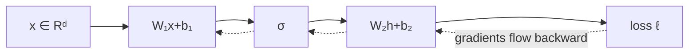

# Mathematical language for machine learning

The obstacle in advanced ML mathematics is often not algebra; it is silently losing track of **what kind of object** a symbol denotes. This lesson establishes a disciplined reading protocol.

## 1. Objects, representations and operators

A scalar is an element of a field, normally \(\mathbb R\). A vector \(x\in\mathbb R^d\) is an object in a vector space; a column of numbers is its coordinate representation in a chosen basis. A matrix \(A\in\mathbb R^{m\times d}\) represents a linear map from \(\mathbb R^d\) to \(\mathbb R^m\).

The product

$$
y=Ax
$$

is therefore a typed operation:

$$
(m\times d)(d\times 1)=(m\times1).
$$

Dimension checking is not clerical work. It is the mathematical analogue of static typing and catches a large fraction of derivation errors.

> **Stop and predict.** If \(X\in\mathbb R^{n\times d}\), \(W\in\mathbb R^{d\times h}\) and \(b\in\mathbb R^h\), what is the shape of \(XW+b\)? Which axis does broadcasting duplicate?

## 2. Sets, functions and composition

A function \(f:\mathcal X\to\mathcal Y\) associates each input in its domain with one output in its codomain. Composition is ordered:

$$
(f\circ g)(x)=f(g(x)).
$$

The rightmost operation acts first. A neural network

$$
f(x)=W_3\sigma(W_2\sigma(W_1x+b_1)+b_2)+b_3
$$

is a composition of affine maps and nonlinearities. Backpropagation reverses this computational order because the chain rule propagates sensitivities from output to input.

## 3. Indices, sums and products

For \(x\in\mathbb R^d\),

$$
\sum_{i=1}^{d}x_i=x_1+\cdots+x_d,
\qquad
\prod_{i=1}^{d}x_i=x_1\cdots x_d.
$$

Products of probabilities become sums under logarithms:

$$
\log\prod_{i=1}^n p(x_i\mid\theta)
=\sum_{i=1}^n\log p(x_i\mid\theta).
$$

This preserves the maximizer because \(\log\) is strictly increasing, while improving numerical stability and exposing additive structure.

Einstein notation suppresses explicit sums. For example, \(y_i=A_{ij}x_j\) implies summation over the repeated index \(j\). Before using it, write one expansion by hand.

## 4. Quantifiers and implication

The statement

$$
\forall x\in\mathbb R^d,\quad x^TAx\ge 0
$$

defines a positive-semidefinite matrix. It is stronger than checking several convenient vectors. A counterexample needs only one \(x\); a proof must handle every allowed \(x\).

Distinguish:

- \(P\Rightarrow Q\): whenever \(P\) holds, \(Q\) must hold.
- \(P\Leftrightarrow Q\): each statement implies the other.
- necessary: must be true for the conclusion to hold;
- sufficient: guarantees the conclusion.

Many ML errors reverse an implication—for example, zero covariance does not generally imply independence.

## 5. Norms and asymptotic notation

A norm measures size and obeys positivity, absolute homogeneity and the triangle inequality. Common cases are

$$
\|x\|_1=\sum_i|x_i|,\qquad
\|x\|_2=\sqrt{\sum_i x_i^2},\qquad
\|x\|_\infty=\max_i|x_i|.
$$

Big-O describes eventual growth up to a multiplicative constant. Self-attention over sequence length \(n\) and head dimension \(d_h\) forms an \(n\times n\) score matrix, giving \(O(n^2d_h)\) arithmetic and \(O(n^2)\) naïve score storage. Big-O suppresses constants; engineering does not. Two \(O(n^2)\) kernels can have radically different memory traffic.

## Own these derivations

1. Expand matrix multiplication \(C=AB\) in index form and prove the shape of \(C\).
2. Convert an i.i.d. likelihood product into a negative log-likelihood sum.
3. Derive the parameter count of a bias-free multi-head attention block with model width \(d\).

## Problems

1. **Routine.** Determine the shapes of \(Q=XW_Q\), \(K=XW_K\), \(V=XW_V\), and \(QK^T\) when \(X\in\mathbb R^{b\times n\times d}\) and each head uses width \(d_h\).
2. **Reasoning.** Give a counterexample showing that \(AB=0\) does not imply \(A=0\) or \(B=0\).
3. **Numerical.** A 7B-parameter model stores weights in bfloat16 and Adam moments in float32. Ignoring activations and sharding, estimate weight-plus-moment memory.
4. **Transfer.** Explain why a syntactically dimension-valid expression can still be semantically wrong. Use attention or probability as the example.

Solution sketches

1. Per head, \(Q,K,V\in\mathbb R^{b\times n\times d_h}\); the score tensor is \(b\times n\times n\). With an explicit head axis: \(b\times h\times n\times d_h\) and \(b\times h\times n\times n\).
2. Let \(A=[1\;0]\) and \(B=[0\;1]^T\). Both are nonzero while \(AB=0\).
3. Weights: \(7\times10^9\times2\approx14\) GB. Two moments: \(2\times7\times10^9\times4\approx56\) GB. Total about 70 GB, excluding gradients and optimizer master weights.
4. Shapes verify compatibility, not meaning. Swapping keys and values can leave legal shapes while changing the operation; treating logits as probabilities can likewise be shape-valid but mathematically false.

## Mastery check

Take an unfamiliar equation from an ML paper. Annotate every symbol with type and shape, expand one suppressed sum, list assumptions, and identify one statement that is sufficient but not necessary. Do this without external help.

