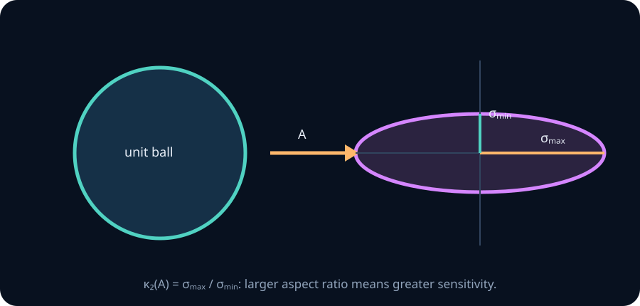
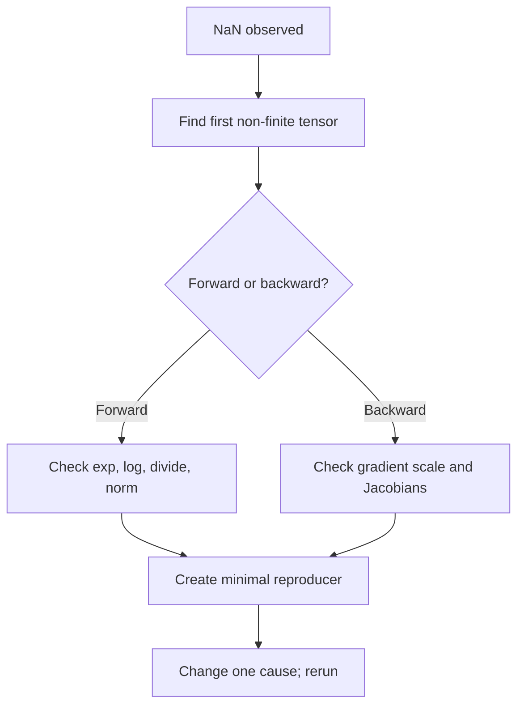

# Numerical stability and floating-point reasoning

Mathematical equivalence does not imply computational equivalence. Research engineers must reason about the algorithm executed in finite precision, not only the real-number formula printed on paper.

## 1. Floating point is a finite model

A normalized floating-point number has the schematic form

$$
x=(-1)^s\,(1.m)_2\,2^e.
$$

Finite mantissa bits limit relative precision; finite exponent bits limit range. Operations round to the nearest representable value. Consequently, addition is not associative:

$$
(a+b)+c\ne a+(b+c)
$$

in general. This matters for reductions across GPU threads and helps explain why distributed runs may not be bitwise reproducible.

## 2. Overflow, underflow and stable softmax

Naïve softmax is

$$
p_i=\frac{e^{z_i}}{\sum_j e^{z_j}}.
$$

Large positive logits overflow; very negative logits underflow. For any constant \(c\),

$$
\frac{e^{z_i-c}}{\sum_j e^{z_j-c}}
=\frac{e^{z_i}/e^c}{\sum_j e^{z_j}/e^c}
=p_i.
$$

Choosing \(c=\max_j z_j\) makes every exponent non-positive and at least one exactly zero. This is not an approximation; in exact arithmetic it is the same distribution.

The corresponding log-sum-exp identity is

$$
\operatorname{LSE}(z)=m+\log\sum_j e^{z_j-m},\qquad m=\max_j z_j.
$$

## 3. Catastrophic cancellation

Subtracting nearly equal large values can destroy significant digits. The algebraic variance identity

$$
\operatorname{Var}(X)=\mathbb E[X^2]-\mathbb E[X]^2
$$

may be unstable when the variance is tiny relative to the mean. A two-pass centered computation or Welford's online algorithm is safer.

Similarly, computing \(\log(1+x)\) for very small \(x\) loses information when \(1+x\) rounds to 1. Numerical libraries provide `log1p(x)` for this regime.

## 4. Conditioning versus stability

These are different ideas:

- **Conditioning** belongs to the problem: how much can the exact answer change when inputs change slightly?
- **Stability** belongs to the algorithm: does the computed answer equal the exact answer to a nearby problem?

If \(A\) is invertible, its 2-norm condition number is

$$
\kappa_2(A)=\|A\|_2\|A^{-1}\|_2
=\frac{\sigma_{\max}(A)}{\sigma_{\min}(A)}.
$$

A large condition number means some input directions are strongly amplified. No clever implementation can recover information that the problem itself nearly erases, although a poor algorithm can make things worse.

## 5. Precision in neural training

Mixed precision trades representation capacity for throughput and memory. Common practices include:

- accumulating sensitive reductions in higher precision;
- maintaining optimizer states in float32;
- scaling losses when float16 gradients underflow;
- using bfloat16 when exponent range matters more than mantissa precision;
- checking finite values and gradient norms before corrupt updates propagate.

An observed NaN is a symptom, not a diagnosis. Trace the first non-finite tensor, inspect the operation that produced it, and distinguish overflow, invalid arithmetic, unstable normalization and exploding dynamics.

## Implementation lab

Implement and test:

1. naïve and stable softmax;
2. naïve and stable log-sum-exp;
3. one-pass variance and Welford variance;
4. gradient-norm and non-finite instrumentation for a PyTorch training loop.

Tests must include extreme logits, nearly constant large-valued data, float16/bfloat16/float32 comparisons, and invariance of softmax to additive shifts.

## Problems

1. Prove that shifting all logits by the same constant leaves softmax unchanged.
2. Explain why clipping logits is not equivalent to subtracting their maximum.
3. Construct three numbers for which floating-point addition order materially changes the result.
4. A least-squares system has singular values \(100,10,10^{-5}\). Compute \(\kappa_2\) and interpret the vulnerable direction.
5. Diagnose: loss is finite, but the first optimizer step makes parameters NaN. List observations that distinguish exploding gradients from invalid optimizer state.

Solution sketches

1. Factor \(e^{-c}\) from numerator and denominator; it cancels.
2. Shifting preserves every logit difference. Clipping alters selected differences and therefore changes the distribution.
3. In limited precision, choose \(a\) huge and \(b=-a\), with \(c\) small: \((a+b)+c=c\), while \(a+(b+c)\) may round to zero.
4. \(\kappa_2=100/10^{-5}=10^7\). Perturbations aligned with the smallest right-singular direction may be amplified by roughly seven orders of magnitude relative to the best direction.
5. Record gradients before the step, optimizer denominators/moments, parameter finiteness, and a minimal step with reduced learning rate or reset state. A finite loss does not guarantee finite gradients.

## Mastery gate

Given a numerically failing training fragment, predict the failure before execution, construct a minimal test, implement a stable alternative, and explain whether the root cause was conditioning or algorithmic instability.

