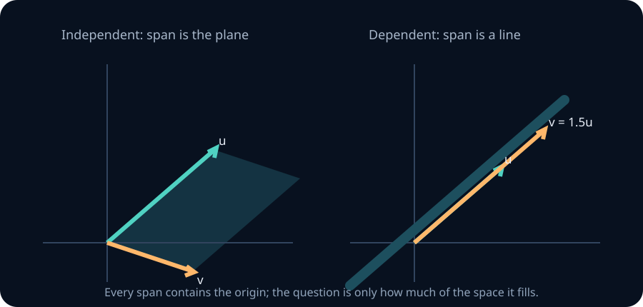
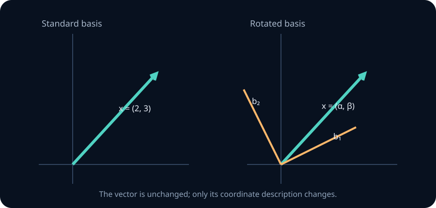

# Vectors, span, independence and bases

Everything in linear algebra is downstream of one question: given some arrows, where can you get to? A neural network is a pile of matrices, a matrix is a list of vectors, and every later claim about rank, capacity, low-rank adaptation or interference is a claim about what a list of vectors can reach. This unit builds that machinery from nothing, with the geometry in your hands.

## 0. Where this is going

By the end you will be able to look at a weight matrix \(W\in\mathbb R^{768\times3072}\) and say something true and non-obvious about it — that its 3072 columns *cannot possibly* be independent, that its column space is at most 768-dimensional however you train it, and which linear combinations it can express. That follows from the dimension bound in section 6. We use column vectors unless stated otherwise: this shape maps 3072 input coordinates to 768 output coordinates, so it is a down-projection under that convention.

Four ideas, in strict order. Each is the previous one asked a sharper question.

| Idea | The question it answers | Geometric form |
|---|---|---|
| Linear combination | What can I build from these vectors? | Walk along the arrows, any distance, either direction |
| Span | What is the *whole set* of things I can build? | A line, a plane, a hyperplane — through the origin |
| Independence | Am I carrying an arrow that does no work? | The parallelogram has collapsed |
| Basis | What is the *cheapest* set that builds all of it? | Exactly one recipe per destination |

**How to work through this.** Read a section, then play with the figure under it until the picture is boring — that boredom is what intuition feels like arriving. Each teaching section ends with three practice prompts: Foundation checks a definition or a one-step calculation, Core combines ideas, Stretch transfers the idea or exposes a failure mode. Attempt them before continuing. The three coding labs in section 13 run in this page. Then work the exercise bank in sections 14–18. Every exercise carries the same header — identifier, difficulty, and the tools it expects — and the same checker underneath: type what can be typed, have a written argument marked, and open the reference solution once you have attempted it. The checkpoint in section 19 is what you bring to a tutor. The NumPy and PyTorch experiments run locally, separately from the browser labs.

**Ask at any point.** Every paragraph, figure, table and exercise carries a small `?` at its edge. Open it to pin a note there — ask a question, write an attempt, get it marked. The thread stays anchored to that spot and is kept in this browser. Connect a model once from the toolbar; without one the notes still work as private written notes.

## 1. What a vector actually is

You will meet four descriptions of the same thing. None of them is the real one. Fluency means switching between them without noticing.

**View 1 — an ordered list of numbers.** \(v=(3,-1)\), or \(v=(0.21,-1.44,0.03,\dots,0.87)\) with 768 entries. The order matters: \((3,-1)\neq(-1,3)\). Write \(\mathbb R^n\) for the set of all lists of \(n\) real numbers. This is the data view, and it is what lives in memory.

**View 2 — an arrow from the origin.** Draw an arrow starting at \((0,0)\) and ending at \((3,-1)\); the arrow *is* the vector. Crucially the arrow is not pinned in place by its tail — two arrows with the same length and direction are the same vector, wherever you draw them. That freedom is exactly what makes tip-to-tail addition legal in section 3.

**View 3 — a point in space.** Just the arrow's tip. Use this view when you care about *locations* (a dataset of 10,000 points in \(\mathbb R^{768}\)); use the arrow view when you care about *displacements* (a gradient step, a residual-stream update). Same algebra, different story, and mixing them up is how people end up averaging things that should not be averaged.

**View 4 — a function on an index set.** \(v\) is a function \(\{1,2,\dots,n\}\to\mathbb R\), where \(v(i)\) is the \(i\)-th entry. This looks like pedantry. It is the single most important view for later: swap the index set \(\{1,\dots,n\}\) for \([0,1]\) and your "vector" becomes a *function* \(f:[0,1]\to\mathbb R\), and the vector-space axioms still apply. Results that assume a finite basis need that assumption checked again; the space of all such functions is infinite-dimensional. Fourier analysis, kernel methods and Gaussian processes all live in that move.

**Worked example — the same object, four ways.** A token embedding row is a list of 768 floats (View 1), a displacement added into the residual stream (View 2), a point whose neighbours are semantically similar tokens (View 3), and a function from feature index to activation (View 4). Attention arithmetic is easiest in View 2, nearest-neighbour analysis in View 3, and the claim "these features are a rotated copy of those" only makes sense once you accept that the list was never the object.

> **Practice — Foundation:** Say which view you are using when you say "the negative gradient points downhill" and when you say "the embeddings cluster".
>
> **Hint:** Look for what the sentence uses: direction and change, or relative positions and distances. A coordinate list by itself does not supply either interpretation.
>
> **Practice — Core:** Give a vector space whose elements are not tuples, and say what View 1 would even mean there.
>
> **Hint:** Try polynomials or functions. A tuple can record coefficients only after you choose a basis; it is not the underlying object.
>
> **Practice — Stretch:** Take View 4 seriously: define addition and scaling for functions \([0,1]\to\mathbb R\) and check the axioms of section 2 hold verbatim.
>
> **Hint:** Define (f+g)(t)=f(t)+g(t) and (af)(t)=a f(t). Check each identity at an arbitrary t, using the corresponding real-number identity.

## 2. The axioms, and what is deliberately missing

The honest answer to "what is a vector" is: *a member of a vector space*.

A **vector space over \(\mathbb R\)** is a set \(V\) with two operations — addition \(V\times V\to V\) and scalar multiplication \(\mathbb R\times V\to V\) — satisfying eight axioms.

**Addition behaves like addition.** (1) \(u+v=v+u\); (2) \((u+v)+w=u+(v+w)\); (3) there is a \(0\) with \(v+0=v\); (4) every \(v\) has a \(-v\) with \(v+(-v)=0\).

**Scaling behaves like scaling.** (5) \(a(bv)=(ab)v\); (6) \(1v=v\).

**They talk to each other.** (7) \(a(u+v)=au+av\); (8) \((a+b)v=av+bv\).

That is the whole definition. Examples include polynomials of degree at most five, \(3\times3\) matrices, real random variables with finite variance on a fixed probability space, and the solution set of \(y''+y=0\). Each theorem applies when its stated assumptions hold.

Small consequences worth deriving once rather than memorising: \(0v=0\), \((-1)v=-v\), and \(a0=0\). Each follows from the distributive axioms in two lines; derivation 1 in section 17 asks for them.

**Notice what is missing.** There is **no length** and **no angle** in that definition. No dot product, no notion of perpendicular. Those are *extra structure*, bolted on in section 10 and developed in the projections unit. Until then, every picture you draw should survive being stretched and skewed — a square grid is a convenience, not a fact. Keep this in your pocket; cosine similarity is a choice of geometry, not a property of the data, and knowing the difference is most of what separates reading a paper from believing one.

> **Practice — Foundation:** Verify axioms (7) and (8) for \(\mathbb R^2\) under componentwise operations.
>
> **Hint:** Write u=(u₁,u₂), v=(v₁,v₂). Expand both sides one coordinate at a time; distinguish scalar addition from vector addition.
>
> **Practice — Core:** Prove \(0v=0\) from the axioms alone, naming each axiom used.
>
> **Hint:** Begin with (0+0)v=0v+0v. Add the additive inverse of 0v to both sides, naming distributivity, associativity, and the additive identity.
>
> **Practice — Stretch:** Exhibit a set with two operations satisfying seven of the eight axioms but not the eighth, and identify which theorem below fails for it.
>
> **Hint:** Keep ordinary vector addition but try defining scalar multiplication by a⋆v=|a|v. Check composition and both distributive rules separately, then inspect the claim about (−1)v.

## 3. The two operations, geometrically

Only two things are allowed. Everything else is built from them.

**Addition** is componentwise: \((a_1,a_2)+(b_1,b_2)=(a_1+b_1,a_2+b_2)\). Geometrically: pick up \(v\), move its tail to the tip of \(u\), and the sum runs from the origin to \(v\)'s new tip. Do it the other way round and you land in the same place — that is axiom (1), and it is why the picture is a *parallelogram* rather than a path.

**Scalar multiplication** is \(c(a_1,a_2)=(ca_1,ca_2)\). Geometrically: stretch by \(|c|\), and flip if \(c<0\). The direction is preserved or exactly reversed — never rotated. A scalar cannot turn a vector sideways. Internalise that now; it is why linear maps are so rigid, and why a one-dimensional span is a full line rather than a ray.

Drag the two arrowheads below. Watch the parallelogram. Then push the \(c\) slider through zero and watch \(cu\) collapse to the origin and come out the other side.

```lab
la-vectors
```

**Check yourself before moving on.** Set \(c=0\); what is \(0u\)? Now find a position for \(v\) where \(u+v=0\) — what is the relationship between the two arrows? Finally set \(c=-1\) and convince yourself that \(u+(-1)u=0\), which follows from distributivity together with the additive identity and inverse axioms. This checks their consistency; it does not make the inverse axiom redundant.

> **Practice — Foundation:** Compute \(3u-2v\) for \(u=(2,-1)\), \(v=(1,3)\), and draw the tip-to-tail construction.
>
> **Hint:** Scale both coordinates of each vector first, then subtract. For the picture, place the second scaled arrow at the tip of the first.
>
> **Practice — Core:** Explain why \(u+v\) and \(v+u\) trace the two halves of one parallelogram rather than reaching two different points.
>
> **Hint:** Translating an arrow preserves its displacement. Compare the two coordinate sums and use commutativity of real addition.
>
> **Practice — Stretch:** In the usual real coordinate plane, show that a 90-degree rotation of a nonzero vector cannot equal a real scalar multiple of it. Why does this not mean rotations violate the axioms of a linear map?
>
> **Hint:** For v=(x,y), write its rotated image as (−y,x). If this equals cv, use the two equations to obtain (1+c²)x=(1+c²)y=0.

## 4. Linear combinations and span

Chain the two operations and you get the only expression linear algebra really cares about.

Given \(v_1,\dots,v_k\in V\) and scalars \(c_1,\dots,c_k\in\mathbb R\), the vector

$$
c_1v_1+c_2v_2+\dots+c_kv_k
$$

is a **linear combination** of the \(v_i\) with **coefficients** \(c_i\). Think of the \(v_i\) as *the moves you are allowed to make* and the \(c_i\) as *how far you go in each move's direction*. You may reuse a move, reverse it, or skip it (\(c_i=0\)). You start at the origin. Where can you end up?

The **span** of a set is the set of *all* its linear combinations:

$$
\operatorname{span}\{v_1,\dots,v_k\}=\Big\{\sum_{i=1}^k c_iv_i \;:\; c_i\in\mathbb R\Big\},
\qquad \operatorname{span}\{\,\}=\{0\}.
$$

Span is the central object of the unit. Three facts about it, each of which you should be able to see rather than recall.

- **Span always contains the origin.** Take every \(c_i=0\). So a span is never a line that misses \((0,0)\) — that is an *affine* set, a different animal, met in section 11.
- **Span of one nonzero vector is a line** through the origin. Span of two independent vectors is a plane. A dependent pair spans a line if at least one vector is nonzero, and just the origin if both are zero.
- **Span is closed under the two operations.** Add two things in the span, you are still in the span; scale one, still in the span. Span is the smallest subspace containing the vectors (section 7).

In the figure the shaded region is everything reachable with coefficients \(a,b\in[-2,2]\). Let \(a,b\) run over all of \(\mathbb R\) and that region grows to fill the whole plane — *or* it does not. Drag \(v\) until it lies along \(u\) and watch the parallelogram flatten into a segment. That flattening is the single most important degeneracy in the subject.

```lab
la-span
```



**Worked example — reading a span off coefficients.** With \(u=(1,2)\) and \(v=(2,4)\), every combination is \(au+bv=(a+2b)(1,2)\), so the span is the line \(\{t(1,2)\}\) and one of the two parameters is doing nothing. The pair \((a,b)\) is not recoverable from the result: \((3,0)\) and \((1,1)\) give the same vector. Non-uniqueness of coefficients is the algebraic shadow of the geometric collapse.

> **Practice — Foundation:** Describe \(\operatorname{span}\{(1,2,3)\}\) and \(\operatorname{span}\{(1,0,0),(0,1,0)\}\) in \(\mathbb R^3\), naming the object and its dimension.
>
> **Hint:** Write a general linear combination with one scalar, then with two. Count freely variable coordinates rather than the number of coordinates written.
>
> **Practice — Core:** Decide whether \((4,5)\) and \((3,6)\) lie in \(\operatorname{span}\{(1,2),(2,4)\}\), geometrically and algebraically.
>
> **Hint:** The second generator is twice the first. Every combination must satisfy the same relation between its two coordinates; test each target against that relation.
>
> **Practice — Stretch:** Show that \(\operatorname{span}(S)\) is the intersection of all subspaces containing \(S\), and explain why that makes "smallest" well defined.
>
> **Hint:** Show every subspace containing S contains all finite linear combinations of S. Then show that the span itself is one of those subspaces.

## 5. Linear independence — the absence of redundancy

You just saw two vectors span a plane, then collapse to a line when one became a multiple of the other. In the collapsed case \(v\) told you nothing new: everything it could reach, \(u\) could already reach. That is redundancy, and here is how to detect it without drawing anything.

Vectors \(v_1,\dots,v_k\) are **linearly independent** if the only solution to

$$
c_1v_1+\dots+c_kv_k=0
$$

is \(c_1=c_2=\dots=c_k=0\). Otherwise they are **linearly dependent**, and any solution with some \(c_i\neq0\) is called a **dependency relation**.

This definition looks sideways at first — why phrase it in terms of hitting \(0\)? Because of the following equivalence, which you should prove (exercise A7).

**Theorem 1 — the three faces of dependence.** For \(v_1,\dots,v_k\) the following are equivalent:

1. They are linearly dependent.
2. Some \(v_j\) lies in the span of the others.
3. Removing some \(v_j\) does not change the span: \(\operatorname{span}\{v_i\}_i=\operatorname{span}\{v_i\}_{i\neq j}\).

Read (2) and (3) as: *one of the arrows is doing no work.* The \(=0\) formulation is preferred because it is symmetric in all \(k\) vectors, needs no choice of a distinguished index, and is a linear system you can actually solve.

### Small cases, memorised as pictures

- **One vector.** \(\{v\}\) is dependent \(\iff v=0\). (If \(v=0\), take \(c_1=1\).)
- **Two vectors.** Dependent \(\iff\) one is a scalar multiple of the other \(\iff\) they are collinear with the origin. In \(\mathbb R^2\) this is exactly \(u_1v_2-u_2v_1=0\) — the determinant you watched flatten in Lab 2, and the signed area of the parallelogram.
- **Three vectors in \(\mathbb R^3\).** Dependent \(\iff\) all three lie in a common plane through the origin.
- **Any list containing \(0\)** is dependent. Any list with a repeated vector is dependent. Strictly, a set removes duplicates; when testing a supplied collection of vectors, retain its indices.

Independence is a property of the *set*, not of its pairs. Three vectors can be pairwise independent and still dependent as a triple; \((1,0),(0,1),(1,1)\) is the smallest example, and exercise A13 asks for the \(\mathbb R^3\) version.

> **Practice — Foundation:** Decide independence for \((1,2),(3,7)\); for \((1,2),(2,4)\); and for \((0,0),(1,3)\), giving a relation where one exists.
>
> **Hint:** Set a u+b v=0 and solve for the coefficients. A zero generator immediately gives a nontrivial relation by putting coefficient 1 on it.
>
> **Practice — Core:** Find every \(t\) for which \((1,t)\) and \((t,4)\) are dependent, and interpret both answers as pictures.
>
> **Hint:** Use the first coordinate equation to eliminate one coefficient from the second. The condition involves t², so keep both signs when solving.
>
> **Practice — Stretch:** Prove that if \(\{v_1,\dots,v_k\}\) is independent and \(w\notin\operatorname{span}\{v_1,\dots,v_k\}\), then \(\{v_1,\dots,v_k,w\}\) is independent.
>
> **Hint:** Assume a zero combination of the enlarged family. A nonzero coefficient on w would express w in the old span; otherwise use the old independence.

## 6. The dimension bound, and what it forces in a model

**Theorem 2 — the pigeonhole of linear algebra.** Any \(k\) vectors in \(\mathbb R^n\) with \(k>n\) are **linearly dependent**.

*Proof idea.* Put the vectors in the columns of an \(n\times k\) matrix \(V\). The equation \(Vc=0\) gives \(n\) homogeneous equations in \(k\) unknowns. Elimination uses at most one pivot per row, leaving at least \(k-n\) free variables. Set one free variable to 1 and solve backwards for the pivot variables: this constructs a nonzero relation. Section 12 shows the procedure on a small example; the [next unit](02-systems-elimination-subspaces.md) develops the kernel and rank language.

Two consequences to keep: any independent list in \(\mathbb R^n\) has at most \(n\) elements, and any spanning list has at least \(n\). The second uses the dimension theorem in section 8 as well.

### Why a research engineer cares

Suppose a residual stream of width \(d=768\) represents features by 10,000 fixed vectors in \(\mathbb R^{768}\). Those vectors cannot be independent. That is a mathematical constraint on the proposed representation, regardless of how it was trained. It does **not** establish that a particular network actually uses 10,000 features, that those features have fixed directions, or that the directions are nearly orthogonal.

Here is a precise toy model of interference. Let unit feature directions be \(f_i\), and encode activations as \(x=\sum_i a_i f_i\). A dot-product readout for feature \(j\) gives

$$
f_j^Tx=a_j+\sum_{i\ne j}a_i f_j^Tf_i.
$$

The second term is cross-talk. Section 10 introduces the dot product; for now read it as measuring overlap. More than \(d\) nonzero directions cannot all be mutually orthogonal, but neither this fact nor dependence alone determines the readout error. That also depends on which features are active, their magnitudes, and the decoder. The PyTorch exercises measure pairwise overlap without treating it as evidence about a trained model.

Same dimension bound, different setting: a matrix \(W\in\mathbb R^{768\times3072}\) has dependent columns and a column span of dimension at most 768. A factored update \(\Delta W=BA\), with \(B\) having \(r\) columns, puts every column of \(\Delta W\) in the span of those \(r\) vectors. This is the structural restriction used by low-rank adapters, before any optimisation question is asked.

> **Practice — Foundation:** State the largest independent set and the smallest spanning set possible in \(\mathbb R^{1024}\).
>
> **Hint:** A basis is simultaneously independent and spanning. Use the dimension bound for the two requested cardinalities.
>
> **Practice — Core:** A model has residual width 1024 and is claimed to represent 50,000 interpretable features. Say exactly what is forced and what must still be established empirically.
>
> **Hint:** The dimension bound limits independent directions. It does not identify what counts as a feature, which combinations occur, or whether a decoder can recover their activations.
>
> **Practice — Stretch:** Generate \(m\) random unit vectors in \(\mathbb R^{64}\) for \(m\in\{32,64,128,1024\}\) and track the largest off-diagonal inner product; report how it changes across several random seeds. Why does this experiment alone not establish that a trained model can reliably recover all feature activations?
>
> **Hint:** Normalize every sampled vector, mask the Gram diagonal, and measure absolute off-diagonal overlaps. Recoverability also depends on activation patterns, noise, and a specified decoding rule.

## 7. Subspaces

"A line through the origin" and "a plane through the origin" deserve a common name.

A subset \(W\subseteq V\) is a **subspace** if it is itself a vector space under \(V\)'s operations. Equivalently — and this is the test you actually use — \(W\) is a subspace iff all three hold:

1. \(0\in W\) (in particular \(W\) is nonempty);
2. closed under addition: \(u,w\in W\Rightarrow u+w\in W\);
3. closed under scaling: \(w\in W,\ c\in\mathbb R\Rightarrow cw\in W\).

The algebraic identities are inherited from \(V\). The zero vector is present by (1), and additive inverses stay in \(W\) by scaling with \(-1\).

Why this matters: **spans are always subspaces**, and conversely every subspace is the span of something. So "subspace" and "span of some set" are two names for one idea. The word *subspace* emphasises the object; *span* emphasises the generators.

| Set in \(\mathbb R^2\) | Subspace? | Which rule breaks |
|---|---|---|
| \(\{(x,y):y=3x\}\) | Yes | — |
| \(\{(x,y):y=3x+1\}\) | No | \(0\notin W\) |
| \(\{(x,y):x\ge0\}\) | No | not closed under \(c=-1\) |
| \(\{(x,y):xy=0\}\) (the two axes) | No | \((1,0)+(0,1)=(1,1)\notin W\) |
| \(\{(0,0)\}\) | Yes | — (the zero subspace) |
| All of \(\mathbb R^2\) | Yes | — (the improper subspace) |

Row four is the one to remember. Closure under addition is a real constraint, not a formality; a union of two subspaces is almost never a subspace, while an intersection always is.

> **Practice — Foundation:** Apply the three-part test to \(\{(x,y,z):x+y+z=0\}\) and to \(\{(x,y,z):x+y+z=1\}\).
>
> **Hint:** Test the zero vector before doing any algebra. For the homogeneous equation, add two satisfying equations and multiply one by a scalar.
>
> **Practice — Core:** Prove that the intersection of two subspaces is a subspace, and give a counterexample for the union.
>
> **Hint:** For an intersection, membership means satisfying both subspace conditions. For a union counterexample, try the two coordinate axes and add one vector from each.
>
> **Practice — Stretch:** Prove that \(\operatorname{span}\{v_1,\dots,v_k\}\) is a subspace and is contained in every subspace containing the \(v_i\).
>
> **Hint:** Zero is a combination with all coefficients zero. Add or scale coefficient lists, then use closure in an arbitrary containing subspace.

## 8. Basis, dimension, coordinates

We have "what can I reach" (span) and "am I wasting arrows" (independence). Put them together and you get the right notion of a coordinate system.

An **ordered basis** of a finite-dimensional vector space \(V\) is a list \(B=(b_1,\dots,b_n)\) that is (i) **linearly independent** and (ii) **spans \(V\)**. Spanning means "enough arrows"; independence means "not one too many". The order matters for coordinates: swapping two basis vectors swaps the corresponding entries of \([v]_B\). The empty list is the basis of the zero space, whose dimension is 0.

**Theorem 3 — unique coordinates.** \(B\) is a basis of \(V\) \(\iff\) every \(v\in V\) has **exactly one** representation \(v=c_1b_1+\dots+c_nb_n\).

*Sketch.* Spanning gives *at least* one representation. For *at most* one: if \(\sum c_ib_i=\sum d_ib_i\), subtract to get \(\sum(c_i-d_i)b_i=0\), and independence forces \(c_i=d_i\). Conversely, existence for every \(v\) gives spanning, and uniqueness applied to \(v=0\) gives independence. Exercise A9 fills in the details.

The tuple \((c_1,\dots,c_n)\) is the **coordinate vector** \([v]_B\). This is the theorem that lets you turn geometry into arithmetic — and it is why choosing a good basis is the whole game in the SVD, PCA and Fourier analysis.

The **standard basis** of \(\mathbb R^n\) is \(e_1=(1,0,\dots,0),\dots,e_n=(0,\dots,0,1)\). It is so convenient that people forget it is a *choice*. The list \((3,-1)\) already *is* a coordinate vector — with respect to \(\{e_1,e_2\}\), silently.

**Theorem 4 — dimension is well defined.** Every basis of a given finite-dimensional space has the same number of elements; that number is \(\dim V\). It follows that in \(\mathbb R^n\): any independent set has \(\le n\) vectors, any spanning set has \(\ge n\) vectors, and any set of exactly \(n\) vectors is a basis as soon as it is *either* independent *or* spanning. The finite exchange argument below supplies the reason.

*Why basis sizes agree.* Suppose \(u_1,\dots,u_p\) are independent and \(w_1,\dots,w_q\) span the space. Expand \(u_1\) using the \(w_j\); some coefficient is nonzero, so solve for that \(w_j\) and replace it by \(u_1\) without losing the span. Repeat with \(u_2\). Its expansion must use an as-yet-unreplaced \(w_j\), or it would lie in the span of \(u_1\), violating independence. Continuing, each \(u_i\) needs a new slot, so \(p\le q\). Apply this twice to two bases, swapping their roles, to get equal sizes. This is the finite **exchange lemma**.

It also explains why you can remove redundant generators until a basis remains, or extend an independent list by adding vectors outside its span. In a finite-dimensional space the process stops. The final clause of Theorem 4 is a labour-saving device: for square cases you check one property, not two.

Drag the two basis arrows below to skew the coordinate grid, then drag the ◆ point. The readout gives the same point in two languages: standard coordinates, and \(B\)-coordinates. Push \(b_2\) onto \(b_1\) and watch the grid — and the coordinate system — die.

```lab
la-basis
```

### Why an RE cares

Lab 3 is a change of basis, and a change of basis is a matrix — the one whose columns are \(b_1,b_2\). Reading \([v]_B\) off the skewed grid is solving \(Bc=v\). When \(b_1\) and \(b_2\) get close to parallel the grid cells become long and thin, and a tiny move of the point produces a huge change in coordinates. That sensitivity has a name — the **condition number** — and it is why recovering coefficients from nearly dependent features can be unstable and why orthogonal bases are worth their cost. You are looking at ill-conditioning directly.

> **Practice — Foundation:** Show that \(\{1,x,x^2\}\) is a basis of the polynomials of degree at most two.
>
> **Hint:** Write a general polynomial a+bx+cx². Spanning follows from its coefficients; independence follows if the zero polynomial has all coefficients zero.
>
> **Practice — Core:** Show that \(\{1,\,1+x,\,1+x+x^2\}\) is also a basis and compute \([3+2x-x^2]_B\) for it.
>
> **Hint:** Expand α+β(1+x)+γ(1+x+x²) and match powers, starting with x². Reconstruct the polynomial to check your coefficients.
>
> **Practice — Stretch:** Five vectors span a three-dimensional subspace of \(\mathbb R^7\). How many can you discard and still span it, and how many independent vectors are among them? Justify from Theorems 1 and 4, not intuition.
>
> **Hint:** Extract a basis by removing redundant generators. Its size equals the dimension of the spanned subspace, regardless of the ambient dimension.

## 9. A matrix is a machine for combining columns

The pictures become useful code once we agree which way the vectors sit. Put \(k\) vectors from \(\mathbb R^n\) into the **columns** of \(V\in\mathbb R^{n\times k}\). Then matrix-vector multiplication is exactly the linear combination

$$
Vc=\begin{bmatrix}v_1&\cdots&v_k\end{bmatrix}
\begin{bmatrix}c_1\\\vdots\\c_k\end{bmatrix}
=\sum_{i=1}^k c_i v_i.
$$

The shapes tell the story: \(k\) coefficients go in, \(n\) coordinates come out. The **rank** of \(V\) is the dimension of its column span — the number of independent output directions it can reach. Membership in the span asks whether \(Vc=w\) has a solution. Independence asks whether \(Vc=0\) has any solution besides \(c=0\). A basis gives exactly one solution for every vector in the space it spans.

**Worked example — two recipes for one destination.** Take

$$
V=\begin{bmatrix}1&0&1\\0&1&1\end{bmatrix},\qquad
w=\begin{bmatrix}5\\4\end{bmatrix}.
$$

The equations are \(c_1+c_3=5\) and \(c_2+c_3=4\). Every solution is \(c=(5-t,4-t,t)^T\). Choosing \(t=0\) or \(t=1\) gives different recipes for the same point. Their difference is a multiple of \((-1,-1,1)^T\), the dependency relation among the columns. The next chapter names the set of all these relations the **null space**.

### Changing the recipe, keeping the vector

Now let \(B,C\in\mathbb R^{n\times n}\) contain two ordered bases as columns. The vector itself must agree in both descriptions:

$$
v=B[v]_B=C[v]_C,
\qquad [v]_C=C^{-1}B[v]_B.
$$

Here \(C^{-1}\) means the operation that undoes multiplication by \(C\); it exists because every vector has unique \(C\)-coordinates. Read the conversion from right to left: build the vector from its \(B\)-recipe, then find its \(C\)-recipe. In code, solve \(Cc=B[v]_B\); you do not need to form an inverse explicitly.

For \(B=((1,0),(1,1))\) and \(v=(3,2)\), the equation \(v=c_1(1,0)+c_2(1,1)\) gives \([v]_B=(1,2)^T\). In the standard basis \(E\), \([v]_E=(3,2)^T\). Nothing moved. Only the description changed.



**Shape habit.** A Python list `[[1, 0], [1, 1]]` is read as two column vectors by this chapter's browser labs. But `np.array(...)` puts those inner lists in rows. Use `np.column_stack(vectors)` when building \(V\) from a list of generators. A silent transpose can make a correct derivation look wrong.

> **Practice — Foundation:** Write the matrix whose columns are \((1,2,0)\) and \((0,1,3)\), state its shape, and compute its product with \((2,-1)^T\).
>
> **Hint:** Place each listed vector vertically. The coefficient vector has one entry per column, and the result has one entry per row.
>
> **Practice — Core:** With \(B=((1,0),(1,1))\), \(C=((1,1),(1,-1))\), find both coordinate vectors of \(v=(3,2)\), then reconstruct \(v\) from each.
>
> **Hint:** Write v as an unknown combination of each basis pair separately. Solve those two small systems and substitute back.
>
> **Practice — Stretch:** Derive the conversion from \(C\)-coordinates back to \(B\)-coordinates and show that the two conversions cancel. Explain why the order of the matrices matters.
>
> **Hint:** First map C-coordinates to the ambient vector, then map that vector to B-coordinates. Matrix products act on the rightmost input first.

## 10. Preview: length and overlap require an inner product

This section supplies the geometry needed for the overlap experiments below. Module 3 returns to these definitions and proves the orthogonal-complement and projection theorems; Module 4 develops orthonormal bases and Gram–Schmidt.

Span tells you what is reachable. It does not tell you whether two reachable vectors are close, or whether two arrows meet at a right angle. To ask those questions we add an **inner product**: a symmetric bilinear function \(\langle u,v\rangle\) that satisfies \(\langle v,v\rangle>0\) for every nonzero \(v\). Bilinear means linear in each argument separately.

In the usual Euclidean geometry of \(\mathbb R^n\), choose

$$
\langle u,v\rangle=u^Tv=\sum_i u_i v_i,\qquad
\|v\|_2=\sqrt{v^Tv},\qquad
\cos\theta=\frac{u^Tv}{\|u\|_2\|v\|_2}.
$$

The cosine formula requires **both vectors to be nonzero**. Orthogonality means \(u^Tv=0\). Nonzero mutually orthogonal vectors are independent: take the inner product of \(\sum_i c_i v_i=0\) with \(v_j\), leaving \(c_j\|v_j\|^2=0\), hence \(c_j=0\).

**Worked example — independent is not perpendicular.** The vectors \(u=(1,0)\), \(v=(1,1)\) are independent, since \(au+bv=(a+b,b)=0\) forces \(a=b=0\). Their dot product is 1, so they are not orthogonal. A basis need not have right angles, and it need not have unit-length arrows.

### The Gram matrix records the overlaps

With generators as columns of \(V\), define \(G=V^TV\). Its \((i,j)\)-entry is \(v_i^Tv_j\), and

$$
c^TGc=(Vc)^T(Vc)=\|Vc\|_2^2.
$$

This identity is the reason the Gram matrix detects dependence in exact arithmetic: a nonzero relation \(Vc=0\) also gives \(Gc=0\), and \(Gc=0\) forces \(\|Vc\|^2=0\). Thus \(G\) is invertible exactly when the columns are independent. The NumPy exercises explore its determinant, a signed-volume tool developed later; forming \(V^TV\) can lose numerical accuracy, so this is not our default computational independence test.

### A new basis does not automatically mean a new geometry

If \(x=Bc\) and \(y=Bd\), their Euclidean inner product is

$$
x^Ty=c^T(B^TB)d.
$$

Using \(c^Td\) instead would silently change the geometry, unless \(B^TB=I\). More generally, a symmetric matrix \(M\) satisfying \(z^TMz>0\) for every nonzero \(z\) defines an inner product \(x^TMy\). Such a matrix is called **positive definite**. In \(B\)-coordinates its matrix is \(B^TMB\). This is why a change of coordinates preserves linear relationships but a raw cosine between the new coordinate lists need not match the old cosine.

> **Practice — Foundation:** Compute \(u^Tv\), both lengths, and the cosine for \(u=(1,0)\), \(v=(1,1)\). What happens if either vector is zero?
>
> **Hint:** The dot product is the sum of coordinate products; lengths are square roots of self-products. Inspect the denominator before dividing to form a cosine.
>
> **Practice — Core:** For \(B=((1,0),(1,1))\), compute \(B^TB\) and use it to recover the standard Euclidean length of the vector with \(B\)-coordinates \((1,2)^T\).
>
> **Hint:** Each Gram entry is an overlap of two basis columns. For coordinate vector c, compare cᵀ(BᵀB)c with the squared length of Bc.
>
> **Practice — Stretch:** Prove that an invertible transformation preserves independence. Give an explicit example showing that it need not preserve Euclidean cosine similarity.
>
> **Hint:** Apply the inverse transformation to a proposed zero combination. For the cosine counterexample, try a nonuniform scaling on a pair that is initially perpendicular.

## 11. Affine sets: moving the origin

A span always contains zero. The line \(x+y=1\) does not, yet moving along it still feels one-dimensional. It is a **translated subspace**, also called an affine space:

$$
\mathcal A=x_0+S=\{x_0+s:s\in S\}.
$$

The point \(x_0\) anchors the set; the subspace \(S\) describes the displacements you can make while staying in it. For \(x+y=1\), choose \(x_0=(1,0)\) and \(S=\operatorname{span}\{(-1,1)\}\). Every point has the form \((1-t,t)\). The affine dimension is \(\dim S=1\).

**Worked example — which averages stay on the line?** Let \(p=(1,0)\) and \(q=(0,1)\). Their sum \((1,1)\) leaves the line, but their midpoint \((1/2,1/2)\) stays on it. More generally,

$$
\sum_i a_i(x_0+s_i)=\left(\sum_i a_i\right)x_0+\sum_i a_i s_i.
$$

When \(\sum_i a_i=1\), this belongs to \(x_0+S\). Such a combination is **affine**. If the coefficients are also nonnegative, it is **convex**. The full line through \(p,q\) is their affine span; the line segment between them is their convex hull. Neither is their linear span, which here is all of \(\mathbb R^2\).

A bias term \(Wx+b\) translates the image of a linear map. Likewise, subtracting the mean of a dataset changes its origin. Centre a dataset before interpreting its span as variation around the mean; the span of the original location vectors answers a different question.

> **Practice — Foundation:** Write \(\{(x,y):y=3x+1\}\) as a point plus a one-dimensional subspace.
>
> **Hint:** Choose any point on the line as the anchor. Vary x and write the resulting displacement from that anchor as a scalar multiple of one direction.
>
> **Practice — Core:** Show that the difference of two points in \(x_0+S\) lies in \(S\), and that choosing a different anchor from the same affine set leaves \(S\) unchanged.
>
> **Hint:** Write the two points as x₀+s₁ and x₀+s₂. Their difference is s₁−s₂; changing anchor subtracts another member of S.
>
> **Practice — Stretch:** Three points are \((1,0)\), \((0,1)\), and \((2,-1)\). Find their linear span, affine span, and convex hull. Explain why these are three different sets.
>
> **Hint:** The points lie on x+y=1. Compare arbitrary linear combinations, combinations whose coefficients sum to 1, and those with additionally nonnegative coefficients.

## 12. From a picture to a numerical decision

The browser labs ask you to turn span, dependence, and coordinates into algorithms. You need one new operation: subtracting a multiple of one equation from another. This preserves the solution set because you can reverse the subtraction.

**Worked example — expose the free coefficient.** To express \((3,6)\) using \((1,2)\) and \((2,4)\), write

$$
c_1+2c_2=3,\qquad 2c_1+4c_2=6.
$$

Subtract twice the first equation from the second. The result is \(0=0\): there is no second restriction. Choose \(c_2=t\), then \(c_1=3-2t\). For target \((4,5)\), the same subtraction produces \(0=-3\), so there is no solution. For target zero it produces \(c=(-2t,t)\), an explicit family of relations. One procedure answers all three questions.

For larger inputs, **elimination** repeatedly selects a nonzero coefficient (a pivot), swaps its row into position, and removes that unknown from the rows below. **Partial pivoting** chooses the largest available absolute coefficient in the current column to avoid dividing by an unnecessarily small number. Then solve the remaining equations backwards. A column without a pivot has a free coefficient. A row with all zero coefficients and a nonzero target is inconsistent.

### Exact dependence versus numerical dependence

Consider

$$
B_\varepsilon=\begin{bmatrix}1&1\\0&\varepsilon\end{bmatrix},\qquad
v=\begin{bmatrix}0\\1\end{bmatrix}.
$$

For every \(\varepsilon\ne0\), the columns form a basis and \([v]_{B_\varepsilon}=(-1/\varepsilon,1/\varepsilon)^T\). As \(\varepsilon\to0\), the coordinates grow without bound. At zero, no recipe exists for this \(v\). If the second coordinate of \(v\) changes by \(\delta\), the recipe changes by \((-\delta/\varepsilon,\delta/\varepsilon)^T\). That is sensitivity to input error, even with an otherwise correct solver.

In floating-point arithmetic a test uses a tolerance, not a proof that an entry is exactly zero. This chapter's small browser exercises use an **absolute** tolerance for pivots and residuals. Rescaling the inputs can therefore change the decision. For experiments at different scales, state both an absolute and a relative tolerance, for example

$$
\|Vc-w\|_2\le \mathrm{atol}+\mathrm{rtol}\,\|w\|_2.
$$

Always compute the residual yourself. A small residual says that the reconstruction is close; it does not guarantee that the coefficients are close to the coefficients for the unperturbed input. For example, near-dependent generators can trade large coefficients against each other while barely changing their sum. This distinction returns in [numerical stability](../00-foundations/01-numerical-stability.md).

**A diagnostic is not the whole story.** The basis lab returns the Hadamard ratio

$$
h(B)=\frac{|\det B|}{\prod_i\|b_i\|_2}.
$$

In two dimensions, area equals \(\|b_1\|\|b_2\||\sin\theta|\), so \(h(B)=|\sin\theta|\). For a square basis it lies in \((0,1]\); orthogonal columns give 1, and dependent nonzero columns give 0. It measures angular collapse. It does **not** measure all causes of sensitivity: \(B=\operatorname{diag}(1,10^{-8})\) has ratio 1, but recovering its second coefficient multiplies input error by \(10^8\). The condition number, developed later, accounts for scaling as well.

The draggable figures warn about near-singularity separately from collapse. A small nonzero determinant still gives a full-dimensional span. Their readouts use floating-point arithmetic; inspect the numbers and use the exact dependent presets when exploring collapse.

> **Practice — Foundation:** Eliminate the second equation for the target \((3,6)\) above and choose one valid coefficient pair. Repeat for \((4,5)\).
>
> **Hint:** Subtract twice the first equation from the second. A zero right-hand side leaves a free coefficient; a nonzero right-hand side signals inconsistency.
>
> **Practice — Core:** For \(B_\varepsilon\), compare the coordinates of \((0,1)\) and \((0,1+10^{-6})\) at \(\varepsilon=10^{-2}\) and \(10^{-8}\). Explain why checking only the reconstruction can miss the sensitivity.
>
> **Hint:** Solve the second coordinate for its coefficient first; it contains division by ε. Compare coefficient changes as well as the reconstructed targets.
>
> **Practice — Stretch:** Compare \(B=10^{-8}I\) with \(\operatorname{diag}(1,10^{-8})\). Both have small determinants. Explain which has unequal sensitivity across directions, and why neither determinant magnitude nor the Hadamard ratio alone answers that question.
>
> **Hint:** Act on each coordinate unit vector and compare inverse scaling in the two directions. Uniform smallness differs from an imbalance between directions.

## Local numerical and research audit

### Scale-aware rank reporting

Exact independence is unchanged when every coordinate is multiplied by a nonzero scalar. A fixed absolute numerical threshold does not share that invariance. For \(A=\operatorname{diag}(1,10^{-8})\), a threshold of \(10^{-6}\) reports one usable direction, while applying that same threshold to \(10^8 A\) reports two. Neither decision changes the exact rank, which is two.

For an embedding audit, report the matrix shape, dtype, feature scaling, algorithm and tolerance. A relative threshold tied to the largest gain (developed in [SVD](08-svd-low-rank.md)) is invariant under a common nonzero rescaling in exact arithmetic; separate feature rescaling changes the geometry and may change the decision. Include an absolute floor only with a stated measurement or rounding rationale.

**M13 · Stretch · mixed — Scale-aware rank reporting.** For diag(1,10⁻⁸), report exact rank and numerical rank using the rule “count gains strictly larger than 10⁻⁶”. Repeat after multiplying the matrix by 10⁸. Explain which claim is invariant.

## 13. Three runnable coding labs

These exercises use only standard-library Python and run in the reader's Python workspace. Each link opens its own task tab. The inputs are lists of **columns**; validate their lengths, finite entries, and positive finite tolerance, and do not mutate them. `None` means a valid mathematical query has no requested solution; malformed input should raise `ValueError`.

The browser provides `_validated_columns(vectors, tol)` and `_eliminate(rows, width, tol)` as support functions. The first validates and copies the columns. The second modifies a row-oriented augmented matrix in place using partial pivoting, inspecting only the first `width` columns for pivots, and returns the pivot-column indices in row order. You may use them to focus on interpreting the result, or implement your own elimination. They are available in [the reference module](../../labs/reference.py) for local experiments.

### Lab A — membership in a span

Implement **span_coordinates** in [labs/exercises.py](../../labs/exercises.py). Return one coefficient per generator, reconstructing the target to the supplied tolerance, or `None` when it lies outside the span. Dependent generators can have many correct answers; choose free coefficients to be zero for a simple representative.

**Predict first.** With columns `[[1, 2], [2, 4]]`, target `[3, 6]` has infinitely many recipes, including `[3, 0]`. Target `[4, 5]` has none. An empty generator list spans just zero: return `[]` for a zero target and `None` for a nonzero target, at the stated tolerance.

~~~text
python -m labs.checks span
~~~

The checks cover independent and dependent generators, rectangular systems, unreachable targets, empty spans, tolerance-sensitive membership, input preservation, and invalid input. After elimination and back-substitution, verify the reconstructed target rather than comparing against a particular recipe.

### Lab B — exhibit a dependency relation

Implement **dependency_relation** in [labs/exercises.py](../../labs/exercises.py). Return `None` for independent generators. Otherwise return a relation \(c\ne0\) with \(Vc\approx0\), normalized so that `max(abs(x) for x in c) == 1` up to rounding. Select one free coefficient to be 1, set the others to zero, and solve backwards. Returning the all-zero vector does not demonstrate dependence.

**Predict first.** For `[[1, 0], [0, 1], [1, 1]]`, `[-1, -1, 1]` works. For a single zero vector, `[1]` works. The empty list is independent, so return `None`; nonempty generator lists must have at least one coordinate per generator.

~~~text
python -m labs.checks dependence
~~~

The checks cover independent rectangular inputs, repeated vectors, a zero generator, pairwise independent but jointly dependent vectors, and random lists with more generators than coordinates. They verify the relation and its normalization rather than requiring a particular sign or free variable.

### Lab C — coordinates and degeneracy

Implement **basis_coordinates** in [labs/exercises.py](../../labs/exercises.py). For a nonempty square basis return `([v]_B, hadamard_ratio)`. Use elimination for coordinates and the absolute product of the resulting diagonal pivots for \(|\det B|\); row swaps change determinant sign but not its absolute value. Reject a basis that is singular at the chosen tolerance.

**Predict first.** For columns `[[1, 0], [1, 1]]` and target `[3, 2]`, the result is `([1, 2], 1 / sqrt(2))`. A rotated orthonormal basis has ratio 1. A pair of nonzero parallel columns is rejected.

~~~text
python -m labs.checks coordinates
~~~

The checks reconstruct the target in standard, skewed, rotated, and random bases; compare the ratio with \(|\sin\theta|\) as two columns approach each other; and reject invalid or singular inputs. Passing these checks supports the implementation on the tested cases. Your explanation of why it works is separate evidence.

> **Practice — Foundation:** Predict the output of `span_coordinates([[1, 0], [1, 1]], [3, 2])` and `span_coordinates([[1, 2], [2, 4]], [4, 5])`; of `dependency_relation([[1, 0], [0, 1]])` and `dependency_relation([[1, 2], [2, 4]])`; and of `basis_coordinates([[1, 0], [1, 1]], [3, 2])` and `basis_coordinates([[1, 2], [2, 4]], [1, 0])`.
>
> **Hint:** The columns (1,2),(2,4) are parallel with 2(1,2)−(2,4)=0, so they give the `None`, the relation (rescale it so the largest entry has magnitude 1), and the singular-basis `ValueError`. For the (1,0),(1,1) queries solve c₁+c₂=3, c₂=2.
>
> **Practice — Core:** Explain why the span and dependence tests verify reconstructed vectors rather than matching one expected coefficient list.
>
> **Hint:** Dependent generators can represent one vector with several coefficient lists. The reconstructed vector tests the mathematical claim without choosing an arbitrary representative.
>
> **Practice — Stretch:** Run `span_coordinates([[1, 0]], [1, 1], tol=1e-9)`, then multiply the generator and the target by \(10^{-10}\) and run it again with the same tolerance. Record both results and both reconstruction residuals, and explain why the decision changed although the exact span and the exact answer did not.
>
> **Hint:** The target is (1,1) off the x-axis in both runs, so it is never exactly in the span. After scaling, the best reconstruction misses by 10⁻¹⁰, which is below the absolute tolerance 10⁻⁹.

## 14. Exercises · by hand

These sixteen exercises build from direct calculations to proofs. Keep the labels when saving an attempt so you can return to the exact problem. Foundation, Core, and Stretch indicate reasoning difficulty; work through the sequence rather than skipping proofs after a successful calculation.

**A1 · Foundation · paper — arithmetic and recipes.** Let \(u=(2,-1)\), \(v=(1,3)\). Compute \(3u-2v\), and find scalars \(a,b\) with \(au+bv=(7,4)\). Check the second answer by substitution.

**A2 · Foundation · paper — name the span.** Describe \(\operatorname{span}\{(1,2,3)\}\), \(\operatorname{span}\{(1,0,0),(0,1,0)\}\), and \(\operatorname{span}\{(1,1,0),(2,2,0),(0,0,1)\}\). For each, give its dimension and say whether it is a point, line, plane, or all of \(\mathbb R^3\).

**A3 · Foundation · paper — reachable or not.** Is \((4,5)\) in \(\operatorname{span}\{(1,2),(2,4)\}\)? Is \((3,6)\)? Give both a geometric description and a coefficient calculation.

**A4 · Foundation · paper — exhibit the redundancy.** Decide independence for each list, giving a nonzero dependency relation when one exists:

| Case | Vectors |
|---|---|
| (a) | \((1,2),(3,7)\) |
| (b) | \((1,2),(2,4)\) |
| (c) | \((1,0,1),(0,1,1),(1,1,2)\) |
| (d) | \((1,0,0),(0,1,0),(0,0,1),(1,1,1)\) |
| (e) | \((0,0),(1,3)\) |

**A5 · Foundation · paper — a parameter changes the span.** For which \(t\) are \((1,t)\) and \((t,4)\) dependent? Interpret both answers geometrically.

**A6 · Core · paper — the subspace test.** Which subsets of \(\mathbb R^3\) are subspaces: (a) \(x+y+z=0\); (b) \(x+y+z=1\); (c) \(x=y=z\); (d) \(xyz=0\); (e) \(x\in\mathbb Z\)? For a yes, check all three conditions. For a no, give a specific failed condition and a counterexample.

**A7 · Core · paper — the three faces of dependence.** Prove Theorem 1 by the cycle (1) implies (2), (2) implies (3), (3) implies (1). Pick an index with \(c_j\ne0\) **before** dividing by \(c_j\). Include the case of a single zero generator.

**A8 · Core · paper — span is the smallest subspace.** Prove that \(\operatorname{span}\{v_1,\dots,v_k\}\) passes the three-part test. Then prove that every subspace containing all the generators contains their span. Handle the empty generator list as well.

**A9 · Core · paper — exactly one recipe.** Complete both directions of Theorem 3. Distinguish existence from uniqueness at every step, including in the converse.

**A10 · Core · paper — adding a new direction.** If \(v_1,\dots,v_k\) are independent and \(w\) is outside their span, prove that \(v_1,\dots,v_k,w\) are independent. This is the step that lets you extend an independent list to a basis.

**A11 · Core · paper — vectors that are polynomials.** Let \(P_2\) be the real polynomials of degree at most two, including the zero polynomial. Show that \((1,x,x^2)\) is a basis. Then show that \(B=(1,1+x,1+x+x^2)\) is a basis and find \([3+2x-x^2]_B\).

**A12 · Stretch · paper — a relation between functions.** Is \(\sin x,\cos x,\sin(x+\pi/4)\) an independent list of functions \(\mathbb R\to\mathbb R\)? A relation must hold at every \(x\), not just at a few sampled points. Find one or prove none exists.

**A13 · Stretch · paper — pairwise is not enough.** Give three vectors in \(\mathbb R^3\) that are pairwise independent but dependent together. Verify both claims. Explain why checking every pair cannot certify independence of a longer list.

<details><summary>Hints for the by-hand exercises — open after an attempt</summary>

A1–A5: expand the coordinates before reaching for a determinant. For A4, a relation is an entire coefficient list, not just the word “dependent.” A6: two points in different coordinate planes expose the problem with \(xyz=0\). A7: isolate a vector using a coefficient known to be nonzero. A8: add two arbitrary combinations and collect coefficients. A9: subtract two recipes. A10: split on whether the coefficient of \(w\) vanishes. A11: compare coefficients of \(1,x,x^2\). A12: use the angle-addition identity. A13: take two independent vectors and add them to make the third.

</details>

> **Practice — Foundation:** A1 asks you to check a proposed pair \(a,b\) with \(au+bv=(7,4)\); A10 asks you to prove that \(v_1,\dots,v_k,w\) are independent. Which one can be settled by one substitution, and which needs a universal argument? Name the quantifier ("there exist" or "for all") in each.
>
> **Hint:** A1's check substitutes one particular pair into two equations. A10 must rule out every nonzero coefficient list, which no finite number of substitutions can do.
>
> **Practice — Core:** The list \((1,0),(0,1),(1,1)\) is dependent. Write \((2,3)\) using two different coefficient lists, subtract them, and check that the difference is a nonzero relation. Which direction of Theorem 3 (A9) does this subtraction prove?
>
> **Hint:** Start from (2,3,0), then trade one unit using (1,1)=(1,0)+(0,1). Two recipes for one vector giving a nonzero relation is the contrapositive of "independent implies unique recipe".
>
> **Practice — Stretch:** Rewrite A10 as a procedure for extending a basis: start from \(\{(1,1,0)\}\) in \(\mathbb R^3\) and try \(e_1,e_2,e_3\) in that order, appending each one that lies outside the current span. Give the resulting basis, then use the dimension bound to explain why the procedure terminates for any start in \(\mathbb R^n\).
>
> **Hint:** e₁ is appended; e₂=(1,1,0)−e₁ is already in the span, so it is skipped. Each append preserves independence, and an independent family in Rⁿ cannot grow beyond n members.

**A14 · Stretch · paper — unions and sums.** Prove that a union of two subspaces of \(\mathbb R^n\) is a subspace exactly when one contains the other. Then show the *sum* \(S+T=\{s+t\}\) always is, and that it equals \(\operatorname{span}(S\cup T)\).

**A15 · Stretch · paper — dimension counting.** For subspaces \(S,T\subseteq\mathbb R^5\) with \(\dim S=\dim T=3\), give every possible value of \(\dim(S\cap T)\) and justify both extremes. State which theorem forces the lower bound.

**A16 · Stretch · paper — one property, not two.** Prove that \(n\) vectors in \(\mathbb R^n\) are a basis as soon as they are independent, without separately checking that they span. Identify the dimension bound and exchange argument established in sections 6 and 8, and say where they enter the proof.

## 15. Exercises · NumPy

Run these in a local Python environment with NumPy; B6 and B7 also use matplotlib. The browser exercises above remain standard-library-only. Use `np.random.default_rng(0)` for reproducible experiments, `float64` for the first pass, and report tolerances with your results. No `np.linalg.matrix_rank` or `np.linalg.solve` here; library routines explicitly allowed below are comparison tools or previews of later machinery.

**B1 · Foundation · NumPy — build a linear combination.** Implement both functions, then compare them on several rectangular shapes, negative coefficients, and zero coefficients. Use loops only in the first implementation, and matrix multiplication in the second.

~~~python
import numpy as np

def lincomb_loops(vectors, coeffs):
    """Nonempty list of equal-length 1-D vectors; one coefficient each."""
    raise NotImplementedError("Accumulate each coefficient times its vector")

def lincomb_vec(V, c):
    """V has shape (n, k), with vectors as columns; c has shape (k,)."""
    raise NotImplementedError("Express the same operation with @")

vectors = [np.array([1., 2., 0.]), np.array([0., 1., 3.])]
c = np.array([2., -1.])
V = np.column_stack(vectors)
assert np.allclose(lincomb_loops(vectors, c), lincomb_vec(V, c))
~~~

**B2 · Core · NumPy — an independence decision needs a tolerance.** Implement `is_dependent_2d(u, v, tol=1e-9)` using \(|u_1v_2-u_2v_1|\le\mathrm{tol}\). Compare an exactly parallel pair, unit vectors separated by \(10^{-8}\) radians, and the standard basis. Find an answer that changes with `tol`. Then multiply both input vectors by \(10^{-6}\). Explain why a fixed determinant threshold is scale-sensitive: scaling both columns by \(s\) scales the determinant by \(s^2\). For nonzero vectors, compare with the scale-free ratio in section 12.

**B3 · Core · NumPy — the Gram determinant, and its limits.** Form \(G=V^TV\); `np.linalg.det` is allowed. Use random \(3\times3\) and \(3\times2\) matrices and dependent versions made by replacing one column with another. In exact arithmetic, \(\det G=0\) exactly when the columns are dependent; justify this using \(c^TGc=\|Vc\|^2\). Compare with floating-point results without expecting literal zero. In two columns, derive

$$
\det G=\|u\|^2\|v\|^2-(u^Tv)^2
=\|u\|^2\|v\|^2\sin^2\theta.
$$

So \(\sqrt{\det G}\) is area. In three columns it is volume, a fact developed in the determinant treatment. Now make two columns nearly parallel and explain why a very small or slightly negative computed determinant is not a trustworthy geometric volume. Do not hide that failure by blindly taking a square root.

**B4 · Core · NumPy — membership by reconstruction.** Write `in_span(V, w, atol=1e-9, rtol=1e-9)` using `np.linalg.lstsq(V, w, rcond=None)` and a residual test. The least-squares solver is allowed here as a preview of the projections chapter. Always compute `np.linalg.norm(V @ c - w)` yourself: the returned `residuals` array can be empty for underdetermined or rank-deficient inputs even when the target is outside the span. Test reachable, unreachable, and nearly reachable targets; specify your absolute-plus-relative decision rule.

**B5 · Core · NumPy — a nonzero relation in a wide matrix.** Draw \(V\) with shape \((5,6)\) and find \(c\ne0\) such that \(Vc\approx0\). `np.linalg.svd` is allowed. The SVD gives orthonormal right directions; its theory comes later. For this experiment, request the **full** right factor:

~~~python
import numpy as np

rng = np.random.default_rng(0)
V = rng.normal(size=(5, 6))
U, singular_values, Vh = np.linalg.svd(V, full_matrices=True)
c = Vh[-1]
print(Vh.shape, np.linalg.norm(V @ c), np.linalg.norm(c))
~~~

For a full-row-rank \(5\times6\) matrix, `Vh` has shape \((6,6)\), and its final row supplies the missing null direction. There are only five returned singular values; the null direction corresponds to the extra right vector, not necessarily to a zero in that returned list. Repeat with `full_matrices=False`: `Vh` is then \((5,6)\), and its final row generally does **not** give a dependency relation. Explain the difference before using SVD to check another wide matrix.

**B6 · Core · NumPy — coordinates near collapse.** For \(B=\begin{bmatrix}a&b\\c&d\end{bmatrix}\), implement `coords_in_basis(B, v)` using

$$
B^{-1}=\frac{1}{ad-bc}\begin{bmatrix}d&-b\\-c&a\end{bmatrix},
$$

rejecting a determinant too small under your stated tolerance. Check standard, skewed, and rotated bases by reconstruction. Then use \(b_1=(1,0)\), \(b_2=(\cos\theta,\sin\theta)\), and fixed \(v=(0,1)\). Sweep \(\theta\) toward zero and plot \(\|[v]_B\|\). Repeat with \(v=(1,0)\), whose coordinates stay \((1,0)\) along this path. Sensitivity permits large changes; it does not require every target to have large coordinates.

**B7 · Stretch · NumPy — rebuild the span picture.** In matplotlib, draw \(u=(1,2)\), \(v=(-1,1)\), then scatter 2,000 combinations with coefficients uniform on \([-2,2]\). Overlay the four boundary corners \(\pm2u\pm2v\) in cyclic order. Save the figure, then repeat with \(v=2u\) and save that figure too. Label the shaded or sampled region as a bounded set of combinations, not the entire span. Explain what finite samples can illustrate and what they cannot prove.

> **Practice — Foundation:** State the shapes of \(V\), \(c\), \(Vc\), and \(V^TV\) for B5.
>
> **Hint:** Count ambient coordinates as rows and generators as columns. Check that the inner dimensions agree in each product before predicting its shape.
>
> **Practice — Core:** Apply B2's test \(|u_1v_2-u_2v_1|\le\mathrm{tol}\) to \(u=(1,1)\), \(v=(1,1+10^{-8})\): with `tol=1e-9` in `float64`, with `tol=1e-9` after casting to `float32`, and with `tol=1e-7` in `float64`. Report the three decisions and say which change is caused by rounding and which by the chosen threshold.
>
> **Hint:** In float64 the determinant is about 10⁻⁸. In float32, 1+10⁻⁸ rounds to exactly 1, so the determinant becomes 0 before any threshold is applied.
>
> **Practice — Stretch:** With B4's `in_span` and `atol=rtol=1e-9`, test the columns \((1,0)\), \((1,10^{-6})\) and target \(w=(0,1)\). Report the Boolean, the coefficients, and the reconstruction residual. Then perturb the target to \((0,1.001)\) and report how far the coefficients move compared with the \(10^{-3}\) move of the target.
>
> **Hint:** The second equation is 10⁻⁶c₂=w₂, so c₂=10⁶w₂ and c₁=−c₂. Both calls return True with residuals near zero, which hides a coefficient change of 1000 in each entry.

**B8 · Stretch · NumPy — geometry under a coordinate change.** Use \(B=\begin{pmatrix}1&1\\0&1\end{pmatrix}\). For several vectors \(x,y\), solve for their coordinate lists \(c,d\). Compare \(x^Ty\), \(c^Td\), and \(c^T(B^TB)d\). Include \(x=(1,0),y=(0,1)\). Explain which calculation preserves the original geometry and why an invertible coordinate change preserves independence even when the raw coordinate cosine changes. Gram–Schmidt and its numerical variants belong to Module 4.

**B9 · Stretch · NumPy — two degeneracy measures.** Implement `hadamard_ratio(B)` and compare it with `np.linalg.cond(B)` on two paths: \(B_\theta\) with columns \((1,0)\) and \((\cos\theta,\sin\theta)\) for \(\theta=10^{-k}\), and \(D_t=\operatorname{diag}(1,t)\) for \(t=10^{-k}\), with \(k=0,1,\dots,8\) in both. Plot both measures against \(k\) on a log scale and report their values at \(\theta=10^{-4}\) and at \(t=10^{-4}\). State which you would put in a bug report, which you would put in a loss curve, and why they are not interchangeable.

## 16. Exercises · PyTorch

Use a local environment with PyTorch. These experiments run on CPU with synthetic inputs; no model download is required. Start with `torch.manual_seed(0)` and `torch.float64`, then investigate what lower precision changes. The libraries' rank computations use numerical thresholds, so distinguish their output from the exact theorem.

**C1 · Foundation · PyTorch — embedding rows.** Generate a random matrix \(E\in\mathbb R^{5000\times64}\). Before computing, state whether its rows must be dependent and the largest possible rank. Compute `torch.linalg.matrix_rank(E)`. Full rank here means rank 64; it cannot mean that all 5,000 rows are independent. Create a version whose last column duplicates its first, then compare the result with your prediction. If you later use actual embeddings, investigate any rank gap rather than assigning it a semantic interpretation automatically.

**C2 · Core · PyTorch — what a factored update can express.** Construct \(\Delta W=BA\) with \(B\in\mathbb R^{256\times8}\) and \(A\in\mathbb R^{8\times256}\). Prove that every output \(\Delta W x=B(Ax)\) lies in \(\operatorname{span}(B)\), hence rank is at most 8. Verify it numerically. Distinguish a **fixed** \(B\), which fixes the allowed output subspace, from trainable \(B\), which can move that subspace while keeping its dimension at most 8. Also explain why a low-rank update does not force \(W+\Delta W\) itself to have low rank.

**C3 · Core · PyTorch — measure overlap without assuming the conclusion.** Generate \(m\) random unit vectors in \(\mathbb R^{64}\) for \(m\in\{32,64,128,1024\}\). Compute the largest absolute off-diagonal inner product. A starting point is:

~~~python
import torch

torch.manual_seed(0)
for m in (32, 64, 128, 1024):
    F = torch.randn(m, 64, dtype=torch.float64)
    F = F / torch.linalg.vector_norm(F, dim=1, keepdim=True)
    overlaps = (F @ F.T).abs()
    overlaps.fill_diagonal_(0)
    print(m, overlaps.max().item())
~~~

Repeat across several seeds and plot the results. Independence is impossible for \(m>64\), but maximum overlap is a separate measurement. Next construct \(x=\sum_i a_i f_i\) with only a few nonzero activations and measure dot-product readout errors. Increase the number of active features. Explain why a maximum pairwise overlap does not by itself determine the accumulated interference or prove a claim about a trained network.

**C4 · Stretch · PyTorch — low-rank initialization is not a rank constraint.** Compare two bias-free models learning the identity map in 64 dimensions. Model one is `nn.Linear(64, 64, bias=False, dtype=torch.float64)`, initialized with the rank-4 weight \(P=\operatorname{diag}(1,1,1,1,0,\dots,0)\). Model two always uses \(W=BA\), with shapes \((64,4)\) and \((4,64)\), initialized with the corresponding first four standard basis columns and rows. Use \(X=8I_{64}\), target \(X\), and mean squared error over all entries; batches are row vectors, so predictions are `X @ W.T`.

The identity fixture makes the comparison exact:

$$
L(W)=\frac{\|XW^T-X\|_F^2}{64^2}
=\frac{\|W-I\|_F^2}{64},
$$

where \(\|M\|_F^2\) is the sum of squared entries of \(M\). Any rank-at-most-4 map misses at least 60 orthogonal input directions; completing an orthonormal basis of its null space gives \(\|W-I\|_F^2\ge60\). The displayed projection attains this bound, so the best constrained loss is \(60/64\). This lower-bound argument previews orthogonality and rank–nullity from the next chapters.

Train both with gradient descent and report the losses and ranks. At the projection initialization the factors already achieve the constrained optimum. The unrestricted layer has gradient \(2(W-I)/64\), so a step with \(0<\eta<32\) immediately creates nonzero weights in the other 60 diagonal positions: its exact rank becomes 64. It can approach zero loss. Explain why initial rank does not constrain later parameter updates, while storing the weight as a product keeps the rank bound for every step.

**C5 · Stretch · PyTorch — translate a claim you read.** Find “column space” or “rank” in a paper you are reading, or use the factored update in C2. Write two sentences: identify the matrix's input and output spaces, then state the geometric restriction. Add one thing the rank claim does not establish, such as feature meaning, downstream accuracy, or ease of optimization.

> **Practice — Foundation:** Why are 5,000 embedding rows dependent even if no two rows are scalar multiples?
>
> **Hint:** Pairwise nonparallel rows need not be jointly independent. Compare the number of rows with the embedding dimension, not just every pair.
>
> **Practice — Core:** Give an example where a rank-1 update added to a matrix leaves the result full rank. Identify the two different spans involved.
>
> **Hint:** Start with an identity matrix and add an update in just one coordinate direction. Compare the update’s column space with the full matrix’s column space.
>
> **Practice — Stretch:** In C4, derive the unrestricted weight after one gradient step. Determine which learning rate leaves the rank at 4, and which positive learning rates make repeated steps converge to the identity.
>
> **Hint:** Differentiate the specified squared Frobenius loss entry by entry. Express the new weight as a multiple of the old weight plus a multiple of I; track the error W−I.

**C6 · Core · PyTorch — probes and null spaces.** With `torch.manual_seed(0)` and `float64`, draw activations \(H\in\mathbb R^{200\times8}\) from a standard normal and labels \(y_i=\mathbb 1[h_{i1}+h_{i2}>0]\). Train a bias-free logistic-regression probe \(w\in\mathbb R^8\) by full-batch gradient descent from \(w=0\) (learning rate 0.5, 500 steps). Describe the null space of \(w\) in words and give its dimension. Form \(z=e_3-w(w^Te_3)/(w^Tw)\), edit every activation to \(h_i'=h_i+5z\), and report \(w^Tz\), \(\|5z\|\), \(\max_i|w^Th_i'-w^Th_i|\), and the probe accuracy before and after. Then say what "the probe's accuracy did not move" does and does not imply.

**C7 · Core · PyTorch — what survives a change of coordinates.** Stack the activation vectors \(v_1=(1,1,0,0)\), \(v_2=(1,-1,0,0)\), \(v_3=(0,0,1,1)\), \(v_4=v_1+v_3\) as rows of a `float64` tensor and map each through the invertible \(A=\operatorname{diag}(2,1,1,3)\). Before and after the map, report `torch.linalg.matrix_rank` of the stack, whether the relation \(v_1+v_3-v_4=0\) still holds for the images, whether the images of \(v_1,v_2,v_3\) are independent, \(\|v_1\|\), and the cosines of the pairs \((v_1,v_2)\) and \((v_1,v_4)\). Classify span, independence, dimension, rank, norm and cosine similarity as surviving or not, and relate the split to the inner-product section: the survivors are the properties that never needed a geometry.

## 17. Derivations to own

Close the page and rebuild these arguments. The aim is to know which step makes a claim true, so that you can recognize when that step is unavailable in a new setting.

1. Derive \(0v=0\), \((-1)v=-v\), and \(a0=0\) from the vector-space axioms. Distinguish the scalar zero from the zero vector.
2. Prove that every span is a subspace and is contained in every subspace containing its generators. State what changes for an empty generator list.
3. Prove the three equivalent forms of dependence, checking that any coefficient you divide by is nonzero.
4. Show that dependence gives two different recipes for at least one vector, and conversely that two different recipes give a nonzero dependency relation.
5. Reconstruct the exchange argument from section 8 and use it to show that two finite bases have the same size.
6. Derive \(v=B[v]_B=C[v]_C\) and the change-of-basis formula, with shapes written above each factor.
7. Derive \(c^TV^TVc=\|Vc\|^2\), then prove that \(V^TV\) is invertible exactly when the columns of \(V\) are independent.
8. Show why coefficients summing to one keep affine combinations inside a translated subspace.
9. Solve for the coordinates of \((0,1)\) in \(B_\varepsilon\), and derive the change caused by a perturbation \((0,\delta)\).
10. Expand the dot-product readout of a sum of feature vectors and identify precisely where cross-talk enters.

<details><summary>First moves for the axioms derivation</summary>

Write \(0v=(0+0)v=0v+0v\), then add the additive inverse of \(0v\) to both sides to get \(0v=0\). Next, \(v+(-1)v=(1-1)v=0\), so uniqueness of the additive inverse gives \((-1)v=-v\). Finally \(a0=a(0+0)=a0+a0\), and cancellation gives \(a0=0\). Each cancellation uses the additive group axioms, not division by a vector.

</details>

> **Practice — Foundation:** In derivation 1, point to one scalar zero and one vector zero and say how you know which is which.
>
> **Hint:** In 0v, the first zero is a scalar acting on a vector. In v+(−v), the resulting zero belongs to the vector space. Check each operation’s domain.
>
> **Practice — Core:** Reconstruct derivation 4 without naming Theorem 1 or Theorem 3. Use only coefficient lists and subtraction.
>
> **Hint:** Suppose two representations exist, subtract them, and inspect their coefficient differences. For the converse, turn a nonzero dependence relation into two representations.
>
> **Practice — Stretch:** Extend derivation 6 to \(P_2\) with old basis \((1,x,x^2)\) and new basis \(B=(1,1+x,1+x+x^2)\). Write the \(3\times3\) matrix converting \(B\)-coordinates to old coordinates, use it on \([3+2x-x^2]_B=(1,3,-1)\), and say what its columns represent when there are no physical arrows.
>
> **Hint:** Each column lists the coefficients of one new basis polynomial in (1,x,x²); for example 1+x+x² gives (1,1,1). Multiply the matrix by (1,3,−1) and compare with (3,2,−1).

## 18. Exercises · cumulative

These mix the ideas rather than repeating one track. Each carries the same header as the exercises above — identifier, difficulty, and the tools it expects — and the same checker: type what can be typed, have an argument marked, and open the reference solution once you have attempted it.

**M1 · Foundation · mixed — Three recipes.** For \(u=(1,2)\), \(v=(2,4)\), find three coefficient pairs producing \((3,6)\). Describe all such pairs.

**M2 · Foundation · mixed — Two dimensions, two descriptions.** For \(B=((1,0),(1,1))\), find the coordinates of \((3,2)\). Reverse the basis order and find the new coordinates.

**M3 · Foundation · mixed — Subspace or affine set.** Classify \(x+y+z=0\) and \(x+y+z=1\) in \(\mathbb R^3\). Give a basis for the first and a point-plus-subspace description for the second.

**M4 · Foundation · mixed — Independent but not orthogonal.** Give two such vectors, then verify independence and their nonzero dot product separately.

**M5 · Core · mixed — Complete the equivalence.** Prove that a list is independent if and only if every vector in its span has exactly one coefficient list. Explain why “in its span” matters.

**M6 · Core · mixed — Find the hidden relation.** Let \(u=(1,2,-1)\), \(v=(2,1,3)\), \(w=(4,5,1)\). Find a nonzero relation, a basis of the span, and all coefficient lists expressing \(w\) with these three generators.

**M7 · Core · mixed — Same geometry in different coordinates.** Set \(B=\operatorname{diag}(2,1)\), \(x=(1,1)\), and \(y=(1,-1)\). Compute the dot product of their standard coordinates, the raw dot product of their \(B\)-coordinates, and the dot product using the Gram matrix \(B^TB\). Explain the discrepancy.

**M8 · Core · mixed — A union claim.** Prove that \(U\cup W\) is a subspace exactly when \(U\subseteq W\) or \(W\subseteq U\). Your proof must establish both directions.

**M9 · Stretch · mixed — Dependency without a small returned singular value.** A full-row-rank \(5\times6\) matrix has five positive returned singular values. Explain why its columns are still dependent and how B5 recovers a relation. State the shapes for both full and reduced SVD.

**M10 · Stretch · mixed — Diagnose a misleading numerical report.** Someone reports “the basis is safe: the reconstruction error is tiny and the Hadamard ratio is 1.” Use \(B=\operatorname{diag}(1,10^{-8})\) to construct a counterexample based on input perturbation. Name the claim the residual does support.

**M11 · Stretch · mixed — Keep the logits unchanged.** Row embeddings transform as \(x'=xA\), where \(A\in\mathbb R^{d\times d}\) is invertible. Original logits are \(xW\), with \(W\in\mathbb R^{d\times k}\). Derive the new downstream weights that preserve every logit. Does Euclidean cosine between embeddings have to remain unchanged?

**M12 · Stretch · mixed — Audit a rank claim.** “Our layer starts at rank 4, so it can only learn four output directions.” State a parameterization under which this is true at every step and one under which it is false. Use C4 to give an exact loss comparison, then state why it does not establish a universal claim about nonlinear networks.
> **Practice — Foundation:** A classmate's M1 answer lists the pairs \((1,1)\), \((5,-1)\), and \((2,1)\). Check each by direct substitution into \(au+bv\) with \(u=(1,2)\), \(v=(2,4)\) before opening the reference solution. Which pair fails, and what does it produce?
>
> **Hint:** Compute a(1,2)+b(2,4) for each pair from the original vectors and compare with (3,6). Every valid pair satisfies a+2b=3.
>
> **Practice — Core:** Split M5 into its two implications and label them "independent ⇒ unique" and "unique ⇒ independent". Test both on the list \((1,2),(2,4)\): give two coefficient lists for \((3,6)\), and say which hypothesis fails and which conclusion fails.
>
> **Hint:** (3,0) and (1,1) both give (3,6). The list is dependent, so "independent ⇒ unique" is not contradicted; the two recipes show that the hypothesis of "unique ⇒ independent" fails too.
>
> **Practice — Stretch:** Change one assumption in M11: take \(d=k=2\), the singular map \(A=\operatorname{diag}(1,0)\), and \(W=I_2\). Compare the inputs \(x=(0,0)\) and \(x=(0,1)\), and show that no weights \(W'\) satisfy \(xAW'=xW\) for every \(x\).
>
> **Hint:** Both inputs map to xA=(0,0), so any W′ gives them the same new logits (0,0). Their original logits are (0,0) and (0,1).

## 19. Checkpoint

Use a fresh page and keep the solution sketches closed. The six questions combine definitions, proofs, geometry, and model interpretation. A passing code check or a familiar diagram does not replace the argument.

**K1 · Checkpoint · gate — Define and explain.** State linear independence from memory. Explain why the zero-combination definition is useful and prove its equivalence to “no vector is in the span of the others.”

**K2 · Checkpoint · gate — Find the redundancy.** For \(u=(1,2,-1)\), \(v=(2,1,3)\), \(w=(4,5,1)\), decide independence. Give an explicit dependency relation if one exists, and describe the span geometrically with a basis.

**K3 · Checkpoint · gate — Repair a false claim.** Prove or disprove: the union of two subspaces of \(\mathbb R^n\) is a subspace. If false, state and prove the exact condition under which it is true.

**K4 · Checkpoint · gate — Reduce a generating list.** Five vectors span a three-dimensional subspace of \(\mathbb R^7\). How many can you discard while preserving the span? What is the largest independent sublist you can select? Justify the counts, and explain why you cannot necessarily discard any arbitrary pair.

**K5 · Checkpoint · gate — Explain collapse precisely.** Hold \(b_1=(1,0)\) fixed and let \(b_2=(1,\varepsilon)\), with \(\varepsilon\ne0\) tending to zero. Find the coordinates of a fixed point \((x,y)\). Separate \(y\ne0\) from \(y=0\), then state what happens to existence and uniqueness at \(\varepsilon=0\). The theorem remains true; its basis hypothesis stops holding.

**K6 · Checkpoint · gate — Separate theorem from model evidence.** A transformer has residual width 1024, and someone proposes 50,000 distinct interpretable feature directions in that stream. State what dependence is forced by the dimensions and what still needs evidence about the model, its activations, and its readout. Do not turn a dimension bound into a claim about observed semantics or accuracy.


**What to bring to a tutor.** Bring six written attempts, one explicit numerical dependency relation with its residual, and one perturbation experiment showing sensitive coordinates. For a proof, identify where every assumption is used. For a computation, state shapes, convention, tolerance, and how you checked the reconstruction. Revise the first incorrect or unjustified step before asking for a complete solution.

**Try an unfamiliar variant.** Replace checkpoint 2's vectors with the polynomials \(1+x\), \(x+x^2\), and \(2+3x+x^2\). Use the coefficient basis \((1,x,x^2)\) to decide dependence. The same reasoning should work after the arrows disappear.

**What comes next.** [Systems, elimination and the four fundamental subspaces](02-systems-elimination-subspaces.md) gives names and structure to the questions this chapter has already posed: which targets are reachable, which inputs produce zero, and when is a recipe unique? [Projections and least squares](03-projections-least-squares.md) develops orthogonality and best approximate recipes. Determinant volume, SVD, condition numbers, and numerical rank were previews here; their full theory and robust algorithms remain later work.

## Mastery check

Explain the object/coordinate distinction and why the standard basis is a choice; state independence from memory and defend the zero-combination phrasing through its equivalences; run the three-part subspace test on unfamiliar sets and name the failing rule; use the dimension bound to say what a fixed-width representation cannot carry, and state cleanly what it does *not* force; derive a change of coordinates from the invariance of the vector rather than from memory; recognise near-dependence as ill-conditioning and diagnose it numerically; and apply every definition unchanged to a space of functions.
