# Vectors, span, independence and bases

Everything in linear algebra is downstream of one question: given some arrows, where can you get to? A neural network is a pile of matrices, a matrix is a list of vectors, and every later claim about rank, capacity, low-rank adaptation or interference is a claim about what a list of vectors can reach. This unit builds that machinery from nothing, with the geometry in your hands.

Watch the 73-minute visual lesson, then use the explanations, exercises and labs below to work through the ideas yourself.

```video
youtube: ZBsU14xtEBU
title: Vectors, span and bases — a visual lesson
0:00 Can you reach the target?
2:59 From moves to reachable territory
11:27 When another direction adds nothing
17:16 A destination, exactly one address
23:27 Why dimension is a real constraint
29:02 A world that keeps its own rules
38:18 Combining worlds without double counting
44:27 What changes when home moves?
50:26 The arrows inside a matrix
1:00:15 Reachability is only half the story
1:07:18 Possible does not always mean stable
1:11:30 See the whole machine
```

## 0. Where this is going

By the end you will be able to look at a weight matrix \(W\in\mathbb R^{768\times3072}\) and say something true and non-obvious about it: its 3072 columns *cannot possibly* be independent, at most 768 of them can be, and every combination it produces lies in a space of dimension at most 768, however it was trained. That follows from the exchange lemma in section 6. We use column vectors unless stated otherwise: this shape maps 3072 input coordinates to 768 output coordinates, so it is a down-projection under that convention.

Four ideas, in strict order, then two constructions built from them. Each idea is the previous one asked a sharper question.

| Idea | The question it answers | Geometric form |
|---|---|---|
| Linear combination | What can I build from these vectors? | Walk along the arrows, any distance, either direction |
| Span | What is the *whole set* of things I can build? | A line, a plane, or a higher-dimensional flat — through the origin |
| Independence | Am I carrying an arrow that does no work? | The parallelogram has collapsed |
| Basis | What is the *cheapest* list that builds all of it? | Exactly one recipe per destination |
| Sum of subspaces | How do two reachable sets combine? | Two planes meeting along a line |
| Affine set | What if the set misses the origin? | A line or plane shifted off the origin |

**How to work through this.** Each teaching section follows the same order: the question, a picture, a worked example with every step shown, the general statement, its proof, and three practice prompts. Foundation checks a definition or a one-step calculation, Core combines ideas, Stretch transfers the idea or exposes a failure mode. Attempt them before continuing. The three coding labs in section 14 run in this page. Then work the exercise bank in sections 15–19; the checkpoint in section 20 is what you bring to a tutor. Every exercise carries a header with its identifier, difficulty and the tools it expects: type what can be typed, have a written argument marked, and open the reference solution once you have attempted it. The NumPy and PyTorch experiments run locally, separately from the browser labs.

## 1. What a vector actually is

Linear algebra computes with vectors, so the first question is what kind of object a vector is. You will meet four descriptions of the same thing. None of them is the real one. Fluency means switching between them without noticing.

**View 1 — an ordered list of numbers.** \(v=(3,-1)\), or \(v=(0.21,-1.44,0.03,\dots,0.87)\) with 768 entries. The order matters: \((3,-1)\neq(-1,3)\). Write \(\mathbb R^n\) for the set of all lists of \(n\) real numbers. This is the data view, and it is what lives in memory.

**View 2 — an arrow.** Draw an arrow starting at \((0,0)\) and ending at \((3,-1)\); the arrow *is* the vector. The arrow is not pinned in place by its tail: two arrows with the same length and direction are the same vector, wherever you draw them. That freedom is exactly what makes tip-to-tail addition legal in section 3.

**View 3 — a point in space.** Just the arrow's tip. Use this view when you care about *locations* (a dataset of 10,000 points in \(\mathbb R^{768}\)); use the arrow view when you care about *displacements* (a gradient step, a residual-stream update). Same algebra, different story, and mixing them up is how people end up averaging things that should not be averaged.

**View 4 — a function on an index set.** \(v\) is a function \(\{1,2,\dots,n\}\to\mathbb R\), where \(v(i)\) is the \(i\)-th entry. This looks like pedantry. It is the most important view for later: swap the index set \(\{1,\dots,n\}\) for \([0,1]\) and your "vector" becomes a *function* \(f:[0,1]\to\mathbb R\), and the rules of section 2 still apply. Fourier analysis, kernel methods and Gaussian processes all live in that move.

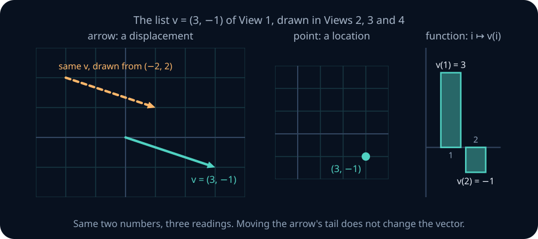

The figure draws the list \((3,-1)\) of View 1 in the other three views. Look first at the two arrows on the left. They start in different places but have the same length and direction, so they are the same vector. The middle panel keeps only the tip. The right panel reads the same two numbers as heights over the indices 1 and 2.

**Worked example — the same object, four ways.** Take \(v=(3,-1)\).

1. As a list it is the two numbers \(3\) and \(-1\), in that order.
2. As an arrow it runs from \((0,0)\) to \((3,-1)\). The arrow from \((-2,2)\) to \((1,1)\) is the same vector, because its displacement is tip minus tail: \((1-(-2),\ 1-2)=(3,-1)\).
3. As a point it is the location \((3,-1)\).
4. As a function it sends \(1\mapsto 3\) and \(2\mapsto-1\).

In a transformer language model, each token is carried through the network as a list of numbers that every layer reads and then adds an update to; that running list is called the **residual stream**, and **attention** is the layer operation that mixes information between the lists of different tokens. A token embedding row is the same kind of object at a larger size: a list of 768 floats (View 1), a displacement added into the residual stream (View 2), a point whose neighbours are semantically similar tokens (View 3), and a function from feature index to activation (View 4). Attention arithmetic is easiest in View 2 and nearest-neighbour analysis in View 3. The claim "these features are a rotated copy of those" only makes sense once you accept that the list was never the object.

> **Practice — Foundation:** Say which view you are using when you say "the negative gradient points downhill" and when you say "the embeddings cluster".
>
> **Hint:** Look for what the sentence uses: direction and change, or relative positions and distances. A coordinate list by itself does not supply either interpretation.
>
> **Practice — Core:** Give a vector space whose elements are not tuples, and say what View 1 would even mean there.
>
> **Hint:** Try polynomials or functions. A tuple can record coefficients only after you choose a basis; it is not the underlying object.
>
> **Practice — Stretch:** Take View 4 seriously: define addition and scaling for functions \([0,1]\to\mathbb R\) and check the axioms of section 2 hold verbatim.
>
> **Hint:** Define (f+g)(t)=f(t)+g(t) and (af)(t)=a f(t). Check each identity at an arbitrary t, using the corresponding real-number identity.

## 2. The axioms, and what is deliberately missing

Which rules must addition and scaling obey for every later argument to work? The precise answer to "what is a vector" is: *a member of a vector space*, meaning a set whose addition and scaling obey the following eight rules. Scalars in this unit are real numbers.

A **vector space over \(\mathbb R\)** is a set \(V\) with two operations — addition \(V\times V\to V\) and scalar multiplication \(\mathbb R\times V\to V\) — satisfying eight axioms for all \(u,v,w\in V\) and \(a,b\in\mathbb R\).

**Addition behaves like addition.** (1) \(u+v=v+u\); (2) \((u+v)+w=u+(v+w)\); (3) there is a vector \(0\) with \(v+0=v\) for every \(v\); (4) every \(v\) has a vector \(-v\) with \(v+(-v)=0\).

**Scaling behaves like scaling.** (5) \(a(bv)=(ab)v\); (6) \(1v=v\).

**They talk to each other.** (7) \(a(u+v)=au+av\); (8) \((a+b)v=av+bv\).

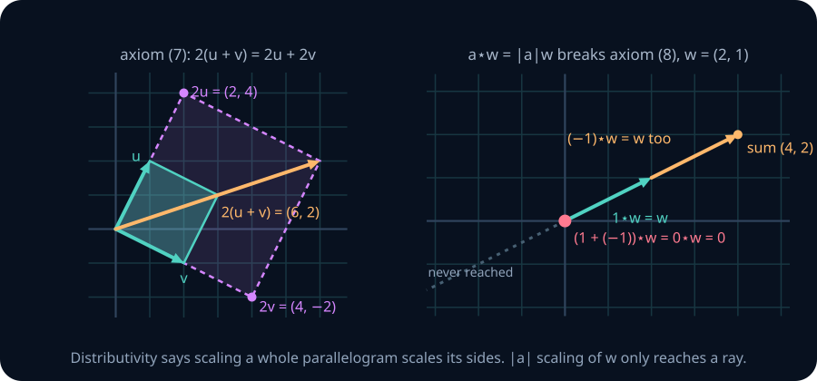

The left panel is axiom (7) as a picture: scaling the whole parallelogram by 2 scales both sides and the diagonal together, so \(2(u+v)\) is the diagonal of the parallelogram on \(2u\) and \(2v\). The right panel shows an operation that fails axiom (8), which is why the axioms are not a formality.

**Worked example — axiom (7) in numbers.** Take \(a=2\), \(u=(1,2)\), \(v=(2,-1)\). Then \(u+v=(3,1)\) and \(2(u+v)=(6,2)\). Separately, \(2u=(2,4)\) and \(2v=(4,-2)\), so \(2u+2v=(6,2)\). The two sides agree, as the left panel shows.

Besides \(\mathbb R^n\), examples with the usual addition and scaling include \(3\times3\) matrices (add and scale entry by entry) and real functions on \([0,1]\) (add and scale values point by point). In each case the eight axioms reduce to the same facts about real numbers, one entry or one point at a time. Each theorem in this unit applies to all of them.

**Worked example — polynomials of degree at most two.** Let \(P_2\) be the polynomials \(a_0+a_1x+a_2x^2\) with real coefficients. The sum of two of them, \((a_0+b_0)+(a_1+b_1)x+(a_2+b_2)x^2\), and a multiple \(ca_0+ca_1x+ca_2x^2\) are again in \(P_2\), so both operations stay inside the set. The zero polynomial serves as \(0\), and \(-a_0-a_1x-a_2x^2\) is the inverse. Every axiom is an identity checked one coefficient at a time: for axiom (8), the coefficient of \(x^i\) in \((a+b)p\) is \((a+b)a_i=aa_i+ba_i\), the coefficient in \(ap+bp\).

**Theorem 0 — three consequences.** In every vector space, \(0v=0\), \(a0=0\), and \((-1)v=-v\).

*Proof.* Axiom (8) gives \(0v=(0+0)v=0v+0v\). Add \(-(0v)\) to both sides and regroup with axioms (2), (4) and (3): \(0=0v\). The same argument with axioms (3) and (7) gives \(a0=a(0+0)=a0+a0\), hence \(a0=0\). For the last claim, axioms (6) and (8) and the first claim give \(v+(-1)v=1v+(-1)v=(1+(-1))v=0v=0\). So \((-1)v\) is an additive inverse of \(v\). Inverses are unique: if \(v+w=0\) and \(v+w'=0\), then \(w=w+(v+w')=(w+v)+w'=w'\). Hence \((-1)v=-v\). ∎

**Notice what is missing.** There is **no length** and **no angle** in the definition: no dot product and no notion of perpendicular. Those are *extra structure*, added in section 11 and developed in the projections unit. Until then, every picture you draw should survive being stretched and skewed: a square grid is a convenience, not a fact. Cosine similarity is a choice of geometry, not a property of the data.

> **Practice — Foundation:** Verify axioms (7) and (8) for \(\mathbb R^2\) under componentwise operations.
>
> **Hint:** Write u=(u₁,u₂), v=(v₁,v₂). Expand both sides one coordinate at a time; distinguish scalar addition from vector addition.
>
> **Practice — Core:** Prove from the axioms that if \(av=0\) then \(a=0\) or \(v=0\).
>
> **Hint:** Suppose a≠0. Multiply both sides by 1/a, then use axioms (5) and (6) on the left and Theorem 0 (a0=0) on the right.
>
> **Practice — Stretch:** Keep ordinary addition on \(\mathbb R^2\) but define \(a\star v=|a|v\). Decide which of the eight axioms hold, and show that the consequence \((-1)\star v=-v\) of Theorem 0 fails.
>
> **Hint:** Test axiom (8) with a=1, b=−1 and any nonzero v, as the right panel of the figure does for w=(2,1). Axiom (5) holds because |a||b|=|ab|.

## 3. The two operations, geometrically

What do addition and scaling look like? Only two operations are allowed. Everything else is built from them.

**Addition** is componentwise: \((a_1,a_2)+(b_1,b_2)=(a_1+b_1,a_2+b_2)\). Geometrically, pick up \(v\), move its tail to the tip of \(u\), and the sum runs from the origin to \(v\)'s new tip. Do it the other way round and you land in the same place. That is axiom (1), and it is why the picture is a *parallelogram* rather than a path.

**Scalar multiplication** is \(c(a_1,a_2)=(ca_1,ca_2)\). Geometrically, it stretches by \(|c|\) and flips if \(c<0\). The direction is preserved or exactly reversed, never rotated. Because a scalar cannot turn a vector sideways, the multiples of one vector stay on one line instead of filling a plane; because the scalar may be negative, they fill the whole line in both directions rather than a ray.

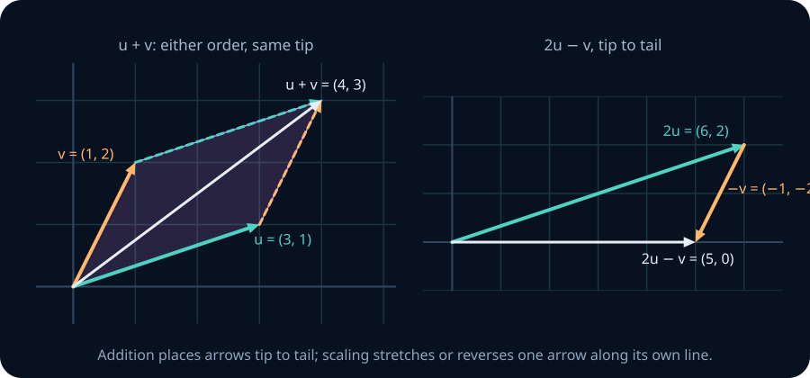

In the left panel, follow the solid \(u\) and then the dashed copy of \(v\); then follow the solid \(v\) and the dashed copy of \(u\). Both routes end at the same corner. The right panel builds \(2u-v\) as two moves.

**Worked example — a sum and a combination.** Let \(u=(3,1)\) and \(v=(1,2)\). Then \(u+v=(3+1,\ 1+2)=(4,3)\), and \(v+u=(1+3,\ 2+1)=(4,3)\): the same point. For \(2u-v\), scale first, \(2u=(6,2)\) and \(-v=(-1,-2)\), then add: \(2u-v=(6-1,\ 2-2)=(5,0)\).

Drag the two arrowheads below. Watch the parallelogram. Then push the \(c\) slider through zero and watch \(cu\) collapse to the origin and come out the other side.

```lab
la-vectors
```

**Check yourself before moving on.** Set \(c=0\): \(0u\) is the origin, as Theorem 0 says. Now find a position for \(v\) where \(u+v=0\): \(v\) must point exactly opposite \(u\) with the same length. Finally set \(c=-1\) and see that \(u+(-1)u=0\).

> **Practice — Foundation:** Compute \(3u-2v\) for \(u=(2,-1)\), \(v=(1,3)\), and draw the tip-to-tail construction.
>
> **Hint:** Scale both coordinates of each vector first, then subtract. For the picture, place the second scaled arrow at the tip of the first.
>
> **Practice — Core:** Explain why \(u+v\) and \(v+u\) trace the two halves of one parallelogram rather than reaching two different points.
>
> **Hint:** Translating an arrow preserves its displacement. Compare the two coordinate sums and use commutativity of real addition.
>
> **Practice — Stretch:** In the usual real coordinate plane, show that a 90-degree rotation of a nonzero vector cannot equal a real scalar multiple of it. Why is this no contradiction with the fact that rotating a sum of two arrows gives the sum of the rotated arrows?
>
> **Hint:** For v=(x,y), write its rotated image as (−y,x). If this equals cv, use the two equations to obtain (1+c²)x=(1+c²)y=0.

## 4. Linear combinations and span

Given a few allowed moves, which points can you reach? Chain the two operations and you get the only expression linear algebra really cares about.

Given a list of vectors \(v_1,\dots,v_k\in V\) and scalars \(c_1,\dots,c_k\in\mathbb R\), the vector

$$
c_1v_1+c_2v_2+\dots+c_kv_k
$$

is a **linear combination** of the \(v_i\) with **coefficients** \(c_i\). Think of the \(v_i\) as *the moves you are allowed to make* and the \(c_i\) as *how far you go in each move's direction*. You may reuse a move, reverse it, or skip it (\(c_i=0\)). You start at the origin.

**Worked example 1 — finding a recipe.** Can \(u=(2,1)\) and \(v=(1,2)\) reach \((4,5)\)? We need \(a(2,1)+b(1,2)=(4,5)\), which is one equation per coordinate:

$$
2a+b=4,\qquad a+2b=5.
$$

The first gives \(b=4-2a\). Substituting, \(a+2(4-2a)=5\), so \(8-3a=5\) and \(a=1\); then \(b=2\). Check: \(1\cdot(2,1)+2\cdot(1,2)=(2+2,\ 1+4)=(4,5)\).

The **span** of a list is the set of *all* its linear combinations:

$$
\operatorname{span}(v_1,\dots,v_k)=\Big\{\sum_{i=1}^k c_iv_i \;:\; c_i\in\mathbb R\Big\},
\qquad \operatorname{span}(\,)=\{0\}.
$$

The empty list makes no moves, so it reaches only the origin. We also write \(\operatorname{span}\{v_1,\dots,v_k\}\) with braces; the set is the same.

**Worked example 2 — a span that collapses.** Replace \(v\) by \(v'=(-4,-2)\). Now \(v'=-2u\), so every combination is \(au+bv'=au-2bu=(a-2b)u\). The span is the set of multiples \(t(2,1)\): the line \(y=x/2\). The target \((4,5)\) would need \(2t=4\) and \(t=5\) at once, which is impossible, so it is out of reach. The target \((6,3)=3u\) is reachable in many ways: any \((a,b)\) with \(a-2b=3\), such as \((3,0)\) or \((1,-1)\). Non-unique coefficients are the algebraic shadow of the geometric collapse.

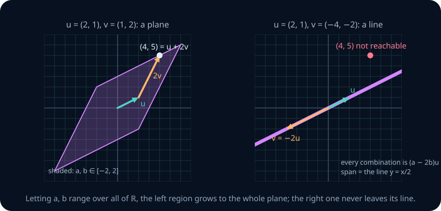

The shaded region on the left is every combination with \(a,b\in[-2,2]\). Let \(a,b\) run over all of \(\mathbb R\) and it grows to fill the plane. On the right, no choice of coefficients leaves the line. Drag \(v\) in the workbench until it lies along \(u\) and watch the parallelogram flatten into a segment. That flattening is the single most important degeneracy in the subject.

```lab
la-span
```

**Worked example 3 — a plane in space.** Let \(a=(1,0,1)\) and \(b=(0,1,1)\) in \(\mathbb R^3\). A general combination is

$$
s(1,0,1)+t(0,1,1)=(s,\ t,\ s+t).
$$

Every vector in the span has third coordinate equal to the sum of the first two. Conversely any \((x,y,x+y)\) equals \(xa+yb\). So the span is exactly the plane \(z=x+y\). The target \((2,3,5)\) is in it: the first two coordinates force \(s=2\), \(t=3\), and the third checks, \(2+3=5\). The target \((1,1,1)\) is not: the first two coordinates force \(s=t=1\), and then the third coordinate would be \(2\), not \(1\).

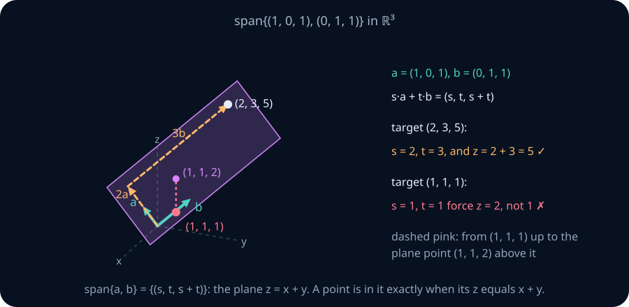

Three facts about spans, each visible in these pictures:

- **A span always contains the origin.** Take every \(c_i=0\). A line that misses \((0,0)\) is not a span; it is an *affine* set, met in section 12.
- **One nonzero vector spans a line** through the origin. Two vectors that do not lie on a common line through the origin span a plane (the whole of \(\mathbb R^2\) in example 1, a plane inside \(\mathbb R^3\) in example 3). Two vectors on one line span that line, or just \(\{0\}\) if both are zero.
- **A span is closed under both operations.** \(\sum c_iv_i+\sum d_iv_i=\sum(c_i+d_i)v_i\) and \(a\sum c_iv_i=\sum(ac_i)v_i\) are again combinations. Section 7 names sets with this property *subspaces*.

> **Practice — Foundation:** Describe \(\operatorname{span}\{(1,2,3)\}\) and \(\operatorname{span}\{(1,0,0),(0,1,0)\}\) in \(\mathbb R^3\), naming the object (point, line or plane) and counting the free parameters in a general member.
>
> **Hint:** Write a general linear combination with one scalar, then with two. Count the scalars you can choose freely, not the number of coordinates written.
>
> **Practice — Core:** Decide whether \((-2,-6)\) and \((3,1)\) lie in \(\operatorname{span}\{(1,3),(2,6)\}\), geometrically and algebraically.
>
> **Hint:** The second generator is twice the first. Every combination must satisfy the same relation between its two coordinates; test each target against that relation.
>
> **Practice — Stretch:** Show that \(\operatorname{span}\{v_1,v_2\}=\operatorname{span}\{v_1,\,v_2+cv_1\}\) for every scalar \(c\), and describe what the replacement does to the parallelogram in the figure.
>
> **Hint:** Each new generator is a combination of the old ones, and each old one is a combination of the new ones, since v₂=(v₂+cv₁)−cv₁. The parallelogram shears but keeps its base.

## 5. Linear independence — the absence of redundancy

You just saw two vectors span a plane, then collapse to a line when one became a multiple of the other. In the collapsed case \(v'\) told you nothing new: everything it could reach, \(u\) could already reach. How do you detect that kind of redundancy without drawing anything?

**Worked example — hunting for a zero recipe.** Take \(v_1=(1,1,0)\), \(v_2=(0,1,1)\), \(v_3=(1,3,2)\). Is there a way to combine them to reach \(0\) without making all coefficients zero? Write \(c_1v_1+c_2v_2+c_3v_3=0\) one coordinate at a time:

$$
c_1+c_3=0,\qquad c_1+c_2+3c_3=0,\qquad c_2+2c_3=0.
$$

The first equation gives \(c_1=-c_3\) and the third gives \(c_2=-2c_3\). Substituting into the second, \(-c_3-2c_3+3c_3=0\), which holds for *every* \(c_3\). Choosing \(c_3=1\) gives \((c_1,c_2,c_3)=(-1,-2,1)\):

$$
-v_1-2v_2+v_3=0,\qquad\text{that is,}\qquad v_3=v_1+2v_2 .
$$

Now replace \(v_3\) by \((2,2,3)\). The equations become \(c_1+2c_3=0\), \(c_1+c_2+2c_3=0\), \(c_2+3c_3=0\). Subtracting the first from the second gives \(c_2=0\); the third then gives \(c_3=0\), and the first gives \(c_1=0\). Only the all-zero recipe reaches \(0\).

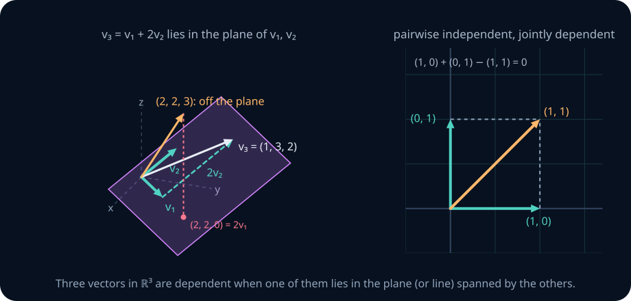

In the left panel, the dashed path \(v_1\) then \(2v_2\) never leaves the purple plane, and it ends at \(v_3\): the third arrow adds no new direction. The orange arrow \((2,2,3)\) rises out of the plane (it sits three units above the plane point \((2,2,0)\)), so it does add one.

**Definition.** A list \(v_1,\dots,v_k\) is **linearly independent** if the only solution of

$$
c_1v_1+\dots+c_kv_k=0
$$

is \(c_1=c_2=\dots=c_k=0\). Otherwise it is **linearly dependent**, and any solution with some \(c_i\neq0\) is a **dependency relation**. The empty list is independent: it has no coefficients to be nonzero. We work with *lists*, which keep order and repetition, so \((v,v)\) has two entries.

Why phrase independence in terms of reaching \(0\)? Because it is equivalent to the redundancy you can see, and because it is symmetric in all \(k\) vectors: no vector is singled out, and the condition is a system of equations you can solve.

**Theorem 1 — three faces of dependence.** For a list \(v_1,\dots,v_k\) with \(k\ge1\), the following are equivalent:

1. The list is linearly dependent.
2. Some \(v_j\) lies in the span of the others.
3. Removing some \(v_j\) does not change the span.

*Proof.* We prove (1)⇒(2)⇒(3)⇒(1).

(1)⇒(2). Take a relation \(\sum_i c_iv_i=0\) with not all \(c_i\) zero, and **choose an index \(j\) with \(c_j\neq0\)**. Then \(c_jv_j=-\sum_{i\ne j}c_iv_i\), and because \(c_j\ne0\) we may divide:

$$
v_j=\sum_{i\neq j}\Big(-\frac{c_i}{c_j}\Big)v_i .
$$

(2)⇒(3). Suppose \(v_j=\sum_{i\ne j}a_iv_i\). Every combination of the shorter list is a combination of the full list (put coefficient 0 on \(v_j\)). Conversely, substitute into an arbitrary combination of the full list:

$$
\sum_i b_iv_i=\sum_{i\ne j}b_iv_i+b_j\sum_{i\ne j}a_iv_i=\sum_{i\neq j}(b_i+b_ja_i)v_i,
$$

which is a combination of the shorter list. So the two spans are equal.

(3)⇒(1). If removing \(v_j\) leaves the span unchanged, then \(v_j\) (which is in the full span) is in the span of the others: \(v_j=\sum_{i\ne j}a_iv_i\). Rearranged, \(\sum_{i\ne j}a_iv_i+(-1)v_j=0\), a relation whose coefficient on \(v_j\) is \(-1\neq0\). ∎

Read (2) and (3) as: *one of the arrows is doing no work.* The theorem does not say *every* vector is redundant. In the list \((1,0),(0,1),(0,2)\), only the last two are involved in any relation; \((1,0)\) is not in the span of the others.

A sharper version tells you *where* the redundancy appears if you add the vectors one at a time.

**Lemma 2 — the linear dependence lemma.** If \(v_1,\dots,v_k\) is dependent, there is an index \(j\) with \(v_j\in\operatorname{span}(v_1,\dots,v_{j-1})\) (for \(j=1\) this means \(v_1=0\)). Removing that \(v_j\) does not change the span of the list.

*Proof.* Take a dependency relation and let \(j\) be the **largest** index with \(c_j\ne0\). Then \(c_1v_1+\dots+c_jv_j=0\), and dividing by \(c_j\) gives \(v_j=-\sum_{i<j}(c_i/c_j)v_i\), which lies in \(\operatorname{span}(v_1,\dots,v_{j-1})\). If \(j=1\) the relation reads \(c_1v_1=0\) with \(c_1\ne0\), so \(v_1=0\). The span is unchanged by the substitution argument of (2)⇒(3). ∎ Since at least one index has this property, there is a smallest one, and removing that vector leaves the span unchanged for the same reason; the exchange argument in section 6 scans for it.

In the picture: add the arrows to the list one at a time and watch the span grow. For a dependent list there is a first step at which the span fails to grow. In the worked example it is step 3, since \(v_3\) lies in the plane of \(v_1,v_2\).

**Lemma 3 — adding a new direction.** If \(v_1,\dots,v_k\) is independent and \(w\notin\operatorname{span}(v_1,\dots,v_k)\), then \(v_1,\dots,v_k,w\) is independent.

*Proof.* Suppose \(c_1v_1+\dots+c_kv_k+dw=0\). If \(d\ne0\), then \(w=-\sum_i(c_i/d)v_i\) would lie in the span, which it does not. So \(d=0\), the relation reads \(\sum_ic_iv_i=0\), and independence of the \(v_i\) forces every \(c_i=0\). ∎

### Small cases, as pictures

- **One vector.** \((v)\) is dependent \(\iff v=0\). (If \(v=0\), take \(c_1=1\).)
- **Two vectors.** Dependent \(\iff\) one is a scalar multiple of the other \(\iff\) both lie on one line through the origin. This is Theorem 1(2) with \(k=2\).
- **Two vectors in \(\mathbb R^2\), by a formula.** \(u,v\) are dependent exactly when the number \(D(u,v)=u_1v_2-u_2v_1\) is zero. *Proof.* If \(v=cu\), then \(D=u_1cu_2-u_2cu_1=0\); the case \(u=cv\) is the same. Conversely suppose \(D=0\). If \(u=0\) the pair is dependent. Otherwise some coordinate of \(u\) is nonzero; say \(u_1\ne0\) (the case \(u_2\ne0\) is symmetric). With \(c=v_1/u_1\), the vector \(v-cu\) has first coordinate \(0\) and second coordinate \(v_2-v_1u_2/u_1=D/u_1=0\), so \(v=cu\). ∎ In the picture, \(|D|\) is the area of the parallelogram on \(u\) and \(v\), which vanishes exactly when the parallelogram flattens. Section 13 checks that area formula, and the determinants unit (LA05) names \(D\) the determinant and generalizes it.
- **Three vectors in \(\mathbb R^3\).** Dependent \(\iff\) one lies in the span of the other two, which is at most a plane through the origin. So a dependent triple lies in a common plane through the origin, as in the figure. The converse, that three vectors in a plane through the origin are always dependent, needs the counting theorem of section 6.
- **A list containing \(0\), or a repeated vector,** is dependent: \(1\cdot0=0\), and \(1\cdot v+(-1)\cdot v=0\).

Independence is a property of the whole list, not of its pairs. The right panel shows the smallest example: \((1,0),(0,1),(1,1)\) are pairwise non-parallel, yet \((1,0)+(0,1)-(1,1)=0\).

**Numerical notes.** In floating point a computed combination is rarely exactly zero, so a program decides dependence with a tolerance. Section 13 explains how that decision depends on scale and why nearly dependent lists behave like dependent ones in computation.

> **Practice — Foundation:** Decide independence for \((1,2),(3,7)\); for \((-2,3),(4,-6)\); and for \((0,0),(1,3)\), giving a relation where one exists.
>
> **Hint:** Set a u+b v=0 and solve for the coefficients. A zero generator immediately gives a nontrivial relation by putting coefficient 1 on it.
>
> **Practice — Core:** Find every \(t\) for which \((1,t)\) and \((t,4)\) are dependent, and interpret both answers as pictures.
>
> **Hint:** Use the formula D=u₁v₂−u₂v₁ from the small cases. The condition involves t², so keep both signs when solving.
>
> **Practice — Stretch:** Prove that every sublist of an independent list is independent, and that a list containing a dependent sublist is dependent.
>
> **Hint:** A relation among the vectors of a sublist becomes a relation among the whole list by putting coefficient 0 on every vector left out.

## 6. The exchange lemma and the dimension bound

How many independent vectors can fit inside a space that some \(q\) vectors span? In the plane you cannot find three independent arrows; this section proves the general statement, with no computation beyond Lemma 2.

**Definition.** A vector space \(V\) is **finite-dimensional** if some finite list spans it. The **standard basis vectors** \(e_1,\dots,e_n\) of \(\mathbb R^n\) have a 1 in one position and 0 elsewhere; every \(x\in\mathbb R^n\) equals \(x_1e_1+\dots+x_ne_n\), so \(\mathbb R^n\) is finite-dimensional. The polynomials \(P_m\) of degree at most \(m\) are spanned by \(1,x,\dots,x^m\). The space \(P\) of *all* polynomials is not finite-dimensional: a finite list of polynomials has some largest degree \(m\), every combination of it has degree at most \(m\), and so \(x^{m+1}\) is out of reach.

**Worked example — exchanging one vector at a time.** In \(\mathbb R^3\), take the independent list \(u_1=(1,1,0)\), \(u_2=(0,1,1)\) and the spanning list \(w_1=e_1,\ w_2=e_2,\ w_3=e_3\).

*Step 1.* Put \(u_1\) at the front: \((u_1,w_1,w_2,w_3)\). This list is dependent, because \(u_1\) is already in the span of the \(w\)'s. Lemma 2 guarantees some vector lies in the span of the ones before it; scan for the first one. It is not \(u_1\), which is nonzero. It is not \(w_1\), which is not a multiple of \((1,1,0)\). It is \(w_2\), since \(w_2=u_1-w_1=(1,1,0)-(1,0,0)=(0,1,0)\). Remove \(w_2\); by Lemma 2 the list \((u_1,w_1,w_3)\) still spans \(\mathbb R^3\).

*Step 2.* Insert \(u_2\) after \(u_1\): \((u_1,u_2,w_1,w_3)\). Scan again. \(u_2\) is not a multiple of \(u_1\). Is \(w_1\) in \(\operatorname{span}(u_1,u_2)\)? That would need \(a(1,1,0)+b(0,1,1)=(a,a+b,b)=(1,0,0)\), forcing \(a=1\), \(b=0\) and then \(a+b=1\ne0\): no. Is \(w_3\) in \(\operatorname{span}(u_1,u_2,w_1)\)? We need \((a+c,\ a+b,\ b)=(0,0,1)\), so \(b=1\), \(a=-1\), \(c=1\): yes, \(w_3=-u_1+u_2+w_1\). Remove \(w_3\). The list \((u_1,u_2,w_1)\) spans \(\mathbb R^3\).

Each \(u\) pushed out one \(w\). If there had been more \(u\)'s than \(w\)'s, some step would have had no \(w\) left to push out.

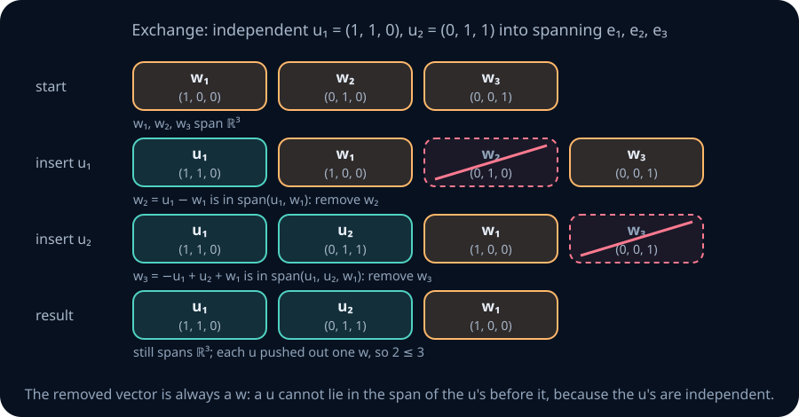

Read the figure row by row: the list length never changes and the list always spans, while independent vectors replace spanning ones.

**Theorem 4 — the exchange lemma.** In a vector space \(V\), if \(u_1,\dots,u_m\) is independent and \(w_1,\dots,w_n\) spans \(V\), then \(m\le n\).

*Proof.* We build lists \(\Lambda_0,\Lambda_1,\dots,\Lambda_m\), each of length \(n\) and each spanning \(V\), where \(\Lambda_k\) consists of \(u_1,\dots,u_k\) followed by \(n-k\) of the \(w\)'s. Start with \(\Lambda_0=(w_1,\dots,w_n)\).

Given \(\Lambda_{k-1}\) with \(k\le m\), insert \(u_k\) directly after \(u_{k-1}\). The new list has length \(n+1\) and is dependent, because \(u_k\) already lies in the span of \(\Lambda_{k-1}\), which is \(V\). By Lemma 2, some vector in it lies in the span of the vectors before it (take the first such vector), and removing it keeps the span equal to \(V\). That vector cannot be any \(u_i\) with \(i\le k\): the vectors before \(u_i\) are \(u_1,\dots,u_{i-1}\), and \(u_i\in\operatorname{span}(u_1,\dots,u_{i-1})\) would give a dependency relation among the independent \(u\)'s (for \(i=1\), it would mean \(u_1=0\)). So the removed vector is one of the \(w\)'s. In particular, \(\Lambda_{k-1}\) still contained at least one \(w\), so \(k-1<n\). The result is \(\Lambda_k\).

The construction succeeds for every \(k=1,\dots,m\), and step \(k\) needed \(k\le n\). Taking \(k=m\) gives \(m\le n\). ∎

**What this says in the picture.** A spanning list is a set of slots. Each independent vector takes over one slot without losing the span, and it can never take a slot already held by an independent vector. You run out of slots before you run out of independent vectors only if there are more of them.

**Corollary 5 — the dimension bound.** Any \(k>n\) vectors in \(\mathbb R^n\) are linearly dependent, and every spanning list of \(\mathbb R^n\) has at least \(n\) vectors.

*Proof.* \(e_1,\dots,e_n\) spans \(\mathbb R^n\), so an independent list has at most \(n\) entries. \(e_1,\dots,e_n\) is also independent (the combination \(\sum x_ie_i\) is the vector \((x_1,\dots,x_n)\), which is zero only when every \(x_i=0\)), so a spanning list has at least \(n\) entries. ∎

### What the bound forces in a model

- A matrix \(W\in\mathbb R^{768\times3072}\) has 3072 columns in \(\mathbb R^{768}\). They are dependent, and at most 768 of them are independent. The same count makes 10,000 fixed feature directions in a width-768 residual stream dependent.
- A factored update \(\Delta W=LR\), with a left factor \(L\) of \(r\) columns and a right factor \(R\) of \(r\) rows, has every column equal to \(L\) times a column of \(R\): a combination of the \(r\) columns of \(L\). So at most \(r\) columns of \(\Delta W\) are independent. This is the structural restriction used by adapters whose update has at most r independent columns, called **low-rank** adapters. The largest number of independent columns of a matrix is its **rank**; [LA02](02-systems-elimination-subspaces.md) shows how to compute it.

**Numerical notes.** The bound constrains a *proposed representation*. It does not show that a network uses 10,000 features, how well a decoder can read them (section 11 writes the readout down), or whether training finds a useful low-rank update.

> **Practice — Foundation:** State the largest independent set and the smallest spanning set possible in \(\mathbb R^{1024}\).
>
> **Hint:** Corollary 5 gives both counts. The standard basis is simultaneously independent and spanning, so both bounds are attained.
>
> **Practice — Core:** A model has residual width 1024 and is claimed to represent 50,000 interpretable features. Say exactly what is forced and what must still be established empirically.
>
> **Hint:** The dimension bound limits independent directions. It does not identify what counts as a feature, which combinations occur, or whether a decoder can recover their activations.
>
> **Practice — Stretch:** Independence of the \(u\)'s is what makes the removed vector a \(w\) in the exchange proof. Run the procedure with the dependent list \(u_1=(1,0)\), \(u_2=(2,0)\) against the spanning list \(e_1,e_2\), and find the step where the vector Lemma 2 removes is a \(u\).
>
> **Hint:** Step 1 removes e₁, since e₁=u₁. At step 2 the list is (u₁,u₂,e₂), and u₂=2u₁ already lies in span(u₁), so the first redundant vector is u₂ itself.

## 7. Subspaces

Lines and planes through the origin, and every span, share one property: combinations of their members stay inside. How do you test whether an arbitrary set has it?

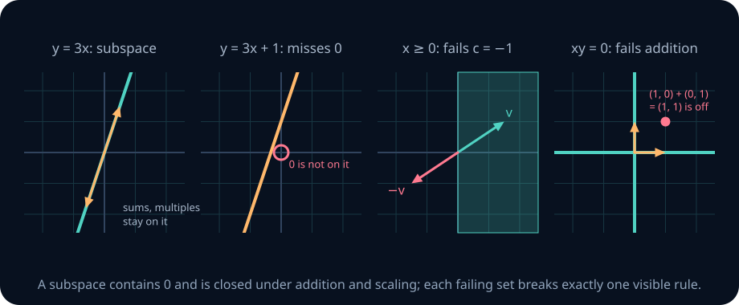

Each failing panel breaks exactly one rule you can see: a missing origin, an arrow whose negative escapes, or two members whose sum escapes.

A subset \(Y\subseteq V\) is a **subspace** if it is itself a vector space under \(V\)'s operations. The test you actually use: \(Y\) is a subspace if and only if all three hold:

1. \(0\in Y\);
2. closed under addition: \(u,w\in Y\Rightarrow u+w\in Y\);
3. closed under scaling: \(w\in Y,\ c\in\mathbb R\Rightarrow cw\in Y\).

*Why the test suffices.* Conditions 2 and 3 make the two operations land in \(Y\). Axioms (1), (2) and (5)–(8) are identities that hold for all vectors of \(V\), hence for those in \(Y\). The zero vector is in \(Y\) by condition 1, and for \(w\in Y\) the inverse \(-w=(-1)w\) (Theorem 0) is in \(Y\) by condition 3. Conversely, a subspace must contain \(V\)'s zero: its own zero \(z\) satisfies \(z+z=z\), and adding \(-z\) in \(V\) gives \(z=0\). ∎

**Worked example — an equation that defines a subspace.** Let \(Y=\{(x,y,z):x+2y-z=0\}\).

1. \(0+0-0=0\), so \(0\in Y\).
2. If \(x+2y-z=0\) and \(x'+2y'-z'=0\), adding gives \((x+x')+2(y+y')-(z+z')=0\).
3. Multiplying \(x+2y-z=0\) by \(c\) gives \(cx+2(cy)-cz=0\).

With numbers: \(u=(1,0,1)\) and \(w=(0,1,2)\) are in \(Y\) (\(1+0-1=0\) and \(0+2-2=0\)); \(u+w=(1,1,3)\) satisfies \(1+2-3=0\); \(-3u=(-3,0,-3)\) satisfies \(-3+0+3=0\). The same set is a span: solving for \(z=x+2y\) gives \((x,y,x+2y)=x(1,0,1)+y(0,1,2)\), so \(Y=\operatorname{span}\{(1,0,1),(0,1,2)\}\).

| Set in \(\mathbb R^2\) | Subspace? | Which rule breaks |
|---|---|---|
| \(\{(x,y):y=3x\}\) | Yes | — |
| \(\{(x,y):y=3x+1\}\) | No | \(0\notin Y\) |
| \(\{(x,y):x\ge0\}\) | No | not closed under \(c=-1\) |
| \(\{(x,y):xy=0\}\) (the two axes) | No | \((1,0)+(0,1)=(1,1)\notin Y\) |
| \(\{(0,0)\}\) | Yes | — (the zero subspace) |
| All of \(\mathbb R^2\) | Yes | — (the whole space) |

**Theorem 6 — a span is the smallest subspace containing its list.** \(\operatorname{span}(v_1,\dots,v_k)\) is a subspace, and every subspace containing all the \(v_i\) contains it.

*Proof.* It contains \(0\) (all coefficients zero; for the empty list the span is \(\{0\}\) by definition) and is closed under both operations by the identities at the end of section 4. If a subspace \(U\) contains each \(v_i\), it contains each \(c_iv_i\) by scaling, and then each partial sum \(c_1v_1+\dots+c_jv_j\) by adding one term at a time, so it contains every combination. The empty list's span \(\{0\}\) is inside every subspace by condition 1. ∎

So "subspace" and "span of some list" are two names for one idea when the space is finite-dimensional (section 8 shows every such subspace has a spanning list). *Subspace* emphasizes the object; *span* emphasizes the generators.

**Theorem 7 — intersections.** The intersection of any collection of subspaces of \(V\) (two, or even infinitely many) is a subspace.

*Proof.* \(0\) is in every one of them. If \(x,y\) are in all of them, then \(x+y\) and \(cx\) are in each one, because each is a subspace, so they are in the intersection. ∎

Row four of the table shows that a *union* of two subspaces usually fails: closure under addition is a real constraint. Exercise M8 finds the exact condition, and section 9 builds the right replacement for a union.

> **Practice — Foundation:** Apply the three-part test to \(\{(x,y,z):x+y+z=0\}\) and to \(\{(x,y,z):x+y+z=1\}\).
>
> **Hint:** Test the zero vector before doing any algebra. For the homogeneous equation, add two satisfying equations and multiply one by a scalar.
>
> **Practice — Core:** Show that the union of the \(x\)-axis and the line \(y=x\) in \(\mathbb R^2\) is not a subspace, and find the smallest subspace that contains it.
>
> **Hint:** Add (1,0) and (1,1) and check both lines. A subspace containing both of those independent vectors contains their span, which is all of R².
>
> **Practice — Stretch:** Show that the functions \(f:\mathbb R\to\mathbb R\) with \(f''+f=0\) form a subspace of the space of all functions \(\mathbb R\to\mathbb R\), and name two members that are not multiples of each other.
>
> **Hint:** Differentiation satisfies (f+g)''=f''+g'' and (cf)''=cf''. Try sin and cos, and evaluate a proposed multiple relation at x=0.

## 8. Basis, dimension, coordinates

What is the cheapest list that reaches everything, and how does it turn a vector into numbers? Span answers "what can I reach"; independence answers "am I wasting arrows". Together they give the right notion of a coordinate system.

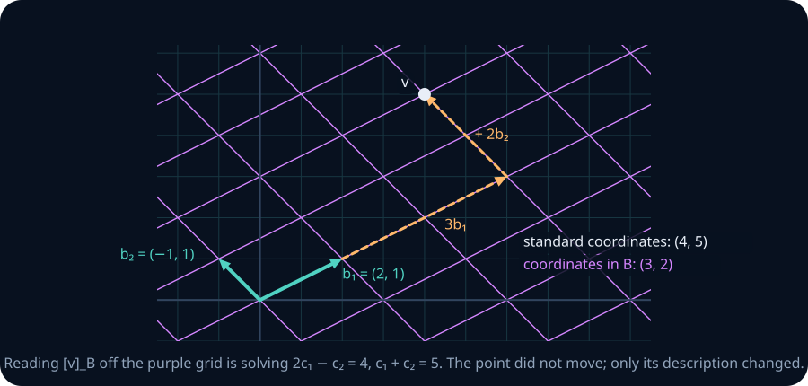

Count along the purple grid in the figure: three cells along \(b_1\), then two along \(b_2\), and you reach \(v\). Those counts are \(v\)'s coordinates in the skewed system, while the faint grid gives its usual coordinates \((4,5)\).

**Worked example — reading coordinates in two dimensions.** Find \(c_1,c_2\) with \(c_1(2,1)+c_2(-1,1)=(4,5)\):

$$
2c_1-c_2=4,\qquad c_1+c_2=5.
$$

Adding the equations gives \(3c_1=9\), so \(c_1=3\) and \(c_2=2\). Check: \(3(2,1)+2(-1,1)=(6-2,\ 3+2)=(4,5)\).

**Definition.** An **ordered basis** of a finite-dimensional space \(V\) is a list \(B=(b_1,\dots,b_n)\) that is (i) **linearly independent** and (ii) **spans \(V\)**. Spanning means "enough arrows"; independence means "not one too many". The empty list is the basis of the zero space \(\{0\}\).

**Theorem 8 — unique coordinates.** \(B\) is a basis of \(V\) if and only if every \(v\in V\) has **exactly one** representation \(v=c_1b_1+\dots+c_nb_n\).

*Proof.* (⇒) *Existence:* \(B\) spans \(V\), so each \(v\) has at least one representation. *Uniqueness:* if \(\sum c_ib_i=\sum d_ib_i\), subtracting gives \(\sum(c_i-d_i)b_i=0\), and independence forces \(c_i=d_i\) for every \(i\).

(⇐) *Spanning:* existence of a representation for every \(v\) is exactly the statement that \(B\) spans \(V\). *Independence:* if \(\sum c_ib_i=0\), compare with the representation \(0=\sum 0\cdot b_i\); uniqueness at \(v=0\) forces every \(c_i=0\). ∎

The tuple \((c_1,\dots,c_n)\) is the **coordinate vector** \([v]_B\). The order of the basis matters: swapping \(b_1\) and \(b_2\) swaps the first two entries of \([v]_B\). This theorem turns geometry into arithmetic, and it is why choosing a good basis is the whole game in the SVD, PCA and Fourier analysis. The standard basis \(e_1,\dots,e_n\) is so convenient that people forget it is a *choice*: the list \((3,-1)\) already *is* a coordinate vector, with respect to \((e_1,e_2)\).

**Worked example — a basis of \(\mathbb R^3\) and a coordinate vector.** Let \(B=(b_1,b_2,b_3)=((1,2,0),(0,1,1),(1,0,1))\). Write \(c_1b_1+c_2b_2+c_3b_3=(x,y,z)\) by coordinates:

$$
c_1+c_3=x,\qquad 2c_1+c_2=y,\qquad c_2+c_3=z.
$$

From the first, \(c_3=x-c_1\). From the third, \(c_2=z-c_3=z-x+c_1\). Substituting into the second, \(2c_1+z-x+c_1=y\), so

$$
c_1=\frac{x+y-z}{3},\qquad c_3=x-c_1,\qquad c_2=z-c_3 .
$$

Every target has exactly one solution, so by Theorem 8 \(B\) is a basis. For \(v=(4,5,3)\): \(c_1=(4+5-3)/3=2\), \(c_3=4-2=2\), \(c_2=3-2=1\). So \([v]_B=(2,1,2)\). Check: \(2(1,2,0)+1(0,1,1)+2(1,0,1)=(2+0+2,\ 4+1+0,\ 0+1+2)=(4,5,3)\).

The next theorems say that bases exist, that they all have the same length, and how to build one.

**Theorem 9 — every spanning list contains a basis.** Go through a spanning list \(v_1,\dots,v_m\) of \(V\) from left to right, deleting \(v_j\) whenever it lies in the span of the vectors kept before it. What remains is a basis.

*Proof.* Each deleted vector is a combination of kept vectors, so deleting it does not change the span, by the substitution argument in the proof of Theorem 1, (2)⇒(3): the result still spans \(V\). If the result were dependent, Lemma 2 would give a kept vector in the span of the kept vectors before it, but such a vector would have been deleted. ∎ In particular, every finite-dimensional space has a basis.

*Example.* The list \((1,1),(2,2),(1,0),(0,1)\) spans \(\mathbb R^2\). Keep \((1,1)\). Delete \((2,2)=2(1,1)\). Keep \((1,0)\), which is not a multiple of \((1,1)\). Delete \((0,1)=(1,1)-(1,0)\). The basis is \((1,1),(1,0)\).

**Theorem 10 — every independent list extends to a basis.** Let \(u_1,\dots,u_m\) be independent in \(V\), and let \(w_1,\dots,w_n\) span \(V\). Go through the \(w\)'s in order, appending \(w_j\) to the list whenever it lies outside the span of the current list. The result is a basis containing the \(u\)'s.

*Proof.* By Lemma 3, each append keeps the list independent. At the end every \(w_j\) lies in the span of the final list (either it was appended, or it was already in the span when it was checked), so the final list spans \(V\). ∎

*Example.* Extend the independent list \((0,1,1)\) using \(e_1,e_2,e_3\). \(e_1\) is not a multiple of \((0,1,1)\): append it. Is \(e_2\) in \(\operatorname{span}((0,1,1),e_1)\)? A combination \(a(0,1,1)+be_1=(b,a,a)\) equals \((0,1,0)\) only if \(a=1\) and \(a=0\): no, so append it. Now \(e_3=(0,1,1)-e_2\) is in the span: skip it. The basis is \((0,1,1),e_1,e_2\).

**Theorem 11 — dimension is well defined.** Any two bases of a finite-dimensional space have the same length. This common length is the **dimension**, \(\dim V\).

*Proof.* Let \(B\) and \(B'\) be bases. \(B\) is independent and \(B'\) spans, so Theorem 4 gives \(\operatorname{len}B\le\operatorname{len}B'\). Swapping roles gives the reverse inequality. ∎

So \(\dim\mathbb R^n=n\) (the standard basis), \(\dim P_m=m+1\) (the basis \(1,x,\dots,x^m\)), and \(\dim\{0\}=0\).

**Theorem 12 — the right length is enough.** In a space of dimension \(n\), an independent list of length \(n\) is a basis, and a spanning list of length \(n\) is a basis.

*Proof.* Extend the independent list to a basis (Theorem 10); the basis has length \(n\) (Theorem 11), so nothing was added. Reduce the spanning list to a basis (Theorem 9); again the basis has length \(n\), so nothing was removed. ∎

**Theorem 13 — subspaces are no bigger than the space.** If \(U\) is a subspace of a finite-dimensional \(V\), then \(U\) is finite-dimensional, \(\dim U\le\dim V\), and \(\dim U=\dim V\) only when \(U=V\).

*Proof.* Build a list inside \(U\): start empty, and while the list does not span \(U\), append a vector of \(U\) outside its span. By Lemma 3 the list stays independent, and it is independent in \(V\), so by Theorem 4 its length never exceeds \(\dim V\). The process therefore stops, and it stops only when the list spans \(U\): it is a basis of \(U\) of length at most \(\dim V\). If the length equals \(\dim V\), Theorem 12 makes it a basis of \(V\), so \(U=V\). ∎

**What these say in the picture.** In the plane, a basis is two non-parallel arrows. One arrow is too few (it spans a line), and a third arrow is always redundant (Theorem 4). Any two non-parallel arrows will do (Theorem 12), and each choice draws its own skewed grid.

Drag the two basis arrows below to skew the coordinate grid, then drag the ◆ point. The readout gives the same point in two languages: standard coordinates, and \(B\)-coordinates. Push \(b_2\) onto \(b_1\) and watch the grid — and the coordinate system — die.

```lab
la-basis
```

**Numerical notes.** Reading \([v]_B\) off a skewed grid is solving \(Bc=v\). When \(b_1\) and \(b_2\) are nearly parallel, the grid cells become long and thin and a tiny move of the point produces a large change in coordinates. That sensitivity is measured by the **condition number** (LA09). It is why recovering coefficients from nearly dependent features can be unstable, and why orthogonal bases are worth their cost; section 13 works an example.

> **Practice — Foundation:** Show that \(\{1,x,x^2\}\) is a basis of the polynomials of degree at most two.
>
> **Hint:** Write a general polynomial a+bx+cx². Spanning follows from its coefficients; independence follows if the zero polynomial has all coefficients zero.
>
> **Practice — Core:** Show that \(\{1,\,1+x,\,1+x+x^2\}\) is also a basis and compute \([3+2x-x^2]_B\) for it.
>
> **Hint:** Expand α+β(1+x)+γ(1+x+x²) and match powers, starting with x². Reconstruct the polynomial to check your coefficients.
>
> **Practice — Stretch:** Five vectors span a three-dimensional subspace of \(\mathbb R^7\). How many can you discard and still span it, and how many independent vectors are among them? Justify from Theorems 9 and 11, not intuition.
>
> **Hint:** Extract a basis by removing redundant generators. Its size equals the dimension of the spanned subspace, regardless of the ambient dimension.

## 9. Sums and direct sums of subspaces

A union of two subspaces is usually not a subspace. What is the smallest subspace containing both, and when does every vector in it split into one piece from each in exactly one way?

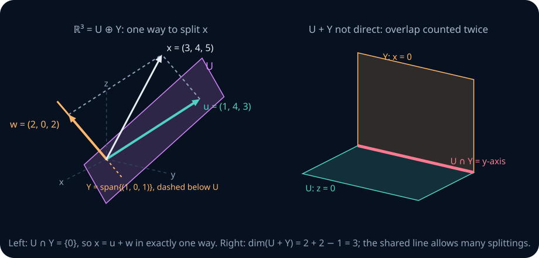

On the left, the line \(Y\) pierces the plane \(U\) only at the origin, and \(x\) is the far corner of a parallelogram with one side in each. On the right, the two planes share a whole line, so there is slack in how a vector can be split.

**Worked example — splitting a vector.** Let \(U=\operatorname{span}\{(1,1,0),(0,1,1)\}\) and \(Y=\operatorname{span}\{(1,0,1)\}\). Split \(x=(3,4,5)\) as \(u+w\) with \(u\in U\), \(w\in Y\). We need \(a(1,1,0)+b(0,1,1)+c(1,0,1)=(3,4,5)\):

$$
a+c=3,\qquad a+b=4,\qquad b+c=5 .
$$

Adding all three gives \(2(a+b+c)=12\), so \(a+b+c=6\). Subtracting each equation from this: \(b=3\), \(c=2\), \(a=1\). So \(u=1(1,1,0)+3(0,1,1)=(1,4,3)\) and \(w=2(1,0,1)=(2,0,2)\), and indeed \((1,4,3)+(2,0,2)=(3,4,5)\). The split is the only one: a vector \(t(1,0,1)\) in \(U\) would satisfy \((t,0,t)=(a,a+b,b)\), forcing \(a=b=t\) and \(2t=0\), so \(U\cap Y=\{0\}\), and Theorem 15 below turns that into uniqueness.

**Definition.** The **sum** of subspaces \(U\) and \(Y\) is \(U+Y=\{u+w:u\in U,\ w\in Y\}\).

**Theorem 14 — the sum is the smallest subspace containing both.** \(U+Y\) is a subspace containing \(U\) and \(Y\), and it lies inside every subspace that contains both. If \(U=\operatorname{span}(u_1,\dots,u_p)\) and \(Y=\operatorname{span}(w_1,\dots,w_q)\), then \(U+Y=\operatorname{span}(u_1,\dots,u_p,w_1,\dots,w_q)\).

*Proof.* \(0=0+0\); \((u+w)+(u'+w')=(u+u')+(w+w')\); \(c(u+w)=cu+cw\). So \(U+Y\) is a subspace, and it contains \(u=u+0\) and \(w=0+w\). A subspace containing \(U\) and \(Y\) contains each sum \(u+w\) by closure. For the spans: a combination of all the generators splits into a combination of the \(u\)'s plus a combination of the \(w\)'s, and conversely. ∎

**Definition.** The sum \(U+Y\) is **direct**, written \(U\oplus Y\), if every vector of \(U+Y\) can be written as \(u+w\) in exactly one way.

**Theorem 15 — direct means the overlap is zero.** \(U+Y\) is direct if and only if \(U\cap Y=\{0\}\).

*Proof.* (⇒) If \(x\in U\cap Y\), then \(x=x+0\) (with \(x\in U\), \(0\in Y\)) and \(x=0+x\) (with \(0\in U\), \(x\in Y\)) are two splittings of \(x\). Uniqueness makes them the same, so \(x=0\). (⇐) If \(u+w=u'+w'\), then \(u-u'=w'-w\). The left side is in \(U\) and the right in \(Y\), so both lie in \(U\cap Y=\{0\}\): \(u=u'\) and \(w=w'\). ∎

**Theorem 16 — dimension of a sum.** For finite-dimensional subspaces \(U\) and \(Y\),

$$
\dim(U+Y)=\dim U+\dim Y-\dim(U\cap Y).
$$

*Proof.* \(U\cap Y\) is a subspace of \(U\) (Theorem 7), hence finite-dimensional (Theorem 13). Take a basis \(z_1,\dots,z_m\) of \(U\cap Y\). By Theorem 10, extend it to a basis \(z_1,\dots,z_m,u_1,\dots,u_j\) of \(U\) and to a basis \(z_1,\dots,z_m,w_1,\dots,w_k\) of \(Y\). We show that the combined list \(z_1,\dots,z_m,u_1,\dots,u_j,w_1,\dots,w_k\) is a basis of \(U+Y\); then \(\dim(U+Y)=m+j+k=(m+j)+(m+k)-m\).

*It spans* \(U+Y\): its span contains both bases, hence \(U\) and \(Y\), hence \(U+Y\) by Theorem 14.

*It is independent.* Suppose \(\sum a_iz_i+\sum b_iu_i+\sum c_iw_i=0\). Then \(y=\sum c_iw_i=-\sum a_iz_i-\sum b_iu_i\). The first expression puts \(y\) in \(Y\) and the second puts it in \(U\), so \(y\in U\cap Y\) and \(y=\sum d_iz_i\) for some scalars \(d_i\). Then \(\sum c_iw_i-\sum d_iz_i=0\), and since the \(z\)'s and \(w\)'s form a basis of \(Y\), every \(c_i\) and \(d_i\) is zero. Now \(\sum a_iz_i+\sum b_iu_i=0\), and the \(z\)'s and \(u\)'s form a basis of \(U\), so every \(a_i\) and \(b_i\) is zero. ∎

**What this says in the picture.** Adding dimensions counts the shared part twice, so it is subtracted once. On the right of the figure, \(U=\{z=0\}\) and \(Y=\{x=0\}\) meet in the \(y\)-axis, so \(\dim(U+Y)=2+2-1=3\) and, by Theorem 13, \(U+Y=\mathbb R^3\). The sum is not direct: \((1,2,3)=(1,2,0)+(0,0,3)=(1,0,0)+(0,2,3)\) gives two splittings. On the left, \(\dim(U+Y)=2+1-0=3\), so \(\mathbb R^3=U\oplus Y\).

Two consequences are worth keeping. A sum is direct exactly when \(\dim(U+Y)=\dim U+\dim Y\). And inside \(\mathbb R^n\), \(U+Y\) has dimension at most \(n\), so \(\dim(U\cap Y)\ge\dim U+\dim Y-n\): two planes through the origin in \(\mathbb R^3\) always share at least a line.

> **Practice — Foundation:** Show that \(\mathbb R^2=\operatorname{span}\{(1,1)\}\oplus\operatorname{span}\{(1,-1)\}\) and split \((5,1)\) into its two pieces.
>
> **Hint:** A multiple of (1,1) equals a multiple of (1,−1) only at the origin. Solve a+b=5, a−b=1 for the two coefficients.
>
> **Practice — Core:** For \(U=\{x+y+z=0\}\) and \(Y=\{x=y\}\) in \(\mathbb R^3\), find a basis of \(U\cap Y\), then use Theorem 16 to find \(\dim(U+Y)\).
>
> **Hint:** Impose both equations: x=y and z=−2x leaves one free parameter. Each plane has dimension 2.
>
> **Practice — Stretch:** A **complement** of a subspace \(U\) of \(V\) is a subspace \(Y\) with \(V=U\oplus Y\). Prove that every subspace of a finite-dimensional space has a complement.
>
> **Hint:** Extend a basis of U to a basis of V (Theorem 10) and let Y be the span of the added vectors. Check U∩Y={0} using independence of the whole basis.

## 10. A matrix is a machine for combining columns

How do the pictures become code? Agree which way the vectors sit. Put \(k\) vectors from \(\mathbb R^n\) into the **columns** of \(V\in\mathbb R^{n\times k}\). Then matrix-vector multiplication is exactly the linear combination

$$
Vc=\begin{bmatrix}v_1&\cdots&v_k\end{bmatrix}
\begin{bmatrix}c_1\\\vdots\\c_k\end{bmatrix}
=\sum_{i=1}^k c_i v_i.
$$

In sections 10–13 and in the NumPy exercises, \(V\) names such a matrix of columns and the vector spaces involved are \(\mathbb R^n\) and \(\mathbb R^k\); elsewhere \(V\) is a general vector space. The shapes tell the story: \(k\) coefficients go in, \(n\) coordinates come out. Membership in the span asks whether \(Vc=w\) has a solution. Independence asks whether \(Vc=0\) has any solution besides \(c=0\). A basis gives exactly one solution for every vector in the space it spans. The **rank** of \(V\) is the dimension of its column span; by Theorems 9 and 13 it is at most \(k\) and at most \(n\).

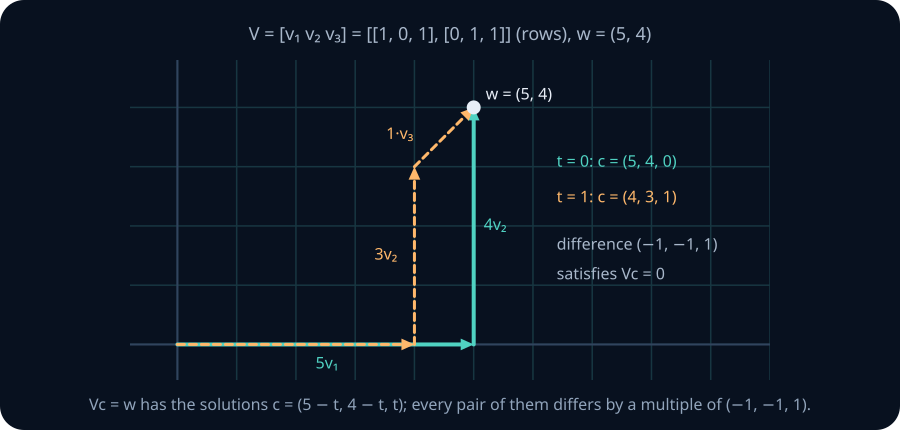

Both paths in the figure end at \(w\). Dependent columns always leave this kind of freedom.

**Matrix notation used from here on.** Each item is the column picture above, applied repeatedly.

- The **product** \(AN\) of an \(m\times n\) matrix \(A\) and an \(n\times p\) matrix \(N\) is the \(m\times p\) matrix whose \(j\)-th column is \(A\) times the \(j\)-th column of \(N\). For example \(\begin{bmatrix}1&1\\0&1\end{bmatrix}\begin{bmatrix}2&0\\1&3\end{bmatrix}=\begin{bmatrix}3&3\\1&3\end{bmatrix}\): the first column is \(2(1,0)+1(1,1)=(3,1)\).
- The **transpose** \(A^T\) swaps rows and columns: \(\begin{bmatrix}1&2\\3&4\end{bmatrix}^T=\begin{bmatrix}1&3\\2&4\end{bmatrix}\). A column vector \(u\) becomes the row \(u^T\), and \(u^Tv=\sum_iu_iv_i\) is a \(1\times1\) product.
- The **identity** \(I\) (or \(I_n\)) has columns \(e_1,\dots,e_n\), so \(Ix=x\). A **diagonal matrix** \(\operatorname{diag}(d_1,\dots,d_n)\) has \(d_1,\dots,d_n\) on its diagonal and zeros elsewhere; \(\operatorname{diag}(2,1)\) stretches the first axis by 2 and leaves the second alone.
- Products group freely: \((AN)x=A(Nx)\), \(A(x+y)=Ax+Ay\) and \(A(cx)=c(Ax)\). The last two hold because adding or scaling coefficient lists adds or scales the combinations; then \((AN)x=\sum_jx_j(An_j)=A\big(\sum_jx_jn_j\big)=A(Nx)\), where \(n_j\) is column \(j\) of \(N\). This is what lets \(Q^{-1}B[v]_B\) below be read either as \((Q^{-1}B)[v]_B\) or as \(Q^{-1}(B[v]_B)\).
- **The row picture.** Entry \(i\) of \(Vc\) is also row \(i\) of \(V\) multiplied entry by entry with \(c\) and added. With the \(V\) above and \(c=(4,3,1)\): row 1 gives \(1\cdot4+0\cdot3+1\cdot1=5\) and row 2 gives \(0\cdot4+1\cdot3+1\cdot1=4\), so \(Vc=(5,4)\), the same answer the column picture gives as \(4v_1+3v_2+1v_3\).
- A square matrix \(A\) is **invertible** when some matrix \(A^{-1}\) satisfies \(A^{-1}A=AA^{-1}=I\). The next subsection shows that a matrix whose columns form a basis is invertible.

**Worked example — two recipes for one destination.** Take

$$
V=\begin{bmatrix}1&0&1\\0&1&1\end{bmatrix},\qquad
w=\begin{bmatrix}5\\4\end{bmatrix}.
$$

The equations are \(c_1+c_3=5\) and \(c_2+c_3=4\). The unknown \(c_3\) is free: set \(c_3=t\), and then \(c_1=5-t\), \(c_2=4-t\). Every solution is \(c=(5-t,4-t,t)^T\). Choosing \(t=0\) or \(t=1\) gives the two paths in the figure. Their difference is \((-1,-1,1)^T\), and \(V(-1,-1,1)^T=-(1,0)-(0,1)+(1,1)=0\): it is the dependency relation among the columns. The next chapter names the set of all such relations the **null space**.

### Changing the recipe, keeping the vector

Let \(B,Q\in\mathbb R^{n\times n}\) contain two ordered bases of \(\mathbb R^n\) as columns: \(B=[b_1\ \cdots\ b_n]\) and \(Q=[q_1\ \cdots\ q_n]\). The vector itself must agree in both descriptions:

$$
v=B[v]_B=Q[v]_Q .
$$

To convert, we need the map \(v\mapsto[v]_Q\). It is **linear**: if \(u=\sum\alpha_iq_i\) and \(v=\sum\beta_iq_i\), then \(u+v=\sum(\alpha_i+\beta_i)q_i\) and \(sv=\sum(s\beta_i)q_i\), and by uniqueness (Theorem 8) these are *the* coordinate vectors, so \([u+v]_Q=[u]_Q+[v]_Q\) and \([sv]_Q=s[v]_Q\). Writing \(v=\sum_jv_je_j\) then gives \([v]_Q=\sum_jv_j[e_j]_Q\): multiplication by the matrix whose columns are \([e_1]_Q,\dots,[e_n]_Q\). Call that matrix \(Q^{-1}\). It undoes \(Q\): \(Q[v]_Q=v\) and \([Qd]_Q=d\), so \(QQ^{-1}=Q^{-1}Q=I\) and \(Q\) is invertible. So

$$
[v]_Q=Q^{-1}B[v]_B .
$$

Read the conversion from right to left: build the vector from its \(B\)-recipe, then find its \(Q\)-recipe. In code, solve \(Qd=B[v]_B\); you do not need to form an inverse explicitly.

**Worked example — two dimensions.** For \(B=((1,0),(1,1))\) and \(v=(3,2)\), the equation \(v=\gamma_1(1,0)+\gamma_2(1,1)\) reads \(\gamma_1+\gamma_2=3\), \(\gamma_2=2\), so \([v]_B=(1,2)^T\). In the standard basis \(E\), \([v]_E=(3,2)^T\). Nothing moved. Only the description changed.

**Worked example — a \(3\times3\) coordinate change.** Take the basis \(B\) of section 8, whose coordinates of \(v=(4,5,3)\) were \((2,1,2)\), and a second basis

$$
Q=(q_1,q_2,q_3)=((1,0,0),(1,1,0),(1,1,1)).
$$

To find \([v]_Q=(d_1,d_2,d_3)\), solve \(d_1q_1+d_2q_2+d_3q_3=(d_1+d_2+d_3,\ d_2+d_3,\ d_3)=(4,5,3)\) from the bottom: \(d_3=3\), then \(d_2=5-3=2\), then \(d_1=4-2-3=-1\). So \([v]_Q=(-1,2,3)\).

To convert *every* \(B\)-coordinate vector at once, find the \(Q\)-coordinates of each column of \(B\) the same way:

- \(b_1=(1,2,0)\): \(d_3=0\), \(d_2=2\), \(d_1=1-2-0=-1\), so \([b_1]_Q=(-1,2,0)\).
- \(b_2=(0,1,1)\): \(d_3=1\), \(d_2=0\), \(d_1=0-0-1=-1\), so \([b_2]_Q=(-1,0,1)\).
- \(b_3=(1,0,1)\): \(d_3=1\), \(d_2=-1\), \(d_1=1+1-1=1\), so \([b_3]_Q=(1,-1,1)\).

These are the columns of the conversion matrix: if \([v]_B=(\gamma_1,\gamma_2,\gamma_3)\), then \(v=\sum_j\gamma_jb_j\) and, by linearity, \([v]_Q=\sum_j\gamma_j[b_j]_Q\).

$$
Q^{-1}B=\begin{bmatrix}-1&-1&1\\2&0&-1\\0&1&1\end{bmatrix},\qquad
Q^{-1}B\begin{bmatrix}2\\1\\2\end{bmatrix}=\begin{bmatrix}-2-1+2\\4+0-2\\0+1+2\end{bmatrix}=\begin{bmatrix}-1\\2\\3\end{bmatrix}.
$$

The product agrees with the direct calculation.

**Shape habit.** A Python list `[[1, 0], [1, 1]]` is read as two column vectors by this chapter's browser labs. But `np.array(...)` puts those inner lists in rows. Use `np.column_stack(vectors)` when building \(V\) from a list of generators. A silent transpose can make a correct derivation look wrong.

> **Practice — Foundation:** Write the matrix whose columns are \((1,2,0)\) and \((0,1,3)\), state its shape, and compute its product with \((2,-1)^T\).
>
> **Hint:** Place each listed vector vertically. The coefficient vector has one entry per column, and the result has one entry per row.
>
> **Practice — Core:** With \(B=((1,2),(0,1))\) and \(Q=((1,1),(1,-1))\), find both coordinate vectors of \(v=(3,4)\), then reconstruct \(v\) from each.
>
> **Hint:** Write v as an unknown combination of each basis pair separately. Solve those two small systems and substitute back.
>
> **Practice — Stretch:** Derive the conversion from \(Q\)-coordinates back to \(B\)-coordinates and show that the two conversions cancel. Explain why the order of the matrices matters.
>
> **Hint:** First map Q-coordinates to the ambient vector, then map that vector to B-coordinates. Matrix products act on the rightmost input first.

## 11. Length, angle and overlap: the inner product

Span tells you what is reachable. It does not tell you whether two reachable vectors are close, or whether two arrows meet at a right angle. What extra structure answers those questions? The overlap experiments later in this unit need it; Module 3 develops it into projections, and Module 4 into orthonormal bases and the Gram–Schmidt process.

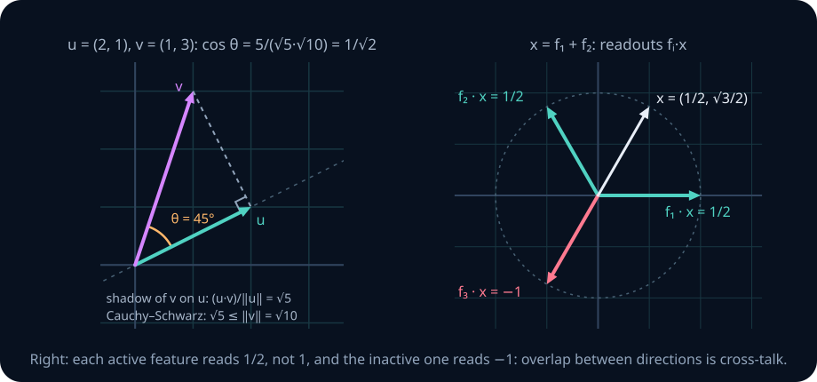

In the left panel, drop a perpendicular from the tip of \(v\) to the line through \(u\). Where it lands measures how much of \(v\) points along \(u\); the dot product records that number. The right panel previews why overlap matters for models.

An **inner product** on a vector space is a function \(\langle u,v\rangle\) that is symmetric (\(\langle u,v\rangle=\langle v,u\rangle\)), linear in each argument separately, and positive (\(\langle v,v\rangle>0\) for every nonzero \(v\)). In the usual Euclidean geometry of \(\mathbb R^n\), choose the **dot product** and its **length** (norm):

$$
\langle u,v\rangle=u^Tv=u\cdot v=\sum_i u_i v_i,\qquad
\|v\|_2=\sqrt{v^Tv}.
$$

**Worked example.** For \(u=(2,1)\) and \(v=(1,3)\): \(u\cdot v=2\cdot1+1\cdot3=5\), \(\|u\|=\sqrt{4+1}=\sqrt5\), \(\|v\|=\sqrt{1+9}=\sqrt{10}\).

To turn the dot product into an angle we need it to be no larger than the product of the lengths.

**Theorem 17 — Cauchy–Schwarz.** \(|u\cdot v|\le\|u\|\,\|v\|\), with equality exactly when \(u\) and \(v\) are dependent.

*Proof.* If \(v=0\), both sides are 0 and the pair is dependent. Otherwise, for every real \(t\),

$$
0\le\|u-tv\|^2=\|u\|^2-2t\,(u\cdot v)+t^2\|v\|^2 .
$$

Choose \(t=(u\cdot v)/\|v\|^2\). The right side becomes \(\|u\|^2-(u\cdot v)^2/\|v\|^2\), so \((u\cdot v)^2\le\|u\|^2\|v\|^2\). Equality holds exactly when \(u-tv=0\) for this \(t\), that is, when \(u\) is a multiple of \(v\). ∎ The same proof works for any inner product; Module 3 uses it that way.

For **nonzero** \(u,v\) the ratio below therefore lies in \([-1,1]\), and we define the angle \(\theta\in[0,\pi]\) by

$$
\cos\theta=\frac{u^Tv}{\|u\|_2\|v\|_2}.
$$

In the worked example, \(\cos\theta=5/(\sqrt5\sqrt{10})=5/\sqrt{50}=1/\sqrt2\), so \(\theta=45^\circ\). The shadow of \(v\) on the line of \(u\) has signed length \(\|v\|\cos\theta=(u\cdot v)/\|u\|=5/\sqrt5=\sqrt5\), which is the length of \(u\) itself: the perpendicular from \(v\) lands exactly at \(u\). Check: \((v-u)\cdot u=(-1,2)\cdot(2,1)=0\). In the figure, Cauchy–Schwarz says this shadow is never longer than \(v\) itself: \(\sqrt5\le\|v\|=\sqrt{10}\).

**Length, distance, and the triangle inequality.** A **unit vector** has length 1; dividing a nonzero vector by its length gives the unit vector in its direction, such as \(u/\|u\|=(2,1)/\sqrt5\). The **distance** between \(u\) and \(v\) is \(\|u-v\|\); here \(\|(1,-2)\|=\sqrt5\). Cauchy–Schwarz gives the **triangle inequality** in two lines:

$$
\|u+v\|^2=\|u\|^2+2\,u\cdot v+\|v\|^2\le\|u\|^2+2\|u\|\|v\|+\|v\|^2=(\|u\|+\|v\|)^2,
$$

so \(\|u+v\|\le\|u\|+\|v\|\): one side of the parallelogram's triangle is never longer than the other two together. Here \(u+v=(3,4)\) has length \(5\le\sqrt5+\sqrt{10}\approx5.40\).

**Orthogonality.** \(u\) and \(v\) are orthogonal when \(u^Tv=0\). Nonzero mutually orthogonal vectors are independent: take the inner product of \(\sum_i c_iv_i=0\) with \(v_j\); every term but one vanishes, leaving \(c_j\|v_j\|^2=0\), hence \(c_j=0\). The converse fails: \(u=(2,1)\) and \(v=(1,3)\) are independent (\(D=2\cdot3-1\cdot1=5\ne0\)) but their dot product is 5. A basis need not have right angles or unit-length arrows.

### The Gram matrix records the overlaps

With generators as columns of \(V\), define the **Gram matrix** \(G=V^TV\). Its \((i,j)\)-entry is \(v_i^Tv_j\), and

$$
c^TGc=(Vc)^T(Vc)=\|Vc\|_2^2.
$$

**Theorem 18 — the Gram matrix sees dependence.** \(Gc=0\) exactly when \(Vc=0\). So the columns of \(V\) are independent if and only if \(c=0\) is the only solution of \(Gc=0\).

*Proof.* If \(Vc=0\), then \(Gc=V^T(Vc)=0\). If \(Gc=0\), then \(\|Vc\|^2=c^TGc=0\), so \(Vc=0\). ∎

For a square matrix, "only the zero vector solves \(Gc=0\)" is equivalent to being invertible; the next unit (LA02) proves that equivalence, and nothing here depends on it.

**Worked example.** For \(V\) with columns \((1,0,1)\) and \((0,1,1)\), \(G=\begin{bmatrix}2&1\\1&2\end{bmatrix}\). With \(c=(1,-1)\), \(Vc=(1,-1,0)\) and \(\|Vc\|^2=2\), while \(c^TGc=2-1-1+2=2\). They agree.

### Overlap is cross-talk

Let unit feature directions be \(f_i\), and encode activations as \(x=\sum_i a_i f_i\). A dot-product readout for feature \(j\) gives

$$
f_j^Tx=a_j+\sum_{i\ne j}a_i\, f_j^Tf_i.
$$

The second term is **cross-talk**. In the right panel of the figure, three unit vectors sit \(120^\circ\) apart in \(\mathbb R^2\), so \(f_i^Tf_j=-\tfrac12\) for \(i\ne j\). With \(x=f_1+f_2\) (activations \(1,1,0\)), the readouts are \(f_1^Tx=1-\tfrac12=\tfrac12\), \(f_2^Tx=\tfrac12\), and \(f_3^Tx=-\tfrac12-\tfrac12=-1\): the active features read half their value and the inactive one reads \(-1\).

### A new basis does not automatically mean a new geometry

If \(x=Bc\) and \(y=Bd\), their Euclidean inner product is

$$
x^Ty=c^T(B^TB)d.
$$

Using \(c^Td\) instead would silently change the geometry, unless \(B^TB=I\). More generally, a symmetric matrix \(M\) satisfying \(z^TMz>0\) for every nonzero \(z\) defines an inner product \(x^TMy\). Such a matrix is called **positive definite**. In \(B\)-coordinates its matrix is \(B^TMB\). A change of coordinates preserves linear relationships, but a raw cosine between the new coordinate lists need not match the old cosine.

**Numerical notes.** The cosine is undefined when either vector is zero. Forming \(V^TV\) explicitly can lose accuracy when the columns are nearly dependent, so the Gram matrix is a tool for reasoning here rather than the default computational test (LA03 and LA09 explain the loss).

> **Practice — Foundation:** Compute \(u^Tv\), both lengths, and the cosine for \(u=(1,0)\), \(v=(1,1)\). What happens if either vector is zero?
>
> **Hint:** The dot product is the sum of coordinate products; lengths are square roots of self-products. Inspect the denominator before dividing to form a cosine.
>
> **Practice — Core:** For \(B=((1,1),(0,2))\), compute \(B^TB\) and use it to recover the standard Euclidean length of the vector with \(B\)-coordinates \((1,1)^T\).
>
> **Hint:** Each Gram entry is an overlap of two basis columns. For coordinate vector c, compare cᵀ(BᵀB)c with the squared length of Bc.
>
> **Practice — Stretch:** Prove that multiplying by an invertible matrix A (the map x↦Ax) preserves independence. Give an explicit example showing that it need not preserve Euclidean cosine similarity.
>
> **Hint:** Apply the inverse transformation to a proposed zero combination. For the cosine counterexample, try a nonuniform scaling on a pair that is initially perpendicular.

## 12. Affine sets: moving the origin

A span always contains zero. The line \(x+y=1\) does not, yet moving along it still feels one-dimensional. What kind of set is it? It is a **translated subspace**, also called an affine set:

$$
\mathcal A=x_0+S=\{x_0+s:s\in S\}.
$$

The point \(x_0\) anchors the set; the subspace \(S\) describes the displacements you can make while staying in it. For \(x+y=1\), choose \(x_0=(1,0)\) and \(S=\operatorname{span}\{(-1,1)\}\). Every point has the form \((1-t,t)\). The affine dimension is \(\dim S=1\).

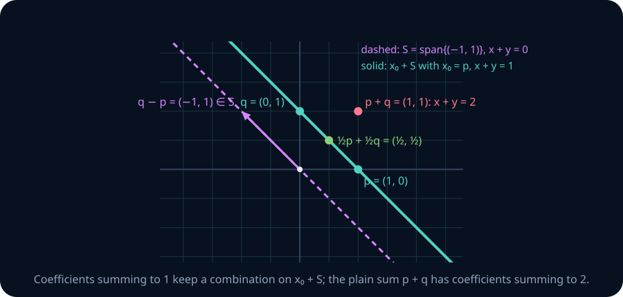

The two lines in the figure are parallel: the solid one is the dashed one slid over by \(p\). The difference \(q-p\) of two points on the solid line is a vector on the dashed line.

**Worked example — which averages stay on the line?** Let \(p=(1,0)\) and \(q=(0,1)\), both on \(x+y=1\). Their sum \((1,1)\) has \(x+y=2\), so it leaves the line, but their midpoint \((1/2,1/2)\) has \(x+y=1\) and stays on it. More generally,

$$
\sum_i a_i(x_0+s_i)=\left(\sum_i a_i\right)x_0+\sum_i a_i s_i.
$$

When \(\sum_i a_i=1\), this belongs to \(x_0+S\). Such a combination is **affine**. If the coefficients are also nonnegative, it is **convex**. The set of all affine combinations of some points is their **affine span**, and the set of all convex combinations is their **convex hull**. The full line through \(p,q\) is their affine span; the line segment between them is their convex hull. Neither is their linear span, which here is all of \(\mathbb R^2\).

A bias term \(Wx+b\) shifts every output of the map \(x\mapsto Wx\) by the same vector \(b\). Likewise, subtracting the mean of a dataset changes its origin. Centre a dataset before interpreting its span as variation around the mean; the span of the original location vectors answers a different question.

> **Practice — Foundation:** Write \(\{(x,y):y=3x+1\}\) as a point plus a one-dimensional subspace.
>
> **Hint:** Choose any point on the line as the anchor. Vary x and write the resulting displacement from that anchor as a scalar multiple of one direction.
>
> **Practice — Core:** Show that the difference of two points in \(x_0+S\) lies in \(S\), and that choosing a different anchor from the same affine set leaves \(S\) unchanged.
>
> **Hint:** Write the two points as x₀+s₁ and x₀+s₂. Their difference is s₁−s₂; changing anchor subtracts another member of S.
>
> **Practice — Stretch:** Three points are \((1,0)\), \((0,1)\), and \((2,-1)\). Find their linear span, affine span, and convex hull. Explain why these are three different sets.
>
> **Hint:** The points lie on x+y=1. Compare arbitrary linear combinations, combinations whose coefficients sum to 1, and those with additionally nonnegative coefficients.

## 13. From a picture to a numerical decision

How does a program decide membership, dependence and coordinates, and what changes when its arithmetic is rounded? The browser labs turn the three questions into algorithms. You need one operation: subtracting a multiple of one equation from another. This preserves the solution set because you can reverse the subtraction.

### Elimination on small systems

**Worked example — expose the free coefficient.** To express \((3,6)\) using \((1,2)\) and \((2,4)\), write

$$
c_1+2c_2=3,\qquad 2c_1+4c_2=6.
$$

Subtract twice the first equation from the second. The result is \(0=0\): there is no second restriction. Choose \(c_2=t\), then \(c_1=3-2t\). For target \((4,5)\), the same subtraction produces \(0=-3\), so there is no solution. For target zero it produces \(c=(-2t,t)\), an explicit family of relations. One procedure answers all three questions.

**Worked example — three unknowns.** When an equation is used to remove an unknown from the equations below it, the coefficient of that unknown is called a **pivot**. Use the dependent columns of section 5, \(v_1=(1,1,0)\), \(v_2=(0,1,1)\), \(v_3=(1,3,2)\), and the target \(w=(2,4,2)\):

$$
\begin{aligned}
c_1\phantom{{}+c_2}+c_3&=2\\
c_1+c_2+3c_3&=4\\
c_2+2c_3&=2
\end{aligned}
\quad\xrightarrow{\text{row}_2-\text{row}_1}\quad
\begin{aligned}
c_1+c_3&=2\\
c_2+2c_3&=2\\
c_2+2c_3&=2
\end{aligned}
\quad\xrightarrow{\text{row}_3-\text{row}_2}\quad
\begin{aligned}
c_1+c_3&=2\\
c_2+2c_3&=2\\
0&=0 .
\end{aligned}
$$

No equation is left to remove \(c_3\) (its column has no pivot), so \(c_3=t\) is free. Back-substitution gives \(c_2=2-2t\) and \(c_1=2-t\). At \(t=0\), \(2v_1+2v_2=(2,4,2)\). For the target \((1,0,0)\) the same two subtractions give right-hand sides \(1\), \(-1\) and then \(0-(-1)=1\), so the last row reads \(0=1\): no solution. For the zero target they give \(c=t(-1,-2,1)\), the relation found in section 5.

For larger inputs, **elimination** repeatedly selects a nonzero pivot, swaps its row into position, and removes that unknown from the rows below. **Partial pivoting** chooses the largest available absolute coefficient in the current column, to avoid dividing by an unnecessarily small number. Then solve the remaining equations backwards. A column without a pivot has a free coefficient. A row with all zero coefficients and a nonzero target is inconsistent. The next unit develops this procedure fully.

### Exact dependence versus numerical dependence

Consider

$$
B_\varepsilon=\begin{bmatrix}1&1\\0&\varepsilon\end{bmatrix},\qquad
v=\begin{bmatrix}0\\1\end{bmatrix}.
$$

For every \(\varepsilon\ne0\), the columns form a basis. The second equation, \(\varepsilon c_2=1\), gives \(c_2=1/\varepsilon\), and the first, \(c_1+c_2=0\), gives \(c_1=-1/\varepsilon\): \([v]_{B_\varepsilon}=(-1/\varepsilon,1/\varepsilon)^T\). As \(\varepsilon\to0\), the coordinates grow without bound, and at \(\varepsilon=0\) no recipe exists for this \(v\). If the second coordinate of \(v\) changes by \(\delta\), the recipe changes by \((-\delta/\varepsilon,\delta/\varepsilon)^T\). That is sensitivity to input error, even with a correct solver.

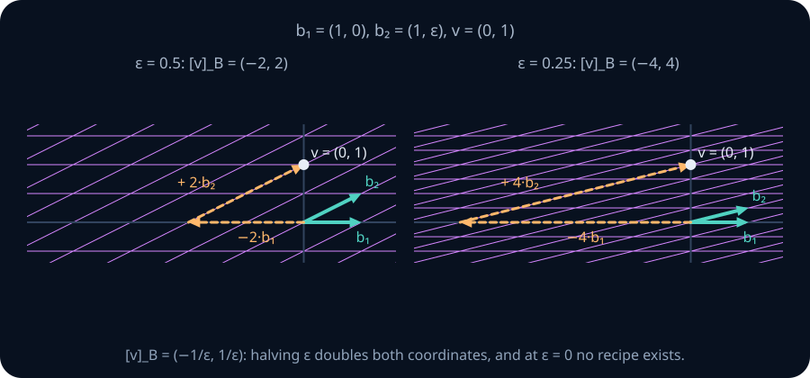

The dashed path in each panel is the recipe. As \(\varepsilon\) halves, the walk left along \(b_1\) and back along \(b_2\) doubles in length, although the destination never moves.

### Tolerances and scale

Rounded arithmetic rarely produces an exact zero, so an implementation compares each pivot and residual with a tolerance. This chapter's small browser exercises use an **absolute** tolerance for pivots and residuals. For experiments at different scales, state both an absolute and a relative tolerance, for example

$$
\|Vc-w\|_2\le \mathrm{atol}+\mathrm{rtol}\,\|w\|_2.
$$

Exact independence is unchanged when every coordinate is multiplied by a nonzero scalar; a fixed absolute threshold is not. Call the factors by which a diagonal matrix stretches each axis its **gains**: \(\operatorname{diag}(1,10^{-8})\) has gains \(1\) and \(10^{-8}\) (for general matrices the gains are the singular values of [SVD](08-svd-low-rank.md)). Counting gains above \(10^{-6}\) reports one usable direction for \(A=\operatorname{diag}(1,10^{-8})\) and two for \(10^8A=\operatorname{diag}(10^8,1)\), although the exact rank is two in both cases. Counting gains above \(10^{-6}\) *times the largest gain* reports one in both cases: a relative threshold ignores a common rescaling.

### An angle diagnostic

The basis lab reports the **Hadamard ratio**

$$
h(B)=\frac{|\det B|}{\prod_i\|b_i\|_2},
$$

where \(|\det B|\) is the factor by which \(B\) scales \(n\)-dimensional volume: the volume of the box spanned by its columns. LA05 defines it; Lab C computes it as the product of pivot magnitudes, and this unit uses only whether it is zero or not. For a \(2\times2\) basis \(\det B=D(b_1,b_2)\) from section 5, and expanding both sides verifies

$$
D(u,v)^2+(u\cdot v)^2=(u_1v_2-u_2v_1)^2+(u_1v_1+u_2v_2)^2=(u_1^2+u_2^2)(v_1^2+v_2^2).
$$

Dividing by \(\|u\|^2\|v\|^2\) gives \(D^2/(\|u\|^2\|v\|^2)=1-\cos^2\theta=\sin^2\theta\). So \(|D|=\|u\|\|v\||\sin\theta|\) is the parallelogram's area (base times height), and \(h(B)=|\sin\theta|\in(0,1]\): perpendicular columns give 1 and nearly parallel columns give nearly 0. (The bound \(h\le1\) for \(n\times n\) bases is Hadamard's inequality, which follows from the orthogonalization of LA04.) The ratio measures angle only; exercises B9 and M10 show what it misses.

**Numerical notes.**

- *Report the rule with the rank.* Rescaling individual features changes the geometry, so a numerical rank means something only alongside the matrix shape, dtype, feature scaling, algorithm and tolerance.
- *A small residual is about the reconstruction.* \(\|Vc-w\|\) small means \(Vc\) is close to \(w\); nearly dependent generators can still produce very different coefficient lists for almost the same target. [Numerical stability](../00-foundations/01-numerical-stability.md) returns to this.

> **Practice — Foundation:** Express the targets \((4,2)\) and \((1,1)\) using the generators \((2,1)\) and \((6,3)\) by eliminating the second equation, choosing one valid coefficient pair where one exists.
>
> **Hint:** The equations are 2c₁+6c₂=t₁ and c₁+3c₂=t₂. Subtract half the first from the second: a zero right-hand side leaves c₂ free; a nonzero one means no solution.
>
> **Practice — Core:** For the basis \(b_1=(1,1)\), \(b_2=(1,1+\varepsilon)\), compare the coordinates of \((0,1)\) and \((0,1+10^{-6})\) at \(\varepsilon=10^{-2}\) and \(10^{-8}\). Explain why checking only the reconstruction can miss the sensitivity.
>
> **Hint:** Subtract the first equation from the second to get εc₂=y−x, which contains division by ε. Compare coefficient changes as well as the reconstructed targets.
>
> **Practice — Stretch:** Compare \(B=10^{-8}I\) with \(\operatorname{diag}(1,10^{-8})\). Both have small determinants. Explain which has unequal sensitivity across directions, and why neither determinant magnitude nor the Hadamard ratio alone answers that question.
>
> **Hint:** Act on each coordinate unit vector and compare inverse scaling in the two directions. Uniform smallness differs from an imbalance between directions.

## 14. Three runnable coding labs

These exercises use only standard-library Python and run in the reader's Python workspace. Each link opens its own task tab. The inputs are lists of **columns**; validate their lengths, finite entries, and positive finite tolerance, and do not mutate them. `None` means a valid mathematical query has no requested solution; malformed input should raise `ValueError`.

The browser provides `_validated_columns(vectors, tol)` and `_eliminate(rows, width, tol)` as support functions. The first validates and copies the columns. The second modifies a row-oriented augmented matrix in place using partial pivoting, inspecting only the first `width` columns for pivots, and returns the pivot-column indices in row order. You may use them to focus on interpreting the result, or implement your own elimination. They are available in [the reference module](../../labs/reference.py) for local experiments.

### Lab A — membership in a span

Implement **span_coordinates** in [labs/exercises.py](../../labs/exercises.py). Return one coefficient per generator, reconstructing the target to the given tolerance, or `None` when it lies outside the span. Dependent generators can have many correct answers; choose free coefficients to be zero for a simple representative.

**Predict first.** With columns `[[1, 2], [2, 4]]`, target `[3, 6]` has infinitely many recipes, including `[3, 0]`. Target `[4, 5]` has none. An empty generator list spans just zero: return `[]` for a zero target and `None` for a nonzero target, at the stated tolerance.

~~~text
python -m labs.checks span
~~~

The checks cover independent and dependent generators, rectangular systems, unreachable targets, empty spans, tolerance-sensitive membership, input preservation, and invalid input. After elimination and back-substitution, verify the reconstructed target rather than comparing against a particular recipe.

### Lab B — exhibit a dependency relation

Implement **dependency_relation** in [labs/exercises.py](../../labs/exercises.py). Return `None` for independent generators. Otherwise return a relation \(c\ne0\) with \(Vc\approx0\), normalized so that `max(abs(x) for x in c) == 1` up to rounding. Select one free coefficient to be 1, set the others to zero, and solve backwards. Returning the all-zero vector does not demonstrate dependence.

**Predict first.** For `[[1, 0], [0, 1], [1, 1]]`, `[-1, -1, 1]` works. For a single zero vector, `[1]` works. The empty list is independent, so return `None`; nonempty generator lists must have at least one coordinate per generator.

~~~text
python -m labs.checks dependence
~~~

The checks cover independent rectangular inputs, repeated vectors, a zero generator, pairwise independent but jointly dependent vectors, and random lists with more generators than coordinates. They verify the relation and its normalization rather than requiring a particular sign or free variable.

### Lab C — coordinates and degeneracy

Implement **basis_coordinates** in [labs/exercises.py](../../labs/exercises.py). For a nonempty square basis return `([v]_B, hadamard_ratio)`. Use elimination for coordinates and the absolute product of the resulting diagonal pivots for \(|\det B|\); row swaps flip the sign of that product but not its absolute value. Reject a basis that is singular at the chosen tolerance.

**Predict first.** For columns `[[2, 1], [1, 3]]` and target `[3, 4]`, the result is `([1, 1], 1 / sqrt(2))`: the determinant is 5 and the column lengths are √5 and √10. A rotated orthonormal basis (perpendicular columns of length 1) has ratio 1. A pair of nonzero parallel columns is rejected.

~~~text
python -m labs.checks coordinates
~~~

The checks reconstruct the target in standard, skewed, rotated, and random bases; compare the ratio with \(|\sin\theta|\) as two columns approach each other; and reject invalid or singular inputs.

> **Practice — Foundation:** Predict the output of `span_coordinates([[2, 0], [1, 1]], [4, 3])` and `span_coordinates([[3, 1], [6, 2]], [1, 1])`; of `dependency_relation([[1, 0], [0, 1]])` and `dependency_relation([[3, 1], [6, 2]])`; and of `basis_coordinates([[2, 0], [1, 1]], [4, 3])` and `basis_coordinates([[3, 1], [6, 2]], [1, 0])`.
>
> **Hint:** The columns (3,1),(6,2) are parallel with 2(3,1)−(6,2)=0, and (1,1) is not a multiple of (3,1), so they give the `None`, the relation (rescale it so the largest entry has magnitude 1), and the singular-basis `ValueError`. For the (2,0),(1,1) queries solve 2c₁+c₂=4, c₂=3; the ratio is |det|/(2·√2)=2/(2√2).
>
> **Practice — Core:** Explain why the span and dependence tests verify reconstructed vectors rather than matching one expected coefficient list.
>
> **Hint:** Dependent generators can represent one vector with several coefficient lists. The reconstructed vector tests the mathematical claim without choosing an arbitrary representative.
>
> **Practice — Stretch:** Run `span_coordinates([[1, 0]], [1, 1], tol=1e-9)`, then multiply the generator and the target by \(10^{-10}\) and run it again with the same tolerance. Record both results and the residual of the second, and explain why the decision changed although the exact span and the exact answer did not.
>
> **Hint:** The first run returns None: (1,1) is off the x-axis. After scaling, the generator's entry 10⁻¹⁰ is below the pivot tolerance, so it is treated as zero, and the whole target (length about 1.4·10⁻¹⁰) passes the absolute residual test: the result is [0.0].

## 15. Exercises · by hand

These exercises build from direct calculations to proofs and one diagnosis. Keep the labels when saving an attempt so you can return to the exact problem. Foundation, Core, and Stretch indicate reasoning difficulty; work through the sequence rather than skipping proofs after a successful calculation.

**A1 · Foundation · paper — arithmetic and recipes.** Let \(u=(4,1)\), \(v=(-1,2)\). Compute \(2u+3v\), and find scalars \(a,b\) with \(au+bv=(6,-3)\). Check the second answer by substitution.

**A2 · Foundation · paper — name the span in space.** For each list in \(\mathbb R^3\), say whether its span is a point, a line, a plane, or all of \(\mathbb R^3\), and give its dimension: (a) \((2,-1,4)\); (b) \((1,0,2),(0,1,-1)\); (c) \((1,2,1),(2,4,2),(3,6,3)\); (d) \((1,0,1),(0,1,0),(1,1,2)\). For (b), write the plane as \(z=px+qy\).

**A3 · Foundation · paper — reachable or not in space.** Decide whether \((4,0,4)\) and \((1,2,3)\) lie in \(\operatorname{span}\{(1,1,0),(1,-1,2)\}\). Give the coefficients when a target is reachable, and name the equation that fails when it is not.

**A4 · Foundation · paper — exhibit the redundancy.** Decide independence for each list, giving a nonzero dependency relation when one exists:

| Case | Vectors |
|---|---|
| (a) | \((3,-1),(-6,2)\) |
| (b) | \((1,1,1),(1,2,3),(2,3,4)\) |
| (c) | \((1,0,2),(0,3,1),(0,0,5)\) |
| (d) | \((1,2),(3,1),(0,5)\) |
| (e) | \((1,2,0),(0,0,0),(3,1,4)\) |

**A5 · Foundation · paper — a parameter in three dimensions.** Find every \(t\) for which \((1,2,t)\), \((0,2,1)\), \((t,0,1)\) are dependent. For the larger such \(t\), give a dependency relation.

**A6 · Core · paper — the subspace test.** Which subsets of \(\mathbb R^3\) are subspaces: (a) \(x-2y+3z=0\); (b) \(x^2=y^2\); (c) \(x+y=z+1\); (d) \(\{(s+t,s,t):s,t\in\mathbb R\}\); (e) \(x\ge y\)? For a yes, check all three conditions. For a no, give a specific failed condition and a counterexample.

**A7 · Foundation · paper — coordinates in a 3×3 basis.** Show that \(B=((1,0,1),(2,1,0),(0,1,1))\) is a basis of \(\mathbb R^3\) and find \([v]_B\) for \(v=(3,3,4)\). Reconstruct \(v\) from your answer.

**A8 · Foundation · paper — extend to a basis.** Extend the independent list \((1,2,0,1),(0,1,1,0)\) to a basis of \(\mathbb R^4\) by trying \(e_1,e_2,e_3,e_4\) in order and appending each one that lies outside the current span. Which standard basis vectors are appended?

**A9 · Foundation · paper — angle and Cauchy–Schwarz.** For \(u=(1,2,2)\) and \(v=(2,-1,2)\), compute \(u\cdot v\), \(\|u\|\), \(\|v\|\) and \(\cos\theta\), and check the Cauchy–Schwarz inequality. Then find a nonzero vector orthogonal to both.

**A10 · Foundation · paper — split a vector.** In \(\mathbb R^3\), let \(U=\{x+y+z=0\}\) and \(Y=\operatorname{span}\{(1,1,1)\}\). Show that \(\mathbb R^3=U\oplus Y\) and write \((3,0,0)\) as \(u+w\) with \(u\in U\), \(w\in Y\).

**A11 · Core · paper — Taylor coordinates.** Show that \(B=(1,\ x-1,\ (x-1)^2)\) is a basis of \(P_2\) and find \([2-x+3x^2]_B\). Explain what the three coordinates are in calculus terms.

**A12 · Core · paper — a coordinate change in three dimensions.** Let \(B=((2,0,1),(1,1,0),(0,1,1))\) and \(Q=((1,0,0),(1,1,0),(1,1,1))\). A vector has \([v]_B=(1,-1,2)\). Find \(v\) and \([v]_Q\), then write the matrix that converts every \(B\)-coordinate vector into \(Q\)-coordinates.

**A13 · Core · paper — sum and intersection in four dimensions.** Let \(U=\operatorname{span}\{(1,0,1,0),(0,1,0,1)\}\) and \(Y=\operatorname{span}\{(1,1,1,1),(1,0,0,0)\}\) in \(\mathbb R^4\). Find \(\dim U\), \(\dim Y\), \(\dim(U+Y)\), \(\dim(U\cap Y)\), and a nonzero vector in \(U\cap Y\). Check the numbers against Theorem 16.

**A14 · Core · paper — sums of independent vectors.** Suppose \(u,v,w\) are independent in a vector space \(V\). Prove that \(u+v,\ v+w,\ w+u\) are independent, and that \(u-v,\ v-w,\ w-u\) are dependent.

**A15 · Core · paper — find the flaw.** A student argues: "If \(v_1,v_2,v_3\) are dependent, then \(c_1v_1+c_2v_2+c_3v_3=0\) with some \(c_i\ne0\). Dividing by \(c_1\) gives \(v_1=-(c_2/c_1)v_2-(c_3/c_1)v_3\), so \(v_1\) lies in the span of \(v_2,v_3\)." Identify the first invalid step, give a dependent list in \(\mathbb R^2\) for which the conclusion is false, and state the correct conclusion.

**A16 · Core · paper — the span of any set.** For an arbitrary subset \(S\subseteq V\), possibly empty or infinite, define \(\operatorname{span}S\) as the set of all finite linear combinations of elements of \(S\), with \(\operatorname{span}\varnothing=\{0\}\). Prove that \(\operatorname{span}S\) is a subspace, that it equals the intersection of all subspaces containing \(S\), and that \(\operatorname{span}(S\cup T)=\operatorname{span}S+\operatorname{span}T\).

**A17 · Stretch · paper — a relation between functions.** Is \(\sin x,\cos x,\sin(x+\pi/4)\) an independent list of functions \(\mathbb R\to\mathbb R\)? A relation must hold at every \(x\), not just at a few sampled points. Find one or prove none exists.

**A18 · Stretch · paper — three subspaces.** Call \(U_1+U_2+U_3\) direct when each of its vectors has exactly one representation \(u_1+u_2+u_3\) with \(u_i\in U_i\). Show with three lines in \(\mathbb R^2\) that pairwise intersections \(U_i\cap U_j=\{0\}\) do not make the sum direct. Then prove that the sum is direct if and only if \(U_1\cap U_2=\{0\}\) and \(U_3\cap(U_1+U_2)=\{0\}\).

**A19 · Stretch · paper — dimension counting.** For subspaces \(S,T\subseteq\mathbb R^5\) with \(\dim S=\dim T=3\), give every possible value of \(\dim(S\cap T)\) and justify both extremes. State which theorem forces the lower bound.

**A20 · Stretch · paper — a single exchange.** Let \(v_1,\dots,v_n\) be a basis of \(V\) and \(w=c_1v_1+\dots+c_nv_n\). Prove that replacing \(v_j\) by \(w\) gives a basis exactly when \(c_j\ne0\).

> **Practice — Foundation:** A1 asks you to check a proposed pair \(a,b\) by substitution; A14 asks you to prove that \(u+v,v+w,w+u\) are independent. Which one can be settled by one substitution, and which needs a universal argument? Name the quantifier ("there exist" or "for all") in each.
>
> **Hint:** A1's check substitutes one particular pair into two equations. A14 must rule out every nonzero coefficient list, which no finite number of substitutions can do.
>
> **Practice — Core:** The list \((1,2),(2,1),(3,3)\) is dependent. Write \((4,5)\) using two different coefficient lists, subtract them, and check that the difference is a nonzero relation. Which direction of Theorem 8 does this subtraction illustrate?
>
> **Hint:** Solve with the first two vectors to get (2,1,0), then find a recipe that uses (3,3)=(1,2)+(2,1), such as (1,0,1). Two recipes for one vector giving a nonzero relation is the contrapositive of "independent implies unique recipe".
>
> **Practice — Stretch:** Run the procedure of Theorem 10 from \(\{(1,1,0)\}\) in \(\mathbb R^3\), trying \(e_1,e_2,e_3\) in that order. Give the resulting basis, then explain from Theorem 4 why the procedure can append at most \(n-m\) vectors when started from \(m\) independent vectors in \(\mathbb R^n\).
>
> **Hint:** e₁ is appended; e₂=(1,1,0)−e₁ is already in the span, so it is skipped. Each append keeps the list independent, and an independent list in Rⁿ has at most n members.

## 16. Exercises · NumPy

Run these in a local Python environment with NumPy; B6 and B7 also use matplotlib. The browser exercises above remain standard-library-only. Use `np.random.default_rng(0)` for reproducible experiments, `float64` for the first pass, and report tolerances with your results. No `np.linalg.matrix_rank` or `np.linalg.solve` here; library routines explicitly allowed below are comparison tools or previews of later machinery.

**B1 · Foundation · NumPy — build a linear combination.** Implement both functions, then compare them on several rectangular shapes, negative coefficients, and zero coefficients. Use loops only in the first implementation, and matrix multiplication in the second.

~~~python
import numpy as np

def lincomb_loops(vectors, coeffs):
    """Nonempty list of equal-length 1-D vectors; one coefficient each."""
    raise NotImplementedError("Accumulate each coefficient times its vector")

def lincomb_vec(V, c):
    """V has shape (n, k), with vectors as columns; c has shape (k,)."""
    raise NotImplementedError("Express the same operation with @")

vectors = [np.array([1., 0., 2.]), np.array([3., 1., -1.])]
c = np.array([-1., 2.])
V = np.column_stack(vectors)
assert np.allclose(lincomb_loops(vectors, c), lincomb_vec(V, c))
~~~

**B2 · Core · NumPy — an independence decision needs a tolerance.** Implement `is_dependent_2d(u, v, tol=1e-9)` using \(|u_1v_2-u_2v_1|\le\mathrm{tol}\). Compare an exactly parallel pair, unit vectors separated by \(10^{-8}\) radians, and the standard basis. Find an answer that changes with `tol`. Then multiply both input vectors by \(10^{-6}\). Explain why a fixed determinant threshold is scale-sensitive: scaling both columns by \(s\) scales the determinant by \(s^2\). For nonzero vectors, compare with the scale-free ratio in section 13.

**B3 · Core · NumPy — the Gram determinant, and its limits.** Form \(G=V^TV\); `np.linalg.det` is allowed (the determinant is defined in LA05; only whether it is zero matters here). Use random \(3\times3\) and \(3\times2\) matrices and dependent versions made by replacing one column with another. In exact arithmetic, \(\det G=0\) exactly when the columns are dependent; justify this using \(c^TGc=\|Vc\|^2\). Compare with floating-point results without expecting literal zero. In two columns, derive

$$
\det G=\|u\|^2\|v\|^2-(u^Tv)^2
=\|u\|^2\|v\|^2\sin^2\theta.
$$

So \(\sqrt{\det G}\) is area. In three columns it is volume, a fact developed in the determinant treatment. Now make two columns nearly parallel and explain why a very small or slightly negative computed determinant is not a trustworthy geometric volume. Do not hide that failure by blindly taking a square root.

**B4 · Core · NumPy — membership by reconstruction.** Write `in_span(V, w, atol=1e-9, rtol=1e-9)` using `np.linalg.lstsq(V, w, rcond=None)` and a residual test. The least-squares solver is allowed here as a preview of the projections chapter. Always compute `np.linalg.norm(V @ c - w)` yourself: the returned `residuals` array can be empty for underdetermined or rank-deficient inputs even when the target is outside the span. Test reachable, unreachable, and nearly reachable targets; specify your absolute-plus-relative decision rule.

**B5 · Core · NumPy — a nonzero relation in a wide matrix.** Draw \(V\) with shape \((5,6)\) and find \(c\ne0\) such that \(Vc\approx0\). `np.linalg.svd` is allowed. The SVD gives mutually perpendicular unit right directions; its theory comes later. For this experiment, request the **full** right factor:

~~~python
import numpy as np

rng = np.random.default_rng(0)
V = rng.normal(size=(5, 6))
U, singular_values, Vh = np.linalg.svd(V, full_matrices=True)
c = Vh[-1]
print(Vh.shape, np.linalg.norm(V @ c), np.linalg.norm(c))
~~~

For a full-row-rank \(5\times6\) matrix, `Vh` has shape \((6,6)\), and its final row supplies the missing null direction. There are only five returned singular values; the null direction corresponds to the extra right vector, not necessarily to a zero in that returned list. Repeat with `full_matrices=False`: `Vh` is then \((5,6)\), and its final row generally does **not** give a dependency relation. Explain the difference before using SVD to check another wide matrix.

**B6 · Core · NumPy — coordinates near collapse.** For \(B=\begin{bmatrix}a&b\\c&d\end{bmatrix}\), implement `coords_in_basis(B, v)` using

$$
B^{-1}=\frac{1}{ad-bc}\begin{bmatrix}d&-b\\-c&a\end{bmatrix},
$$

rejecting a determinant too small under your stated tolerance. Check standard, skewed, and rotated bases by reconstruction. Then use \(b_1=(1,0)\), \(b_2=(\cos\theta,\sin\theta)\), and fixed \(v=(0,2)\). Sweep \(\theta\) toward zero and plot \(\|[v]_B\|\). Repeat with \(v=(3,0)\), whose coordinates stay \((3,0)\) along this path. Sensitivity permits large changes; it does not require every target to have large coordinates.

**B7 · Stretch · NumPy — rebuild the span picture.** In matplotlib, draw \(u=(1,2)\), \(v=(-1,1)\), then scatter 2,000 combinations with coefficients uniform on \([-2,2]\). Overlay the four boundary corners \(\pm2u\pm2v\) in cyclic order. Save the figure, then repeat with \(v=2u\) and save that figure too. Label the shaded or sampled region as a bounded set of combinations, not the entire span. Explain what finite samples can illustrate and what they cannot prove.

> **Practice — Foundation:** State the shapes of \(V\), \(c\), \(Vc\), and \(V^TV\) for B5.
>
> **Hint:** Count ambient coordinates as rows and generators as columns. Check that the inner dimensions agree in each product before predicting its shape.
>
> **Practice — Core:** Apply B2's test \(|u_1v_2-u_2v_1|\le\mathrm{tol}\) to \(u=(1,1)\), \(v=(1,1+10^{-8})\): with `tol=1e-9` in `float64`, with `tol=1e-9` after casting to `float32`, and with `tol=1e-7` in `float64`. Report the three decisions and say which change is caused by rounding and which by the chosen threshold.
>
> **Hint:** In float64 the determinant is about 10⁻⁸. In float32, 1+10⁻⁸ rounds to exactly 1, so the determinant becomes 0 before any threshold is applied.
>
> **Practice — Stretch:** With B4's `in_span` and `atol=rtol=1e-9`, test the columns \((1,0)\), \((1,10^{-6})\) and target \(w=(0,1)\). Report the Boolean, the coefficients, and the reconstruction residual. Then perturb the target to \((0,1.001)\) and report how far the coefficients move compared with the \(10^{-3}\) move of the target.
>
> **Hint:** The second equation is 10⁻⁶c₂=w₂, so c₂=10⁶w₂ and c₁=−c₂. Both calls return True with residuals near zero, which hides a coefficient change of 1000 in each entry.

**B8 · Stretch · NumPy — geometry under a coordinate change.** Use \(B=\begin{pmatrix}1&2\\0&1\end{pmatrix}\). For several vectors \(x,y\), solve for their coordinate lists \(c,d\). Compare \(x^Ty\), \(c^Td\), and \(c^T(B^TB)d\). Include \(x=(1,0),y=(0,1)\). Explain which calculation preserves the original geometry and why an invertible coordinate change preserves independence even when the raw coordinate cosine changes. Gram–Schmidt and its numerical variants belong to Module 4.

**B9 · Stretch · NumPy — two degeneracy measures.** Implement `hadamard_ratio(B)` and compare it with `np.linalg.cond(B)` on two paths: \(B_\theta\) with columns \(e_1\) and \((\cos\theta,\sin\theta)\) for \(\theta=10^{-k}\), and \(S_t=\operatorname{diag}(1,t)\) for \(t=10^{-k}\), with \(k=0,1,\dots,8\) in both. Plot both measures against \(k\) on a log scale and report their values at \(\theta=10^{-4}\) and at \(t=10^{-4}\). State which you would put in a bug report, which you would put in a loss curve, and why they are not interchangeable.

## 17. Exercises · PyTorch

Use a local environment with PyTorch. These experiments run on CPU with synthetic inputs; no model download is required. Start with `torch.manual_seed(0)` and `torch.float64`, then investigate what lower precision changes. The libraries' rank computations use numerical thresholds, so distinguish their output from the exact theorem.

**C1 · Foundation · PyTorch — embedding rows.** Generate a random matrix \(E\in\mathbb R^{5000\times64}\). Before computing, state whether its rows must be dependent and the largest possible rank. Compute `torch.linalg.matrix_rank(E)`. Full rank here means rank 64; it cannot mean that all 5,000 rows are independent. Create a version whose last column duplicates its first, then compare the result with your prediction.

**C2 · Core · PyTorch — what a factored update can express.** Construct \(\Delta W=LR\) with \(L\in\mathbb R^{256\times8}\) and \(R\in\mathbb R^{8\times256}\). Prove that every output \(\Delta W x=L(Rx)\) lies in \(\operatorname{span}(L)\), the span of the columns of \(L\), hence rank is at most 8. Verify it numerically. Distinguish a **fixed** \(L\), which fixes the allowed output subspace, from trainable \(L\), which can move that subspace while keeping its dimension at most 8. Also explain why a low-rank update does not force \(W+\Delta W\) itself to have low rank.

**C3 · Core · PyTorch — measure overlap without assuming the conclusion.** Generate \(m\) random unit vectors in \(\mathbb R^{64}\) for \(m\in\{32,64,128,1024\}\). Compute the largest absolute off-diagonal inner product. A starting point is:

~~~python
import torch

torch.manual_seed(0)
for m in (32, 64, 128, 1024):
    F = torch.randn(m, 64, dtype=torch.float64)
    F = F / torch.linalg.vector_norm(F, dim=1, keepdim=True)
    overlaps = (F @ F.T).abs()
    overlaps.fill_diagonal_(0)
    print(m, overlaps.max().item())
~~~

Repeat across several seeds and plot the results. Independence is impossible for \(m>64\), but maximum overlap is a separate measurement. Next construct \(x=\sum_i a_i f_i\) with only a few nonzero activations and measure dot-product readout errors. Increase the number of active features. Explain why the largest pairwise overlap does not by itself determine the total interference.

**C4 · Stretch · PyTorch — low-rank initialization is not a rank constraint.** Compare two bias-free models learning the identity map in 64 dimensions. Model one is `nn.Linear(64, 64, bias=False, dtype=torch.float64)`, initialized with the rank-4 weight \(P=\operatorname{diag}(1,1,1,1,0,\dots,0)\). Model two always uses \(W=LR\), with shapes \((64,4)\) and \((4,64)\), initialized with the corresponding first four standard basis columns and rows. Use \(X=8I_{64}\), target \(X\), and mean squared error over all entries; batches are row vectors, so predictions are `X @ W.T`.

The identity fixture makes the comparison exact: show that the loss equals \(\|W-I\|_F^2/64\), where \(\|M\|_F^2\) is the sum of squared entries of \(M\). Train both models with gradient descent and report their losses and ranks. Then derive the unrestricted weight after one step with learning rate \(\eta\), give its exact rank, and find the learning rates for which repeated steps converge. Explain why initial rank does not constrain later parameter updates, while storing the weight as a product keeps the rank bound at every step.

**C5 · Stretch · PyTorch — translate a claim you read.** Find “column space” or “rank” in a paper you are reading, or use the factored update in C2. Write two sentences: identify the matrix's input and output spaces, then state the geometric restriction. Add one thing the rank claim does not establish, such as feature meaning, downstream accuracy, or ease of optimization.

> **Practice — Foundation:** Why are 5,000 embedding rows dependent even if no two rows are scalar multiples?
>
> **Hint:** Pairwise nonparallel rows need not be jointly independent. Compare the number of rows with the embedding dimension, not just every pair.
>
> **Practice — Core:** Give an example where a rank-1 update added to a matrix leaves the result full rank. Identify the two different spans involved.
>
> **Hint:** Start with an identity matrix and add an update in just one coordinate direction. Compare the update’s column space with the full matrix’s column space.
>
> **Practice — Stretch:** In C2, freeze \(L\) and train only \(R\). Show that every update keeps each column of \(\Delta W\) in \(\operatorname{span}(L)\), and give a target update that this model can never reach however long it trains.
>
> **Hint:** Whatever R becomes, ΔW=LR has columns L·(column of R). Any matrix with a column outside span(L), such as one whose column is a vector perpendicular to all columns of L, is unreachable.

**C6 · Core · PyTorch — probes and null spaces.** With `torch.manual_seed(0)` and `float64`, draw activations \(H\in\mathbb R^{200\times8}\) from a standard normal and labels \(y_i=\mathbb 1[H_{i1}+H_{i2}>0]\). Train a bias-free logistic-regression probe \(w\in\mathbb R^8\) by full-batch gradient descent from \(w=0\) (learning rate 0.5, 500 steps). Describe the null space of \(w\) in words and give its dimension. Form \(z=e_3-w(w^Te_3)/(w^Tw)\), edit every activation to \(h_i'=h_i+5z\), and report \(w^Tz\), \(\|5z\|\), \(\max_i|w^Th_i'-w^Th_i|\), and the probe accuracy before and after. Then say what "the probe's accuracy did not move" does and does not imply.

**C7 · Core · PyTorch — what survives a change of coordinates.** Stack the activation vectors \(v_1=(1,1,0,0)\), \(v_2=(1,-1,0,0)\), \(v_3=(0,0,1,1)\), \(v_4=v_1+v_3\) as rows of a `float64` tensor and map each through the invertible \(A=\operatorname{diag}(2,1,1,3)\). Before and after the map, report `torch.linalg.matrix_rank` of the stack, whether the relation \(v_1+v_3-v_4=0\) still holds for the images, whether the images of \(v_1,v_2,v_3\) are independent, \(\|v_1\|\), and the cosines of the pairs \((v_1,v_2)\) and \((v_1,v_4)\). Classify span, independence, dimension, rank, norm and cosine similarity as surviving or not, and relate the split to the inner-product section: the survivors are the properties that never needed a geometry.

## 18. Derivations to own

Close the page and rebuild these arguments. The aim is to know which step makes a claim true, so that you can recognize when that step is unavailable in a new setting.

1. Derive \(0v=0\), \((-1)v=-v\), and \(a0=0\) from the vector-space axioms. Distinguish the scalar zero from the zero vector.
2. Prove that every span is a subspace and is contained in every subspace containing its generators. State what changes for an empty generator list.
3. Prove the three equivalent forms of dependence and the linear dependence lemma, checking that any coefficient you divide by is nonzero.
4. Show that dependence gives two different recipes for at least one vector, and conversely that two different recipes give a nonzero dependency relation.
5. Prove the exchange lemma, then deduce that two finite bases have the same length and that \(k>n\) vectors in \(\mathbb R^n\) are dependent.
6. Prove that a spanning list can be reduced to a basis and an independent list extended to one, and that in dimension \(n\) either property alone suffices for a list of length \(n\).
7. Prove that \(U+Y\) is direct exactly when \(U\cap Y=\{0\}\), and prove \(\dim(U+Y)=\dim U+\dim Y-\dim(U\cap Y)\).
8. Derive \(v=B[v]_B=Q[v]_Q\) and the change-of-basis formula, with shapes written above each factor.
9. Prove Cauchy–Schwarz, then prove that \(V^TVc=0\) exactly when \(Vc=0\).
10. Show why coefficients summing to one keep affine combinations inside a translated subspace.
11. Solve for the coordinates of \((0,1)\) in \(B_\varepsilon\), and derive the change caused by a perturbation \((0,\delta)\).
12. Expand the dot-product readout of a sum of feature vectors and identify precisely where cross-talk enters.

> **Practice — Foundation:** In derivation 1, point to one scalar zero and one vector zero and say how you know which is which.
>
> **Hint:** In 0v, the first zero is a scalar acting on a vector. In v+(−v), the resulting zero belongs to the vector space. Check each operation’s domain.
>
> **Practice — Core:** Reconstruct derivation 4 without naming Theorem 1 or Theorem 8. Use only coefficient lists and subtraction.
>
> **Hint:** Suppose two representations exist, subtract them, and inspect their coefficient differences. For the converse, turn a nonzero dependence relation into two representations.
>
> **Practice — Stretch:** Extend derivation 8 to \(P_2\) with old basis \((1,x,x^2)\) and new basis \(B=(1,1+x,1+x+x^2)\). Write the \(3\times3\) matrix converting \(B\)-coordinates to old coordinates, use it on \([3+2x-x^2]_B=(1,3,-1)\), and say what its columns represent when there are no physical arrows.
>
> **Hint:** Each column lists the coefficients of one new basis polynomial in (1,x,x²); for example 1+x+x² gives (1,1,1). Multiply the matrix by (1,3,−1) and compare with (3,2,−1).

## 19. Exercises · cumulative

These mix the ideas rather than repeating one track. Each carries the same header as the exercises above — identifier, difficulty, and the tools it expects — and the same checker: type what can be typed, have an argument marked, and open the reference solution once you have attempted it.

**M1 · Foundation · mixed — Three recipes.** For \(u=(2,-1)\), \(v=(-6,3)\), find three coefficient pairs producing \((4,-2)\). Describe all such pairs.

**M2 · Foundation · mixed — Two dimensions, two descriptions.** For \(B=((2,1),(1,1))\), find the coordinates of \((5,3)\). Reverse the basis order and find the new coordinates.

**M3 · Foundation · mixed — Subspace or affine set.** Classify \(2x-y+z=0\) and \(2x-y+z=3\) in \(\mathbb R^3\). Give a basis for the first and a point-plus-subspace description for the second.

**M4 · Foundation · mixed — Independent but not orthogonal.** Give three vectors in \(\mathbb R^3\) that are independent while every pair has a nonzero dot product, and verify both claims. Then explain why three nonzero, pairwise orthogonal vectors in \(\mathbb R^3\) are automatically a basis.

**M5 · Core · mixed — Coordinates carry relations.** Let \(B\) be a basis of an \(n\)-dimensional space \(V\). Prove that \(w_1,\dots,w_k\) are independent in \(V\) exactly when \([w_1]_B,\dots,[w_k]_B\) are independent in \(\mathbb R^n\). Use this with the basis \((1,x,x^2)\) to find a dependency relation among \(1+2x\), \(x-x^2\), \(1+x+x^2\).

**M6 · Core · mixed — Find the hidden relation.** Let \(u=(1,2,-1)\), \(v=(2,1,3)\), \(w=(4,5,1)\). Find a nonzero relation, a basis of the span, and all coefficient lists expressing \(w\) with these three generators.

**M7 · Core · mixed — Same geometry in different coordinates.** Set \(B=\operatorname{diag}(2,1)\), \(x=(1,3)\), and \(y=(3,-1)\). Compute the dot product of their standard coordinates, the raw dot product of their \(B\)-coordinates, and the dot product using the Gram matrix \(B^TB\). Explain the discrepancy.

**M8 · Core · mixed — A union claim.** Prove that \(U\cup Y\) is a subspace exactly when \(U\subseteq Y\) or \(Y\subseteq U\). Your proof must establish both directions.

**M9 · Stretch · mixed — Several relations at once.** A \(4\times7\) matrix has rank 4, so its full SVD returns four positive singular values. How many independent dependency relations do its columns have, which rows of the full factor `Vh` supply them, and what are the shapes of `U`, the singular values and `Vh` in the full and the reduced SVD?

**M10 · Stretch · mixed — Diagnose a misleading numerical report.** Someone reports “the basis is safe: the reconstruction error is tiny and the Hadamard ratio is 1.” Use \(B=\operatorname{diag}(1,10^{-5})\) to construct a counterexample based on input perturbation. Name the claim the residual does support.

**M11 · Stretch · mixed — Keep the logits unchanged.** Row embeddings transform as \(x'=xA\), where \(A\in\mathbb R^{d\times d}\) is invertible. Original logits are \(xW\), with \(W\in\mathbb R^{d\times k}\). Derive the new downstream weights that preserve every logit. Does Euclidean cosine between embeddings have to remain unchanged?

**M12 · Stretch · mixed — Audit a claim about rank-one gradients.** For a linear layer \(y=Wx\) trained on one example \((x,t)\) with loss \(\tfrac12\|Wx-t\|^2\), show that the gradient with respect to \(W\) is \((Wx-t)x^T\), a matrix of rank at most one. Someone concludes: “so training can only ever change \(W\) along one direction.” Starting from \(W_0=0\in\mathbb R^{2\times2}\), take one step with learning rate 1 on the example \((e_1,e_1)\) and then one on \((e_2,e_2)\); report \(W_2\) and its rank. State the correct claim about \(W_k-W_0\) after \(k\) single-example steps.

**M13 · Stretch · mixed — Scale-aware rank reporting.** For \(A=\operatorname{diag}(4,\,2\cdot10^{-7})\), report the exact rank and the numerical rank under the rule “count gains strictly larger than \(10^{-6}\)”. Repeat for \(10^3A\). Then apply the relative rule “count gains larger than \(10^{-6}\) times the largest gain” to both, and say which claims are invariant under the rescaling.

> **Practice — Foundation:** With \(u=(1,-2)\) and \(v=(-3,6)\), a classmate claims that the pairs \((4,1)\), \((1,0)\) and \((2,1)\) all give \(au+bv=(1,-2)\). Check each by substitution. Which pair fails, and what does it produce?
>
> **Hint:** Since v=−3u, every combination is (a−3b)u, so a pair works exactly when a−3b=1.
>
> **Practice — Core:** The coordinate map in M5 carries relations in both directions. For the polynomials \(1-x\), \(x-x^2\), \(1-x^2\), write their coefficient lists in the basis \((1,x,x^2)\), find a relation among the lists, and translate it back into a relation among the polynomials.
>
> **Hint:** The lists are (1,−1,0), (0,1,−1) and (1,0,−1). The first two add to the third.
>
> **Practice — Stretch:** Change one assumption in M11: take \(d=k=2\), the singular map \(A=\operatorname{diag}(1,0)\), and \(W=I_2\). Compare the inputs \(x=(0,0)\) and \(x=(0,1)\), and show that no weights \(W'\) satisfy \(xAW'=xW\) for every \(x\).
>
> **Hint:** Both inputs map to xA=(0,0), so any W′ gives them the same new logits (0,0). Their original logits are (0,0) and (0,1).

## 20. Checkpoint

Use a fresh page and keep the solution sketches closed. The six questions cover a concept explanation, a small calculation, a derivation, an implementation bug, an experiment critique, and an unfamiliar extension. A passing code check or a familiar diagram does not replace the argument.

**K1 · Checkpoint · gate — Define and explain.** State linear independence from memory. Explain why the zero-combination definition is useful and prove its equivalence to “no vector is in the span of the others.”

**K2 · Checkpoint · gate — Find the redundancy in four dimensions.** For \(u=(1,0,2,1)\), \(v=(0,1,1,-1)\), \(w=(2,-3,1,5)\), decide independence, give an explicit dependency relation if one exists, and give the dimension of the span and a basis for it.

**K3 · Checkpoint · gate — Complements are not unique.** Prove or disprove: if \(V=U\oplus Y\) and \(V=U\oplus Y'\), then \(Y=Y'\). Then prove what is determined: \(\dim Y=\dim V-\dim U\) when \(V\) is finite-dimensional.

**K4 · Checkpoint · gate — Debug an independence test.** A colleague's `is_independent(vectors, tol)` returns `True` whenever no two of the vectors are parallel, testing each pair with \(|u\cdot v|<(1-\mathrm{tol})\|u\|\|v\|\). Give three vectors in \(\mathbb R^3\) on which it returns the wrong answer, explain the bug using Theorem 1, and describe a correct test built on `dependency_relation`, with one regression test you would add.

**K5 · Checkpoint · gate — Explain collapse precisely.** Hold \(b_1=e_2\) fixed and let \(b_2=\varepsilon e_1+e_2\), with \(\varepsilon\ne0\) tending to zero. Find the coordinates of a fixed point \((x,y)\), separating \(x\ne0\) from \(x=0\), and state what happens to existence and uniqueness at \(\varepsilon=0\). A lab note reads: “as \(\varepsilon\) shrinks the coordinates blow up, so the point is leaving the span.” Critique it.

**K6 · Checkpoint · gate — Symmetric plus antisymmetric.** In the space \(V\) of real \(2\times2\) matrices, let \(U\) be the symmetric matrices (\(A^T=A\)) and \(Y\) the antisymmetric ones (\(A^T=-A\)). Prove \(V=U\oplus Y\), find \(\dim U\) and \(\dim Y\), and split \(\begin{pmatrix}1&2\\4&3\end{pmatrix}\) into its symmetric and antisymmetric parts.

**What to bring to a tutor.** Bring six written attempts, one explicit numerical dependency relation with its residual, and one perturbation experiment showing sensitive coordinates. For a proof, identify where every assumption is used. For a computation, state shapes, convention, tolerance, and how you checked the reconstruction. Revise the first incorrect or unjustified step before asking for a complete solution.

**Try an unfamiliar variant.** Replace K2's vectors with the polynomials \(1+x\), \(x+x^2\), and \(2+3x+x^2\). Use the coefficient basis \((1,x,x^2)\) to decide dependence. The same reasoning should work after the arrows disappear.

**What comes next.** [Systems, elimination and the four fundamental subspaces](02-systems-elimination-subspaces.md) gives names and structure to the questions this chapter has already posed: which targets are reachable, which inputs produce zero, and when is a recipe unique? [Projections and least squares](03-projections-least-squares.md) develops orthogonality and best approximate recipes. Determinant volume, SVD, condition numbers, and numerical rank were previews here; their full theory and robust algorithms come later.

## Mastery check

Explain the object/coordinate distinction and why the standard basis is a choice; state independence from memory and defend the zero-combination phrasing through its equivalences; prove the exchange lemma and use it to show that dimension is well defined; run the three-part subspace test on unfamiliar sets and name the failing rule; split a vector across a direct sum and compute the dimension of a sum from its intersection; use the dimension bound to say what a fixed-width representation cannot carry, and state cleanly what it does *not* force; derive a change of coordinates from the invariance of the vector rather than from memory; recognise near-dependence as ill-conditioning and diagnose it numerically; and apply every definition unchanged to a space of functions.
