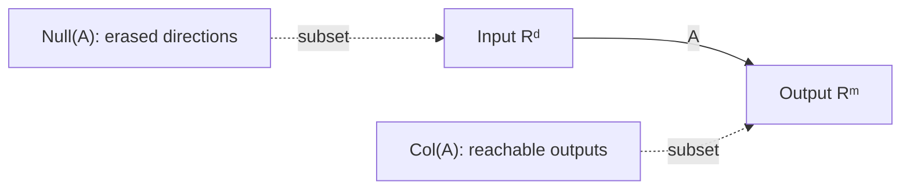

# Linear maps, rank and the four fundamental subspaces

## 1. Linear maps

A map \(T:V\to W\) is linear when

$$
T(\alpha x+\beta y)=\alpha T(x)+\beta T(y).
$$

Once bases are chosen, a finite-dimensional linear map is represented by a matrix. Matrix multiplication is therefore composition of linear maps—not an arbitrary rule of arrays.

If \(A:\mathbb R^d\to\mathbb R^m\) and \(B:\mathbb R^k\to\mathbb R^d\), then \(AB:\mathbb R^k\to\mathbb R^m\). The order follows function composition: \(A(Bx)\).

## 2. Kernel and image

The null space or kernel is

$$
\mathcal N(A)=\{x\in\mathbb R^d:Ax=0\}.
$$

It contains input directions erased by the transformation. The column space or image is

$$
\mathcal C(A)=\{Ax:x\in\mathbb R^d\}\subseteq\mathbb R^m.
$$

It contains every achievable output. Their dimensions satisfy rank–nullity:

$$
\operatorname{rank}(A)+\operatorname{nullity}(A)=d.
$$

### Proof idea for rank–nullity

Take a basis of \(\mathcal N(A)\), extend it to a basis of the domain, and examine the images of the added vectors. Those images form a basis of \(\mathcal C(A)\). The domain basis therefore partitions into null directions and directions responsible for the image.

## 3. Row space and orthogonal complements

For \(A\in\mathbb R^{m\times d}\), four spaces matter:

| Space | Ambient space | Meaning |
|---|---|---|
| Column space \(\mathcal C(A)\) | \(\mathbb R^m\) | reachable outputs |
| Null space \(\mathcal N(A)\) | \(\mathbb R^d\) | erased inputs |
| Row space \(\mathcal C(A^T)\) | \(\mathbb R^d\) | input directions detected by rows |
| Left null space \(\mathcal N(A^T)\) | \(\mathbb R^m\) | output directions orthogonal to every column |

The fundamental orthogonality relations are

$$
\mathcal N(A)=\mathcal C(A^T)^\perp,
\qquad
\mathcal N(A^T)=\mathcal C(A)^\perp.
$$

For the first relation, if \(Ax=0\), every row \(a_i^T\) satisfies \(a_i^Tx=0\); hence \(x\) is orthogonal to the row space. Equality follows from matching dimensions.

## 4. Rank and factorization

Rank is the dimension of the image and equals the number of independent rows, independent columns and nonzero singular values. If \(\operatorname{rank}(A)=r\), then

$$
A=UV,
\qquad U\in\mathbb R^{m\times r},\;V\in\mathbb R^{r\times d}.
$$

This expresses a wide transformation through an \(r\)-dimensional bottleneck. Low-rank adapters exploit exactly this structure: a parameter update \(\Delta W=BA\) has rank at most the inner dimension.

## 5. Injective, surjective and invertible

- \(A\) is injective iff \(\mathcal N(A)=\{0\}\), equivalently full column rank.
- \(A\) is surjective iff \(\mathcal C(A)=\mathbb R^m\), equivalently full row rank.
- A square matrix is invertible iff it is both, equivalently rank \(d\).

In neural networks, an operation can be non-invertible because it reduces dimension, clips values or identifies multiple inputs. Information loss is often intentional but should be named.

## Implementation lab

Given matrices with controlled singular values:

1. compute numerical rank under several tolerances;
2. recover bases for all four fundamental subspaces;
3. verify the orthogonality relationships numerically;
4. construct rank-\(r\) factorizations;
5. demonstrate that `matrix_rank` changes with scale unless the tolerance scales appropriately.

## Problems

1. Prove that \(\mathcal N(A)\) is a subspace.
2. If \(A\in\mathbb R^{7\times12}\) has rank 5, give dimensions of all four fundamental subspaces.
3. Show that \(\operatorname{rank}(AB)\le\min(\operatorname{rank}(A),\operatorname{rank}(B))\).
4. Determine all solutions of \(Ax=b\) in terms of one particular solution and \(\mathcal N(A)\).
5. **Transfer.** A residual block computes \(x+F(x)\). Explain why the skip path can preserve directions that a low-rank local Jacobian of \(F\) would otherwise erase.

Solution sketches

1. Verify zero, addition and scalar closure directly from linearity.
2. Column space 5; left null space \(7-5=2\); row space 5; null space \(12-5=7\).
3. The image of \(AB\) is contained in the image of \(A\), and \(B\) can supply at most \(\operatorname{rank}(B)\) independent inputs to \(A\).
4. If \(x_p\) is particular, every solution is \(x_p+z\) with \(z\in\mathcal N(A)\), and every such vector is a solution.
5. The block Jacobian is \(I+J_F\). Even if \(J_Fv=0\), the identity path maps \(v\) to itself locally.

## Mastery gate

For an unseen rectangular matrix, explain and compute its four subspaces, prove the two orthogonality relations, and connect the rank structure to a model bottleneck or LoRA update.

