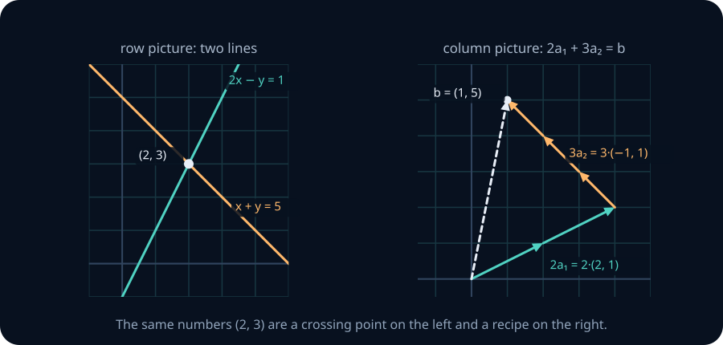
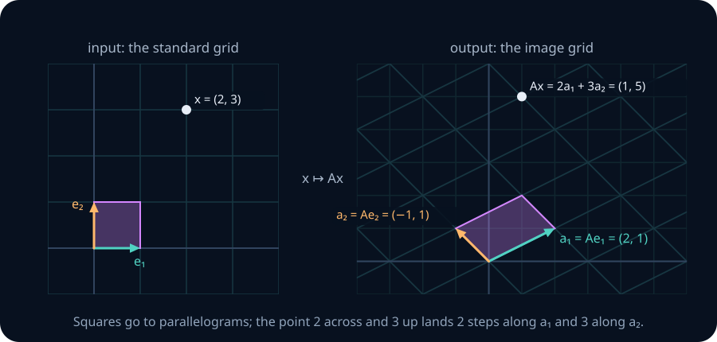
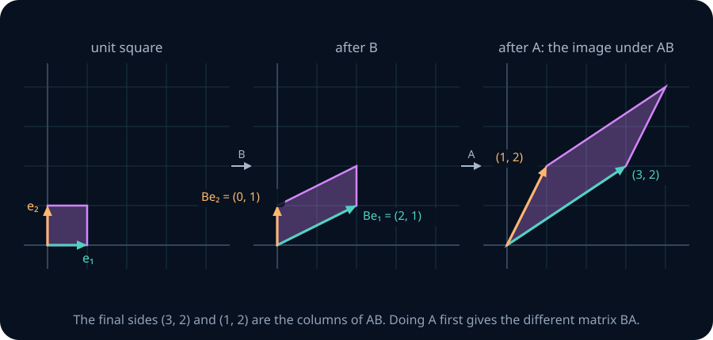
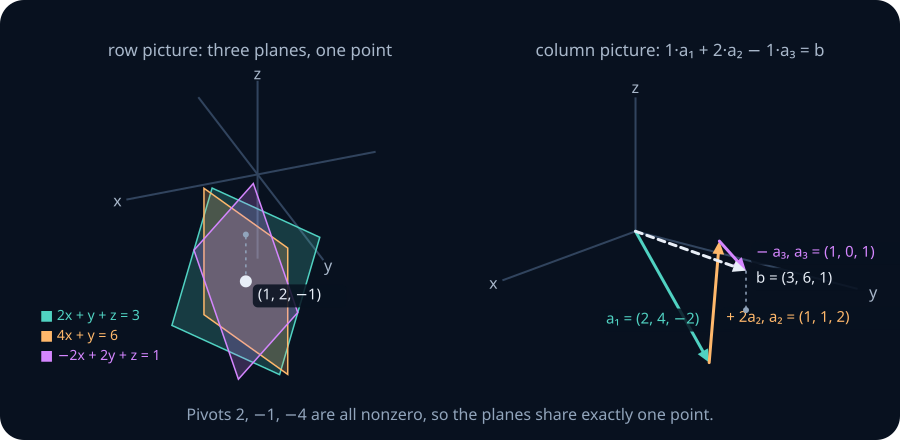
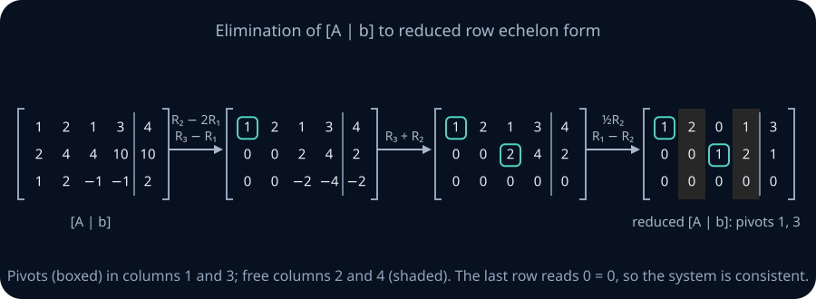
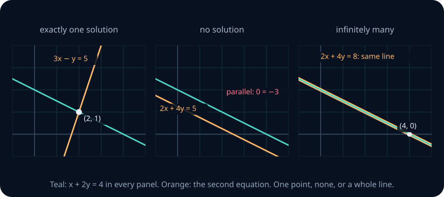
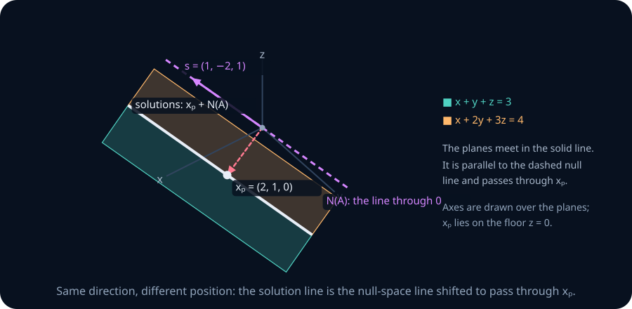
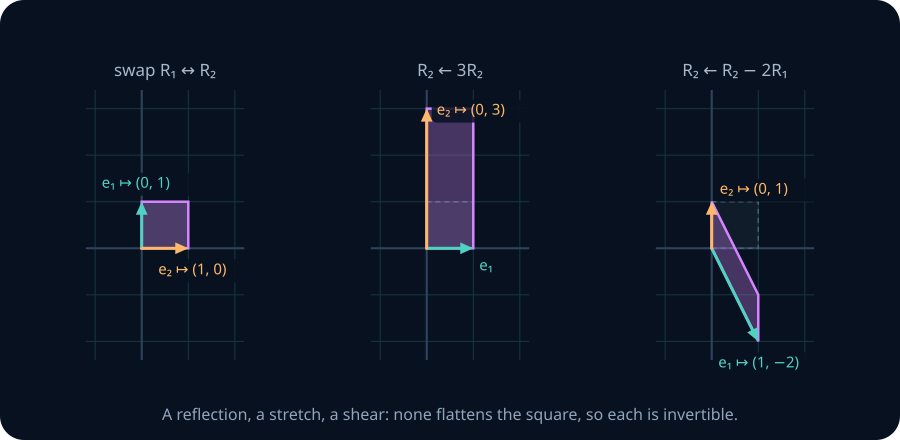
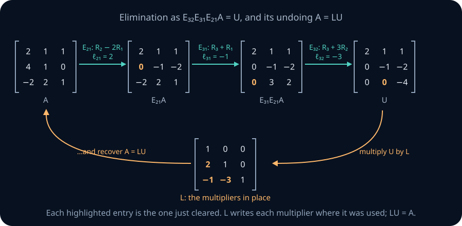
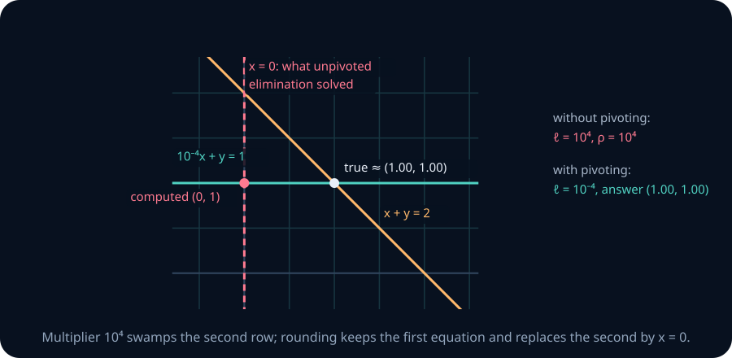

# Systems, elimination and the four fundamental subspaces

Two questions about a system of linear equations — does a solution exist, and is it unique — turn out to be the span and independence questions of the previous unit asked backwards. One algorithm, elimination, answers both, and its answer is organized by four subspaces attached to every matrix.

## 0. Where this is going

The previous unit asked what a list of arrows can reach. This one fixes a target \(b\) and asks *which* combination of the columns of a matrix \(A\) produces it, and whether there is more than one.

| Question about \(Ax=b\) | The idea it really is | Read off from elimination as |
|---|---|---|
| **Existence** — is there any solution? | Is \(b\) in the span of the columns of \(A\)? | No pivot in the right-hand column |
| **Uniqueness** — is there only one? | Are the columns of \(A\) independent? | No free columns |

By the end you should be able to look at a shape such as \(A\in\mathbb R^{768\times3072}\) and say, before computing anything, that \(Ax=b\) is solvable for every \(b\) when the rank is full and that its solution is never unique. The first fact comes from the consistency test of section 5; the second from one identity proved in section 6: rank plus nullity equals the number of columns.

**Prerequisite check.** Each item links to the section of the previous unit that teaches it.

- Write \((4,5)\) as a combination of \((2,1)\) and \((1,2)\). Repair: [LA01 §4, span](01-vectors-spaces-bases.md).
- Decide whether \((1,1,0),(0,1,1),(1,3,2)\) are independent. Repair: [LA01 §5, independence](01-vectors-spaces-bases.md).
- State why \(n\) independent vectors in \(\mathbb R^n\) form a basis. Repair: [LA01 §8, basis and dimension](01-vectors-spaces-bases.md).
- Explain why a line that misses the origin is not a subspace. Repair: [LA01 §12, affine sets](01-vectors-spaces-bases.md).
- State when a sum of subspaces \(U+Y\) is direct. Repair: [LA01 §9, sums and direct sums](01-vectors-spaces-bases.md).

**Notation.** Vectors are columns. An \(m\times n\) matrix \(A\) has \(m\) rows and \(n\) columns; its entry in row \(i\) and column \(j\) is \(a_{ij}\), also written \(A_{ij}\). Its columns are \(a_1,\dots,a_n\in\mathbb R^m\). The right-hand side of a system is \(b\in\mathbb R^m\) with entries \(b_1,\dots,b_m\); the unknown is \(x\in\mathbb R^n\). \(e_j\) is the \(j\)-th standard basis vector. Row \(i\) of a matrix is \(R_i\) when we are describing row operations.

**Route.** Sections 1–2 say what a matrix does and how matrices combine. Sections 3–4 develop elimination and carry out a complete \(3\times4\) example. Sections 5–7 read rank, the complete solution and the four subspaces off that example. Sections 8–9 turn elimination into matrix algebra: elementary matrices, inverses and the factorization \(PA=LU\). Section 10 asks what changes in floating point.

**How to work through this.** Each teaching section follows the same order: the question, a picture, a worked example with every step shown, the general statement, its proof, and three practice prompts (Foundation, Core, Stretch). Attempt the prompts before continuing. The three coding labs in section 11 run in this page. The exercise bank in sections 12–16 carries a header on every item — identifier, difficulty, and the tools it expects — with a checker underneath: type what can be typed, have a written argument marked, and open the reference solution once you have attempted it. The checkpoint in section 17 is the gate.

## 1. Three ways to read \(Ax\)

A system of equations and a matrix times a vector are the same object. What exactly does \(Ax\) compute, and what does solving \(Ax=b\) ask for?

**Definition.** For an \(m\times n\) matrix \(A=[\,a_1\ a_2\ \cdots\ a_n\,]\) and \(x\in\mathbb R^n\), the **matrix–vector product** is the linear combination of the columns with the entries of \(x\) as coefficients:

$$
Ax = x_1a_1 + x_2a_2 + \dots + x_na_n\ \in\mathbb R^m .
$$

Reading entry \(i\) of this sum gives the second description, one row at a time:

$$
(Ax)_i = a_{i1}x_1+a_{i2}x_2+\dots+a_{in}x_n ,
$$

which is row \(i\) of \(A\) dotted with \(x\). So \(Ax=b\) can be read two ways. The **column picture** asks for a recipe: which combination of the columns builds \(b\)? The **row picture** lists \(m\) equations, each saying that \(x\) lies on one line (in \(\mathbb R^2\)), one plane (in \(\mathbb R^3\)) or, in higher dimensions, one **hyperplane** (the solution set of a single linear equation in \(\mathbb R^n\)); a solution is a point on all of them.

**Worked example — one system, two pictures.** Take

$$
A=\begin{pmatrix}2&-1\\1&1\end{pmatrix},\qquad b=\begin{pmatrix}1\\5\end{pmatrix},\qquad\text{that is}\qquad 2x-y=1,\quad x+y=5 .
$$

*Row picture.* The second equation gives \(x=5-y\). Substituting into the first, \(2(5-y)-y=1\), so \(10-3y=1\) and \(y=3\); then \(x=2\). The two lines cross at \((2,3)\). Check: \(2\cdot2-3=1\) and \(2+3=5\).

*Column picture.* The columns are \(a_1=(2,1)\) and \(a_2=(-1,1)\). The solution says \(2a_1+3a_2=b\): indeed \(2(2,1)+3(-1,1)=(4-3,\ 2+3)=(1,5)\).



In the left panel look for the crossing point; in the right panel follow the path from the origin: two copies of the first column, then three of the second, ending exactly at \(b\). The same numbers \((2,3)\) are a point in one picture and a recipe in the other. The column picture is the one that generalizes: with 768 columns nobody draws 768 hyperplanes, but "is \(b\) reachable from these columns?" still makes sense.

**The third reading: a map.** A **function** \(f:\mathbb R^n\to\mathbb R^m\) is **linear** if for all vectors \(x,y\) and all scalars \(\alpha,\beta\)

$$
f(\alpha x+\beta y)=\alpha f(x)+\beta f(y).
$$

This is the **superposition** property: the response to a combination of inputs is the same combination of the responses. Taking \(\alpha=\beta=1\) gives additivity \(f(x+y)=f(x)+f(y)\); taking \(\beta=0\) gives homogeneity \(f(\alpha x)=\alpha f(x)\); and taking \(\alpha=\beta=0\) gives \(f(0)=0\). Every matrix defines a linear map \(x\mapsto Ax\), because

$$
A(\alpha x+\beta y)=\sum_j(\alpha x_j+\beta y_j)a_j=\alpha\sum_jx_ja_j+\beta\sum_jy_ja_j=\alpha Ax+\beta Ay .
$$

The converse is the reason matrices matter.

**Theorem 1 — every linear map is a matrix.** If \(f:\mathbb R^n\to\mathbb R^m\) is linear, then \(f(x)=Ax\) for every \(x\), where \(A\) is the \(m\times n\) matrix whose columns are \(f(e_1),\dots,f(e_n)\). No other matrix has this property.

*Proof.* Write \(x=x_1e_1+\dots+x_ne_n\). Superposition, applied repeatedly, gives \(f(x)=x_1f(e_1)+\dots+x_nf(e_n)\), and by the column definition of the product this is \(Ax\). If also \(f(x)=Bx\) for every \(x\), then \(Be_j=f(e_j)=Ae_j\); but \(Ae_j\) is column \(j\) of \(A\), so the two matrices have the same columns. ∎



**What this says in the picture.** A linear map is decided by where it sends \(e_1\) and \(e_2\). The whole grid on the left is carried to the skewed grid on the right, square by square: the point three rows up and two columns across stays three rows up and two across, in the new grid. Solving \(Ax=b\) means finding the input grid point that lands on \(b\).

**Worked example — building matrices from what a map does.**

1. *Rotation by 90° counterclockwise in the plane.* Rotating a parallelogram gives a parallelogram, so rotation is additive, and rotating a stretched arrow gives the stretched rotated arrow, so it is linear. It sends \(e_1=(1,0)\) to \((0,1)\) and \(e_2=(0,1)\) to \((-1,0)\), so by Theorem 1 its matrix is \(\begin{pmatrix}0&-1\\1&0\end{pmatrix}\). Check on \(x=(3,1)\): \(3(0,1)+1(-1,0)=(-1,3)\), and rotating \((3,1)\) a quarter turn does give \((-1,3)\).
2. *A summary of three measurements.* Let \(f(x)=(\text{mean of }x_1,x_2,x_3,\ x_3-x_1)\) on \(\mathbb R^3\). Averages and differences respect sums and scalings, so \(f\) is linear. Its columns are \(f(e_1)=(\tfrac13,-1)\), \(f(e_2)=(\tfrac13,0)\), \(f(e_3)=(\tfrac13,1)\), giving the \(2\times3\) matrix \(\begin{pmatrix}\tfrac13&\tfrac13&\tfrac13\\-1&0&1\end{pmatrix}\). Input and output live in different spaces: three numbers in, two out.
3. *A non-example.* \(g(x)=x+(1,0)\) moves every point one unit right. It sends \(0\) to \((1,0)\ne0\), so it is not linear. A neural-network layer \(x\mapsto Wx+c\) with a nonzero bias \(c\) is **affine** (a linear map followed by a shift), for the same reason.

**The habit to build.** When you meet \(Wh\) in a paper, read it as *a combination of \(W\)'s columns weighted by \(h\)*. Every claim about what a bias-free layer can output is a claim about the span of those columns.

> **Practice — Foundation:** Write \(Ax\) for \(A=\begin{pmatrix}1&2\\3&4\end{pmatrix}\), \(x=(5,-1)\) as a combination of columns and as two row equations.
>
> **Hint:** Multiply each column by the corresponding entry of x. Separately dot each row with x; both calculations must give the same output vector.
>
> **Practice — Core:** Find the matrix of the reflection of the plane across the line \(y=x\) by tracking \(e_1\) and \(e_2\), and use it to reflect \((4,-1)\).
>
> **Hint:** The reflection swaps the two standard basis vectors. Those images are the columns, in order; then take 4 times the first column minus the second.
>
> **Practice — Stretch:** Give a map \(\mathbb R^2\to\mathbb R^2\) satisfying \(T(cu)=cT(u)\) for all scalars but failing additivity, and say which part of the proof of Theorem 1 breaks.
>
> **Hint:** Try T(x,y)=(x³/(x²+y²),0) away from the origin and T(0,0)=0. Check scaling for negative scalars as well, then test addition on e₁ and e₂.

## 2. Multiplying matrices: composition, transpose and inverse

If you apply one linear map and then another, the result is again linear, so by Theorem 1 it has a matrix. Which one? The answer defines the product of two matrices, and elimination in sections 8–9 is built entirely out of such products.

**Definition.** Let \(A\) be \(m\times n\) and \(B\) be \(n\times p\), and write the columns of \(B\) as \(u_1,\dots,u_p\). The **product** \(AB\) is the \(m\times p\) matrix

$$
AB=A\,[\,u_1\ \cdots\ u_p\,]=[\,Au_1\ \cdots\ Au_p\,].
$$

The inner sizes must agree: \(A\) accepts vectors of length \(n\), and each column of \(B\) has length \(n\).

This is the matrix of "first \(B\), then \(A\)": by Theorem 1, the composed map \(x\mapsto A(Bx)\) has \(j\)-th column \(A(Be_j)=Au_j\). So \(ABx=A(Bx)\) for every \(x\). Four more ways to compute the same matrix follow by unpacking the columns:

- **Entry view.** \((AB)_{ij}\) is row \(i\) of \(A\) dotted with column \(j\) of \(B\): \((AB)_{ij}=\sum_{k=1}^nA_{ik}B_{kj}\).
- **Row view.** Row \(i\) of \(AB\) is (row \(i\) of \(A\)) times \(B\): a combination of the rows of \(B\), with coefficients from row \(i\) of \(A\).
- **Column view.** Column \(j\) of \(AB\) is \(A\) times column \(j\) of \(B\): a combination of the columns of \(A\).
- **Columns times rows.** If \(A\) has columns \(a_1,\dots,a_n\) and \(B\) has rows \(b_1^{\mathsf T},\dots,b_n^{\mathsf T}\), then \(AB=a_1b_1^{\mathsf T}+\dots+a_nb_n^{\mathsf T}\). Each term \(a_kb_k^{\mathsf T}\), a column times a row, is called an **outer product**: an \(m\times p\) matrix whose columns are all multiples of \(a_k\) (in the language of section 5, it has rank at most 1). Entry \((i,j)\) of the sum is \(\sum_kA_{ik}B_{kj}\), the entry view again.

**Worked example — one product, three views.** Take

$$
A=\begin{pmatrix}1&1\\0&2\end{pmatrix},\qquad B=\begin{pmatrix}2&0\\1&1\end{pmatrix}.
$$

1. *Columns.* \(A(2,1)=2(1,0)+1(1,2)=(3,2)\) and \(A(0,1)=(1,2)\). So \(AB=\begin{pmatrix}3&1\\2&2\end{pmatrix}\).
2. *Entries.* \((AB)_{11}=(1,1)\cdot(2,1)=3\) and \((AB)_{21}=(0,2)\cdot(2,1)=2\), agreeing with the first column.
3. *Rows.* Row 1 of \(AB\) is \(1\cdot(2,0)+1\cdot(1,1)=(3,1)\), agreeing with the first row.
4. *Order matters.* \(BA=\begin{pmatrix}2&2\\1&3\end{pmatrix}\ne AB\).



**What this says in the picture.** \(B\) turns the unit square into a parallelogram; \(A\) then acts on that parallelogram. The final shape has sides \((3,2)\) and \((1,2)\), the columns of \(AB\). Doing \(A\) first would give a different parallelogram, which is why \(AB\ne BA\) in general.

In the columns-times-rows view, with columns \(a_1=(1,0)\), \(a_2=(1,2)\) of \(A\) and rows \(b_1^{\mathsf T}=(2,0)\), \(b_2^{\mathsf T}=(1,1)\) of \(B\), the same product is \(a_1b_1^{\mathsf T}+a_2b_2^{\mathsf T}=\begin{pmatrix}2&0\\0&0\end{pmatrix}+\begin{pmatrix}1&1\\2&2\end{pmatrix}=\begin{pmatrix}3&1\\2&2\end{pmatrix}\), a sum of two pieces whose columns are multiples of a single vector.

**Blocks.** Matrices can be multiplied in blocks: if \(A=[\,A_1\ A_2\,]\) is split by columns and \(B=\begin{pmatrix}B_1\\B_2\end{pmatrix}\) by rows at the same place, then \(AB=A_1B_1+A_2B_2\), provided the shapes fit. For example, split \(A=\begin{pmatrix}1&2&0\\0&1&3\end{pmatrix}\) after its second column and \(b=(1,1,2)\) after its second entry: \(A_1(1,1)+A_2(2)=(3,1)+(0,6)=(3,7)\), which is \(Ab\) computed directly. The reason is the columns-times-rows view: \(AB\) is a sum of column-times-row contributions, and grouping the columns of \(A\) with the matching rows of \(B\) only brackets that sum. The columns-times-rows view is the case where every block is a single column or row.

A realistic product need not be square. For

$$
A=\begin{pmatrix}1&0&2\\-1&3&1\end{pmatrix}\ (2\times3),\qquad B=\begin{pmatrix}2&1\\0&-1\\1&1\end{pmatrix}\ (3\times2),
$$

the entry view gives \((AB)_{11}=2+0+2=4\), \((AB)_{12}=1+0+2=3\), \((AB)_{21}=-2+0+1=-1\), \((AB)_{22}=-1-3+1=-3\), so \(AB=\begin{pmatrix}4&3\\-1&-3\end{pmatrix}\), a \(2\times2\) matrix, while \(BA\) is \(3\times3\).

**Rules.** Because a product is a composition of maps, \((AB)C=A(BC)\) (both mean "\(C\), then \(B\), then \(A\)"), and \(A(B+C)=AB+AC\), \((A+B)C=AC+BC\) follow from linearity. The **identity matrix** \(I_n\) has columns \(e_1,\dots,e_n\); \(I_nx=x\), so \(AI_n=A\) and \(I_mA=A\). A **diagonal matrix** \(\operatorname{diag}(d_1,\dots,d_n)\) has \(d_1,\dots,d_n\) on its diagonal and zeros elsewhere; it scales coordinate \(i\) by \(d_i\).

**Transpose.** The **transpose** \(A^{\mathsf T}\) of an \(m\times n\) matrix is the \(n\times m\) matrix with \((A^{\mathsf T})_{ij}=A_{ji}\): its rows are the columns of \(A\). For the \(2\times3\) matrix above, \(A^{\mathsf T}=\begin{pmatrix}1&-1\\0&3\\2&1\end{pmatrix}\). A matrix with \(A^{\mathsf T}=A\) is **symmetric**. The dot product of two vectors is a product of this kind: \(x\cdot y=x^{\mathsf T}y\), a \(1\times n\) matrix times an \(n\times1\) matrix.

**Theorem 2 — transpose of a product.** \((AB)^{\mathsf T}=B^{\mathsf T}A^{\mathsf T}\).

*Proof.* Compare entries: \(((AB)^{\mathsf T})_{ij}=(AB)_{ji}=\sum_kA_{jk}B_{ki}=\sum_k(B^{\mathsf T})_{ik}(A^{\mathsf T})_{kj}=(B^{\mathsf T}A^{\mathsf T})_{ij}\). ∎

The order reverses, as it does when you undo a composition: to take off shoes and socks, reverse the order you put them on. Check it on the \(2\times2\) example: \((AB)^{\mathsf T}=\begin{pmatrix}3&2\\1&2\end{pmatrix}\), and \(B^{\mathsf T}A^{\mathsf T}=\begin{pmatrix}2&1\\0&1\end{pmatrix}\begin{pmatrix}1&0\\1&2\end{pmatrix}=\begin{pmatrix}3&2\\1&2\end{pmatrix}\).

**Inverse.** A square matrix \(A\) is **invertible** if there is a matrix \(B\) with \(AB=BA=I\). A matrix that is not invertible is **singular**.

**Theorem 3 — inverses.** (i) An inverse, when it exists, is unique; it is written \(A^{-1}\). (ii) If \(A\) and \(B\) are invertible \(n\times n\) matrices, so is \(AB\), and \((AB)^{-1}=B^{-1}A^{-1}\). (iii) If \(A\) is invertible, so is \(A^{\mathsf T}\), with \((A^{\mathsf T})^{-1}=(A^{-1})^{\mathsf T}\). (iv) If \(A\) is invertible, \(Ax=b\) has exactly one solution, \(x=A^{-1}b\).

*Proof.* (i) If \(AB=BA=I\) and \(AC=CA=I\), then \(B=BI=B(AC)=(BA)C=IC=C\). (ii) \((AB)(B^{-1}A^{-1})=A(BB^{-1})A^{-1}=AA^{-1}=I\), and similarly in the other order. (iii) Transpose \(AA^{-1}=I\) and \(A^{-1}A=I\) using Theorem 2: \((A^{-1})^{\mathsf T}A^{\mathsf T}=I\) and \(A^{\mathsf T}(A^{-1})^{\mathsf T}=I\). (iv) \(x=A^{-1}b\) works because \(A(A^{-1}b)=b\); and any solution satisfies \(x=A^{-1}(Ax)=A^{-1}b\). ∎

**Worked example — a \(2\times2\) inverse, and a matrix with none.** For \(\begin{pmatrix}p&q\\r&s\end{pmatrix}\) with \(ps-qr\ne0\), multiplying out shows the inverse is \(\frac1{ps-qr}\begin{pmatrix}s&-q\\-r&p\end{pmatrix}\). For \(\begin{pmatrix}2&1\\5&3\end{pmatrix}\), \(ps-qr=6-5=1\), so the inverse is \(\begin{pmatrix}3&-1\\-5&2\end{pmatrix}\). Check the first column of the product: \(3(2,5)-5(1,3)=(1,0)\). By contrast \(\begin{pmatrix}1&2\\2&4\end{pmatrix}\) sends \((2,-1)\) to \((0,0)\). Every matrix sends \(0\) to \(0\) too, so no matrix \(B\) could send \((0,0)\) back to both \((2,-1)\) and \(0\): the matrix is singular. Section 8 turns this observation into a complete test for invertibility.

> **Practice — Foundation:** For \(P=\begin{pmatrix}0&1\\1&0\end{pmatrix}\) and \(S=\begin{pmatrix}1&2\\0&1\end{pmatrix}\), compute \(PS\) and \(SP\), and describe what each does to the unit square.
>
> **Hint:** P swaps the two coordinates (a reflection across y=x); S is a shear that slides points horizontally by twice their height. Compose in the stated order: PS means shear first.
>
> **Practice — Core:** Prove that \((A^{\mathsf T})^{\mathsf T}=A\) and that \((ABC)^{\mathsf T}=C^{\mathsf T}B^{\mathsf T}A^{\mathsf T}\) whenever the shapes allow the product.
>
> **Hint:** The first is the entry definition applied twice. For the second, group ABC as (AB)C and apply Theorem 2 twice.
>
> **Practice — Stretch:** Find a nonzero \(2\times2\) matrix \(N\) with \(N^2=0\), and explain the equation in terms of the column space of \(N\) lying inside the vectors that \(N\) sends to zero.
>
> **Hint:** Try a matrix with a single nonzero entry above the diagonal. N² = N·N applies N to each column of N, so every column of N must be sent to zero.

## 3. Elimination: row operations that keep every solution

Substitution works for two equations and becomes unmanageable for ten. How can a system be simplified step by step without ever losing or gaining a solution?

The **augmented matrix** \([A\mid b]\) records a system compactly: row \(i\) holds the coefficients of equation \(i\) and, after the bar, its right-hand side. Three **row operations** act on it:

1. **Swap** two rows, \(R_i\leftrightarrow R_j\).
2. **Scale** a row by a nonzero constant, \(R_i\leftarrow cR_i\) with \(c\ne0\).
3. **Replace** a row by itself minus a multiple of another, \(R_i\leftarrow R_i-\ell R_j\) with \(j\ne i\).

**Gaussian elimination** uses them with a purpose. In each column from left to right, choose a nonzero entry as the **pivot**, move its row into place, and subtract multiples of the pivot row from the rows below to create zeros under the pivot. The number \(\ell\) in \(R_i\leftarrow R_i-\ell R_j\) is the **multiplier**: the entry to be cleared divided by the pivot. The result is **upper triangular** (all entries below the diagonal are zero) for a square system, and the unknowns are then found from the last equation upward, which is **back substitution**.

**Worked example — the \(2\times2\) system of section 1.** In

$$
\left(\begin{array}{cc|c}2&-1&1\\1&1&5\end{array}\right)
$$

the first pivot is 2 and the multiplier for row 2 is \(\ell=\tfrac12\). The operation \(R_2\leftarrow R_2-\tfrac12R_1\) gives the row \((1-1,\ 1+\tfrac12\mid 5-\tfrac12)=(0,\ \tfrac32\mid\tfrac92)\). Back substitution: \(\tfrac32y=\tfrac92\) gives \(y=3\), and \(2x-3=1\) gives \(x=2\).


**What this says in the picture.** In the row picture, the new second equation is a combination of the old two, so its line passes through every point both old lines share: the line turns about the crossing point until it is horizontal, and the unknown \(x\) has been eliminated from it. In the column picture, the same operation acts on the output plane as the map \((u,v)\mapsto(u,\ v-\tfrac12u)\), a **shear** that slides each point vertically by \(-\tfrac12\) of its horizontal coordinate. It moves \(a_1\), \(a_2\) and \(b\) together, and since it is linear it keeps the recipe: \(2(2,0)+3(-1,\tfrac32)=(1,\tfrac92)\). Elimination is a sequence of such shears (and swaps), each chosen to flatten one more column.

**Worked example — three equations, three unknowns.**

$$
\begin{aligned}
2x+y+z&=3\\
4x+y\phantom{{}+z}&=6\\
-2x+2y+z&=1
\end{aligned}
\qquad
\left(\begin{array}{ccc|c}2&1&1&3\\4&1&0&6\\-2&2&1&1\end{array}\right).
$$

1. *Column 1, pivot 2.* The multiplier for row 2 is \(\ell_{21}=4/2=2\): \(R_2\leftarrow R_2-2R_1\) gives \((4-4,\ 1-2,\ 0-2\mid 6-6)=(0,-1,-2\mid0)\). The multiplier for row 3 is \(\ell_{31}=-2/2=-1\): \(R_3\leftarrow R_3+R_1\) gives \((0,3,2\mid4)\).
2. *Column 2, pivot \(-1\).* The multiplier for row 3 is \(\ell_{32}=3/(-1)=-3\): \(R_3\leftarrow R_3+3R_2\) gives \((0,\ 3-3,\ 2-6\mid 4+0)=(0,0,-4\mid4)\).
3. *Back substitution.* The system is now \(2x+y+z=3\), \(-y-2z=0\), \(-4z=4\). So \(z=-1\); then \(-y+2=0\) gives \(y=2\); then \(2x+2-1=3\) gives \(x=1\).
4. *Check in the original equations.* \(2+2-1=3\), \(4+2=6\), \(-2+4-1=1\).



On the left each equation is a plane, and the three meet in one point; on the right the same numbers are the recipe \(1\cdot(2,4,-2)+2\cdot(1,1,2)-1\cdot(1,0,1)=(3,6,1)\). The pivots were \(2,-1,-4\). All three were nonzero, which is exactly why the solution is unique; section 8 proves that.

**Theorem 4 — row operations preserve the solution set.** If a system is changed by one row operation, the old and new systems have exactly the same solutions.

*Proof.* Two inclusions.

*Every old solution solves the new system.* Each new equation is a combination of old equations: a swap reorders them, scaling multiplies one by \(c\), and replacement forms \(R_i-\ell R_j\). If \(x\) satisfies the old equations, it satisfies any combination of them.

*Every new solution solves the old system.* Each operation can be undone by an operation of the same kind: a swap by the same swap, scaling by \(c\) by scaling by \(1/c\) (here \(c\ne0\) is used), and \(R_i\leftarrow R_i-\ell R_j\) by \(R_i\leftarrow R_i+\ell R_j\) (here \(j\ne i\) is used: row \(j\) is unchanged, so it can be subtracted back). The old system is obtained from the new one by that inverse operation, so the first inclusion, applied to the inverse operation, shows that new solutions solve the old system. ∎

By induction, any sequence of row operations preserves the solution set.

**Numerical notes.** Any nonzero entry can serve as a pivot in exact arithmetic. With rounding, a tiny pivot produces huge multipliers, and section 10 shows why practical codes choose the largest available entry.

> **Practice — Foundation:** For the \(2\times3\) system \(x+2y+z=4\), \(2x+3y-z=3\), apply each operation to the original augmented matrix separately: swap \(R_1\leftrightarrow R_2\); scale \(R_1\) by 3; replace \(R_2\) by \(R_2-2R_1\). Check that \((-1,2,1)\) solves all three new systems, and write the inverse of each operation.
>
> **Hint:** The third operation gives the row [0 −1 −3 | −5]. The inverses are the same swap, scaling by 1/3, and R₂ ← R₂+2R₁.
>
> **Practice — Core:** Explain why scaling a row by zero is not permitted, in terms of the second inclusion in the proof of Theorem 4.
>
> **Hint:** Compare a nonzero equation with the equation obtained by multiplying it by zero. Can the original restriction be recovered from the new one?
>
> **Practice — Stretch:** Solve \(x+y+z=2\), \(2x+2y+3z=5\), \(x+3y+2z=3\) by elimination. Where does a zero appear in a pivot position, and which row operation repairs it?
>
> **Hint:** After clearing column 1, the entry in row 2, column 2 is zero while row 3 has a nonzero entry there. Swap those rows, then back-substitute; the answer has y=0.

## 4. Echelon forms, and a complete \(3\times4\) example

When there are more unknowns than pivots, back substitution leaves some unknowns undetermined. What is the cleanest form elimination can reach, and is it the same whatever operations you choose?

**Definitions.** A matrix is in **row echelon form** when all zero rows are at the bottom and the first nonzero entry of each nonzero row lies strictly to the right of the first nonzero entry of the row above. The first nonzero entry of a nonzero row is its **pivot**. A column containing a pivot is a **pivot column**; every other column is a **free column**, and its unknown is a **free variable**. The form is **reduced** (**RREF**, reduced row echelon form) when, in addition, every pivot equals 1 and every other entry in a pivot column is 0. Elimination reaches RREF by scaling each pivot to 1 and clearing above the pivots as well as below.

**Worked example — elimination to RREF.** Solve \(Ax=b\) with

$$
A=\begin{pmatrix}1&2&1&3\\2&4&4&10\\1&2&-1&-1\end{pmatrix},\qquad b=\begin{pmatrix}4\\10\\2\end{pmatrix}.
$$

1. *Column 1, pivot 1.* \(R_2\leftarrow R_2-2R_1\) and \(R_3\leftarrow R_3-R_1\):

$$
\left(\begin{array}{cccc|c}1&2&1&3&4\\2&4&4&10&10\\1&2&-1&-1&2\end{array}\right)
\longrightarrow
\left(\begin{array}{cccc|c}1&2&1&3&4\\0&0&2&4&2\\0&0&-2&-4&-2\end{array}\right).
$$

2. *Column 2.* Every entry of column 2 at or below row 2 is zero, so column 2 gets no pivot: it is a free column. Move on to column 3 without moving down a row.
3. *Column 3, pivot 2 in row 2.* \(R_3\leftarrow R_3+R_2\) clears below it, giving a zero row. Then \(R_2\leftarrow\tfrac12R_2\) makes the pivot 1, and \(R_1\leftarrow R_1-R_2\) clears above it:

$$
\left(\begin{array}{cccc|c}1&2&1&3&4\\0&0&2&4&2\\0&0&0&0&0\end{array}\right)
\longrightarrow
\left(\begin{array}{cccc|c}1&2&0&1&3\\0&0&1&2&1\\0&0&0&0&0\end{array}\right).
$$

4. *Column 4.* No rows remain below row 2 with a nonzero entry, so column 4 is free.

The pivot columns are 1 and 3; the free columns are 2 and 4. The reduced equations say \(x_1+2x_2+x_4=3\) and \(x_3+2x_4=1\). The last row says \(0=0\): it imposes nothing, and in particular it is not \(0=\)(nonzero), so the system is consistent. Sections 5–7 read everything else off this one reduction.



Work the elimination bench below by hand: choose a row operation, apply it, and watch the pivots appear. The bench holds three equations in three unknowns; the Stretch system of section 3 is a good first input. The verdict panel updates after every move — read it only after you have predicted it.

```lab
la-elim
```

Two different people eliminating the same matrix may choose different operations. Do they reach the same RREF? The key is that row operations preserve a hidden structure: the linear relations among the columns.

**Lemma 5 — row operations preserve column relations.** If \(R\) is obtained from \(A\) by row operations, then for every vector \(c\), \(Ac=0\) exactly when \(Rc=0\). In words: \(c_1a_1+\dots+c_na_n=0\) holds for the columns of \(A\) exactly when the same coefficients give zero for the columns of \(R\).

*Proof.* \(Ac=0\) says that \(c\) solves the system \(Ax=0\), whose augmented matrix is \([A\mid0]\). The same row operations turn \([A\mid0]\) into \([R\mid0]\), because they keep a zero column zero. By Theorem 4 the two systems have the same solutions. ∎

In the worked example, column 2 is twice column 1 and column 4 is column 1 plus twice column 3, in \(A\) and in \(R\) alike: \((2,4,2)=2(1,2,1)\) and \((3,10,-1)=(1,2,1)+2(1,4,-1)\) in \(A\); \((2,0,0)=2(1,0,0)\) and \((1,2,0)=(1,0,0)+2(0,1,0)\) in \(R\). The column *spaces* differ: every column of \(R\) has third entry 0, but column 1 of \(A\) does not. Relations survive; spans need not.

**Theorem 6 — the reduced form is unique.** Every matrix can be reduced to exactly one matrix in RREF, whatever sequence of row operations is used.

*Proof.* Existence: the elimination procedure above always terminates in RREF. For uniqueness, first look at how an RREF matrix \(R\) is built. Say its pivot columns are \(p_1<p_2<\dots<p_r\). Column \(p_k\) is \(e_k\), because the pivot is 1 and the rest of the column is cleared. A free column \(j\) lying between \(p_k\) and \(p_{k+1}\) has zeros in rows \(k+1,\dots,m\), since those rows have their first nonzero entries further right; so it equals \(\sum_{i\le k}R_{ij}e_i=\sum_{i\le k}R_{ij}\,(\text{column }p_i)\). Two facts follow:

- (i) Column \(j\) of \(R\) is a pivot column exactly when it is *not* a combination of the columns before it: a free column is such a combination, while \(e_k\) is not, because every column before \(p_k\) has zero in row \(k\).
- (ii) The entries of a free column are the coefficients expressing it through the pivot columns before it, and those coefficients are unique because \(e_1,\dots,e_k\) are independent.

Both facts are statements about linear relations among columns: "column \(j\) is a combination of the earlier columns" means some \(c\) with \(c_j=1\) and \(c_i=0\) for \(i>j\) satisfies \(Rc=0\). Now let \(R\) and \(R'\) both be RREFs of \(A\). By Lemma 5, \(R\), \(R'\) and \(A\) satisfy exactly the same column relations. By (i), \(R\) and \(R'\) have the same pivot columns, hence the same columns \(e_1,\dots,e_r\) in the same places. By (ii), each free column has the same entries in both. The remaining rows are zero in both. So \(R=R'\). ∎

For example, in \(\begin{pmatrix}2&4\\1&2\end{pmatrix}\) column 2 is twice column 1. Whatever operations anyone uses, that relation survives (Lemma 5), so column 2 can never become a pivot column, and its RREF entry must be the coefficient 2: the RREF is \(\begin{pmatrix}1&2\\0&0\end{pmatrix}\), with no choice left.

Because the RREF is unique, anything defined from it — the pivot columns, their number, the free variables — belongs to the matrix itself, not to the route taken.

> **Practice — Foundation:** Which of these are in RREF, and what fails in the others: \(\begin{pmatrix}1&0&3\\0&1&-2\end{pmatrix}\), \(\begin{pmatrix}1&4&0\\0&0&2\end{pmatrix}\), \(\begin{pmatrix}0&1&5\\1&0&0\end{pmatrix}\)?
>
> **Hint:** Check three things in order: each pivot equals 1, each pivot is to the right of the one above, and every other entry in a pivot column is 0.
>
> **Practice — Core:** Reduce \(\begin{pmatrix}1&3&0&2\\0&0&1&4\\1&3&1&6\end{pmatrix}\) to RREF, name the pivot and free columns, and state one relation among the columns that holds in both the original and the reduced matrix.
>
> **Hint:** Subtract row 1 from row 3, then row 2 from the new row 3. Column 2 is three times column 1 before and after.
>
> **Practice — Stretch:** Reduce \(A=\begin{pmatrix}1&2&1\\2&4&3\end{pmatrix}\) to reduced row echelon form twice: once starting with \(R_2\leftarrow R_2-2R_1\), once starting with \(R_1\leftrightarrow R_2\) and then scaling the new first row by \(\tfrac12\). Confirm both routes reach the same form, and use Lemma 5 to argue that no sequence of operations can make column 2 a pivot column.
>
> **Hint:** On the second route, clear column 1 after the swap and scaling, then clear above the new pivot. Column 2 is twice column 1, and row operations preserve that column relation.

## 5. Rank: one number that answers both questions

Elimination produces a count of pivots. What does that count measure, and how does it decide existence and uniqueness?

**Definition.** The **rank** of \(A\), written \(\operatorname{rank}A\) or \(r\), is the number of pivots in its RREF. By Theorem 6 this number depends only on \(A\). The **column space** \(C(A)\) is the span of the columns of \(A\) — the set of all \(Ax\) — and the **row space** is the span of the rows, which is \(C(A^{\mathsf T})\).

**Theorem 7 — bases from the reduced form.** Let \(R\) be the RREF of \(A\).

1. The pivot columns *of \(A\)* form a basis of \(C(A)\).
2. The nonzero rows *of \(R\)* form a basis of the row space of \(A\).
3. Consequently \(\dim C(A)=\dim C(A^{\mathsf T})=r\): row rank equals column rank, and \(\operatorname{rank}A^{\mathsf T}=\operatorname{rank}A\).

*Proof.* (1) The pivot columns of \(R\) are \(e_1,\dots,e_r\), which are independent, and each free column of \(R\) is a combination of them (fact (ii) in the proof of Theorem 6). By Lemma 5, \(A\) has the same relations: a nonzero relation among its pivot columns would be one among \(e_1,\dots,e_r\), so they are independent; and each free column of \(A\) is the same combination of the pivot columns of \(A\), so the pivot columns span \(C(A)\).

(2) Each row operation replaces rows by combinations of rows, so the row space can only shrink; since the operation can be reversed, it cannot shrink either. So \(A\) and \(R\) have the same row space, spanned by the nonzero rows of \(R\). Those rows are independent: row \(k\) has a 1 in column \(p_k\), where every other row of \(R\) has 0, so in any vanishing combination the coefficient of row \(k\) is 0.

(3) Both bases have \(r\) elements. ∎

In the worked example of section 4, \(r=2\). A basis of \(C(A)\) is columns 1 and 3 of \(A\): \((1,2,1)\) and \((1,4,-1)\). A basis of the row space is \((1,2,0,1)\) and \((0,0,1,2)\). The column space lives in \(\mathbb R^3\) and the row space in \(\mathbb R^4\), yet both are 2-dimensional: that is the content of part 3. Taking columns of \(R\) instead of \(A\) would be wrong, since \(C(R)\ne C(A)\).

**Theorem 8 — the consistency test.** The following are equivalent: (a) \(Ax=b\) has a solution; (b) \(b\in C(A)\); (c) \(\operatorname{rank}A=\operatorname{rank}[A\mid b]\).

*Proof.* (a)⇔(b) is the column reading of \(Ax\). For (a)⇔(c), reduce \([A\mid b]\); the left block becomes the RREF \(R\) of \(A\), because the operations are chosen by the left block. Either the last column receives a pivot or it does not. If it does, some row reads \((0\ \cdots\ 0\mid1)\), the equation \(0=1\), so there is no solution (Theorem 4), and \(\operatorname{rank}[A\mid b]=r+1\). If it does not, the ranks agree, and setting every free variable to 0 and reading each pivot variable from its row gives a solution. ∎

**Worked example — consistent and inconsistent right-hand sides.** For the section 4 matrix and \(b=(4,10,2)\) the last row reduced to \((0\ 0\ 0\ 0\mid0)\): both ranks are 2 and the system is consistent. Change \(b\) to \((4,10,3)\). The same operations produce right-hand sides \(4\), then \(10-8=2\) and \(3-4=-1\), then \(-1+2=1\) in row 3: the row reads \((0\ 0\ 0\ 0\mid1)\). Now \(\operatorname{rank}[A\mid b]=3>2\), and \((4,10,3)\) is not in the column space.

**Three outcomes, never two.** A linear system has no solution, exactly one, or infinitely many. If \(x\) and \(x'\) are two different solutions, then \(A(x-x')=b-b=0\), so \(A\big(x+t(x-x')\big)=b\) for every real \(t\): one extra solution forces a whole line of them.

| Reduced form of \([A\mid b]\) shows | Outcome | Solution set |
|---|---|---|
| Pivot in the right-hand column | No solution | Empty — \(b\notin C(A)\) |
| No pivot there, no free columns | Exactly one | A point |
| No pivot there, \(k\) free columns | Infinitely many | A \(k\)-dimensional affine set |

**Worked example — the three outcomes in the plane.** Keep the first equation \(x+2y=4\) and vary the second.

- With \(3x-y=5\): \(R_2\leftarrow R_2-3R_1\) gives \(-7y=-7\), so \(y=1\), \(x=2\). One solution.
- With \(2x+4y=5\): \(R_2\leftarrow R_2-2R_1\) gives \(0=-3\). No solution.
- With \(2x+4y=8\): the same operation gives \(0=0\). Then \(y=t\) is free and \(x=4-2t\): infinitely many solutions, the line \((4,0)+t(-2,1)\).



The lab draws a \(2\times2\) system in both pictures at once. Drag until the lines are parallel and compare: in the row picture the lines miss or coincide; in the column picture the two arrows fall on one line, and \(b\) is on that line or off it.

```lab
la-picture
```

**Consequences worth instant recall,** for \(A\in\mathbb R^{m\times n}\) of rank \(r\):

- \(r\le\min(m,n)\), since each pivot needs its own row and its own column.
- \(r=m\) (*full row rank*) \(\iff\) every row of \(R\) has a pivot \(\iff\) no row can read \(0=1\) \(\iff\) \(Ax=b\) is solvable for every \(b\). (If \(r<m\), the left null space of section 7 is nonzero; for a nonzero \(y\) in it, \(b=y\) gives \(y^{\mathsf T}b=y^{\mathsf T}y\ne0\), so by Theorem 14 that \(b\) is unreachable.)
- \(r=n\) (*full column rank*) \(\iff\) no free columns \(\iff\) a solution, when one exists, is unique (section 6 proves the last step).

**Theorem 9 — rank cannot be created by multiplication.** \(\operatorname{rank}(AB)\le\min(\operatorname{rank}A,\operatorname{rank}B)\).

*Proof.* Each column of \(AB\) is \(A\) times a column of \(B\), so it lies in \(C(A)\); hence \(C(AB)\subseteq C(A)\) and \(\operatorname{rank}AB\le\operatorname{rank}A\) (a subspace of a subspace has no larger dimension, LA01 §8). Each row of \(AB\) is a combination of rows of \(B\) (row view), so the row space of \(AB\) lies inside that of \(B\), and by Theorem 7 \(\operatorname{rank}AB\le\operatorname{rank}B\). ∎

### Why this matters for ML

Theorem 9 is the whole story of low-rank adaptation: an update \(\Delta W=BA\) with inner dimension \(r\) has rank at most \(r\), so it reaches only a low-dimensional slice of the possible updates. It is also why an attention head's pre-softmax score matrix \(QK^{\mathsf T}\) has rank at most \(d_\text{head}\) however long the sequence, and why two linear layers with nothing between them compose to one linear layer whose rank is at most the narrower width.

**Numerical notes.** Two nearly parallel lines still meet in exactly one point, but that point moves enormously when either line tilts slightly. The algebra reports "exactly one solution" and is right; the answer can still be numerically worthless. Section 10 and [LA09](09-norms-conditioning-stability.md) name this sensitivity.

> **Practice — Foundation:** State the largest possible rank of a \(4\times7\) matrix and what full rank would mean for solvability and for uniqueness.
>
> **Hint:** Rank cannot exceed the smaller dimension. If rank reaches the number of rows, every target is reachable; seven columns and at most four pivots leave free columns.
>
> **Practice — Core:** For \(A=\begin{pmatrix}1&1\\1&2\\1&3\end{pmatrix}\), find every \(c\) for which \((1,c,3)\) lies in \(C(A)\), using \(\operatorname{rank}A=\operatorname{rank}[A\mid b]\).
>
> **Hint:** Eliminate the augmented matrix with a symbolic third column. The last row becomes 0 0 | (expression in c); the ranks agree only when that expression is zero.
>
> **Practice — Stretch:** Construct \(2\times2\) matrices \(A,B\) with \(\operatorname{rank}(AB)\) strictly less than both ranks, and say what collapsed.
>
> **Hint:** Use nonzero projections onto the two different coordinate axes. Arrange for B's image to lie in the set of vectors A sends to zero.

## 6. The complete solution: one particular point plus a subspace

When a system has infinitely many solutions, how do you describe all of them, and how many independent directions of freedom are there?

**Definition.** The **null space** of \(A\) is \(N(A)=\{x\in\mathbb R^n: Ax=0\}\). It is a subspace of \(\mathbb R^n\): it contains 0, and if \(Ax=0\) and \(Ay=0\) then \(A(\alpha x+\beta y)=0\) by linearity. Its dimension is the **nullity** of \(A\). A system with right-hand side 0 is **homogeneous**.

**Theorem 10 — the structure of every solution set.** If \(x_p\) is any one solution of \(Ax=b\) (a **particular solution**), the set of all solutions is

$$
x_p+N(A)=\{x_p+s: s\in N(A)\}.
$$

*Proof.* If \(s\in N(A)\), then \(A(x_p+s)=Ax_p+As=b+0=b\), so every point of \(x_p+N(A)\) is a solution. Conversely, if \(Ax=b\), then \(A(x-x_p)=b-b=0\), so \(s=x-x_p\) is in \(N(A)\) and \(x=x_p+s\). ∎

So a consistent solution set is an affine set in the sense of LA01 §12: the null space, translated to pass through \(x_p\). It is a single point exactly when \(N(A)=\{0\}\).

**Worked example — reading the complete solution off the reduced form.** From section 4, the reduced equations are

$$
x_1+2x_2+x_4=3,\qquad x_3+2x_4=1,
$$

with free variables \(x_2,x_4\). Solve each equation for its pivot variable: \(x_1=3-2x_2-x_4\) and \(x_3=1-2x_4\).

1. *Particular solution.* Set both free variables to 0: \(x_p=(3,0,1,0)\). Check: \(A x_p=(3+1,\ 6+4,\ 3-1)=(4,10,2)=b\).
2. *First null vector.* For \(Ax=0\), the same equations hold with right-hand sides 0. Set \(x_2=1,\ x_4=0\): \(x_1=-2\), \(x_3=0\), so \(s_1=(-2,1,0,0)\).
3. *Second null vector.* Set \(x_2=0,\ x_4=1\): \(x_1=-1\), \(x_3=-2\), so \(s_2=(-1,0,-2,1)\).
4. *Checks.* \(As_1=-2(1,2,1)+(2,4,2)=0\) and \(As_2=-(1,2,1)-2(1,4,-1)+(3,10,-1)=0\).

The complete solution is

$$
x=(3,0,1,0)+x_2(-2,1,0,0)+x_4(-1,0,-2,1),\qquad x_2,x_4\in\mathbb R,
$$

a 2-dimensional plane inside \(\mathbb R^4\) that misses the origin.

Four dimensions cannot be drawn, so the figure uses a system with three unknowns. For \(x+y+z=3\), \(x+2y+3z=4\), the operation \(R_2\leftarrow R_2-R_1\) gives \(y+2z=1\), and \(R_1\leftarrow R_1-R_2\) gives \(x-z=2\). The free variable is \(z\); the particular solution is \((2,1,0)\) and the null vector is \((1,-2,1)\).



**What this says in the picture.** The null space is the dashed line through the origin. The solution set is the solid line: the same direction, shifted to pass through \((2,1,0)\). Every solution is "the particular point, plus some null vector"; a different particular point, such as \((3,-1,1)\), shifts along the same line and describes the same set.

**Theorem 11 — the free-variable basis.** Let \(A\) have free columns \(f_1,\dots,f_k\). For each \(j\), let \(s_j\) be the solution of \(Ax=0\) with \(x_{f_j}=1\), every other free variable 0, and pivot variables read from the reduced rows. Then \(s_1,\dots,s_k\) is a basis of \(N(A)\).

*Proof.* *Independent:* coordinate \(f_j\) of \(s_j\) is 1, and coordinate \(f_j\) of every other \(s_i\) is 0. So in a vanishing combination \(\sum c_is_i=0\), reading coordinate \(f_j\) gives \(c_j=0\), for each \(j\).

*Spanning:* take any \(x\in N(A)\) and let \(y=x-\sum_jx_{f_j}s_j\). Then \(y\in N(A)\), since \(N(A)\) is a subspace, and every free coordinate of \(y\) is 0: coordinate \(f_j\) is \(x_{f_j}-x_{f_j}\cdot1\). By Theorem 4, \(Ry=0\), and row \(i\) of \(Ry=0\) reads \(y_{p_i}+\sum_{\text{free }f}R_{if}y_f=0\), so every pivot coordinate is also 0. Hence \(y=0\) and \(x=\sum_jx_{f_j}s_j\). ∎

**Theorem 12 — rank–nullity.** For \(A\in\mathbb R^{m\times n}\),

$$
\operatorname{rank}A+\dim N(A)=n .
$$

*Proof.* Each of the \(n\) columns is either a pivot column or a free column. There are \(r\) pivot columns, and by Theorem 11 the free columns number \(\dim N(A)\). ∎

Read it as a conservation law: the \(n\) input dimensions split into those the map keeps (rank) and those it destroys (nullity). In the worked example, \(2+2=4\). It also finishes the uniqueness claim of section 5: full column rank \(r=n\) means \(N(A)=\{0\}\), so by Theorem 10 a solution, when it exists, is unique.

### Why this matters for ML

A fixed nonzero linear probe \(h\mapsto w^{\mathsf T}h\) on activations in \(\mathbb R^{768}\) has rank 1, so its null space has dimension 767: every change of the activation inside those directions leaves the probe score exactly unchanged. Unchanged probe *accuracy* is a much weaker observation than unchanged scores — scores can move without changing predictions, and different predictions can share one aggregate accuracy — so it does not show that the representation, or even the component along \(w\), stayed fixed.

> **Practice — Foundation:** For \(A=\begin{pmatrix}1&2\\2&4\end{pmatrix}\), find \(N(A)\) and check rank–nullity.
>
> **Hint:** The second equation duplicates the first. Solve x₁+2x₂=0 with x₂ free, then compare the null-space dimension with the rank.
>
> **Practice — Core:** Write the complete solution of the single equation \(x_1-x_2+2x_3=4\) in \(\mathbb R^3\) as \(x_p+N(A)\) with the free-variable basis, and name the geometric object.
>
> **Hint:** One pivot, in column 1, leaves x₂ and x₃ free. Setting both to 0 gives the particular point; set one of them to 1 at a time for the null vectors.
>
> **Practice — Stretch:** Prove that the free-variable basis is the only basis of \(N(A)\) in which each vector has 1 in its own free coordinate and 0 in the other free coordinates.
>
> **Hint:** Two such bases differ, vector by vector, by a null vector whose free coordinates are all 0. The spanning half of the proof of Theorem 11 shows such a vector is 0.

## 7. The four fundamental subspaces

Every matrix carries four subspaces: two in the input space \(\mathbb R^n\) and two in the output space \(\mathbb R^m\). How are they computed from one elimination, how big is each, and how do they fit together?

| Subspace | Definition | Lives in | Dimension |
|---|---|---|---|
| Column space \(C(A)\) | all \(Ax\); span of the columns | \(\mathbb R^m\) | \(r\) |
| Null space \(N(A)\) | all \(x\) with \(Ax=0\) | \(\mathbb R^n\) | \(n-r\) |
| Row space \(C(A^{\mathsf T})\) | span of the rows | \(\mathbb R^n\) | \(r\) |
| Left null space \(N(A^{\mathsf T})\) | all \(y\) with \(A^{\mathsf T}y=0\), that is \(y^{\mathsf T}A=0\) | \(\mathbb R^m\) | \(m-r\) |

The name "left null space" comes from \(y^{\mathsf T}A=0\): \(y\) multiplies \(A\) from the left. A vector \(y\) is in it exactly when the combination \(y_1R_1+\dots+y_mR_m\) of the rows of \(A\) is the zero row.

**Theorem 13 — the four dimensions.** For \(A\in\mathbb R^{m\times n}\) of rank \(r\), the four subspaces have dimensions \(r\), \(n-r\), \(r\) and \(m-r\) as in the table.

*Proof.* \(\dim C(A)=\dim C(A^{\mathsf T})=r\) is Theorem 7. Rank–nullity for \(A\) gives \(\dim N(A)=n-r\). Rank–nullity for the \(n\times m\) matrix \(A^{\mathsf T}\), whose rank is also \(r\), gives \(\dim N(A^{\mathsf T})=m-r\). ∎

**Worked example — all four subspaces of the section 4 matrix.** Here \(m=3\), \(n=4\), \(r=2\).

- \(C(A)\), dimension 2: columns 1 and 3 of \(A\), \((1,2,1)\) and \((1,4,-1)\) (Theorem 7).
- \(C(A^{\mathsf T})\), dimension 2: the nonzero rows of \(R\), \((1,2,0,1)\) and \((0,0,1,2)\).
- \(N(A)\), dimension \(4-2=2\): \(s_1=(-2,1,0,0)\) and \(s_2=(-1,0,-2,1)\) from section 6.
- \(N(A^{\mathsf T})\), dimension \(3-2=1\). Record the row operations by applying them to \([A\mid I_3]\), choosing pivots only in the \(A\) block. The five operations of section 4 (\(R_2-2R_1\), \(R_3-R_1\), \(R_3+R_2\), \(\tfrac12R_2\), \(R_1-R_2\)) give

$$
\left(\begin{array}{cccc|ccc}1&2&1&3&1&0&0\\2&4&4&10&0&1&0\\1&2&-1&-1&0&0&1\end{array}\right)
\longrightarrow
\left(\begin{array}{cccc|ccc}1&2&0&1&2&-\tfrac12&0\\0&0&1&2&-1&\tfrac12&0\\0&0&0&0&-3&1&1\end{array}\right)=[\,R\mid E\,].
$$

The right block \(E\) records what was done: each row of \(R\) is the corresponding row of \(E\) times \(A\), so \(EA=R\). Row 3 of \(R\) is zero, so row 3 of \(E\) satisfies \((-3,1,1)A=0\): indeed \(-3(1,2,1,3)+(2,4,4,10)+(1,2,-1,-1)=0\). So \(N(A^{\mathsf T})\) is spanned by \(y=(-3,1,1)\).

Both counts check: \(2+2=4\) in the input space and \(2+1=3\) in the output space.


**Theorem 14 — the left null space decides consistency.** \(Ax=b\) has a solution exactly when \(y^{\mathsf T}b=0\) for every \(y\in N(A^{\mathsf T})\). The rows of \(E\) that correspond to zero rows of \(R\) form a basis of \(N(A^{\mathsf T})\).

*Proof.* If \(Ax=b\) and \(y^{\mathsf T}A=0\), then \(y^{\mathsf T}b=y^{\mathsf T}Ax=0\). For the converse and the basis, note first that the rows of \(E\) are independent: \(E\) comes from \(I_m\) by row operations, so its rows span the same row space as \(I_m\), namely \(\mathbb R^m\), and \(m\) spanning vectors in \(\mathbb R^m\) are independent (LA01 §8: in dimension \(m\), a spanning list of length \(m\) is a basis). If row \(i\) of \(R\) is zero, row \(i\) of \(E\) times \(A\) is zero, so that row (as a column vector) is in \(N(A^{\mathsf T})\). There are \(m-r\) such rows, they are independent, and \(\dim N(A^{\mathsf T})=m-r\) (Theorem 13), so they form a basis (LA01 §8: an independent list of the right length is a basis). Finally, reducing \([A\mid b]\) with the same operations gives \([R\mid Eb]\). If \(y^{\mathsf T}b=0\) for all \(y\in N(A^{\mathsf T})\), then each entry of \(Eb\) in a zero row of \(R\) is 0, so the right-hand column gets no pivot and Theorem 8 gives a solution. ∎

In the worked example the test is \(-3b_1+b_2+b_3=0\). For \(b=(4,10,2)\): \(-12+10+2=0\), consistent. For \(b=(4,10,3)\): \(-12+10+3=1\ne0\), inconsistent — the same 1 that appeared in the bad row in section 5.

**How the pieces fit.** Each pair of subspaces in one space meets only at the origin, and together they fill the space.

**Theorem 15 — two direct sums.** \(\mathbb R^n=C(A^{\mathsf T})\oplus N(A)\) and \(\mathbb R^m=C(A)\oplus N(A^{\mathsf T})\), with \(\oplus\) the direct sum of LA01 §9. Moreover \(A\) maps the row space one-to-one onto the column space.

*Proof.* Suppose \(z\) is in both \(C(A^{\mathsf T})\) and \(N(A)\). Then \(z=A^{\mathsf T}y\) for some \(y\), and \(Az=0\), so \(z^{\mathsf T}z=(A^{\mathsf T}y)^{\mathsf T}z=y^{\mathsf T}Az=0\) (Theorem 2). A sum of squares is zero only when every term is, so \(z=0\). By LA01 §9 (a sum is direct exactly when the overlap is zero) the sum \(C(A^{\mathsf T})+N(A)\) is direct, and by the dimension-of-a-sum formula of LA01 §9 its dimension is \(r+(n-r)-0=n\), so, being a subspace of full dimension (LA01 §8), it is all of \(\mathbb R^n\). Apply the same argument to \(A^{\mathsf T}\) for the output space. For the last claim, every \(x\) splits as \(x_r+x_{\mathrm{null}}\) with \(x_r\) in the row space and \(x_{\mathrm{null}}\in N(A)\), so \(Ax=Ax_r\): the row space alone reaches all of \(C(A)\). If \(Ax_r=Ax_r'\) for two row-space vectors, their difference lies in the row space and in \(N(A)\), so it is 0. ∎

**What this says in the picture.** Every input is a row-space part plus a null-space part. \(A\) sends the null-space part to 0 and carries the row-space part, without collapse, onto the column space. On the output side, \(b\) is reachable exactly when it has no component along the left null space. The right angles in the diagram have an elementary source: \(Ax=0\) says that every row of \(A\) has dot product zero with \(x\), so the null space is perpendicular to every row, and hence to the row space. Rank, nullity, existence and uniqueness need no inner product. Only the right angles in the four-subspace picture do, and those come from the dot product ([Module 3](03-projections-least-squares.md)).

The lab below is the \(2\times2\) case, where everything is visible at once. Drag the columns of \(A\) and watch the unit square map to a parallelogram; collapse the columns onto one line and the column space drops to a line while the null space appears as the inputs crushed to the origin. The area of the parallelogram is the absolute value of the **determinant**; zero area is exactly rank deficiency. [LA05](05-determinants-volume.md) develops determinants; here the area is only a picture of collapse.

```lab
la-map
```

> **Practice — Foundation:** For a \(3\times5\) matrix of rank 2, give the dimension of all four subspaces and say which live in \(\mathbb R^3\).
>
> **Hint:** Column and row spaces both have dimension rank. Apply rank–nullity to A and to Aᵀ for the other two dimensions.
>
> **Practice — Core:** For \(A=\begin{pmatrix}1&2\\2&4\\3&6\end{pmatrix}\), give a basis for each of the four subspaces and check that each left-null basis vector has zero dot product with the column.
>
> **Hint:** Rank 1: one pivot column, one free column. The left null space solves y₁+2y₂+3y₃=0, so it is a plane with two free variables.
>
> **Practice — Stretch:** Construct a matrix whose left null space is nontrivial and explain what that says about which \(b\) are reachable.
>
> **Hint:** Choose a matrix with a zero output row. Its corresponding coordinate vector lies in N(Aᵀ) and imposes a compatibility condition on reachable targets.

## 8. Elementary matrices, inverses, and the invertible matrix theorem

Each row operation is linear in the rows, so it should be a matrix. Writing elimination as matrix multiplication answers two questions at once: how to compute \(A^{-1}\), and exactly when it exists.

**Definition.** An **elementary matrix** is what you get by applying one row operation to the identity matrix. In \(3\times3\):

$$
\underbrace{\begin{pmatrix}0&1&0\\1&0&0\\0&0&1\end{pmatrix}}_{R_1\leftrightarrow R_2},\qquad
\underbrace{\begin{pmatrix}1&0&0\\0&5&0\\0&0&1\end{pmatrix}}_{R_2\leftarrow5R_2},\qquad
\underbrace{\begin{pmatrix}1&0&0\\0&1&0\\-4&0&1\end{pmatrix}}_{R_3\leftarrow R_3-4R_1}.
$$

**Theorem 16 — a row operation is multiplication on the left.** If \(E\) is the elementary matrix of a row operation, then applying that operation to any \(m\)-row matrix \(A\) gives \(EA\). Every elementary matrix is invertible, and its inverse is the elementary matrix of the reverse operation.

*Proof.* A row operation acts on each column separately: it combines the entries of a column the same way whatever the other columns contain, and it respects sums and multiples. So applied to single columns it is a linear map \(\mathrm{op}:\mathbb R^m\to\mathbb R^m\), and by Theorem 1 it is multiplication by the matrix whose columns are \(\mathrm{op}(e_1),\dots,\mathrm{op}(e_m)\), which is the operation applied to \(I\), namely \(E\). Applying the operation to \(A\) applies it to every column \(a_j\), giving the columns \(Ea_j\), that is, the matrix \(EA\). For the inverse, let \(E'\) be the matrix of the reverse operation. Then \(E'E\) is the identity with the operation done and undone, which is \(I\); likewise \(EE'=I\). ∎

For example, the third matrix above times \(A\) leaves rows 1 and 2 alone and makes row 3 equal to \(-4R_1+R_3\). Its inverse puts \(+4\) in the same place.



**What this says in the picture.** Acting on column vectors, the three kinds are a reflection that swaps two axes, a stretch along one axis, and a shear. None of them flattens the square, which is the picture of invertibility. Elimination multiplies \(A\) on the left by a sequence of these: \(E_k\cdots E_2E_1A=R\). Setting \(E=E_k\cdots E_1\) recovers the record matrix \(E\) of section 7, since applying the same operations to \(I\) produces \(E_k\cdots E_1I\).

**Gauss–Jordan inversion.** Reduce \([A\mid I]\). If the left block becomes \(I\), the right block is \(A^{-1}\): the operations give \(EA=I\), and the right block is \(EI=E\). Since \(E\) is a product of invertible matrices it is invertible (Theorem 3), so \(A=E^{-1}\), and then \(A^{-1}=E\).

**Worked example — Gauss–Jordan on a \(3\times3\) matrix.** Invert \(A=\begin{pmatrix}1&1&0\\1&2&1\\0&1&2\end{pmatrix}\).

1. \(R_2\leftarrow R_2-R_1\): the second row becomes \((0,1,1\mid-1,1,0)\).
2. \(R_3\leftarrow R_3-R_2\): the third row becomes \((0,0,1\mid1,-1,1)\). The left block is now upper triangular with pivots 1, 1, 1.
3. \(R_2\leftarrow R_2-R_3\): the second row becomes \((0,1,0\mid-2,2,-1)\).
4. \(R_1\leftarrow R_1-R_2\): the first row becomes \((1,0,0\mid3,-2,1)\).

$$
\left(\begin{array}{ccc|ccc}1&1&0&1&0&0\\1&2&1&0&1&0\\0&1&2&0&0&1\end{array}\right)
\longrightarrow
\left(\begin{array}{ccc|ccc}1&0&0&3&-2&1\\0&1&0&-2&2&-1\\0&0&1&1&-1&1\end{array}\right),
\qquad
A^{-1}=\begin{pmatrix}3&-2&1\\-2&2&-1\\1&-1&1\end{pmatrix}.
$$

Check one column of \(AA^{-1}\): \(A(3,-2,1)=(3-2,\ 3-4+1,\ -2+2)=(1,0,0)\). If instead the left block develops a zero row, \(A\) has fewer than \(n\) pivots, and the next theorem shows it has no inverse.

**Theorem 17 — the invertible matrix theorem.** For an \(n\times n\) matrix \(A\), the following are equivalent.

1. \(A\) is invertible.
2. \(N(A)=\{0\}\): the only solution of \(Ax=0\) is \(x=0\).
3. The columns of \(A\) are independent.
4. \(\operatorname{rank}A=n\).
5. The RREF of \(A\) is \(I\).
6. \(A\) is a product of elementary matrices.
7. \(Ax=b\) has a solution for every \(b\in\mathbb R^n\).
8. The columns of \(A\) span \(\mathbb R^n\).
9. There is a matrix \(B\) with \(BA=I\) (a left inverse).
10. There is a matrix \(C\) with \(AC=I\) (a right inverse).
11. \(A^{\mathsf T}\) is invertible.

When they hold, any left or right inverse equals \(A^{-1}\).

*Proof.* We prove a cycle through 1–6 and attach the rest.

- 1⇒9 and 1⇒10: take \(B=C=A^{-1}\).
- 9⇒2: if \(Ax=0\), then \(x=Ix=BAx=B0=0\).
- 2⇔3: \(Ax=x_1a_1+\dots+x_na_n\), so "only \(x=0\) gives \(Ax=0\)" is the definition of independent columns.
- 2⇒4: rank–nullity gives \(\operatorname{rank}A=n-0=n\).
- 4⇒5: \(n\) pivots in \(n\) columns make every column a pivot column, so the RREF has columns \(e_1,\dots,e_n\) in order: it is \(I\).
- 5⇒6: \(E_k\cdots E_1A=I\) gives \(A=E_1^{-1}\cdots E_k^{-1}\), and each \(E_i^{-1}\) is elementary (Theorem 16).
- 6⇒1: a product of invertible matrices is invertible (Theorem 3).
- 10⇒7: \(x=Cb\) solves \(Ax=b\), since \(A(Cb)=b\).
- 7⇔8: \(Ax=b\) is solvable exactly when \(b\) is a combination of the columns.
- 8⇒4: the columns span \(\mathbb R^n\), so \(\dim C(A)=n\), which is the rank (Theorem 7).
- 1⇔11: Theorem 3(iii) gives 1⇒11; applying it to \(A^{\mathsf T}\), whose transpose is \(A\), gives 11⇒1.

Every statement now implies 1 and follows from 1. Finally, if \(BA=I\) then \(B=B(AA^{-1})=(BA)A^{-1}=A^{-1}\); similarly \(AC=I\) gives \(C=A^{-1}\). ∎

This settles the claim the previous unit deferred: a square matrix whose null space is \(\{0\}\) is invertible (statement 2 ⇒ statement 1). It also shows why the pivots in section 3 decided uniqueness: three nonzero pivots in a \(3\times3\) system is statement 4. A further equivalent condition, \(\det A\ne0\), is proved in [LA05](05-determinants-volume.md).

**What this says in the picture.** An invertible map never flattens space: the unit square goes to a genuine parallelogram, no nonzero input is crushed to 0, and every output is hit. The eleven statements are eleven ways of saying "no collapse".

**Rectangular matrices have no two-sided inverse.** If \(A\) is \(m\times n\) and \(BA=I_n\), the argument of 9⇒2 gives \(N(A)=\{0\}\), so \(n=\operatorname{rank}A\le m\). If \(AC=I_m\), every \(b\in\mathbb R^m\) is reachable, so \(m=\operatorname{rank}A\le n\). Both together force \(m=n\). One-sided inverses of full-rank rectangular matrices do exist and return in least squares ([Module 3](03-projections-least-squares.md)).

> **Practice — Foundation:** Write the \(3\times3\) elementary matrix that adds 4 times row 1 to row 3, write its inverse, and check that their product is \(I\).
>
> **Hint:** Apply the operation to I: the only change is the entry in row 3, column 1. The inverse subtracts instead, so its entry has the opposite sign.
>
> **Practice — Core:** Invert \(\begin{pmatrix}1&2\\3&5\end{pmatrix}\) by Gauss–Jordan elimination on \([A\mid I]\), and check your answer against the \(2\times2\) formula of section 2.
>
> **Hint:** Clear below the first pivot with R₂−3R₁, scale the second pivot (it is −1) to 1, then clear above it. Here ps−qr=5−6=−1.
>
> **Practice — Stretch:** Prove that the inverse of an invertible upper triangular matrix is upper triangular, with diagonal entries the reciprocals of the original diagonal entries.
>
> **Hint:** Run Gauss–Jordan on [U | I]: scaling makes the pivots 1, and clearing upwards only ever adds multiples of lower rows to higher ones, so the right block never gains an entry below its diagonal.

## 9. LU factorization: elimination, remembered

Suppose you must solve \(Ax=b\) for twenty different right-hand sides with the same \(A\). Repeating the elimination twenty times wastes almost all the work, because the row operations depend only on \(A\). How can elimination be recorded once and reused?

**Worked example — the elimination of section 3 as matrices.** For \(A=\begin{pmatrix}2&1&1\\4&1&0\\-2&2&1\end{pmatrix}\) the three row operations were \(R_2-2R_1\), \(R_3+R_1\), \(R_3+3R_2\), with multipliers \(\ell_{21}=2\), \(\ell_{31}=-1\), \(\ell_{32}=-3\). Their elementary matrices are

$$
E_{21}=\begin{pmatrix}1&0&0\\-2&1&0\\0&0&1\end{pmatrix},\quad
E_{31}=\begin{pmatrix}1&0&0\\0&1&0\\1&0&1\end{pmatrix},\quad
E_{32}=\begin{pmatrix}1&0&0\\0&1&0\\0&3&1\end{pmatrix},
$$

and \(E_{32}E_{31}E_{21}A=U=\begin{pmatrix}2&1&1\\0&-1&-2\\0&0&-4\end{pmatrix}\). Multiply on the left by the inverses, in reverse order:

$$
A=E_{21}^{-1}E_{31}^{-1}E_{32}^{-1}\,U=LU,\qquad
L=\begin{pmatrix}1&0&0\\2&1&0\\-1&-3&1\end{pmatrix}.
$$

The multipliers sit in \(L\) exactly where they were used, with no arithmetic: \(\ell_{21}=2\) in row 2, column 1; \(\ell_{31}=-1\) in row 3, column 1; \(\ell_{32}=-3\) in row 3, column 2. Check row 3 of \(LU\): \(-1\cdot(2,1,1)-3\cdot(0,-1,-2)+1\cdot(0,0,-4)=(-2,2,1)\), which is row 3 of \(A\). The product in the forward order is not so tidy: \(E_{32}E_{31}E_{21}=\begin{pmatrix}1&0&0\\-2&1&0\\-5&3&1\end{pmatrix}\), and \(-5\) is not a multiplier. It records that row 3 received \(3\cdot(-2)=-6\) times the *old* row 1 by way of the new row 2, plus \(+1\) times row 1 directly, for a total of \(-5\).

**Theorem 18 — \(A=LU\).** If elimination on a square matrix \(A\) meets a nonzero pivot in every column without row swaps, then \(A=LU\), where \(U\) is the upper triangular result and \(L\) is **unit lower triangular** (ones on the diagonal, zeros above) with the multiplier \(\ell_{ij}\) in position \((i,j)\) below the diagonal.

*Proof.* The operations clearing column \(k\) can be done together: they subtract \(\ell_{ik}\) times row \(k\) from each row \(i>k\), which is multiplication by \(L_k=I-\ell_ke_k^{\mathsf T}\), where \(\ell_k=(0,\dots,0,\ell_{k+1,k},\dots,\ell_{nk})\) has zeros in positions \(1,\dots,k\). Its inverse is \(L_k^{-1}=I+\ell_ke_k^{\mathsf T}\), because \((I-\ell_ke_k^{\mathsf T})(I+\ell_ke_k^{\mathsf T})=I-\ell_k(e_k^{\mathsf T}\ell_k)e_k^{\mathsf T}\) and \(e_k^{\mathsf T}\ell_k=0\). Elimination gives \(L_{n-1}\cdots L_1A=U\), so \(A=L_1^{-1}\cdots L_{n-1}^{-1}U\). In the product \((I+\ell_1e_1^{\mathsf T})(I+\ell_2e_2^{\mathsf T})\cdots\), every cross term contains a factor \(e_j^{\mathsf T}\ell_k\) with \(j<k\), which is zero because \(\ell_k\) vanishes in positions up to \(k\). So the product is \(I+\ell_1e_1^{\mathsf T}+\dots+\ell_{n-1}e_{n-1}^{\mathsf T}\): the multipliers, written in place. ∎



**Solving with the factors.** \(Ax=b\) becomes \(L(Ux)=b\). Solve \(Lc=b\) by **forward substitution** (top row first), then \(Ux=c\) by back substitution. For \(b=(3,6,1)\): \(c_1=3\); \(2c_1+c_2=6\) gives \(c_2=0\); \(-c_1-3c_2+c_3=1\) gives \(c_3=4\). This \(c\) is the right-hand column that elimination produced in section 3, and \(Ux=c\) returns \(x=(1,2,-1)\) as before.

**The operation count.** Count a **flop** as one addition, subtraction, multiplication or division. Clearing column \(k\) of an \(n\times n\) matrix affects the \(n-k\) rows below the pivot: each needs one division for its multiplier and, for each of its \(n-k\) remaining entries, one multiplication and one subtraction. That is \((n-k)+2(n-k)^2\) flops. Summing with \(j=n-k\) from 1 to \(n-1\), using \(\sum j=\tfrac{(n-1)n}2\) and \(\sum j^2=\tfrac{(n-1)n(2n-1)}6\):

$$
\sum_{j=1}^{n-1}\big(j+2j^2\big)=\tfrac23n^3-\tfrac12n^2-\tfrac16n\approx\tfrac23n^3 .
$$

Forward substitution with unit \(L\) costs \(n^2-n\) flops and back substitution \(n^2\). So factoring once costs about \(\tfrac23n^3\) and each further right-hand side about \(2n^2\). For \(n=1000\), one factorization is roughly \(6.7\times10^8\) flops and one pair of substitutions \(2\times10^6\): reuse makes every extra right-hand side over 300 times cheaper. Forming \(A^{-1}\) costs about \(2n^3\) and is rarely worth it; solve with the factors instead.

**Row swaps: \(PA=LU\).** A **permutation matrix** \(P\) is the identity with its rows reordered; \(PA\) reorders the rows of \(A\) the same way. When a zero (or, in floating point, a small) entry lands in the pivot position, elimination swaps rows. **Partial pivoting** always swaps in the entry of largest absolute value at or below the pivot position, so every multiplier satisfies \(|\ell|\le1\).

**Worked example — partial pivoting on the same matrix.**

1. *Column 1.* The candidates are \(2,4,-2\); the largest in absolute value is 4, in row 2. Swap \(R_1\leftrightarrow R_2\), giving rows \((4,1,0)\), \((2,1,1)\), \((-2,2,1)\). Multipliers \(\tfrac24=\tfrac12\) and \(-\tfrac24=-\tfrac12\): the new rows 2 and 3 are \((0,\tfrac12,1)\) and \((0,\tfrac52,1)\).
2. *Column 2.* The candidates are \(\tfrac12\) and \(\tfrac52\); swap rows 2 and 3, and swap their stored multipliers with them. Multiplier \(\tfrac{1/2}{5/2}=\tfrac15\): the last row becomes \((0,0,1-\tfrac15)=(0,0,\tfrac45)\).
3. *Result.* The rows of \(A\) were used in the order 2, 3, 1, so

$$
PA=\begin{pmatrix}4&1&0\\-2&2&1\\2&1&1\end{pmatrix}
=\begin{pmatrix}1&0&0\\-\tfrac12&1&0\\\tfrac12&\tfrac15&1\end{pmatrix}
\begin{pmatrix}4&1&0\\0&\tfrac52&1\\0&0&\tfrac45\end{pmatrix}.
$$

Every multiplier now has absolute value at most 1, whereas the unpivoted elimination used \(\ell_{32}=-3\). Check row 3: \(\tfrac12(4,1,0)+\tfrac15(0,\tfrac52,1)+(0,0,\tfrac45)=(2,1,1)\).

**Theorem 19 — \(PA=LU\).** For every \(n\times n\) matrix \(A\) there are a permutation matrix \(P\), a unit lower triangular \(L\) and an upper triangular \(U\) with \(PA=LU\). With partial pivoting every entry of \(L\) has absolute value at most 1. \(U\) has a zero on its diagonal exactly when \(A\) is singular.

*Proof.* Elimination with swaps computes \(L_{n-1}P_{n-1}\cdots L_2P_2L_1P_1A=U\), where \(P_k\) swaps row \(k\) with a row \(\ge k\) (or is \(I\)), and \(L_k=I-\ell_ke_k^{\mathsf T}\) as before. If column \(k\) has no nonzero candidate, take \(L_k=I\) and leave a zero pivot. A later swap \(P_j\) with \(j>k\) exchanges two rows with numbers greater than \(k\), so \(e_k^{\mathsf T}P_j=e_k^{\mathsf T}\) and \(P_jL_kP_j=I-(P_j\ell_k)e_k^{\mathsf T}\): again an elimination matrix, with the entries of \(\ell_k\) swapped. (A swap is its own inverse.) Inserting \(P_jP_j=I\) repeatedly moves every swap to the right, giving \(L'_{n-1}\cdots L'_1(P_{n-1}\cdots P_1)A=U\), with each \(L'_k\) of the same form as \(L_k\). Theorem 18's argument then gives \(PA=LU\) with \(P=P_{n-1}\cdots P_1\) and \(L\) holding the swapped multipliers. Swapping only permutes the multipliers, so partial pivoting's bound \(|\ell|\le1\) survives. Finally \(P\) and \(L\) are invertible, so \(A\) is invertible exactly when \(U\) is. An upper triangular \(U\) is invertible exactly when every diagonal entry is nonzero. If all are nonzero, back substitution on \(Ux=0\) forces \(x_n=0\), then \(x_{n-1}=0\), and so on, so \(N(U)=\{0\}\) and \(U\) is invertible (Theorem 17). If \(u_{kk}=0\), the first \(k\) columns of \(U\) all have zeros in rows \(k,\dots,n\), so they lie in the \((k-1)\)-dimensional span of \(e_1,\dots,e_{k-1}\); \(k\) vectors there are dependent (LA01), so \(U\) is singular. ∎

**Solving with \(PA=LU\).** A permutation matrix satisfies \(P^{-1}=P^{\mathsf T}\): its columns are distinct standard basis vectors, so \(P^{\mathsf T}P=I\). To solve \(Ax=b\), multiply by \(P\): \(LUx=Pb\). For the worked example with \(b=(3,6,1)\), \(Pb\) reorders \(b\) as rows 2, 3, 1: \(Pb=(6,1,3)\). Forward substitution gives \(c_1=6\), \(c_2=1+\tfrac12\cdot6=4\), \(c_3=3-\tfrac12\cdot6-\tfrac15\cdot4=-\tfrac45\). Back substitution with \(U\) gives \(\tfrac45x_3=-\tfrac45\), so \(x_3=-1\); \(\tfrac52x_2+x_3=4\), so \(x_2=2\); \(4x_1+x_2=6\), so \(x_1=1\). The answer \((1,2,-1)\) matches section 3.

**A symmetric refinement.** Dividing each row of \(U\) by its pivot writes \(U=DU'\) with \(D\) diagonal and \(U'\) unit upper triangular, so \(A=LDU'\). When \(A\) is invertible and no swaps are needed this factorization is unique: if \(L_1D_1U_1=L_2D_2U_2\), then \(L_2^{-1}L_1D_1=D_2U_2U_1^{-1}\); the left side is lower triangular and the right upper triangular (inverses and products of triangular matrices keep their shape), so both are diagonal, and comparing unit diagonals gives \(L_1=L_2\), \(U_1=U_2\), \(D_1=D_2\). For a symmetric \(A\) it becomes \(A=LDL^{\mathsf T}\); [LA07](07-spectral-theorem-quadratic-forms.md) uses this form for Cholesky.

> **Practice — Foundation:** For \(n=1000\), use \(\tfrac23n^3\) flops for an LU factorization and \(2n^2\) flops for one forward-plus-back substitution. Count the flops for twenty right-hand sides done as (a) twenty full factor-and-solve passes and (b) one factorization reused twenty times, and give the ratio.
>
> **Hint:** (a) is 20(⅔n³+2n²) and (b) is ⅔n³+20·2n². With n=1000 the ratio is just under 19, not 20, because the substitutions are not free.
>
> **Practice — Core:** Factor \(\begin{pmatrix}3&1\\6&4\end{pmatrix}=LU\) without row swaps, then solve \(Ax=(5,14)\) by forward and back substitution.
>
> **Hint:** The only multiplier is 6/3=2, so L has 2 below its diagonal and U has second pivot 4−2=2. Solve Lc=b top row first, then Ux=c bottom row first.
>
> **Practice — Stretch:** With multipliers \(\ell_{21},\ell_{31},\ell_{32}\), compute the entry in row 3, column 1 of \(E_{32}E_{31}E_{21}\), and explain why \(L\) is the more convenient record of elimination.
>
> **Hint:** Row 3 of E₃₂E₃₁E₂₁ is row 3 minus ℓ₃₂ times row 2 applied after the column-1 step; the (3,1) entry picks up ℓ₃₂ℓ₂₁. In L the multipliers never interact.

## 10. Elimination on a real machine

Everything above is exact arithmetic. What goes wrong when every operation is rounded, and what does partial pivoting buy?

**A three-digit machine.** Imagine a computer that rounds every result to three significant decimal digits, and solve

$$
10^{-4}x+y=1,\qquad x+y=2 .
$$

The exact solution is \(x=1/(1-10^{-4})=1.0001\ldots\), \(y=(1-2\cdot10^{-4})/(1-10^{-4})=0.9998\ldots\); both round to 1.00.

- *Without pivoting.* The pivot is \(10^{-4}\) and the multiplier is \(\ell=10^4\). The new second row has coefficient \(1-10^4\cdot1=-9999\), stored as \(-1.00\times10^4\), and right-hand side \(2-10^4=-9998\), also stored as \(-1.00\times10^4\). Back substitution gives \(y=1.00\) and then \(x=(1-1.00)/10^{-4}=0\). The answer \((0,1)\) has lost \(x\) entirely.
- *With partial pivoting.* Swap the rows, so the pivot is 1 and \(\ell=10^{-4}\). The new coefficient is \(1-10^{-4}=0.9999\), stored as 1.00, and the right-hand side \(1-2\cdot10^{-4}=0.9998\), stored as 1.00. Then \(y=1.00\) and \(x=2-1.00=1.00\), correct to all three digits.



**What this says in the picture.** The huge multiplier added \(10^4\) copies of the first equation to the second, and rounding then discarded the original second equation's own coefficients. The stored factors multiply to \(\begin{pmatrix}10^{-4}&1\\1&0\end{pmatrix}\), and with the rounded right-hand side the machine exactly solved the system whose second line is \(x=0\) — the dashed line. The true lines cross at a healthy angle, so the problem itself is not sensitive; the failure belongs to the unpivoted algorithm. The returned point \((0,1)\) sits on the first line and misses the second: its residual in the second equation is \(2-(0+1)=1\).

**Growth factor.** Partial pivoting keeps every multiplier at most 1 in absolute value, but entries can still grow as elimination proceeds. The **growth factor** \(\rho\) is the largest absolute entry appearing in any intermediate matrix (including \(U\)) divided by the largest absolute entry of \(A\). In the unpivoted three-digit example, \(\rho=10^4\).

**Worked example — growth under partial pivoting.** Take

$$
W_3=\begin{pmatrix}1&0&1\\-1&1&1\\-1&-1&1\end{pmatrix},
$$

with ones on the diagonal and in the last column and \(-1\) below the diagonal. In column 1 every candidate has absolute value 1, so partial pivoting (keeping the current row on ties) uses row 1, with multipliers \(-1\) and \(-1\): adding row 1 to rows 2 and 3 gives rows \((0,1,2)\) and \((0,-1,2)\). In column 2 the candidates tie again; the multiplier is \(-1\), and adding row 2 to row 3 gives \((0,0,4)\). The last column went \(1\to2\to4\) while every multiplier stayed at \(-1\). The largest entry of \(W_3\) is 1 and the largest entry of \(U\) is 4, so \(\rho=4\). The \(n\times n\) version doubles the last column at every step, so \(\rho=2^{n-1}\) (Wilkinson's example).

The standard backward-error result for Gaussian elimination with partial pivoting (Trefethen and Bau, Lecture 22) says the computed solution \(\hat x\) exactly solves \((A+\delta A)\hat x=b\) with \(\|\delta A\|/\|A\|\) of order \(\rho u\), where \(u\) is the unit roundoff (\(2^{-53}\) in float64). Growth like \(2^{n-1}\) is possible but almost never seen in practice, which is why partial pivoting is the default. [LA09](09-norms-conditioning-stability.md) develops this.

**Exact rank and numerical rank.** Exact rank is well defined for exact data, but rounding or measurement noise almost always makes a matrix full rank. Numerical routines therefore estimate rank by counting pivots, or better singular values ([LA08](08-svd-low-rank.md)), above a chosen tolerance. The count depends on the method and the tolerance. For \(\operatorname{diag}(1,10^{-10})\) the exact rank is 2, while a tolerance of \(10^{-8}\) reports 1.

**Sensitivity of the problem.** The **condition number** \(\kappa(A)=\|A\|\,\|A^{-1}\|\) measures how much a small relative change in \(b\) (or \(A\)) can be amplified in the exact solution \(x\); \(\|\cdot\|\) is a matrix norm, defined in LA09. Informally, one loses about \(\log_{10}\kappa\) of the roughly 16 decimal digits float64 carries. Pivoting fixes the algorithm; it cannot fix an ill-conditioned problem.

**Numerical notes.** Partial pivoting controls multipliers, not growth, so its guarantee is excellent in practice rather than unconditional. A numerical rank is a report about a matrix, a method and a tolerance together; report all three. A small residual \(b-A\hat x\) shows that \(\hat x\) solves a nearby problem, not that it is close to \(x\) when \(\kappa\) is large. [LA09](09-norms-conditioning-stability.md) treats norms, \(\kappa\) and backward error in full.

> **Practice — Foundation:** With partial pivoting, which row supplies the first pivot of \(\begin{pmatrix}1&4\\-3&2\end{pmatrix}\), what is the multiplier, and why can a multiplier chosen this way never exceed 1 in absolute value?
>
> **Hint:** Compare |1| and |−3| in the first column. The multiplier is the entry being cleared divided by the pivot, and the pivot was chosen to be the larger of the two.
>
> **Practice — Core:** For \(A=\operatorname{diag}(1,10^{-6})\), report the numerical rank at tolerances \(10^{-4}\) and \(10^{-8}\), then multiply \(A\) by 1000 and repeat at \(10^{-4}\). State the exact rank in every case and list what you would report alongside a numerical rank.
>
> **Hint:** Use absolute tolerances. For a diagonal matrix the diagonal entries are the pivots, 1 and 10⁻⁶, giving numerical ranks 1 and 2; after scaling they are 1000 and 10⁻³, so the count at 10⁻⁴ becomes 2. Exact rank is 2 throughout.
>
> **Practice — Stretch:** Show that partial pivoting on any \(2\times2\) matrix has growth factor at most 2, and give a matrix that reaches 2.
>
> **Hint:** The only new entry is u₂₂=a₂₂−ℓa₁₂ with |ℓ|≤1, so |u₂₂|≤|a₂₂|+|a₁₂|. For equality you need |ℓ|=1 and a₂₂, −ℓa₁₂ of the same sign, each as large as the largest entry.

## 11. Runnable labs

Three coding exercises run in this page's Python workspace, each as its own tab, using the standard library only.

### Lab A — reduced row echelon form

Implement **row_echelon** in [labs/exercises.py](../../labs/exercises.py). Return the reduced row echelon form together with the pivot columns, treating any candidate pivot at or below the tolerance as zero. Theorem 6 makes exact RREF unique. With floating point and thresholded pivots, compare outputs to a tolerance and check pivot normalization and cleared pivot columns.

Run:

~~~text
python -m labs.checks echelon
~~~

The checks cover a rank-deficient square system, a diagonal matrix, a leading zero column, the all-zero matrix, idempotence of the reduction, a pivot below the tolerance, input preservation, and ragged or non-finite input.

### Lab B — the complete solution set

Implement **solve_complete** in [labs/exercises.py](../../labs/exercises.py). Return `None` when the system is inconsistent, otherwise a particular solution with free variables set to zero and the free-variable basis of the null space, one vector per free column. This is Theorems 8, 10 and 11 made executable, and its output length is Theorem 12.

Run:

~~~text
python -m labs.checks solve-complete
~~~

The checks cover a consistent rank-deficient system, an inconsistent one, a unique solution with an empty basis, a wide system with two free variables, independence of the returned basis, the homogeneous case, input preservation, and mismatched shapes.

### Lab C — LU with partial pivoting

Implement **lu_factor** in [labs/exercises.py](../../labs/exercises.py). Return the permutation, a unit lower triangular \(L\) whose multipliers are at most 1 in magnitude, and an upper triangular \(U\) with \(PA=LU\) (Theorem 19).

Run:

~~~text
python -m labs.checks lu
~~~

The checks cover a matrix needing a swap on the first column, a three-by-three case, the tiny-pivot matrix that breaks naive elimination, a singular matrix, the identity, input preservation, and non-square or non-finite input.

## 12. Exercises · by hand

Eliminate by hand and keep the record of moves; a bare answer with no row operations behind it teaches nothing. A1–A11 are routine computations with fresh numbers; A12–A17 are constructions, proofs, counterexamples and a failure diagnosis.

**A1 · Foundation · paper — a unique solution.** Solve \(x+y+2z=3\), \(2x+3y+3z=4\), \(-x+y+z=-2\) by elimination, showing every row operation and the three pivots, then check your answer in all three equations.

**A2 · Foundation · paper — an inconsistent system.** Show that \(x-y+2z=1\), \(2x+y+z=4\), \(x+2y-z=2\) has no solution. Give the rank of the coefficient matrix and of the augmented matrix, and find the value of the third right-hand side (currently 2) that would make the system consistent.

**A3 · Foundation · paper — infinitely many solutions.** Find the complete solution of \(x_1+3x_2+x_3=3\), \(2x_1+6x_2+4x_3=10\), \(-x_1-3x_2+x_3=1\) in the form \(x_p+N(A)\), with \(x_p\) the particular solution whose free variable is 0.

**A4 · Foundation · paper — a \(3\times4\) system to RREF.** Reduce the augmented matrix of \(x_1-x_2+2x_3=3\), \(2x_1-2x_2+5x_3+x_4=8\), \(3x_1-3x_2+7x_3+x_4=11\) to RREF. Give the rank, the pivot columns, the particular solution with free variables 0, and the free-variable basis of the null space.

**A5 · Foundation · paper — four equations, three unknowns.** Solve \(x+y=3\), \(y+z=5\), \(x+z=4\), \(x+y+z=6\). Then find the condition on a general right-hand side \((b_1,b_2,b_3,b_4)\) for this system to be consistent, and say what the fourth equation must be changed to for it to fail.

**A6 · Foundation · paper — two parameters decide.** For the system \(x+2y+z=1\), \(2x+5y+3z=3\), \(x+3y+kz=m\), find every \(k\) giving a unique solution, and for the remaining \(k\) find the \(m\) giving infinitely many solutions. Describe the row picture in each case.

**A7 · Core · paper — LU by hand.** For \(A=\begin{pmatrix}1&2&1\\3&8&1\\0&4&1\end{pmatrix}\), record every elimination step as an elementary matrix, assemble \(L\) from the multipliers and \(U\) from the result, and check \(LU=A\). Use the two triangular factors to compute \(x\) with \(Ax=(1,-3,-2)\), showing the intermediate vector \(c\) with \(Lc=b\).

**A8 · Core · paper — Gauss–Jordan inverse.** Invert \(\begin{pmatrix}1&2&0\\0&1&1\\1&2&1\end{pmatrix}\) by reducing \([A\mid I]\), recording each row operation, and check one column of \(AA^{-1}\).

**A9 · Core · paper — pivoting by hand.** Compute \(PA=LU\) with partial pivoting for \(A=\begin{pmatrix}1&2&2\\4&4&2\\2&6&4\end{pmatrix}\). Give the order in which the original rows are used, the multipliers, and \(U\), and confirm every multiplier has absolute value at most 1.

**A10 · Core · paper — four subspaces of a tall matrix.** For \(B=\begin{pmatrix}1&2&0\\2&4&1\\3&6&1\\1&2&-1\end{pmatrix}\), give the rank, a basis for each of the four fundamental subspaces, and the consistency conditions on \(b\in\mathbb R^4\) for \(Bx=b\).

**A11 · Core · paper — the reachable plane.** For \(A=\begin{pmatrix}1&2&3\\4&5&6\\7&8&9\end{pmatrix}\), find a basis of the left null space and use it to write the single equation that \(b\) must satisfy for \(Ax=b\) to be solvable. Decide whether \(b=(1,2,3)\) and \(b=(1,1,2)\) are reachable.

**A12 · Core · paper — build to order.** Give a \(3\times4\) matrix whose null space is exactly \(\operatorname{span}\{(1,-1,0,0),(0,0,1,-1)\}\), or prove none exists. What must its rank be?

**A13 · Core · paper — find the flaw.** A student solves \(x+y=3\), \(x-y=1\) by replacing both rows at once: \(R_1\leftarrow R_1-R_2\) and \(R_2\leftarrow R_2-R_1\), each computed from the original rows. This gives \(2y=2\) and \(-2y=-2\), and the student concludes that \(y=1\) with \(x\) free. Identify exactly what is invalid, write the combined step as a matrix and say why Theorem 4 does not cover it, and give the correct solution.

**A14 · Core · paper — the Gram matrix keeps the null space.** Prove that \(N(A^{\mathsf T}A)=N(A)\) for every real matrix \(A\), and deduce that \(\operatorname{rank}(A^{\mathsf T}A)=\operatorname{rank}A\). Give a matrix with complex entries showing where the argument needs real numbers.

**A15 · Stretch · paper — what the reduced form determines.** Prove that two \(m\times n\) matrices have the same RREF exactly when they have the same null space, and exactly when they have the same row space. Then give two \(2\times2\) matrices with the same RREF but different column spaces.

**A16 · Stretch · paper — one-sided inverses.** Prove that if \(A\) and \(B\) are \(n\times n\) and \(AB\) is invertible, then \(A\) and \(B\) are both invertible. Then show by example that a \(1\times2\) matrix \(A\) and a \(2\times1\) matrix \(B\) can satisfy \(AB=I_1\) while \(BA\ne I_2\), and say which step of your proof uses squareness.

**A17 · Stretch · paper — counting the cost.** Show that back substitution for an \(n\times n\) upper triangular system with nonzero diagonal costs exactly \(n^2\) flops. Then, taking \(\tfrac23n^3\) flops for an LU factorization, \(2n^3\) flops to form \(A^{-1}\), \(2n^2\) per pair of triangular solves and \(2n^2\) per matrix–vector product, compute for \(n=2000\) and 50 right-hand sides the ratio of the cost of the inverse route to the LU route.

## 13. Exercises · NumPy

No `np.linalg.solve` and no `matrix_rank` until a problem says to compare against them. These extend the browser labs; they do not repeat them.

**B1 · Foundation · NumPy — elementary matrices as code.** Write `elementary(kind, n, i, j=None, c=None)` returning the \(n\times n\) elementary matrix for a swap, a scaling or a replacement. For random \(4\times5\) matrices, check that `E @ A` performs the row operation and that the matrix of the reverse operation is `np.linalg.inv(E)` to rounding. Then eliminate a random \(4\times4\) matrix without swaps, collect the elimination matrices, and confirm that their product in forward order is \(L^{-1}\) while the inverses in reverse order multiply to \(L\) with the multipliers in place.

**B2 · Core · NumPy — count the flops.** Instrument a no-pivoting LU of your own so that it counts every addition, subtraction, multiplication and division. For \(n=5,10,20,\dots,320\), compare the count with \(\tfrac23n^3-\tfrac12n^2-\tfrac16n\), and fit the exponent of the count against \(n\) on a log–log plot.

**B3 · Core · NumPy — factor once, solve many.** Port your Lab C factorization to NumPy (or use `scipy.linalg.lu_factor` and `lu_solve` if SciPy is available). For \(n=500\), time 50 right-hand sides solved from one factorization against 50 calls to `np.linalg.solve`, report the ratio, and compare it with the flop model of section 9. Repeat at \(n=50\) and explain the difference.

**B4 · Core · NumPy — the counting law, measured.** Verify rank–nullity on 200 random matrices of assorted shapes, including deliberately rank-deficient ones built by repeating or combining columns, using your own rank and null-space basis. Check that each basis vector satisfies \(Av\approx0\) and that the basis is independent.

**B5 · Stretch · NumPy — growth factors in practice.** Implement partial-pivoting LU that also returns the growth factor \(\rho\). Measure \(\rho\) for 100 standard normal matrices at each of \(n=10,20,40,80\), and for the Wilkinson matrices \(W_n\) of section 10 at the same sizes. Solve \(W_nx=b\) with \(b=W_n\mathbf 1\) in float64 for \(n=20,40,60\), report the relative error against \(\mathbf 1\), and relate it to \(\rho u\).

**B6 · Stretch · NumPy — rank is a threshold.** Compute the numerical rank of a \(20\times20\) rank-5 product perturbed by noise of size \(10^{-10}\) at five tolerances. Plot rank against tolerance and mark where the singular values cluster.

**B7 · Stretch · NumPy — four bases from one reduction.** Reduce \([A\mid I_m]\) while selecting pivots only in the \(A\) block, to obtain \([R\mid E]\) with \(EA=R\). Build bases for all four fundamental subspaces from this single reduction, using rows of \(E\) that correspond to zero rows of \(R\) for the left null space. Verify the four dimensions on random rank-deficient matrices of several shapes.

## 14. Exercises · PyTorch

**C1 · Foundation · PyTorch — read the shape first.** Take `nn.Linear(768, 3072)`. Before computing, state the maximum possible rank of its weight, whether \(Wx=b\) can have a unique solution, and the nullity if the rank is full. Then verify each with `torch.linalg`.

**C2 · Core · PyTorch — what a factored update can reach.** Build \(\Delta W=BA\) with \(d=k=512\) and inner dimension \(r=8\). Verify \(\operatorname{rank}(\Delta W)\le8\) numerically, then give the dimensions of \(N(\Delta W)\) and \(N(\Delta W^{\mathsf T})\), and say in words which input directions the adapter ignores and which output directions it can never produce.

**C3 · Core · PyTorch — a rank bound on attention scores.** For one attention head with \(d_\text{head}=64\) and sequence length 1024, compute the rank of the pre-softmax score matrix \(QK^{\mathsf T}\), explain the bound from Theorem 9, then check whether the rank survives the softmax.

**C4 · Core · PyTorch — LU conventions in a library.** With `torch.manual_seed(0)` and `float64`, draw a \(6\times6\) matrix \(A\) and a \(6\times20\) right-hand side \(B\). Compute `P, L, U = torch.linalg.lu(A)` and determine from the output whether PyTorch returns \(A=PLU\) or \(PA=LU\). Check that every entry of \(L\) has absolute value at most 1, then solve all twenty systems with `torch.linalg.lu_factor` and `torch.linalg.lu_solve` and report the largest residual \(\|AX-B\|\).

**C5 · Stretch · PyTorch — conditioning in a regression.** With `torch.manual_seed(0)` and `float64`, draw \(x,u\in\mathbb R^{100}\) standard normal, set the design \(A=[\,x,\ x+10^{-4}u\,]\), and the target \(b=2x+0.01\,\epsilon\) with \(\epsilon\) standard normal. Using `torch.linalg.lstsq`, report `torch.linalg.cond(A)`, the two coefficients and their sum, and the residual norm. Perturb \(b\) by \(10^{-6}\) times fresh standard normal noise and report the coefficient change. Re-run with the single-column design \(A=[\,x\,]\) and compare coefficient stability.

**C6 · Stretch · PyTorch — audit a rank claim.** With `torch.manual_seed(0)` and `float64`, build a stand-in weight \(W=U\operatorname{diag}(s)V^{\mathsf T}+Z\in\mathbb R^{256\times256}\), where \(U,V\) are the Q factors of two standard normal \(256\times256\) matrices, \(s_i=0.9^{\,i}\) for \(i=0,\dots,255\), and \(Z\) has independent \(\mathcal N(0,10^{-12})\) entries (standard deviation \(10^{-6}\)). Plot the singular values of \(W\) on a log scale, report the numerical rank at absolute tolerances \(10^{-1}\), \(10^{-2}\), and \(10^{-10}\), and report the fraction of squared Frobenius norm discarded by a rank-32 truncation. Say what, if anything, follows about a layer with this weight.

## 15. Derivations to own

Close the page and rebuild these arguments, naming the hypothesis each step uses.

1. Prove that every linear map \(\mathbb R^n\to\mathbb R^m\) is \(x\mapsto Ax\) with columns \(f(e_j)\), and that the matrix of a composition is the product.
2. Prove \((AB)^{\mathsf T}=B^{\mathsf T}A^{\mathsf T}\) and \((AB)^{-1}=B^{-1}A^{-1}\), and that an inverse is unique.
3. Prove both inclusions of Theorem 4, saying where \(c\ne0\) and \(j\ne i\) are used.
4. Prove that row operations preserve column relations, and use it to prove that the RREF is unique.
5. Prove that the pivot columns of \(A\) are a basis of \(C(A)\) and the nonzero rows of \(R\) a basis of the row space; deduce that row rank equals column rank.
6. Prove the consistency test \(\operatorname{rank}A=\operatorname{rank}[A\mid b]\).
7. Prove Theorem 10, that a consistent solution set is \(x_p+N(A)\), in both directions.
8. Prove that the free-variable vectors are independent and span \(N(A)\), then prove rank–nullity.
9. Deduce the four subspace dimensions, and prove that the rows of \(E\) matching zero rows of \(R\) are a basis of \(N(A^{\mathsf T})\).
10. Prove that \(C(A^{\mathsf T})\cap N(A)=\{0\}\) and that \(\mathbb R^n=C(A^{\mathsf T})\oplus N(A)\).
11. Prove the invertible matrix theorem, including that a square matrix with trivial null space is invertible.
12. Derive \(A=LU\) from the elementary matrices, explaining why the multipliers fall into place, and count \(\tfrac23n^3\) flops.
13. Derive \(PA=LU\) by moving the swaps to the front, and show partial pivoting keeps \(|\ell|\le1\).
14. Show that the growth factor of \(W_n\) under partial pivoting is \(2^{n-1}\), and explain why bounded multipliers do not bound growth.

## 16. Exercises · cumulative

These mix the ideas rather than repeating one track, and carry the same header and checker as the exercises above.

**M1 · Foundation · mixed — three shapes, three verdicts.** For a \(3\times3\) system with rank 3, a \(3\times5\) system with rank 3, and a \(5\times3\) system with rank 3, state existence and uniqueness before computing anything, and justify each from rank alone.

**M2 · Foundation · mixed — design the subspaces.** Construct a \(3\times3\) matrix whose column space is the plane \(y_1+y_2+y_3=0\) and whose null space is the line spanned by \((1,1,1)\). Verify both claims and give its rank.

**M3 · Core · mixed — a solution set you can draw.** Find the complete solution set of \(x-y+2z=1\), \(2x-y+z=4\), describe it geometrically, and give the point of it that has \(z=1\).

**M4 · Core · mixed — reachable targets.** For a \(3\times2\) matrix of rank 2, characterise exactly the set of \(b\) for which \(Ax=b\) is solvable, and connect your answer to the left null space.

**M5 · Core · mixed — the elimination that lies.** Construct a \(2\times2\) system where exact elimination gives a unique solution but float64 elimination without pivoting returns something badly wrong. Report both answers, the condition number, and the growth factor of the unpivoted elimination.

**M6 · Stretch · mixed — when is a residual layer invertible?** A layer computes \(x\mapsto(I+uv^{\mathsf T})x\) with \(u,v\in\mathbb R^n\). Using the invertible matrix theorem, prove that it is invertible exactly when \(v^{\mathsf T}u\ne-1\), and describe its null space when \(v^{\mathsf T}u=-1\). Give a concrete \(u,v\) in \(\mathbb R^2\) for each case.

**M7 · Stretch · mixed — several probes, one blind space.** Three linear probes \(w_1,w_2,w_3\) read activations in \(\mathbb R^{768}\), and the three vectors are independent. Find the dimension of the set of activation changes that leave all three probe scores exactly unchanged. If a fourth probe \(w_4=w_1-w_2\) is added, does that dimension change? Then say what stable scores on all four probes still do not show.

**M8 · Stretch · mixed — the geometry you have not earned.** Someone draws the four subspaces with right angles between them. State what extra structure that picture assumes, which two orthogonality claims it is making, and what in this unit does *not* depend on them.

**M9 · Stretch · mixed — pivot growth and backward error.** For the Wilkinson matrices \(W_n\) of section 10, prove by induction that partial pivoting (keeping the current row on ties) produces a last column of \(U\) equal to \((1,2,4,\dots,2^{n-1})\). Give \(\rho\) for \(n=5\), and evaluate the backward-error scale \(\rho u\) for \(n=60\) in float64 (\(u=2^{-53}\)). Say what that number means for the computed solution.

## 17. Checkpoint

Answer all six before opening the next unit. They cover a concept explanation (K1), a small calculation (K2), a derivation (K3), an implementation bug (K4), an experiment critique (K5) and an unfamiliar extension (K6). Bring the written attempts, not just the answers.

**K1 · Checkpoint · gate — rank, without the word matrix.** Explain what the rank of \(A\) measures without using the word "matrix", then state the two questions about \(Ax=b\) it answers and how.

**K2 · Checkpoint · gate — one reduction, every answer.** For \(C=\begin{pmatrix}1&0&2&-1\\2&1&3&0\\0&1&-1&2\end{pmatrix}\) and \(b=(1,3,1)\), reduce \([C\mid b]\) to RREF. Give the rank, the complete solution, a basis of each of the four fundamental subspaces, and check both dimension counts.

**K3 · Checkpoint · gate — trivial null space means invertible.** Prove, without quoting the invertible matrix theorem, that an \(n\times n\) matrix \(A\) with \(N(A)=\{0\}\) has an inverse. Say where you use that \(A\) is square.

**K4 · Checkpoint · gate — debug a solver.** A colleague's `lu_nopivot(A, tol)` raises an error whenever a pivot has absolute value below `tol` and otherwise eliminates without swaps. It fails on \(\begin{pmatrix}0&1\\1&1\end{pmatrix}\) and returns an inaccurate solution for \(\begin{pmatrix}10^{-12}&1\\1&1\end{pmatrix}\) with `tol=1e-15`. Explain both failures, state the fix, and write three regression tests with their expected outcomes.

**K5 · Checkpoint · gate — a reproducible rank claim.** Someone reports that a \(768\times768\) weight matrix "has rank 400". State what else they must report for that to be reproducible, and what it would and would not imply about the layer's capacity.

**K6 · Checkpoint · gate — rank depends on the numbers you allow.** Work with arithmetic modulo 2, where \(1+1=0\). Reduce \(\begin{pmatrix}1&1\\1&-1\end{pmatrix}\) modulo 2 and compare its rank with its rank over the real numbers. Which steps of this unit's elimination theory used properties of real numbers, and which carry over to any number system in which every nonzero element has a reciprocal?

**What to bring to a tutor.** Six written attempts; for K2, the full record of row operations; for K3, the step where squareness enters. Revise the first incorrect or unjustified step before asking for a complete solution.

## Mastery check

Read \(Ax\) as a combination of columns and as a map, and build the matrix of a linear map from where it sends \(e_1,\dots,e_n\); multiply matrices in the column, row and entry views and transpose a product; eliminate by hand to RREF and name the pivot and free columns; prove that row operations preserve solutions and column relations, and why the RREF is unique; decide consistency by comparing ranks and read the complete solution as a particular point plus a null-space basis; give all four fundamental subspaces from one reduction with their dimensions and the two direct sums; write elimination as elementary matrices, invert by Gauss–Jordan and state and prove the invertible matrix theorem; derive \(PA=LU\) and its \(\tfrac23n^3\) cost; and explain partial pivoting, the growth factor and numerical rank in terms of what each does and does not guarantee.

The next unit, [Projections and least squares](03-projections-least-squares.md), develops the dot product into orthogonal complements and projection: "no solution" becomes "best approximate solution", and the right angles of the four-subspace picture become theorems.
