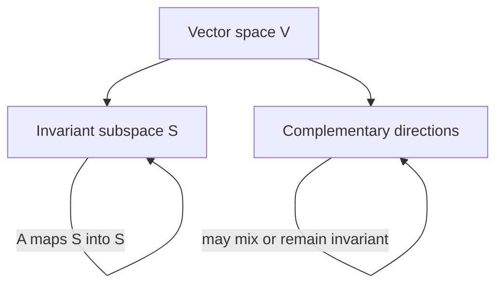

# Eigenvalues, eigenvectors and invariant subspaces

## 1. Directions preserved by a transformation

A nonzero vector \(v\) is an eigenvector of a square matrix \(A\) when

$$
Av=\lambda v.
$$

The transformation may scale or reverse this direction but does not rotate it away from its span. Eigenvalues satisfy

$$
\det(A-\lambda I)=0.
$$

This determinant equation finds candidates; it does not explain geometry. Always inspect how the map acts on the corresponding subspaces.

## 2. Invariant subspaces

A subspace \(S\) is invariant under \(A\) if

$$
x\in S\implies Ax\in S.
$$

An eigenspace is invariant, but invariant subspaces can contain several eigendirections or exist when individual real eigenvectors do not. They are the correct language for decoupling dynamics and understanding iterative algorithms.

For a block upper-triangular representation

$$
[A]=\begin{bmatrix}A_{11}&A_{12}\\0&A_{22}\end{bmatrix},
$$

the first coordinate subspace is invariant. Finding useful invariant subspaces is therefore a way to reveal hidden block structure.

## 3. Diagonalization

If \(A\) has \(d\) linearly independent eigenvectors collected in \(V\), then

$$
A=V\Lambda V^{-1},
\qquad
A^k=V\Lambda^kV^{-1}.
$$

This turns repeated application into scalar powers along eigen-directions. But not every matrix is diagonalizable. A repeated eigenvalue may have too few independent eigenvectors, producing Jordan structure and polynomial factors in \(A^k\).

## 4. Symmetric matrices

The spectral theorem gives an especially clean case. For real symmetric \(A\),

$$
A=Q\Lambda Q^T
$$

with orthonormal eigenvectors and real eigenvalues. Consequences include:

- orthogonal eigenspaces for distinct eigenvalues;
- stable coordinate change because \(Q^{-1}=Q^T\);
- quadratic-form decomposition

$$
x^TAx=\sum_i\lambda_i(q_i^Tx)^2.
$$

Therefore \(A\succeq0\) iff every eigenvalue is nonnegative.

## 5. Rayleigh quotient

For symmetric \(A\), define

$$
R_A(x)=\frac{x^TAx}{x^Tx}.
$$

Writing \(x=Q\alpha\) yields

$$
R_A(x)=\frac{\sum_i\lambda_i\alpha_i^2}{\sum_i\alpha_i^2},
$$

a weighted average of eigenvalues. Hence

$$
\lambda_{\min}\le R_A(x)\le\lambda_{\max}.
$$

The extrema occur at corresponding eigenvectors. This links spectra to curvature: for a quadratic loss with Hessian \(H\), the Rayleigh quotient is curvature along direction \(x\).

## 6. Iteration and stability

Consider \(x_{t+1}=Ax_t\). If diagonalizable,

$$
x_t=A^tx_0=V\Lambda^tV^{-1}x_0.
$$

The spectral radius \(\rho(A)=\max_i|\lambda_i|\) controls asymptotic growth in many cases. Power iteration repeatedly applies \(A\), causing the dominant eigendirection to outgrow the rest—provided the initial vector has a component in it and the dominant magnitude is separated.

For gradient descent on \(f(x)=\tfrac12x^THx\),

$$
x_{t+1}=(I-\eta H)x_t.
$$

Stability requires \(|1-\eta\lambda_i|<1\) along every positive-curvature eigendirection, giving \(0<\eta<2/\lambda_{\max}\).

## Implementation lab

- Implement power iteration and inverse iteration.
- Visualize gradient descent on a quadratic under several condition numbers.
- Compare eigen-decomposition of a symmetric matrix with a defective matrix.
- Estimate extreme Hessian eigenvalues using Hessian-vector products, without forming the Hessian.

## Problems

1. Prove that eigenvectors with distinct eigenvalues are linearly independent.
2. Show that the trace equals the sum and determinant equals the product of eigenvalues, counting algebraic multiplicity.
3. Prove the Rayleigh quotient bounds for symmetric \(A\).
4. Give a non-diagonalizable \(2\times2\) matrix and analyze its powers.
5. **Transfer.** Explain why large Hessian eigenvalue spread produces slow gradient descent even if every direction has positive curvature.

Solution sketches

1. Assume a shortest nontrivial linear combination is zero, apply \(A\), subtract one eigenvalue times the original relation, and contradict minimality.
2. Use triangular or Schur form: diagonal entries are eigenvalues, while trace and determinant are similarity invariants.
3. Expand in the orthonormal eigenbasis; the quotient becomes a convex combination of eigenvalues.
4. \(A=\begin{bmatrix}1&1\\0&1\end{bmatrix}\) has one eigendirection and \(A^k=\begin{bmatrix}1&k\\0&1\end{bmatrix}\).
5. A learning rate safe for the largest curvature makes contraction along the smallest curvature approximately \(1-\eta\lambda_{\min}\), very close to one when the condition number is large.

## Mastery gate

Analyze an unfamiliar matrix using eigenspaces and invariant subspaces, derive gradient-descent stability on a quadratic, and implement a matrix-free extreme-eigenvalue estimator.

