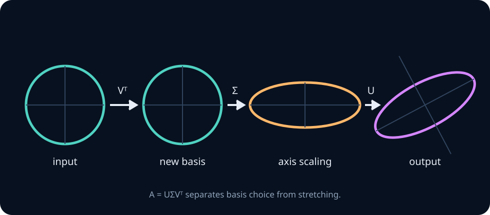
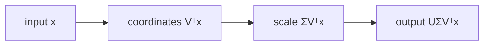

# Singular value decomposition and PCA

Eigen-decomposition explains a square operator acting on one space. The singular value decomposition explains **every** linear map, including rectangular and rank-deficient maps, by separating it into two rotations/reflections and one axis-aligned scaling.

For \(A\in\mathbb R^{m\times n}\),

$$
A=U\Sigma V^T,
$$

where \(U\in\mathbb R^{m\times m}\) and \(V\in\mathbb R^{n\times n}\) are orthogonal, while \(\Sigma\in\mathbb R^{m\times n}\) is diagonal except for its rectangular shape. Its nonnegative entries satisfy

$$
\sigma_1\ge \sigma_2\ge\cdots\ge\sigma_r>0,
$$

with \(r=\operatorname{rank}(A)\).

## 1. Geometry: rotate, scale, rotate

Apply the factors from right to left:

1. \(V^T\) expresses the input in the right-singular-vector basis.
2. \(\Sigma\) scales coordinate \(i\) by \(\sigma_i\), killing null-space coordinates.
3. \(U\) expresses the result in the output basis.

Thus

$$
Av_i=\sigma_i u_i.
$$

The right singular vectors \(v_i\) live in the domain \(\mathbb R^n\); the left singular vectors \(u_i\) live in the codomain \(\mathbb R^m\). Confusing these spaces is a common source of shape errors.

## 2. Deriving the SVD from the spectral theorem

The matrix \(A^TA\) is symmetric positive semidefinite because

$$
x^TA^TAx=\lVert Ax\rVert_2^2\ge 0.
$$

By the spectral theorem,

$$
A^TA=V\Lambda V^T,
$$

with \(\Lambda=\operatorname{diag}(\lambda_i)\), \(\lambda_i\ge0\). Define \(\sigma_i=\sqrt{\lambda_i}\). For every positive singular value, let

$$
u_i=\frac{Av_i}{\sigma_i}.
$$

Then \(\lVert u_i\rVert=1\), and for \(i\ne j\),

$$
u_i^Tu_j
=\frac{v_i^TA^TAv_j}{\sigma_i\sigma_j}
=\frac{\lambda_jv_i^Tv_j}{\sigma_i\sigma_j}=0.
$$

Complete these vectors to an orthonormal basis for \(\mathbb R^m\). This constructs \(U\) and proves the factorization. It also proves

$$
A^TA=V\Sigma^T\Sigma V^T,
\qquad
AA^T=U\Sigma\Sigma^TU^T.
$$

So right singular vectors diagonalize \(A^TA\), left singular vectors diagonalize \(AA^T\), and squared singular values are their shared nonzero eigenvalues.

## 3. Four fundamental subspaces

For the compact SVD \(A=U_r\Sigma_rV_r^T\):

$$
\operatorname{col}(A)=\operatorname{span}(U_r),
\qquad
\operatorname{row}(A)=\operatorname{span}(V_r),
$$

$$
\ker(A)=\operatorname{span}(v_{r+1},\ldots,v_n),
\qquad
\ker(A^T)=\operatorname{span}(u_{r+1},\ldots,u_m).
$$

This is the fundamental theorem of linear algebra made computational: SVD gives orthonormal bases for all four spaces.

## 4. Pseudoinverse and least squares

Invert only the nonzero singular values:

$$
A^+=V_r\Sigma_r^{-1}U_r^T.
$$

Then \(x^\star=A^+b\) is a least-squares solution minimizing \(\lVert Ax-b\rVert_2\); among all minimizers it has minimum norm. Components of \(b\) along \(u_i\) are amplified by \(1/\sigma_i\). Tiny singular values therefore amplify noise, explaining ill-conditioning.

Truncated SVD and ridge regression reduce this amplification in different ways:

$$
x_k=\sum_{i=1}^k\frac{u_i^Tb}{\sigma_i}v_i,
\qquad
x_{\lambda}=\sum_i\frac{\sigma_i}{\sigma_i^2+\lambda}(u_i^Tb)v_i.
$$

The first uses a hard spectral cutoff; the second uses a smooth shrinkage filter.

## 5. Best low-rank approximation

Expand the compact SVD as rank-one terms:

$$
A=\sum_{i=1}^r\sigma_i u_iv_i^T.
$$

The Eckart–Young–Mirsky theorem states that

$$
A_k=\sum_{i=1}^k\sigma_i u_iv_i^T
$$

is the best rank-\(k\) approximation under both spectral and Frobenius norms:

$$
\min_{\operatorname{rank}(B)\le k}\lVert A-B\rVert_2=\sigma_{k+1},
$$

$$
\min_{\operatorname{rank}(B)\le k}\lVert A-B\rVert_F^2
=\sum_{i>k}\sigma_i^2.
$$

This result underlies compression, latent semantic analysis, low-rank adaptation and many approximate linear layers. It does **not** say the truncated representation preserves every downstream decision; task-relevant low-variance directions may still matter.

## 6. PCA as constrained variance maximization

Let rows of \(X\in\mathbb R^{N\times d}\) be centered observations. For a unit direction \(w\), projected coordinates are \(Xw\). Their empirical variance (using denominator \(N\)) is

$$
\frac1N\lVert Xw\rVert^2
=w^T\left(\frac1NX^TX\right)w.
$$

The first principal component solves

$$
\max_{\lVert w\rVert=1}w^TCw,
\qquad C=\frac1NX^TX.
$$

With Lagrangian \(\mathcal L(w,\lambda)=w^TCw-\lambda(w^Tw-1)\), stationarity gives

$$
Cw=\lambda w.
$$

The Rayleigh quotient shows the maximum is achieved by the top eigenvector of \(C\). Subsequent components add orthogonality constraints. If

$$
X=U\Sigma V^T,
$$

then \(C=V(\Sigma^2/N)V^T\): PCA directions are columns of \(V\), component scores are \(XV=U\Sigma\), and explained variances are \(\sigma_i^2/N\).

### Reconstruction view

Let \(W_k\in\mathbb R^{d\times k}\) have orthonormal columns. Orthogonal reconstruction is \(XW_kW_k^T\). Minimizing

$$
\lVert X-XW_kW_k^T\rVert_F^2
$$

is equivalent to maximizing captured variance \(\lVert XW_k\rVert_F^2\). Therefore the variance and reconstruction definitions of PCA agree.

## 7. Failure modes that matter in practice

- **No centering:** the first component may mostly point toward the mean.
- **Mismatched scaling:** high-variance units dominate; standardization changes the question from covariance PCA to correlation PCA.
- **Leakage:** fitting PCA before the train/test split transfers test-distribution information.
- **Sign ambiguity:** \(v\) and \(-v\) define the same component; tests must not assume a sign.
- **Degenerate spectrum:** repeated singular values define a subspace, not unique basis vectors.
- **Normal equations:** forming \(X^TX\) squares the condition number; direct SVD is safer for ill-conditioned problems.
- **Dense full SVD:** wasteful when only a small \(k\) is required; use randomized or iterative methods and validate residuals.

## Implementation lab

Implement in NumPy, then reproduce in PyTorch without calling a PCA library.

1. Center a train matrix and store the training mean.
2. Compute a thin SVD and return components, scores and explained-variance ratios.
3. Implement `transform` and `inverse_transform` with explicit shape contracts.
4. Test orthonormality, reconstruction error monotonicity and sign-invariant agreement with a reference.
5. Implement randomized range finding: draw \(\Omega\), form \(Y=X\Omega\), orthonormalize \(Y=QR\), then SVD the smaller \(Q^TX\).
6. Benchmark time, memory and residual error while varying \(N,d,k\), spectrum decay and dtype.

**From-scratch constraint:** use only matrix multiplication, transpose, norms and a symmetric eigensolver for the first version. Then compare against `torch.linalg.svd` and explain numerical differences.

## Problems

1. Prove \(\lVert A\rVert_2=\sigma_1\) from the SVD.
2. Prove \(\lVert A\rVert_F^2=\sum_i\sigma_i^2\).
3. Derive \(A^+b\) and prove its minimum-norm property.
4. Show why \(\kappa_2(A^TA)=\kappa_2(A)^2\) for full-column-rank \(A\).
5. Derive the equivalence between maximum captured variance and minimum reconstruction error for centered data.
6. Construct a dataset where the lowest-variance direction perfectly determines the label. What does unsupervised PCA discard?
7. **Transfer.** A transformer activation matrix has rapidly decaying singular values, but replacing it with \(A_k\) sharply hurts accuracy. Give three hypotheses and one discriminating experiment for each.

Solution sketches

1. Write \(x=Vz\). Orthogonality preserves the norm, and \(\lVert\Sigma z\rVert\le\sigma_1\lVert z\rVert\), with equality at \(z=e_1\).
2. Use orthogonal invariance of the Frobenius norm: \(\lVert U\Sigma V^T\rVert_F=\lVert\Sigma\rVert_F\).
3. In singular coordinates, nonzero output coordinates force \(z_i=(u_i^Tb)/\sigma_i\); any null-space component increases \(\lVert x\rVert\) without changing \(Ax\).
4. The extreme eigenvalues of \(A^TA\) are \(\sigma_1^2\) and \(\sigma_r^2\).
5. Expand the squared error and use \(P=W_kW_k^T=P^T=P^2\): total energy equals captured plus orthogonal residual energy.
6. Put large independent noise on one feature and a tiny but label-aligned value on another. PCA optimizes input variance, not predictive information.
7. Possibilities include rare task-critical directions, distribution shift in calibration data, or nonlinear downstream amplification. Test with supervised subspace probes, stratified calibration, and layerwise causal ablations.

## Mastery gate

Derive the SVD relationships without notes, implement stable PCA with leakage-safe train/test behavior, defend a rank choice using residual and downstream metrics, and diagnose an adversarial example where variance compression destroys task information.
