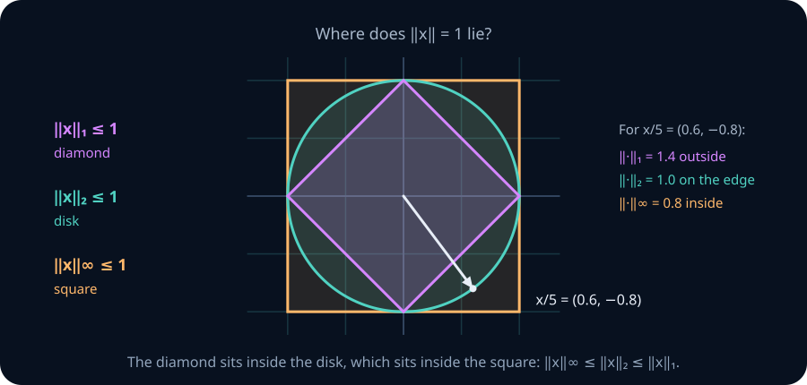
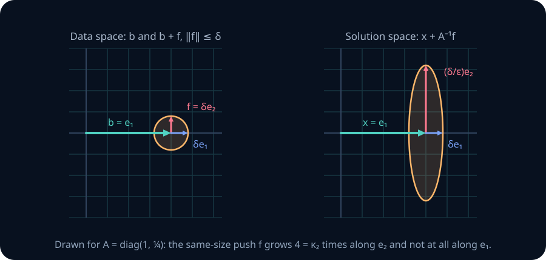
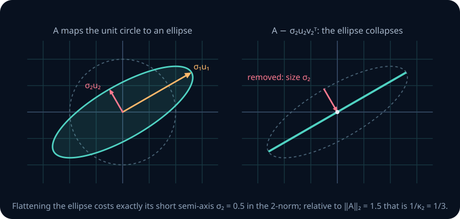
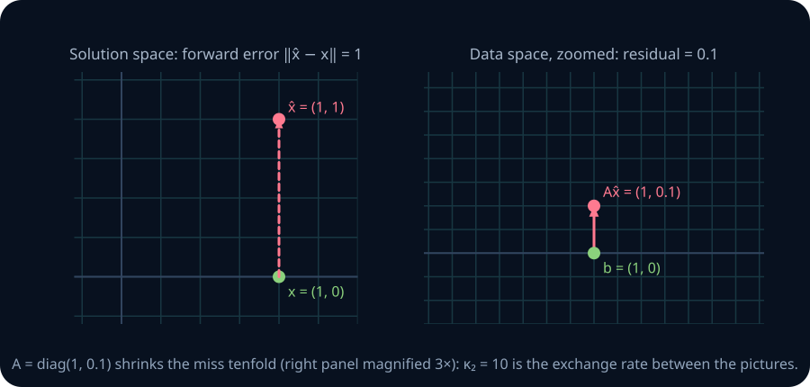
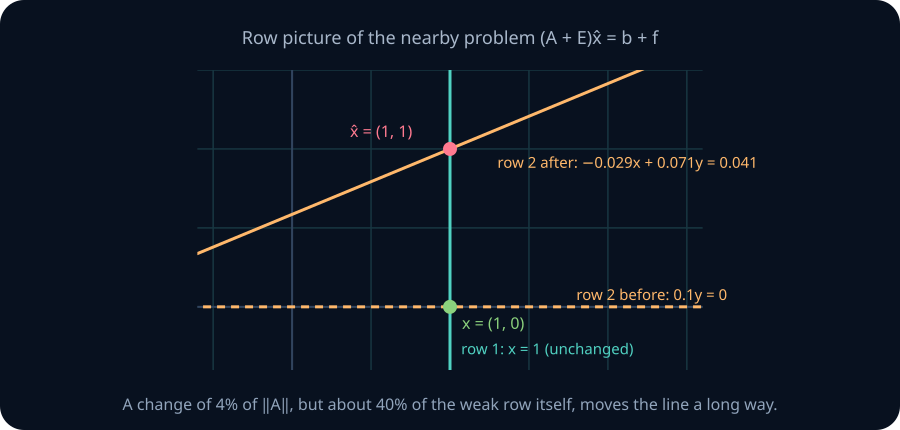
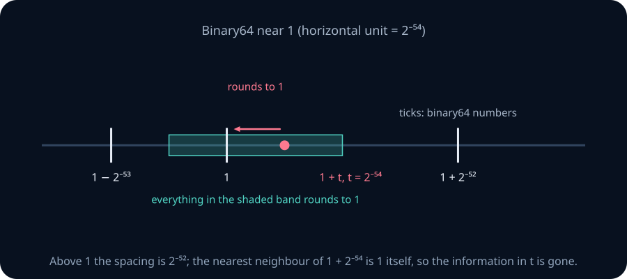
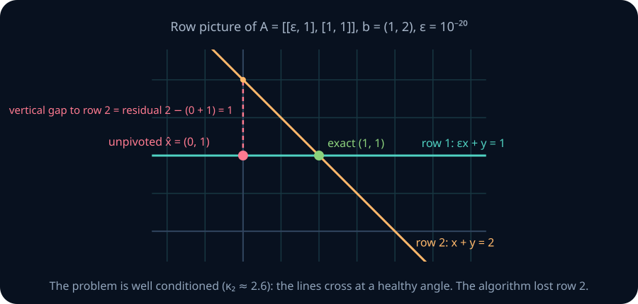
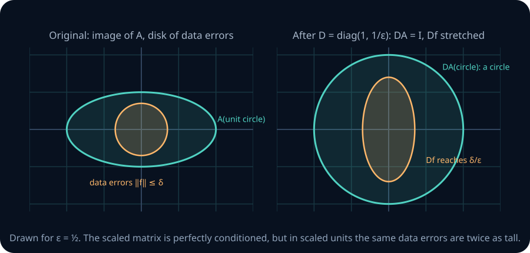

# Norms, conditioning, and numerical stability

A solver returns a vector and reports a residual of one millionth. Is the answer accurate?

Take A=diag(1,10⁻⁶), b=(1,0), and the returned vector x̂=(1,1). The exact answer is x=(1,0). The residual b−Ax̂=(0,−10⁻⁶) is tiny, yet the relative error in the answer is 1: one hundred percent. The second coordinate barely affects the observations, so a large error there leaves little evidence in the residual.

Now replace A by 10⁶A and b by 10⁶b. The equation and its solution are unchanged, but the residual becomes (0,−1). The same wrong answer suddenly has a much larger diagnostic number. To interpret a residual, we need both a scale and a measure of how strongly the equation hides errors.

This chapter connects three questions: how do we measure size, how sensitive is the mathematical problem, and how accurately did an algorithm solve it?

## 0. Route and prerequisite diagnostic

The chapter builds four ideas, each defined when it first appears. A matrix norm measures the most a matrix can stretch a vector. A condition number measures how much a small change in the data can change the exact answer. A perturbation bound turns that into a guarantee, valid as long as the change is not too large. And the backward error measures how far the data would have to move for a computed answer to be exactly right.

**Notation.** We use real vectors x∈ℝⁿ and matrices A∈ℝᵐˣⁿ. When we solve Ax=b for a unique answer, A is square and nonsingular. We write x̂ for a computed answer, E for a change to the matrix, f for a change to the right-hand side, and r=b−Ax̂ for the **residual**. A norm without a subscript in a theorem can be any one vector norm, used consistently, together with the matrix norm it induces (Section 2).

Before starting, check these four prerequisites. Each has a link to the lesson that teaches it.

- For diag(4,1/2), give the largest and smallest unit-vector output lengths: 4 and 1/2. Repair: [SVD and singular channels](08-svd-low-rank.md).
- For A=[[1,2],[0,1]] and x̂=(0,1), compute Ax̂=(2,1). Explain why a residual needs b too. Repair: [linear systems](02-systems-elimination-subspaces.md).
- Explain why an orthogonal change of coordinates preserves Euclidean length. Repair: [orthonormal bases](04-orthonormal-bases-qr.md).
- Explain how 1+2⁻⁵⁴ can round to 1 in binary64 although 2⁻⁵⁴ is representable. Repair: [floating-point reasoning](../00-foundations/01-numerical-stability.md).

Sections 1–8 develop the theory and two experiments. Section 9 has three Python labs that run in the browser. Local array experiments and cumulative assessment follow. The 26-hour estimate includes proofs, implementation, and a numerical audit. General least-squares sensitivity, regularization, and production solver design continue in later modules.

## 1. A norm declares what counts as large

Before we can say that an error is small, we have to decide how to measure it. A **norm** is a rule that gives every vector a length. To behave like a length, the rule must satisfy three properties:

1. Only the zero vector has length 0: ‖x‖≥0, with equality exactly at x=0. This is **definiteness**.
2. Stretching a vector by a factor α multiplies its length by |α|: ‖αx‖=|α|‖x‖. This is **absolute homogeneity**.
3. A detour is never shorter than the direct route: ‖x+y‖≤‖x‖+‖y‖. This is the **triangle inequality**.

The triangle inequality is what lets error budgets add up. If two steps each contribute an error of length at most 0.01, together they contribute at most 0.02.

There is more than one sensible length. For x=(3,−4), three standard norms give three different answers:

$$
\|x\|_1=|3|+|-4|=7,\qquad
\|x\|_2=\sqrt{3^2+(-4)^2}=\sqrt{25}=5,\qquad
\|x\|_\infty=\max(|3|,|-4|)=4.
$$

In general ‖x‖₁=∑ᵢ|xᵢ| adds the sizes of all coordinates, ‖x‖₂=(∑ᵢxᵢ²)¹ᐟ² is ordinary straight-line length, and ‖x‖∞=maxᵢ|xᵢ| reports only the largest coordinate. They answer different questions: the total error, the geometric distance, and the worst single entry.



The **unit ball** of a norm is the set of vectors of length at most 1. In two dimensions the three unit balls are a diamond, a disk, and a square. In the figure, x/5=(0.6,−0.8) has Euclidean length exactly 1, so it sits on the edge of the disk. Its 1-norm is 0.6+0.8=1.4, so it lies outside the diamond. Its infinity norm is 0.8, so it lies inside the square. A smaller unit ball means the norm reports larger lengths, and that nesting is exactly the chain of inequalities below.

**Norm comparisons with dimensions exposed.** For x∈ℝⁿ,

$$
\|x\|_\infty\leq\|x\|_2\leq\|x\|_1,
\qquad
\|x\|_1\leq\sqrt n\,\|x\|_2,
\qquad
\|x\|_2\leq\sqrt n\,\|x\|_\infty.
$$

The first inequality follows because the sum of squares includes the largest square. Squaring the sum of absolute values adds nonnegative cross terms, proving the second. Cauchy–Schwarz applied to (|x₁|,…,|xₙ|) and (1,…,1) proves the √n bound for the 1-norm. Bounding every square by ‖x‖∞² proves the last. Equality can depend on the direction: one nonzero coordinate makes all three norms equal, whereas equal-magnitude coordinates attain the √n factors.

**Units matter.** If one coordinate is measured in meters and another in seconds, the plain Euclidean norm adds unlike quantities. Choose a positive reference scale sᵢ for each coordinate and measure ‖x‖scaled=‖D⁻¹x‖₂ with D=diag(sᵢ). This is again a norm (Stretch practice below), and it measures each coordinate in units of its own scale.

**Numerical notes.** The √n constants grow with dimension. A million coordinates each off by 10⁻³ have infinity norm 10⁻³ but Euclidean norm 1, so a tolerance means nothing until its norm is named. A scaled norm is only as meaningful as the scales chosen for it.

> **Practice — Foundation:** Compute the 1-, 2-, and infinity norms of (2,−6,3), and check that they satisfy the inequality chain above.
>
> **Hint:** The absolute values add to 11; the squares add to 4+36+9=49; the largest absolute entry is 6.
>
> **Practice — Core:** For x=(1,…,1)∈ℝ⁹, compute all three norms and identify which dimension-dependent inequalities are equalities.
>
> **Hint:** There are nine unit absolute values and nine unit squares; compare 9, 3, and 1 with √9=3.
>
> **Practice — Stretch:** Prove that x↦‖D⁻¹x‖₂ is a norm when D is invertible. Which axiom fails if D⁻¹ is replaced by a singular matrix?
>
> **Hint:** Apply the Euclidean norm axioms after the linear map. A singular map kills a nonzero vector, violating definiteness.

## 2. Induced matrix norms measure the largest allowed amplification

A matrix acts on vectors, so the natural way to measure its size is by what it does: the most it can stretch a vector. Choose a vector norm, feed A every input of length 1, and record the longest output. That record is the matrix norm **induced** by the vector norm:

$$
\|A\|_p=\max_{x\ne0}\frac{\|Ax\|_p}{\|x\|_p}
=\max_{\|x\|_p=1}\|Ax\|_p.
$$

The two forms agree because scaling x does not change the ratio. The maximum exists because the set of unit vectors is closed and bounded and x↦‖Ax‖ is continuous. For a rectangular A, the input and output vectors have different numbers of entries, but both are measured with the same p. Every bound in this chapter uses such a matching pair.

**The three useful formulas.**

$$
\|A\|_1=\max_j\sum_i|a_{ij}|,\qquad
\|A\|_\infty=\max_i\sum_j|a_{ij}|,\qquad
\|A\|_2=\sigma_1(A).
$$

For the 1-norm, the triangle inequality gives ‖Ax‖₁≤∑ⱼ|xⱼ|∑ᵢ|aᵢⱼ|≤(maximum absolute column sum)‖x‖₁. A coordinate vector selecting a maximal column attains the bound. For the infinity norm, every row output is bounded by its absolute row sum times ‖x‖∞. Choose xⱼ to match the signs of a maximal row; zero entries may use either sign. That row attains the bound. For the 2-norm, expand x in the orthonormal right singular basis: ‖Ax‖₂²=∑ᵢσᵢ²(vᵢᵀx)²≤σ₁²‖x‖₂², with equality at v₁ when A≠0.

**In the picture.** A maps the unit circle to an ellipse ([LA08](08-svd-low-rank.md)), and ‖A‖₂ is the length of that ellipse's longest semi-axis. The 1- and infinity norms do the same for the diamond and the square: A maps each to a parallelogram, and the induced norm is the farthest reach of that parallelogram, measured in the same norm.

![Left: the 1-norm diamond and its image parallelogram under A = [[1,−2],[3,0]], reaching 1-norm 4 at (1,3). Right: the infinity-norm square and its image, reaching infinity norm 3 at (3,3)](../assets/la09-induced-shapes.svg)

The figure shows this for the worked example below. On the left, A sends the diamond's corner e₁ to (1,3), which touches the dashed diamond of 1-norm radius 4 and no image point reaches farther, so ‖A‖₁=4. On the right, A sends the square's corner (1,−1) to (3,3), on the dashed square of infinity-norm radius 3, so ‖A‖∞=3. In both panels the induced norm is the radius of the smallest ball of the same shape that contains the image.

**Worked example.** Take A=[[1,−2],[3,0]].

- *1-norm.* The absolute column sums are |1|+|3|=4 and |−2|+|0|=2, so ‖A‖₁=4. The first coordinate vector attains it: Ae₁=(1,3), and ‖(1,3)‖₁=4.
- *Infinity norm.* The absolute row sums are |1|+|−2|=3 and |3|+|0|=3, so ‖A‖∞=3. To attain it, match signs with the first row: x=(1,−1), which has ‖x‖∞=1, gives Ax=(1·1+(−2)(−1), 3·1+0·(−1))=(3,3), so ‖Ax‖∞=3.
- *2-norm.* Form AᵀA. Its entries are the dot products of the columns: (1,3)·(1,3)=10, (1,3)·(−2,0)=−2, and (−2,0)·(−2,0)=4. So AᵀA=[[10,−2],[−2,4]], with characteristic polynomial λ²−14λ+36. Its eigenvalues are 7±√13, and ‖A‖₂=√(7+√13)≈3.257.

The largest entry, 3, happens to equal ‖A‖∞ here but gives neither ‖A‖₁ nor ‖A‖₂.

**Composition control.** By definition ‖Ax‖≤‖A‖‖x‖. Apply this twice to get ‖ABx‖≤‖A‖‖B‖‖x‖, then maximize over unit inputs:

$$
\|AB\|\leq\|A\|\,\|B\|.
$$

This property is submultiplicativity. Equality need not hold: the direction B amplifies most may not be the one A amplifies most.

The Frobenius norm ‖A‖F=(∑ᵢⱼaᵢⱼ²)¹ᐟ²=(∑ᵢσᵢ²)¹ᐟ² remains useful for total matrix energy. It is submultiplicative, but for n>1 it is not an induced norm on square n×n matrices: ‖Iₙ‖F=√n, whereas every induced norm gives ‖Iₙ‖=1. For rank r>0, ‖A‖₂≤‖A‖F≤√r‖A‖₂. A theorem stated for induced norms needs an induced norm; check before substituting ‖A‖F.

**Predict, then reveal.** In the workbench, choose the 1-, 2-, or infinity unit ball and a matrix. Predict the largest output p-norm before revealing it. Rotate the probe around the input ball, then try the rank-one and zero presets. Both views use the same coordinate scale, so output contraction is visible. The probe gives one direction's gain; the revealed norm is the maximum over all directions. This is a two-dimensional geometry experiment, not a solver benchmark.

```lab
la-norms
```

> **Practice — Foundation:** Find the induced 1- and infinity norms of [[2,−3],[1,1]].
>
> **Hint:** Absolute column sums give the 1-norm; absolute row sums give the infinity norm. Do not sum signed entries: the first row gives |2|+|−3|=5, not −1.
>
> **Practice — Core:** For the same matrix, exhibit a unit 1-norm vector attaining the 1-norm and a unit infinity-norm vector attaining the infinity norm, and verify each by multiplying.
>
> **Hint:** The largest column is the second, so try e₂. For the infinity norm, match the signs of the first row with x=(1,−1).
>
> **Practice — Stretch:** For A=diag(10,1) and B=diag(1,10), compare ‖AB‖₂ with ‖A‖₂‖B‖₂. Explain why the upper bound is loose.
>
> **Hint:** Multiply first: AB=10I. The two maps have different most-amplified input directions.

## 3. Conditioning belongs to a problem and its perturbation model

**Conditioning** is a property of the problem itself, before any computer is involved. It asks: if the data move a little, how far can the exact answer move?

Start with the simplest case. Hold a nonsingular A fixed and let only the right-hand side change. If Ax=b and A(x+δx)=b+f, subtracting the two equations gives, exactly,

$$
\delta x=A^{-1}f.
$$

This is sensitivity of the mathematical answer, before any solver has been chosen. For nonzero b and x,

$$
\frac{\|\delta x\|}{\|x\|}
\leq\|A^{-1}\|\frac{\|b\|}{\|x\|}\frac{\|f\|}{\|b\|}
\leq\underbrace{\|A\|\,\|A^{-1}\|}_{\kappa(A)}
\frac{\|f\|}{\|b\|}.
$$

The first inequality uses ‖δx‖=‖A⁻¹f‖≤‖A⁻¹‖‖f‖. The second uses ‖b‖=‖Ax‖≤‖A‖‖x‖. The number κ(A)=‖A‖‖A⁻¹‖ is the **condition number** of A: the most that a relative data error can be magnified into a relative solution error. For one fixed b, the sharper factor is ‖A⁻¹‖‖b‖/‖A⁻¹b‖, and κ(A) is its worst case over all right-hand sides. So κ is a ceiling, not a prediction that every perturbation reaches it.

Since 1=‖I‖≤‖A‖‖A⁻¹‖, κ(A)≥1. In the Euclidean norm,

$$
\kappa_2(A)=\frac{\sigma_1}{\sigma_n},
$$

because A has largest gain σ₁ and A⁻¹ has largest gain 1/σₙ. In the picture, κ₂ is the ratio of the longest to the shortest semi-axis of the ellipse A makes from the unit circle: how elongated it is.

**A ceiling you can attain.** For A=diag(1,ε) with 0<ε≤1, choose b=e₁, so x=e₁. A perturbation f=δe₂ gives δx=A⁻¹f=(δ/ε)e₂. The relative data error is δ and the relative solution error is δ/ε, so the amplification is 1/ε=κ₂(A): the ceiling is reached. The same-size push f=δe₁ gives δx=δe₁, amplification 1.



The figure draws this for ε=¼. Every push of size at most δ lies in the small disk on the left. The inverse sends the disk to the ellipse on the right, four times taller than it is wide. Pushes along e₂, the direction A shrinks, come out four times longer; pushes along e₁ do not grow. In SVD language, the worst case puts b along u₁, which makes x as small as possible, and f along uₙ, which A⁻¹ stretches the most.

**A worked 3×3 example.** Let

$$
A=\begin{pmatrix}1&1&0\\0&1&1\\0&0&1\end{pmatrix},\qquad
A^{-1}=\begin{pmatrix}1&-1&1\\0&1&-1\\0&0&1\end{pmatrix}.
$$

Multiply to check that AA⁻¹=I. Use the infinity norm, because it is easy to compute by hand.

1. The absolute row sums of A are 2, 2, 1, so ‖A‖∞=2.
2. The absolute row sums of A⁻¹ are 3, 2, 1, so ‖A⁻¹‖∞=3.
3. Therefore κ∞(A)=2·3=6.

Now attain the ceiling. Take x=(1,1,1), so b=Ax=(2,2,1), with ‖x‖∞=1 and ‖b‖∞=2. Push the data by f=δ(1,−1,1), which has ‖f‖∞=δ. Then δx=A⁻¹f=δ(1+1+1, −1−1, 1)=δ(3,−2,1), so ‖δx‖∞=3δ. The relative solution error is 3δ against a relative data error of δ/2: a factor of 6=κ∞. The push f=δ(1,1,1) of the same size gives δx=δ(1,0,1), a factor of only 2. Every eigenvalue of this A equals 1 and det A=1, yet κ∞=6. The n×n version, with ones on the diagonal and just above it, has κ∞=2n.

Multiplying A by a nonzero scalar c multiplies every singular value by |c|. Thus κ(cA)=κ(A), although the absolute sensitivity ‖(cA)⁻¹‖ changes. A tiny matrix can be perfectly well conditioned: κ₂(10⁻¹²I)=1. Conversely diag(10⁶,10⁻⁶) has determinant 1 and condition number 10¹². Neither absolute size nor determinant magnitude measures conditioning.

**Products and orthogonal factors.** For nonsingular square A and B, (AB)⁻¹=B⁻¹A⁻¹, so submultiplicativity applied to the product and to its inverse gives κ(AB)≤κ(A)κ(B). An orthogonal Q preserves Euclidean length, so every singular value of Q equals 1 and κ₂(Q)=1. Since ‖QAx‖₂=‖Ax‖₂ for every x, QA has the same gains as A and κ₂(QA)=κ₂(A); applying the same argument to the input side gives κ₂(AQ)=κ₂(A). Orthogonal steps therefore cannot worsen 2-norm conditioning, while a general factor can. This is the structural reason the QR and SVD routes of [LA04](04-orthonormal-bases-qr.md) and [LA08](08-svd-low-rank.md) are preferred to forming AᵀA (Section 7). The product bound is a ceiling too: diag(10,1)·diag(1,10)=10I has κ₂=1 although each factor has κ₂=10.

**Numerical notes.** A singular square matrix has no unique solution to be sensitive, and κ=∞ is only the convention for reporting it. A rectangular A needs a stated least-squares or minimum-norm problem before a condition number means anything; LA10 treats that case. One benign experiment tests one direction, so it cannot show that κ is small.

> **Practice — Foundation:** Find κ₂(diag(4,1/2)) and κ₂(10⁻¹²I₂).
>
> **Hint:** Divide the largest singular value by the smallest. A common nonzero multiplier cancels.
>
> **Practice — Core:** For A=diag(1,10⁻⁴), b=e₁, and f=10⁻⁶e₂, calculate δx and both relative errors. Is the condition bound attained?
>
> **Hint:** The inverse multiplies the second coordinate by 10⁴. The original x and b both have norm 1.
>
> **Practice — Stretch:** Keep that A and b, but rotate f to the first axis. Explain why an excellent observed response does not establish that κ₂(A) is small.
>
> **Hint:** One experiment tests one direction. The inverse's large gain remains available on the other axis.

## 4. Perturbing the matrix introduces a denominator

Measured data usually disturb the matrix as well: coefficients are estimated, and entries are rounded when stored. So let both A and b move. Suppose

$$
(A+E)(x+\delta x)=b+f,\qquad Ax=b.
$$

Expand the product, subtract Ax=b, and collect the δx terms: (A+E)δx=f−Ex. Since A+E=A(I+A⁻¹E), multiplying by A⁻¹ gives

$$
(I+A^{-1}E)\delta x=A^{-1}(f-Ex).
$$

To solve for δx we need to invert I+A⁻¹E. For numbers, 1+r can be inverted by the geometric series 1/(1+r)=1−r+r²−⋯ whenever |r|<1. The same works for matrices. Write M=A⁻¹E and q=‖A⁻¹‖‖E‖, so ‖M‖≤q. Multiplying out gives (I+M)(I−M+M²−⋯+(−M)ᵏ)=I−(−M)ᵏ⁺¹, and the last term has norm at most qᵏ⁺¹. If q<1, that term vanishes as k grows, so the series ∑ₖ₌₀∞(−M)ᵏ, called the **Neumann series**, converges to the inverse of I+M. (The partial sums do converge: each term has norm at most qᵏ, and ∑qᵏ is finite.) Therefore

$$
\|(I+A^{-1}E)^{-1}\|\leq\sum_{k=0}^{\infty}q^k=\frac1{1-q}.
$$

This also proves A+E is nonsingular under the stated condition. Define εA=‖E‖/‖A‖ and εb=‖f‖/‖b‖ for b≠0. Then q=κ(A)εA and

$$
\boxed{\frac{\|\delta x\|}{\|x\|}
\leq\frac{\kappa(A)}{1-\kappa(A)\varepsilon_A}
(\varepsilon_A+\varepsilon_b),\qquad
\kappa(A)\varepsilon_A<1.}
$$

To get the boxed form, take norms: ‖δx‖≤‖A⁻¹‖(‖f‖+‖E‖‖x‖)/(1−q). Divide by ‖x‖ and use 1/‖x‖≤‖A‖/‖b‖, which is ‖b‖≤‖A‖‖x‖ rearranged. The right side becomes ‖A⁻¹‖‖A‖(‖f‖/‖b‖+‖E‖/‖A‖)/(1−q)=κ(εb+εA)/(1−κεA). When κεA is small the denominator is close to 1, and the bound reads roughly "κ times the total relative data error". The denominator is what keeps it true for larger perturbations.

**In the picture.** In the 2-norm, ‖A⁻¹‖₂=1/σₙ, so the hypothesis q<1 says ‖E‖₂<σₙ. The perturbation is smaller than the short semi-axis of A's ellipse, so it cannot flatten the ellipse onto a line. The distance-to-singularity result below shows that σₙ is exactly the threshold.

**Work the boundary.** Set A=diag(1,0.01), b=e₂, E=diag(0,−0.005), and f=0. Then x=(0,100) and x+δx=(0,200), so relative forward error is 1. Here κ=100, εA=0.005, q=0.5, and the bound is 100·0.005/(1−0.5)=1: equality. If E=diag(0,−0.01), q=1 and A+E is singular; for this b there is no solution. A finite bound cannot be obtained by ignoring the zero denominator.

The condition q<1 is sufficient, not necessary. For A=I and E=2I, q=2 but A+E=3I is nonsingular. Failure of the condition means this theorem makes no guarantee, not that a solve must fail.

**Distance to singularity (Gastinel–Kahan).** In the 2-norm, the smallest perturbation making a nonsingular A singular has norm σₙ. *It can be done:* take E=−σₙuₙvₙᵀ. Then (A+E)vₙ=Avₙ−σₙuₙ(vₙᵀvₙ)=σₙuₙ−σₙuₙ=0, so A+E is singular, and a rank-one matrix uvᵀ has 2-norm ‖u‖₂‖v‖₂, so ‖E‖₂=σₙ. *Nothing smaller works:* if (A+E)z=0 for a unit vector z, then Ez=−Az, so ‖E‖₂≥‖Ez‖₂=‖Az‖₂≥σₙ. Hence the relative distance to a singular matrix is σₙ/σ₁=1/κ₂(A).



The figure draws A=R·diag(1.5,0.5) for a rotation R. Removing the rank-one piece σ₂u₂v₂ᵀ deletes the short semi-axis and flattens the ellipse onto a segment, and that perturbation has 2-norm σ₂=0.5. No smaller perturbation can do it: any singular A+E must send some unit vector to zero, and A moves every unit vector at least σ₂ from the origin. A condition number of 3 means a relative change of 1/3 can make this matrix singular.

**Numerical notes.** Distance to singularity is measured over all real perturbations E. If E must keep a structure, such as symmetry, sparsity, or a fixed physical parameterization, the nearest singular matrix of that kind can be farther away.

> **Practice — Foundation:** If κ=100, εA=0.001, and εb=0.002, evaluate the finite-perturbation bound.
>
> **Hint:** Check 100·0.001<1 first, then divide 100·(0.001+0.002) by 1−0.1.
>
> **Practice — Core:** Reproduce the diagonal boundary example and explain the change when the second perturbed diagonal entry becomes zero.
>
> **Hint:** Solve each diagonal coordinate directly. At the boundary the second equation becomes 0·x₂=1.
>
> **Practice — Stretch:** Prove the distance-to-singularity result, including both the rank-one construction and the lower bound for every singularizing perturbation.
>
> **Hint:** Use the smallest paired singular directions for existence, then a unit vector in the perturbed matrix's null space for necessity.

## 5. Forward error, residual, and backward error answer different questions

A solver hands back a candidate x̂. There are three different ways to ask how good it is.

- The **forward error** ‖x̂−x‖/‖x‖ compares x̂ with the true solution x. It is the number we care about, but computing it needs x, which a real application does not have.
- The **residual** r=b−Ax̂ measures how badly x̂ fails the equation. It can always be computed.
- The **backward error** turns the question around. Instead of moving the answer, it asks how little the data A and b would have to change for x̂ to be an exact solution.



The residual lives in data space, the forward error in solution space, and A is the map between them. In the figure, A=diag(1,0.1) squashes the vertical direction tenfold. A miss of 1 in the answer therefore shows up as a miss of only 0.1 in the data. The condition number is the worst possible exchange rate between the two pictures.

Because A(x̂−x)=−r, the right-hand-side result immediately gives

$$
\frac{\|\hat x-x\|}{\|x\|}\leq\kappa(A)\frac{\|r\|}{\|b\|},\qquad b\ne0.
$$

For right-hand-side-only perturbations, x̂ solves Ax̂=b−r exactly. Thus ‖r‖/‖b‖ is precisely the minimum relative change to b under that perturbation model. There is only one possible right-hand-side change: −r.

**Allow both A and b to move.** In the 2-norm, define the normwise backward error as the smallest η≥0 for which

$$
(A+E)\hat x=b+f,\qquad
\|E\|_2\leq\eta\|A\|_2,\quad
\|f\|_2\leq\eta\|b\|_2.
$$

For d=‖A‖₂‖x̂‖₂+‖b‖₂>0, its exact value is given by the **Rigal–Gaches** formula

$$
\eta_2=\frac{\|r\|_2}{\|A\|_2\|\hat x\|_2+\|b\|_2}.
$$

*Lower bound.* The perturbed equation requires r=Ex̂−f. Consequently ‖r‖₂≤η(‖A‖₂‖x̂‖₂+‖b‖₂)=ηd.

*Attainment.* When x̂≠0, set t=‖A‖₂‖x̂‖₂/d, E=t r x̂ᵀ/‖x̂‖₂², and f=−(1−t)r. Then Ex̂−f=r, ‖E‖₂=t‖r‖₂/‖x̂‖₂=η₂‖A‖₂, and ‖f‖₂=(1−t)‖r‖₂=η₂‖b‖₂. The rank-one norm identity follows from Cauchy–Schwarz, with equality along x̂. If x̂=0 and b≠0, take E=0 and f=−b: η₂=1. If both are zero, the candidate already solves the homogeneous equation and the backward error is 0 by convention, while relative forward error is undefined.

**Worked example: build the nearby problem.** Take the opening example, A=diag(1,10⁻⁶), b=(1,0), x̂=(1,1).

1. The residual is r=b−Ax̂=(1,0)−(1,10⁻⁶)=(0,−10⁻⁶), so ‖r‖₂=10⁻⁶.
2. The scales are ‖A‖₂=1, ‖x̂‖₂=√2, and ‖b‖₂=1, so d=√2+1 and η₂=10⁻⁶/(√2+1)=(√2−1)·10⁻⁶≈4.14×10⁻⁷.
3. Split the residual: t=√2/(√2+1)=2−√2≈0.586 of it goes into the matrix and 1−t=√2−1≈0.414 into the right-hand side.
4. E=t r x̂ᵀ/‖x̂‖₂² has zero first row and second row −(t/2)·10⁻⁶(1,1)≈(−0.293, −0.293)×10⁻⁶. And f=−(1−t)r=(0, 0.414×10⁻⁶).
5. Check: (A+E)x̂=(1, 10⁻⁶−t·10⁻⁶)=(1, 0.414×10⁻⁶)=b+f. The relative changes are ‖E‖₂/‖A‖₂=t·10⁻⁶/√2≈4.14×10⁻⁷ and ‖f‖₂/‖b‖₂≈4.14×10⁻⁷, both equal to η₂.

So x̂=(1,1), which is 100% wrong, is the exact answer to a problem whose data differ from ours by less than one part in a million.

**In the picture.** In the row picture of [LA02](02-systems-elimination-subspaces.md), each equation of Ax=b is a line (or plane), and the solution is where they meet. The backward error measures the smallest tilt and shift of those lines that makes them pass through x̂.



The figure uses A=diag(1,0.1) so the movement is visible. The first equation, x=1, already holds at x̂=(1,1) and does not move. The second equation, 0.1y=0, is the line y=0. Changing its coefficients by only about 4% of ‖A‖ turns it into −0.029x+0.071y=0.041, a line through (1,1). That change is small compared with the matrix as a whole, but it is about 40% of the weak second row itself, which is why the line moves so far. A normwise backward error measures changes against ‖A‖; the componentwise version below measures them against each entry. That is the geometric reason a small backward error can come with a large forward error.

**Return to the opening example.** For A=diag(1,10⁻⁶), b=e₁, and x̂=(1,1), relative residual is 10⁻⁶, relative forward error is 1, and η₂=10⁻⁶/(√2+1)≈4.14×10⁻⁷. Both backward diagnostics are small. The factor κ₂=10⁶ explains why that does not force a small forward error.

If η₂ is small and κ₂η₂<1, applying the previous theorem to an attaining pair E,f gives the sufficient bound 2κ₂η₂/(1−κ₂η₂). This is the precise form of the rule of thumb "forward error ≲ condition number × backward error".

**Numerical notes.** η₂ allows any change to A. The smallest change that keeps a structure, such as symmetry or sparsity, can be larger. A **componentwise** backward error instead requires |Eᵢⱼ|≤η|Aᵢⱼ| and |fᵢ|≤η|bᵢ|, which respects each entry's own scale and keeps zeros at zero. Its exact value is the **Oettli–Prager** formula ω=maxᵢ|rᵢ|/(|A||x̂|+|b|)ᵢ, with absolute values taken entrywise. For example, take A=[[1,1],[0,10⁻³]], b=(2,10⁻³), whose solution is (1,1), and the candidate x̂=(2,0). Then r=(0,10⁻³). The infinity-norm backward error is ‖r‖∞/(‖A‖∞‖x̂‖∞+‖b‖∞)=10⁻³/(2·2+2)≈1.7×10⁻⁴, which looks tiny. But |A||x̂|+|b|=(4, 10⁻³), so Oettli–Prager gives ω=max(0/4, 10⁻³/10⁻³)=1: to make x̂ exact, the small entries a₂₂ and b₂ would have to change by 100%. The matching componentwise condition number, due to Skeel, is ‖|A⁻¹||A||x|‖∞/‖x‖∞; Higham's chapter 7 develops both. A small normwise η can hide a large relative change in a small entry (exercise M4). The residual is itself computed in floating point; when it is tiny, form it with extra precision before trusting it.

> **Practice — Foundation:** For A=I₂, b=(1,0), and x̂=(1,0.01), give r and relative forward error.
>
> **Hint:** With the identity, output error and solution error have the same length; r has the opposite sign.
>
> **Practice — Core:** Compute relative residual, κ₂, and η₂ for the opening diagonal example. Explain how an inaccurate answer can have a small backward error.
>
> **Hint:** The denominator for η₂ is √2+1. The inverse amplifies the residual's second coordinate by one million.
>
> **Practice — Stretch:** For A=I₃, b=(1,1,1), and x̂=(1,1,0), compute r and η₂, then construct the rank-one E and vector f attaining η₂ and verify (A+E)x̂=b+f.
>
> **Hint:** Here r=(0,0,1), ‖x̂‖₂=√2, and ‖b‖₂=√3, so d=√2+√3. Split r with t=√2/d and check the sign in r=Ex̂−f.

## 6. An error experiment with an exact oracle

An **oracle** is a trusted exact answer to compare against. Here the oracle is built in: the workbench constructs each problem so that its exact solution is known.

The workbench uses A=c·diag(1,ε), b=c·e₁, and x=e₁. The positive multiplier c changes the raw units without changing κ₂=1/ε. Choose a relative right-hand-side perturbation δ≥0 and direction θ:

$$
f=c\delta(\cos\theta,\sin\theta),\qquad
\hat x=x+A^{-1}f
=\left(1+\delta\cos\theta,\frac{\delta\sin\theta}{\varepsilon}\right).
$$

This x̂ is the exact solution to the deliberately perturbed equation. Against the original equation, r=−f. Therefore, up to display rounding,

$$
\text{relative residual}=\delta,\qquad
\text{relative forward error}
=\delta\sqrt{\cos^2\theta+\frac{\sin^2\theta}{\varepsilon^2}},
\qquad
\eta_2=\frac{\delta}{\|\hat x\|_2+1}.
$$

**Before reveal:** set ε=10⁻⁶ and δ=10⁻⁶. Predict the answer error at θ=0° and at θ=90°. Then reveal. The dangerous direction gives error 1; the benign direction gives 10⁻⁶. The condition number has not changed.

Next multiply c by 10⁶. Predict which of the displayed residual, normalized residual, condition number, and forward error change. Only the absolute residual changes. Finally, choose the singular preset. At ε=0 the equation has no unique solution: for a nonzero second component of f it is inconsistent, while a zero second component leaves infinitely many solutions. The UI refuses to manufacture a single forward-error answer.

```lab
la-condition
```

The left plot shows solution coordinates. The right plot shows log₁₀ relative error against perturbation angle and the worst-case ceiling; every +1 on its vertical axis means a factor of ten. Numerical readouts remain available without interpreting the plots. Changing any input hides the outcome again so that the new prediction comes first.

**Numerical notes.** The workbench solves each perturbed problem analytically, so it shows conditioning alone. It does not model rounding and does not test the stability of LU, QR, or any hardware; Section 7 takes up algorithms.

> **Practice — Foundation:** In the dangerous preset, name the direction of f and the resulting direction of x̂−x.
>
> **Hint:** The weak channel is the second coordinate on both sides of this diagonal map.
>
> **Practice — Core:** Keep ε and δ fixed while changing c from 1 to 10⁶. Derive why relative residual and η₂ remain unchanged.
>
> **Hint:** Both the residual and the data-scale denominator gain the same positive factor; x̂ stays fixed.
>
> **Practice — Stretch:** A colleague reports only the θ=0° outcome and calls the matrix well conditioned. Design a controlled counterexperiment and distinguish it from evidence of a bad solver.
>
> **Hint:** Change only the perturbation direction. The workbench solves each perturbed problem analytically, so the difference is mathematical sensitivity.

## 7. Stability belongs to an algorithm in finite precision

Conditioning is about the problem. **Stability** is about the recipe a computer follows to solve it. Every floating-point operation rounds, so an algorithm never returns the exact answer. The useful question is whether it returns the exact answer to a slightly different problem.

An algorithm is **backward stable** when, for every input in its problem class (for example, all nonsingular n×n systems), the computed answer is the exact answer for data within a relative distance of order u. Here u is the **unit roundoff** of the arithmetic, and the bound may include a modest factor depending on the problem size. An algorithm that fails this for some inputs, and does not meet a comparable forward-error guarantee either, is **unstable**. Combined with Section 5, backward stability gives the working rule: such an algorithm is as accurate as the problem's conditioning allows. Trefethen and Bau also use a weaker notion, **stability**: the computed answer is close to the exact answer for some nearby input, "nearly the right answer to nearly the right question". Backward stability implies stability. Back substitution for a triangular system is backward stable: the computed x̂ solves (R+δR)x̂=b with each entry of δR at most about nu times the corresponding entry of R (Trefethen and Bau, Lecture 17).

The model behind such statements is that each basic operation is correctly rounded: fl(a op b)=(a op b)(1+δ) with |δ|≤u. In binary64 with round-to-nearest, u=2⁻⁵³. The gap from 1 to the next larger number is 2⁻⁵², twice as large, and both numbers are called "machine epsilon" in different sources. The [foundations lesson](../00-foundations/01-numerical-stability.md) develops this model.

**A well-conditioned problem with a poor formula.** For t>0, consider

$$
g(t)=\sqrt{1+t}-1
=\frac{t}{\sqrt{1+t}+1}.
$$

The two formulas are equal in exact arithmetic; multiply the first by (√(1+t)+1)/(√(1+t)+1) to get the second. Work both through at t=2⁻⁵⁴.



1. Just above 1, binary64 numbers are 2⁻⁵² apart, so 1+t must be stored as either 1 or 1+2⁻⁵². It lies 2⁻⁵⁴ from 1 but 3·2⁻⁵⁴ from 1+2⁻⁵², so it rounds to 1: fl(1+t)=1, as the figure shows.
2. The direct formula computes √1−1=0. The true answer is about 2⁻⁵⁵, so the error is 100%.
3. The rationalized formula computes t/(√1+1)=t/2=2⁻⁵⁵. The exact value is t/(√(1+t)+1), which differs from t/2 by a relative amount of about t/4=2⁻⁵⁶. Every digit is right.

The second formula works because it keeps the original t in the numerator instead of subtracting two nearly equal rounded numbers.

This is not inherently an ill-conditioned function of t. With s=√(1+t), differentiation gives g′(t)=1/(2s), so its relative condition number is

$$
\left|\frac{t g'(t)}{g(t)}\right|
=\frac{s+1}{2s}\longrightarrow1\quad(t\downarrow0).
$$

So the loss comes from the evaluation path, not from the function. The subtraction itself is exact here; what it exposes is the rounding error already committed when 1+t was formed.

**Where the error enters.** Every problem has a condition number, not only linear solves. For a differentiable map x↦F(x) with x≠0 and F(x)≠0, let J_F(x) be its **Jacobian**, the matrix of partial derivatives that gives the best linear approximation of F near x (for a scalar function it is just F′). The relative condition number κ_F(x)=‖J_F(x)‖‖x‖/‖F(x)‖ compares a small relative change in the input with the relative change it causes in the output. For b↦A⁻¹b it is the fixed-b number of Section 3, and for g it is the ratio just computed. The same measurement applies to each step of an algorithm. Take the subtraction step a−c:

1. If a and c each carry a relative error of at most ρ, the difference can change by as much as (|a|+|c|)ρ.
2. Relative to the answer a−c, that is a factor (|a|+|c|)/|a−c|. The factor is small when a and c are far apart and huge when they nearly cancel.
3. In the direct formula, a=ŝ≈√(1+t) and c=1, so the factor is about (1+1)/(t/2)=4/t.
4. A rounding error of order u in ŝ therefore becomes a relative error of order u/t in the output. At t=2⁻⁵⁴ that is 2, larger than 1: no correct digit survives.

This is the usual way instability arises: one intermediate step is much worse conditioned than the problem being solved, and it magnifies the rounding errors made before it.

**Normal equations change the numerical challenge.** For full-column-rank A, the Gram matrix has positive eigenvalues σᵢ², hence κ₂(AᵀA)=κ₂(A)². For A=[[1,1],[0,10⁻⁸]], forming the Gram matrix can round 1+10⁻¹⁶ to 1 and lose the small direction. A stable solve of that rounded Gram system does not recover information discarded in forming it. QR and SVD work with A directly and avoid the squaring (Section 3 showed why orthogonal steps cannot worsen κ₂); LA11 develops the algorithms. The squared condition number describes the Gram matrix; the full sensitivity theory of least squares is more subtle and also depends on the size of the residual.

**Condition estimates need the weak direction too.** A largest-singular-value estimate only measures ‖A‖₂. It cannot distinguish I from diag(1,10⁻¹²), since both have largest gain 1. Estimating κ requires inverse amplification or the smallest singular scale as well. For small matrices, SVD or solves against basis vectors provide reference measurements. Production condition estimators reuse factors and selected solves; they need not form an inverse explicitly.

**An unstable solver on a well-conditioned system.** Take A=[[ε,1],[1,1]] and b=(1,2) with ε=10⁻²⁰. The exact solution (1/(1−ε),(1−2ε)/(1−ε)) rounds to (1,1). The problem is benign. Its inverse is A⁻¹=[[1,−1],[−1,ε]]/(ε−1), with absolute row sums 2/(1−ε) and (1+ε)/(1−ε), so κ∞(A)=‖A‖∞‖A⁻¹‖∞=2·2/(1−ε)≈4, and κ₂(A)≈2.618. Elimination without row exchanges uses the pivot ε. The multiplier is 10²⁰, the updated pivot 1−10²⁰ rounds to −10²⁰, and the updated right-hand side 2−10²⁰ also rounds to −10²⁰. Back substitution gives x̂₂=1 and then x̂₁=(1−1)/ε=0. The returned x̂=(0,1) has relative forward error 1/√2, relative residual 1/√5≈0.45, and η₂≈0.26, so it is not the exact solution of any nearby problem. The computed factors show where the information went: their product is [[ε,1],[1,0]], so elimination discarded the entry a₂₂=1 entirely. Partial pivoting swaps the rows, uses the multiplier ε, and returns (1,1). The problem did not change; only the evaluation path did. [LA02](02-systems-elimination-subspaces.md) tracks the same failure through pivot growth.

**Why pivoting fixes it.** The size of the numbers created during elimination is measured by the **growth factor** ρ, the largest entry that appears in any intermediate matrix divided by the largest entry of A. Here the unpivoted elimination created −10²⁰ from entries of size 1, so ρ=10²⁰. The standard result for Gaussian elimination with partial pivoting (Trefethen and Bau, Lecture 22) is that the computed solution satisfies (A+δA)x̂=b with ‖δA‖/‖A‖ of order ρu. Partial pivoting keeps every multiplier at most 1 in size, which makes ρ small for almost every matrix met in practice. Wilkinson's example, with ones on the diagonal and in the last column and −1 everywhere below the diagonal, doubles the last column at every elimination step, so ρ=2ⁿ⁻¹ for n×n matrices. The guarantee is excellent in practice rather than unconditional.



The row picture shows what happened. The two lines cross at a healthy angle, which is what a small condition number looks like. The unpivoted answer sits exactly on the first line and ignores the second, leaving a residual of 1 in the second equation.

**Four cases, two questions.** Conditioning and stability are independent, and an audit must place a failure in the right cell.

| | Backward-stable algorithm | Unstable algorithm |
|---|---|---|
| Well-conditioned problem | Accurate answer. | Can fail: the unpivoted solve above, the direct √(1+t)−1. |
| Ill-conditioned problem | Small backward error, possibly a large forward error: the opening example. | Neither guarantee holds. |

**Counting lost digits.** A backward-stable solver guarantees η of order u, up to modest problem-size factors. When κu≪1, the qualified bound of Section 5 then makes the relative forward error of order κu. As a rule of thumb, expect to lose about log₁₀κ of the roughly log₁₀(1/u) decimal digits a format carries: about 16 in binary64 (u=2⁻⁵³), 7 in binary32 (u=2⁻²⁴), and between 2 and 3 in bfloat16 (u=2⁻⁸). A system with κ=10⁸ keeps about eight binary64 digits and has no guaranteed binary32 digit, because κu>1. The [foundations lesson](../00-foundations/01-numerical-stability.md) discusses where reduced precision appears in training.

**Numerical notes.** The digit count is an order-of-magnitude reading of a worst-case ceiling. The size factors hidden in "order u" can be large, and a particular right-hand side may lie far from the worst direction. The rounding model needs qualification near underflow and does not cover overflow. The rationalized formula for g needs the original t; if only the rounded value of 1+t is available, t is already lost.

> **Practice — Foundation:** Evaluate both formulas for g at t=2⁻⁵⁴ in binary64 and explain why they differ.
>
> **Hint:** Check the rounded value of 1+t first. The rationalized numerator retains t even when that sum rounds to 1.
>
> **Practice — Core:** If A has singular values 2 and 10⁻⁴, give κ₂(A), the Gram eigenvalues, and κ₂(AᵀA).
>
> **Hint:** Square the singular values to get the Gram spectrum, then compare the two ratios.
>
> **Practice — Stretch:** Explain why a largest-eigenvalue iteration on AᵀA cannot by itself estimate κ₂(A), even if the iteration is exact.
>
> **Hint:** Compare diag(1,1) with diag(1,10⁻¹²). The top Gram eigenvalue agrees while inverse sensitivity does not.

## 8. A defensible numerical audit

Suppose a model fit changes dramatically after a small data edit. Before blaming floating point, separate the stored problem, its data uncertainty, and the algorithm's error.

1. State the equation, shapes, data type (dtype, such as float32 or float64), coordinate units, and perturbation model. Is the uncertainty absolute, relative, normwise, or componentwise?
2. Report the data scales and a condition measurement with its norm. On a small control, compute both extreme singular values; for a larger problem, name the estimator and its limitations.
3. Compute the residual against the original stored A and b, preferably with more accurate accumulation when cancellation makes the residual uncertain. Report a normalized residual and the corresponding backward error.
4. Measure forward error against an exact synthetic solution or a higher-precision oracle. A different algorithm in the same dtype is useful corroboration but is not automatically an exact oracle.
5. Sweep perturbation directions and magnitudes. Separate mathematical input changes from dtype changes. Check the theorem's denominator before using its bound.

**A worked control.** Take A=diag(1,ε) with ε=10⁻⁸, the intended solution x=(1,1), and b=(1,ε) written down exactly, so the true answer is known. Test the deliberately wrong candidate x̂=(1,0):

| Quantity | Value | What it says |
|---|---|---|
| κ₂(A) | 10⁸ | The weak direction is strongly hidden. |
| Relative residual ‖r‖₂/‖b‖₂ | 10⁻⁸/√(1+10⁻¹⁶)≈10⁻⁸ | The answer looks excellent in data space. |
| Backward error η₂ | 10⁻⁸/(1+√(1+10⁻¹⁶))≈5×10⁻⁹ | A tiny data change makes x̂ exact. |
| Relative forward error | ‖(0,1)‖₂/‖(1,1)‖₂=1/√2≈0.71 | The answer has lost a whole coordinate. |
| Residual bound κ₂·(relative residual) | ≈1 | The ceiling is valid and nearly reached. |

Every diagnostic is correct, and they disagree because they answer different questions. If b had instead been computed as a rounded product A@x, the intended x might no longer solve the stored system exactly; report that when using such a b as an oracle.

**Scaling is part of the question.** A row-scaled equation DAx=Db has the same exact solutions for invertible D, but its normwise residual and condition number generally differ. A column scaling A D z=b changes coordinates to x=Dz; accuracy in z must be translated back to the requested coordinates. Rescaling rows and columns so that entries have comparable sizes is called **equilibration**. It can improve the numerical representation, but it does not remove uncertainty in the original measurements. In the diagonal control, row scaling by diag(1,1/ε) makes the matrix I but also amplifies uncertainty in the second measurement by 1/ε.



In the figure, ε=½. Before scaling, the matrix is the problem: its ellipse is flat. After scaling, the matrix is perfect, but the same data errors, written in the new units, reach twice as far in the second coordinate. The difficulty has moved from the matrix into the data. It has not disappeared.

**Match the remedy to the diagnosis.** Once the audit has located the failure, the responses differ. A large backward error implicates the algorithm: pivot, use an orthogonal factorization, or replace a cancelling formula. A small backward error with a large κ implicates the problem, and no solver can recover what the data do not determine. The options are then to reformulate the question (ask for a better-determined output, or collect data that excite the weak direction), to change the model with an explicitly stated bias such as the regularization of LA10, or to reduce the error in the stored data. Higher precision helps when rounding in the stored problem or the algorithm dominates the error budget. It cannot shrink measurement uncertainty that was already present. **Iterative refinement** is the standard way to buy accuracy cheaply: solve once, compute the residual in higher precision, solve for a correction with the same factorization, and repeat. It can recover full accuracy for moderately ill-conditioned systems, and its mixed-precision form is developed in LA11. Report any equilibration together with the transformed perturbation model.

**Project for research engineers.** Produce a reproducible table over ε, dtype, scale, and perturbation direction. Include κ, normalized residual, backward error, forward error where the oracle is known, and the bound's validity condition. Diagnose at least one small-residual/large-forward-error case, one cancellation failure, and one large-backward-error solve of a well-conditioned system.

**Project for research scientists.** Prove the finite-perturbation bound with its assumptions. Exhibit a direction attaining the right-hand-side bound and one where it is loose. Explain why neither a determinant nor one benign experiment shows that a problem is robust.

> **Practice — Foundation:** Which diagnostic normally needs an oracle: residual, backward error, or forward error?
>
> **Hint:** Only one of these directly compares the returned answer with the unknown exact solution.
>
> **Practice — Core:** For A=diag(1,ε), x=(1,1), b=(1,ε), and x̂=(1,0), derive relative residual and relative forward error.
>
> **Hint:** The missing solution coordinate has magnitude 1, while the missing output coordinate has magnitude ε; normalize by the correct baseline norm.
>
> **Practice — Stretch:** Row scaling turns the diagonal control into I. Explain why this does not make uncertainty of size δ in the original second measurement disappear.
>
> **Hint:** Apply the same row scaling to the perturbation vector. Its second entry becomes δ/ε.

## 9. Three runnable coding labs

All three tasks use stdlib Python, preserve inputs, and reject booleans, malformed inputs, and non-finite values with ValueError. Checks use relative tolerances, including tiny nonzero outputs; no fixed absolute tolerance may silently accept zero instead of a meaningful small result. NumPy and PyTorch extensions below run locally.

### Lab A — compute induced row and column controls

Open [matrix norms](../../labs/exercises.py). Implement `matrix_norm_1_inf(matrix)`, returning `(one_norm, infinity_norm)` for a nonempty rectangular list or tuple of rows. `_validated_matrix` is supplied. Use absolute column sums and row sums with `math.fsum`; do not square entries. Zero matrices return (0,0). Reject a result outside finite floating-point range with ValueError, including overflow raised during summation. The fixtures include rectangular shapes, signed entries, and scales near 10⁻²⁰⁰ and 10²⁰⁰.

### Lab B — estimate inverse amplification by solves

Open [condition estimate](../../labs/exercises.py). Implement `condition_estimate(matrix)`, returning an estimate of κ∞ for a finite nonempty square matrix. This is a small dense oracle costing O(n³), not a production large-matrix estimator.

The supplied `_conditioning_factor(matrix)` validates input, divides A by its largest absolute entry to form B, and performs partial-pivot LU. It returns `(lu, permutation, norm_inf_B)` or None when the zero matrix or an exactly zero computed pivot prevents a solve. `_conditioning_solve(lu, permutation, rhs)` solves Bz=rhs without modifying the factors. These helpers have no absolute rank cutoff and reject non-finite arithmetic; a zero computed pivot is not a theorem about exact rank of the intended data.

Return `math.inf` when factorization returns None. Otherwise solve Bzⱼ=eⱼ for every coordinate vector. Accumulate |zⱼ[i]| across j for each row i; the largest sum estimates ‖B⁻¹‖∞. Multiply it by ‖B‖∞. This estimates both forward and inverse amplification without using a top-eigenvalue estimate as a substitute. The solves determine columns of an inverse, but the implementation need only keep their row sums. Reject overflowing solves, row sums, or final products with ValueError rather than returning a misleading finite estimate. Infinity is reserved for the computed-singular branch. Even a finite result is an estimate affected by the supplied floating-point factorization.

### Lab C — isolate cancellation from conditioning

Open [cancellation experiment](../../labs/exercises.py). Implement `cancellation_demo(t)`, returning `(direct, rationalized)` for the two evaluations of √(1+t)−1. Accept finite real t≥0, excluding bools; return (0,0) at t=0. Use `math.sqrt`. This task intentionally retains the poor formula for comparison. For tiny positive t the rationalized result may still underflow if the exact answer lies below the representable range; it cannot promise arbitrary precision. Invalid inputs raise ValueError.

Run `python3 -m labs.checks matrix-norms`, `python3 -m labs.checks condition-estimate`, and `python3 -m labs.checks cancellation-demo`. Add `--reference` after an attempt to exercise the supplied solutions.

## 10. Exercises · by hand

**A1 · Foundation · paper — choose the measurement.** Give the 1-, 2-, and infinity norms of x=(2,−1,2), in that order. State what each measures, and check both √n comparison inequalities for n=3. Is either an equality?

**A2 · Core · paper — two induced norms of a rectangular map.** For A=[[2,−1,0],[−1,3,1]], compute ‖A‖₁ and ‖A‖∞ and give a unit vector attaining each bound in its respective norm. Which induced norms of Aᵀ do these values give?

**A3 · Core · paper — composition can lose the maximizing direction.** For the shear A=[[1,1],[0,1]] and its inverse B=[[1,−1],[0,1]], compute ‖AB‖₂ and ‖A‖₂‖B‖₂. Prove the general submultiplicative inequality, and explain in the picture why this pair is far from equality.

**A4 · Core · paper — attain the sensitivity ceiling.** For A=diag(2,10⁻³), b=2e₁, and f=10⁻⁶e₂, find x, δx, κ₂, relative data error, and relative solution error. Repeat the last error for f=10⁻⁶e₁, and give both amplification ratios.

**A5 · Core · paper — retain the denominator.** Evaluate the perturbation bound when κ=50, εA=0.004, and εb=0.001. State the hypothesis that permits it. Then give diagonal A and E, different from the lesson's A=I and E=2I, for which that hypothesis fails although A+E is nonsingular.

**A6 · Stretch · paper — distance to failure in another norm.** For any induced norm, prove that ‖E‖<1/‖A⁻¹‖ keeps A+E nonsingular. Then, for A=[[1,1,0],[0,1,1],[0,0,1]], construct E with ‖E‖∞=1/3 for which A+E is singular, and conclude that the relative infinity-norm distance from A to a singular matrix is exactly 1/κ∞(A).

**A7 · Core · paper — a nearby problem for a wrong answer.** For A=diag(2,10⁻³), b=(2,0), and x̂=(1,1), compute relative residual, relative forward error, κ₂, and η₂. Construct E,f attaining η₂ and verify the perturbed equation. Does the residual-based forward-error ceiling hold with equality?

**A8 · Stretch · paper — a second poor formula.** For f(x)=1−cos x with small x≠0, derive the relative condition number |xf′(x)/f(x)| and its limit as x→0. Explain why binary64 evaluation of 1−cos x returns 0 at x=10⁻⁸, derive an algebraically equal formula that avoids the cancellation, and evaluate it.

**A9 · Core · paper — an unstable path to a good problem.** For A=[[ε,2],[1,1]], b=(2,2), and ε=10⁻²⁰, eliminate without row exchanges in binary64, rounding each operation. Report x̂ and the product of the computed factors. Repeat with partial pivoting, and use κ∞(A) to explain why the failure belongs to the algorithm rather than the problem.

**A10 · Stretch · paper — orthogonal factors do not hurt.** Prove κ(AB)≤κ(A)κ(B) for nonsingular square A and B in any induced norm, and prove κ₂(QA)=κ₂(AQ)=κ₂(A) for orthogonal Q. For square nonsingular A=QR, show that κ₂(AᵀA)=κ₂(A)² while the triangular system Rx=Qᵀb has κ₂(R)=κ₂(A).

## 11. Exercises · NumPy

Use a local NumPy installation and float64 unless the experiment explicitly changes dtype. Record the installed version. `np.linalg.cond(A, p=2)` and `np.linalg.cond(A, p=np.inf)` measure different norms. Use `np.linalg.solve`, not an explicit inverse, for the system solutions. Define each reported residual against the stored inputs.

**B1 · Foundation · NumPy — norms with independent fixtures.** Compare the stdlib norm task with `np.linalg.norm` at orders 1 and infinity on [[1,−2,0],[3,0,4]] and on 10⁻²⁰⁰ and 10²⁰⁰ multiples. State the two unscaled expected norms and check that the inputs are unchanged.

**B2 · Core · NumPy — sweep the weak direction.** For ε in {10⁻²,10⁻⁶,10⁻¹⁰}, use A=diag(1,ε), b=e₁, and δ=10⁻⁶. Solve with f=δe₁ and f=δe₂. Report relative residual, relative forward error, and κ₂δ; compare with the analytic predictions and explain the direction effect.

**B3 · Core · NumPy — the Gram matrix forgets.** For A=[[1,1],[0,ε]], sweep ε in {10⁻⁴,10⁻⁸,10⁻¹⁰}. Compare direct singular values with `eigvalsh(A.T @ A)`. Report raw computed Gram eigenvalues, including zeros or negatives, before any clipping. Explain why clipping cannot recover lost data.

**B4 · Stretch · NumPy — audit the estimator.** Compare the stdlib κ∞ estimate with `np.linalg.cond(A, np.inf)` on a pivoting matrix [[0,2],[1,3]], diag(1,10⁻¹²), and nonzero scalar multiples. Then test a nearly dependent matrix and distinguish disagreement between estimates from proof of exact singularity. Record solve residuals for the inverse-column probes.

## 12. Exercises · PyTorch

These are local CPU experiments with a separate PyTorch installation. Record version and dtype. Backend and rounding details can affect exact observed thresholds; report those observations rather than promoting them to universal constants.

**C1 · Core · PyTorch — precision changes the evaluation path.** Evaluate both cancellation formulas with tensor t=2⁻³⁰ in float32 and float64. Predict the direct float32 result and compare relative error against a float64 rationalized reference. Explain the limits of treating that reference as exact.

**C2 · Stretch · PyTorch — a stable solve can face uncertain data.** In float64, build the 6×6 matrix A with ones on the diagonal and just above it, set b=A·(1,…,1), and use `torch.linalg.solve` for b and for b+δ(1,−1,1,−1,1,−1) with δ=10⁻⁸. Report each solve's residual against its own right-hand side, the relative change in the solution and in the data (infinity norm), and their ratio. Explain why small residuals and this amplification are compatible.

## 13. Derivations to own

1. Derive induced 1- and infinity norm formulas, including a vector attaining each bound; derive the spectral norm from the SVD.
2. Prove submultiplicativity and explain a case with strict inequality.
3. Derive fixed-b relative sensitivity, its uniform κ bound, and directions attaining the 2-norm ceiling.
4. Prove the finite A,b perturbation bound using the convergent inverse series; state what fails at the boundary.
5. Prove the distance-to-singularity identity for unstructured 2-norm perturbations.
6. Derive the 2-norm backward-error formula by a lower bound and an explicit attaining perturbation. Distinguish it from right-hand-side-only backward error.
7. Prove κ(AB)≤κ(A)κ(B) and the orthogonal invariance of κ₂; use them to explain why normal equations square the condition number while QR does not.
8. Work the unpivoted 2×2 elimination failure and explain, using backward error and κ, why it is an algorithmic failure on a well-conditioned problem.

## 14. Exercises · cumulative

**M1 · Core · mixed — volume is not robustness.** For the shear A=[[1,10⁴],[0,1]] and B=10⁻⁵I₂, compute det and κ∞ of each. Explain why determinant magnitude cannot rank these problems by relative solve sensitivity, and describe the shear's ill-conditioning in the ellipse picture.

**M2 · Core · mixed — normalize the residual.** For A=[[2,1],[1,1]], b=(3,2), and x̂=(1.1,0.8), compute r, the relative residual ‖r‖∞/‖b‖∞, the relative forward error in the infinity norm, and κ∞(A), and check the residual-based ceiling. Then multiply A and b by 10³: which of these numbers change?

**M3 · Stretch · mixed — units in the parameters.** A model has two parameters measured in different units, with A=[[1,100],[1,−100]]. Compute κ₂(A). Change units with the column scaling D=diag(1,1/100), so x=Dz and the system becomes ADz=b; compute κ₂(AD). Explain what κ₂(AD)=1 says, and does not say, about the accuracy of each original parameter.

**M4 · Stretch · mixed — componentwise evidence differs.** Let A=diag(1,10⁻⁸), b=(1,10⁻⁸), and x̂=(1,0). Compute the relative infinity-norm residual. If only b may change and every component must satisfy |fᵢ|≤η|bᵢ|, find the smallest η. Explain the diagnostic disagreement.

**M5 · Core · mixed — a precision budget.** A backward-stable solver is applied to a system with κ₂=10⁵. Using a forward error of order κu, estimate the trustworthy decimal digits in binary64 (u=2⁻⁵³), binary32 (u=2⁻²⁴), and bfloat16 (u=2⁻⁸). Which format gives no guarantee at all? State two reasons the estimate can be pessimistic or optimistic for a particular solve.

## 15. Exercises · checkpoint

**K1 · Foundation · gate — name the three questions.** Define conditioning, forward error, and backward stability. For a solve, state which concerns the mathematical problem, which concerns an answer, and which concerns an algorithm under a specified arithmetic model.

**K2 · Stretch · gate — prove the qualified bound.** Starting from (A+E)(x+δx)=b+f, derive the finite relative perturbation bound. State nonzero/invertibility assumptions and explain the role of κ εA<1.

**K3 · Core · gate — diagnose a small residual.** For A=[[1,1],[1,1+10⁻⁸]], b=(2,2), and x̂=(0,2), find the exact solution, then give the relative residual, the relative forward error, κ₂ to one significant figure, and η₂ (all in the 2-norm). Does the residual-based ceiling hold, and is it attained?

**K4 · Core · gate — debug a condition report.** A program returns the largest singular value as its “condition number,” and declares matrices with determinant magnitude below 10⁻¹² singular. Using the rotation Q=[[0.6,−0.8],[0.8,0.6]] and its column-scaled version Q·diag(1,10⁻⁹) for the first rule, and a multiple of the identity for the second, give a counterexample to each rule and describe a scale-aware replacement with explicit numerical limitations.

**K5 · Stretch · gate — critique an experiment.** An audit perturbs only the strongest output direction, observes a small solution change, and claims the solver is backward stable and the problem robust. Identify what was actually measured and design separate tests for sensitivity and algorithmic error.

**K6 · Stretch · gate — an unfamiliar error metric.** A diagonal solve uses positive coordinate scales D=diag(dᵢ) for inputs and C=diag(cᵢ) for outputs, with ‖x‖X=‖D⁻¹x‖₂ and ‖b‖Y=‖C⁻¹b‖₂. Derive the matrix whose Euclidean condition number describes these scaled norms. Explain how to report errors back in physical coordinates.

## Research connection and reading

The [LAPACK Users' Guide on error measurement](https://www.netlib.org/lapack/lug/node75.html) gives standard norm conventions and explains reciprocal condition reporting. Read its discussion of RCOND as a bridge to actual solver diagnostics. The [NumPy condition-number documentation](https://numpy.org/doc/stable/reference/generated/numpy.linalg.cond.html) specifies the available norm choices; state the selected p instead of reporting an unlabeled library number.

For textbook depth, Trefethen and Bau, *Numerical Linear Algebra* (SIAM, 1997), Lectures 12–15, develop condition numbers, floating-point arithmetic, and stability in the vocabulary used here; Lectures 20–22 cover Gaussian elimination, pivoting, and its stability. Higham, *Accuracy and Stability of Numerical Algorithms* (2nd ed., SIAM, 2002), Chapter 7, treats perturbation theory for linear systems, including the normwise backward-error formula of Section 5 (Rigal and Gaches) and its componentwise counterpart.

This material unlocks a sharper reading of inverse problems and model fitting: a reproducible output need not be identifiable from uncertain data, and a stable implementation need not preserve all solution coordinates. A scientific claim must specify which output or prediction is sensitive, to what perturbations, under which measurement scale. Sensitivity of predictions can differ from sensitivity of parameters; quantify the requested output before extending a worst-case parameter bound to a task-level conclusion.

## Mastery check and remaining coverage

You should now be able to give a residual a scale, connect it to a qualified forward-error ceiling, exhibit nearby data for which a candidate is exact, separate an unstable evaluation path from a sensitive problem, and translate κ into an expected loss of digits for a chosen format. Reconstruct the proofs and repair critical mistakes before advancing, even if the typed answers pass.

LA10 develops pseudoinverses, rank cutoffs, and regularization. LA11 develops direct solver algorithms and their cost; LA12 develops iterative methods and preconditioning. Sharp least-squares perturbation theory is developed with the pseudoinverse in LA10. Componentwise and structured condition estimation, production reciprocal-condition estimators, and mixed-precision iterative refinement are developed with the solvers in LA11. The browser estimator and the two-dimensional experiments here are teaching tools for small problems.
