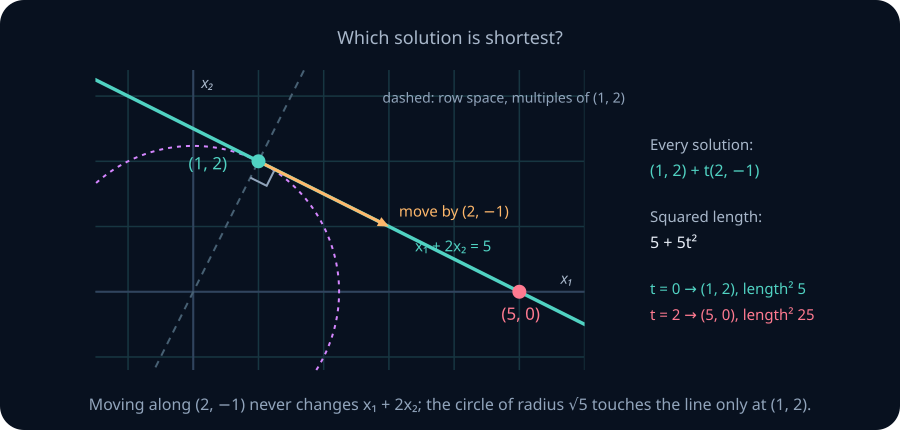
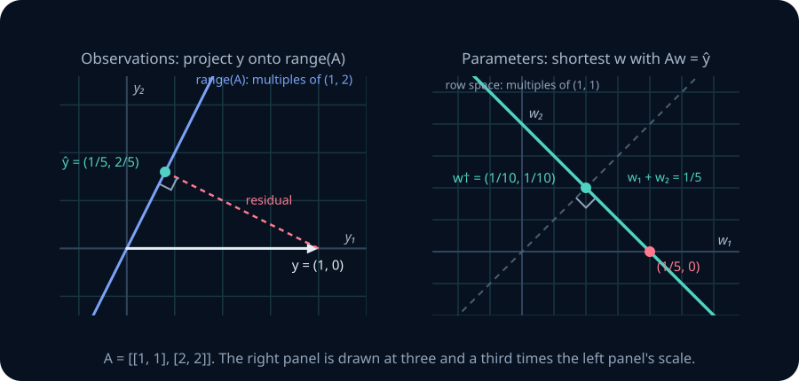
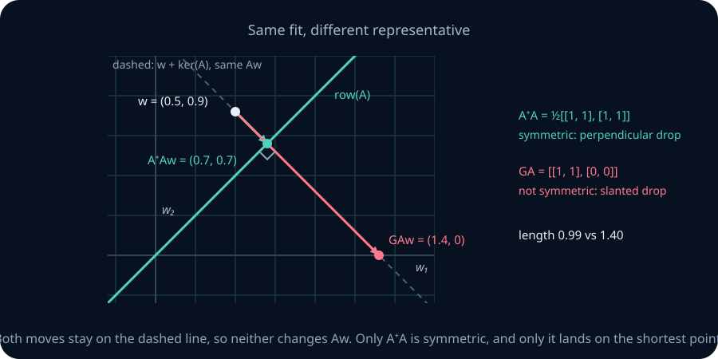
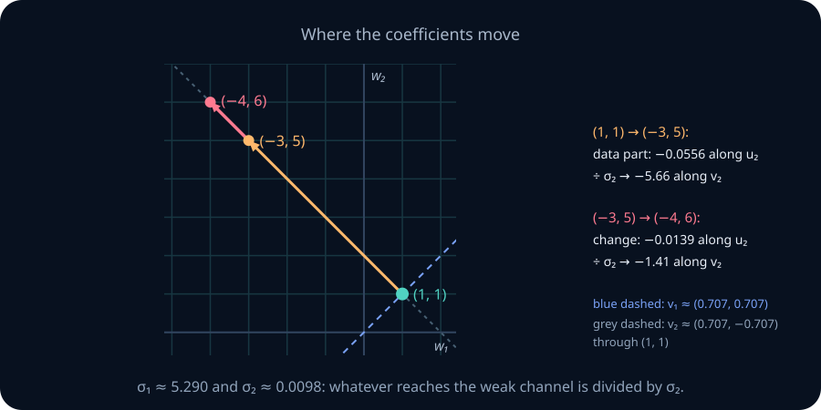
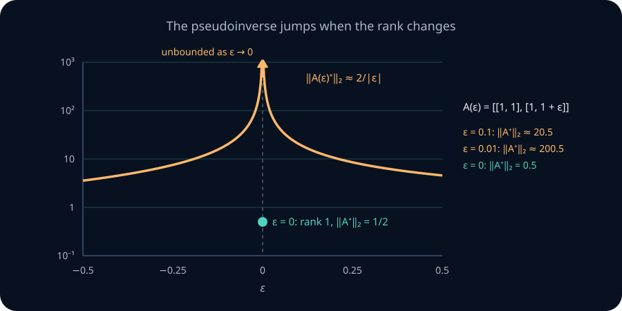

# Pseudoinverse and regularization

The equation x₁+2x₂=5 has a whole line of solutions. (5,0) satisfies it, and so do (0,5/2) and (1,2). Ask a least-squares routine such as NumPy's `lstsq` for a solution and it returns (1,2). It was given one equation in two unknowns, so something beyond the equation decided among the candidates. What?

A second puzzle looks unrelated. Two measured features, x₁=(1,2,3) and x₂=(1,2.01,2.99), are nearly the same column. Fit y=(2,4.05,5.95) by least squares, y≈w₁x₁+w₂x₂, and the best coefficients are w=(−3,5). Now change two observations by 0.01, to y=(2,4.06,5.94). The best coefficients become w=(−4,6). Each coefficient moved by a full unit, a hundred times the change in the data, while the fitted values moved by at most 0.01. Adding a small penalty on the size of w (the method called ridge regression, Section 7) turns the same two fits into about (0.960,1.036) and (0.950,1.045).

Both puzzles are about directions a matrix cannot see, or can barely see. In the first, one direction of the input is invisible to the equation, and the routine settles it by a rule we can name and prove optimal. In the second, one direction is almost invisible, and dividing by how faintly it is seen produces the jump. Sections 1–4 answer the first question completely, and Section 5 answers the second. The rest of the chapter studies three ways to control what faint directions do: cut them off, damp them, or stop an iteration before it reaches them.

## 0. Route and prerequisite diagnostic

The chapter has three natural stopping points.

1. **Choosing a solution (Sections 1–4).** When many inputs fit equally well, choose the shortest. This defines the pseudoinverse A⁺, and four identities characterize it.
2. **Controlling amplification (Sections 5–8).** Small singular values make that choice unstable. A cutoff and a ridge penalty respond in different ways.
3. **Defending the choice (Sections 9–12).** Choose how much to regularize, see what gradient descent chooses without being told, and implement the methods.

Subsections marked *second reading* complete proofs that later modules rely on. The main line of the argument does not need them on a first pass.

**Notation.** A∈ℝᵐˣⁿ has rank r. When r≥1 we use the compact SVD of [LA08](08-svd-low-rank.md), A=UᵣΣᵣVᵣᵀ: the columns u₁,…,uᵣ of Uᵣ are orthonormal in ℝᵐ, the columns v₁,…,vᵣ of Vᵣ are orthonormal in ℝⁿ, σ₁≥⋯≥σᵣ>0, and Avᵢ=σᵢuᵢ. We call the pair (vᵢ,uᵢ) with gain σᵢ **channel i**. We write row(A)=range(Aᵀ) for the row space, P_S for the orthogonal projector onto a subspace S, and ‖·‖ for the Euclidean norm. The zero matrix has no channels. For it, every x fits equally badly, the shortest choice is x=0, and A⁺ is the n×m zero matrix. Statements that mention σᵣ assume A≠0.

Before starting, check these four prerequisites. Answer all four before reading the answers below the list.

- Give a nonzero vector in the kernel of [[1,1,0],[0,1,1]] and check that it is perpendicular to both rows. Repair: [systems and subspaces](02-systems-elimination-subspaces.md).
- Project b=(3,1) onto the line through (1,1). Repair: [projection](03-projections-least-squares.md).
- If Av₁=4u₁ and Av₂=u₂, what is A(2v₁−v₂)? Repair: [SVD channels](08-svd-low-rank.md).
- A square matrix has singular values 5 and 0.05. Give its κ₂ and say what that number bounds. Repair: [conditioning](09-norms-conditioning-stability.md).

*Answers:* (1,−1,1), or any multiple of it; (2,2); 8u₁−u₂; κ₂=100, the largest possible ratio of relative change in the solution to relative change in the data.

## 1. Many solutions: choose the one the matrix can see

Return to x₁+2x₂=5. Both (5,0) and (1,2) satisfy it. To see what separates them, start at (1,2) and move in the direction (2,−1). Increasing the first coordinate by 2 adds 2 to the left-hand side; decreasing the second by 1 subtracts the same 2. The equation cannot detect this movement.

Every solution therefore has the form (1,2)+t(2,−1). The two vectors (1,2) and (2,−1) are perpendicular, so by Pythagoras the squared length of a solution is

$$
\|(1,2)+t(2,-1)\|^2=5+5t^2 .
$$

It is smallest at t=0. The routine returned the shortest solution. (5,0) is the solution at t=2, with squared length 25.



The figure shows why the shortest solution sits where it does. The direction (2,−1) is the only one the equation ignores, and the solution line runs along it. The dashed line is every multiple of (1,2), the equation's own row. It crosses the solution line at a right angle, and that crossing is (1,2). Circles about the origin grow until one first touches the solution line, and a circle first touches a line where the radius is perpendicular to the line. That point is the shortest solution.

**Two equations, three unknowns.** Take two equations in three unknowns,

$$
A=\begin{pmatrix}1&0&1\\0&1&1\end{pmatrix},\qquad b=\begin{pmatrix}2\\3\end{pmatrix}.
$$

The equations say x₁+x₃=2 and x₂+x₃=3. Choose x₃=t. Then every solution is

$$
x(t)=(2-t,\;3-t,\;t).
$$

Increasing t by 1 moves x by (−1,−1,1), and A(−1,−1,1)=(−1+1, −1+1)=(0,0): this is the invisible direction. At the shortest solution, x must be perpendicular to it. If it were not, a small step along the line in the direction that shrinks the length would give a shorter solution. So

$$
x(t)\cdot(-1,-1,1)=-(2-t)-(3-t)+t=3t-5=0,\qquad t=\tfrac53,
$$

and the shortest solution is

$$
x^\dagger=\left(\tfrac13,\ \tfrac43,\ \tfrac53\right),\qquad \|x^\dagger\|^2=\tfrac{1+16+25}{9}=\tfrac{14}{3}.
$$

For comparison, setting the free variable to zero gives (2,3,0), with squared length 13.

Look at the answer once more: (1/3,4/3,5/3)=(1/3)(1,0,1)+(4/3)(0,1,1). The shortest solution is a combination of the rows of A. That is no accident. A vector is perpendicular to every invisible direction exactly when it lies in the row space, because row(A) and ker(A) are orthogonal complements ([LA03](03-projections-least-squares.md)). Perpendicularity to the line and membership in the row space are the same condition.

**Theorem 1 — the minimum-norm solution.** Suppose Ax=b has at least one solution x₀.

1. The set of all solutions is x₀+ker(A).
2. Exactly one solution lies in row(A). Call it x†.
3. Every other solution x satisfies ‖x‖²=‖x†‖²+‖x−x†‖², so ‖x‖>‖x†‖.

*Proof.* (1) x solves the system iff A(x−x₀)=0, that is, iff x−x₀∈ker(A). (2) Since ℝⁿ=row(A)⊕ker(A) with the two pieces perpendicular, write x₀=p+k with p∈row(A) and k∈ker(A). Then Ap=Ax₀−Ak=b, so p is a solution in row(A). If p and p′ are two such, then p−p′ lies in row(A) and, by (1), in ker(A). The only vector in both is 0, so p=p′. (3) Any solution is x=x†+k with k∈ker(A). Because x†∈row(A) is perpendicular to k, Pythagoras gives ‖x‖²=‖x†‖²+‖k‖², which exceeds ‖x†‖² unless k=0. ∎

**From the reasoning to a formula.** Suppose the rows of A are independent (full row rank, r=m). Since x† lies in the row space, x†=Aᵀz for some z∈ℝᵐ. Substituting into Ax=b gives AAᵀz=b. The m×m Gram matrix AAᵀ of independent rows is invertible ([LA03](03-projections-least-squares.md)), so

$$
x^\dagger=A^{\mathsf T}(AA^{\mathsf T})^{-1}b .
$$

In the example, AAᵀ=[[2,1],[1,2]], whose inverse is (1/3)[[2,−1],[−1,2]], so z=(1/3)(2·2−3, −2+2·3)=(1/3,4/3). These are the row coefficients we found by perpendicularity, and Aᵀz=(1/3,4/3,5/3) again. The formula condenses what the perpendicularity argument did: look for the answer among combinations of the rows, then fix the coefficients by the equations.

**The question left open in LA03.** [LA03](03-projections-least-squares.md) noted that setting free variables to zero picks one representative, and asked whether that representative is special. It is not. Above, calling x₃ free and setting it to zero gave (2,3,0). Calling x₁ free instead gives x₃=2, x₂=1, the solution (0,1,2) with squared length 5. The answer depends on which variable we chose to call free, so it is a convention tied to the order of the columns. The minimum-norm solution depends only on A and b: it adds an objective, the length of x, that the equations alone do not supply.

**Numerical notes.** The formula Aᵀ(AAᵀ)⁻¹b needs independent rows, while Theorem 1 does not. Forming AAᵀ also squares the condition number, the same hazard as the normal equations of [LA09](09-norms-conditioning-stability.md); later sections compute x† from orthogonal factors instead.

> **Practice — Foundation:** For the single equation 3x₁−x₂=10, find a direction the equation cannot see, write every solution, and find the shortest one.
>
> **Hint:** The shortest solution is a multiple of the row. Write it as t(3,−1) and substitute into the equation.
>
> **Practice — Core:** Two people report solutions of x₁+x₂+x₃=6: one gives (6,0,0), the other (2,2,2). Without minimizing anything, decide which is the minimum-norm solution by testing perpendicularity, and find the squared length of each.
>
> **Hint:** Find two vectors whose coordinates sum to zero; they span the invisible directions. Which reported solution is perpendicular to both?
>
> **Practice — Stretch:** Someone argues: "Setting a free variable to zero gives the shortest solution, because zero is the smallest value that variable can take." Test the claim on x₁+x₃=2, x₂=1, and repair the argument.
>
> **Hint:** Parameterize the solutions by one free variable. Compare the length at the free-variable-zero choice with the length at the perpendicular choice.

So far an exact fit existed. What if no x satisfies Ax=b at all?

## 2. No exact fit: project first, then take the shortest

When Ax=b has no solution, [LA03](03-projections-least-squares.md) replaces it with the least-squares problem: minimize ‖Ax−b‖. The best reachable output is ŷ=P_range(A)b, the projection of b onto the column space, and x is a least-squares solution exactly when Ax=ŷ. That settles the output. It does not settle the input: if the columns of A are dependent, many x produce the same ŷ. Two decisions are needed, and they are made in two different spaces.

**The example LA03 left unfinished.** LA03 fitted y=(1,0) with A=[[1,1],[2,2]], whose two columns are equal. We keep its letters, y and w.

*Step 1, in observation space.* Every column is a multiple of (1,2), so range(A) is the line through (1,2). Project:

$$
\hat y=\frac{(1,2)\cdot(1,0)}{(1,2)\cdot(1,2)}\,(1,2)=\tfrac15(1,2)=\left(\tfrac15,\tfrac25\right),\qquad
y-\hat y=\left(\tfrac45,-\tfrac25\right).
$$

The residual is perpendicular to (1,2), since 4/5−4/5=0, so no w can do better. The smallest squared error is 16/25+4/25=4/5.

*Step 2, in parameter space.* Now solve Aw=ŷ. Both rows say w₁+w₂=1/5, so the least-squares solutions form a line, w=(1/5,0)+t(−1,1). Its direction (−1,1) is the kernel of A. By the reasoning of Section 1, the shortest point on this line is perpendicular to (−1,1), which forces w₁=w₂:

$$
w^\dagger=\left(\tfrac1{10},\tfrac1{10}\right),\qquad \|w^\dagger\|^2=\tfrac1{50}.
$$

Setting w₂=0 instead gives (1/5,0), with squared length 1/25.



The two panels are the two decisions. On the left, observations: the residual is perpendicular to everything A can produce. On the right, parameters: every point on the solid line produces the same projection ŷ, and the shortest one lies on the dashed row-space line. Neither panel alone determines w†.

**A second case, with an unreachable coordinate.** Let

$$
A=\begin{pmatrix}1&2\\2&4\\0&0\end{pmatrix},\qquad b=\begin{pmatrix}1\\1\\1\end{pmatrix}.
$$

Both columns are multiples of (1,2,0). Project b onto that line:

$$
\hat y=\frac{(1,2,0)\cdot(1,1,1)}{5}(1,2,0)=\left(\tfrac35,\tfrac65,0\right),\qquad
b-\hat y=\left(\tfrac25,-\tfrac15,1\right).
$$

The residual is perpendicular to (1,2,0): 2/5−2/5+0=0. Its third coordinate is the whole third observation. No choice of input can affect that coordinate, because the third row of A is zero. Next, solve Ax=ŷ. The first row says x₁+2x₂=3/5, the second says twice that, and the third says 0=0. The invisible direction is (2,−1), the row space is the line through (1,2), and the shortest solution is the multiple x=t(1,2) with 5t=3/5:

$$
x^\dagger=\left(\tfrac3{25},\tfrac6{25}\right),\qquad
Ax^\dagger=\left(\tfrac{15}{25},\tfrac{30}{25},0\right)=\hat y .
$$

**Theorem 2 — the minimum-norm least-squares solution.** For every A and b, the least-squares solutions form a set x₀+ker(A), and exactly one of them lies in row(A). That one, x†, is shorter than every other least-squares solution. Equivalently, x† is the unique vector satisfying both

$$
A^{\mathsf T}(Ax-b)=0\qquad\text{and}\qquad x\in\operatorname{row}(A).
$$

*Proof.* By the projection theorem of [LA03](03-projections-least-squares.md), x minimizes ‖Ax−b‖ iff Ax−b is perpendicular to range(A), that is, iff Aᵀ(Ax−b)=0, and this happens iff Ax=ŷ. The system Ax=ŷ always has a solution, since ŷ lies in range(A). Theorem 1 applied to Ax=ŷ gives the solution set, the unique row-space solution, and its minimality. ∎

We call x† the **minimum-norm least-squares solution**. When Ax=b is consistent, ŷ=b and x† is the solution of Theorem 1.

**Numerical notes.** The normal equations AᵀAx=Aᵀb have the same solution set but, when A has dependent columns, a singular matrix AᵀA, so they cannot be solved by a plain inverse. Even with independent columns, forming AᵀA squares the condition number. The two-step description is the mathematics; Section 3 gives a computation that does both steps at once.

> **Practice — Foundation:** For A=[[1,−1],[−1,1]] and b=(2,0), project b onto range(A), write the set of least-squares solutions, and give x† and the residual.
>
> **Hint:** Start in observation space: project b onto the line through (1,−1). Then look for the shortest w that produces that projection.
>
> **Practice — Core:** In the duplicate-column example, add c(2,−1) to y for some number c. Using the two panels of the figure, say what happens to ŷ, to the line of least-squares solutions, and to w†.
>
> **Hint:** Check whether the change (2,−1) is perpendicular to the column (1,2). If it is, what happens to it under projection?
>
> **Practice — Stretch:** Prove that adding to b any vector in ker(Aᵀ) leaves x† unchanged, and that adding a vector in range(A) changes x† by a vector in row(A).
>
> **Hint:** Use the fact that ker(Aᵀ) is the orthogonal complement of range(A). For the second part, split e into its row-space and kernel parts.

Both steps, projecting and then choosing the row-space representative, depend linearly on b. Is there one matrix that performs them together?

## 3. The pseudoinverse: reverse the channels you can see

First, x† really is linear in b. If x₁† and x₂† belong to b₁ and b₂, then x₁†+x₂† lies in row(A) and satisfies Aᵀ(A(x₁†+x₂†)−(b₁+b₂))=0. By the uniqueness in Theorem 2, it is the minimum-norm least-squares solution for b₁+b₂. Scaling works the same way. So there is an n×m matrix that sends every b to x†. To find it, we need a basis in which both decisions of Section 2 are easy. The SVD provides one.

In the coordinates of the SVD, A acts channel by channel: it takes the coordinate of x along vᵢ, multiplies it by σᵢ, and places the result along uᵢ. Directions in ker(A) produce nothing, and directions of ℝᵐ outside range(A) are never produced.

**A worked 3×3 example.** The factors below were constructed so that the arithmetic stays in small fractions. The example applies a given SVD; it does not show how to find one, which [LA08](08-svd-low-rank.md) covers. Let

$$
U=\frac13\begin{pmatrix}1&2&2\\2&1&-2\\2&-2&1\end{pmatrix},\qquad
\sigma=(6,3,0),\qquad
V=\frac13\begin{pmatrix}2&-1&2\\2&2&-1\\-1&2&2\end{pmatrix},
$$

so that

$$
A=U\operatorname{diag}(6,3,0)V^{\mathsf T}=\frac13\begin{pmatrix}2&8&2\\7&10&-2\\10&4&-8\end{pmatrix}.
$$

A has rank 2. Its channels are v₁=(2,2,−1)/3 ↦ 6u₁ with u₁=(1,2,2)/3, and v₂=(−1,2,2)/3 ↦ 3u₂ with u₂=(2,1,−2)/3. The third input direction v₃=(2,−1,2)/3 spans ker(A), and u₃=(2,−2,1)/3 spans the part of ℝ³ that A never reaches. Take b=(1,1,1).

1. **Read b in the output basis.** u₁ᵀb=(1+2+2)/3=5/3, u₂ᵀb=(2+1−2)/3=1/3, and u₃ᵀb=(2−2+1)/3=1/3.
2. **Set aside what no input can reach.** The u₃ coordinate lies outside range(A). It is the residual: (1/3)u₃=(2/9,−2/9,1/9). This is Step 1 of Section 2, done by reading a coordinate.
3. **Reverse each channel A uses.** To produce (5/3)u₁, the input needs coordinate (5/3)/6=5/18 along v₁. To produce (1/3)u₂, it needs (1/3)/3=1/9 along v₂.
4. **Add nothing invisible.** A ignores the coordinate along v₃, so any value fits equally well. By Theorem 1, zero gives the shortest input. This is Step 2 of Section 2.
5. **Reassemble.**

$$
x^\dagger=\tfrac5{18}v_1+\tfrac19v_2=\tfrac5{54}(2,2,-1)+\tfrac1{27}(-1,2,2)=\tfrac1{54}(8,14,-1)=\left(\tfrac4{27},\ \tfrac7{27},\ -\tfrac1{54}\right).
$$

Check the fit. The output should be b minus the residual, (1,1,1)−(2/9,−2/9,1/9)=(7/9,11/9,8/9). The first row of A gives (1/3)(2·4/27+8·7/27−2/54)=(1/3)(63/27)=7/9, and the other two rows give 11/9 and 8/9 in the same way.

**The operator.** Steps 1–5 did the same thing to every b: take uᵢᵀb, divide by σᵢ, place it along vᵢ, and do this for the channels with σᵢ>0 only. In one formula,

$$
x^\dagger=\sum_{i=1}^{r}\frac{u_i^{\mathsf T}b}{\sigma_i}\,v_i=\Bigl(\sum_{i=1}^{r}\frac1{\sigma_i}v_iu_i^{\mathsf T}\Bigr)b .
$$

**Definition.** The **pseudoinverse** of A≠0 is

$$
A^+=\sum_{i=1}^{r}\frac1{\sigma_i}v_iu_i^{\mathsf T}=V_r\Sigma_r^{-1}U_r^{\mathsf T},
$$

an n×m matrix. For A=0, A⁺ is the n×m zero matrix.

For the example,

$$
A^+=\frac16v_1u_1^{\mathsf T}+\frac13v_2u_2^{\mathsf T}=\frac1{54}\begin{pmatrix}-2&2&8\\10&8&-4\\7&2&-10\end{pmatrix},
$$

and A⁺(1,1,1) sums each row: (1/54)(8,14,−1), the x† found above.

**Theorem 3 — the pseudoinverse solves least squares with minimum norm.** For every b, A⁺b=x†.

*Proof.* A⁺b is a combination of v₁,…,vᵣ, so it lies in row(A) ([LA08](08-svd-low-rank.md), Theorem 28). Next, AA⁺b=Σᵢ(uᵢᵀb)uᵢ=UᵣUᵣᵀb, the projection of b onto range(A), so A(A⁺b)=ŷ. A vector in row(A) that produces ŷ is x†, by Theorem 2. ∎


The figure is the whole definition. Each channel A uses is a two-way street: A multiplies by σᵢ going right, and A⁺ divides by σᵢ coming back. The kernel of A, which A sends to zero, is never reached by A⁺. The part of the output space A cannot reach, ker(Aᵀ), is sent to zero by A⁺. The two dashed arrows are where an ordinary inverse would fail to exist.

**The SVD is not unique, but A⁺ is.** Singular vectors can change sign, and when two singular values are equal the pair of vectors can rotate within their plane ([LA08](08-svd-low-rank.md)). Different valid SVDs therefore give different-looking sums. Theorem 3 shows they all give the same matrix: every one of them sends each b to x†, which was defined in Section 2 without any SVD. A matrix is determined by what it does to every b.

> **Practice — Foundation:** Using the same factors, compute A⁺b for b=(1,2,2) channel by channel: read the three coordinates uᵢᵀb, reverse the channels, and reassemble. What is the residual, and why?
>
> **Hint:** Take the dot product of b with each column of U. Which of the resulting coordinates are nonzero?
>
> **Practice — Core:** Predict A⁺b for b=(2,−2,1) without multiplying any matrices, and explain the answer using the figure.
>
> **Hint:** Compute the coordinates of b along u₁, u₂ and u₃. Which box of the four-subspace picture does b lie in?
>
> **Practice — Stretch:** Suppose σ₁=σ₂ for some matrix, and an SVD is changed by replacing [v₁ v₂] with [v₁ v₂]Q and [u₁ u₂] with [u₁ u₂]Q for a 2×2 orthogonal Q. Show directly that v₁u₁ᵀ+v₂u₂ᵀ does not change, so the two channels' contribution to A⁺ does not change.
>
> **Hint:** Write the sum as the matrix of right vectors times the transpose of the matrix of left vectors. What happens when both are multiplied by the same orthogonal Q?

Look back at the opening's near-collinear fit before moving on. Its second singular value is σ₂≈0.0098, so its pseudoinverse contains the term v₂u₂ᵀ/σ₂, a division by about 0.0098. Section 5 shows that this division is the coefficient jump.

The formula for A⁺ is built from one SVD. How do we recognize the same operator without choosing any singular vectors?

## 4. Four identities pin the operator down

Suppose someone hands you a matrix G: a formula from a textbook, the output of a library, or a colleague's derivation. Is it A⁺? Computing an SVD to compare would work, but there is a direct test. It consists of four identities, each of which can be read off the channel picture.

From the definition, AA⁺=Σuᵢuᵢᵀ=UᵣUᵣᵀ and A⁺A=Σvᵢvᵢᵀ=VᵣVᵣᵀ: the orthogonal projectors onto range(A) and onto row(A). Everything else follows from that.

1. **AA⁺A=A.** Going forward, back and forward again is the same as going forward once: A⁺ exactly undoes A on everything A produces.
2. **A⁺AA⁺=A⁺.** Likewise, A⁺ followed by A and A⁺ again is A⁺: what A⁺ produces lies in row(A), where A loses nothing.
3. **(AA⁺)ᵀ=AA⁺.** The output-side projector is symmetric, so it drops perpendicularly onto range(A): the fit it produces is the least-squares fit.
4. **(A⁺A)ᵀ=A⁺A.** The input-side projector is symmetric, so it drops perpendicularly onto row(A): no invisible component survives.

For the 3×3 example these products are

$$
AA^+=\frac19\begin{pmatrix}5&4&-2\\4&5&2\\-2&2&8\end{pmatrix}=I-u_3u_3^{\mathsf T},\qquad
A^+A=\frac19\begin{pmatrix}5&2&-4\\2&8&2\\-4&2&5\end{pmatrix}=I-v_3v_3^{\mathsf T}.
$$

Both are symmetric. Each removes exactly the one direction its channel picture discards: u₃=(2,−2,1)/3 on the output side and v₃=(2,−1,2)/3 on the input side. Multiplying out confirms identities (1) and (2).

**A candidate that passes three tests out of four.** For A=[[1,1],[2,2]], here is the solver that sets w₂=0. Given y, it fits w₁ alone: the best w₁ is (y₁+2y₂)/5, so its matrix is

$$
G=\begin{pmatrix}\tfrac15&\tfrac25\\0&0\end{pmatrix}.
$$

Check the identities.
- AGA=A and GAG=G both hold.
- AG=(1/5)[[1,2],[2,4]] is symmetric, and it is the projector onto the line through (1,2). So G does produce least-squares fits.
- GA=[[1,1],[0,0]] is not symmetric, so identity (4) fails.

The pseudoinverse instead has A⁺A=(1/2)[[1,1],[1,1]].



The figure shows what the failed identity costs. Start from w=(0.5,0.9). Both GA and A⁺A move w along the dashed line w+t(1,−1), the kernel direction, so neither changes Aw. A⁺A stops where that line crosses the row space at a right angle, at (0.7,0.7). GA follows the same line down to the horizontal axis, at (1.4,0): a slanted drop, which is what a non-symmetric projector does. The two landing points produce the same output, but only the perpendicular one is the shortest, with length 0.99 against 1.40. Identity (4) is the condition that encodes minimum norm.

**Theorem 4 — Moore–Penrose.** For every A there is exactly one n×m matrix G satisfying

$$
AGA=A,\qquad GAG=G,\qquad (AG)^{\mathsf T}=AG,\qquad (GA)^{\mathsf T}=GA,
$$

and it is G=A⁺.

*Proof.* The SVD formula satisfies all four, as shown above. Now let G be any matrix satisfying them, and fix b. We show Gb=x†, so G=A⁺ by Theorem 3.

- *Gb is a least-squares solution.* The matrix P=AG is symmetric by (3), and idempotent since P²=(AGA)G=AG. So P is an orthogonal projector ([LA03](03-projections-least-squares.md)). Its range lies in range(A). Conversely, A=AGA=PA shows that range(A) lies in range(P). Hence P=P_range(A), and A(Gb)=Pb=ŷ.
- *Gb lies in row(A).* The matrix Q=GA is symmetric by (4) and idempotent since Q²=G(AGA)=GA, so it too is an orthogonal projector. Every vector in ker(A) is in ker(Q). Conversely, if Qx=0 then Ax=AGAx=AQx=0. So ker(Q)=ker(A), and Q projects onto ker(A)^⊥=row(A). By (2), Gb=GAGb=Q(Gb), so Gb lies in the range of Q, which is row(A).

A row-space vector that produces ŷ is x†, by Theorem 2. ∎

The proof also shows what each identity contributes. Identities (1) and (3) make Gb a least-squares solution. Identities (1), (2) and (4) together keep Gb in the row space. The free-variable solver G above has the first group but not the second.

**Formulas you already know are special cases.** Each is checked by the four identities.

- If A has independent columns (full column rank), then A⁺=(AᵀA)⁻¹Aᵀ. Here GA=I, so (2) and (4) are immediate, and AG=A(AᵀA)⁻¹Aᵀ is symmetric, which gives (3). This is LA03's left inverse.
- If A has independent rows, then A⁺=Aᵀ(AAᵀ)⁻¹, the formula of Section 1, now with AG=I.
- If A is square and invertible, A⁻¹ passes all four tests, so A⁺=A⁻¹.

**A rule that fails.** For invertible matrices (AB)⁻¹=B⁻¹A⁻¹. The pseudoinverse has no such rule. Take the 1×2 matrix A=[1 1] and the 2×1 matrix B=(1,0)ᵀ. Then AB=[1], so (AB)⁺=1. But A⁺=Aᵀ(AAᵀ)⁻¹=(1/2,1/2)ᵀ and B⁺=(BᵀB)⁻¹Bᵀ=[1 0], so B⁺A⁺=1/2. The reason shows in the channels. A⁺ returns the shortest input to A, which is (1/2,1/2), but B can only produce multiples of (1,0). B⁺ then keeps only the part along (1,0), losing the rest.

**Second reading: two consequences.** (i) (Aᵀ)⁺=(A⁺)ᵀ. Transposing the four identities for A and A⁺ gives the four identities for Aᵀ and (A⁺)ᵀ: (1) and (2) transpose into themselves, and (3) and (4) exchange. Uniqueness does the rest. (ii) (A⁺)⁺=A. The four identities read the same with the roles of A and G exchanged.

**Numerical notes.** The identities test a candidate; they are not an algorithm for computing one. In floating point they hold only up to rounding. More seriously, a matrix with a singular value of 10⁻¹⁴ has a pseudoinverse whose identities hold exactly in exact arithmetic, but which divides by 10⁻¹⁴. Whether that channel should count at all is a decision the identities cannot make. Sections 5 and 6 take it up.

> **Practice — Foundation:** For A=[1 2], Section 1 gives A⁺=(1/5)(1,2)ᵀ. Verify all four identities, and say which of the products AA⁺ and A⁺A is a projector onto which subspace.
>
> **Hint:** Compute AA⁺ and A⁺A as matrices first, then ask onto which subspace each one projects.
>
> **Practice — Core:** A colleague claims that G=Aᵀ/‖A‖_F² is the pseudoinverse of every nonzero matrix, where ‖A‖_F² is the sum of squared entries. Prove the claim for every rank-one A, then find a rank-two matrix for which it fails.
>
> **Hint:** Write a rank-one matrix as σuvᵀ with unit u and v, and compare its Frobenius norm with σ. For rank two, test a diagonal matrix with unequal entries.
>
> **Practice — Stretch:** Prove (Aᵀ)⁺=(A⁺)ᵀ using only the four identities and the uniqueness in Theorem 4, without an SVD.
>
> **Hint:** Transpose each of the four identities for (A, A⁺). Which pair of matrices do the transposed identities describe?

The four identities determine A⁺ from A. They say nothing about how large A⁺ is. What happens when a nonzero channel is very small?

## 5. Small singular values: where the coefficient jump came from

Throughout this section A≠0. Relative bounds assume the quantities in their denominators are nonzero: x≠0 and b≠0.

### 5.1 The opening fit, read channel by channel

The near-collinear design of the opening is

$$
X=\begin{pmatrix}1&1\\2&2.01\\3&2.99\end{pmatrix},\qquad
\sigma_1\approx5.290,\quad\sigma_2\approx0.009823,\qquad
\kappa_2=\frac{\sigma_1}{\sigma_2}\approx538 .
$$

Its right singular vectors are v₁≈(0.7074,0.7069) and v₂≈(0.7069,−0.7074). The strong channel v₁ adds the two features, and the weak channel v₂ takes their difference, which the data barely contain. The weak output direction is u₂≈(−0.051,−0.822,0.567).

The observations were made from coefficients (1,1): X(1,1)=(2,4.01,5.99), and y=(2,4.05,5.95) adds the disturbance (0,0.04,−0.04). Now follow that disturbance through the channels of X⁺.

1. **Read it in the output basis.** Its length is 0.0566, and its coordinate along u₂ is about −0.0556. Almost all of it lies along the weak output direction.
2. **Reverse the channel.** Divide by σ₂≈0.0098: the coefficient along v₂ becomes about −5.66.
3. **Place it along v₂.** −5.66·(0.7069,−0.7074)≈(−4,4), so w=(1,1)+(−4,4)=(−3,5). In fact X(−4,4)=(0,0.04,−0.04) exactly.

The second change, δy=(0,0.01,−0.01), goes the same way. Its coordinate along u₂ is about −0.0139, which is 98% of its length 0.0141. Dividing by σ₂ gives −1.41 along v₂, that is, δw≈(−1,1). Its tiny part along u₁ is divided by σ₁≈5.29 and contributes about 0.0005. Since δy=X(−1,1) exactly, δw=(−1,1) exactly. The fitted values change by δy itself, at most 0.01 in any coordinate.



That is the answer to the opening's second question. Both moves in the figure run almost exactly along v₂, the direction the data hardly see. Whatever part of the observations lands on the weak output direction u₂ is divided by σ₂, and dividing by 0.0098 multiplies by about 102. The fitted values change only slightly because a large move along v₂ produces only a small change in Xw: that small change is exactly what was divided.

The general fact is the size of A⁺. Its channels have gains 1/σ₁,…,1/σᵣ, and the largest is 1/σᵣ, reached by inputs along uᵣ:

$$
\|A^+\|_2=\frac1{\sigma_r}.
$$

For X, ‖X⁺‖₂=1/σ₂≈101.8.

### 5.2 How far the answer can move

**Theorem 5 — sensitivity to the observations.** Let A have independent columns, so r=n, σₙ>0, and the least-squares solution x=A⁺b is unique. Suppose x≠0, so that b has a nonzero projection ŷ onto range(A). Let θ be the angle between b and range(A), so cosθ=‖ŷ‖/‖b‖>0. If b changes to b+δb, the solution changes by δx=A⁺δb, and

$$
\frac{\|\delta x\|}{\|x\|}\le\frac{\kappa_2}{\cos\theta}\,\frac{\|\delta b\|}{\|b\|},\qquad
\kappa_2=\frac{\sigma_1}{\sigma_n}=\|A\|_2\,\|A^+\|_2 .
$$

*Proof.* A⁺ is linear, so δx=A⁺δb and ‖δx‖≤‖δb‖/σₙ. On the other side, ŷ=Ax gives ‖b‖cosθ=‖ŷ‖≤σ₁‖x‖. Divide the first inequality by ‖x‖≥‖b‖cosθ/σ₁. ∎

The factor 1/cosθ is new compared with square systems. When b points nearly perpendicular to range(A), the fitted part ŷ is small, x is built from that small part, and a fixed δb is large compared with it. For a square invertible A every b lies in the range, cosθ=1, and Theorem 5 becomes the bound of [LA09](09-norms-conditioning-stability.md). This is the condition number that LA09 deferred for rectangular matrices: κ₂=‖A‖₂‖A⁺‖₂, attached to the full-column-rank least-squares problem.

**Check it on the opening.** The fit is exact, so cosθ=1. The relative change in the data is ‖δy‖/‖y‖=0.01414/7.470≈0.00189, and the bound allows a relative change in w up to 538·0.00189≈1.02. The actual change is ‖δw‖/‖w‖=1.414/5.831≈0.243: an amplification of 128, within the ceiling of 538. The ceiling is not reached because it needs b along u₁, which makes x as small as possible. Here w=(−3,5) already contains a large v₂ part, which makes ‖w‖ larger than in the worst case.

**When the rank changes, there is no bound.** Every bound so far divides by σₙ or σᵣ, a fixed positive number. When a perturbation creates a new channel, the new σ can be as small as the perturbation.



The figure uses A(ε)=[[1,1],[1,1+ε]]. For ε≠0 the matrix is invertible with determinant ε. Its larger singular value is about 2, so the smaller is about |ε|/2, and ‖A(ε)⁺‖₂=‖A(ε)⁻¹‖₂≈2/|ε|. At ε=0 the matrix [[1,1],[1,1]] has rank one with the single gain σ₁=2, so ‖A(0)⁺‖₂=1/2. As ε shrinks, A(ε) approaches A(0), but A(ε)⁺ does not approach A(0)⁺: it grows without limit and then, at ε=0, falls to a matrix of size 1/2. The pseudoinverse is discontinuous exactly where the rank changes.

**Theorem 6 — a new channel can be as weak as the perturbation that made it.** If rank(A+E)>rank(A), then

$$
\|(A+E)^+\|_2\ge\frac1{\|E\|_2}.
$$

*Proof.* Let B=A+E have rank s>r=rank(A). Count dimensions in ℝⁿ: dim row(B)+dim ker(A)=s+(n−r)>n, so the two subspaces share a unit vector x. Because x lies in row(B), it is a combination of B's s right singular vectors, and ‖Bx‖≥σ_s(B). Because x lies in ker(A), Bx=Ex, so ‖Bx‖≤‖E‖₂. Hence σ_s(B)≤‖E‖₂, and ‖B⁺‖₂=1/σ_s(B)≥1/‖E‖₂. ∎

On the figure, E=[[0,0],[0,ε]] has ‖E‖₂=|ε|. The theorem promises ‖A(ε)⁺‖₂≥1/|ε|, and the actual value is about 2/|ε|. The consequence for computation is direct. Rounding error of size 10⁻¹⁶ can turn a rank-deficient matrix into one of full rank, and then its pseudoinverse is at least 10¹⁶ in size. A pseudoinverse is meaningful only after deciding which channels count. Section 6 makes that decision explicit.

### 5.3 Second reading: perturbing the matrix as well

Section 5.2 changed only b. A fitted model also has uncertain inputs: the entries of A itself. This subsection derives the sensitivity of least squares to both, which [LA09](09-norms-conditioning-stability.md) left for this chapter.

**Setting.** A has independent columns, x=A⁺b≠0, and r=b−Ax is the residual. Perturb A to A+E and b to b+δb with ‖E‖₂≤ε‖A‖₂ and ‖δb‖≤ε‖b‖, and assume ‖E‖₂<σₙ. That last condition keeps the columns independent: for any unit z, ‖(A+E)z‖≥‖Az‖−‖Ez‖≥σₙ−‖E‖₂>0. So the perturbed problem has a unique solution x+δx.

**First-order derivation.** The perturbed solution satisfies the normal equations

$$
(A+E)^{\mathsf T}(A+E)(x+\delta x)=(A+E)^{\mathsf T}(b+\delta b).
$$

Expand both sides and use AᵀAx=Aᵀb to cancel the unperturbed terms. The terms that remain are of first order in E, δb and δx, plus products of two or more of them. Keeping the first-order terms leaves

$$
A^{\mathsf T}A\,\delta x+E^{\mathsf T}Ax+A^{\mathsf T}Ex=A^{\mathsf T}\delta b+E^{\mathsf T}b+(\text{second-order terms}).
$$

Move terms across, use b−Ax=r, and multiply by (AᵀA)⁻¹. For fixed A and b, as ε→0,

$$
\delta x=A^+(\delta b-Ex)+(A^{\mathsf T}A)^{-1}E^{\mathsf T}r+O(\varepsilon^2).
$$

The constant hidden in O(ε²) depends on the problem. It grows as σₙ shrinks, so this expansion describes small perturbations of a fixed problem, not every perturbation allowed by ‖E‖₂<σₙ.

**Bounding each first-order term.** Use ‖A⁺‖₂=1/σₙ, ‖(AᵀA)⁻¹‖₂=1/σₙ², ‖r‖=‖b‖sinθ, and ‖x‖≥‖b‖cosθ/σ₁ from the proof of Theorem 5.

- The data term: ‖A⁺δb‖/‖x‖≤εκ₂/cosθ, as in Theorem 5.
- The matrix term: ‖A⁺Ex‖/‖x‖≤(1/σₙ)·εσ₁=εκ₂.
- The residual term: ‖(AᵀA)⁻¹Eᵀr‖/‖x‖≤(εσ₁‖b‖sinθ/σₙ²)·σ₁/(‖b‖cosθ)=εκ₂²tanθ.

Together,

$$
\frac{\|\delta x\|}{\|x\|}\le\varepsilon\left(\frac{\kappa_2}{\cos\theta}+\kappa_2+\kappa_2^2\tan\theta\right)+O(\varepsilon^2).
$$

The first-order bound on the contribution of the matrix perturbation is ε(κ₂+κ₂²tanθ). The κ₂² term is carried by the residual, and it vanishes for an exact fit, where tanθ=0. A small residual is not enough to make it negligible in the bound. With κ₂=10⁴ and tanθ=10⁻³, a residual one thousandth the size of the data, the κ₂ term is 10⁴ but κ₂²tanθ is 10⁵. The residual-dependent term is ten times the κ₂ term, so dropping it would understate the worst-case ceiling substantially. This compares terms of an upper bound. Whether some perturbation actually attains it is a separate question, and here we have not exhibited one.

**A guarantee for finite perturbations.** The O(ε²) form says nothing about a particular ε of moderate size. A bound that does is due to Wedin (1973), stated as Theorem 20.1 in Higham, *Accuracy and Stability of Numerical Algorithms* (2nd ed., SIAM, 2002), and proved there.

**Theorem (Wedin).** Let A∈ℝᵐˣⁿ with m≥n, and let A and A+E both have full column rank. Let x and x+δx be the least-squares solutions for (A,b) and (A+E, b+δb), with r=b−Ax, ‖E‖₂≤ε‖A‖₂ and ‖δb‖≤ε‖b‖. If κ₂ε<1, then

$$
\frac{\|\delta x\|}{\|x\|}\le\frac{\kappa_2\varepsilon}{1-\kappa_2\varepsilon}\left(2+(\kappa_2+1)\frac{\|r\|}{\|A\|_2\,\|x\|}\right).
$$

The hypothesis κ₂ε<1 is sufficient for the setting's condition: it gives ‖E‖₂≤ε‖A‖₂=εσ₁<σₙ. Since ‖A‖₂‖x‖≥‖Ax‖=‖b‖cosθ, the residual ratio is at most tanθ, so the same κ₂ and κ₂²tanθ structure appears. The factor 1/(1−κ₂ε) is the price of finite size. It is close to 1 when κ₂ε is small, and it grows without limit as κ₂ε approaches 1. Near that boundary the first-order picture is no guide at all. Golub and Van Loan, *Matrix Computations*, Section 5.3, derive the first-order form by a different route. Higham's Chapter 20 also bounds the change in the residual.

**Sensitivity of the problem versus stability of an algorithm.** The bound above describes the least-squares problem itself. It holds for the exact solution of the perturbed problem, so no algorithm can remove it. [LA09](09-norms-conditioning-stability.md) drew the same line for square systems. Forming AᵀA is a separate, algorithmic hazard. Rounding the Gram matrix introduces errors that the computed solution amplifies at the scale κ₂²u, where u is the unit roundoff, *whatever the residual is*. Methods based on QR or the SVD avoid that extra loss, and their computed solutions are as accurate as the problem's own sensitivity allows. They do not make the κ₂²tanθ term go away. This settles the question raised in Section 10 of [LA03](03-projections-least-squares.md), that a correct formula can be a poor algorithm: the normal equations are a correct formula whose computation adds an error the problem itself does not have.

**Numerical notes.** These are worst-case bounds over all perturbations of the stated sizes. Structured perturbations, such as errors confined to one column, can do much less damage. Every bound in this section assumes the rank is known and does not change; Theorem 6 shows what happens otherwise.

> **Practice — Foundation:** A 3×2 matrix has singular values 4 and 0.02. Give ‖A⁺‖₂ and κ₂. A change of size 10⁻³ in b moves the least-squares solution as far as possible when it points in which direction, and how far does it move then?
>
> **Hint:** ‖A⁺‖₂ is the reciprocal of the smallest singular value. The worst direction for the change in b is the output direction of the weakest channel.
>
> **Practice — Core:** A least-squares problem has κ₂=100, and b makes a 60° angle with range(A). Bound the relative change in x caused by a relative change of 10⁻⁴ in b. Then evaluate κ₂+κ₂²tanθ for this problem and say which term controls sensitivity to errors in A.
>
> **Hint:** Compute cos60° and tan60° first. Then evaluate the data bound and the two matrix terms separately before comparing them.
>
> **Practice — Stretch:** Repair the claim: "Since ‖(A+E)⁺‖₂≥1/‖E‖₂, adding any small perturbation to any matrix makes its pseudoinverse huge." Name the missing hypothesis and give a small perturbation of a rank-deficient matrix whose pseudoinverse barely changes.
>
> **Hint:** Reread the hypothesis of Theorem 6. Then try a perturbation that is a small multiple of A itself.

In the opening fit, the weak channel with σ₂≈0.0098 carried almost nothing except the 0.04 disturbance, and dividing by it produced most of the coefficients. Must we invert every nonzero channel, or may we refuse to divide by one that is mostly noise?

## 6. Truncated SVD: decide which channels to trust

Throughout Sections 6–9 the observations are b=Ax+e. The unknown x lies in row(A), so it has coordinates cᵢ=vᵢᵀx along the right singular vectors, and e is noise. Channel i then receives

$$
u_i^{\mathsf T}b=\sigma_i c_i+u_i^{\mathsf T}e .
$$

The first term is signal, scaled down by σᵢ. The second is noise, which does not care how strong the channel is. Inverting the channel divides both terms by σᵢ: the signal comes back as cᵢ, and the noise comes back as uᵢᵀe/σᵢ. A strong channel returns its signal with a little noise. A channel with tiny σᵢ returns a little signal with a lot of noise.

**A three-channel example.** Work directly in singular coordinates, since lengths do not depend on which orthonormal U and V carry them. Take

$$
\sigma=(1,\ 10^{-1},\ 10^{-4}),\qquad c=(1,\ \tfrac12,\ \tfrac1{10}),\qquad U^{\mathsf T}e=10^{-3}(1,-1,-1),
$$

so ‖e‖=√3·10⁻³≈1.73·10⁻³ and the observed coordinates are β=Uᵀb=(1.001, 0.049, −0.00099). Divide by σ:

| channel i | σᵢ | signal σᵢcᵢ | noise uᵢᵀe | βᵢ/σᵢ | true cᵢ |
|---|---|---|---|---|---|
| 1 | 1 | 1 | 10⁻³ | 1.001 | 1 |
| 2 | 10⁻¹ | 0.05 | −10⁻³ | 0.49 | 0.5 |
| 3 | 10⁻⁴ | 10⁻⁵ | −10⁻³ | −9.9 | 0.1 |

In the third channel the noise is a hundred times the signal. Dividing by 10⁻⁴ turns the noise −10⁻³ into −10, and the recovered coordinate is 0.1−10=−9.9. Now choose how many channels to keep, setting the rest to zero:

| channels kept, k | solution coordinates | error ‖x_k−x‖ | squared residual ‖Ax_k−b‖² |
|---|---|---|---|
| 1 | (1.001, 0, 0) | 0.5099 | 2.402·10⁻³ |
| 2 | (1.001, 0.49, 0) | 0.1005 | 9.801·10⁻⁷ |
| 3 | (1.001, 0.49, −9.9) | 10.000 | 0 |

Keeping all three channels fits the data exactly and is a hundred times worse than keeping two. Keeping only one discards the real coordinate 0.5 and is five times worse than keeping two. The residual column is no guide on its own: it always prefers more channels.

**The truncated pseudoinverse.** Keeping the first k channels means replacing A by its rank-k truncation and applying the pseudoinverse of that:

$$
A_k=\sum_{i\le k}\sigma_iu_iv_i^{\mathsf T},\qquad
x_k=A_k^+b=\sum_{i\le k}\frac{u_i^{\mathsf T}b}{\sigma_i}\,v_i .
$$

In practice the choice is made with a tolerance τ≥0. The **numerical rank** at tolerance τ is the number of singular values with σᵢ>τ, and A_τ⁺ is the pseudoinverse of A_τ, the matrix that keeps exactly those channels. Both forms are the general recipe x=Σfᵢ(uᵢᵀb/σᵢ)vᵢ with **filter factors** fᵢ. Here fᵢ=1 for a kept channel and fᵢ=0 for a discarded one. Sections 7 and 10 use the same recipe with other filters.

**Theorem 7 — what truncation solves, and what its error is made of.** For 1≤k≤r, x_k=A_k⁺b is the minimum-norm minimizer of ‖A_kx−b‖. If b=Ax+e with x=Σcᵢvᵢ in row(A), then

$$
x_k-x=\underbrace{\sum_{i\le k}\frac{u_i^{\mathsf T}e}{\sigma_i}v_i}_{\text{amplified noise}}\;-\;\underbrace{\sum_{i>k}c_iv_i}_{\text{discarded signal}},
\qquad
\|x_k-x\|^2=\sum_{i\le k}\Big(\frac{u_i^{\mathsf T}e}{\sigma_i}\Big)^2+\sum_{i>k}c_i^2 ,
$$

and the amplified noise has length at most ‖e‖/σ_k.

*Proof.* The truncation A_k has the compact SVD with channels 1 to k, so Theorem 3 applied to A_k gives the first statement. For the error, substitute uᵢᵀb=σᵢcᵢ+uᵢᵀe into x_k and subtract x=Σᵢcᵢvᵢ. The coordinates cᵢ for i≤k cancel, leaving the two sums. The vᵢ are orthonormal, so Pythagoras gives the squared length. Finally, each |uᵢᵀe|/σᵢ≤|uᵢᵀe|/σ_k for i≤k, and Σ(uᵢᵀe)²≤‖e‖². ∎

The theorem names the trade. Raising k moves a term from the discarded-signal sum to the amplified-noise sum. That helps while cᵢ² exceeds (uᵢᵀe/σᵢ)², and hurts after. On the example, k=2 gives an error of √(0.01²+10⁻⁶+0.1²)≈0.1005: noise 0.01 from channel 2 and discarded signal 0.1 from channel 3. Keeping channel 3 swaps that 0.1 for 10.

**Where does the signal run out?** Three channels are too few to show a pattern, so the figure uses a larger problem with 32 channels. Its singular values fall evenly on a log scale from 1 to 10⁻⁸, the true coordinates are cᵢ=σᵢ^½, and each channel's noise is drawn once with standard deviation 10⁻⁴/√32≈1.8·10⁻⁵, giving ‖e‖≈9.57·10⁻⁵.


The left panel is a **Picard plot**: σᵢ, the observed |uᵢᵀb|, and their ratio, against i. While the signal term dominates, |uᵢᵀb|≈σᵢ|cᵢ| falls faster than σᵢ, and the ratio falls with it. Around channel 15 the observed coefficients stop falling and sit at the noise level. From there on, uᵢᵀb is mostly noise, and the ratio climbs as σᵢ shrinks. The right panel is the error of Theorem 7 for every k. It is smallest at k=14, where the plateau begins, with error 0.039, compared with ‖x‖≈1.49. Keeping every channel gives an error of about 960.

The condition that the exact coefficients |uᵢᵀ(Ax)| decay faster than σᵢ, at least on average, is the **discrete Picard condition** (Hansen). Without it, even noise-free data would put large coordinates cᵢ on the weakest channels. Any filter that damps those channels would then discard real signal, and as the number of channels grows, stable recovery becomes impossible. With it, and with noise of roughly equal size in every channel, as here, the plot suggests where the data stop carrying information: the index where the observed coefficients level off. That reading needs no knowledge of the true x, which is why the plot is a working diagnostic. It is a diagnostic under these assumptions, not a proof. It cannot show that any single coordinate is noise, and it does not give a cutoff that is right for every problem.

**Numerical notes: library tolerances differ.** Every rank-revealing routine must decide which singular values count, and libraries decide differently. In NumPy 2.x, `np.linalg.pinv` zeroes singular values **less than or equal to** rcond·σ₁ with default rcond=10⁻¹⁵ (the newer argument `rtol` is an alias; passing `rtol=None` selects the Array API default instead). `np.linalg.matrix_rank` counts singular values **greater than** σ₁·max(m,n)·ε by default, where ε is the machine epsilon of the dtype. `np.linalg.lstsq` treats as zero those **smaller than** rcond·σ₁, with default rcond=ε·max(m,n) since NumPy 2.0; before that the default was machine precision. All three are *relative* tolerances. The labs in Section 12 use an *absolute* tolerance τ, keeping σᵢ>τ. Record the library version and the tolerance whenever you report a rank. None of these defaults knows the noise level of your data. They guard against rounding, and they will happily keep channel 30 of the problem above.

> **Practice — Foundation:** A problem in singular coordinates has σ=(2, 0.5, 0.001) and observed coordinates β=(4, 0.5, 0.003). At absolute tolerance τ=0.01, give the numerical rank and the coordinates of A_τ⁺b. What would full inversion put in the third coordinate?
>
> **Hint:** Compare each σᵢ with τ first. Divide only the kept observed coordinates by their singular values.
>
> **Practice — Core:** In the three-channel example, suppose the third channel's noise were +10⁻³ instead of −10⁻³. Recompute β₃/σ₃ and the error for k=3, and explain why the best cutoff is still k=2.
>
> **Hint:** Write β₃ as signal plus the new noise and divide by σ₃. Does Theorem 7's error depend on the sign of the noise?
>
> **Practice — Stretch:** Repair the claim: "Numerical rank is a property of the matrix, so two careful programs must agree on it." Give a matrix and two reasonable tolerances that disagree, and say what extra information should decide.
>
> **Hint:** Compute matrix_rank's default threshold for diag(1, 10⁻⁸). Then choose a tolerance from a measurement noise level instead, and compare.

A cutoff is all or nothing: channel 14 is passed whole and channel 15 is discarded whole, although the two are hardly different. Can the trade between discarded signal and amplified noise change smoothly instead?

## 7. Ridge: replace the hard cutoff with a smooth filter

### 7.1 Damping every channel a little

Instead of deciding which channels to invert, charge for the size of the answer. Choose λ>0 and minimize

$$
\|Ax-b\|^2+\lambda\|x\|^2 .
$$

A move along a weak direction vᵢ hardly changes the fit, because A shrinks it by σᵢ, but it costs its full length in λ‖x‖². So the penalty discourages exactly the moves that Section 5 found dangerous. This is **ridge regression**, also called Tikhonov regularization.

**Theorem 8 — the ridge solution.** For λ>0 the minimizer is unique. It solves (AᵀA+λI)x=Aᵀb, and in SVD form it is

$$
x_\lambda=\sum_{i\le r}f_i\,\frac{u_i^{\mathsf T}b}{\sigma_i}\,v_i,\qquad f_i=\frac{\sigma_i^2}{\sigma_i^2+\lambda}.
$$

In particular x_λ lies in row(A), and x_λ→A⁺b as λ→0⁺, whether or not A has full rank.

*Proof.* Expand the objective as xᵀ(AᵀA+λI)x−2bᵀAx+bᵀb. The matrix AᵀA+λI is symmetric positive definite, since xᵀ(AᵀA+λI)x=‖Ax‖²+λ‖x‖²>0 for x≠0. A quadratic with a positive definite matrix has exactly one minimizer, where its gradient 2(AᵀA+λI)x−2Aᵀb vanishes. For the SVD form, complete Vᵣ to an orthonormal basis of ℝⁿ with vectors spanning ker(A). In that basis AᵀA+λI is diagonal, with entries σᵢ²+λ on the row-space vectors and λ on the kernel vectors. The right-hand side Aᵀb=Σσᵢ(uᵢᵀb)vᵢ has no kernel component. Dividing coordinate by coordinate gives σᵢ(uᵢᵀb)/(σᵢ²+λ) along vᵢ, which is fᵢ(uᵢᵀb)/σᵢ, and zero along the kernel. As λ→0⁺, each fᵢ→1 for the finitely many i≤r, and the sum becomes the formula for A⁺b in Theorem 3. ∎

The proof never needed AᵀA to be invertible. The penalty λ fills in the kernel directions, which is why ridge has a unique answer even when least squares has a line of them. The limit also says which one ridge approaches. Consider LA03's duplicate-column example A=[[1,1],[2,2]], y=(1,0) from Section 2. Here AᵀA+λI=[[5+λ,5],[5,5+λ]] and Aᵀy=(1,1). By symmetry x_λ=(c,c) with (10+λ)c=1. So c=1/11 at λ=1, c=100/1001≈0.0999 at λ=0.01, and c→1/10 as λ→0: ridge approaches (1/10,1/10), the pseudoinverse answer, never one of the other least-squares solutions.

The filter factor reads like a dimmer switch with its midpoint at σ=√λ. For σᵢ≫√λ, fᵢ≈1 and the channel passes almost untouched. For σᵢ≪√λ, fᵢ≈σᵢ²/λ, so the channel's contribution fᵢ(uᵢᵀb)/σᵢ≈σᵢ(uᵢᵀb)/λ shrinks *with* σᵢ instead of blowing up as 1/σᵢ.

### 7.2 Why the opening coefficients held still

The opening reported that ridge with λ=0.01 turned the two fits (−3,5) and (−4,6) into about (0.960,1.036) and (0.950,1.045). The filter factors explain it. With σ₁²≈27.98 and σ₂²≈0.0000965,

$$
f_1=\frac{27.98}{27.98+0.01}\approx0.99964,\qquad f_2=\frac{0.0000965}{0.0000965+0.01}\approx0.00956 .
$$

Note that σ₂ enters squared: f₂ is not 0.0098/(0.0098+0.01), which would be about one half. The strong channel passes essentially whole. The weak channel passes at under 1%. In Section 5.1 the 0.01 change in the data reached the coefficients as −1.41 along v₂. Ridge multiplies that by f₂, and −1.41·0.00956≈−0.0135, the size of the change from (0.960,1.036) to (0.950,1.045). The same factor removes most of the original −5.66 along v₂ that had carried (1,1) to (−3,5): what remains is −5.66·0.00956≈−0.054, which is why both ridge fits sit close to (1,1).

There is a price. Ridge no longer reproduces y exactly: its fitted values (1.9965, 4.0033, 5.9791) miss y=(2,4.05,5.95) by 0.055, and lie close to X(1,1)=(2,4.01,5.99) instead. Here that is what we want, since the 0.04 disturbance was never signal. Ridge cannot know this. It damps the weak channel because it is weak, not because it is noisy.


The figure puts the three filters of this chapter side by side. The step is truncation. The smooth orange curve is ridge. The purple curves belong to gradient descent, which Section 10 explains.

**Back to the three-channel example.** Ridge errors for a range of λ are:

| λ | 10⁻⁸ | 10⁻⁶ | 10⁻⁵ | 10⁻⁴ | 10⁻³ | 10⁻² |
|---|---|---|---|---|---|---|
| ‖x_λ−x‖ | 5.05 | 0.198 | 0.110 | 0.102 | 0.114 | 0.274 |

The best value in hindsight is λ≈1.19·10⁻⁴, with error 0.1021, essentially the same as truncation at k=2. Ridge is a smoother way to make the same trade, not a way around it. In this example the third channel's observed coordinate is −9.9 and every ridge factor is positive, so ridge's third coordinate f₃·(−9.9) is always negative. No λ recovers c₃=0.1 from that channel. The best any filter can do is to suppress it.

### 7.3 How the solution moves with λ, and how to compute it

**Theorem 9 — monotonicity.** As λ increases on (0,∞), ‖x_λ‖ is nonincreasing and ‖Ax_λ−b‖ is nondecreasing. Both are strictly monotone when Aᵀb≠0.

*Proof.* Write βᵢ=uᵢᵀb. From Theorem 8,

$$
\|x_\lambda\|^2=\sum_{i\le r}\frac{\sigma_i^2\beta_i^2}{(\sigma_i^2+\lambda)^2},\qquad
\|Ax_\lambda-b\|^2=\sum_{i\le r}\frac{\lambda^2\beta_i^2}{(\sigma_i^2+\lambda)^2}+\|(I-AA^+)b\|^2 .
$$

The residual formula holds because Ax_λ=Σfᵢβᵢuᵢ, so the residual has coordinate (1−fᵢ)βᵢ=λβᵢ/(σᵢ²+λ) on uᵢ, plus the part of b outside range(A). Each term of the first sum decreases in λ, and each λ/(σᵢ²+λ) increases. Since Aᵀb=Σσᵢβᵢvᵢ, the condition Aᵀb≠0 means some βᵢ≠0 with i≤r, and that term makes both changes strict. ∎

Section 9 needs this: a residual that strictly increases with λ crosses any attainable level exactly once.

**Conditioning.** The ridge system is better conditioned than the normal equations:

$$
\kappa_2(A^{\mathsf T}A+\lambda I)=\frac{\sigma_1^2+\lambda}{\mu_{\min}+\lambda},
$$

where μ_min is the smallest eigenvalue of the n×n matrix AᵀA. Under full column rank μ_min=σₙ². Whenever rank(A)<n, including every wide matrix, μ_min=0 and the condition number is (σ₁²+λ)/λ. For the opening fit at λ=0.01, it drops from 27.98/0.0000965≈2.9·10⁵ to 27.99/0.0101≈2.8·10³.

**Algorithm.** Do not form AᵀA if you can avoid it ([LA09](09-norms-conditioning-stability.md)). Ridge is itself an ordinary least-squares problem with extra rows:

$$
\begin{pmatrix}A\\ \sqrt\lambda\,I\end{pmatrix}x\approx\begin{pmatrix}b\\ 0\end{pmatrix}.
$$

Its normal equations are (AᵀA+λI)x=Aᵀb, and its condition number is the square root of the one above, about 53 for the opening fit. Solve it by QR, which LA11 develops, or apply the filter factors directly when the SVD is already available.

### 7.4 Second reading: four connections

**A size budget.** Ridge also solves a constrained problem: minimize ‖Ax−b‖ subject to ‖x‖≤t. For 0<t<‖A⁺b‖ the constraint is active, and the minimizer is x_λ for the λ>0 with ‖x_λ‖=t. Theorem 9 makes ‖x_λ‖ strictly decreasing, from ‖A⁺b‖ as λ→0⁺ to 0 as λ→∞, so this λ exists and is unique. At t=0 the only feasible point is x=0, which ridge reaches only in the limit λ→∞; for t≥‖A⁺b‖ the constraint is inactive and the answer is A⁺b. The Lagrange argument behind it belongs to the optimization track.

**Effective degrees of freedom.** The fitted values are Ax_λ=H_λb with H_λ=Σfᵢuᵢuᵢᵀ, and

$$
\operatorname{df}(\lambda)=\operatorname{tr}H_\lambda=\sum_{i\le r}\frac{\sigma_i^2}{\sigma_i^2+\lambda}
$$

counts how many channels the fit effectively uses, from r at λ=0 down to 0. For the opening fit at λ=0.01, df≈0.99964+0.00956≈1.009: one channel, plus a trace of the second.

**Units, standardization and the intercept.** The penalty λ‖x‖² adds up the squared coefficients as if they were measured in the same units. Measure one feature in centimetres instead of metres and its coefficient shrinks a hundredfold, so the same λ barely restrains it. Ridge therefore depends on how features are scaled. The usual convention divides each feature by its standard deviation. That is a modelling choice, made for a stated reason, not a correction. An intercept is normally left unpenalized. With the objective Σⱼ(yⱼ−β₀−xⱼᵀw)²+λ‖w‖², setting the derivative in β₀ to zero gives β₀=ȳ−x̄ᵀw, where ȳ and x̄ are the means. Substituting back leaves ridge on centered data, Σⱼ((yⱼ−ȳ)−(xⱼ−x̄)ᵀw)²+λ‖w‖². So: center, solve ridge without an intercept, then recover β₀.

**A probabilistic reading.** If the noise is Gaussian with variance s² and w has a Gaussian prior with variance s²/λ in each coordinate, the most probable w given the data is the ridge solution. [PS09](../05-probability-statistics/09-bayesian-modeling-computation.md) develops this.

Replacing ‖x‖² by ‖Lx‖² for a chosen matrix L, such as a difference operator that penalizes roughness, gives generalized Tikhonov regularization. It appears here only as an exercise.

> **Practice — Foundation:** A matrix has singular values 3 and 0.03. Give both ridge filter factors at λ=0.09 and at λ=0.0009. Which λ passes the weak channel at half strength?
>
> **Hint:** Use f=σ²/(σ²+λ), with σ squared. For half strength, compare √λ with σ₂.
>
> **Practice — Core:** A student computes the ridge filter as σ/(σ+λ). Compare this with σ²/(σ²+λ) for σ=0.01 and λ=0.01, and find which one solves (AᵀA+λI)x=Aᵀb.
>
> **Hint:** Evaluate both formulas at the given numbers. Then recall which quantities are the eigenvalues of AᵀA.
>
> **Practice — Stretch:** Show that the fitted values Ax_λ also change monotonically: ‖Ax_λ‖ is nonincreasing in λ. Then give a 2×2 example, not diagonal, in which one coordinate of x_λ increases with λ, so a shrinking norm does not mean every coordinate shrinks.
>
> **Hint:** Write ‖Ax_λ‖² channel by channel with the filter factors. For the example, choose right singular vectors that are not the coordinate axes, and channel coefficients of opposite sign.

What does ridge do to a fit when the noise is random rather than one chosen disturbance? And are the stable fitted values a guarantee that predictions are stable everywhere?

## 8. Experiment: what the noise moves

The experiment uses the opening design, with one change: a selector sets the gap h in x₂=(1, 2+h, 3−h). The default h=0.01 is the opening's design, with σ₂≈0.0098. The true coefficients are fixed at w*=(1,1). Each observation receives independent Gaussian noise with standard deviation s, and the experiment fits fifty such noise draws. X and w* stay the same across draws; only the noise changes. The **New noise draws** button changes the random seed.

**Before revealing**, answer two questions. Across the fifty draws, do the coefficients move a lot? Do the fitted values at the three observed inputs move by a comparable amount?

```lab
la-ridge
```

The three panels keep their own units. In the coefficient cloud, w₁ is in units of y per unit of x₁ and w₂ in units of y per unit of x₂. The readout reports the two coefficient spreads separately for that reason: once x₂ is measured in other units, the two cannot be added. The prediction panel is in units of y, with one column of dots for each observed input and a fourth for a query input. The filter panel marks σ₁ and σ₂ on the ridge filter for the current λ. Comparisons across panels are made only between quantities in the same units: the spread of fitted values, and the spread of the prediction at the fixed input (1,0), are both in units of y, so their ratio means the same thing in any units of x₂. The axes are fixed so that different settings can be compared. Values outside them are counted in the readout, never moved onto the edge, and **Fit axes to the data** rescales both plots to show every point. The readout also gives the shrinkage bias in the fitted values, computed exactly from the noiseless estimate, since each estimate is linear in y. With s=0 every draw coincides, and the readout says that all spreads are zero.

**What to look for.** At λ=0, the coefficient cloud is a long thin streak along v₂≈(0.707,−0.707), with a spread of about s/σ₂, roughly 1 when s=0.01. The fitted values at the observed inputs spread by less than s. This is Section 5's coefficient jump, now caused by random noise: whatever part of the noise lands on u₂ is divided by σ₂, and moves w a long way along v₂ with only a small change in Xw. Raise λ past σ₂²≈10⁻⁴ and the streak collapses towards w*. By λ=10⁻², the prediction at (1,0) spreads no more than about the fitted values do.

**The off-pattern query.** Every observed input has x₁≈x₂. The query (1,0) does not: its two features disagree. Its component along v₂ is about 0.707, so its prediction w₁ inherits the full instability of the coefficients. Select it at λ=0 and the fourth column of dots spreads like the coefficients, not like the fitted values. In the opening data, the 0.01 change moved the prediction at (1,0) from −3 to −4. **Stable fitted values at the observed inputs do not establish stable predictions elsewhere.** They establish it only for inputs that, like the data, have almost no component along the weak directions.

**Presets.**

- **Near collinear** is the default above.
- **Exact collinearity** sets h=0, so x₂=x₁ and there is no second channel. At λ=0 a whole line of coefficients fits equally well. The solver returns the minimum-norm one, the pseudoinverse solution of Sections 1–4, and the cloud lies on the line w₁=w₂. As λ grows from zero, the estimates change continuously, as Theorem 8 promised.
- **Changed units** multiplies x₂ by 10, so the true coefficients become (1, 0.1) in the new units. The noiseless response Xw* is unchanged, and so is the least-squares fit at λ=0. The same λ‖w‖² now restrains the two coefficients differently, so for λ>0 the shrinkage, and with it the ridge fitted values, change. Neither set of units is correct. Choosing the penalty is part of stating the model.
- **Huge λ** sets λ=1000. The coefficients and their spread both shrink towards zero. The bias grows: the noiseless fitted values fall towards 0 and miss Xw* by about 7.3, close to ‖Xw*‖≈7.48, the error of predicting zero everywhere.
- **Off-pattern query** shows the query (1,0) at λ=0.

**Numerical notes.** The experiment computes each estimate exactly from the 2×2 eigen-decomposition of XᵀX, applying ridge filters to the channels or, at λ=0, the pseudoinverse. It is a statistics experiment about noise in y, not a test of a solver's rounding. Fifty draws give spreads accurate to roughly 10%, so compare orders of magnitude, not third digits. The bias, by contrast, is exact and does not change when the noise is redrawn.

> **Practice — Foundation:** In the default preset at λ=0 and s=0.01, predict sd(w₁) and sd(w₂) from σ₂ and v₂ alone, and the largest fitted-value spread at the observed inputs. Then reveal and compare.
>
> **Hint:** The noise along u₂ has standard deviation s, and that channel divides by σ₂; then split the resulting move along v₂ into its two coordinates. Fitted values are a projection of y: can a projection amplify?
>
> **Practice — Core:** Switch to the off-pattern query at λ=0. Explain why its prediction spread is essentially sd(w₁), and why that is about 0.707 times the spread along v₂. Then estimate how large λ must be to bring it below 0.1, and check with the slider.
>
> **Hint:** Write the prediction as qᵀw and find q's component along v₂. Then ask what filter factor f₂ would shrink the spread to 0.1.
>
> **Practice — Stretch:** A colleague runs the huge-λ preset, sees the tiniest coefficient spread of all, and concludes that λ=1000 gives the most reliable model. Use the readout to rebut this, and say what the experiment cannot tell you about choosing λ.
>
> **Hint:** Read the shrinkage bias in the readout and compare it with ‖Xw*‖. What does the experiment know that real data do not?

Ridge damps weak channels smoothly, but λ is still a knob. On real data, w* is unknown and the error cannot be plotted. How much damping can the data themselves justify?

## 9. How much damping can the data justify?


The figure follows both coefficients of the opening fit as λ grows, once for each data set. At small λ the two fits disagree by a full unit in each coefficient. From about λ=10⁻³, where f₂ has dropped below 0.1, they agree and sit near (1,1). For large λ they shrink towards zero together. Somewhere between "too little damping to stop the jump" and "so much that the answer shrinks to nothing" is a defensible choice. Three criteria for choosing it follow.

### 9.1 The discrepancy principle

If the noise level δ≈‖e‖ is known, a natural rule is: do not fit the data more closely than the noise allows. A residual much smaller than δ means the solution is fitting noise. So choose λ to make ‖Ax_λ−b‖=τδ, with a safety factor τ slightly above 1, often τ=1.1. This is **Morozov's discrepancy principle**. Before using it, check that such a λ exists.

**Theorem 10 — when the discrepancy equation has a solution.** Suppose Aᵀb≠0. Then ρ(λ)=‖Ax_λ−b‖ is continuous and strictly increasing on (0,∞), with

$$
\lim_{\lambda\to0^+}\rho(\lambda)=\|(I-AA^+)b\|,\qquad \lim_{\lambda\to\infty}\rho(\lambda)=\|b\| .
$$

So a unique λ>0 with ρ(λ)=τδ exists if and only if ‖(I−AA⁺)b‖<τδ<‖b‖. If Aᵀb=0, then x_λ=0 for every λ and ρ(λ)=‖b‖ is constant, so there is either no solution or every λ is one; either way the principle gives no unique choice.

*Proof.* The formula for ρ² in the proof of Theorem 9 is continuous in λ, and strictly increasing when Aᵀb≠0. As λ→0⁺ each λ/(σᵢ²+λ)→0, leaving ‖(I−AA⁺)b‖². As λ→∞ each λ/(σᵢ²+λ)→1, leaving Σβᵢ²+‖(I−AA⁺)b‖²=‖b‖². By the intermediate value theorem every level strictly between the two limits is attained, by strict monotonicity exactly once, and the limits themselves are never attained. If Aᵀb=0, then every βᵢ=0 for i≤r, so x_λ=0 and ρ=‖b‖. ∎

The lower limit has a plain meaning. The part of b outside range(A) cannot be fitted by any x, so no λ makes the residual smaller than that part. If τδ is below it, the noise estimate is inconsistent with the data. For example, A=[[1],[0]] and b=(1,1) have floor ‖(I−AA⁺)b‖=1 and ‖b‖=√2. The target 0.5 lies below the floor and the target 2 lies above ‖b‖, so neither has a solution.

**Solving it: bracket, then bisect.** Because ρ is increasing, bisection works, and it works best in log λ, since useful values of λ span many orders of magnitude. First find two values whose residuals straddle the target. Then repeatedly test the geometric midpoint √(λ_lo·λ_hi) and keep the half that still straddles.

Take the three-channel example of Section 6 with τ=1.1 and δ=√3·10⁻³. The target is τδ≈1.905·10⁻³. Since b lies in range(A) the floor is 0, and ‖b‖≈1.002, so a solution exists. At λ=10⁻⁸ the residual is 4.95·10⁻⁴, below the target, and at λ=10⁻¹ it is 0.101, above it. That is the bracket.

| step | λ tested | residual | target lies… | new bracket |
|---|---|---|---|---|
| 1 | 3.16·10⁻⁵ | 1.00·10⁻³ | above | [3.16·10⁻⁵, 10⁻¹] |
| 2 | 1.78·10⁻³ | 7.67·10⁻³ | below | [3.16·10⁻⁵, 1.78·10⁻³] |
| 3 | 2.37·10⁻⁴ | 1.52·10⁻³ | above | [2.37·10⁻⁴, 1.78·10⁻³] |
| 4 | 6.49·10⁻⁴ | 3.21·10⁻³ | below | [2.37·10⁻⁴, 6.49·10⁻⁴] |

Continuing converges to λ*≈3.36·10⁻⁴. Its error is 0.1036, against 0.1021 for the best λ in hindsight. The rule used only δ and the data, never the true x.

### 9.2 The L-curve, and how it can mislead

Without a noise estimate, a popular picture is the **L-curve**: plot log‖x_λ‖ against log‖Ax_λ−b‖ as λ varies. Small λ gives a near-vertical branch, where the residual barely improves while the norm explodes with amplified noise. Large λ gives a near-horizontal branch, where the norm is steady while the residual grows with shrinkage bias. The heuristic picks the corner between them, the point of greatest curvature.


On the 32-channel problem the corner is sharp and easy to find: with ten values of λ per decade, the greatest curvature is at λ≈3·10⁻⁹. On the left, the three marked points look almost the same. The right panel shows what they cost. The corner choice has error 0.209. The discrepancy principle, using the known δ≈9.57·10⁻⁵ and τ=1.1, chooses λ≈2.1·10⁻⁶ with error 0.039. The best λ in hindsight, about 6.3·10⁻⁷, has error 0.033. On this problem the corner **under-regularizes**, and its error is five times that of the discrepancy choice. On log axes, a factor of a thousand in λ can look like a small step along the flat branch.

The L-curve is a heuristic with known failure modes, discussed at length by Hansen. It is useful when no noise estimate exists, and it should be checked against something else.

### 9.3 Generalized cross-validation and held-out data

**Generalized cross-validation** needs no δ. Its idea is leave-one-out prediction: drop one observation, fit the rest, and see how well the fit predicts the one left out. GCV replaces that by a rotation-invariant average with a closed form. It chooses λ to minimize

$$
G(\lambda)=\frac{\|Ax_\lambda-b\|^2}{\big(m-\operatorname{df}(\lambda)\big)^2},
\qquad m-\operatorname{df}(\lambda)=(m-r)+\sum_{i\le r}\frac{\lambda}{\sigma_i^2+\lambda}.
$$

Read it as a trade. The numerator is the residual, which grows with λ. The denominator measures how many of the m observations are still free to show error, and it shrinks as λ→0 and the fit uses every channel. The second form of the denominator is the one to compute: subtracting df(λ) from m directly loses accuracy when the two are nearly equal.

What GCV estimates is **prediction** error at the observed inputs, not the error in x. On the 32-channel problem, where m=n so the denominator vanishes as λ→0, the distinction matters.


G has two dips. On a grid of a hundred values per decade, the deeper one is at λ≈7.1·10⁻¹⁴ and the shallower one at λ≈2.2·10⁻⁷. Measured by the error in the fitted values against the noiseless data, ‖Ax_λ−Ax‖, both are good: about 9.0·10⁻⁵ and 5.8·10⁻⁵, against 8.3·10⁻⁵ for the discrepancy choice. Measured by the reconstruction error ‖x_λ−x‖, they are worlds apart: about 67 at the deeper dip and 0.037 at the shallower one. So GCV did what it promises, choose a λ that predicts the data well at the inputs we have. For an inverse problem, where x itself is the goal, its global minimum is a severe failure. Section 8 showed the same split between stable predictions and unstable coefficients. A plot of the criterion shows the two dips; a single number returned by a routine hides them. Hansen's *Regularization Tools* manual, Section 2.9, derives GCV from predictive cross-validation and gives this trace form.

In machine learning the usual route is **held-out validation**: fit on part of the data, measure prediction error on the rest, and choose the λ that predicts best. How to split the data, and how to avoid reusing the same split to make many decisions, is the subject of [PS10](../05-probability-statistics/10-sampling-design-ml-evaluation.md). One lesson from Section 8 carries over: validation measures error at the inputs you validate on. If deployment includes off-pattern inputs, the validation set must include them too.

**Numerical notes.** Bisect on log λ, not λ. Evaluate ρ(λ) from the filter factors when the SVD is available: it costs O(r) per value once the coordinates uᵢᵀb are known. When δ is only roughly known, report how λ* moves as τδ varies over that range. A choice that moves by orders of magnitude is not well determined by the data.

> **Practice — Foundation:** For A=diag(1, 0.1) and b=(1, 0.1), write ρ(λ)² from the filter factors, and find the floor and the ceiling of Theorem 10. Is the target 0.5 attainable?
>
> **Hint:** Use the residual formula from the proof of Theorem 9 with βᵢ=bᵢ. Is any part of b outside range(A)?
>
> **Practice — Core:** Continue the bisection table above for two more steps, starting from the bracket [2.37·10⁻⁴, 6.49·10⁻⁴]. Use the residual values ρ(3.92·10⁻⁴)≈2.14·10⁻³ and ρ(3.05·10⁻⁴)≈1.78·10⁻³.
>
> **Hint:** Each new test point is the geometric mean of the bracket's ends. Compare its residual with the target 1.905·10⁻³ to decide which end moves.
>
> **Practice — Stretch:** A report says: "We chose λ at the L-curve corner, so our solution is properly regularized." List what the report would need to add to support that claim, using the 32-channel problem as the counterexample.
>
> **Hint:** List the evidence that would separate a good corner from a bad one. The error comparison in Section 9.2 supplies the counterexample.

All three filters so far were chosen deliberately. Gradient descent on the plain least-squares loss is never told about λ or a cutoff. Does it choose a solution of its own?

## 10. Implicit bias: what gradient descent chooses, and when

Assume A≠0 throughout. Gradient descent on f(x)=½‖Ax−b‖² takes steps

$$
x_{t+1}=x_t-\eta A^{\mathsf T}(Ax_t-b)
$$

with step size η>0. When there are many least-squares solutions, which one does it reach? Look at the update before doing any algebra. It is a multiple of Aᵀ(something), so it lies in range(Aᵀ)=row(A). The iteration can move only in row directions. Whatever part of the starting point lies in ker(A) is never touched.

**Theorem 11 — where gradient descent converges.** If 0<η<2/σ₁², then for every starting point x₀,

$$
x_t\to A^+b+P_{\ker A}\,x_0 .
$$

In particular, starting from x₀=0 gives the minimum-norm least-squares solution x†=A⁺b.

*Proof.* Split x₀ into its kernel part P_{ker A}x₀ and its row part. Every update lies in row(A), so the kernel part stays fixed for all t. In the row space use the channel coordinates zᵢ=vᵢᵀx. Since Aᵀ(Ax−b)=Σᵢ(σᵢ²zᵢ−σᵢβᵢ)vᵢ with βᵢ=uᵢᵀb, each coordinate updates on its own:

$$
z_i^{(t+1)}-\frac{\beta_i}{\sigma_i}=(1-\eta\sigma_i^2)\Big(z_i^{(t)}-\frac{\beta_i}{\sigma_i}\Big).
$$

For 0<η<2/σ₁² and every i≤r, 0<ησᵢ²<2, so |1−ησᵢ²|<1, and each error shrinks geometrically. The row part converges to Σ(βᵢ/σᵢ)vᵢ=A⁺b. ∎

**A worked case.** Take A=[[1,0,1],[0,1,1]] and b=(2,3), the system of Section 1, with x†=(1/3,4/3,5/3). Here AAᵀ=[[2,1],[1,2]] has eigenvalues 3 and 1, so σ₁²=3 and any 0<η<2/3 converges. With η=0.3, starting from 0, the iterates converge to (1/3,4/3,5/3). Starting from (1,1,1), they converge to (2/3,5/3,4/3) instead, which also solves the system. The difference is (1/3)(1,1,−1), the projection of (1,1,1) onto ker(A)=span(1,1,−1): exactly the part the iteration could not touch.


The figure draws both runs with the kernel coordinate across and the remaining row-space error upwards. Both runs move straight down, onto the line of solutions at the bottom. They land at different points because each keeps its own kernel coordinate. Gradient descent from zero reaches x† for the same reason the minimum-norm solution lies in row(A): neither ever acquires a kernel part.

### 10.1 Early stopping is a filter

Start from x₀=0 and stop after t steps. The coordinate recursion gives zᵢ^(t)=(1−(1−ησᵢ²)ᵗ)βᵢ/σᵢ, so

$$
x_t=\sum_{i\le r}\Big(1-(1-\eta\sigma_i^2)^t\Big)\frac{u_i^{\mathsf T}b}{\sigma_i}v_i .
$$

This is the filter recipe again, with fᵢ=1−(1−ησᵢ²)ᵗ. Strong channels converge in a few steps. A channel with ησᵢ²≪1 has fᵢ≈tησᵢ² for t≪1/(ησᵢ²), so it has barely started. Stopping early leaves the weak channels damped, which is the effect of ridge. The purple curves in the filter figure of Section 7 show this filter for η=1 and σ₁=1.

Two cautions, each a separate claim.

- **The filter is a monotone dimmer only for 0<η≤1/σ₁².** Then every ratio 1−ησᵢ² lies in [0,1), and each fᵢ rises steadily from 0 to 1. For 1/σ₁²<η<2/σ₁², the iteration still converges by Theorem 11, but strong channels have negative ratios and their factors overshoot 1 and oscillate on the way. That is not a damping filter. In the worked case, η=0.6 gives ratio 1−0.6·3=−0.8 in the top channel.
- **Ridge and early stopping are comparable, not equal.** With t≈1/(ηλ), the two filters pass channels near σ≈√λ at similar strength, as the figure shows for t=10⁴ and λ=10⁻⁴. This is a comparison of scales. The two solutions are different vectors.

### 10.2 The conditions matter

"Gradient descent finds the minimum-norm solution" is true under the conditions of Theorem 11 and false without them. Each condition can be checked.

**Initialization.** From x₀ with a kernel part, the limit is x†+P_{ker A}x₀, as the worked case shows. Starting at zero, or anywhere in row(A), is what selects x†.

**Geometry.** Changing the update changes which solution is selected. Take a fixed symmetric positive definite matrix P and the preconditioned update x_{t+1}=x_t−ηPAᵀ(Ax_t−b).

**Theorem 12 — preconditioning changes the chosen solution.** Let P be symmetric positive definite and let 0<η<2/σ₁(AP^½)². Then from x₀=0 the iterates converge to the least-squares solution that minimizes xᵀP⁻¹x. From a general x₀, the limit is the least-squares solution closest to x₀ in the norm ‖y‖_{P⁻¹}=(yᵀP⁻¹y)^½.

*Proof.* Substitute x=P^½z, where P^½ is the symmetric positive definite square root. Multiplying the update by P^−½ gives z_{t+1}=z_t−η(AP^½)ᵀ(AP^½z_t−b), plain gradient descent for the matrix B=AP^½. By Theorem 11, z_t→B⁺b+P_{ker B}z₀. From z₀=0 this is the least-squares solution of Bz≈b with the smallest ‖z‖. Since ‖z‖²=xᵀP⁻¹x, and x is a least-squares solution for A exactly when z is one for B, the limit x minimizes xᵀP⁻¹x. For general z₀, the kernel part of z₀ is kept and the row part of z converges, which is the least-squares solution nearest z₀ in ‖·‖, that is, nearest x₀ in ‖·‖_{P⁻¹}. ∎

On the worked case with P=diag(1,1,100), the third coordinate is cheap in the P⁻¹ norm. Among the solutions x†+t(1,1,−1), minimizing x₁²+x₂²+x₃²/100 gives t=−55/67, so from zero the preconditioned iteration converges to (−98, 103, 500)/201≈(−0.488, 0.512, 2.488) instead of x†. Adaptive optimizers such as Adam change their effective P during training, so this theorem does not describe them, but it shows why their implicit choice need not be the minimum Euclidean norm.

**Parameterization.** Writing the same linear model in other variables changes the answer too. Write w=u⊙u−v⊙v, coordinate by coordinate, and run gradient flow, the continuous-time limit of gradient descent with infinitesimal steps, on u and v from u₀=v₀=α·1 with α>0. Woodworth and coauthors (2020, Section 4) proved that *if* this flow converges to a solution of Aw=b, the limit minimizes a function Q_α(w) among all solutions. As α→0 that function behaves like the ℓ₁ norm Σ|wⱼ|, which favours sparse answers. As α→∞ it approaches the ℓ₂ norm and the minimum-norm solution. These statements concern gradient flow, and the ℓ₁ behaviour is a limit taken after training to convergence. A discrete run with a finite step can illustrate the effect but is not covered by the theorem. The signed form u⊙u−v⊙v matters: the simpler w=u⊙u forces every wⱼ≥0, and from zero its gradients vanish, so a failure to reach a signed target there says nothing about which solution is preferred.

**Step size.** Outside 0<η<2/σ₁², convergence from an arbitrary start is not guaranteed. The failures are specific. At η=0 nothing moves. At η=2/σ₁², the top channel's ratio is −1, so a nonzero error there flips sign forever without shrinking. In the worked case, η=2/3 sends a top-channel error of 0.1 to −0.1, 0.1, and so on. For η>2/σ₁², any channel with ησᵢ²>2 and nonzero error grows; η=0.8 gives ratio 1−2.4=−1.4 in the top channel. A start that is already a least-squares solution has no error in any channel, and stays where it is at every η.

**Loss and model.** Everything above is for squared loss on a linear model. Other losses, such as the logistic loss on separable data, have their own implicit biases, which the research reading below introduces. Stochastic gradient descent on a consistent system from zero also stays in row(A), since each per-example gradient is a multiple of a row of A; under suitable step sizes it converges to x† as well. That is an exercise.

None of this says that the minimum-norm solution *predicts* well. When and why minimum-norm interpolation generalizes, including the phenomena called benign overfitting and double descent, is a statistical question, taken up in [PS06](../05-probability-statistics/06-estimation-likelihood-fisher.md) and [PS12](../05-probability-statistics/12-high-dimensional-probability.md).

> **Practice — Foundation:** In the worked case with η=0.3 from x₀=0, compute x₁. Check that it lies in row(A) by writing it as a combination of the rows (1,0,1) and (0,1,1).
>
> **Hint:** The first step from zero is η times −∇f(0)=Aᵀb. Then try to write the result as a combination of the two rows.
>
> **Practice — Core:** Start the worked case at x₀=(2,0,0) with η=0.3. Predict the limit before iterating, using only the kernel direction (1,1,−1), and check that it solves Ax=b.
>
> **Hint:** Project (2,0,0) onto the kernel direction (1,1,−1). Gradient descent never changes that part.
>
> **Practice — Stretch:** Repair the argument: "Gradient descent always converges to the minimum-norm solution, because the minimum-norm solution is the one closest to the start." Name two hypotheses it uses silently, and give a counterexample to the version without them.
>
> **Hint:** Ask: closest to what, and in which norm? Compare the claim with the run from (1,1,1).

We now have four ways to produce coefficients from rank-deficient or ill-conditioned data: the pseudoinverse, a cutoff, ridge, and early-stopped gradient descent. Each comes with an assumption, a tolerance, or a knob. When someone hands over a fit, which of its numbers should you believe?

## 11. Would you trust these coefficients?

Here are three fit reports. For each, decide what the report actually supports, and what it would have to add before you could believe its conclusion.

1. *"We fitted 32 coefficients to a blurred signal with `pinv` at its default settings. The residual is 4·10⁻⁵, smaller than our noise level of 10⁻⁴, so the reconstruction is excellent."*
2. *"House prices on floor area in square metres and plot size in hectares. Ridge with λ=1 stabilized the fit. Plot size has a tiny coefficient, so it barely matters."*
3. *"Two sensors read nearly the same quantity. Least squares gives w=(−3,5): the second sensor is five times as important and the first works against it. Fitted values match the data to within 0.01."*

Report 1 supports one statement: the reconstruction reproduces the data more closely than the noise level. That is the warning sign of Section 9, not evidence of an excellent reconstruction. A residual below the noise is what fitting the noise looks like, though it does not prove it: if A were the identity, the exact solve x=b would have zero residual, and its error would be exactly the noise, however small. The default relative cutoff of 10⁻¹⁵ keeps every channel whose singular value exceeds 10⁻¹⁵σ₁, which can include channels far below the noise level. Whether the weak ones carry signal or mostly noise is exactly what a Picard plot shows. If this is the 32-channel problem of Section 6, where the truth is known, the answer is already in hand: keeping every channel gives an error of about 960. The report needs the Picard plot, or an error or stability check of the kept channels, before "excellent" means anything.

Report 2 makes an importance claim the fit cannot justify. A penalized coefficient's size depends on units. Plot size in hectares has small numerical values, so its coefficient must be large to matter, and the isotropic penalty restrains exactly that coefficient most. With plot size in square metres, the same λ would give a different verdict. The report needs standardized features, or a stated reason for the penalty, before any comparison of coefficient sizes.

Report 3 is the opening fit, where we know the data came from w*=(1,1) plus a disturbance. The fitted values are stable under the 0.01 change at the observed inputs, which is what the report measured. Stability is not accuracy: it shows the fitted values would not move much, not that they match the unknown true response. The coefficients are not stable. They lie mostly along the weak direction, and the 0.01 change moves each of them by a whole unit. So "five times as important" is not justified as an importance claim. The report would need the size of the coefficient change under a stated perturbation, and some reason to think the weak direction is identified by the data.


The figure measures report 3's problem directly. The same small change in the data is read through three outputs. The coefficient change is in units of y per unit of feature, which is meaningful here only because both sensors share units; the other two are in units of y. Compare the two bars within each group, not the heights of different groups. Without damping, the fitted values barely move while the coefficients and the off-pattern prediction move a hundred times as much. With ridge, all three are small. The cost is a residual of 0.055 instead of an exact fit.

Each judgment came from asking what had been chosen, what that choice made sensitive, and what the report left out. A report that lets a reader make these judgments without guessing states:

- **the rank and the tolerance**, with the library and its convention, absolute or relative;
- **which channels were discarded or damped**, and the size of |uᵢᵀb| on them: a large observed coordinate on a discarded channel, compared with the noise level, suggests discarded signal;
- **the residual against the noise level**, so that possible over-fitting is visible;
- **the coefficient norm**, and how it changes with the regularization parameter;
- **how much predictions and coefficients change under a stated perturbation** of the data, at the observed inputs *and* at at least one input off the pattern of the data;
- **whether the features were standardized**, and how the intercept was handled.

None of these needs the true answer. All of them come from the SVD, the data, the chosen filter and a stated noise level. They do not prove that a fit is accurate. They let a reader see what it is sensitive to, and which conclusions it can support.

> **Practice — Foundation:** For report 3, compute the component of the query input (1,0) along v₁≈(0.707,0.707) and along v₂≈(0.707,−0.707), and say which one makes its prediction unstable.
>
> **Hint:** Take dot products of (1,0) with v₁ and v₂. Which of the two directions carries the coefficient instability?
>
> **Practice — Core:** Rewrite report 1 so that it would let a reader judge it. Name the numbers it must add, and say which figure in this chapter would show the problem.
>
> **Hint:** Go through the reporting checklist and mark what report 1 leaves out. Which figure in Section 6 shows where the data stop carrying signal?
>
> **Practice — Stretch:** In report 2, suppose plot size is converted to square metres, multiplying its column by 10⁴. Explain qualitatively how the ridge coefficients of both features change at fixed λ=1, and why standardizing both features removes this dependence.
>
> **Hint:** Ask how the plot-size coefficient must change to give the same fitted values. How large is its penalty then?

## 12. Three runnable coding labs

All three tasks take a matrix in the form of a compact SVD, `(m, n, left, singular_values, right_t)`. Here left is m×r with orthonormal columns, singular_values holds r strictly positive values in descending order, and right_t is r×n with orthonormal rows. The explicit m and n make the rank-zero case expressible: left is then m empty rows and right_t is []. The supplied `_validated_compact_svd` checks all of this and returns copies. The supplied `_validated_tolerance` and `_validated_rhs` check a nonnegative tolerance and a right-hand side of length m. All three tasks use stdlib Python, preserve their inputs, and raise ValueError for invalid input or non-finite results. Tolerances are absolute: a channel is kept when σᵢ>tol, so a singular value equal to tol is discarded.

### Lab A — the truncated pseudoinverse

Open [pseudoinverse via SVD](../../labs/exercises.py). Implement `pinv_via_svd(m, n, left, singular_values, right_t, tol)`, returning the n×m matrix A_τ⁺. This is the pseudoinverse of the truncated matrix A_τ that keeps exactly the channels with σᵢ>tol. Its entry (a, b) is the sum over kept channels of vᵢ[a]uᵢ[b]/σᵢ. With nothing kept, return the n×m zero matrix. The checks verify the four Moore–Penrose identities *against A_τ*, the matrix actually inverted. When tol removes nothing, they also compare with the exact pseudoinverse of the 3×3 example of Section 3. Repeated singular values, wide shapes and rank zero are included.

### Lab B — ridge by filter factors

Open [ridge solve](../../labs/exercises.py). Implement `ridge_solve(m, n, left, singular_values, right_t, b, lam)` for lam≥0. Apply the filter of Theorem 8 channel by channel. Compute each gain as 1/(σᵢ+λ/σᵢ), which equals σᵢ/(σᵢ²+λ), so that a tiny σᵢ cannot underflow when squared. Because the factors are compact, lam=0 gives A⁺b. The checks compare with an independent normal-equations solution on a well-conditioned case, confirm that ‖x_λ‖ never increases with λ, test the λ→0⁺ limit (1/10,1/10) on the duplicate-column case, and check the weak-channel factor 0.00956 of Section 7.2.

### Lab C — a minimum-norm solve that forms no matrix

Open [minimum-norm solution](../../labs/exercises.py). Implement `min_norm_solution(m, n, left, singular_values, right_t, b, tol)`, returning `(x, rank_used, residual_norm)`. Compute βᵢ=uᵢᵀb only for kept channels, then x=Σβᵢvᵢ/σᵢ and the residual b−Ax using Ax=Σβᵢuᵢ. The cost is O((m+n)k) for k kept channels, against O(mn) just to write down A_τ⁺. The residual norm is measured against the full matrix supplied. The checks confirm that x lies in the span of the kept vᵢ, that it matches Lab A applied to b, and that the residual is orthogonal to the kept left singular vectors. It is orthogonal to range(A) only when every nonzero channel is kept. For A=diag(1, 0.001), b=(0,1) and tol=0.01, the result is x=0 with residual (0,1): orthogonal to u₁, not to range(A)=ℝ².

Run `python3 -m labs.checks pinv-via-svd`, `python3 -m labs.checks ridge-solve`, and `python3 -m labs.checks min-norm-solution`. Add `--reference` to run the supplied solutions.

## 13. Exercises · by hand

Items marked *required* are the core of the chapter. Items marked *extension* go further, and can wait for a second pass.

**A1 · Foundation · paper · required — a rank-one pseudoinverse.** Let A=uvᵀ with u=(1,2,2) and v=(3,4), a 3×2 matrix of rank one. Write its compact SVD, then give A⁺, its first row, and ‖A⁺‖₂. Check AA⁺A=A on one entry.

**A2 · Foundation · paper · required — shortest solution by perpendicularity.** For A=[[1,2,0],[0,1,−1]] and b=(3,1), parameterize all solutions by one free variable, find a kernel vector, and choose the solution perpendicular to it. Confirm your answer with the formula Aᵀ(AAᵀ)⁻¹b.

**A3 · Core · paper · required — project, then shorten.** Let A=[[1,−1],[2,−2],[1,−1]] and b=(1,0,1). Project b onto range(A), find every w with Aw equal to that projection, and choose the shortest. Report the residual and check that it is perpendicular to the column.

**A4 · Core · paper · required — ridge on two channels.** In singular coordinates a problem has σ=(2, 0.2) and observed coordinates uᵢᵀb=(4, 0.06). For λ=0.04, give both filter factors and the coordinates of x_λ along v₁ and v₂. Compare with the unregularized coordinates, and say which channel ridge changed and why.

**A5 · Core · paper · required — bracket and bisect.** For A=diag(4, 0.5) and b=(4, 0.1), the discrepancy target is 0.05. Check that a root exists, confirm that λ=10⁻⁴ and λ=1 bracket it, and perform two steps of bisection in log λ, giving the bracket after each step.

**A6 · Foundation · paper · required — two steps of gradient descent.** For the single equation x₁+x₂=2 written as A=[[1,1]] and b=(2), start at 0 with η=1/4. Compute x₁ and x₂, the factor by which the error shrinks each step, and the limit.

**A7 · Core · paper · required — the reverse-order rule fails.** For A=[[1,1],[0,0]] and B=[[1,0],[0,0]], compute (AB)⁺ and B⁺A⁺ and show that they differ. Then prove that (QW)⁺=WᵀQᵀ whenever Q has orthonormal columns and W has orthonormal rows.

**A8 · Core · paper · required — the projector is unique.** Prove that AA⁺ is the orthogonal projector onto range(A), and that it is the only matrix P with P²=P, Pᵀ=P and range(P)=range(A).

**A9 · Core · paper · required — the push-through form of ridge.** Prove that (AᵀA+λI)⁻¹Aᵀ=Aᵀ(AAᵀ+λI)⁻¹ for λ>0. For a 10×10⁶ matrix, say which side is cheaper to solve with, and why the identity survives λ→0⁺ only in the form Aᵀ(AAᵀ)⁻¹ when A has full row rank.

**A10 · Core · paper · required — preconditioning moves the answer.** For x₁+x₂=2 and the SPD preconditioner P=diag(1,4), find the step-size range in which the preconditioned iteration xₜ₊₁=xₜ−ηPAᵀ(Axₜ−b) converges, and its limit from x₀=0. Explain why the limit is not (1,1).

**A11 · Core · paper · required — diagnose an unstable report.** A fitted model has σ₁=10 and σ₂=0.01, with v₁=(0.8,0.6) and v₂=(0.6,−0.8). A data change of size 0.01 lies entirely along u₂. Find the change in the coefficients, the largest possible change in the fitted values at the training inputs, and the change in prediction at the inputs (4,3) and (3,−4). A colleague reports "the model is unstable". Say exactly what is unstable.

**A12 · Stretch · paper · extension — penalize roughness, not size.** Minimize ‖x−b‖²+λ‖Lx‖² for b=(0,2), λ=1 and the difference operator L=[[−1,1]]. Solve the normal equations, describe which vectors the penalty leaves untouched, and explain why the answer is not a shrunken copy of b.

**A13 · Stretch · paper · extension — overshoot above 1/σ₁².** For A=diag(2,1), b=(2,1) and η=0.4, which lies in (1/σ₁², 2/σ₁²), compute the top channel's filter factor 1−(1−ησ₁²)ᵗ for t=1, 2, 3. Show that the iteration still converges, and explain why this is not a damping filter.

## 14. Exercises · NumPy

Use a local NumPy installation in float64 and record `np.__version__`. State every tolerance you pass, and whether it is relative or absolute.

**B1 · Foundation · NumPy — three routines, three ranks.** For A=diag(1, 10⁻¹⁰, 10⁻¹⁵, 10⁻¹⁷) as a 4×4 matrix, report the rank implied by `np.linalg.pinv` (count the nonzero singular values of its output), by `np.linalg.matrix_rank`, and by the rank returned from `np.linalg.lstsq`, all at their defaults. Explain each answer from the documented tolerance, then choose an absolute tolerance from a stated noise level of 10⁻⁸ and report the rank again.

**B2 · Core · NumPy — a Picard plot of a Hilbert system.** Build the 12×12 Hilbert matrix H with entries 1/(i+j+1), set x=(1,…,1) and b=Hx+e with Gaussian e of norm 10⁻⁸ from a fixed seed. Make the Picard plot from `np.linalg.svd`, locate where |uᵢᵀb| reaches the noise level, and compare that index with the truncation k that minimizes ‖x_k−x‖.

**B3 · Core · NumPy — L-curve against the discrepancy principle.** Build a 64×64 Gaussian blur matrix A with entries exp(−(i−j)²/(2·3²)) normalized so each row sums to 1, a smooth true signal, and noise of known norm δ. Compute the ridge solution on a grid of λ, find the L-curve's maximum-curvature point and the discrepancy choice with τ=1.1, and report both errors. Report honestly whichever fails, and whether the L-curve corner is stable when the grid density changes.

**B4 · Stretch · NumPy — normal equations against stacked QR.** Build a 200×20 matrix A=UΣVᵀ with orthonormal factors from seeded Gaussian matrices and singular values spaced logarithmically from 1 to 10⁻⁸, so κ₂=10⁸. Take b=A·(1,…,1)+r, where r has norm 10⁻⁶ and is orthogonal to range(A). For λ=10⁻¹² and λ=10⁻⁴, solve ridge three ways: `np.linalg.solve` on AᵀA+λI, `np.linalg.lstsq` on the stacked system [A; √λI], and the filter formula from the known factors. Report each method's relative difference from the filter answer, and relate the measured differences to the two condition numbers of Section 7.3, saying what those numbers do and do not guarantee.

## 15. Exercises · PyTorch

These are local CPU experiments. Record the PyTorch version and dtype, and report the step size and final residual of every run.

**C1 · Core · PyTorch — where autograd descent lands.** For a random 20×100 matrix A and b in float64, run plain gradient descent on ½‖Ax−b‖² with autograd, once from zero and once from a random start x₀. Compare each limit with `torch.linalg.pinv(A) @ b`, and show that the difference in the second case equals the projection of x₀ onto ker(A).

**C2 · Core · PyTorch — weight decay, ridge, and Adam.** For an overdetermined least-squares problem, take the objective f(w)=‖Xw−y‖²/(2N)+(λ/2)‖w‖², minimized by the solution of (XᵀX/N+λI)w=Xᵀy/N. Minimize it with full-batch SGD and `weight_decay=λ`. Then repeat with `torch.optim.Adam(weight_decay=λ)`, which adds λw to the gradient before the adaptive step (`decoupled_weight_decay=False`), and with `torch.optim.AdamW(weight_decay=λ)`. Report each run's distance from the ridge solution, and explain which runs minimize f and why the other does not.

**C3 · Stretch · PyTorch · extension — a parameterization with a sparse bias.** For an underdetermined system with a sparse signed solution, parameterize w=u⊙u−v⊙v with u₀=v₀=α·1 and run small-step gradient descent at α=10⁻³ and α=1. Compare the ℓ₁ and ℓ₂ norms of the two limits with the minimum-ℓ₂ solution. State which theorem the experiment illustrates and why it does not certify it.

## 16. Derivations to own

1. Prove that the minimum-norm solution of a consistent system lies in row(A), and that it is the only solution there (Theorem 1).
2. Show that minimum-norm least squares is "project, then shorten" (Theorem 2), and derive A⁺ channel by channel from it.
3. Prove that the four Moore–Penrose identities determine A⁺ uniquely, using the two projectors.
4. Derive ‖A⁺‖₂=1/σᵣ and the sensitivity bound κ₂/cosθ for full-column-rank least squares, then the rank-jump bound ‖(A+E)⁺‖₂≥1/‖E‖₂.
5. Split the truncated-SVD error into amplified noise and discarded signal (Theorem 7).
6. Derive the ridge solution in SVD form and its λ→0⁺ limit, and prove the monotonicity of ‖x_λ‖ and ‖Ax_λ−b‖.
7. Prove the existence condition for the discrepancy principle, including the case Aᵀb=0.
8. Prove that gradient descent converges to A⁺b+P_{ker A}x₀ for 0<η<2/σ₁², and derive the preconditioned version by a change of variables.

## 17. Exercises · cumulative

**M1 · Core · mixed — one fit, three chapters.** Let A be the 3×2 matrix with columns (3,0,0) and (0,0.01,0), and b=(3, 0.02, 1). Find the projection of b onto range(A) and the residual, the least-squares solution, the best rank-one approximation of A and its 2-norm error, the truncated solution keeping one channel, and the sensitivity factor κ₂/cosθ. Which of the two solutions would you report, and on what evidence?

**M2 · Core · mixed — conditioning bought by ridge.** A 3×2 matrix has singular values 10 and 0.1. Give κ₂(AᵀA), κ₂(AᵀA+λI) at λ=0.01, and the condition number of the stacked matrix [A; √λI]. Explain which of these governs the accuracy of a QR solve of the stacked problem, and which the accuracy of solving the normal equations.

**M3 · Stretch · mixed — weights and a penalty together.** Minimize (Ax−b)ᵀW(Ax−b)+λ‖x‖² for A=[[1],[1]], W=diag(1,3), b=(1,3) and λ=1. Derive the normal equations from the weighted geometry of [LA03](03-projections-least-squares.md), solve them, and show that the answer is the ordinary ridge solution for the rescaled problem W^½Ax≈W^½b.

## 18. Exercises · checkpoint

**K1 · Foundation · gate — answer the two opening questions.** In a paragraph each, without formulas until the last sentence, explain which solution a least-squares routine returns when there are many, and why the coefficients of the near-collinear fit jumped while the fitted values did not.

**K2 · Core · gate — derive ridge with its assumptions.** Starting from the objective ‖Ax−b‖²+λ‖x‖², derive its unique minimizer, its SVD form, and its limit as λ→0⁺. Mark every step that uses λ>0, and say what fails at λ=0 when A is rank-deficient.

**K3 · Core · gate — a small case end to end.** For A=[[2,0],[0,0],[0,1]] and b=(2,5,3), find A⁺, the least-squares solution, the residual, and the ridge solution at λ=1.

**K4 · Core · gate — debug a ridge solver.** A `ridge_solve` passes every test with λ=0 but uses the filter σᵢ/(σᵢ+λ). For a channel with σ=0.1 and λ=0.01, give the correct and the buggy filter factors. Explain why the λ=0 tests could not catch the bug, and design a check that would.

**K5 · Stretch · gate — critique a generalization claim.** A report says: "Gradient descent found the minimum-norm interpolating solution, so the model will generalize well." Identify what Section 10 does establish, the conditions it needs, and what the claim adds that no theorem in this chapter supports.

**K6 · Stretch · gate — defend a different penalty.** You must reconstruct a smooth signal sampled at 100 points from blurred, noisy data. Argue for or against replacing the ridge penalty λ‖x‖² by λ‖Dx‖², where D takes first differences. Say what each penalty treats as simple, which vectors D leaves unpenalized, how you would choose λ, and what the normal equations become.

## Research connection and reading

Hansen, *Rank-Deficient and Discrete Ill-Posed Problems* (SIAM, 1998), chapters 4–7, is the standard treatment of truncated SVD, Tikhonov regularization, the discrete Picard condition and parameter choice. It includes the L-curve's failure modes that Section 9 met. Golub and Van Loan, *Matrix Computations*, §5.5, covers rank-deficient least squares and the pseudoinverse from the algorithmic side. Hastie, Tibshirani and Friedman, *The Elements of Statistical Learning*, §3.4, develops ridge regression with standardization, degrees of freedom and the intercept.

The chapter's last question, why minimum-norm interpolation can predict well, is an active research area. Hastie, Montanari, Rosset and Tibshirani, "Surprises in high-dimensional ridgeless least squares interpolation" (*Annals of Statistics*, 2022), computes its risk exactly. Bartlett, Long, Lugosi and Tsigler, "Benign overfitting in linear regression" (*PNAS*, 2020), characterize when it is harmless. Gunasekar, Lee, Soudry and Srebro, "Characterizing implicit bias in terms of optimization geometry" (ICML, 2018), extend Section 10 to other geometries and losses. Woodworth and coauthors, "Kernel and rich regimes in overparametrized models" (COLT, 2020), prove the result about the signed parameterization quoted there.

## Mastery check and remaining coverage

You should now be able to answer both opening questions from first principles. A least-squares routine returns the shortest of the equally good answers, the one in the row space. The coefficients jumped because a weak channel divides whatever reaches it by its small singular value. You should be able to compute A⁺ channel by channel and recognize it by its four identities. Given a fit, you should be able to choose and defend a cutoff, a ridge parameter or a stopping time, and say what each one assumes. Reconstruct the proofs before advancing, even if the typed answers pass.

LA11 develops QR with column pivoting and the complete orthogonal decomposition, the direct methods that compute minimum-norm solutions without a full SVD. LA12 treats conjugate gradients and LSQR, whose early stopping is a regularizer of the kind in Section 10. Randomized solvers are developed in LA13 and LA20. Lasso and sparsity belong to the optimization track and LA25. The statistical risk of ridge and the bias–variance trade are developed in PS06 and PS11, and validation design in PS10. Drazin and group inverses, the generalized SVD, and infinite-dimensional ill-posed problems are intentionally omitted.
