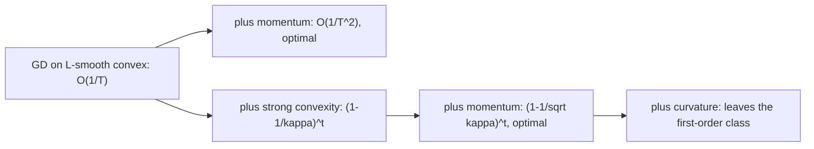

# Convexity, smoothness and duality

Neural networks are not convex, so this unit needs a defence before it needs a definition.

Two defences. First, **every local statement about a smooth nonconvex problem is a convex statement in a neighbourhood**: the constants \(L\) and \(\mu\) that govern gradient descent on a quadratic are the same constants that decide whether a real training run diverges, and they are computable from a Hessian spectrum you already know how to estimate. Second, **constrained problems are everywhere in modern training** — KL trust regions in policy optimization, maximum-entropy derivations of the softmax, margin problems, projection onto a quantization grid — and duality is the machinery that turns them into something solvable.

What convexity does *not* buy you is a global guarantee about a transformer. Section 7 is explicit about where the theory stops.

## 1. Convex sets and convex functions

A set \(C\) is convex when \(x,y\in C\) implies \(\theta x+(1-\theta)y\in C\) for all \(\theta\in[0,1]\). A function \(f\) is convex when its epigraph \(\{(x,t):f(x)\le t\}\) is a convex set, equivalently when

$$
f(\theta x+(1-\theta)y)\le\theta f(x)+(1-\theta)f(y).
$$

For differentiable \(f\), convexity is equivalent to the **first-order condition**

$$
f(y)\ge f(x)+\nabla f(x)^T(y-x)\quad\text{for all }x,y,
$$

which says every tangent plane is a global underestimator. That single inequality does most of the work in this unit. For twice-differentiable \(f\) it is equivalent to \(\nabla^2f(x)\succeq0\) everywhere.

Convexity survives: nonnegative combinations, composition with an affine map \(f(Ax+b)\), pointwise maximum \(\max_i f_i\), and partial minimization over a convex set. It does **not** survive composition with a general nonlinear map — which is exactly why a two-layer network is nonconvex even with a convex loss.

**Worked example — log-sum-exp.** Let \(f(z)=\log\sum_i e^{z_i}\) and \(p=\operatorname{softmax}(z)\). Then

$$
\nabla f(z)=p,
\qquad
\nabla^2f(z)=\operatorname{diag}(p)-pp^T.
$$

For any \(v\), let \(I\) be the random index with \(\Pr[I=i]=p_i\). Then

$$
v^T\nabla^2f(z)v=\mathbb E[v_I^2]-\mathbb E[v_I]^2=\operatorname{Var}(v_I)\ge0.
$$

The softmax Hessian is a covariance matrix. That is why cross-entropy on logits is convex *in the logits* (and not in the weights that produce them), and it is the same PSD structure you met as a Gram matrix in [projections and least squares](../02-linear-algebra/03-projections-least-squares.md).

## 2. The quadratic sandwich: smoothness and strong convexity

Rates come from bounding \(f\) above and below by quadratics.

\(f\) is **\(L\)-smooth** when \(\lVert\nabla f(x)-\nabla f(y)\rVert\le L\lVert x-y\rVert\). Integrating the gradient along the segment \(x\to y\) gives the **descent lemma**:

$$
f(y)\le f(x)+\nabla f(x)^T(y-x)+\tfrac L2\lVert y-x\rVert^2.
$$

\(f\) is **\(\mu\)-strongly convex** when

$$
f(y)\ge f(x)+\nabla f(x)^T(y-x)+\tfrac\mu2\lVert y-x\rVert^2.
$$

Together these trap \(f\) between two paraboloids of curvature \(\mu\) and \(L\). For the quadratic \(f(x)=\tfrac12x^THx\) with \(H\succ0\), the constants are exactly the extreme eigenvalues:

$$
\mu=\lambda_{\min}(H),\qquad L=\lambda_{\max}(H),\qquad \kappa=\frac L\mu=\kappa_2(H).
$$

So the condition number from [eigenvalues and invariant subspaces](../02-linear-algebra/04-eigenvalues-invariant-subspaces.md) *is* the optimization difficulty parameter.

Strong convexity is too strong for overparameterized models, where \(\lambda_{\min}=0\) along many directions. The useful weakening is the **Polyak–Lojasiewicz (PL) condition**

$$
\tfrac12\lVert\nabla f(x)\rVert^2\ge\mu\bigl(f(x)-f^\star\bigr),
$$

which implies linear convergence without implying convexity or a unique minimizer. Wide networks near a minimum are often better described by PL than by strong convexity.

## 3. Gradient-descent rates, proved

Take \(x_{t+1}=x_t-\eta\nabla f(x_t)\) with \(\eta=1/L\). The descent lemma gives

$$
f(x_{t+1})\le f(x_t)-\frac1{2L}\lVert\nabla f(x_t)\rVert^2.
$$

Every step decreases \(f\) by an amount proportional to the squared gradient norm. Three consequences:

**Convex case.** Combining with the first-order condition and telescoping,

$$
f(x_T)-f^\star\le\frac{L\lVert x_0-x^\star\rVert^2}{2T}.
$$

Sublinear: \(O(1/T)\), so \(\varepsilon\) accuracy costs \(O(1/\varepsilon)\) steps.

**Strongly convex case.** Expanding \(\lVert x_{t+1}-x^\star\rVert^2\) and using both sandwich inequalities,

$$
\lVert x_{t+1}-x^\star\rVert^2\le\Bigl(1-\frac\mu L\Bigr)\lVert x_t-x^\star\rVert^2,
$$

a linear (geometric) rate needing \(O(\kappa\log(1/\varepsilon))\) steps. On a quadratic this is the same statement as \(e_{t+1}=(I-\eta H)e_t\) from [calculus and optimization](01-calculus-gradients-optimization.md), now with a bound that holds off the quadratic too.

**PL case.** Substituting PL into the descent lemma gives \(f(x_{t+1})-f^\star\le(1-\mu/L)(f(x_t)-f^\star)\): a linear rate in function value, with no uniqueness claim about \(x^\star\).

The practical reading of all three: **the step size is set by \(L\), the number of steps is set by \(\kappa\).** Stability is a smoothness question; speed is a conditioning question.

## 4. Acceleration and what is actually optimal

Momentum is not a heuristic. For \(L\)-smooth convex \(f\), Nesterov's method

$$
y_t=x_t+\beta(x_t-x_{t-1}),
\qquad
x_{t+1}=y_t-\eta\nabla f(y_t)
$$

achieves \(f(x_T)-f^\star=O\bigl(L\lVert x_0-x^\star\rVert^2/T^2\bigr)\), and with \(\beta=\frac{\sqrt\kappa-1}{\sqrt\kappa+1}\) it converges at rate \((1-1/\sqrt\kappa)\) in the strongly convex case: \(O(\sqrt\kappa\log(1/\varepsilon))\) steps instead of \(O(\kappa\log(1/\varepsilon))\).

The Nemirovski–Yudin lower bound says **no** first-order method — any method whose iterates stay in the span of observed gradients — can beat \(\Omega(1/T^2)\) on this function class. So acceleration is not a trick that might later be improved on; it is the boundary. To go past it you must stop being a pure first-order method: use curvature (the preconditioning lesson), use structure, or change the problem.

Heavy ball, analyzed on a quadratic in the calculus lesson, attains the same \(\sqrt\kappa\) scaling on quadratics but can fail to converge on general smooth convex functions; Nesterov's variant is the one carrying the general guarantee.

## 5. Lagrangian duality

Take the primal problem

$$
\min_x f_0(x)\ \text{ s.t. }\ f_i(x)\le0,\quad h_j(x)=0,
$$

and form the Lagrangian and dual function

$$
\mathcal L(x,\lambda,\nu)=f_0(x)+\sum_i\lambda_if_i(x)+\sum_j\nu_jh_j(x),
$$

$$
g(\lambda,\nu)=\inf_x\mathcal L(x,\lambda,\nu).
$$

\(g\) is a pointwise infimum of functions affine in \((\lambda,\nu)\), hence **concave regardless of whether the primal is convex**. That is the whole reason duality is useful on hard problems.

**Weak duality.** For feasible \(x\) and \(\lambda\ge0\): \(\mathcal L(x,\lambda,\nu)\le f_0(x)\), because \(\lambda_if_i(x)\le0\) and \(h_j(x)=0\). Taking \(\inf_x\) on the left and the infimum over feasible \(x\) on the right gives \(g(\lambda,\nu)\le p^\star\). Always true. Every dual-feasible point is therefore a **certificate**: the gap \(f_0(x)-g(\lambda,\nu)\) bounds your suboptimality without knowing \(p^\star\).

**Strong duality.** For a convex primal satisfying Slater's condition (a strictly feasible point exists for the inequality constraints), \(d^\star=p^\star\) and the dual optimum is attained.

**KKT conditions.** At optimality with strong duality:

$$
\nabla_xf_0+\sum_i\lambda_i\nabla f_i+\sum_j\nu_j\nabla h_j=0
\quad\text{(stationarity)},
$$

$$
f_i(x)\le0,\quad h_j(x)=0\quad\text{(primal feasibility)},
\qquad
\lambda_i\ge0\quad\text{(dual feasibility)},
$$

$$
\lambda_if_i(x)=0\quad\text{(complementary slackness)}.
$$

Complementary slackness is the informative one: a constraint is either inactive (\(f_i<0\)) or priced (\(\lambda_i>0\)), never both. The conditions are necessary under a constraint qualification and sufficient when the primal is convex.

## 6. Two duals every research engineer should derive unaided

**Maximum entropy gives you the softmax.** Maximize \(H(p)=-\sum_ip_i\log p_i\) subject to \(\sum_ip_i=1\) and \(\sum_ip_if_k(i)=b_k\). The Lagrangian is

$$
\mathcal L=-\sum_ip_i\log p_i+\nu\Bigl(\sum_ip_i-1\Bigr)+\sum_k\lambda_k\Bigl(\sum_ip_if_k(i)-b_k\Bigr).
$$

Stationarity in \(p_i\) gives \(-\log p_i-1+\nu+\lambda^Tf(i)=0\), hence

$$
p_i\propto\exp\bigl(\lambda^Tf(i)\bigr).
$$

The softmax is not a convenient squashing function; it is *the* maximum-entropy distribution consistent with linear moment constraints, and the logits are dual variables.

**KL-constrained improvement gives you the RLHF objective.** Maximize \(\mathbb E_{\pi}[A(x)]\) subject to \(\operatorname{KL}(\pi\Vert\pi_{\mathrm{ref}})\le\varepsilon\). The same computation yields

$$
\pi^\star(x)\propto\pi_{\mathrm{ref}}(x)\exp\bigl(A(x)/\beta\bigr),
$$

with \(\beta\) the multiplier on the KL constraint. This one expression is the backbone of PPO's KL penalty, of best-of-\(n\) reweighting, and of the DPO reparameterization — see [policy gradients and actor-critic](../12-reinforcement-learning/02-policy-gradients-actor-critic.md). Derive it once and you never memorize any of the three.

## 7. Where the theory stops

- **Nonconvexity is real.** Nothing above says a transformer converges to a global optimum. What transfers is *local*: \(L\) sets the stability threshold, \(\kappa\) sets the slowdown.
- **\(L\) is local, not global.** Deep-network smoothness varies by orders of magnitude across the landscape. Gradient clipping is best read as an admission that your \(L\) estimate holds only inside a trust region — the constrained-optimization lesson.
- **\(\mu\approx0\) at scale.** Overparameterized models have vast flat directions. Use PL or a restricted-eigenvalue argument, not strong convexity.
- **Duality gaps mislead without Slater.** On a nonconvex primal weak duality still holds, but a nonzero gap proves nothing about your iterate's quality.
- **Convex surrogates are not the target metric.** Cross-entropy is convex in logits; accuracy, pass@k and human preference are not what you are optimizing directly.
- **Rate constants are worst case.** A method with a worse bound routinely wins on real problems. Bounds rank *classes* of methods, not runs.

## Implementation lab

Implement in NumPy first, then reproduce the same numbers in PyTorch.

1. Build quadratics with a prescribed spectrum (sample orthogonal \(Q\), set \(H=Q\Lambda Q^T\)) so that \(\mu,L,\kappa\) are known exactly.
2. Implement GD, heavy ball and Nesterov behind one interface. Plot \(\log(f(x_t)-f^\star)\) against \(t\), fit the slope, and check it matches \(\log(1-\mu/L)\) and \(\log(1-1/\sqrt\kappa)\) — verify the **constant**, not just the asymptotic order.
3. Sweep \(\kappa\in\{10,10^2,10^3,10^4\}\) and plot iterations-to-tolerance on log-log axes. Confirm the \(\kappa\) versus \(\sqrt\kappa\) scaling.
4. Estimate \(L\) empirically two ways: maximize \(\lVert\nabla f(x)-\nabla f(y)\rVert/\lVert x-y\rVert\) over sampled pairs, and run power iteration on Hessian-vector products (reuse the matrix-free estimator from the eigenvalue lesson). Compare on a small MLP and explain any gap.
5. Solve a small inequality-constrained QP twice: projected gradient on the primal, gradient ascent on the dual. Use the duality gap as the stopping criterion and check complementary slackness numerically.
6. Solve the maximum-entropy problem for given moments and confirm the solution equals the softmax of the fitted dual variables.

**From-scratch constraint:** no `cvxpy`, no `scipy.optimize`. Matrix multiply, norms, your own line search and a symmetric eigensolver only.

## Problems

1. Prove the descent lemma from \(L\)-smoothness using \(f(y)-f(x)=\int_0^1\nabla f(x+t(y-x))^T(y-x)\,dt\).
2. Prove the \((1-\mu/L)\) contraction for GD with \(\eta=1/L\) on an \(L\)-smooth, \(\mu\)-strongly convex \(f\).
3. Show \(\nabla^2\operatorname{logsumexp}(z)=\operatorname{diag}(p)-pp^T\) is PSD and prove \(\lambda_{\max}\le\tfrac12\). What does this say about a safe step size in logit space?
4. Let \(f(x)=\tfrac12x^THx\) with \(H\succeq0\) singular. Show \(f\) is not strongly convex but satisfies PL on \(\operatorname{range}(H)\) with \(\mu=\lambda^+_{\min}(H)\). Relate this to overparameterization.
5. Derive the dual of ridge regression \(\min_w\tfrac12\lVert Xw-y\rVert^2+\tfrac\lambda2\lVert w\rVert^2\) and interpret the dual variables.
6. Derive \(\pi^\star\propto\pi_{\mathrm{ref}}\exp(A/\beta)\) from the KL-constrained problem, then state precisely what changes when the hard constraint is replaced by a fixed penalty \(\beta\).
7. **Transfer.** A run is stable at \(\eta=3\times10^{-4}\) and diverges at \(6\times10^{-4}\). Estimate the implied local smoothness constant. Predict what happens to the stability threshold when the batch size doubles, and separate the part of your prediction that convexity licenses from the part that needs the stochastic analysis of the SGD lesson.

Solution sketches

1. Subtract \(\nabla f(x)^T(y-x)\), bound the integrand with Cauchy-Schwarz and Lipschitzness of the gradient, then integrate \(tL\lVert y-x\rVert^2\) over \(t\in[0,1]\) to get the factor \(L/2\).
2. Expand \(\lVert x_t-\eta\nabla f(x_t)-x^\star\rVert^2\); lower-bound \(\nabla f(x_t)^T(x_t-x^\star)\) by strong convexity and upper-bound \(\lVert\nabla f(x_t)\rVert^2\) by \(2L(f(x_t)-f^\star)\) from smoothness. The cross terms collapse to the stated factor.
3. PSD by the variance argument of section 1. For the bound, \(v^THv=\operatorname{Var}(v_I)\le\tfrac14(\max v-\min v)^2\le\tfrac12\lVert v\rVert^2\) at the worst two-point distribution. So a logit-space step below \(2/L=4\) is stable: landscape sharpness comes from the network, not from the softmax.
4. Strong convexity fails along \(\ker H\), where moving leaves \(f\) unchanged. On \(\operatorname{range}(H)\), \(\lVert\nabla f\rVert^2=\lVert Hx\rVert^2\ge\lambda^+_{\min}\,x^THx=2\lambda^+_{\min}f(x)\). Flat directions cost uniqueness, not speed.
5. Introduce \(r=Xw-y\) as an equality constraint. The dual is \(\max_\alpha-\tfrac12\alpha^T(XX^T+\lambda I)\alpha-y^T\alpha\) with \(w=-X^T\alpha\), and \(\alpha\) proportional to scaled residuals. Note \(XX^T\) is \(N\times N\): the dual is cheaper when \(N\ll d\). This is the kernel trick in embryo.
6. Stationarity in \(\pi(x)\) of \(\mathbb E_\pi[A]-\beta\operatorname{KL}(\pi\Vert\pi_{\mathrm{ref}})+\nu(\sum\pi-1)\) gives \(A(x)-\beta(\log\pi-\log\pi_{\mathrm{ref}}+1)+\nu=0\), hence the exponential tilt. With fixed \(\beta\) you solve the penalized problem, whose achieved KL drifts with the scale of \(A\); the constrained form holds KL fixed and lets \(\beta\) move.
7. Divergence between \(3\times10^{-4}\) and \(6\times10^{-4}\) brackets \(2/L\), giving \(L\in(3.3\times10^3,6.7\times10^3)\). Convexity licenses the claim that the threshold is set by curvature along the trajectory, which batch size does not change in expectation. It does **not** license a prediction about the stochastic threshold, which also depends on gradient-noise variance \(\sigma^2/B\): larger \(B\) usually permits a larger \(\eta\) for noise reasons, not curvature reasons.

## Mastery gate

From a blank file, prove the descent lemma and the strongly convex GD rate; predict iterations-to-tolerance for a quadratic of known \(\kappa\) under GD and under Nesterov, then confirm both numerically; derive the maximum-entropy softmax and the KL-constrained policy from their Lagrangians; and, given a diverging training run, produce a curvature-based estimate of the stability threshold together with an explicit statement of what convex theory does not tell you about it.
