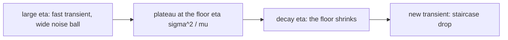

# Stochastic approximation, SGD and batch size

Everything in the convexity lesson assumed you can compute \(\nabla f(x)\). You cannot. At scale you compute an estimate from a minibatch, and every important training decision — learning rate, batch size, schedule, how many GPUs are worth buying — is a statement about that estimator's mean and variance.

This is the unit that turns "batch size is a hyperparameter" into an equation you can measure.

## 1. The estimator, not the gradient

Write the objective as a population expectation and the minibatch estimate as a sample mean:

$$
f(x)=\mathbb E_{\xi\sim\mathcal D}\bigl[\ell(x;\xi)\bigr],
\qquad
\hat g_B(x)=\frac1B\sum_{b=1}^B\nabla\ell(x;\xi_b).
$$

Under i.i.d. sampling, \(\hat g_B\) is **unbiased**, \(\mathbb E[\hat g_B]=\nabla f(x)=:G\), with covariance

$$
\operatorname{Cov}(\hat g_B)=\frac\Sigma B,
\qquad
\Sigma=\operatorname{Cov}_\xi\bigl(\nabla\ell(x;\xi)\bigr).
$$

Two quantities will run the rest of this lesson: the **signal** \(\lVert G\rVert^2\) and the **noise** \(\operatorname{tr}\Sigma\). Their ratio has units of batch size, and that is not a coincidence.

Note what is *not* assumed: that the data are shuffled correctly, that every example contributes once per epoch, that the loss denominator counts the same tokens the numerator does. Section 7 is about what breaks when those fail, and they fail often.

## 2. Robbins-Monro: when does a noisy iteration converge at all?

The classical stochastic approximation iteration is \(x_{t+1}=x_t-\eta_t\hat g_t\). Robbins and Monro's conditions are

$$
\sum_{t}\eta_t=\infty,
\qquad
\sum_t\eta_t^2<\infty.
$$

The first says the steps can still reach any point — the iteration has not run out of travel. The second says the accumulated noise is summable, so the iterate settles. The canonical satisfying choice is \(\eta_t=c/t\); \(\eta_t=c/\sqrt t\) satisfies the first but not the second, and a constant \(\eta\) satisfies neither.

Constant \(\eta\) therefore **cannot** converge to \(x^\star\) when \(\sigma>0\). It converges to a distribution. The next section computes its width, which turns out to be the most useful single formula in practical training.

## 3. Two phases and the noise ball

Let \(f\) be \(L\)-smooth and \(\mu\)-strongly convex, let \(\eta\le1/L\), and suppose \(\mathbb E\lVert\hat g-G\rVert^2\le\sigma^2\). Expand one step:

$$
\mathbb E\lVert x_{t+1}-x^\star\rVert^2
=\lVert x_t-x^\star\rVert^2
-2\eta G^T(x_t-x^\star)
+\eta^2\mathbb E\lVert\hat g_t\rVert^2 .
$$

Use strong convexity on the middle term and \(\mathbb E\lVert\hat g\rVert^2=\lVert G\rVert^2+\sigma^2\) on the last. Unrolling the recursion gives the standard two-term bound

$$
\mathbb E\lVert x_t-x^\star\rVert^2
\;\le\;
\underbrace{(1-\eta\mu)^t\lVert x_0-x^\star\rVert^2}_{\text{transient: geometric}}
\;+\;
\underbrace{\frac{\eta\sigma^2}{\mu}}_{\text{noise floor}} .
$$

Read this carefully, because it explains most learning-rate folklore:

- **Phase one** is geometric progress at rate \((1-\eta\mu)\) — bigger \(\eta\) is strictly better.
- **Phase two** is a random walk inside a ball of radius \(\sim\sqrt{\eta\sigma^2/\mu}\) — bigger \(\eta\) is strictly worse.
- The crossover is why loss curves plateau, and why **decaying the learning rate produces the characteristic staircase drop**: you are shrinking the ball, not finding a new basin.
- The floor scales with \(\eta\sigma^2\). Since \(\sigma^2\propto1/B\), the floor depends on the ratio \(\eta/B\), not on either alone. That single observation is the linear scaling rule.

## 4. How much is one step worth? The critical batch size

Take a second-order expansion of the loss under a step \(-\varepsilon\hat g\) with \(\mathbb E[\hat g]=G\) and \(\operatorname{Cov}(\hat g)=\Sigma/B\):

$$
\mathbb E[\Delta f]
=-\varepsilon\lVert G\rVert^2
+\frac{\varepsilon^2}2\Bigl(G^THG+\frac{\operatorname{tr}(H\Sigma)}B\Bigr).
$$

The noise enters only through \(\operatorname{tr}(H\Sigma)/B\): curvature amplifies gradient noise direction by direction. Minimizing over \(\varepsilon\),

$$
\varepsilon^\star=\frac{\lVert G\rVert^2}{G^THG+\operatorname{tr}(H\Sigma)/B},
\qquad
\mathbb E[\Delta f]^\star=\frac{\Delta f_{\max}}{1+B_{\text{noise}}/B},
$$

where

$$
\Delta f_{\max}=\frac{\lVert G\rVert^4}{2\,G^THG},
\qquad
\boxed{\;B_{\text{noise}}=\frac{\operatorname{tr}(H\Sigma)}{G^THG}\;}
$$

This is the whole large-batch story in one line. **Per-step progress saturates**: doubling \(B\) beyond \(B_{\text{noise}}\) buys almost nothing per step while costing twice the compute. Below \(B_{\text{noise}}\), progress per step is nearly proportional to \(B\), so large batches are nearly free in step count.

Integrating the relation along a training run gives the Pareto frontier between optimization steps \(S\) and processed examples \(E=BS\):

$$
\Bigl(\frac S{S_{\min}}-1\Bigr)\Bigl(\frac E{E_{\min}}-1\Bigr)=1 .
$$

Serial time is bounded below by \(S_{\min}\) no matter how many GPUs you own; total compute is bounded below by \(E_{\min}\) no matter how patient you are; and \(B_{\text{noise}}=E_{\min}/S_{\min}\) is where you trade one for the other. This is the calculation behind "should we scale the cluster or the run length".

Because \(H\) is expensive, the standard field estimate drops it, giving the **simple noise scale**

$$
B_{\text{simple}}=\frac{\operatorname{tr}\Sigma}{\lVert G\rVert^2},
$$

measurable from gradient norms at two batch sizes (see the lab). It is exact when \(H\propto I\) and a decent proxy otherwise. It grows during training as \(\lVert G\rVert\) falls — which is why batch-size ramps work.

## 5. Linear scaling, and where it breaks

From section 3, the stationary noise ball depends on \(\eta/B\). So to hold the noise level fixed while increasing \(B\), scale \(\eta\propto B\). That is the **linear scaling rule**, and it is a variance statement, not a curvature statement.

It breaks in three identifiable ways:

1. **Stability ceiling.** The deterministic constraint \(\eta<2/L\) from the convexity lesson does not care about \(B\). Once linear scaling pushes \(\eta\) into that ceiling, you diverge. Warmup exists mainly to sneak past this during the early high-curvature phase.
2. **Saturation.** Past \(B_{\text{noise}}\) the gradient is already nearly noiseless, so there is no variance to compensate for, and \(\eta\propto B\) simply overshoots.
3. **Adaptive optimizers rescale.** Adam's update is approximately \(\hat m/\sqrt{\hat v}\), which is scale-invariant in the gradient; the relevant scaling is closer to \(\sqrt B\) and depends on where \(\epsilon\) sits relative to \(\sqrt{\hat v}\). Do not transplant SGD's rule to AdamW without measuring — see the preconditioning lesson.

## 6. Variance reduction and control variates

If \(c(\xi)\) has known mean, \(\hat g-\alpha(c(\xi)-\mathbb E[c])\) stays unbiased and can have far lower variance. The most important instance in ML is the **policy-gradient baseline**: since \(\mathbb E_\pi[\nabla\log\pi]=0\),

$$
\nabla J=\mathbb E\bigl[(R-b)\nabla\log\pi\bigr]
$$

is unbiased for **any** constant \(b\), and the variance-minimizing choice is the gradient-norm-weighted mean return. This is why an advantage estimate, not a raw return, is used in [policy gradients and actor-critic](../13-reinforcement-learning/02-policy-gradients-actor-critic.md).

Finite-sum variance reduction (SVRG, SAG, SAGA) achieves linear rates on strongly convex finite sums by correcting with a stale full gradient. These methods are theoretically excellent and are essentially unused in deep learning. Know why: they assume a fixed finite sum (violated by streaming corpora and augmentation), they need periodic full-gradient passes (prohibitive), the stale-gradient correction is wrong after the iterate moves in a nonconvex landscape, and gradient noise is not the binding constraint on progress at large scale — \(B_{\text{noise}}\) says the noise is already small.

Be careful with the adjacent folklore claim that "SGD noise is a regularizer that helps generalization". There is real evidence for noise-shaped implicit bias (the landscape lesson), but it is not a licence to treat variance as free.

## 7. Bias is the failure mode that actually hurts you

Variance costs you a constant factor. Bias costs you the guarantee. Every item below produces a *biased* \(\hat g\) and none of them raises an exception:

- **Token versus sequence averaging.** Averaging per-sequence loss and then over the batch weights short sequences more than long ones. With padding in the denominator, the weighting is wrong in a third way. Decide whether your objective is per-token or per-sequence, then make the denominator match.
- **Gradient accumulation.** Summing micro-batch gradients without dividing by the number of micro-batches changes the effective learning rate by that factor. Uneven final micro-batches change it again.
- **Dropping the last batch.** `drop_last=True` silently discards examples; with sorted or bucketed data it discards a specific subpopulation every epoch.
- **Sampling without replacement.** Epoch shuffling gives variance \(\frac{\sigma^2}B\cdot\frac{N-B}{N-1}\), not \(\sigma^2/B\), and within an epoch the draws are negatively correlated — usually helpful, but it means your \(\sigma^2\) estimate is off.
- **Duplicated or near-duplicated data** reweights the objective toward the duplicates, which is a change of \(f\) itself, not an estimator problem.
- **Curriculum or unshuffled order** makes \(\hat g_t\) a biased estimate of the population gradient at every \(t\), even though it averages out over an epoch.
- **Non-i.i.d. sharding across ranks** combined with an all-reduce mean gives an unbiased global gradient only if every rank's shard is exchangeable. Sorting by length or source breaks this.

The diagnostic habit: before tuning an optimizer, verify numerically that the accumulated gradient over \(k\) micro-batches equals the single-batch gradient over the same examples to floating-point tolerance.

## Implementation lab

1. Build a quadratic with known \(H\), inject Gaussian gradient noise with known \(\sigma\), and run constant-step SGD. Plot \(\mathbb E\lVert x_t-x^\star\rVert^2\) over many seeds against the two-term bound; confirm both the geometric transient and the \(\eta\sigma^2/\mu\) floor, and confirm the floor halves when \(\eta\) halves.
2. Compare \(\eta_t\in\{\text{const},\,c/\sqrt t,\,c/t\}\) on that problem. Show which converge, and show that constant-\(\eta\) SGD converges in distribution rather than in value.
3. Estimate the noise scale on a small language model without ever forming \(\Sigma\): from gradient norms at two batch sizes \(B_{\text{small}}<B_{\text{big}}\), solve the two-equation system for unbiased estimates of \(\lVert G\rVert^2\) and \(\operatorname{tr}\Sigma\), then report \(B_{\text{simple}}\). Track it across training and show that it grows.
4. Train to a fixed target loss at \(B\in\{2^k\}\), record \((S,E)\), and fit the hyperbola \((S/S_{\min}-1)(E/E_{\min}-1)=1\). Compare the fitted \(B_{\text{noise}}=E_{\min}/S_{\min}\) with the measured \(B_{\text{simple}}\).
5. Test linear scaling directly: for each \(B\), sweep \(\eta\) and find the best; plot \(\eta^\star\) against \(B\) on log-log axes and locate the knee where the slope leaves 1.
6. Implement REINFORCE with and without a baseline; measure the empirical gradient variance and verify unbiasedness by comparing long-run means.
7. **Bug reproduction.** Implement per-sequence and per-token loss averaging on padded batches, compute both gradients, and report the relative difference. Then implement gradient accumulation two ways (mean and sum) and show which one matches full-batch training.

**From-scratch constraint:** no `torch.optim`. Write the update rules yourself so the estimator, the step size and the accumulation semantics are all visible in one place.

## Problems

1. Show \(\hat g_B\) is unbiased with covariance \(\Sigma/B\) under i.i.d. sampling, then derive the finite-population correction \(\frac{N-B}{N-1}\) for sampling without replacement.
2. Derive the two-term bound of section 3, stating exactly where \(\eta\le1/L\) is used.
3. Derive \(\varepsilon^\star\), \(\Delta f^\star\), and \(B_{\text{noise}}=\operatorname{tr}(H\Sigma)/G^THG\). Then show \(B_{\text{noise}}=\operatorname{tr}\Sigma/\lVert G\rVert^2\) exactly when \(H=cI\).
4. Derive the Pareto relation \((S/S_{\min}-1)(E/E_{\min}-1)=1\) from the per-step progress formula, stating the approximation you make in integrating it.
5. Derive the linear scaling rule from the noise-floor expression, and give a concrete situation where following it causes divergence rather than a matched curve.
6. Prove that subtracting any constant baseline leaves the policy gradient unbiased, and derive the variance-minimizing baseline.
7. **Transfer.** You double the batch size and double the learning rate. Loss-versus-step matches the old run almost exactly, but loss-versus-examples is clearly worse, and the gap widens later in training. Explain both observations using \(B_{\text{noise}}\), predict what happens if you double again, and design a two-run experiment that locates the critical batch size to within a factor of two.

Solution sketches

1. Linearity gives the mean; independence gives \(\operatorname{Cov}=\Sigma/B\). Without replacement, the draws are negatively correlated with covariance \(-\Sigma/(N-1)\) between distinct draws, and collecting terms yields the stated factor. Note it vanishes at \(B=N\), as full-batch gradients must be noiseless.
2. Smoothness bounds \(\mathbb E\lVert\hat g\rVert^2\) usably and gives \(\eta\le1/L\) so the \(\eta^2\lVert G\rVert^2\) term is dominated by the progress term; strong convexity supplies the \((1-\eta\mu)\) contraction. The geometric series of the \(\eta^2\sigma^2\) terms sums to \(\eta\sigma^2/\mu\).
3. Differentiate the quadratic in \(\varepsilon\) and substitute. With \(H=cI\), \(\operatorname{tr}(H\Sigma)=c\operatorname{tr}\Sigma\) and \(G^THG=c\lVert G\rVert^2\), so \(c\) cancels.
4. Treat \(\Delta f^\star\) as the per-step progress and integrate \(dS\) against loss; the approximation is that \(B_{\text{noise}}\) is locally constant. Eliminating the loss variable between \(S\) and \(E=BS\) gives the hyperbola.
5. The floor is \(\propto\eta\sigma^2\propto\eta/B\), so \(\eta\propto B\) holds it fixed. It diverges when linear scaling pushes \(\eta\) above the curvature ceiling \(2/L\) — typically early in training before warmup has finished, when \(L\) is largest.
6. Unbiasedness follows from \(\mathbb E[\nabla\log\pi]=\nabla\!\sum_a\pi=0\). Minimizing \(\operatorname{Var}\) over \(b\) gives \(b^\star=\mathbb E[R\lVert\nabla\log\pi\rVert^2]/\mathbb E[\lVert\nabla\log\pi\rVert^2]\).
7. Matching per-step curves means you are at or below \(B_{\text{noise}}\) in step efficiency but already paying double the compute per step: the extra examples buy nothing, which is precisely the right branch of the hyperbola. The widening gap reflects \(B_{\text{simple}}\) growing as \(\lVert G\rVert\) falls — you were past the knee early and moved back toward it later. Doubling again roughly doubles compute for a small step-count gain. Experiment: train to a fixed loss target at four batch sizes spanning a 16x range with \(\eta\) separately tuned at each, fit the hyperbola, and cross-check against \(B_{\text{simple}}\) measured from two-batch gradient norms.

## Mastery gate

Derive the noise-floor bound and the critical-batch-size formula from scratch; measure \(B_{\text{simple}}\) on a real model without forming a covariance matrix; predict from that measurement whether doubling the batch size will shorten wall-clock time, and say what it will cost in compute; and find a planted gradient-estimator bias bug (accumulation, padding denominator or sharding) in a supplied training loop by numerical comparison against a full-batch gradient.
