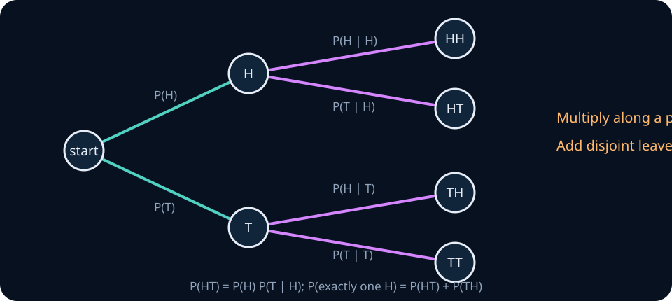
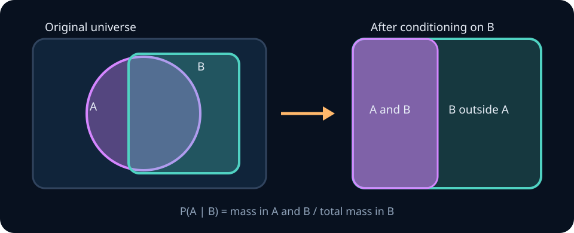

# Probability foundations from finite events

Probability is not a synonym for uncertainty, randomness, confidence, or frequency. It is a mathematical model that assigns numbers to events while obeying rules that prevent contradiction. Statistics begins one level later: it uses observed data to reason about an unknown part of such a model.

This unit starts with finite sample spaces, where every object can be written down and checked. Continuous distributions and measure-theoretic refinements come later. By the end, you should be able to construct a finite probability model, condition it correctly, distinguish mutual from pairwise independence, derive Bayes' rule, and verify calculations by simulation.

## 0. Prerequisite diagnostic

Before continuing, make sure you can:

- interpret set union, intersection, complement, and subset notation;
- expand a finite sum and product;
- distinguish an implication from an equivalence;
- write a short Python function using loops, dictionaries, and a seeded random-number generator.

If any item is unfamiliar, review [mathematical language](../00-foundations/00-mathematical-language.md). No calculus is required in this unit.

## 1. Outcomes, sample spaces, and events

An **outcome** is one complete result at the resolution chosen by the model. The **sample space** \(\Omega\) is the set of all allowed outcomes. An **event** is a subset of \(\Omega\).

For two coin flips, an ordered model is

$$
\Omega=\{HH,HT,TH,TT\}.
$$

The event "exactly one head" is \(A=\{HT,TH\}\). It is an event, not an additional outcome. The event "the first flip is a head" is \(B=\{HH,HT\}\).



The tree preserves sequence information that a count alone discards. For fair independent flips, every edge has probability \(1/2\), so each leaf has probability \((1/2)(1/2)=1/4\). The event “exactly one head” contains two disjoint leaves, giving \(1/4+1/4=1/2\).

The sample space is a modelling choice. If order matters, \(HT\) and \(TH\) are different outcomes. Replacing them by a single outcome called "one head" changes the model and requires a different probability assignment. Many incorrect probability calculations begin by silently changing the resolution of \(\Omega\).

### Event operations

For events \(A,B\subseteq\Omega\):

- \(A\cap B\): both occur;
- \(A\cup B\): at least one occurs;
- \(A^c=\Omega\setminus A\): \(A\) does not occur;
- \(A\setminus B\): \(A\) occurs and \(B\) does not;
- \(A\subseteq B\): occurrence of \(A\) implies occurrence of \(B\).

The empty event \(\varnothing\) never occurs. The whole sample space \(\Omega\) always occurs. De Morgan's laws are

$$
(A\cup B)^c=A^c\cap B^c,
\qquad
(A\cap B)^c=A^c\cup B^c.
$$

> **Stop and predict.** For two coin flips, list \(A\cap B\), \(A\cup B\), and \(A^c\) for the events above before calculating any probabilities.

> **Practice — Foundation:** A coin is tossed and a six-sided die is rolled. Write the sample space and the event “heads or an even roll.”
>
> **Practice — Core:** Let \(A\) be “heads” and \(B\) be “roll at least 5.” Write \(A\cap B\), \(A\cup B\), and \(A^c\) as sets of outcomes.
>
> **Practice — Stretch:** Model two dice once with ordered pairs and once only by their sum. What information is lost, and which questions can no longer be answered?

## 2. The probability axioms

A probability function \(P\) assigns a number to each event and satisfies:

1. **Nonnegativity:** \(P(A)\ge 0\).
2. **Normalization:** \(P(\Omega)=1\).
3. **Additivity:** if \(A_1,A_2,\ldots\) are pairwise disjoint, then

$$
P\!\left(\bigcup_i A_i\right)=\sum_iP(A_i).
$$

For a finite sample space, it is enough to assign nonnegative masses \(p(\omega)\) to outcomes so that \(\sum_{\omega\in\Omega}p(\omega)=1\). Then

$$
P(A)=\sum_{\omega\in A}p(\omega).
$$

Do not assume outcomes are equally likely unless the model says so. A loaded die still has sample space \(\{1,2,3,4,5,6\}\), but its six outcome masses need not be \(1/6\).

### Consequences you should derive

The axioms imply

$$
P(\varnothing)=0,
\qquad
P(A^c)=1-P(A),
$$

and

$$
P(A\cup B)=P(A)+P(B)-P(A\cap B).
$$

The subtraction prevents double-counting the intersection. If \(A\subseteq B\), then \(B=A\cup(B\setminus A)\) is a disjoint union, so \(P(A)\le P(B)\).

The **union bound** follows without independence:

$$
P\!\left(\bigcup_{i=1}^n A_i\right)\le\sum_{i=1}^nP(A_i).
$$

This apparently loose inequality is fundamental in learning theory: it converts guarantees about individual bad events into a simultaneous guarantee over many choices.

<details><summary>Checkpoint: which rule applies?</summary>

If \(P(A)=0.4\), \(P(B)=0.5\), and \(P(A\cap B)=0.2\), then \(P(A\cup B)=0.4+0.5-0.2=0.7\). Adding only \(0.4+0.5\) double-counts the overlap. The union bound says merely that \(P(A\cup B)\le0.9\); it is valid but does not use the known intersection.

</details>

> **Practice — Foundation:** If \(P(A)=0.37\), compute \(P(A^c)\). Name the axiom or consequence you used.
>
> **Practice — Core:** Suppose \(P(A)=0.55\), \(P(B)=0.40\), and \(P(A\cap B)=0.20\). Compute \(P(A\cup B)\) and the probability that exactly one event occurs.
>
> **Practice — Stretch:** Starting only from the axioms, prove that \(A\subseteq B\) implies \(P(A)\le P(B)\), then use that fact to justify the two-event union bound.

## 3. Counting only when outcomes are equally likely

If a finite sample space contains equally likely outcomes, then

$$
P(A)=\frac{|A|}{|\Omega|}.
$$

This formula is a consequence of symmetry plus the axioms, not the definition of probability.

**Worked example — two dice from first principles.** Two fair dice create 36 equally likely **ordered** outcomes \((i,j)\). For a sum of nine, the favorable outcomes are \((3,6),(4,5),(5,4),(6,3)\), so the probability is \(4/36=1/9\). A tempting mistake is to treat the possible sums \(2,3,\ldots,12\) as eleven equally likely outcomes. They are not: a sum of seven has six generating pairs while a sum of two has one.

### Sum and product rules

If one choice can be made in \(m\) ways and a disjoint alternative in \(n\) ways, there are \(m+n\) possibilities. If a first choice has \(m\) possibilities and each permits \(n\) second choices, there are \(mn\) ordered pairs.

For \(n\) distinct objects:

$$
n!=n(n-1)\cdots1
$$

orders all objects. The number of ordered selections of \(k\) without replacement is \(n!/(n-k)!\); the number of unordered selections is

$$
{n\choose k}=\frac{n!}{k!(n-k)!}.
$$

**Worked example — collisions.** Suppose three independently generated IDs are uniform over \(N\) possibilities. Directly counting every collision pattern is awkward. The complement "all distinct" has probability

$$
\frac{N}{N}\frac{N-1}{N}\frac{N-2}{N}.
$$

Therefore

$$
P(\text{at least one collision})
=1-\frac{N(N-1)(N-2)}{N^3}.
$$

The complement is often easier because "at least one" contains overlapping cases.

> **Practice — Foundation:** How many five-person teams can be chosen from twelve people? State why order does or does not matter.
>
> **Practice — Core:** Derive the probability that at least two people share a birthday in a group of 25 under the usual simplifying assumptions. Compute it through the complement.
>
> **Practice — Stretch:** A generator emits three labels with probabilities \(0.8,0.15,0.05\). Explain why counting labels gives a wrong probability model and construct the correct weighted sample space.

## 4. Conditional probability changes the reference population

For \(P(B)>0\), define

$$
P(A\mid B)=\frac{P(A\cap B)}{P(B)}.
$$

Conditioning discards outcomes outside \(B\) and renormalizes the remaining mass.



Conditioning does not reverse the direction of a condition:

$$
P(A\mid B)\ne P(B\mid A)
$$

in general.

Rearranging the definition gives the multiplication rule

$$
P(A\cap B)=P(A\mid B)P(B)=P(B\mid A)P(A).
$$

For a sequence of events,

$$
P(A_1\cap\cdots\cap A_n)
=P(A_1)P(A_2\mid A_1)\cdots
P(A_n\mid A_1\cap\cdots\cap A_{n-1}).
$$

This **chain rule** is always valid when the conditional probabilities are defined. Multiplying marginal probabilities instead would assume independence.

**Worked example — sampling without replacement.** A bag contains three red and two blue balls. The probability that two sequential draws are both red is

$$
P(R_1\cap R_2)=P(R_1)P(R_2\mid R_1)=\frac35\frac24=\frac3{10}.
$$

The second factor changes because the first draw changes the bag.

<details><summary>Checkpoint: with replacement or without?</summary>

If the first ball were replaced, the second red probability would remain \(3/5\), giving \(9/25\). Without replacement it is \(2/4\), giving \(3/10\). The numerical difference comes from a different experiment, not from two competing calculation rules.

</details>

> **Practice — Foundation:** In a dataset, 120 of 300 examples are positive and 90 of those positives pass a filter. Compute the probability of passing given positive.
>
> **Practice — Core:** Build a \(2\times2\) count table in which \(P(A\mid B)=0.75\), then calculate \(P(B\mid A)\). Explain why the two conditionals differ.
>
> **Practice — Stretch:** A benchmark reports accuracy only on prompts that another model judged “answerable.” Draw the conditioning event and describe one way this selection could reverse a model comparison.

## 5. Total probability and Bayes' rule

Suppose \(H_1,\ldots,H_k\) form a **partition**: they are mutually disjoint and their union is \(\Omega\). Then every occurrence of \(D\) occurs through exactly one partition element, so

$$
P(D)=\sum_{j=1}^kP(D\mid H_j)P(H_j).
$$

Combining this with the multiplication rule yields Bayes' rule:

$$
P(H_i\mid D)
=\frac{P(D\mid H_i)P(H_i)}
{\sum_jP(D\mid H_j)P(H_j)}.
$$

Read the terms by role:

- \(P(H_i)\): prior probability or base rate;
- \(P(D\mid H_i)\): likelihood of the observed evidence under the hypothesis;
- \(P(D)\): evidence or normalizing constant;
- \(P(H_i\mid D)\): posterior probability after observing the evidence.

**Worked example — a benchmark alarm.** Only 2% of submitted models contain a particular contamination pattern. A detector flags 95% of contaminated models and 4% of clean models. Among 10,000 submissions, the expected counts are:

| | Flagged | Not flagged | Total |
|---|---:|---:|---:|
| Contaminated | 190 | 10 | 200 |
| Clean | 392 | 9,408 | 9,800 |
| Total | 582 | 9,418 | 10,000 |

Thus

$$
P(\text{contaminated}\mid\text{flagged})=\frac{190}{582}\approx0.326.
$$

The detector's 95% sensitivity is not a 95% posterior probability. The low base rate and false positives matter.

> **Practice — Foundation:** A detector has sensitivity \(0.90\), false-positive rate \(0.08\), and the condition prevalence is \(0.02\). Compute the probability of a positive detection by total probability.
>
> **Practice — Core:** For the same detector, compute the posterior probability of the condition after a positive result. Recompute it when prevalence rises to \(0.20\).
>
> **Practice — Stretch:** Express Bayes' rule in posterior-odds form and explain how a fixed likelihood ratio behaves when deployment base rates change.

## 6. Independence is a factorization statement

Events \(A\) and \(B\) are independent when

$$
P(A\cap B)=P(A)P(B).
$$

When \(P(B)>0\), this is equivalent to \(P(A\mid B)=P(A)\): learning that \(B\) occurred does not change the probability of \(A\).

Disjointness is different. Two nonempty disjoint events cannot be independent because their intersection has probability zero while the product of their probabilities is positive.

### Pairwise versus mutual independence

Events \(A_1,\ldots,A_n\) are mutually independent when every finite subcollection factors:

$$
P\!\left(\bigcap_{i\in S}A_i\right)=\prod_{i\in S}P(A_i)
\quad\text{for every nonempty }S.
$$

Pairwise independence checks only subsets of size two and is weaker.

**Counterexample.** Flip two independent fair coins. Let \(A\) mean the first is heads, \(B\) mean the second is heads, and \(C\) mean the flips agree. Every pair is independent, but knowing any two determines the third. Indeed,

$$
P(A\cap B\cap C)=\frac14\ne\frac18=P(A)P(B)P(C).
$$

<details><summary>Common wrong turn: “disjoint means independent”</summary>

If nonempty events \(A\) and \(B\) are disjoint, observing \(B\) makes \(A\) impossible: \(P(A\mid B)=0\). Before observing \(B\), \(P(A)>0\). The observation changed the probability, so the events are dependent.

</details>

> **Practice — Foundation:** Give an example of two disjoint events that are not independent, and verify the failure numerically.
>
> **Practice — Core:** For a \(2\times2\) table of your choice, test independence using both \(P(A\cap B)=P(A)P(B)\) and \(P(A\mid B)=P(A)\).
>
> **Practice — Stretch:** Construct three events that are pairwise independent but not mutually independent. Check every required factorization explicitly.

## 7. Random variables turn outcomes into numbers

A random variable is a function \(X:\Omega\to\mathbb R\), not an outcome that changes mysteriously. For two coin flips, let \(X\) count heads. Then

$$
X(HH)=2,\quad X(HT)=X(TH)=1,\quad X(TT)=0.
$$

Its probability mass function is

$$
p_X(x)=P(X=x).
$$

For fair independent flips, \(p_X(0)=1/4\), \(p_X(1)=1/2\), and \(p_X(2)=1/4\). Different outcomes can map to the same value, so the probability of a value is the sum of the masses of all outcomes mapped to it.

The cumulative distribution function

$$
F_X(x)=P(X\le x)
$$

is defined for discrete and continuous random variables. It is nondecreasing, right-continuous, approaches zero to the left and one to the right. The next unit develops PMFs, densities, CDFs, and common distribution families systematically.

> **Practice — Foundation:** For two fair coin tosses, define \(X\) as the number of heads and list \(X(\omega)\) for every outcome.
>
> **Practice — Core:** Let \(Y=X^2\). Derive the PMF of \(Y\) from the outcome map rather than guessing from its possible values.
>
> **Practice — Stretch:** Construct two different random variables on the same sample space that have the same distribution but assign values to individual outcomes differently.

## 8. Expectation and the indicator method

For a finite-valued random variable,

$$
E[X]=\sum_xx\,p_X(x)
=\sum_{\omega\in\Omega}X(\omega)p(\omega).
$$

Expectation is a probability-weighted average, not necessarily a possible observed value. Linearity holds without independence:

$$
E[aX+bY]=aE[X]+bE[Y].
$$

For an event \(A\), define its indicator

$$
\mathbf1_A(\omega)=
\begin{cases}
1,&\omega\in A,\\
0,&\omega\notin A.
\end{cases}
$$

Then \(E[\mathbf1_A]=P(A)\). If \(X=\sum_i\mathbf1_{A_i}\) counts how many events occur, linearity gives

$$
E[X]=\sum_iP(A_i)
$$

even when the events are dependent.

**Worked example — expected collisions.** Hash \(m\) items independently and uniformly into \(N\) buckets. For each pair \(i<j\), let \(I_{ij}\) indicate a collision. Since \(P(I_{ij}=1)=1/N\), the expected number of colliding pairs is

$$
E\!\left[\sum_{i<j}I_{ij}\right]
=\sum_{i<j}\frac1N
=\frac{{m\choose2}}N.
$$

No independence between the indicators was required for this expectation.

> **Practice — Foundation:** For \(P(X=0)=0.2\), \(P(X=1)=0.5\), and \(P(X=3)=0.3\), compute \(E[X]\).
>
> **Practice — Core:** A random permutation of \(n\) items is generated. Introduce indicator variables and derive the expected number of fixed points without enumerating permutations.
>
> **Practice — Stretch:** Give a heavy-tailed discrete distribution for which total probability is one but \(E[X]\) is infinite. Explain which series fails to converge.

## 9. Model probability is not empirical frequency

The model supplies \(P(A)\). A simulation produces the empirical frequency

$$
\widehat P_n(A)=\frac1n\sum_{i=1}^n\mathbf1\{\omega_i\in A\}.
$$

Under independent sampling from the stated model, this frequency tends to \(P(A)\) as \(n\) grows. At finite \(n\), disagreement is expected. A simulation can reveal a calculation or implementation error; it cannot prove that the model matches reality.

Research code should make the random mechanism inspectable:

1. state the sample space and probability assignment;
2. distinguish independent draws from sampling without replacement;
3. seed a local random-number generator for reproducibility;
4. report the number of trials and variability, not only one estimate;
5. test the simulator on cases with an exact answer.

> **Practice — Foundation:** Simulate 100 fair coin tosses by hand or in code and compare the empirical head frequency with \(0.5\).
>
> **Practice — Core:** Repeat the estimate at sample sizes 100, 1,000, and 10,000 over many trials. Plot or tabulate how the typical absolute error changes.
>
> **Practice — Stretch:** Create a dependent sequence with marginal success probability \(0.5\). Compare its empirical-frequency stability with independent Bernoulli trials and explain the difference.

## 10. ML connections and common failure modes

- **Class imbalance:** sensitivity \(P(\widehat Y=1\mid Y=1)\) does not determine precision \(P(Y=1\mid\widehat Y=1)\); the class base rate is required.
- **Dataset filtering:** performance conditional on examples that passed a filter is not automatically performance on the original population.
- **Token generation:** the chain rule factors a joint sequence probability into conditional next-token probabilities. This factorization does not claim tokens are independent.
- **Train/test leakage:** treating related samples as independent can place nearly identical information in both splits and invalidate the intended estimate.
- **Conditional versus causal:** \(P(Y\mid X)\) describes an observational distribution. It does not by itself describe what happens when an intervention changes \(X\).
- **Union over many choices:** repeatedly selecting the best-looking model or prompt increases the chance that at least one result looks good by noise. Later units turn this observation into multiple-testing corrections and uniform generalization bounds.

> **Practice — Foundation:** For each failure mode above, name the probability assumption or conditioning mistake being violated.
>
> **Practice — Core:** Design train, validation, and test splits for repeated users whose records arrive over time. State exactly which dependence and leakage risks your split prevents.
>
> **Practice — Stretch:** Suppose twenty prompt variants are tried and only the best score is reported. Describe the hidden conditioning event and propose an evaluation protocol that accounts for selection.

## 11. Runnable lab: exact conditional probability

Implement `conditional_probability` in [labs/exercises.py](../../labs/exercises.py). It receives a mapping from finite outcomes to nonnegative weights, an event, and a conditioning event. Return

$$
\frac{\sum_{\omega\in A\cap B}w_\omega}
{\sum_{\omega\in B}w_\omega}.
$$

The weights need not already sum to one because the common normalizer cancels. Reject an empty model, negative or nonfinite weights, unknown outcomes in either event, zero total mass, and a conditioning event with zero mass. Do not mutate the inputs.

Run:

```text
python -m labs.checks conditional
```

After it passes, write a seeded simulation for the loaded model

$$
w=\{1:1,2:1,3:1,4:1,5:1,6:5\}
$$

and compare empirical with exact \(P(X=6\mid X\text{ is even})\) over increasing trial counts. Do not change the exact function into a simulator.

## 12. Derivations to own

Derive each result from the axioms or the definition of conditional probability:

1. \(P(A^c)=1-P(A)\).
2. The two-event inclusion–exclusion formula.
3. The union bound for \(n\) events by induction.
4. The probability chain rule for three events.
5. The law of total probability from a partition.
6. Bayes' rule from two expressions for \(P(A\cap B)\).
7. Linearity of expectation for two finite random variables.

## 13. End-of-unit practice (graded)

**Foundation — problems 1–3.** Build accurate finite models and execute direct calculations.

1. **Routine.** Two fair dice are rolled. Compute the probability that their sum is at least ten.
2. **Complement.** Derive the probability of at least one shared birthday among \(m\) people under a uniform 365-day model.
3. **Conditioning.** Two cards are drawn without replacement from a standard deck. Given that at least one is an ace, compute the probability both are aces. State whether the observation reveals which draw was an ace.

**Core — problems 4–7.** Combine conditioning, factorization, and indicator arguments.

4. **Bayes.** Recompute the contamination example if the base rate falls from 2% to 0.2%, holding detector behavior fixed. Explain the direction of change before calculating.
5. **Independence.** Prove that if \(A\) and \(B\) are independent, then \(A^c\) and \(B\) are independent.
6. **Indicators.** Derive the expected number of empty buckets after hashing \(m\) items independently into \(N\) uniform buckets.
7. **Counterexample.** Construct events that are pairwise independent but not mutually independent, different from the two-coin example.

**Stretch — problems 8–12.** Transfer the probability language to evaluation, algorithms, and model criticism.

8. **Research critique.** A benchmark reports the best of 40 prompt variants on the same 300 examples. Identify the event union being ignored and specify what additional data split would support an honest final estimate.
9. **Implementation.** Compare independent sampling and sampling without replacement from a small population. Show empirically that using the independent-draw formula for both gives the wrong answer.
10. **Transfer.** Explain why next-token factorization is an application of the chain rule and not an independence assumption.
11. **Adversarial conditioning.** Construct a population in which model A is more accurate than model B overall but less accurate inside each of two reported subgroups. State the conditioning variables and verify every rate.
12. **Model audit.** Choose a real randomized system such as sampling, routing, or data augmentation. Specify its sample space, probability law, observables, and at least three ways the mathematical model could disagree with implementation.

<details><summary>Solution sketches</summary>

1. There are six favorable ordered pairs: \((4,6),(5,5),(6,4),(5,6),(6,5),(6,6)\), so the answer is \(6/36=1/6\).
2. The complement probability is \(\prod_{j=0}^{m-1}(365-j)/365\) for \(m\le365\); subtract it from one. For \(m>365\), the collision probability is one.
3. Of \({52\choose2}\) unordered pairs, those with at least one ace number \({52\choose2}-{48\choose2}=198\). The six two-ace pairs are favorable, giving \(6/198=1/33\). Observing a specified draw to be an ace would define a different conditioning event.
4. In 100,000 cases, expect 200 contaminated, 190 true flags, and \(0.04(99{,}800)=3{,}992\) false flags. The posterior is \(190/4{,}182\approx0.0454\); reducing the prior reduces the posterior.
5. Write \(P(A^c\cap B)=P(B)-P(A\cap B)=P(B)-P(A)P(B)=P(A^c)P(B)\).
6. Let \(I_j\) indicate that bucket \(j\) is empty. Each item avoids it with probability \((N-1)/N\), so \(E[I_j]=(1-1/N)^m\). Summing gives \(N(1-1/N)^m\).
7. One construction uses independent fair bits \(U,V\) and events \(U=0\), \(V=0\), and \(U\oplus V=0\).
8. Each prompt has an event that its observed score is unusually high due to sampling noise. Selecting across 40 variants concerns their union. Use a development set for selection and a previously untouched test set for the final estimate.
9. On a population with \(r\) red among \(n\), two red draws have probability \((r/n)^2\) with replacement and \((r/n)((r-1)/(n-1))\) without replacement.
10. Repeated multiplication by \(P(x_t\mid x_{<t})\) is the chain rule. Independence would replace these history-dependent conditionals with marginals \(P(x_t)\), a much stronger and generally false statement.
11. Many constructions work; the key is unequal subgroup sizes for the two models. Report the four subgroup-specific counts and aggregate them to verify both within-group inequalities and the reversed overall inequality.
12. A complete audit names atomic outcomes, normalizes the law, defines each measured random variable, and tests assumptions such as independence, identical distributions, reproducible randomness, and faithful logging against observable behavior.

</details>

## Mastery check

Without notes, build a finite probability model for a new problem, name every outcome and event, derive a conditional probability two ways, and validate it with a seeded simulation. Then explain one way the model could fail to describe the real data-generating process.

Passing this unit means you can construct and audit finite models. It does not yet mean you can work fluently with continuous distributions or infer unknown parameters from data.

## Track roadmap

Next come random variables and distribution families; joint distributions and transformations; laws of large numbers, central limit behavior, and concentration; estimation; **hypothesis testing, power, effect sizes, and multiple comparisons**; bootstrap, permutation methods, and experimental design; Bayesian computation; and ML evaluation under dependence and distribution shift.
