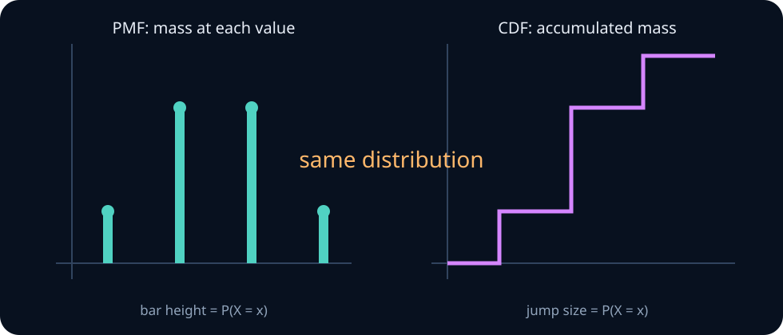
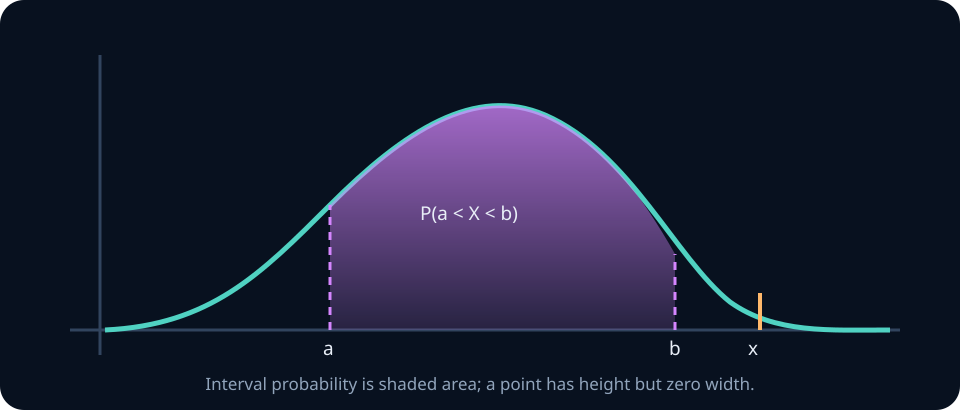
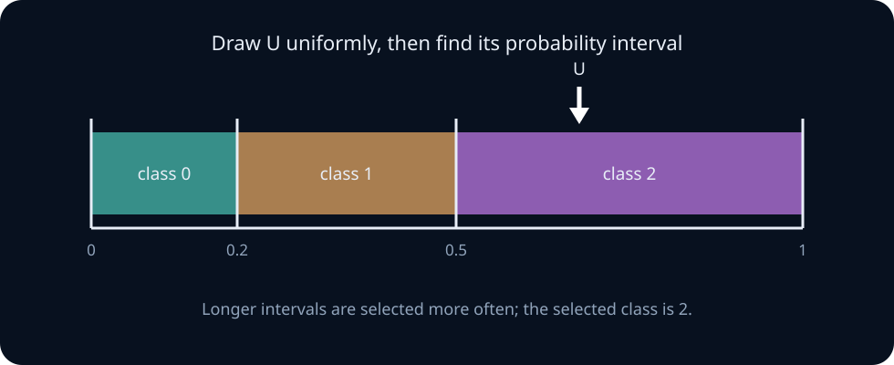

# Random variables, distributions, moments, and simulation

A probability space describes uncertainty over outcomes. A **random variable** extracts a numerical or categorical quantity from those outcomes. Its **distribution** records how probability is allocated across its possible values.

This separation matters in machine learning. A token ID, class label, reward, logit, latency, and model score are different functions of an underlying experiment. They can be defined on the same data-generating process while having very different distributions.

By the end of this unit, you should be able to move between a random variable, its PMF or density, its CDF, expectations, moments, and samples; derive the main properties of common distribution families; choose a plausible family from a data-generating story; and implement reproducible categorical sampling without a library sampler.

## 0. Begin with the experiment

Review [probability foundations](00-probability-foundations.md) if you cannot yet construct a finite sample space, condition on an event, or distinguish independence from disjointness. This unit also uses finite sums, elementary algebra, derivatives, and one-dimensional integrals. The calculus ideas are reviewed when first needed.

The order of construction is:

$$
\text{experiment}
\longrightarrow
(\Omega,P)
\longrightarrow
X(\omega)
\longrightarrow
\text{distribution of }X.
$$

A named distribution is not a substitute for a data-generating story. Start with what is repeated, what is held fixed, what can depend on what, and what quantity is recorded.

> **Practice — Foundation:** For one die roll, separate the outcome, the event “even,” and the observed value “number of dots.” Which object is a set?
>
> **Practice — Core:** Describe the experiment, sample space, and measurement for the length of a generated response. Identify one source of randomness besides token sampling.
>
> **Practice — Stretch:** Give two different experiments that induce the same distribution for a binary measurement. Explain what the distribution hides about their mechanisms.

## 1. A random variable is a function

A random variable \(X\) maps each outcome to a value:

$$
X:\Omega\to\mathcal X.
$$

The codomain \(\mathcal X\) may be numerical, categorical, vector-valued, or structured. The traditional name “random variable” does not mean the function itself changes. Once \(\omega\) is known, \(X(\omega)\) is fixed; uncertainty about the outcome induces uncertainty about the value.

**Example — one request, several variables.** For one model-serving request, the outcome might contain the prompt, sampled tokens, hardware state, and timing information. From that outcome define:

- \(T\): number of generated tokens;
- \(L\): latency in milliseconds;
- \(Y\): whether a safety filter fired;
- \(C\): the final stop-reason category.

These variables share an experiment and can be dependent. Treating rows in a table as unrelated just because the columns have different names would discard that structure.

### Preimages define events

Statements about a random variable are events in \(\Omega\):

$$
\{X\le x\}=\{\omega\in\Omega:X(\omega)\le x\}.
$$

Thus \(P(X\le x)\) is shorthand for the probability of a set of outcomes. This is the bridge from the event language of Unit 1 to distributions.

> **Practice — Foundation:** On two coin tosses, define \(X\) as the number of heads. Write the function from all four outcomes to numbers.
>
> **Practice — Core:** Define two random variables on a die roll whose supports are identical but whose probabilities differ. Derive both distributions.
>
> **Practice — Stretch:** Explain why asking whether “the random variable happened” is a type error. Rewrite the question in two mathematically meaningful ways.

## 2. Discrete distributions: PMFs and support

A random variable is **discrete** when its possible values form a finite or countable set. Its probability mass function is

$$
p_X(x)=P(X=x).
$$

It satisfies

$$
p_X(x)\ge0,
\qquad
\sum_xp_X(x)=1.
$$

The **support** is the set of values with positive mass. If \(X\) counts heads in three fair independent flips, then

$$
p_X(0)=\frac18,\quad
p_X(1)=\frac38,\quad
p_X(2)=\frac38,\quad
p_X(3)=\frac18.
$$

To find the probability of a set \(A\) of values, add its masses:

$$
P(X\in A)=\sum_{x\in A}p_X(x).
$$

The notation \(p_X(x)\) describes a probability distribution. A model output such as \(0.8\) is not automatically a calibrated probability merely because it lies between zero and one.



**Worked example — read the PMF and CDF together.** For the three-flip head count, \(P(X\le1)=p_X(0)+p_X(1)=1/8+3/8=1/2\). On the CDF this is the height immediately after the jump at one. Meanwhile \(P(1<X\le3)=F_X(3)-F_X(1)=1-1/2=1/2\). The PMF answers “how much mass is exactly here?”; the CDF answers “how much mass has accumulated up to here?”

> **Practice — Foundation:** Check whether \(p(0)=0.1,p(1)=0.3,p(2)=0.6\) is a valid PMF and compute \(P(X\ge1)\).
>
> **Practice — Core:** A token sampler returns ranks 1, 2, and 3 with probabilities proportional to 6, 3, and 1. Normalize the weights and compute the expected rank.
>
> **Practice — Stretch:** Construct two PMFs with the same support and mean but very different tail probabilities. Explain why the mean alone misses that difference.

## 3. CDFs unify discrete and continuous variables

The cumulative distribution function is

$$
F_X(x)=P(X\le x).
$$

Every CDF has four properties:

1. \(F_X\) is nondecreasing.
2. \(0\le F_X(x)\le1\).
3. \(F_X(x)\to0\) as \(x\to-\infty\), and \(F_X(x)\to1\) as \(x\to\infty\).
4. \(F_X\) is right-continuous.

For any \(a<b\),

$$
P(a<X\le b)=F_X(b)-F_X(a).
$$

For a discrete variable, the CDF is a step function and the jump at \(x\) equals \(p_X(x)\):

$$
p_X(x)=F_X(x)-F_X(x^-).
$$

### Quantiles

For \(0<q<1\), define a \(q\)-quantile by

$$
Q(q)=\inf\{x:F_X(x)\ge q\}.
$$

This definition works even when a flat region or jump prevents solving \(F_X(x)=q\) exactly. The median is a 0.5-quantile. Quantiles are often more informative than means for skewed latency, loss, or response-length distributions.

> **Practice — Foundation:** Given a small discrete PMF, compute its CDF at points below, on, and between support values.
>
> **Practice — Core:** Recover \(P(a<X\le b)\), \(P(X=b)\), and the median set from a supplied step-function CDF.
>
> **Practice — Stretch:** Write a function that numerically checks monotonicity, range, and right-continuity clues for tabulated CDF values. Describe what a finite grid cannot prove.

## 4. Continuous distributions: density is not probability

A continuous random variable may have a probability density function \(f_X\) satisfying

$$
f_X(x)\ge0,
\qquad
\int_{-\infty}^{\infty}f_X(x)\,dx=1.
$$

Interval probabilities are areas:

$$
P(a<X\le b)=\int_a^bf_X(x)\,dx.
$$

The CDF is

$$
F_X(x)=\int_{-\infty}^xf_X(t)\,dt,
$$

and where the CDF is differentiable, \(f_X(x)=F_X'(x)\).

For a genuinely continuous distribution,

$$
P(X=x)=0
$$

for every single point. Therefore \(f_X(x)\) is not \(P(X=x)\). A density may exceed one: the uniform density on \([0,0.1]\) equals ten, while the total area remains one. Density also has inverse units. If \(X\) is measured in seconds, \(f_X(x)\) has units of inverse seconds.

Not every distribution is purely discrete or purely continuous. A generation process may stop immediately with positive probability and otherwise have a continuous latency. Such a mixed distribution has a point mass plus a density; forcing it into only one category loses information.



<details><summary>Checkpoint: can a density equal 5?</summary>

Yes. If \(X\sim\operatorname{Uniform}(0,0.2)\), then \(f_X(x)=5\) inside the interval. But \(P(X=0.1)=0\), while \(P(0.08<X<0.12)=5(0.04)=0.2\). Density height, point probability, and interval probability are different quantities.

</details>

> **Practice — Foundation:** For density \(f(x)=2x\) on \([0,1]\), verify normalization and compute \(P(X>1/2)\).
>
> **Practice — Core:** Find a density greater than one on part of its support and show that every interval probability remains at most one.
>
> **Practice — Stretch:** Compare the probability of an exact floating-point output in mathematical continuous sampling with the probability of that machine value in an actual finite-precision implementation.

## 5. Expectation is an average under a distribution

For a discrete \(X\),

$$
E[X]=\sum_xx\,p_X(x).
$$

For a continuous \(X\) with density,

$$
E[X]=\int_{-\infty}^{\infty}x f_X(x)\,dx.
$$

An expectation exists when the relevant absolute sum or integral is finite. A distribution can be valid while its mean or variance is infinite. Do not manipulate a moment before checking that it exists.

### LOTUS: transform values, not necessarily distributions

For a function \(g\), the law of the unconscious statistician gives

$$
E[g(X)]=
\begin{cases}
\sum_x g(x)p_X(x),&X\text{ discrete},\\[4pt]
\int g(x)f_X(x)\,dx,&X\text{ continuous}.
\end{cases}
$$

You do not need to derive the full distribution of \(g(X)\) merely to compute its expectation.

Linearity follows directly:

$$
E[aX+b]=aE[X]+b.
$$

More generally, \(E[\sum_i a_iX_i]=\sum_i a_iE[X_i]\) whether or not the \(X_i\) are independent.

> **Practice — Foundation:** Compute \(E[X]\) for a fair die and explain why the answer need not be a possible outcome.
>
> **Practice — Core:** For \(X\sim\text{Bernoulli}(p)\), derive \(E[3X-2]\) two ways: from its distribution and from linearity.
>
> **Practice — Stretch:** Give two distributions with the same expectation but different operational risk. Choose and justify a second summary that separates them.

## 6. Moments summarize location and spread

The \(k\)-th raw moment is \(E[X^k]\). The mean is \(\mu=E[X]\). The variance is the second central moment:

$$
\operatorname{Var}(X)=E[(X-\mu)^2].
$$

Expanding the square gives the computational identity

$$
\operatorname{Var}(X)=E[X^2]-E[X]^2.
$$

This identity is algebraically correct but can be numerically unstable when the two terms are large and nearly equal. Use a centered two-pass calculation or Welford's recurrence from [numerical stability](../00-foundations/01-numerical-stability.md) for data.

The standard deviation

$$
\operatorname{SD}(X)=\sqrt{\operatorname{Var}(X)}
$$

has the same units as \(X\). Variance has squared units.

For an affine transformation \(Y=aX+b\),

$$
E[Y]=aE[X]+b,
\qquad
\operatorname{Var}(Y)=a^2\operatorname{Var}(X).
$$

Adding \(b\) moves every value without changing spread; multiplying by \(a\) scales deviations by \(|a|\).

Higher moments describe additional shape but can be fragile under heavy tails. A mean and variance do not uniquely determine a distribution except within special families such as the Gaussian.

> **Practice — Foundation:** For \(P(X=-1)=P(X=1)=1/2\), compute the first two raw moments, variance, and standard deviation.
>
> **Practice — Core:** Prove \(\operatorname{Var}(aX+b)=a^2\operatorname{Var}(X)\) from the definition, carefully tracking the shifted mean.
>
> **Practice — Stretch:** Construct a sequence of distributions whose means stay fixed while variances grow without bound. Explain what changes in the tails.

## 7. Bernoulli and categorical variables

### Bernoulli

A Bernoulli random variable records one binary trial:

$$
X\sim\operatorname{Bernoulli}(p),
\qquad
P(X=1)=p,\quad P(X=0)=1-p.
$$

Because \(X^2=X\),

$$
E[X]=p,
\qquad
\operatorname{Var}(X)=p-p^2=p(1-p).
$$

Any event indicator is Bernoulli. This makes Bernoulli variables the basic building blocks for counts and empirical proportions.

### Categorical

A categorical variable chooses one of \(K\) classes:

$$
P(X=k)=p_k,
\qquad
p_k\ge0,\quad\sum_{k=1}^Kp_k=1.
$$

If class \(k\) is encoded by the one-hot vector \(e_k\), then

$$
E[e_X]=(p_1,\ldots,p_K)^T.
$$

Class numbers such as 1, 2, and 3 are labels, not quantities. Their numerical mean changes if labels are permuted; the one-hot representation preserves the categorical meaning.

In a language model, softmax converts logits \(z_k\) into categorical probabilities

$$
p_k=\frac{e^{z_k}}{\sum_je^{z_j}}.
$$

Adding the same constant to every logit leaves the distribution unchanged. Numerically, subtract \(\max_jz_j\) before exponentiating.

> **Practice — Foundation:** Encode a correctness outcome as Bernoulli and compute its mean and variance when accuracy is \(0.8\).
>
> **Practice — Core:** Normalize categorical weights \((2,5,3)\), sample conceptually with a uniform number, and show which cumulative interval maps to each label.
>
> **Practice — Stretch:** A label set is duplicated so two labels represent the same semantic answer. Analyze how categorical entropy and semantic-answer probability respond differently.

## 8. Binomial, geometric, and Poisson counts

### Binomial: successes in a fixed number of trials

Let \(X=\sum_{i=1}^nX_i\), where the \(X_i\) are independent Bernoulli variables with the same success probability \(p\). Then

$$
X\sim\operatorname{Binomial}(n,p)
$$

with

$$
P(X=k)={n\choose k}p^k(1-p)^{n-k},
\qquad k=0,1,\ldots,n.
$$

The combinatorial factor chooses which \(k\) trials succeeded. Linearity gives \(E[X]=np\). Independence makes variances add, so

$$
\operatorname{Var}(X)=np(1-p).
$$

The binomial model requires a fixed trial count, binary outcomes, a common \(p\), and independent trials. “Count data” alone does not justify it.

**Worked example — exact binomial tail.** Suppose eight independently sampled evaluation items each pass with probability \(p=0.75\). The probability of at least seven passes is

$$
{8\choose7}(0.75)^7(0.25)+(0.75)^8
\approx0.367.
$$

The first term chooses which one of eight items failed; the second covers no failures. If the items share a passage or template, independence may fail and this tail calculation no longer follows.

### Geometric: waiting time to the first success

With support \(1,2,\ldots\),

$$
P(X=k)=(1-p)^{k-1}p.
$$

Here \(X\) counts the successful trial itself. Some software instead counts failures and uses support \(0,1,\ldots\); always state the convention.

The geometric distribution is memoryless:

$$
P(X>s+t\mid X>s)=P(X>t).
$$

Its mean and variance are

$$
E[X]=\frac1p,
\qquad
\operatorname{Var}(X)=\frac{1-p}{p^2}.
$$

### Poisson: event counts over exposure

For rate or expected count \(\lambda>0\),

$$
X\sim\operatorname{Poisson}(\lambda),
\qquad
P(X=k)=e^{-\lambda}\frac{\lambda^k}{k!}.
$$

Its mean and variance both equal \(\lambda\). This equality is a diagnostic implication, not a universal truth about counts. Real data often have variance larger than the mean because rates differ across cases, events cluster, or observations are dependent.

If \(n\) is large, \(p\) is small, and \(np\approx\lambda\), a \(\operatorname{Binomial}(n,p)\) count is approximately Poisson. The approximation describes many rare opportunities, not merely any rare observed result.

**Worked example — a Poisson interval.** If failures arrive at an approximately constant rate of two per hour, then the probability of no failures in a half-hour uses exposure-adjusted mean \(\lambda=1\):

$$
P(X=0)=e^{-1}\approx0.368.
$$

Using \(\lambda=2\) would mix an hourly rate with a half-hour exposure. Parameters carry units and must be scaled with the observation window.

> **Practice — Foundation:** Identify whether each variable is best modelled initially as binomial, geometric, or Poisson: successes in fixed trials, trials until first success, arrivals in a fixed interval.
>
> **Practice — Core:** Derive the mean of a geometric variable by a tail-sum argument, then state which support convention you used.
>
> **Practice — Stretch:** Simulate rare Bernoulli counts with \(np\) fixed while changing \(n\) and \(p\). Quantify when the Poisson approximation is poor and propose a diagnostic.

## 9. Uniform, exponential, and Gaussian variables

### Uniform: equal density over a bounded interval

For \(X\sim\operatorname{Uniform}(a,b)\),

$$
f_X(x)=\frac1{b-a}\mathbf1\{a\le x\le b\}.
$$

For \(a\le c\le d\le b\),

$$
P(c\le X\le d)=\frac{d-c}{b-a}.
$$

Its moments are

$$
E[X]=\frac{a+b}{2},
\qquad
\operatorname{Var}(X)=\frac{(b-a)^2}{12}.
$$

Equal density is not equal probability for intervals of different lengths.

**Worked example — a uniform interval.** If randomized backoff is uniform from 20 to 60 milliseconds, then the chance of landing between 30 and 45 milliseconds is

$$
\frac{45-30}{60-20}=\frac{15}{40}=0.375.
$$

Endpoints do not affect this continuous probability because individual points have probability zero.

### Exponential: waiting time at a constant rate

For rate \(\lambda>0\),

$$
f_X(x)=\lambda e^{-\lambda x}\mathbf1\{x\ge0\},
\qquad
F_X(x)=1-e^{-\lambda x}\quad(x\ge0).
$$

Its survival probability, mean, and variance are

$$
P(X>x)=e^{-\lambda x},
\qquad
E[X]=\frac1\lambda,
\qquad
\operatorname{Var}(X)=\frac1{\lambda^2}.
$$

Like the geometric distribution, it is memoryless. Constant hazard is a substantive assumption and often fails for user behavior, hardware failures, and task completion times.

**Worked example — interpret rate before calculating.** With an exponential waiting-time rate of \(0.25\) events per minute, the mean wait is four minutes. The probability of waiting more than eight minutes is \(e^{-0.25(8)}=e^{-2}\approx0.135\). The input to the exponent is dimensionless: minutes cancel against events per minute.

### Gaussian: additive variation on the real line

For \(\sigma>0\),

$$
X\sim\mathcal N(\mu,\sigma^2)
$$

has density

$$
f_X(x)=\frac1{\sigma\sqrt{2\pi}}
\exp\!\left[-\frac{(x-\mu)^2}{2\sigma^2}\right].
$$

Its mean is \(\mu\) and variance is \(\sigma^2\). Standardization gives

$$
Z=\frac{X-\mu}{\sigma}\sim\mathcal N(0,1).
$$

Roughly 68%, 95%, and 99.7% of Gaussian mass lies within one, two, and three standard deviations of the mean. These are properties of the Gaussian family, not rules for arbitrary data.

A Gaussian has support over the whole real line. It is a poor direct model for a strictly positive quantity when nonnegligible mass would fall below zero, and a poor tail model when extremes occur much more frequently than Gaussian tails predict.

**Worked example — standardize before using a Gaussian probability.** If an approximately Gaussian score has mean 70 and standard deviation 8, then a score of 86 corresponds to

$$
z=\frac{86-70}{8}=2.
$$

The Gaussian approximation places about 2.3% of observations above this value. This conclusion depends on the Gaussian model; “two standard deviations” alone does not determine a tail probability for arbitrary data.

> **Practice — Foundation:** Compute an interval probability for a uniform variable and a survival probability for an exponential variable.
>
> **Practice — Core:** Verify the exponential memoryless property algebraically and explain what it claims in conditional-probability language.
>
> **Practice — Stretch:** A latency histogram is positive, right-skewed, and multimodal. Critique both a Gaussian and a single exponential model, then propose a better generative story.

## 10. How the common families relate

| Distribution | Support | Data-generating question | Parameters | Mean | Variance |
|---|---|---|---|---:|---:|
| Bernoulli | \(\{0,1\}\) | Did one trial succeed? | \(p\) | \(p\) | \(p(1-p)\) |
| Categorical | \(\{1,\ldots,K\}\) | Which one of \(K\) classes occurred? | \(p_1,\ldots,p_K\) | encoding-dependent | encoding-dependent |
| Binomial | \(\{0,\ldots,n\}\) | How many of \(n\) iid binary trials succeeded? | \(n,p\) | \(np\) | \(np(1-p)\) |
| Geometric | \(\{1,2,\ldots\}\) | Which iid trial was the first success? | \(p\) | \(1/p\) | \((1-p)/p^2\) |
| Poisson | \(\{0,1,\ldots\}\) | How many constant-rate events occurred in an exposure? | \(\lambda\) | \(\lambda\) | \(\lambda\) |
| Uniform | \([a,b]\) | Is density constant on a bounded interval? | \(a,b\) | \((a+b)/2\) | \((b-a)^2/12\) |
| Exponential | \([0,\infty)\) | How long until a constant-rate event? | \(\lambda\) | \(1/\lambda\) | \(1/\lambda^2\) |
| Gaussian | \(\mathbb R\) | Is variation plausibly additive and symmetric? | \(\mu,\sigma^2\) | \(\mu\) | \(\sigma^2\) |

This table is a recognition aid, not a model-selection algorithm. Independence, stationarity, support, censoring, truncation, and selection mechanisms matter as much as the shape of a histogram.

> **Practice — Foundation:** For each common family in the table, name its support and one parameter constraint without looking back.
>
> **Practice — Core:** Starting from independent Bernoulli trials, explain the different stopping rules that produce binomial and geometric variables.
>
> **Practice — Stretch:** Build a decision tree that chooses a first-pass family from support, repetition structure, and stopping rule. Test it on three ML observables where the first-pass choice ultimately fails.

## 11. Transformations: distinguish values from density

If \(Y=g(X)\), the distribution of \(Y\) must account for how \(g\) moves and stretches probability mass.

For an affine transformation \(Y=aX+b\) with \(a>0\),

$$
F_Y(y)=P(aX+b\le y)
=F_X\!\left(\frac{y-b}{a}\right).
$$

Differentiating gives

$$
f_Y(y)=\frac1a f_X\!\left(\frac{y-b}{a}\right).
$$

The factor \(1/a\) preserves total area. For \(a<0\), the density factor is \(1/|a|\), and the CDF inequality reverses during the derivation.

For a differentiable one-to-one transformation,

$$
f_Y(y)=f_X(g^{-1}(y))
\left|\frac{d}{dy}g^{-1}(y)\right|.
$$

Non-one-to-one transformations require summing contributions from every inverse branch. The next unit derives this rule carefully and extends it to vectors using Jacobian determinants.

> **Practice — Foundation:** If \(Y=2X+3\), compute the transformed support when \(X\in\{-1,0,2\}\).
>
> **Practice — Core:** For \(X\sim\text{Uniform}(0,1)\) and \(Y=X^2\), derive the CDF and density of \(Y\), including its support.
>
> **Practice — Stretch:** Explain why mapping density heights directly through \(g\) fails. Use interval compression or expansion to predict the direction of the missing correction.

## 12. Sampling constructs observations from a distribution

A **sample** \(X_1,\ldots,X_n\) is a collection of random variables. An iid sample means they are independent and have the same distribution. Neither property follows merely because values are stored in separate rows.

A pseudo-random number generator is deterministic stateful software designed to imitate random draws. A seed chooses its initial state. Reproducibility requires recording at least the algorithm or library, seed, code version, and sampling configuration.

### Inverse-CDF idea

If \(U\sim\operatorname{Uniform}(0,1)\), then

$$
X=F^{-1}(U)
$$

has CDF \(F\), under the generalized quantile definition. For a categorical distribution, partition \([0,1)\) into consecutive intervals with lengths \(p_1,\ldots,p_K\); the interval containing \(U\) selects the category.

For unnormalized nonnegative weights \(w_k\), draw \(U\) uniformly on \([0,W)\), where \(W=\sum_kw_k\), and return the first category whose cumulative weight exceeds \(U\). Normalization is implicit.



**Worked example — one categorical draw.** Weights \((2,3,5)\) have total ten and cumulative boundaries \((2,5,10)\). A uniform draw \(u=6.4\) lies after five and before ten, so it selects category 2. Multiplying every weight and the sampled interval by ten preserves the selected category and the distribution.

### Empirical distributions and Monte Carlo averages

Given observed values \(X_1,\ldots,X_n\), the empirical distribution puts mass \(1/n\) on each observation. For a function \(g\), the Monte Carlo estimate is

$$
\widehat\mu_n=\frac1n\sum_{i=1}^ng(X_i).
$$

For iid draws with finite variance \(\sigma_g^2=\operatorname{Var}(g(X))\),

$$
E[\widehat\mu_n]=E[g(X)],
\qquad
\operatorname{Var}(\widehat\mu_n)=\frac{\sigma_g^2}{n}.
$$

Thus typical noise shrinks like \(1/\sqrt n\), not \(1/n\). Reducing Monte Carlo standard error by a factor of ten generally requires one hundred times as many independent draws. Later units justify this behavior and handle dependent samples.

> **Practice — Foundation:** Use inverse-CDF sampling to map \(u=0.72\) into a categorical distribution with probabilities \((0.2,0.5,0.3)\).
>
> **Practice — Core:** Implement inverse-CDF sampling for a discrete PMF and validate it with empirical frequencies and a fixed random seed.
>
> **Practice — Stretch:** Compare inverse-transform and direct-library sampling for an extreme parameter setting. Identify whether discrepancies come from theory, numerical precision, or the random generator.

## 13. Numerical and modelling discipline

### Work in log space for tiny probabilities

Products of many probabilities underflow. Use

$$
\log\prod_i p_i=\sum_i\log p_i.
$$

To add log probabilities, use log-sum-exp rather than exponentiating first. Zero probability corresponds to log probability \(-\infty\), which requires explicit handling.

### Parameters have domains

- Bernoulli and binomial require \(0\le p\le1\).
- Poisson and exponential require \(\lambda>0\).
- Gaussian requires \(\sigma>0\), or equivalently variance \(\sigma^2>0\).
- A categorical vector requires nonnegative entries and positive total mass before normalization.

A model can emit a finite numerical answer while violating these semantic constraints.

### Diagnose the assumptions, not only the fit

Ask:

1. Does the distribution have the correct support?
2. Does its experiment match how the data were generated?
3. Are observations independent, grouped, censored, truncated, or selected?
4. Are the parameter and process stable across time and subpopulations?
5. Are tails and rare events important to the decision?
6. Could a mixture or hierarchy explain apparent overdispersion?

A histogram that resembles a named density is weak evidence if these questions fail.

> **Practice — Foundation:** List the validation checks a categorical sampler should perform before drawing a sample.
>
> **Practice — Core:** Create three deliberately invalid inputs—negative weight, all-zero weights, and a NaN—and specify the safest failure behavior for each.
>
> **Practice — Stretch:** Design a reproducibility report that distinguishes algorithm, seed, library version, hardware, and nondeterministic parallel execution. Explain which guarantees each field can and cannot provide.

## 14. Runnable lab: categorical sampling from weights

Implement `sample_categorical` in [labs/exercises.py](../../labs/exercises.py). It accepts a finite sequence of nonnegative weights, a nonnegative integer draw count, and an integer seed. It returns the sampled zero-based category indices.

Requirements:

- reject empty, negative, nonfinite, or all-zero weights;
- reject invalid draw counts and seeds;
- do not mutate the weights;
- use a local seeded random-number generator rather than global random state;
- preserve the distribution if every weight is multiplied by the same positive constant;
- never sample a zero-weight category.

Run:

```text
python -m labs.checks categorical
```

After the behavioral check passes, run at least 100 independent replications for draw counts \(10^2,10^3,10^4\). Plot the error in the estimated class probabilities against \(n\) on log axes and compare it with a reference slope proportional to \(n^{-1/2}\).

## 15. Derivations to own

Derive these results rather than memorizing the table:

1. Bernoulli mean and variance using \(X^2=X\).
2. Binomial PMF by counting which trials succeed.
3. Binomial mean and variance using a sum of indicators.
4. Geometric memorylessness from its survival function.
5. Poisson normalization using the exponential power series.
6. Uniform mean and variance by integration.
7. Exponential CDF, mean, and memorylessness.
8. The affine density transformation and its absolute scale factor.
9. Unbiasedness and variance of an iid Monte Carlo average.

## 16. End-of-unit practice (graded)

**Foundation — problems 1–3.** Read PMFs, CDFs, densities, and moments accurately.

1. **PMF and CDF.** Let \(p_X(x)=cx\) for \(x\in\{1,2,3,4\}\). Find \(c\), write the complete CDF, and compute \(P(1<X\le3)\).
2. **Density versus probability.** Let \(X\sim\operatorname{Uniform}(0,0.2)\). Find \(f_X(0.1)\), \(P(X=0.1)\), and \(P(0.08<X<0.12)\). Explain why the three answers are different kinds of quantities.
3. **Moments.** Derive \(\operatorname{Var}(aX+b)=a^2\operatorname{Var}(X)\) directly from the definition.

**Core — problems 4–8.** Select and manipulate distribution families while auditing assumptions.

4. **Binomial assumptions.** A moderation dataset contains 1,000 messages from 40 users. Explain why the number of policy violations need not be binomial even if every row is binary.
5. **Overdispersion.** A request count has empirical mean 8 and variance 31. Give two process-level reasons a single Poisson model may fail.
6. **Waiting times.** For \(X\sim\operatorname{Exponential}(\lambda)\), find its median and compare it with its mean.
7. **Transformation.** If \(X\sim\operatorname{Uniform}(0,1)\) and \(Y=X^2\), derive \(F_Y\) and \(f_Y\). Identify where the density is largest.
8. **Categorical encoding.** Show why treating class IDs as numerical values produces a representation-dependent mean. Give the one-hot mean instead.

**Stretch — problems 9–14.** Combine simulation, numerical reasoning, and model criticism.

9. **Simulation.** Estimate \(P(X\ge8)\) for \(X\sim\operatorname{Binomial}(10,0.6)\) using 50 independent batches of 10,000 draws from local RNG seeds 0 through 49. Compare the mean and standard deviation of the 50 estimates with the exact probability and its predicted Monte Carlo standard error.
10. **Model critique.** A team models generation latency with a Gaussian because its central histogram looks symmetric. List three checks needed before using it to estimate a strict tail-latency service-level objective.
11. **Numerics.** Explain why multiplying 2,000 next-token probabilities may underflow while the corresponding log-likelihood remains usable.
12. **Transfer.** Match a distribution to each story and state one assumption whose failure invalidates it: (a) exactly one of five routing destinations is selected per request; (b) GPU faults are counted during a fixed 24-hour window under a constant independent rate; (c) independent attempts continue until the first schema-valid response; (d) waiting time to the next request under a homogeneous Poisson arrival process. Distinguish the geometric support convention you use.
13. **Distribution forensics.** You receive only 10,000 sampled values from an unknown scalar generator. Build a reproducible investigation that tests support, discreteness, tail behavior, candidate-family fit, and dependence across draw order without claiming that a good fit identifies the mechanism.
14. **Sampler stress test.** Implement one categorical sampler incorrectly in a subtle way, such as renormalizing after cumulative rounding. Design tests that reliably expose the defect under both balanced and highly skewed weights.

<details><summary>Solution sketches</summary>

1. Normalization gives \(c(1+2+3+4)=1\), so \(c=0.1\). The CDF jumps to 0.1, 0.3, 0.6, and 1 at 1, 2, 3, and 4. The requested probability is \(0.2+0.3=0.5\).
2. The density is 5, the point probability is 0, and the interval probability is \(0.04/0.2=0.2\). Density has inverse units, point mass is zero, and interval probability is area.
3. Since \(E[aX+b]=a\mu+b\), subtracting the transformed mean gives \(a(X-\mu)\); square and take expectation.
4. Messages from one user can be dependent, users can have different violation probabilities, and the row-selection mechanism can vary. These break independence or common \(p\).
5. Heterogeneous latent rates create a mixture; temporal clustering or shared incidents create dependence. Either can produce variance above the mean.
6. Solve \(1-e^{-\lambda m}=1/2\), giving \(m=(\log2)/\lambda\), which is below the mean \(1/\lambda\).
7. For \(0\le y\le1\), \(F_Y(y)=P(X\le\sqrt y)=\sqrt y\), hence \(f_Y(y)=1/(2\sqrt y)\). It diverges near zero while remaining integrable.
8. Relabelling classes changes \(E[X]=\sum_kkp_k\). For one-hot encoding the mean is the probability vector \(p\), whose coordinates permute with the labels.
9. The exact probability is \(\sum_{k=8}^{10}{10\choose k}0.6^k0.4^{10-k}\approx0.16729\). A 10,000-draw batch has predicted standard error \(\sqrt{p(1-p)/10000}\approx0.00373\). Across 50 independent batches, their sample mean should be near \(0.16729\) and their sample standard deviation near \(0.00373\); report Monte Carlo uncertainty rather than demanding exact agreement from the seeds.
10. Check impossible negative mass, tail fit rather than only the center, dependence and nonstationarity, censoring/timeouts, and whether a mixture across request types is required.
11. The product can fall below the smallest representable positive number. Logs convert the product into a finite sum of negative log probabilities.
12. Use categorical for (a), Poisson for (b), geometric for (c), and exponential for (d). The choices respectively require one exclusive category with stable probabilities; a fixed exposure with approximately constant independent event rate; repeated comparable independent attempts with constant success probability; and a homogeneous Poisson arrival process. Changing routing probabilities, clustered faults, learning across attempts, or time-varying arrival intensity breaks the corresponding model.
13. A strong investigation combines value counts or spacings, empirical CDFs and quantiles, tail-focused plots, parameter fitting on one split, fit checks on another, and lag or run diagnostics. Agreement narrows plausible descriptions but does not recover a unique data-generating process.
14. Use deterministic boundary tests plus large seeded simulations. Include zero and tiny weights, one dominant class, weights spanning many orders of magnitude, permutation checks, and expected-frequency tolerances based on binomial sampling variation.

</details>

## Mastery check

Given an unfamiliar data-generating story, define the random variable and support, propose a distribution, derive its mean or a relevant event probability, simulate from it with a local seed, and name two assumptions whose failure would change the result. Then distinguish model probability, density, empirical frequency, and estimator uncertainty without using those words interchangeably.

The next unit, [joint distributions, conditioning, and covariance](02-joint-distributions-conditioning-covariance.md), moves from one variable to several while keeping every calculation finite and inspectable.
