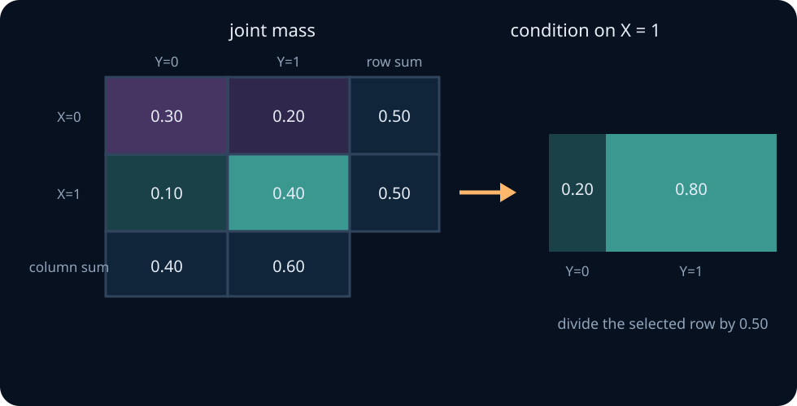
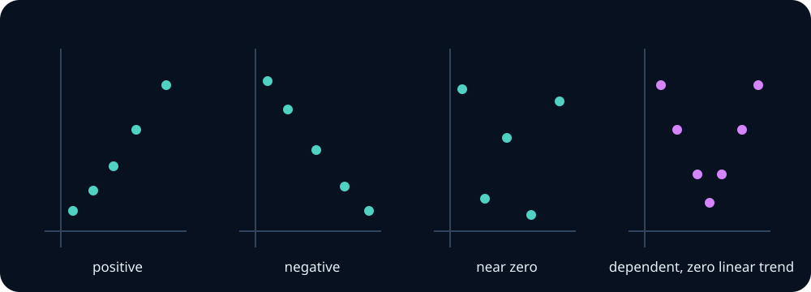

# Joint distributions, conditioning, and covariance

Most ML experiments produce several related measurements. A training run has loss, accuracy, throughput, memory use, and thousands of per-example outputs. Separate one-variable distributions cannot tell us how these quantities relate. That information lives in their **joint distribution**.

This unit stays with finite tables and second moments so every operation remains visible. By the end, you should be able to marginalize and condition a joint distribution, use conditional expectation, derive total expectation and total variance, compute covariance without confusing it with independence, and identify when aggregation or clustered data changes an evaluation claim.

## 0. Prerequisite check

You should be able to normalize a PMF, compute an expectation and variance, apply conditional probability to finite events, and explain why zero covariance need not imply independence. Review [random variables and distributions](01-random-variables-distributions.md) if those steps are not yet routine.

## 1. Joint mass describes combinations

For discrete variables \(X\) and \(Y\),

$$
p_{X,Y}(x,y)=P(X=x,Y=y),
$$

with nonnegative entries summing to one. Consider an evaluation where \(X\) identifies model version B and \(Y\) records a pass:

| joint mass | \(Y=0\) | \(Y=1\) | row sum |
|---|---:|---:|---:|
| \(X=0\) | 0.30 | 0.20 | 0.50 |
| \(X=1\) | 0.10 | 0.40 | 0.50 |
| column sum | 0.40 | 0.60 | 1.00 |



The support is the set of pairs with positive mass. It need not be rectangular. If \(X\) is prompt length and \(Y\) is the number of masked prompt tokens, pairs with \(Y>X\) are impossible even if both marginal ranges include those values.

> **Practice — Foundation:** Check whether a supplied \(2\times3\) table is a valid joint PMF by testing sign and total mass.
>
> **Practice — Core:** Construct two different joint tables with the same row and column marginals. Describe how their relationships differ.
>
> **Practice — Stretch:** Give an ML example in which two metrics have identical marginal distributions across systems but very different joint behavior per example.

## 2. Marginalization adds over what is not observed

To obtain the distribution of \(X\), sum over every compatible value of \(Y\):

$$
p_X(x)=\sum_y p_{X,Y}(x,y).
$$

Similarly,

$$
p_Y(y)=\sum_x p_{X,Y}(x,y).
$$

In the table,

$$
P(X=1)=0.10+0.40=0.50,
$$

and

$$
P(Y=1)=0.20+0.40=0.60.
$$

**Common wrong turn.** Marginalization is probability-weighted aggregation, not an unweighted average of unique row or column values. It preserves duplicated probability mass because that mass represents how often combinations occur.

<details><summary>Checkpoint: prove the marginal normalizes</summary>

$$
\sum_xp_X(x)=\sum_x\sum_yp_{X,Y}(x,y)=1.
$$

The order of finite sums can be exchanged. Every joint cell appears exactly once.

</details>

> **Practice — Foundation:** Sum a joint table across columns to obtain \(p_X\), then verify that the marginal normalizes.
>
> **Practice — Core:** Compute both marginals of a \(3\times2\) table and verify that summing in either order produces total mass one.
>
> **Practice — Stretch:** Design a streaming algorithm that computes selected marginals of a sparse joint count table without materializing its dense Cartesian product.

## 3. Conditioning selects a slice and renormalizes it

For \(p_X(x)>0\),

$$
p_{Y\mid X}(y\mid x)
=\frac{p_{X,Y}(x,y)}{p_X(x)}.
$$

For \(X=1\), the selected row is \((0.10,0.40)\) and its total is \(0.50\). Dividing gives

$$
p_{Y\mid X}(0\mid1)=0.20,
\qquad
p_{Y\mid X}(1\mid1)=0.80.
$$

For \(X=0\), the conditional pass probability is \(0.20/0.50=0.40\). Conditioning changes the reference population from all observations to those with a specified value of \(X\).

The product rule reconstructs the joint distribution:

$$
p_{X,Y}(x,y)=p_{Y\mid X}(y\mid x)p_X(x).
$$

> **Predict before calculating.** If the two rows of a joint table are proportional, will conditioning on the row change the distribution of \(Y\)? What does that suggest about independence?

> **Practice — Foundation:** Select one column of a joint PMF and renormalize it to compute \(p_{X\mid Y}(x\mid y)\).
>
> **Practice — Core:** From a count table, compute \(P(X=x\mid Y=y)\) and \(P(Y=y\mid X=x)\); explain the different denominators.
>
> **Practice — Stretch:** Create a rare subgroup whose conditional error rate is high even though its contribution to overall error is small. Report both quantities without conflating them.

## 4. Independence factorizes the complete table

Variables \(X\) and \(Y\) are independent exactly when

$$
p_{X,Y}(x,y)=p_X(x)p_Y(y)
$$

for every pair. Equivalently, every positive-mass conditional distribution of \(Y\) equals its marginal distribution.

In the example,

$$
p_{X,Y}(1,1)=0.40
\ne
p_X(1)p_Y(1)=0.50(0.60)=0.30,
$$

so the variables are dependent.

Checking one covariance is not equivalent to checking factorization. Checking only the most visible cells is also insufficient: independence is a claim about the entire joint law.

<details><summary>Checkpoint answer: proportional rows</summary>

After normalization, proportional rows become identical conditional distributions. If every positive row has the same conditional distribution, it also equals the weighted marginal distribution, so the joint PMF factorizes.

</details>

> **Practice — Foundation:** Test one cell of a joint table against the product of its marginals and explain why one matching cell is insufficient to establish independence.
>
> **Practice — Core:** Construct an independent joint PMF from two given marginals, then recover the marginals from the product table.
>
> **Practice — Stretch:** Simulate independent variables and measure the largest empirical factorization error over all cells as sample size grows. Explain why empirical equality is never exact.

## 5. Joint expectation weights every combination

For a function \(g\),

$$
E[g(X,Y)]
=\sum_x\sum_y g(x,y)p_{X,Y}(x,y).
$$

Choosing \(g(X,Y)=XY\) gives \(E[XY]\). Choosing \(g(X,Y)=X+Y\) and distributing the sum proves

$$
E[X+Y]=E[X]+E[Y]
$$

without independence.

**Worked example — calculate from cells.** In the binary table, only cell \((1,1)\) contributes to \(XY\), so

$$
E[XY]=1\cdot1\cdot0.40=0.40.
$$

Because \(X\) and \(Y\) are indicators, \(E[X]=0.50\) and \(E[Y]=0.60\).

> **Practice — Foundation:** Compute \(E[X+Y]\) directly from a small joint table.
>
> **Practice — Core:** Compute \(E[XY]\) and compare it with \(E[X]E[Y]\). State exactly what equality would and would not establish.
>
> **Practice — Stretch:** Construct dependent variables with zero covariance and verify dependence from their joint support or conditional distribution.

## 6. Conditional expectation is a random variable

For each value \(x\),

$$
m(x)=E[Y\mid X=x]
=\sum_y y\,p_{Y\mid X}(y\mid x).
$$

Before observing \(X\), \(m(X)=E[Y\mid X]\) is itself random. In the binary example,

$$
m(0)=0.40,
\qquad
m(1)=0.80.
$$

Conditional expectation is the best squared-error predictor using information in \(X\). For any function \(g(X)\),

$$
E[(Y-g(X))^2]
=E[(Y-m(X))^2]+E[(m(X)-g(X))^2].
$$

The cross-term disappears because

$$
E[Y-m(X)\mid X]=0.
$$

This is a population optimum. Learning \(m\) from finite data introduces approximation, optimization, and estimation errors.

> **Practice — Foundation:** From a joint table, compute every value of the function \(m(y)=E[X\mid Y=y]\).
>
> **Practice — Core:** Treat \(m(Y)\) as a random variable and derive its PMF when \(Y\) is discrete.
>
> **Practice — Stretch:** For a probabilistic classifier, interpret \(E[Y\mid S]\) where \(S\) is its score. Describe how this function reveals miscalibration.

## 7. Total expectation averages conditional means correctly

The law of total expectation is

$$
E[Y]=E[E[Y\mid X]].
$$

For discrete \(X\),

$$
E[Y]=\sum_xE[Y\mid X=x]p_X(x).
$$

**Worked example — unequal request types.** Suppose easy, medium, and hard requests occur with probabilities \(0.5,0.3,0.2\) and have mean token counts \(50,200,800\). Then

$$
E[Y]=0.5(50)+0.3(200)+0.2(800)=245.
$$

The unweighted average \((50+200+800)/3=350\) answers a different question in which request types are equally probable.

> **Practice — Foundation:** Average two subgroup means with their subgroup probabilities; compare with the incorrect unweighted average.
>
> **Practice — Core:** Verify total expectation both from a joint table and by first conditioning on one variable.
>
> **Practice — Stretch:** Construct a mixture in which every subgroup mean stays fixed but a change in subgroup prevalence moves the overall mean substantially. Relate this to evaluation under distribution shift.

## 8. Total variance separates two sources of variation

The law of total variance is

$$
\operatorname{Var}(Y)
=E[\operatorname{Var}(Y\mid X)]
+\operatorname{Var}(E[Y\mid X]).
$$

The first term is average variation **within** groups. The second is variation **between** group means.

**Worked example — latency mixtures step by step.** Two equally common request types have conditional means 100 ms and 500 ms, each with variance \(400\text{ ms}^2\).

First compute the overall mean:

$$
E[Y]=\tfrac12(100)+\tfrac12(500)=300.
$$

The within-group term is

$$
E[\operatorname{Var}(Y\mid X)]=\tfrac12(400)+\tfrac12(400)=400.
$$

The between-group term is

$$
\operatorname{Var}(E[Y\mid X])
=\tfrac12(100-300)^2+\tfrac12(500-300)^2
=40{,}000.
$$

Therefore total variance is \(40{,}400\text{ ms}^2\). Most variation comes from mixing request types, not from noise within a type.

> **Practice — Foundation:** Identify the within-group and between-group terms in the law of total variance.
>
> **Practice — Core:** Compute all three quantities in the variance decomposition for a two-component mixture and check the equality numerically.
>
> **Practice — Stretch:** Keep subgroup variances fixed while changing subgroup means and weights. Predict and then plot how total variance changes.

## 9. Covariance measures linear co-movement

For finite second moments,

$$
\operatorname{Cov}(X,Y)
=E[(X-E[X])(Y-E[Y])]
=E[XY]-E[X]E[Y].
$$

In the binary table,

$$
\operatorname{Cov}(X,Y)=0.40-0.50(0.60)=0.10.
$$

The covariance is positive because version B and passing occur together more often than independence would predict.

If both standard deviations are positive, correlation is

$$
\rho_{X,Y}
=\frac{\operatorname{Cov}(X,Y)}
{\operatorname{SD}(X)\operatorname{SD}(Y)}.
$$

It lies between \(-1\) and \(1\) and removes measurement units. It still summarizes only linear association.



**Worked counterexample — dependent with zero covariance.** Let \(X\) be uniform on \(\{-1,0,1\}\) and \(Y=X^2\). Then \(Y\) is determined by \(X\), but

$$
E[X]=0,
\qquad
E[XY]=E[X^3]=0,
$$

so covariance is zero. The curved pattern is invisible to a signed linear summary.

> **Practice — Foundation:** Determine the sign of covariance for three small paired datasets before calculating it.
>
> **Practice — Core:** Compute covariance using both \(E[XY]-E[X]E[Y]\) and centered products, then standardize it to correlation.
>
> **Practice — Stretch:** Give a deterministic nonlinear relationship with zero covariance. Plot it and explain precisely why a linear co-movement summary misses the dependence.

## 10. Covariance matrices describe vector uncertainty

For a random vector \(Z\in\mathbb R^d\) with mean \(\mu\),

$$
\Sigma=E[(Z-\mu)(Z-\mu)^T].
$$

Its entry \(\Sigma_{ij}\) is \(\operatorname{Cov}(Z_i,Z_j)\). The matrix is symmetric, and for every vector \(a\),

$$
a^T\Sigma a
=\operatorname{Var}(a^TZ)\ge0.
$$

Thus every covariance matrix is positive semidefinite. A symmetric matrix with nonnegative diagonal entries is not automatically valid; all directional variances must be nonnegative.

For \(W=AZ+b\),

$$
E[W]=A\mu+b,
\qquad
\operatorname{Cov}(W)=A\Sigma A^T.
$$

Coordinatewise standardization sets marginal variances to one but leaves correlations. Whitening produces identity covariance, but identity covariance does not guarantee independence outside special distribution families.

> **Practice — Foundation:** Build the \(2\times2\) covariance matrix of two variables and identify its variances and covariance.
>
> **Practice — Core:** For a weight vector \(a\), verify \(\operatorname{Var}(a^TX)=a^T\Sigma a\) numerically from a supplied covariance matrix.
>
> **Practice — Stretch:** Diagnose an estimated covariance matrix with a negative eigenvalue. Explain whether the cause might be arithmetic, missing-data handling, or an invalid estimation procedure.

## 11. Aggregation can reverse a comparison

Suppose an easy and difficult subgroup have the following results:

| group | model A | model B |
|---|---:|---:|
| Easy | 90/100 = 90% | 19/20 = 95% |
| Difficult | 1/10 = 10% | 20/100 = 20% |

Model B is better inside both groups. Aggregating gives

$$
A:\;91/110\approx82.7\%,
\qquad
B:\;39/120=32.5\%.
$$

The reversal occurs because A was evaluated mostly on easy cases and B mostly on difficult ones. The marginal comparison uses different subgroup weights.

This does not mean every analysis should condition on every variable. State the target comparison, examine how groups were assigned or selected, and distinguish observational adjustment from a causal claim.

> **Practice — Foundation:** Compute a weighted aggregate from two subgroup rates and identify which weights control the result.
>
> **Practice — Core:** Construct a complete Simpson-reversal table and verify both subgroup comparisons and the reversed aggregate comparison.
>
> **Practice — Stretch:** Explain why conditioning on every available variable is not an automatic cure for aggregation bias; include one collider or post-treatment variable in your argument.

## 12. Conditional independence

Variables \(X\) and \(Y\) are conditionally independent given \(Z\) when

$$
p(x,y\mid z)=p(x\mid z)p(y\mid z).
$$

Latency and token count may be dependent marginally because both vary with request type, yet approximately independent within each request type. Conversely, variables can be marginally independent but become dependent after conditioning on a selected subset.

Factorizations based on conditional independence power many probabilistic models. They are meaningful modelling claims, not algebraic conveniences that can be assumed after looking only at pairwise correlations.

> **Practice — Foundation:** Translate \(X\perp Y\mid Z\) into a factorization of the conditional joint distribution.
>
> **Practice — Core:** Construct variables that are dependent marginally but independent after conditioning on a shared context variable.
>
> **Practice — Stretch:** Give an example where conditioning creates dependence between two otherwise independent causes. Explain the selection mechanism in words and probabilities.

## 13. Evaluation failure modes

- **Rows are not necessarily units.** Turns from one conversation and samples from one user share context.
- **Separate metrics are related.** Accuracy and latency changes can be correlated across examples or runs.
- **Selection changes the joint law.** Filtering failed tool calls before evaluation conditions on an outcome-related event.
- **Mixtures create structure.** Heterogeneous subgroups can create large variance and dependence absent within groups.
- **Whitening is limited.** Removing second-order correlation does not remove nonlinear or higher-order dependence.
- **Conditional is not causal.** \(P(Y\mid X)\) does not say what an intervention on \(X\) would do without additional assumptions.

> **Practice — Foundation:** Match each listed evaluation failure to marginalization, conditioning, dependence, covariance, or aggregation.
>
> **Practice — Core:** Redesign an accuracy report for repeated prompts nested within tasks so it displays per-task uncertainty and does not treat every row as independent.
>
> **Practice — Stretch:** Audit an evaluation table containing model, task family, seed, and score. Specify the joint quantities you would inspect before making a single-number comparison.

## 14. Runnable lab: finite joint marginals and covariance

Implement `joint_marginals_covariance` in [labs/exercises.py](../../labs/exercises.py). The input maps numeric pairs \((x,y)\) to nonnegative, possibly unnormalized weights. Return normalized marginal dictionaries and covariance.

Run:

```text
python -m labs.checks joint
```

The behavioral checks include sparse support, rescaled weights, invalid models, and the dependent \(Y=X^2\) construction with zero covariance.

### Guided extension

Using the same input format:

1. construct every positive-mass conditional PMF \(p(y\mid x)\);
2. verify each sums to one;
3. compute \(E[Y\mid X=x]\);
4. verify total expectation;
5. verify total variance by separately computing within- and between-group terms.

## 15. Derivations to own

1. Prove both marginals normalize.
2. Reconstruct a joint PMF from one marginal and one conditional PMF.
3. Prove total expectation in the finite case.
4. Derive the squared-error decomposition for conditional expectation.
5. Derive total variance and show why the cross-term vanishes.
6. Derive \(\operatorname{Var}(X+Y)\) including covariance.
7. Prove covariance matrices are positive semidefinite.
8. Derive \(\operatorname{Cov}(AZ+b)=A\Sigma A^T\).

## 16. End-of-unit practice (graded)

**Foundation — problems 1–3.** Read, normalize, marginalize, and condition finite joint distributions.

1. Compute both marginals and both conditional distributions in the opening table.
2. Construct the joint PMF of two fair dice conditioned on their sum being at most five.
3. Verify total expectation for the request-type example.

**Core — problems 4–7.** Derive variance and covariance properties and diagnose dependence.

4. Recompute total variance when the two latency types occur with probabilities 0.8 and 0.2.
5. Show directly that the zero-covariance \(Y=X^2\) example does not factorize.
6. Give a symmetric matrix with positive diagonal entries that is not positive semidefinite.
7. Derive the variance of \(a^TZ\) from the covariance matrix.

**Stretch — problems 8–12.** Transfer joint reasoning to aggregation, clustered evaluation, and conditional structure.

8. Build a second aggregation-reversal table and explain the weighting mechanism.
9. Explain why an iid standard error over 20,000 turns from 200 conversations can be too small.
10. Construct variables that are conditionally independent given a shared cause but marginally dependent.
11. Create a three-variable binary joint PMF for which \(X\) and \(Y\) are independent marginally but dependent after conditioning on \(Z=1\). Verify all claims from the table.
12. Analyze scores from several models, tasks, and seeds. Specify a sequence of marginal, conditional, covariance, and aggregation checks that could reveal a misleading overall leaderboard order.

<details><summary>Worked solutions</summary>

1. The row marginals are \((0.5,0.5)\); column marginals are \((0.4,0.6)\). Conditional pass probabilities are \(0.4\) and \(0.8\); each complementary fail probability is \(0.6\) and \(0.2\).
2. The allowed ordered pairs are \((1,1),(1,2),(1,3),(1,4),(2,1),(2,2),(2,3),(3,1),(3,2),(4,1)\). Conditioning makes them equally likely with mass \(1/10\). Count appearances of each coordinate to obtain the marginals.
3. Weighting \(50,200,800\) by \(0.5,0.3,0.2\) gives \(245\), matching direct averaging over a population with those proportions.
4. The overall mean becomes \(180\). The within term remains 400. The between term is \(0.8(100-180)^2+0.2(500-180)^2=25{,}600\), so total variance is 26,000.
5. At \((0,0)\), joint mass is \(1/3\), while the product of marginals is \((1/3)(1/3)=1/9\).
6. \(\begin{bmatrix}1&2\\2&1\end{bmatrix}\) fails because direction \((1,-1)^T\) gives quadratic form \(-2\).
7. Center \(a^TZ\), expand its squared deviation, and obtain \(a^TE[(Z-\mu)(Z-\mu)^T]a=a^T\Sigma a\).
8. Any correct construction must show the same model winning within every group while unequal group allocations reverse the weighted marginal rates.
9. Turns within a conversation share history and are dependent. The row count exaggerates independent information; split or resample at conversation level, or user level if users repeat.
10. Let \(Z\) choose a request type, and draw \(X\) and \(Y\) independently using type-specific means. They factorize given \(Z\), but the changing conditional means associate them marginally.
11. A collider construction works: draw independent fair bits \(X,Y\), and let \(Z\) indicate whether at least one is one. Marginally the inputs factorize; given \(Z=1\), the pair \((0,0)\) is removed and the remaining three pairs each have mass \(1/3\), which does not factorize.
12. Start with per-model marginals, then stratify by task and seed; inspect paired score differences and their covariance; compare equal-task weighting with row weighting; check missingness and selection; and report whether rankings persist across these conditionals.

</details>

## Mastery check

Given a new finite two-variable experiment, construct and normalize its joint table, derive marginals and conditionals, calculate a conditional expectation and covariance, verify total expectation or total variance, and identify the observational unit that carries dependence. Explain every result in plain language as well as notation.

Next: [transformations, convolution, and Jacobians](03-transformations-convolution-jacobians.md).
