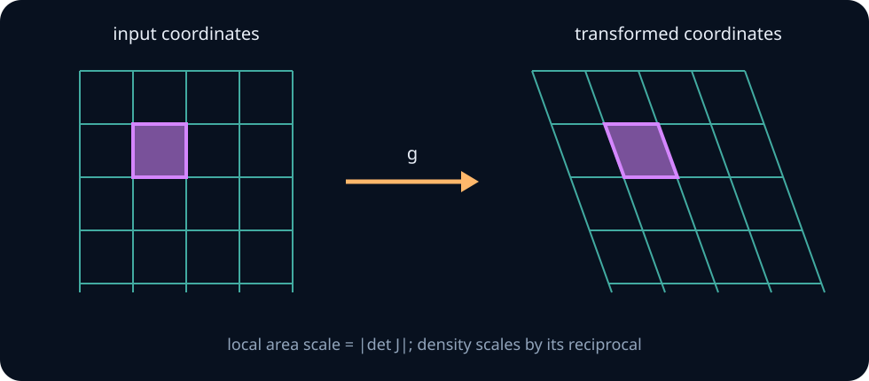

# Transformations, convolution, and Jacobians

Models constantly transform random quantities: logits become probabilities, base noise becomes generated samples, independent errors add, and coordinate systems change. Transforming values is easy to write as \(Y=g(X)\). Transforming the **distribution** requires accounting for which inputs reach each output and how the map stretches probability mass.

This unit develops that accounting from finite many-to-one maps through continuous Jacobian determinants. By the end, you should be able to derive transformed PMFs and densities, convolve independent variables, identify every inverse branch, and audit the log-determinant term in an invertible probabilistic model.

## 0. Three questions before calculating

For \(Y=g(X)\), ask:

1. What is the support of \(Y\)?
2. For a candidate \(y\), which inputs satisfy \(g(x)=y\)?
3. Does the map compress or expand nearby intervals or volumes?

The first prevents impossible outputs, the second prevents lost probability branches, and the third determines the derivative or determinant correction.

> **Practice — Foundation:** For each map—\(X^2\), \(e^X\), and \((X_1+X_2,X_1-X_2)\)—state whether it is one-to-one on all real inputs.
>
> **Hint:** Test each map on a pair of inputs: \(X^2\) sends \(1\) and \(-1\) to the same value, \(e^X\) is strictly increasing, and \(u=x_1+x_2,\ v=x_1-x_2\) can be solved uniquely as \(x_1=(u+v)/2,\ x_2=(u-v)/2\).
>
> **Practice — Core:** Before calculating, list the support, the preimage of the output value \(0.5\), and the input/output dimensions for \(Y=|X|\) with \(X\sim N(0,1)\), and for \(Y=X_1+X_2\) with \(X_1,X_2\) independent Uniform\((0,1)\).
>
> **Hint:** \(|x|=0.5\) has the two roots \(\pm0.5\); the preimage of \(0.5\) under the sum is the whole segment \(x_1+x_2=0.5\) inside the unit square, so that map goes from two dimensions to one.
>
> **Practice — Stretch:** For \(X\sim\text{Uniform}(-1,1)\) and \(Y=X^2\), derive \(f_Y(y)\) twice—by the CDF method and by the two-branch Jacobian formula—and confirm both give \(1/(2\sqrt y)\) on \((0,1]\). Then do the discrete analogue by a direct PMF sum for \(X\) uniform on \(\{-1,0,1\}\). Which route makes it hardest to forget a branch?
>
> **Hint:** CDF route: \(P(X^2\le y)=P(-\sqrt y\le X\le\sqrt y)=\sqrt y\). Jacobian route: each root \(\pm\sqrt y\) contributes \(f_X(\pm\sqrt y)\cdot\frac{1}{2\sqrt y}=\frac12\cdot\frac{1}{2\sqrt y}\).

### Local calculus bridge: gradients and Jacobians

The prerequisite [derivatives and gradients](../03-optimization/01-calculus-gradients-optimization.md) introduces scalar derivatives. For a differentiable map \(g:\mathbb R^d\to\mathbb R^k\), its Jacobian is the \(k\times d\) matrix \(J_g(x)_{ij}=\partial g_i/\partial x_j\). It gives the local linear approximation \(g(x+h)=g(x)+J_g(x)h+o(\|h\|)\). For scalar output, the gradient is the transpose of this row Jacobian. The chain rule is \(J_{f\circ g}(x)=J_f(g(x))J_g(x)\); checking the shapes prevents a transposed calculation.

For example, \(g(x_1,x_2)=(2x_1+x_2,x_2)\) has Jacobian \(\begin{pmatrix}2&1\\0&1\end{pmatrix}\). It doubles local area; its inverse halves area. A smooth local inverse requires a nonsingular square Jacobian at the point. A global density formula additionally needs a valid inverse branch on the support (or a sum over branches); a nonzero determinant at one point does not prove global invertibility.

For later likelihood lessons, the Hessian of a twice differentiable scalar function collects second partial derivatives. A Gaussian log likelihood \(\ell(\mu)=-\tfrac12(x-\mu)^T\Sigma^{-1}(x-\mu)+c\), with fixed positive-definite \(\Sigma\), has gradient \(\Sigma^{-1}(x-\mu)\) and Hessian \(-\Sigma^{-1}\). Differentiating an expectation is a separate step: support changes, lack of integrable domination, or boundary terms can invalidate moving a derivative inside an integral. State the relevant regularity assumptions instead of inferring them from the chain rule.

> **Practice — Foundation:** Give the Jacobian shape for a map from three inputs to two outputs.
>
> **Hint:** Each of the 2 outputs contributes one row and each of the 3 inputs one column, so the shape is \(2\times3\); such a matrix has no determinant.
>
> **Practice — Core:** For the affine example above, \(g(x_1,x_2)=(2x_1+x_2,\,x_2)\), write the inverse map, its Jacobian, and its determinant.
>
> **Hint:** Solve \(y_2=x_2\), \(y_1=2x_1+x_2\) for \(x\): \(x_1=(y_1-y_2)/2\). Check that the inverse Jacobian times \(\begin{pmatrix}2&1\\0&1\end{pmatrix}\) is the identity and its determinant is \(1/2\).
>
> **Practice — Stretch:** Explain why the scalar map x↦x² has a nonzero derivative at x=1 but is not globally invertible on the real line.
>
> **Hint:** Compute \(g(2)\) and \(g(-2)\): two different inputs share one output, even though \(g'(1)=2\ne0\) gives a local inverse near \(x=1\).

## 1. Discrete transformations add mass over preimages

For discrete \(X\),

$$
p_Y(y)=\sum_{x:g(x)=y}p_X(x).
$$

**Worked example — squaring a discrete variable.** Let \(X\) be uniform on \(\{-2,-1,0,1,2\}\) and \(Y=X^2\). Its support is \(\{0,1,4\}\). The preimages give

$$
P(Y=0)=\frac15,
\quad
P(Y=1)=P(X=-1)+P(X=1)=\frac25,
$$

and

$$
P(Y=4)=P(X=-2)+P(X=2)=\frac25.
$$

A tempting error is to assign \(1/3\) to each output merely because there are three possible values. Output values need not be equally likely.

<details><summary>Checkpoint: clipping collects mass</summary>

Let \(Y=\min(X,2)\). Every input value at least two maps to \(Y=2\), so \(P(Y=2)=P(X\ge2)\). Clipping creates a point mass at the boundary even if the original variable had several distinct values beyond it.

</details>

> **Practice — Foundation:** Let \(X\) take the values \(-2,-1,1,3\) with probabilities \(0.1,0.3,0.4,0.2\). Find the support and PMF of \(Y=X^2\) and check that the masses sum to one.
>
> **Hint:** Both \(-1\) and \(1\) map to \(1\), so \(P(Y=1)=0.3+0.4\); the other outputs \(4\) and \(9\) each have a single preimage.
>
> **Practice — Core:** For two independent fair dice, derive the PMF of \(Y=\max(X_1,X_2)\) by summing all preimages.
>
> **Hint:** There are \(k^2\) pairs with both dice \(\le k\) and \((k-1)^2\) pairs with both \(\le k-1\), so \(P(Y=k)=(k^2-(k-1)^2)/36\); check that the six values sum to one.
>
> **Practice — Stretch:** Write a function that takes a finite PMF (a dict from outcome to probability) and a map \(g\), and returns the PMF of \(g(X)\) by grouping inputs by output. Test it on \(X\) uniform on \(\{-2,-1,0,1,2\}\) with \(g(x)=x^2\) (expect \(\{0:0.2,1:0.4,4:0.4\}\)), and check that total mass is 1. Then apply it to the pair \(X=(X_1,X_2)\) with mass \(1/2\) on \((0.1,0.2)\) and \(1/2\) on \((0.3,0.0)\) and \(g(a,b)=a+b\): report how many atoms the naive version returns, and fix it.
>
> **Hint:** Accumulate with `out[y] = out.get(y, 0) + p`. In floating point `0.1 + 0.2 == 0.3` is `False`, so the naive version returns two atoms; rounding the keys (for example to 12 decimals) merges them into one atom at \(0.3\) with mass 1.

## 2. The CDF method works before density calculus

For any transformation, begin with

$$
F_Y(y)=P(g(X)\le y).
$$

Solve the inequality as an event about \(X\), then use the known distribution of \(X\). If the resulting CDF is differentiable, differentiate it to obtain a density.

**Worked example — square a uniform variable.** If \(X\sim\operatorname{Uniform}(0,1)\) and \(Y=X^2\), then \(0\le Y\le1\). For \(0\le y\le1\),

$$
F_Y(y)=P(X^2\le y)=P(X\le\sqrt y)=\sqrt y.
$$

Therefore

$$
f_Y(y)=\frac{1}{2\sqrt y},\qquad0<y<1.
$$

The density grows near zero because squaring compresses many small positive inputs into an even shorter output interval. The infinite height is integrable: its total area remains one.

> **Practice — Foundation:** For \(X\sim\text{Uniform}(0,1)\) and \(Y=\sqrt X\), express \(F_Y(y)\) as an event about \(X\).
>
> **Hint:** For \(0\le y\le1\), \(\sqrt X\le y\) is the same event as \(X\le y^2\) because squaring is increasing on \([0,1]\).
>
> **Practice — Core:** Use the CDF method to derive the distribution of \(Y=-\log X\) for a uniform \(X\). Track the support before differentiating.
>
> **Hint:** For \(y\ge0\), \(-\log X\le y\) is the same event as \(X\ge e^{-y}\); the support of \(Y\) is \([0,\infty)\), so differentiate \(1-e^{-y}\) only there.
>
> **Practice — Stretch:** For \(X\sim\text{Exponential}(1)\) and the decreasing map \(Y=e^{-X}\), apply the CDF method, mark the exact step where the inequality reverses, and identify the distribution of \(Y\).
>
> **Hint:** Since \(t\mapsto e^{-t}\) is decreasing, \(e^{-X}\le y\) is the event \(X\ge-\log y\) for \(0<y<1\); then use \(P(X\ge c)=e^{-c}\).

## 3. Monotone one-dimensional transformations

Let \(g\) be differentiable and strictly monotone. With \(x=g^{-1}(y)\), probability in corresponding small intervals must match:

$$
f_Y(y)\,dy\approx f_X(x)\,dx.
$$

Thus

$$
f_Y(y)
=f_X(g^{-1}(y))
\left|\frac{d}{dy}g^{-1}(y)\right|.
$$

The absolute value handles decreasing transformations. A density cannot become negative merely because the map reverses orientation.

### Affine transformation

For \(Y=aX+b\), \(a\ne0\),

$$
f_Y(y)=
f_X\!\left(\frac{y-b}{a}\right)\frac1{|a|}.
$$

The factor \(1/|a|\) is necessary: stretching the horizontal axis by \(|a|\) must shrink density height by the same factor to preserve area.

### Log transformation

For positive \(X\) and \(Y=\log X\), the inverse is \(x=e^y\) with derivative \(e^y\), so

$$
f_Y(y)=f_X(e^y)e^y.
$$

Equivalently, if \(Y\) is Gaussian then \(X=e^Y\) has a positive skewed distribution. Exponentiation changes both support and tail shape.

> **Practice — Foundation:** If \(X\sim\text{Uniform}(0,2)\) and \(Y=3X-4\), write the inverse, the derivative of the inverse, the transformed support, and the density of \(Y\).
>
> **Hint:** The inverse is \(x=(y+4)/3\) with \(|dx/dy|=1/3\); push the endpoints \(0\) and \(2\) through \(3x-4\) to find the support, and multiply the height \(1/2\) by \(1/3\).
>
> **Practice — Core:** For \(X\sim N(0,1)\), derive the density of \(Y=e^X\), including the positivity restriction, and evaluate \(f_Y(1)\) and \(f_Y(e)\) to three decimals.
>
> **Hint:** The inverse is \(x=\log y\) with \(dx/dy=1/y\) for \(y>0\), so \(f_Y(y)=\varphi(\log y)/y\) there and \(0\) for \(y\le0\); expect \(f_Y(1)=\varphi(0)\approx0.399\).
>
> **Practice — Stretch:** Let \(X\) have density \(2x\) on \([0,1]\) and \(Y=X^3\). Find \(f_Y\) and verify \(\int_0^1 f_Y(y)\,dy=1\) directly, then again by substituting \(y=x^3\) to show how the inverse-derivative factor cancels the coordinate change.
>
> **Hint:** The inverse is \(x=y^{1/3}\) with \(dx/dy=\tfrac13y^{-2/3}\), giving \(f_Y(y)=\tfrac23y^{-1/3}\); under \(y=x^3\), \(dy=3x^2\,dx\) cancels that factor exactly.

## 4. Non-injective maps require every inverse branch

If several regular input values map to \(y\),

$$
f_Y(y)=
\sum_{x:g(x)=y}\frac{f_X(x)}{|g'(x)|}.
$$

**Worked example — absolute value.** If \(X\sim\operatorname{Uniform}(-1,1)\) and \(Y=|X|\), then for \(0<y<1\), both \(x=y\) and \(x=-y\) contribute. Each branch has density \(1/2\) and derivative magnitude one, so

$$
f_Y(y)=\frac12+\frac12=1.
$$

Using only the positive branch would integrate to one half and immediately reveal lost mass.

**Worked example — square a standard Gaussian.** For \(Y=X^2\) and \(y>0\), the roots are \(\pm\sqrt y\), with derivative magnitude \(2\sqrt y\). Symmetry gives

$$
f_Y(y)
=\frac{f_X(\sqrt y)+f_X(-\sqrt y)}{2\sqrt y}
=\frac{1}{\sqrt{2\pi y}}e^{-y/2}.
$$

> **Practice — Foundation:** List every preimage of \(y=9\) under \(g(x)=x^2\) on the whole real line, and then under \(g\) restricted to the domain \([-1,\infty)\).
>
> **Hint:** Solve \(x^2=9\) to get both roots, then keep only the roots that lie inside the stated domain.
>
> **Practice — Core:** Derive the density of \(Y=|X|\) for a general continuous \(X\). Evaluate it at \(y=1\) for \(X\sim N(1,1)\), then simplify the formula when \(X\sim N(0,1)\).
>
> **Hint:** For \(y>0\) the roots are \(x=y\) and \(x=-y\), each with \(|dx/dy|=1\), so \(f_Y(y)=f_X(y)+f_X(-y)\); for \(N(1,1)\) at \(y=1\) this is \(\varphi(0)+\varphi(2)\).
>
> **Practice — Stretch:** For \(Y=X^3-X\), determine how many inverse branches exist in different output regions and outline how the density formula changes at turning points.
>
> **Hint:** Solve \(g'(x)=3x^2-1=0\) to get turning points \(\pm1/\sqrt3\) with critical values \(\mp2/(3\sqrt3)\approx\mp0.385\); count real roots of \(x^3-x=y\) inside and outside that interval, and note \(1/|g'|\) blows up at the turning points.

## 5. A multivariate Jacobian measures local volume change

Let \(Y=g(X)\) be a differentiable one-to-one map on \(\mathbb R^d\). The Jacobian matrix is

$$
J_g(x)=\left[\frac{\partial g_i}{\partial x_j}\right]_{ij}.
$$

Near \(x\), the map behaves like its linear approximation \(J_g(x)\). The absolute determinant measures the local volume scale.



The density rule is

$$
f_Y(y)
=f_X(g^{-1}(y))
\left|\det J_{g^{-1}}(y)\right|.
$$

Equivalently,

$$
\log f_Y(y)
=\log f_X(x)-\log|\det J_g(x)|,
\qquad y=g(x).
$$

The determinant is not generally the product of diagonal entries. That shortcut works for triangular or diagonal Jacobians, not arbitrary matrices.

> **Practice — Foundation:** Compute the Jacobian matrix and determinant of \(g(x_1,x_2)=(2x_1,3x_2)\).
>
> **Hint:** Differentiate each output with respect to each input: \(\partial(2x_1)/\partial x_2=0\) and \(\partial(3x_2)/\partial x_1=0\), so the matrix is diagonal.
>
> **Practice — Core:** For \(g(x_1,x_2)=(x_1+x_2,x_1-x_2)\), derive the inverse map and its absolute determinant.
>
> **Hint:** With \(u=x_1+x_2\) and \(v=x_1-x_2\), adding and subtracting gives \(x_1=(u+v)/2\) and \(x_2=(u-v)/2\); the forward determinant is \(-2\), so the inverse has absolute determinant \(1/2\).
>
> **Practice — Stretch:** Take \(g(x_1,x_2)=(x_1^2-x_2^2,\,2x_1x_2)\). Map the corners of the square \([a,a+h]\times[b,b+h]\) with \(h=10^{-3}\) at \((a,b)=(1,0),(1,1),(0.5,2)\), compute the image area with the shoelace formula, and compare the ratio area\(/h^2\) with \(|\det J_g(a,b)|\). Repeat at \((0,0)\) and explain what you see.
>
> **Hint:** \(|\det J_g|=4(x_1^2+x_2^2)\), so expect ratios near 4, 8 and 17 (off by about \(0.1\%\) since \(J\) varies across the square); at the origin the determinant is \(0\) and the ratio collapses to about \(2\times10^{-6}\).

## 6. Affine maps make the determinant visible

For invertible \(Y=AX+b\),

$$
f_Y(y)
=f_X(A^{-1}(y-b))\frac1{|\det A|}.
$$

**Worked example — shear and stretch.** Let

$$
A=\begin{bmatrix}2&1\\0&1\end{bmatrix}.
$$

Its determinant is two, so every small area doubles. The transformed density is

$$
f_Y(y_1,y_2)
=\frac12f_X\!\left(\frac{y_1-y_2}{2},y_2\right).
$$

The shear changes shape and orientation but not the determinant beyond the factor contributed by the stretch.

If \(A\) is singular, outputs lie in a lower-dimensional subspace. There is then no ordinary full-dimensional density, and dividing by a zero determinant is not a valid operation.

> **Practice — Foundation:** For \(Y=AX+b\) with \(A=\begin{pmatrix}2&1\\1&3\end{pmatrix}\) and \(b=(1,-1)\), by what factor does a unit square's area change, and what factor multiplies \(f_X(A^{-1}(y-b))\) in \(f_Y(y)\)?
>
> **Hint:** The Jacobian is \(A\) at every point, so compute \(|\det A|=2\cdot3-1\cdot1\) and divide the density by it; \(b\) only shifts and does not change volume.
>
> **Practice — Core:** Let \(X\) be uniform on the unit square and \(Y=AX\) with \(A=\operatorname{diag}(4,\,0.5)\). Give the support of \(Y\), its constant density, and verify that the density integrates to one.
>
> **Hint:** The inverse map is \((y_1/4,\,2y_2)\); the image is the rectangle \([0,4]\times[0,0.5]\) and the density is \(1/|\det A|=1/2\), so multiply by the area.
>
> **Practice — Stretch:** Let \(X\) be uniform on the unit square and \(A=\begin{pmatrix}1&2\\2&4\end{pmatrix}\). Show \(\det A=0\), describe the support of \(Y=AX\) as a segment, and give the density of \(Y_1=X_1+2X_2\) along it instead of a full two-dimensional density.
>
> **Hint:** Both rows are multiples of \((1,2)\), so \(Y_2=2Y_1\) always and \(Y\) lives on the segment from \((0,0)\) to \((3,6)\); \(Y_1\) is Uniform\((0,1)\) plus Uniform\((0,2)\), which gives a trapezoid density on \([0,3]\) with plateau \(1/2\).

## 7. Polar coordinates explain the radial factor

For

$$
x=r\cos\theta,
\qquad
y=r\sin\theta,
$$

the forward Jacobian is

$$
\frac{\partial(x,y)}{\partial(r,\theta)}
=\begin{bmatrix}
\cos\theta&-r\sin\theta\\
\sin\theta&r\cos\theta
\end{bmatrix},
$$

whose determinant is \(r\). Therefore

$$
dx\,dy=r\,dr\,d\theta.
$$

The factor \(r\) reflects geometry: a thin ring at large radius has greater area than one of the same thickness near the origin.

<details><summary>Checkpoint: why uniform radius is not uniform area</summary>

Sampling \(R\sim\operatorname{Uniform}(0,1)\) and a uniform angle puts too much probability near the centre of a disk. Uniform area requires \(P(R\le r)=r^2\), hence \(R=\sqrt U\) for uniform \(U\).

</details>

> **Practice — Foundation:** Compute the polar-coordinate Jacobian and explain geometrically why a thin angular wedge has area proportional to radius.
>
> **Hint:** Differentiate \(x=r\cos\theta,\ y=r\sin\theta\) with respect to \((r,\theta)\); the determinant simplifies with \(\cos^2\theta+\sin^2\theta=1\).
>
> **Practice — Core:** Start from the standard bivariate normal density \(\frac1{2\pi}e^{-(x^2+y^2)/2}\). Integrate over angle to derive the density of \(R=\sqrt{X^2+Y^2}\) and verify that it integrates to one.
>
> **Hint:** In polar coordinates the density is \(\frac1{2\pi}e^{-r^2/2}\) times the Jacobian \(r\); integrating \(\theta\) over \([0,2\pi)\) leaves \(re^{-r^2/2}\), and \(\int_0^\infty re^{-r^2/2}dr\) is done by substituting \(u=r^2/2\).
>
> **Practice — Stretch:** For the same standard bivariate normal, derive the density of \(S=R^2\) and compare it with \(f_R\) near zero: explain why \(f_R(0)=0\) while \(f_S(0)=1/2\).
>
> **Hint:** With \(r=\sqrt s\), \(dr/ds=1/(2\sqrt s)\); this cancels the factor \(r=\sqrt s\) in \(f_R\), leaving \(\tfrac12e^{-s/2}\) (Exponential with rate \(1/2\)).

## 8. Sums create convolution

Let \(S=X+Y\). For discrete variables,

$$
p_S(s)=\sum_xp_{X,Y}(x,s-x).
$$

If \(X\) and \(Y\) are independent,

$$
p_S(s)=\sum_xp_X(x)p_Y(s-x).
$$

For independent continuous variables,

$$
f_S(s)=\int_{-\infty}^{\infty}f_X(x)f_Y(s-x)\,dx.
$$

**Worked example — two fair dice.** Each die has PMF \(1/6\) on \(1,\ldots,6\). For a sum of seven, six products contribute, so

$$
P(S=7)=6\left(\frac16\frac16\right)=\frac16.
$$

For a sum of two, only \((1,1)\) contributes, giving \(1/36\). Convolution automatically captures the triangular shape of the sum distribution.

**Worked continuous example.** If \(X,Y\) are independent uniform variables on \([0,1]\), the integrand equals one where both \(0\le x\le1\) and \(0\le s-x\le1\). The overlap interval has length

$$
f_S(s)=
\begin{cases}
s,&0\le s\le1,\\
2-s,&1<s\le2,\\
0,&\text{otherwise}.
\end{cases}
$$

> **Practice — Foundation:** Let \(X\sim\text{Bernoulli}(0.3)\) and \(Y\sim\text{Bernoulli}(0.6)\) be independent. Convolve their PMFs to get the PMF of \(X+Y\) and identify its support.
>
> **Hint:** The sum \(1\) arises from \((1,0)\) or \((0,1)\): add \(0.3\cdot0.4\) and \(0.7\cdot0.6\). Check that the three masses sum to one.
>
> **Practice — Core:** Derive the triangular density for the sum of two independent uniform \((0,1)\) variables by finding the integration limits separately for each region.
>
> **Hint:** In \(f_S(s)=\int f(x)f(s-x)\,dx\) you need both \(0<x<1\) and \(0<s-x<1\), so \(x\) ranges over \((\max(0,s-1),\min(1,s))\); treat \(0<s\le1\) and \(1<s<2\) separately.
>
> **Practice — Stretch:** Let \(X\sim\text{Uniform}(0,1)\). Compare the law of \(S=X+Y\) for \(Y=X\) (perfect positive dependence), \(Y=1-X\) (perfect negative dependence) and \(Y\) independent of \(X\); all three have Uniform\((0,1)\) marginals. Give each law of \(S\) and its variance.
>
> **Hint:** \(Y=X\) gives \(S=2X\sim\text{Uniform}(0,2)\); \(Y=1-X\) gives \(S=1\) with certainty; independence gives the triangle on \([0,2]\). Use \(\operatorname{Var}S=\tfrac1{12}+\tfrac1{12}+2\operatorname{Cov}(X,Y)\).

## 9. Means and variances of sums

Linearity always gives

$$
E[X+Y]=E[X]+E[Y].
$$

Variance gives

$$
\operatorname{Var}(X+Y)
=\operatorname{Var}(X)+\operatorname{Var}(Y)
+2\operatorname{Cov}(X,Y).
$$

Independence makes covariance zero, but convolution of marginals requires the stronger independence statement, not merely zero covariance.

> **Practice — Foundation:** Let \(X_1,\dots,X_{25}\) be independent with common mean \(\mu=2\) and variance \(\sigma^2=4\). Compute the mean, variance and standard deviation of \(S=X_1+\dots+X_{25}\).
>
> **Hint:** Means add by linearity (no independence needed); under independence the variances add with no covariance terms, so \(\operatorname{Var}S=n\sigma^2\) and \(\operatorname{sd}S=\sqrt{n}\,\sigma\).
>
> **Practice — Core:** Derive \(\operatorname{Var}(X+Y)\) without assuming independence and identify the covariance contribution. Then evaluate it for \(\operatorname{Var}X=4\), \(\operatorname{Var}Y=9\), \(\operatorname{Cov}(X,Y)=-3\).
>
> **Hint:** Expand \(E[((X-\mu_X)+(Y-\mu_Y))^2]\); the cross term \(E[(X-\mu_X)(Y-\mu_Y)]\) appears twice, so the numerical answer is \(4+9+2(-3)\).
>
> **Practice — Stretch:** Let \(X\) and \(Y\) each be \(\pm1\) with probability \(1/2\). Give joint PMFs with \(\operatorname{Cov}(X,Y)=+1\), \(0\) and \(-1\), and compute \(\operatorname{Var}(X+Y)\) in each case. Why are \(\pm1\) the extremes?
>
> **Hint:** Covariance \(+1\) needs \(Y=X\), covariance \(-1\) needs \(Y=-X\), and independence gives 0; then \(\operatorname{Var}(X+Y)=1+1+2\operatorname{Cov}\). Cauchy–Schwarz bounds \(|\operatorname{Cov}|\le\operatorname{sd}X\,\operatorname{sd}Y=1\).

## 10. Why Jacobians appear in ML

- **Normalizing transformations:** an invertible map turns simple base noise into a richer distribution, with log density corrected by a log absolute determinant.
- **Reparameterization:** writing a sample as a deterministic transformation of parameter-free noise can expose differentiable parameter paths.
- **Constrained parameters:** exponentials and softmax-like maps move unconstrained values into positive or simplex-valued spaces, changing geometry and density.
- **Data preprocessing:** a nonlinear transform changes the implied model when predictions are converted back to original units.
- **Generated coordinates:** rotations, scaling, and projection can create singular output laws if dimensions collapse.

> **Practice — Foundation:** For the one-dimensional flow \(y=-3x+2\) with base \(x\sim N(0,1)\), give the inverse, the log-absolute-determinant term, and \(\log p_Y(2)\) to three decimals.
>
> **Hint:** The inverse is \(x=(y-2)/(-3)\), \(\log|dy/dx|=\log3\), and \(\log p_Y(y)=\log p_X(x)-\log3\); at \(y=2\), \(x=0\) and \(\log\varphi(0)=-0.919\).
>
> **Practice — Core:** Let \(Z\sim\text{Uniform}(0,1)\) and reparameterize \(W=2Z\): compute \(p_W(0.5)\) and compare it with \(p_Z(0.25)\). Then let a categorical label have \(P(a)=0.7\), \(P(b)=0.3\) and rename the labels \(a\leftrightarrow b\): what is the probability of the renamed outcome \(b\)? Explain why only the first case needs a Jacobian.
>
> **Hint:** A density is mass per unit length, so stretching by 2 halves it: \(p_W(w)=p_Z(w/2)\cdot\tfrac12\). A relabeling just moves each atom to a new name, and atom masses have no length to rescale.
>
> **Practice — Stretch:** A proposed one-dimensional flow layer is \(y=x^3\) with base \(x\sim N(0,1)\). Write \(\log p_Y(y)\), show that it diverges as \(y\to0\), and evaluate \(\log|dy/dx|\) and \(\log p_Y(y)\) at \(y=10^{-12}\). What does this mean for likelihood training and evaluation?
>
> **Hint:** \(dy/dx=3x^2\) vanishes at \(x=0\), so \(\log|\det|=\log(3x^2)\to-\infty\) and subtracting it drives \(\log p_Y\to+\infty\); at \(y=10^{-12}\), \(x=10^{-4}\) and \(\log(3\times10^{-8})\approx-17.3\).

## 11. Normalizing flows: the change of variables becomes a model

Every ingredient of a modern density model is already on this page. A normalizing flow is nothing more than the multivariate change-of-variables formula, applied deliberately and stacked.

**The construction.** Take a simple base density — a standard Gaussian \(p_Z\) — and an invertible, differentiable map \(f\) with \(x=f(z)\). The transformed density follows immediately from the Jacobian rule derived above:

$$
p_X(x)=p_Z\bigl(f^{-1}(x)\bigr)\,\left|\det\frac{\partial f^{-1}}{\partial x}\right| ,
$$

or, more usefully for fitting,

$$
\log p_X(x)=\log p_Z\bigl(f^{-1}(x)\bigr)+\log\left|\det\frac{\partial f^{-1}(x)}{\partial x}\right| .
$$

This is an **exact** log-likelihood, not a bound and not an approximation. You can train it by plain maximum likelihood, evaluate it on held-out data, and compare models by a real number — which is precisely what variational and energy-based approaches cannot do.

**Composition.** Invertible maps compose, and determinants multiply, so for \(f=f_K\circ\cdots\circ f_1\),

$$
\log p_X(x)=\log p_Z(z)+\sum_{k=1}^K\log\left|\det\frac{\partial f_k^{-1}}{\partial u_k}\right| .
$$

Depth costs a sum of log-determinants. That is the whole design problem.

**The determinant is the bottleneck.** A general \(d\times d\) determinant costs \(O(d^3)\), which is impossible at image or audio scale. Every flow architecture is an answer to "how do I get an expressive invertible map whose Jacobian determinant is cheap?" Two answers dominate:

- **Triangular Jacobians.** If output coordinate \(i\) depends only on input coordinates \(\le i\), the Jacobian is triangular and its determinant is the product of the diagonal — \(O(d)\). Autoregressive flows are built exactly this way.
- **Coupling layers.** Split \(z=(z_a,z_b)\). Leave \(z_a\) untouched and transform \(z_b\) by an affine map whose scale and shift are arbitrary functions of \(z_a\):

$$
x_a=z_a,
\qquad
x_b=z_b\odot\exp\bigl(s(z_a)\bigr)+t(z_a).
$$

The Jacobian is block-triangular with identity in one block, so

$$
\log\left|\det\frac{\partial x}{\partial z}\right|=\sum_i s_i(z_a),
$$

a plain sum of network outputs. The functions \(s\) and \(t\) may be arbitrarily complex neural networks — they are never inverted — while the layer as a whole stays exactly invertible. Alternating which half is transformed lets information mix.

**Worked example — one affine coupling step.** Let \(d=2\), \(z=(1.0,\,2.0)\), \(s(z_a)=0.5z_a\) and \(t(z_a)=z_a\). Then \(x_a=1.0\) and

$$
x_b=2.0\cdot e^{0.5}+1.0\approx2.0\times1.6487+1.0=4.297 ,
$$

with \(\log|\det|=s(z_a)=0.5\). Inverting requires only \(z_b=(x_b-t(x_a))e^{-s(x_a)}\), using \(x_a=z_a\) — no network inversion anywhere.

**What flows cost.** Invertibility forces the latent space to have the **same dimension** as the data, so a flow cannot compress; and the requirement that every layer be invertible constrains architecture far more than a free-form decoder. That is the trade: exact likelihoods and exact inversion in exchange for dimension preservation and architectural restriction.

**Where else the same formula appears.** The instantaneous version of this identity — \(d\log p/dt=-\nabla\cdot f\) along a continuous flow — is what gives deterministic diffusion samplers an exact likelihood, and the discrete version here is the reason a Jacobian term shows up whenever a model reparameterizes its outputs. It is worth noticing that a change of variables is not a trick specific to flows; it is the single rule that governs how a density behaves under any invertible transformation, including the ones you apply during data preprocessing. Standardizing, log-transforming, or rescaling targets all change the density by a Jacobian factor, which is why likelihoods computed in different units are not comparable.

> **Practice — Foundation:** Apply the coupling formula to \(z=(2.0,\,3.0)\) with \(s(z_a)=-0.5z_a\) and \(t(z_a)=1\), and report both \(x\) and the log-determinant.
>
> **Hint:** The first coordinate passes through: \(x_a=z_a=2.0\). Then \(s=-1.0\) and \(t=1\), so \(x_b=3.0\,e^{-1}+1\), and the log-determinant is \(s(z_a)\) itself.
>
> **Practice — Core:** For \(d=2\) with \(s(z_a)=0.5z_a\) and \(t(z_a)=z_a\) (the worked example), write the full \(2\times2\) Jacobian of the coupling layer, show it is lower-triangular with determinant \(e^{0.5z_a}\), and write the exact inverse. Check that the inverse sends \(x=(1.0,\,4.297)\) back to \(z=(1.0,\,2.0)\).
>
> **Hint:** \(\partial x_a/\partial z_b=0\) makes the matrix triangular, so only the diagonal entries \(1\) and \(e^{s(z_a)}\) matter; the off-diagonal \(\partial x_b/\partial z_a\) can be anything. Invert with \(z_b=(x_b-t(x_a))e^{-s(x_a)}\).
>
> **Practice — Stretch:** A team compares a flow trained on raw pixel values in \([0,255]\) with one trained on values scaled to \([0,1]\), for \(32\times32\times3\) images, and reports that the second has far better log-likelihood. Explain the discrepancy quantitatively using the Jacobian of the rescaling, compute the gap in nats per image, and state the correction that makes the numbers comparable.
>
> **Hint:** Scaling each of \(d=3072\) coordinates by \(1/255\) multiplies the density by \(255^d\), so log density rises by \(d\log255\approx3072\times5.541\) nats with no change in the model.

## 12. Runnable lab: discrete convolution

Implement `discrete_convolution` in [labs/exercises.py](../../labs/exercises.py). Each input maps a finite numeric value to a nonnegative, possibly unnormalized weight. Return the normalized PMF of the sum of two independent draws.

Run:

```text
python -m labs.checks convolution
```

The checks require scale invariance, sparse and overlapping sums, input preservation, and rejection of invalid distributions.

### Mini-experiment

Convolve a fair-die PMF with itself repeatedly. After each addition, record the standardized sum distribution. Plot it and describe what changes in support, centre, spread, and shape. Do not invoke a limiting theorem yet; this experiment motivates the next unit.

## 13. Derivations to own

1. Derive a discrete transformed PMF from preimages.
2. Derive \(Y=X^2\) for positive uniform \(X\) using the CDF method.
3. Derive the monotone density rule from interval probability.
4. Derive the many-branch rule and check normalization.
5. Compute the affine Jacobian density correction.
6. Derive the polar-coordinate factor \(r\).
7. Derive discrete and continuous convolution from a joint law.
8. Explain why zero covariance is insufficient for convolution of marginals.

## Prediction experiment

Predict both the baseline and failure-preset results before revealing the calculation. Record the assumptions, change one control at a time, and explain the boundary case. This small deterministic model isolates a mechanism; it is not an empirical validation of a trained system.

```lab
lab: ps-transform
```

## 14. End-of-unit practice (graded)

Work each problem before opening its authored solution. Written proofs and design answers require self-review against the rubric; numeric fields check only the stated quantities.


### Foundation — problems 1–3. Track support, preimages, and one-dimensional probability correctly.

**A1 · Foundation · paper — Cumulative problem 1.** Let \(P(X=-2,-1,0,1,2)=(0.1,0.2,0.4,0.2,0.1)\) and \(Y=X^2\). Derive the complete PMF of \(Y\), state its support, and verify mass conservation.

**A2 · Foundation · paper — Cumulative problem 2.** If \(X\sim\operatorname{Uniform}(0,1)\), derive the density of \(Y=-\log X\).

**A3 · Foundation · paper — Cumulative problem 3.** If \(X\) has density \(2x\) on \([0,1]\), derive the density of \(Y=X^2\).

### Core — problems 4–8. Combine inverse branches, determinants, coordinate systems, and convolution.

**A4 · Core · paper — Cumulative problem 4.** Derive the distribution of \(|X|\) for a symmetric density \(f_X\). Apply it to the Laplace density \(f_X(x)=\tfrac12e^{-|x|}\): name the distribution of \(|X|\) and compute \(P(|X|>2)\).

**A5 · Core · paper — Cumulative problem 5.** Transform a uniform point in the unit square by \(A=\begin{bmatrix}3&1\\0&2\end{bmatrix}\); find its support area and density.

**A6 · Core · paper — Cumulative problem 6.** Derive a uniform-area sampler for the unit disk using two independent Uniform\((0,1)\) variables \(U,V\). Check your sampler by computing \(P(R\le 1/2)\), which must equal the area fraction \(1/4\), and explain why \(R=U\) would fail this check.

**A7 · Core · paper — Cumulative problem 7.** Let \(X_1,X_2\) be independent Bernoulli\((p)\). Convolve their PMFs to obtain the PMF of \(X_1+X_2\), identify it as the binomial PMF for two trials, and evaluate it at \(p=0.3\).

**A8 · Core · paper — Cumulative problem 8.** Convolve two uniform \([0,1]\) densities and verify the result integrates to one.

### Stretch — problems 9–12. Diagnose dependence, density bookkeeping, and transformations used in models.

**A9 · Stretch · paper — Cumulative problem 9.** Let \(X\sim\text{Bernoulli}(1/2)\). For each of \(Y=X\), \(Y=1-X\), and \(Y\) an independent Bernoulli\((1/2)\), give the PMF of \(X+Y\). All three pairs have the same marginals; show that the independent convolution formula is correct only for the last one.

**A10 · Stretch · paper — Cumulative problem 10.** Let \(x\sim N(0,1)\) and \(y=g(x)=3x\). Compute \(\log p_Y(3)\) directly from \(Y\sim N(0,9)\), then again as \(\log p_X(g^{-1}(y))-\log|\det J_g|\). Use the agreement to explain the sign and placement of the log-determinant term.

**A11 · Stretch · paper — Cumulative problem 11.** Derive the density of the product \(Z=XY\) for independent uniform \((0,1)\) variables. Choose and justify either a CDF, conditioning, or multivariate-transformation route.

**A12 · Stretch · paper — Cumulative problem 12.** A learned transformation is locally linear with Jacobian \(A=\begin{bmatrix}1&1\\1&1+\varepsilon\end{bmatrix}\), \(\varepsilon=10^{-6}\): invertible in theory, with one singular value near zero. (a) Compute \(\det A\), both singular values, and the condition number. (b) With NumPy seed 0, draw 1000 points \(x\sim N(0,I_2)\), form \(y=Ax\), recover \(\hat x\) with `np.linalg.solve` in float64 and in float32, and report the maximum round-trip error \(\max|\hat x-x|\) for each. (c) Compare \(\log|\det A|\) from `slogdet` in both precisions with the exact \(\log\varepsilon\). State which of these checks you would run on a real flow.


## Six-part checkpoint

Complete these without notes, then use the solutions to audit assumptions and reasoning. Passing a numeric check alone does not establish mastery. For implementation and transfer, retain the code/results or written protocol as evidence.

**K1 · Foundation · gate — Concept.** Why is an absolute Jacobian determinant needed?

**K2 · Core · gate — Derivation.** Derive the density of Y=aX+b for nonzero a.

**K3 · Core · gate — Calculation.** For X uniform on [0,1], find the density height of Y=−4X+2 on its support.

**K4 · Core · gate — Implementation audit.** Reproduce two settings of the ps-transform experiment independently, including its failure preset. State a numerical invariant or analytic oracle and explain what the plot does not establish.

**K5 · Stretch · gate — Claim audit.** Can the invertible transformation formula be applied directly to Y=X² on the whole real line?

**K6 · Stretch · gate — RE/RS transfer.** Specify checks for a normalizing-flow log-density implementation.

## Mastery check

Given an unfamiliar transformation, determine its output support and inverse branches, derive its distribution using both a CDF and Jacobian where possible, verify normalization, and validate it by simulation. Given two finite PMFs, convolve them by hand and with code while stating exactly where independence is used.

Next: [multivariate Gaussian geometry and conditioning](04-multivariate-gaussian-geometry.md).
