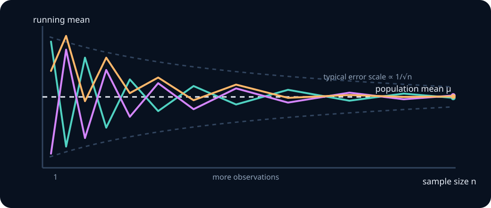
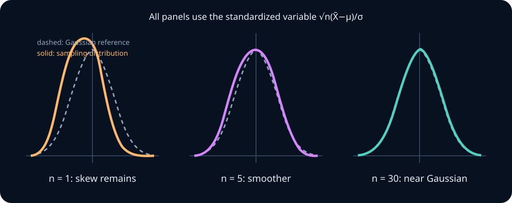
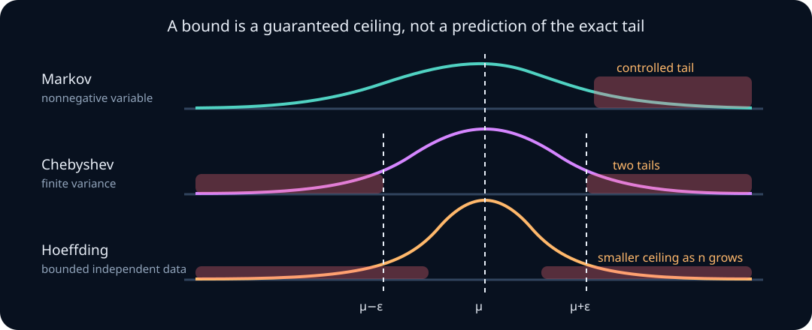
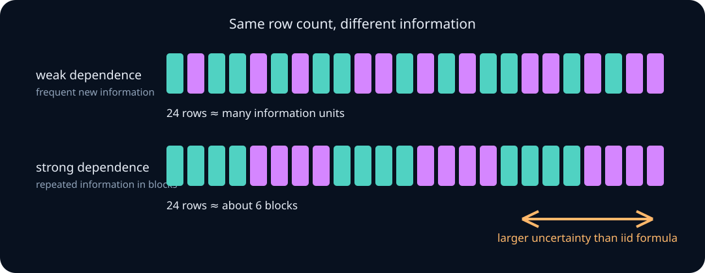

# Repeated samples, limit theorems, and Monte Carlo error

A single random observation can be noisy. An average of many observations is often more stable. That simple fact powers benchmark averages, simulation, minibatch gradients, polling, randomized algorithms, and empirical research—but several different mathematical ideas hide inside it.

This unit separates them:

- a **law of large numbers** says an average approaches its target;
- a **central limit theorem** describes the approximate shape and scale of its random error;
- a **concentration inequality** gives a finite-sample ceiling on the chance of a large error;
- a **Monte Carlo standard error** estimates the remaining simulation noise;
- heavy tails and dependence explain why blindly using an iid square-root rule can be dangerously optimistic.

By the end, you should be able to derive the variance of an average, distinguish convergence concepts, standardize a sample mean, decide when a Gaussian approximation is plausible, choose and interpret a concentration bound, estimate Monte Carlo error, and repair uncertainty calculations when observations arrive in correlated clusters.

## 0. The repeated-sampling mental model

Let \(X_1,\ldots,X_n\) be observations produced by repeating an experiment. The sample mean is

$$
\bar X_n=\frac1n\sum_{i=1}^n X_i.
$$

There are three layers to keep separate:

1. The population or simulation model gives each \(X_i\) a distribution with mean \(\mu\).
2. One realized dataset gives one numerical value of \(\bar X_n\).
3. Repeating the entire dataset-generation process gives a **sampling distribution** for \(\bar X_n\).

The third layer is easy to miss. An estimator is a function of random data, so before data are observed it is itself a random variable.

**Worked example — accuracy across repeated test sets.** Suppose a fixed classifier has probability \(p=0.7\) of answering a randomly drawn benchmark item correctly. Encode correctness as \(X_i\in\{0,1\}\). A test set of 100 items produces one accuracy \(\bar X_{100}\). If we independently draw 1,000 new test sets, we obtain 1,000 different accuracies. Their histogram approximates the sampling distribution of \(\bar X_{100}\); it is not the distribution of individual correctness values.

> **Practice — Foundation:** Identify the experiment, observation, estimator, and target when estimating a model's success probability from 200 independently sampled prompts.
>
> **Practice — Core:** Describe a simulation that approximates the sampling distribution of a five-die average. Explain the two nested repetitions.
>
> **Practice — Stretch:** A report bootstraps rows from one fixed dataset. Explain why that resampling distribution is conceptually different from repeatedly drawing fresh datasets from the unknown population.

## 1. Why averaging reduces variance

Assume initially that \(X_1,\ldots,X_n\) are independent and identically distributed—**iid**—with

$$
E[X_i]=\mu,\qquad \operatorname{Var}(X_i)=\sigma^2<\infty.
$$

Linearity of expectation gives

$$
E[\bar X_n]
=\frac1n\sum_{i=1}^nE[X_i]
=\mu.
$$

Independence makes all cross-covariances zero, so

$$
\operatorname{Var}(\bar X_n)
=\frac1{n^2}\sum_{i=1}^n\operatorname{Var}(X_i)
=\frac{\sigma^2}{n}.
$$

Therefore

$$
\operatorname{SD}(\bar X_n)=\frac{\sigma}{\sqrt n}.
$$

This is the square-root law: multiplying the sample size by four halves the standard deviation of the mean. Multiplying it by one hundred divides that standard deviation by ten.

The paths in the diagram do not have to move steadily toward \(\mu\). New observations can temporarily move an average away. Stability is a statement about the shrinking distribution of error, not monotone progress along every realized path.

**Worked example — Bernoulli accuracy.** If \(X_i\sim\operatorname{Bernoulli}(0.7)\), then \(\sigma^2=p(1-p)=0.21\). At \(n=100\), the standard deviation of observed accuracy across independent test sets is

$$
\sqrt{\frac{0.21}{100}}\approx0.0458.
$$

At \(n=10{,}000\), it is approximately \(0.00458\). One extra decimal place of stability costs roughly one hundred times as many independent items.

> **Practice — Foundation:** Derive the mean and variance of an average of 25 iid variables with mean 4 and variance 9.
>
> **Practice — Core:** Two independent estimates use \(n\) and \(9n\) observations. Compare their standard deviations and the widths of equally calibrated error bars.
>
> **Practice — Stretch:** Derive the variance of a weighted average \(\sum_iw_iX_i\) for independent observations. Under the constraint \(\sum_iw_i=1\) and equal variances, show why equal weights minimize variance.

## 2. Convergence in probability and the weak law

A sequence of random variables \(Y_n\) converges **in probability** to a constant \(c\) if, for every tolerance \(\varepsilon>0\),

$$
P(|Y_n-c|>\varepsilon)\longrightarrow0
\qquad\text{as }n\to\infty.
$$

Write this as \(Y_n\xrightarrow{P}c\).

The weak law of large numbers states, under common conditions such as iid observations with finite mean,

$$
\bar X_n\xrightarrow{P}\mu.
$$

Translate the symbols into a sentence: choose any fixed error tolerance, however small. The probability that the sample mean misses the population mean by more than that tolerance eventually becomes arbitrarily small.

The weak law does **not** say:

- \(\bar X_n=\mu\) for a finite \(n\);
- error decreases on every step of a realized run;
- all distributions converge at the same speed;
- a dataset with dependent or shifting observations behaves as if it were iid.

**Worked example — interpreting the event.** Let \(X_i\) be response latency with mean \(200\) ms. Setting \(\varepsilon=10\) ms makes the deviation event

$$
\{|\bar X_n-200|>10\}.
$$

The law says the probability of this event vanishes with \(n\); it does not supply a usable sample size by itself.

> **Practice — Foundation:** Write in words what \(\bar X_n\xrightarrow{P}\mu\) means for a fixed \(\varepsilon=0.01\).
>
> **Practice — Core:** Give a numerical sequence of realized running means that moves away from \(\mu\) several times but still approaches it. Explain why this does not contradict convergence.
>
> **Practice — Stretch:** Construct random variables \(Y_n\) that equal 1 with probability \(1/n\) and 0 otherwise. Prove convergence in probability to zero and discuss whether any single realization must be eventually zero.

## 3. A weak-law proof from Chebyshev's inequality

Chebyshev's inequality says that any random variable \(Y\) with finite variance obeys

$$
P(|Y-E[Y]|\ge\varepsilon)
\le
\frac{\operatorname{Var}(Y)}{\varepsilon^2}.
$$

Apply it to the iid sample mean:

$$
P(|\bar X_n-\mu|\ge\varepsilon)
\le
\frac{\sigma^2}{n\varepsilon^2}.
$$

For fixed \(\sigma^2\) and \(\varepsilon>0\), the right side approaches zero. This proves a finite-variance version of the weak law.

Notice the proof's architecture:

1. show the estimator is centered at the target;
2. show its variance shrinks;
3. convert shrinking variance into shrinking deviation probability.

That template reappears throughout statistics and learning theory.

**Worked example — a valid but loose guarantee.** Suppose \(\sigma^2=4\), \(n=1{,}000\), and the tolerance is \(0.2\). Chebyshev gives

$$
P(|\bar X_n-\mu|\ge0.2)
\le\frac{4}{1000(0.2)^2}=0.1.
$$

The true probability might be far smaller. An inequality is a guaranteed ceiling under its assumptions, not an estimate of the actual tail probability.

> **Practice — Foundation:** Use Chebyshev to bound \(P(|\bar X_n-\mu|\ge0.5)\) when \(\sigma^2=9\) and \(n=400\).
>
> **Practice — Core:** Solve \(\sigma^2/(n\varepsilon^2)\le\delta\) for \(n\). Interpret the resulting sample-size requirement.
>
> **Practice — Stretch:** Repeat the proof for independent but non-identically distributed variables with common mean and variances bounded by \(V\). Identify the precise step where independence is used.

## 4. Almost-sure convergence and the strong law

Convergence in probability asks about the deviation probability separately at each \(n\). **Almost-sure convergence** asks about an entire infinite sample path:

$$
P\!\left(\lim_{n\to\infty}\bar X_n=\mu\right)=1.
$$

Write \(\bar X_n\xrightarrow{\text{a.s.}}\mu\). Under standard iid finite-mean assumptions, the strong law of large numbers gives this stronger conclusion.

A useful mental picture is:

- weak law: at a large chosen time, most paths are close;
- strong law: with probability one, a whole path eventually stays within every fixed tolerance.

“Almost surely” still allows an exceptional set of paths, but that set has probability zero. Probability zero is not the same logical statement as impossibility; a continuous variable taking one exact value is the familiar example.

We will use the strong law as a theorem rather than prove it here. Its proof requires tools beyond the finite-variance Chebyshev argument above.

> **Practice — Foundation:** State the difference between convergence in probability and almost-sure convergence without using the phrase “stronger convergence.”
>
> **Practice — Core:** Draw or describe three infinite paths where most are close at every large fixed \(n\), then explain what additional pathwise behavior almost-sure convergence requires.
>
> **Practice — Stretch:** Explain why a probability-one statement about an infinite sequence cannot generally be verified by observing one very long finite prefix.

## 5. Sampling distributions and standard error

The **standard error** of an estimator is the standard deviation of its sampling distribution. For an iid mean with known variance,

$$
\operatorname{SE}(\bar X_n)=\frac{\sigma}{\sqrt n}.
$$

Usually \(\sigma\) is unknown. The sample variance

$$
s^2=\frac1{n-1}\sum_{i=1}^n(X_i-\bar X_n)^2
$$

produces the estimated standard error

$$
\widehat{\operatorname{SE}}(\bar X_n)=\frac{s}{\sqrt n}.
$$

Keep three quantities distinct:

- \(s\) describes spread among individual observations;
- \(s/\sqrt n\) estimates spread among repeated sample means;
- \(|\bar X_n-\mu|\) is the unknown realized error in this particular sample.

A standard error is not the realized error and does not guarantee that the target lies within one standard error.

**Worked example — seed-to-seed variation.** Five independent training runs produce evaluation scores \(0.71,0.75,0.69,0.74,0.76\). Their mean is \(0.73\). The sample standard deviation is about \(0.029\), so the estimated standard error of the five-run mean is about \(0.013\). Reporting \(0.73\pm0.029\) describes run spread; reporting a multiple of \(0.013\) addresses uncertainty in the average under an iid-run model.

> **Practice — Foundation:** Explain the difference between standard deviation and standard error for 100 observed losses.
>
> **Practice — Core:** Compute the sample standard deviation and estimated standard error for \(2,4,4,6\). Then predict how the standard error changes if the same distribution is sampled 16 times.
>
> **Practice — Stretch:** A paper reports a tiny standard error over one million tokens from only four independently trained models. Identify two possible observational units and explain which target each uncertainty calculation would address.

## 6. The central limit theorem

The iid central limit theorem says that if \(X_i\) have mean \(\mu\) and finite, positive variance \(\sigma^2\), then

$$
Z_n=
\frac{\sqrt n(\bar X_n-\mu)}{\sigma}
\xrightarrow{d}\mathcal N(0,1).
$$

Convergence in distribution means the CDF of \(Z_n\) approaches the standard Gaussian CDF at its continuity points.

The standardization performs three jobs:

1. subtract \(\mu\) to center the error at zero;
2. multiply by \(\sqrt n\) so the shrinking error remains visible;
3. divide by \(\sigma\) to express error in standard-deviation units.

Undoing the standardization gives the approximation

$$
\bar X_n\approx
\mathcal N\!\left(\mu,\frac{\sigma^2}{n}\right)
$$

for sufficiently large \(n\). The CLT describes the distribution of the average, not necessarily the distribution of the original \(X_i\). Highly non-Gaussian observations can still produce an approximately Gaussian mean.

If the observations themselves are Gaussian, the sample mean is exactly Gaussian for every \(n\); no approximation or large-sample argument is needed.

> **Practice — Foundation:** Standardize a sample mean of iid variables when \(n=64\), \(\mu=10\), and \(\sigma=4\).
>
> **Practice — Core:** Starting from the standardized CLT, derive the approximate distribution of the sum \(S_n=\sum_iX_i\).
>
> **Practice — Stretch:** Explain why the unscaled error \(\bar X_n-\mu\) converges to zero while the scaled error \(\sqrt n(\bar X_n-\mu)\) can converge to a non-degenerate distribution.

## 7. Using a Gaussian approximation carefully

Suppose \(X_i\sim\operatorname{Bernoulli}(p)\). Then

$$
\bar X_n\approx\mathcal N\!\left(p,\frac{p(1-p)}n\right).
$$

**Worked example — unusually high observed accuracy.** Let \(p=0.72\) and \(n=200\). The standard deviation of the accuracy is

$$
\sqrt{\frac{0.72(0.28)}{200}}\approx0.03175.
$$

An observed accuracy of \(0.78\) is approximately

$$
z=\frac{0.78-0.72}{0.03175}\approx1.89
$$

standard deviations above the target. A standard Gaussian upper tail beyond \(1.89\) is about \(0.029\).

But accuracy is a discrete count divided by \(n\). The event \(\bar X_n\ge0.78\) means at least 156 successes. A continuity correction approximates this count event using boundary \(155.5\):

$$
z_{\text{cc}}
=\frac{155.5-200(0.72)}{\sqrt{200(0.72)(0.28)}}
\approx1.81.
$$

The correction respects that the continuous approximation is standing in for discrete probability bars.

Do not turn “\(n\ge30\)” into a law. Approximation quality depends on skewness, discreteness, tails, and the event being approximated. For Bernoulli sums, checking whether both \(np\) and \(n(1-p)\) are reasonably large is more informative than checking \(n\) alone.

> **Practice — Foundation:** For \(p=0.5,n=100\), compute the mean and standard deviation of the success count and of the observed proportion.
>
> **Practice — Core:** Approximate \(P(\bar X_n\le0.4)\) for \(p=0.5,n=100\), first without and then with a continuity correction.
>
> **Practice — Stretch:** Compare exact binomial and Gaussian-approximation tail probabilities over several \(p,n\) pairs. Find a case where the center is approximated well but an extreme tail is not.

## 8. When the ordinary CLT approximation fails

The theorem has assumptions, and the approximation has a regime.

- **Too little averaging:** small \(n\) can preserve skewness, gaps, and multimodality.
- **Rare events:** a large \(n\) is not enough when \(np\) remains small.
- **Extreme tails:** convergence near the center can be much better than far into a tail.
- **Infinite variance:** the usual \(\sqrt n\) scaling and Gaussian limit may fail.
- **Dependence:** correlated observations change the variance and sometimes the limit.
- **Nonstationarity:** if distributions shift with \(i\), there may be no single stable \(\mu\).
- **Selection:** stopping or reporting based on observed results changes the relevant distribution.

**Worked example — rare errors.** Let an independent request fail with probability \(p=0.002\), and observe \(n=100\) requests. Although \(n\) sounds moderately large, \(np=0.2\). The exact probability of zero failures is

$$
(1-0.002)^{100}\approx0.819.
$$

The count distribution has a large point mass at zero and strong right skew. A Gaussian approximation centered at \(0.2\) cannot represent this shape well. A Poisson approximation with rate \(0.2\) is much more natural.

> **Practice — Foundation:** For a Bernoulli sum, calculate \(np\) and \(n(1-p)\) at \(n=1{,}000,p=0.001\) and assess a Gaussian approximation.
>
> **Practice — Core:** Give one example for each failure category above and state which part of the standard CLT argument becomes doubtful.
>
> **Practice — Stretch:** Simulate means from a heavy-tailed distribution at growing sample sizes. Compare their sampling histograms with those from a finite-variance distribution and explain why “more data” can look erratic for a long time.

## 9. Monte Carlo estimation is expectation by sampling

Suppose a target can be written

$$
\theta=E[h(X)]
$$

but the expectation is difficult to compute analytically. Draw \(X_1,\ldots,X_n\) and use

$$
\hat\theta_n=\frac1n\sum_{i=1}^nh(X_i).
$$

This is Monte Carlo estimation. It is just a sample mean applied to the transformed variable \(h(X)\).

For an event \(A\), choose the indicator \(h(X)=\mathbf1\{X\in A\}\). Then

$$
\theta=P(X\in A),
\qquad
\hat\theta_n=\frac{\text{number of simulated hits}}n.
$$

If the draws are iid, the estimator is unbiased and

$$
\operatorname{Var}(\hat\theta_n)
=\frac{\operatorname{Var}(h(X))}{n}.
$$

**Worked example — estimating a rare event.** To estimate \(P(S\ge25)\) for a complicated random sum \(S\), simulate \(S_i\) and average \(I_i=\mathbf1\{S_i\ge25\}\). If 48 of 100,000 simulations hit, then \(\hat p=0.00048\). The plug-in standard error is approximately

$$
\sqrt{\frac{\hat p(1-\hat p)}n}
\approx0.000069.
$$

Only 48 effective hits support the estimate. The large total draw count should not create false confidence about a very small tail probability.

> **Practice — Foundation:** Write an indicator-based Monte Carlo estimator for \(P(g(X)>t)\).
>
> **Practice — Core:** Derive the variance of the event-probability estimator and find its worst case over \(p\in[0,1]\).
>
> **Practice — Stretch:** Design a paired Monte Carlo comparison of two systems using the same random inputs. Derive why estimating the mean paired difference can have lower variance than subtracting two independent estimates.

## 10. Planning and monitoring Monte Carlo error

For iid draws with finite variance, a rough large-sample error bar is

$$
\hat\theta_n\pm z\,\frac{s_h}{\sqrt n},
$$

where \(s_h\) is the sample standard deviation of \(h(X_i)\) and \(z\) is a chosen Gaussian multiplier such as \(1.96\).

To target standard error at most \(r\), the idealized sample-size equation is

$$
n\ge\frac{\sigma_h^2}{r^2}.
$$

Because \(\sigma_h^2\) is unknown, use a pilot run or a conservative bound. For an indicator, \(p(1-p)\le1/4\), so

$$
n\ge\frac{1}{4r^2}
$$

guarantees the target standard-error scale under independent sampling. Achieving \(r=0.001\) can therefore require up to 250,000 draws.

**Stopping caution.** If you inspect estimates repeatedly and stop precisely when an ordinary interval first excludes an inconvenient value, its nominal coverage no longer applies automatically. A fixed sample size, a predeclared precision rule with appropriate sequential analysis, or an untouched confirmation run makes the inferential target clearer.

Also separate Monte Carlo error from model error. A billion flawless simulations can estimate the wrong probability extremely precisely if the simulator is misspecified.

> **Practice — Foundation:** Under the worst-case Bernoulli variance, calculate the sample size needed for standard error at most \(0.005\).
>
> **Practice — Core:** A pilot run estimates \(\sigma_h=12\). Determine the approximate draw count required to halve the current standard error.
>
> **Practice — Stretch:** Design a simulation report that separates random-number seed, Monte Carlo standard error, numerical error, and simulator misspecification.

## 11. Concentration inequalities give finite-sample ceilings

Limit theorems describe behavior as \(n\) grows. Concentration inequalities provide statements valid at a particular finite \(n\).

**Markov's inequality.** For nonnegative \(Y\) and \(a>0\),

$$
P(Y\ge a)\le\frac{E[Y]}a.
$$

The proof is one line: \(Y\ge a\mathbf1\{Y\ge a\}\); take expectations.

**Chebyshev's inequality.** Apply Markov to \((Y-E[Y])^2\):

$$
P(|Y-E[Y]|\ge\varepsilon)
\le\frac{\operatorname{Var}(Y)}{\varepsilon^2}.
$$

**Hoeffding's inequality.** If independent observations satisfy \(X_i\in[a,b]\), then

$$
P(|\bar X_n-\mu|\ge\varepsilon)
\le
2\exp\!\left(
-\frac{2n\varepsilon^2}{(b-a)^2}
\right).
$$

Stronger assumptions buy a faster, exponential tail ceiling.

**Worked comparison.** For independent \(X_i\in[0,1]\), \(n=500\), and \(\varepsilon=0.1\), the worst-case variance is \(1/4\). Chebyshev gives

$$
\frac{1/4}{500(0.1)^2}=0.05,
$$

while Hoeffding gives

$$
2e^{-2(500)(0.1)^2}
=2e^{-10}\approx0.0000908.
$$

Neither is automatically close to the true tail probability. Choose a bound by checking its assumptions, not by selecting the smallest number after the fact.

> **Practice — Foundation:** Use Markov to bound \(P(Y\ge20)\) for nonnegative \(Y\) with mean 3.
>
> **Practice — Core:** Derive Chebyshev from Markov, then apply Hoeffding to a mean of 800 independent values in \([-1,1]\) with tolerance \(0.1\).
>
> **Practice — Stretch:** Find a regime where the numerical Chebyshev bound is smaller than the Hoeffding bound even though Hoeffding has exponential decay. Explain why “asymptotically sharper” need not mean smaller for every parameter choice.

## 12. The Chernoff method generates every exponential bound

Markov, Chebyshev, and Hoeffding look like three unrelated results. They are one method applied to three assumptions, and seeing that turns a list to memorize into a tool you can re-derive.

**The method.** For any \(\lambda>0\), the event \(X\ge t\) is identical to \(e^{\lambda X}\ge e^{\lambda t}\). Markov applied to the nonnegative variable \(e^{\lambda X}\) gives

$$
P(X\ge t)\le\frac{E\bigl[e^{\lambda X}\bigr]}{e^{\lambda t}},
\qquad\text{hence}\qquad
P(X\ge t)\le\inf_{\lambda>0}e^{-\lambda t}E\bigl[e^{\lambda X}\bigr].
$$

Everything now depends on controlling the **moment generating function** \(E[e^{\lambda X}]\). Because the MGF of a sum of independent variables factorizes, the bound multiplies across observations — which is precisely where the exponential-in-\(n\) decay comes from. Chebyshev, by contrast, uses only a second moment and can never do better than polynomial decay.

**Sub-Gaussian variables.** Say \(X\) with mean \(\mu\) is **\(\sigma\)-sub-Gaussian** when

$$
E\bigl[e^{\lambda(X-\mu)}\bigr]\le e^{\lambda^2\sigma^2/2}
\qquad\text{for all }\lambda\in\mathbb R .
$$

The definition says: the MGF is no larger than a Gaussian's. Optimizing \(\lambda\) in the Chernoff bound then yields the Gaussian-shaped tail

$$
P\bigl(|X-\mu|\ge t\bigr)\le2\exp\!\left(-\frac{t^2}{2\sigma^2}\right).
$$

**Hoeffding is now a corollary.** Hoeffding's lemma states that a variable bounded in \([a,b]\) is \(\frac{b-a}2\)-sub-Gaussian. Averaging \(n\) independent such variables divides the sub-Gaussian parameter by \(\sqrt n\), and substituting into the display above reproduces exactly the inequality of the previous section. Bounded implies sub-Gaussian; the reverse is false, since a Gaussian is unbounded.

**Bernstein: paying attention to the variance.** Hoeffding uses only the range, so it is wasteful whenever the variance is much smaller than the range — the common case for rare events. Bernstein's inequality, for independent observations with variance \(\sigma^2\) and \(|X_i-\mu|\le b\), gives

$$
P\bigl(|\bar X_n-\mu|\ge t\bigr)
\le2\exp\!\left(-\frac{nt^2}{2\sigma^2+\tfrac23bt}\right).
$$

For small \(t\) the denominator is dominated by \(2\sigma^2\) and the bound is **Gaussian-like in the true variance**; for large \(t\) the \(bt\) term takes over and the decay becomes exponential rather than Gaussian.

**Worked comparison — a rare event.** Let \(X_i\in[0,1]\) with true rate \(p=0.01\), so \(\sigma^2=p(1-p)=0.0099\). Take \(n=10{,}000\) and \(t=0.005\).

- *Hoeffding:* \(2\exp(-2\times10^4\times2.5\times10^{-5})=2e^{-0.5}\approx1.21\), a vacuous bound.
- *Bernstein:* denominator \(=2(0.0099)+\tfrac23(1)(0.005)=0.0198+0.00333=0.0231\), numerator \(=10^4\times2.5\times10^{-5}=0.25\), giving \(2\exp(-10.8)\approx4.1\times10^{-5}\).

Hoeffding says nothing at all; Bernstein gives four decimal places of confidence. **When the variance is far below the squared range, always use a variance-aware bound.** This is the routine situation for click rates, error rates, and any evaluation metric measured on a rare failure mode.

**Sub-exponential variables.** Squares of Gaussians — and therefore \(\chi^2\) variables, squared norms, and empirical variances — are not sub-Gaussian: their MGF is finite only for \(\lambda\) in a bounded interval. They are **sub-exponential**, and the resulting two-regime tail

$$
P\bigl(|\bar X_n-\mu|\ge t\bigr)\le2\exp\bigl(-cn\min(t,t^2)\bigr)
$$

is Gaussian for small deviations and exponential for large ones. This is the bound used for squared-norm concentration in [high-dimensional probability](12-high-dimensional-probability.md).

**McDiarmid: beyond averages.** Everything above concerns sums. Many quantities of interest — the maximum, a quantile, a cross-validation estimate, the accuracy of a model fitted to the sample — are not sums. The **bounded-differences inequality** covers them. If \(f(x_1,\ldots,x_n)\) changes by at most \(c_i\) when coordinate \(i\) alone is changed, then for independent inputs

$$
P\bigl(|f-E[f]|\ge t\bigr)\le2\exp\!\left(-\frac{2t^2}{\sum_ic_i^2}\right).
$$

Taking \(f=\bar X_n\) with \(c_i=(b-a)/n\) recovers Hoeffding, so this is a strict generalization. Its real use is elsewhere: a held-out accuracy computed on \(n\) independent examples changes by at most \(1/n\) when one example changes, so it concentrates at the same rate as a mean even though the model was fitted. This is the standard entry point to generalization bounds — see [entropy, generalization, and decisions](../06-information-learning-decision/01-entropy-generalization-decisions.md).

**The honest caveat.** Every bound here assumes independence, and independence is the assumption most often false in ML evaluation. With clustered or sequential data the effective sample size is smaller than \(n\), and all of these inequalities become optimistic by exactly that factor — the subject of the next sections.

> **Practice — Foundation:** Derive the Chernoff form \(P(X\ge t)\le e^{-\lambda t}E[e^{\lambda X}]\) from Markov's inequality in two lines.
>
> **Practice — Core:** Optimize \(\lambda\) for a \(\sigma\)-sub-Gaussian variable and confirm the \(\exp(-t^2/2\sigma^2)\) tail. Then redo the worked rare-event comparison at \(p=0.001\) and report both bounds.
>
> **Practice — Stretch:** A leave-one-out cross-validation estimate is not a sum. State a bounded-difference constant for it under a stability assumption, apply McDiarmid, and explain precisely which assumption is doing the work and how it could fail for a high-capacity model.

## 13. Heavy tails and robust summaries

A heavy-tailed distribution places non-negligible probability far from its center. The practical issue is not merely that outliers look dramatic: the moments required by familiar guarantees may not exist.

For a Pareto-type tail with parameter \(\alpha\):

- when \(\alpha\le1\), the mean is infinite;
- when \(1<\alpha\le2\), the mean exists but variance is infinite;
- when \(\alpha>2\), both mean and variance exist, though convergence can still be slow when \(\alpha\) is near 2.

If variance is infinite, the ordinary variance calculation for \(\bar X_n\), the \(s/\sqrt n\) standard error, Chebyshev's inequality, and the ordinary finite-variance CLT are not justified.

**Worked example — one observation dominates.** The nine values

$$
2,3,3,4,4,4,5,5,970
$$

have mean \(111.1\) but median \(4\). Neither summary is universally “correct”: the mean answers total divided by count and is appropriate for some cost targets, while the median describes a typical observation. The point is to choose a target and an estimator whose sensitivity matches the decision.

Robust options include:

- median or quantiles when the target is typical behavior;
- trimmed or winsorized means when a bounded influence rule is scientifically defensible;
- median-of-means: split observations into groups, average within each group, then take the median of group means;
- an explicit heavy-tailed model when tail behavior itself is the target.

Never delete extreme observations solely because they are inconvenient. First distinguish data errors, rare valid events, and a misspecified model.

> **Practice — Foundation:** Compare the mean and median before and after adding one extreme value to a small dataset.
>
> **Practice — Core:** Implement median-of-means for 100 values using ten groups. Explain how group count trades robustness against the stability of each group mean.
>
> **Practice — Stretch:** Construct a decision problem where the mean is essential despite heavy tails and another where a high quantile is the more relevant target. Justify both choices.

## 14. Dependence changes the effective sample size

For observations with common variance \(\sigma^2\) but possible dependence,

$$
\operatorname{Var}(\bar X_n)
=\frac1{n^2}
\left[
n\sigma^2
+2\sum_{i<j}\operatorname{Cov}(X_i,X_j)
\right].
$$

Positive covariance inflates uncertainty. Negative covariance can reduce it. The iid formula silently discards every covariance term.

For a weakly stationary sequence with lag-\(k\) autocorrelation \(\rho_k\), a large-\(n\) approximation is

$$
\operatorname{Var}(\bar X_n)
\approx
\frac{\sigma^2}{n}
\left(1+2\sum_{k=1}^{\infty}\rho_k\right).
$$

Define an approximate effective sample size

$$
n_{\text{eff}}
\approx
\frac{n}{1+2\sum_{k\ge1}\rho_k}.
$$

It is the iid sample size that would give roughly the same mean variance. It is a summary under assumptions, not a count of magically independent rows.

**Worked example — persistent sequence.** If correlations resemble \(\rho_k=\rho^k\) with \(\rho=0.8\), then

$$
1+2\sum_{k\ge1}\rho^k
=1+\frac{2\rho}{1-\rho}
=9.
$$

Thus \(n_{\text{eff}}\approx n/9\). Nine thousand sequential measurements may provide uncertainty similar to only about one thousand iid measurements.

For clustered data, resample or aggregate at the independent unit: user, conversation, task, document, environment, or training run. For time series and Markov-chain output, methods include autocorrelation-aware estimators and **batch means**: divide a sufficiently long sequence into contiguous batches, average within each, and estimate uncertainty from variation among batch averages.

> **Practice — Foundation:** Identify the likely independent unit for tokens within responses, responses within users, and seeds within one training configuration.
>
> **Practice — Core:** Derive the variance of the mean when every distinct pair has covariance \(c\). Describe what happens when \(c>0\) stays fixed as \(n\) grows.
>
> **Practice — Stretch:** Simulate an autocorrelated sequence, compare the iid standard error with a batch-means estimate, and study sensitivity to batch length and number of batches.

## 15. Research and ML evaluation patterns

Repeated-sample reasoning appears throughout AI work:

- **Benchmark accuracy:** rows may share templates, authors, tasks, or contamination sources.
- **LLM judging:** repeated judge calls share prompts and model biases; judge randomness is only one uncertainty source.
- **Training curves:** adjacent checkpoints and minibatches are strongly dependent.
- **Multiple seeds:** seeds sample optimization randomness but not necessarily datasets, architectures, or research choices.
- **Agent rollouts:** turns within an episode share state; episode-level outcomes are often the safer unit.
- **Token losses:** millions of tokens can come from a small number of documents, so token count overstates independent information.
- **A/B evaluation:** paired prompts make the within-prompt difference the natural estimator and can remove prompt difficulty variation.
- **Simulation:** Monte Carlo precision does not validate the simulator, reward, policy, or deployment distribution.

**Worked example — paired model comparison.** On prompt \(i\), let \(A_i,B_i\in\{0,1\}\) be correctness for two models and define \(D_i=A_i-B_i\). Estimate the performance difference by \(\bar D\). Its variance is

$$
\operatorname{Var}(D_i)
=\operatorname{Var}(A_i)+\operatorname{Var}(B_i)
-2\operatorname{Cov}(A_i,B_i).
$$

If both models tend to succeed on easy prompts and fail on hard ones, covariance is positive, so pairing reduces variance relative to two independent prompt sets. The independent unit still may be a task family rather than an individual prompt.

Before attaching an error bar, answer:

1. What randomness is the probability statement over?
2. What is the target population or simulator?
3. Which units are plausibly independent?
4. Is the estimator's variance finite and stable?
5. Were stopping, filtering, or model selection decisions data-dependent?

> **Practice — Foundation:** For each ML example above, name the estimator, target, and plausible independent unit.
>
> **Practice — Core:** Redesign an evaluation with 5,000 prompts nested in 100 tasks so that uncertainty reflects task-to-task variation rather than treating all rows as iid.
>
> **Practice — Stretch:** Write an uncertainty audit for a best-of-20-seeds result. Separate within-seed evaluation noise, seed variation, selection bias, and uncertainty about transfer to a new dataset.

## 16. Runnable lab: batch-means standard error

Implement **batch_means_standard_error** in [labs/exercises.py](../../labs/exercises.py). Given a finite numeric sequence and a positive batch size that divides its length into at least two batches, return:

1. the overall sample mean;
2. the standard error estimated from the sample variance of contiguous batch means.

Run:

~~~text
python -m labs.checks monte-carlo
~~~

The checks cover batch size one, constant data, translation and scale behavior, large offsets, input preservation, and invalid batch layouts.

### Guided experiment

Generate three sequences with the same marginal mean and variance:

1. iid Gaussian observations;
2. a positively autocorrelated sequence;
3. a sequence formed by repeating every iid draw several times.

For several batch sizes, compare the naive iid standard error with the batch-means estimate. Repeat the entire experiment to learn which batch sizes are too short to absorb dependence and which leave too few batches for stable variance estimation.

## 17. Derivations to own

1. Derive the mean and variance of an iid sample mean.
2. Prove the finite-variance weak law using Chebyshev.
3. Convert the standardized CLT into approximations for a mean and a sum.
4. Derive the Bernoulli mean standard error.
5. Derive Monte Carlo variance for a transformed variable and for an indicator.
6. Prove Markov's inequality and derive Chebyshev from it.
7. Compare the \(1/n\) Chebyshev ceiling with exponential Hoeffding decay.
8. Expand the variance of a dependent sample mean into covariance terms.
9. Derive the effective-sample-size expression from autocorrelations.
10. Derive the variance of a paired estimator and state when pairing helps.

## 18. End-of-unit practice (graded)

**Foundation — problems 1–4.** Read sampling distributions and execute direct variance and approximation calculations.

1. **Average mechanics.** Let iid observations have mean 12 and variance 25. Find the mean, variance, and standard error of \(\bar X_{100}\). Recompute for \(\bar X_{400}\).
2. **Convergence language.** Translate the weak law and strong law into plain language, then give one claim neither law makes about a finite sample.
3. **Bernoulli sampling.** For \(p=0.4,n=250\), compute the mean and standard deviation of the success count and the sample proportion.
4. **Markov and Chebyshev.** Bound a nonnegative tail using Markov, then bound a centered deviation using Chebyshev for numerical values of your choice.

**Core — problems 5–9.** Combine theorems, choose approximations, and quantify Monte Carlo error.

5. **Weak-law proof.** Prove convergence in probability for independent variables sharing mean \(\mu\) whose variances are all at most \(V\).
6. **Continuity correction.** Approximate \(P(S\ge65)\) for \(S\sim\operatorname{Binomial}(100,0.5)\) with and without a continuity correction; compare with an exact computation.
7. **Monte Carlo planning.** Derive a conservative draw count for estimating any Bernoulli probability with approximate 95% half-width at most \(0.002\).
8. **Concentration choice.** For independent losses in \([0,4]\), compare Chebyshev and Hoeffding bounds for a specified \(n,\varepsilon\). List the assumptions used by each.
9. **Paired evaluation.** Given paired binary predictions from two models, compute the mean difference, its estimated standard error, and the result obtained after incorrectly treating model scores as independent.

**Stretch — problems 10–14.** Audit broken assumptions and design defensible repeated-sample evidence.

10. **Rare events.** Compare exact binomial, Poisson, Gaussian, and Hoeffding calculations for at least one rare-event setting. Explain which numbers are approximations, exact probabilities, or guaranteed ceilings.
11. **Heavy tails.** Simulate a finite-mean, infinite-variance distribution. Compare sample mean, trimmed mean, median, and median-of-means across increasing sample sizes and repeated datasets.
12. **Dependence.** Generate sequences with several autocorrelation strengths. Compare empirical variance across repeated sequence means with iid and batch-means standard-error predictions.
13. **Hierarchical benchmark.** Design an estimator and uncertainty procedure for prompts nested within tasks, tasks nested within domains, and multiple stochastic model runs. State the population to which each conclusion generalizes.
14. **Research critique.** Find or invent a result that reports a mean over a huge row count but has few independent units. Reconstruct a plausible dependence structure, estimate how uncertainty changes, and rewrite the claim conservatively.

Worked solution sketches

1. The mean remains 12. Variance is \(25/n\), giving \(0.25\) and \(0.0625\); standard errors are \(0.5\) and \(0.25\). Four times the data halves the standard error.
2. The weak law makes fixed-\(n\) deviation probabilities vanish; the strong law says almost every infinite running-average path converges. Neither guarantees exact equality, monotone error reduction, or a useful finite-\(n\) rate.
3. The count has mean \(100\) and variance \(60\), hence standard deviation \(\sqrt{60}\). The proportion has mean \(0.4\) and standard deviation \(\sqrt{0.4(0.6)/250}\).
4. Markov gives \(P(Y\ge a)\le E[Y]/a\) for nonnegative \(Y\). Chebyshev gives \(P(|Y-\mu|\ge\varepsilon)\le\sigma^2/\varepsilon^2\). A complete answer verifies positivity of thresholds and finite moments.
5. The average has expectation \(\mu\) and variance at most \(V/n\) because independence removes covariance terms. Chebyshev bounds the deviation probability by \(V/(n\varepsilon^2)\), which vanishes.
6. The uncorrected standardized boundary is \((65-50)/5=3\); the corrected one uses \(64.5\), giving \(2.9\). Exact binomial summation determines which approximation is closer.
7. With multiplier \(1.96\) and worst-case variance \(1/4\), require \(1.96\sqrt{1/(4n)}\le0.002\), or \(n\ge1.96^2/(4\cdot0.002^2)\), approximately 240,100 independent draws.
8. Chebyshev uses finite variance; bound it by the range if necessary. Hoeffding uses independence and boundedness and substitutes range width \(4\). Report both ceilings even if either exceeds one, then truncate a probability ceiling at one.
9. Form differences \(D_i=A_i-B_i\) and use their sample standard deviation divided by \(\sqrt n\). Ignoring pairing omits the covariance term and is usually less precise when prompt difficulty affects both models similarly.
10. Exact binomial summation is the reference under iid Bernoulli assumptions. Poisson and Gaussian values approximate it under different regimes. Hoeffding is a finite-sample upper bound and need not approximate the true probability.
11. Results depend on the tail parameter and tuning choices. The ordinary mean targets the expectation but can be dominated by extremes; robust summaries stabilize different targets or trade bias for reduced sensitivity. Report repeated-sample distributions, not one favorable run.
12. Positive autocorrelation inflates empirical variance above \(\sigma^2/n\). Batch means improve only when batches are long enough relative to dependence and numerous enough to estimate between-batch variance reliably.
13. A defensible design names whether domains and tasks are fixed or sampled, aggregates or resamples at the intended generalization unit, preserves run and prompt pairing, and reports variance components rather than one row-level iid interval.
14. Replacing row count by independent cluster count usually widens uncertainty. The revised claim should name the observed clusters, avoid unsupported population generalization, and distinguish descriptive precision from evidence across genuinely new units.

## Mastery check

Given a repeated-sampling problem, identify the target, estimator, and independent unit; derive the estimator's mean and variance; state whether an LLN, CLT, or concentration result applies; quantify Monte Carlo error; and diagnose heavy-tail, dependence, stopping, or selection failures. Validate at least one analytic prediction with repeated simulation rather than one long run.

Next: [estimation, likelihood, Fisher information, and asymptotics](06-estimation-likelihood-fisher.md).
