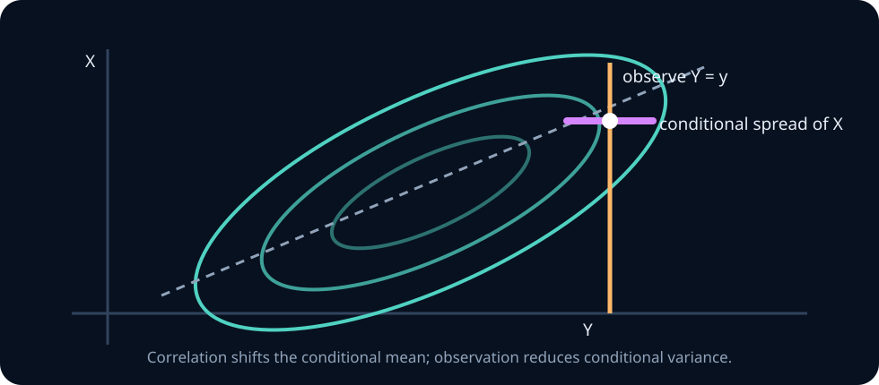

# Multivariate Gaussian geometry and conditioning

The multivariate Gaussian is more than a familiar bell curve with extra coordinates. It is a complete connection between probability and linear algebra: means translate, covariance eigenvectors orient uncertainty, eigenvalues scale it, affine maps preserve the family, and conditioning performs an uncertainty-aware linear update.

This unit isolates that geometry so the formulas do not arrive as an appendix to joint distributions. By the end, you should be able to read covariance ellipsoids, sample using a matrix factor, transform and marginalize Gaussian vectors, derive the bivariate conditional formula, apply the block conditional formula, and recognize where Gaussian convenience becomes a modelling liability.

## 0. Random vectors and notation

Let \(X=(X_1,\ldots,X_d)^T\) have mean vector

$$
\mu=E[X]
$$

and covariance matrix

$$
\Sigma=E[(X-\mu)(X-\mu)^T].
$$

Entry \(\Sigma_{ii}\) is a variance and \(\Sigma_{ij}\) is a covariance. For every vector \(a\),

$$
a^T\Sigma a=\operatorname{Var}(a^TX)\ge0,
$$

so \(\Sigma\) must be symmetric positive semidefinite.

> **Practice — Foundation:** For a three-dimensional random vector, identify the dimensions of \(X\), \(\mu\), \(\Sigma\), and \((X-\mu)(X-\mu)^T\).
>
> **Practice — Core:** Given five two-dimensional observations, compute the sample mean vector and write—but need not yet evaluate—the centered outer products used for covariance.
>
> **Practice — Stretch:** Explain why knowing every coordinate's marginal mean and variance is insufficient to specify joint uncertainty. Construct two contrasting joint examples.

## 1. The multivariate Gaussian density

For positive-definite \(\Sigma\),

$$
X\sim\mathcal N(\mu,\Sigma)
$$

has density

$$
f_X(x)=
\frac{1}{(2\pi)^{d/2}|\Sigma|^{1/2}}
\exp\!\left[-\frac12(x-\mu)^T\Sigma^{-1}(x-\mu)\right].
$$

Read the formula structurally:

- \(\mu\) locates the centre;
- the quadratic form measures standardized distance from the centre;
- \(|\Sigma|^{1/2}\) measures the overall volume scale;
- the exponential makes equal-density sets equal-quadratic-form sets.

The squared Mahalanobis distance is

$$
D^2(x)=(x-\mu)^T\Sigma^{-1}(x-\mu).
$$

It measures distance in units adapted to scale and correlation rather than raw Euclidean coordinates.

> **Practice — Foundation:** Verify that the multivariate Gaussian density reduces to the ordinary univariate Gaussian formula when \(d=1\).
>
> **Practice — Core:** Evaluate the log density at two points for a diagonal covariance and explain the contribution from squared distance and volume normalization.
>
> **Practice — Stretch:** Show why a nonsymmetric or non-positive-definite matrix cannot serve in the ordinary full-density formula, addressing both the quadratic form and determinant.

## 2. Covariance eigenvectors draw the ellipsoid

Let

$$
\Sigma=Q\Lambda Q^T,
$$

where columns of \(Q\) are orthonormal eigenvectors and \(\Lambda\) contains positive eigenvalues. Then

$$
D^2(x)
=\|\Lambda^{-1/2}Q^T(x-\mu)\|^2.
$$

Equal-density contours are ellipsoids:

- eigenvectors give principal directions;
- square roots of eigenvalues give relative axis lengths;
- off-diagonal covariance rotates axes away from coordinate directions.



**Worked example — read a covariance matrix.** For

$$
\Sigma=\begin{bmatrix}4&3\\3&9\end{bmatrix},
$$

the determinant is \(36-9=27>0\), so the matrix is positive definite. The positive off-diagonal entry tilts the ellipse toward directions where both coordinates rise together. Marginal standard deviations are two and three, while correlation is

$$
\rho=\frac{3}{2\cdot3}=0.5.
$$

> **Practice — Foundation:** For diagonal covariance \(\operatorname{diag}(9,1)\), identify the principal directions and relative axis lengths.
>
> **Practice — Core:** Eigendecompose a \(2\times2\) covariance matrix and sketch its one-standard-deviation ellipse from eigenvectors and square-root eigenvalues.
>
> **Practice — Stretch:** Hold eigenvalues fixed while rotating eigenvectors. Predict which scalar summaries remain unchanged and which coordinate-wise correlations change.

## 3. Sampling is an affine transformation of standard noise

Let \(Z\sim\mathcal N(0,I)\), and choose a matrix \(L\) satisfying

$$
LL^T=\Sigma.
$$

Then

$$
X=\mu+LZ
$$

has mean \(\mu\) and covariance

$$
\operatorname{Cov}(X)=LIL^T=\Sigma.
$$

A Cholesky factor gives one such \(L\) when \(\Sigma\) is positive definite. An eigendecomposition gives \(L=Q\Lambda^{1/2}\). These factors can differ while generating the same distribution because isotropic standard Gaussian noise is rotation invariant.

<details><summary>Checkpoint: why not multiply by the covariance itself?</summary>

If \(X=\mu+\Sigma Z\), then its covariance is \(\Sigma I\Sigma^T=\Sigma^2\), not \(\Sigma\). The transformation needs a matrix square root or factor \(L\) with \(LL^T=\Sigma\).

</details>

> **Practice — Foundation:** For diagonal \(\Sigma\), write a square root \(L\) and map one supplied standard-noise vector to a sample.
>
> **Practice — Core:** Verify empirically that samples \(X=\mu+LZ\) have the requested mean and covariance, and quantify error across sample sizes.
>
> **Practice — Stretch:** Compare Cholesky and eigendecomposition square roots for a nearly singular covariance. Discuss speed, numerical behavior, and whether the generated distributions differ.

## 4. Affine transformations preserve Gaussianity

If \(X\sim\mathcal N(\mu,\Sigma)\), then

$$
Y=AX+b
$$

is Gaussian with

$$
Y\sim\mathcal N(A\mu+b,A\Sigma A^T).
$$

This remains valid when \(A\) is rectangular or singular. In those cases the resulting distribution may live in a lower-dimensional subspace and have no ordinary density in the ambient space.

Every linear projection is therefore univariate Gaussian:

$$
a^TX\sim\mathcal N(a^T\mu,a^T\Sigma a).
$$

One equivalent definition of a multivariate Gaussian is that every linear combination of its coordinates is univariate Gaussian.

> **Practice — Foundation:** If \(Y=AX+b\), compute the dimensions of its mean and covariance before multiplying any matrices.
>
> **Practice — Core:** Derive the distribution of a scalar projection \(a^TX\) and use it to compute an interval probability.
>
> **Practice — Stretch:** Use a rank-deficient \(A\) to produce a singular Gaussian output. Describe its geometric support and why an ordinary ambient-space density does not exist.

## 5. Marginals select blocks

Partition

$$
X=\begin{bmatrix}X_a\\X_b\end{bmatrix},
\quad
\mu=\begin{bmatrix}\mu_a\\\mu_b\end{bmatrix},
\quad
\Sigma=
\begin{bmatrix}
\Sigma_{aa}&\Sigma_{ab}\\
\Sigma_{ba}&\Sigma_{bb}
\end{bmatrix}.
$$

The marginal distributions are simply

$$
X_a\sim\mathcal N(\mu_a,\Sigma_{aa}),
\qquad
X_b\sim\mathcal N(\mu_b,\Sigma_{bb}).
$$

Cross-covariance affects their joint relationship but does not enter either marginal covariance block.

> **Practice — Foundation:** Extract the marginal mean and covariance for selected coordinates from a partitioned Gaussian vector.
>
> **Practice — Core:** Given a three-dimensional mean and covariance, derive the bivariate marginal of coordinates one and three and check the block indexing carefully.
>
> **Practice — Stretch:** Explain why marginalizing a Gaussian is block selection while conditioning changes both mean and covariance. Illustrate the distinction geometrically.

## 6. Derive the bivariate conditional distribution

Suppose \(X\) and \(Y\) have means \(\mu_X,\mu_Y\), variances \(\sigma_X^2,\sigma_Y^2\), and covariance \(\sigma_{XY}\), with a positive-definite covariance matrix.

Write

$$
X=\mu_X+
\frac{\sigma_{XY}}{\sigma_Y^2}(Y-\mu_Y)+\varepsilon,
$$

where

$$
\varepsilon
=X-\mu_X-
\frac{\sigma_{XY}}{\sigma_Y^2}(Y-\mu_Y).
$$

Its covariance with \(Y\) is zero:

$$
\operatorname{Cov}(\varepsilon,Y)
=\sigma_{XY}-
\frac{\sigma_{XY}}{\sigma_Y^2}\sigma_Y^2=0.
$$

Because \((\varepsilon,Y)\) is jointly Gaussian, zero covariance implies independence. Conditioning on \(Y=y\) therefore changes the affine term but not the residual distribution:

$$
E[X\mid Y=y]
=\mu_X+
\frac{\sigma_{XY}}{\sigma_Y^2}(y-\mu_Y),
$$

and

$$
\operatorname{Var}(X\mid Y=y)
=\sigma_X^2-
\frac{\sigma_{XY}^2}{\sigma_Y^2}.
$$

Using correlation \(\rho=\sigma_{XY}/(\sigma_X\sigma_Y)\), conditional variance is

$$
\sigma_X^2(1-\rho^2).
$$

Observation reduces variance according to squared correlation. The sign of correlation changes the conditional mean direction but not the amount of variance reduction.

> **Practice — Foundation:** In the bivariate conditional formula, identify the regression-like slope and the remaining conditional variance.
>
> **Practice — Core:** Complete the square in a bivariate Gaussian exponent to recover the conditional mean and variance without quoting the formula.
>
> **Practice — Stretch:** Study the limits as correlation approaches \(1\), \(-1\), and \(0\). Explain what happens to the conditional line and residual uncertainty.

## 7. A fully numerical conditioning example

Let model quality \(X\) and a proxy score \(Y\) be jointly Gaussian with

$$
\mu_X=70,
\quad
\mu_Y=50,
\quad
\sigma_X^2=16,
\quad
\sigma_Y^2=25,
\quad
\sigma_{XY}=12.
$$

After observing \(Y=60\), the conditional mean is

$$
70+\frac{12}{25}(60-50)=74.8.
$$

The conditional variance is

$$
16-\frac{12^2}{25}=10.24,
$$

so conditional standard deviation is \(3.2\), down from the marginal value four.

Interpretation: a proxy ten points above its mean shifts expected quality upward by 4.8, but does not determine quality exactly. The residual uncertainty remains substantial.

> **Practice — Foundation:** Recompute the numerical conditional mean when the observed coordinate is one standard deviation above its mean.
>
> **Practice — Core:** Compare prior and conditional variance numerically and state why the realized observation changes the mean but not the conditional variance in this Gaussian model.
>
> **Practice — Stretch:** Simulate from the stated bivariate Gaussian, retain points in a narrow band around the observed value, and compare empirical conditional moments with the analytic result. Discuss the bandwidth tradeoff.

## 8. Block Gaussian conditioning

When \(\Sigma_{bb}\) is invertible,

$$
X_a\mid X_b=b
\sim\mathcal N(\mu_{a\mid b},\Sigma_{a\mid b}),
$$

where

$$
\mu_{a\mid b}
=\mu_a+
\Sigma_{ab}\Sigma_{bb}^{-1}(b-\mu_b),
$$

and

$$
\Sigma_{a\mid b}
=\Sigma_{aa}
-\Sigma_{ab}\Sigma_{bb}^{-1}\Sigma_{ba}.
$$

Read the mean update from right to left:

1. compute the observation residual \(b-\mu_b\);
2. scale it by observed uncertainty through \(\Sigma_{bb}^{-1}\);
3. map it through cross-covariance \(\Sigma_{ab}\);
4. add the correction to the prior mean.

The covariance reduction is a positive-semidefinite matrix. It depends on which variable is observed, not the observed numerical value.

> **Practice — Foundation:** Label every block in the partitioned conditional mean and covariance formula with its dimensions.
>
> **Practice — Core:** Compute a two-dimensional conditional distribution from a \(3\times3\) covariance by solving a linear system rather than forming an explicit inverse.
>
> **Practice — Stretch:** Prove that the conditional covariance is positive semidefinite using its interpretation as a covariance or through the Schur complement.

## 9. Gaussian independence is special

For jointly Gaussian blocks,

$$
\Sigma_{ab}=0
\quad\Longleftrightarrow\quad
X_a\text{ and }X_b\text{ are independent}.
$$

The forward implication from independence to zero covariance holds generally. The reverse implication depends on joint Gaussianity.

The construction \(Y=X^2\) with symmetric \(X\) remains a standing counterexample outside the Gaussian family: covariance can vanish under perfect nonlinear dependence.

> **Practice — Foundation:** State the difference between uncorrelated and independent variables, then state the extra Gaussian result.
>
> **Practice — Core:** Verify from a block-diagonal Gaussian density that two coordinate blocks factorize and are independent.
>
> **Practice — Stretch:** Construct a non-Gaussian zero-covariance pair that is dependent, then explain exactly which Gaussian argument is unavailable.

## 10. Standardization, whitening, and rotation

Coordinatewise standardization transforms

$$
X_i\mapsto\frac{X_i-\mu_i}{\sigma_i}.
$$

It produces unit marginal variances but generally preserves correlation.

Whitening uses \(W\Sigma W^T=I\):

$$
Z=W(X-\mu).
$$

For Gaussian \(X\), whitened coordinates are independent standard Gaussians. For a non-Gaussian vector they are merely uncorrelated with unit variance.

Whitening is not unique. A further orthogonal rotation preserves identity covariance. When an interpretation depends on a particular whitened axis, the choice of whitening convention matters.

> **Practice — Foundation:** Standardize a two-dimensional vector using coordinate-wise means and standard deviations; state what happens to correlation.
>
> **Practice — Core:** Derive and verify a whitening transform from an eigendecomposition of \(\Sigma\).
>
> **Practice — Stretch:** Compare two valid whitening matrices that differ by an orthogonal rotation. Show that both yield identity covariance but different coordinates.

## 11. Singular and ill-conditioned covariance

If \(\Sigma\) has a zero eigenvalue, some linear combination has zero variance and is deterministic. The distribution lies in a lower-dimensional affine subspace.

If an eigenvalue is merely tiny, density calculations using \(\Sigma^{-1}\) and \(|\Sigma|\) become numerically sensitive. Practical safeguards include:

- solving linear systems rather than forming an explicit inverse;
- using Cholesky factors when positive definiteness is reliable;
- inspecting eigenvalues and condition numbers;
- adding regularization only with an explicit modelling interpretation;
- distinguishing exact structural degeneracy from finite-sample estimation noise.

> **Practice — Foundation:** Give one exact linear relation among three coordinates and show why it makes covariance singular.
>
> **Practice — Core:** For a covariance with a very small eigenvalue, compare direct inversion with a linear solve and describe a condition-number diagnostic.
>
> **Practice — Stretch:** Evaluate three remedies—removing redundant features, adding diagonal regularization, and using a pseudoinverse—by stating the model each one implicitly changes.

## 12. Modelling checks in ML

- Are marginals plausibly symmetric and light-tailed?
- Does a single ellipse hide clusters or curved structure?
- Is covariance stable across subgroups and time?
- Are diagonal-output assumptions discarding important conditional relationships?
- Does the model assign mass to impossible values?
- Are rare-event decisions sensitive to tail misspecification?
- Was covariance estimated with enough independent experimental units relative to dimension?

Gaussian calculations can be exact under the model and still answer the wrong empirical question.

> **Practice — Foundation:** For each modelling check above, write one plot or statistic that could reveal the problem.
>
> **Practice — Core:** Audit a Gaussian model for embedding vectors using held-out Mahalanobis distances, marginal tails, pairwise structure, and subgroup conditioning.
>
> **Practice — Stretch:** Design an evaluation that separates a poor covariance estimate from a fundamentally non-Gaussian joint shape. Include simulated reference data and held-out checks.

## 13. Runnable lab: bivariate Gaussian conditioning

Implement `condition_bivariate_gaussian` in [labs/exercises.py](../../labs/exercises.py). Given both means, both variances, covariance, and an observed \(Y=y\), return the conditional mean and variance of \(X\mid Y=y\).

Run:

```text
python -m labs.checks gaussian
```

Reject nonfinite inputs, nonpositive variances, and covariance matrices that are not positive definite. The checks include independence, negative correlation, scale, and the numerical example above.

### Mini-experiment

For correlations from \(-0.95\) to \(0.95\), plot conditional mean as a function of \(y\) and conditional variance as a function of \(\rho\). Before plotting, predict which graph changes sign and which is symmetric.

## 14. Derivations to own

1. Prove covariance matrices are positive semidefinite.
2. Show that \(X=\mu+LZ\) has covariance \(LL^T\).
3. Derive the affine Gaussian mean and covariance.
4. Derive the distribution of \(a^TX\).
5. Derive the bivariate conditional formulas using the independent residual.
6. Reduce the block formula to the scalar bivariate formula.
7. Show conditional covariance is no larger than marginal covariance.
8. Explain why zero covariance yields Gaussian independence but not general independence.

## 15. End-of-unit practice (graded)

**Foundation — problems 1–3.** Validate covariance and connect its algebra to geometry and sampling.

1. Verify whether three proposed \(2\times2\) matrices are valid covariance matrices.
2. Draw approximate covariance ellipses for positive, negative, and zero correlations.
3. Construct samples using both Cholesky and eigen factors and compare empirical covariance.

**Core — problems 4–8.** Manipulate affine maps, marginals, and conditional Gaussian distributions.

4. Derive the mean and covariance after a rectangular linear projection.
5. Compute the marginal distribution of a selected coordinate block.
6. Reproduce the numerical conditioning example and verify the implied correlation is valid.
7. Derive \(X\mid Y=y\) for zero-mean unit-variance variables with correlation \(\rho\).
8. Explain the limits as \(\rho=0\) and \(|\rho|\to1\).

**Stretch — problems 9–12.** Diagnose where Gaussian structure or numerical calculations fail.

9. Give a non-Gaussian vector with identity covariance whose coordinates are dependent.
10. Diagnose why a nearly singular empirical covariance can destabilize a Gaussian likelihood.
11. Partition a four-dimensional Gaussian into two two-dimensional blocks and compute a conditional distribution using linear solves. Verify the result with conditional simulation or narrow-band rejection sampling.
12. Compare a single Gaussian, a Gaussian mixture, and a heavy-tailed elliptical model on synthetic data with clusters and outliers. Specify which geometric and held-out diagnostics separate the failure modes.

<details><summary>Worked solutions</summary>

1. Check symmetry, positive diagonal variances, and nonnegative eigenvalues or principal minors. A negative determinant in two dimensions proves invalidity.
2. Positive correlation tilts the long axis upward, negative correlation downward, and zero correlation aligns axes when marginal variances differ.
3. Both factors satisfy \(LL^T=\Sigma\), so sampling error aside, both empirical covariances approach \(\Sigma\).
4. For \(Y=AX+b\), expectation is \(A\mu+b\) and covariance is \(A\Sigma A^T\), even when \(A\) reduces dimension.
5. Select the corresponding mean entries and principal covariance block.
6. Correlation is \(12/(4\cdot5)=0.6\). Conditional mean is 74.8 and variance is 10.24.
7. The conditional law is \(\mathcal N(\rho y,1-\rho^2)\).
8. At zero correlation, observing \(Y\) changes nothing. As magnitude approaches one, conditional variance approaches zero; the sign determines whether the mean moves with or against \(y\).
9. Let \(U\) be symmetric and set \(X=U\), \(Y=U^2-E[U^2]\), then rescale variances. Covariance is zero while dependence remains deterministic.
10. Tiny eigenvalues create huge inverse eigenvalues and a tiny determinant, magnifying numerical and estimation errors. Use factorized solves and examine whether regularization is scientifically justified.
11. Apply the block formulas with solves against \(\Sigma_{bb}\), check symmetry and positive semidefiniteness of the conditional covariance, then compare analytic moments with a sufficiently large conditional sample while reporting Monte Carlo or bandwidth error.
12. A single Gaussian misses separated modes and is outlier-sensitive; a mixture can capture clusters but may still have light component tails; a heavy-tailed ellipse handles radial extremes but not multimodality. Use held-out log scores together with projections, radial distances, subgroup residuals, and tail quantiles.

</details>

## Mastery check

Starting from a covariance matrix, explain its ellipse, build a sampling factor, transform it under a linear map, compute a marginal and conditional distribution, and verify the result empirically. Then identify one realistic way the Gaussian assumption could fail and how that failure would appear in data.

Next: [repeated samples, limit theorems, and Monte Carlo error](06-limit-theorems-monte-carlo.md).
