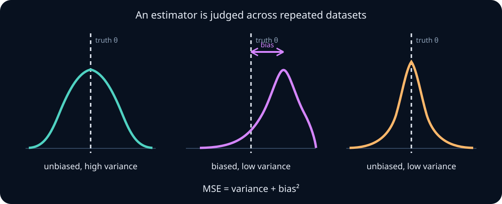
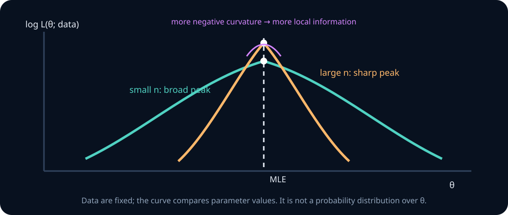
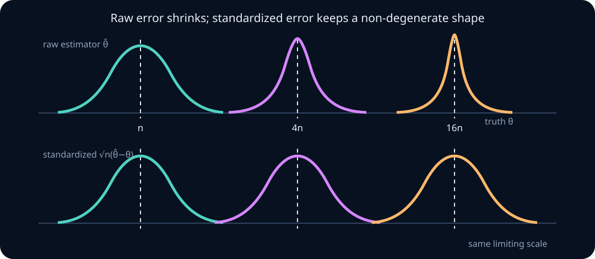

# Estimation, likelihood, Fisher information, and asymptotics

Probability starts with a model and derives what data might look like. Estimation reverses the direction: data have been observed, but some feature of the model or population is unknown.

That reversal creates several distinct questions:

- What quantity are we trying to learn?
- Which function of the data will estimate it?
- Across repeated datasets, is that function systematically wrong or highly variable?
- How does a probabilistic model turn observed data into a likelihood?
- When does maximizing likelihood recover the target?
- How much information does one observation carry?
- When are Gaussian standard-error calculations justified?

This chapter builds those ideas from finite examples to the asymptotic tools used in research. By the end, you should be able to distinguish a parameter from an estimator and an estimate, derive bias–variance–MSE decompositions, obtain Bernoulli and Gaussian maximum-likelihood estimators, diagnose non-identifiability, calculate Fisher information, explain consistency and asymptotic normality, use the delta method, and identify where misspecification or dependence invalidates familiar uncertainty formulas.

## 0. Parameter, estimand, estimator, and estimate

Suppose data \(X_1,\ldots,X_n\) come from an unknown distribution \(P\).

- A **parameter** is a coordinate in a model, such as the Bernoulli probability \(p\).
- An **estimand** is the population quantity we choose to learn, such as \(E_P[X]\), a median, or an accuracy difference. It need not be a model parameter.
- An **estimator** is a rule applied to random data:

$$
\hat\theta=T(X_1,\ldots,X_n).
$$

- An **estimate** is the numerical value of that rule after one dataset is observed.

The hat marks a random estimator before observation and a realized estimate after observation; context tells which meaning is intended.

**Worked example — estimating correctness.** Let \(X_i=1\) if a model answers prompt \(i\) correctly and \(0\) otherwise. Under an iid Bernoulli model, \(p\) is the unknown success probability, \(\hat p=\frac1n\sum_iX_i\) is an estimator, and \(0.73\) might be its value on one test set. If the target population changes from public benchmarks to deployed user requests, the estimand changes even if the formula for \(\hat p\) does not.

> **Practice — Foundation:** Label the parameter, estimator, estimate, and data in a study that reports an average latency of 182 ms from 500 requests.
>
> **Hint:** Separate the fixed population quantity from the random rule and its realized output.
>
> **Practice — Core:** The population median latency is an estimand defined without any parametric model. For the sample \(120,95,300,150,110\) ms, compute the plug-in estimates of the median and of the 0.8 quantile (the smallest observed value whose empirical CDF reaches 0.8).
>
> **Hint:** Sort the values to \(95,110,120,150,300\); each carries empirical mass \(1/5\), so the median is the third order statistic and the 0.8 quantile is the fourth.
>
> **Practice — Stretch:** A model scores 830 of 1,000 items drawn at random from a 50,000-item pool. Target A is accuracy on those 1,000 fixed items; target B is accuracy on the whole pool. Give the standard error of 0.83 under each target, and explain why neither supports a claim about user queries from a different domain.
>
> **Hint:** Under target A nothing is resampled, so the estimate is the estimand; under target B use \(\sqrt{0.83(0.17)/1000}\), optionally times the finite-population factor \(\sqrt{1-1000/50000}\).

For multivariable differentiation, review the [local calculus bridge](03-transformations-convolution-jacobians.md#local-calculus-bridge-gradients-and-jacobians): gradient/Jacobian shapes, the chain rule, Hessians, and the separate conditions for differentiating an expectation.

## 1. An estimator has a sampling distribution

Before data are observed, \(\hat\theta\) varies from dataset to dataset. Its probability law under a fixed data-generating distribution is the estimator's **sampling distribution**.

To study it conceptually:

1. fix the population or model parameter \(\theta\);
2. draw a complete dataset of size \(n\);
3. compute \(\hat\theta\);
4. repeat steps 2–3 many times.

This repeated-dataset thought experiment defines quantities such as

$$
E_\theta[\hat\theta],
\qquad
\operatorname{Var}_\theta(\hat\theta),
\qquad
P_\theta(|\hat\theta-\theta|>\varepsilon).
$$

The subscript reminds us that estimator behavior can depend on the unknown truth. An estimator can be excellent at one parameter value and poor at another.

**Worked example — two estimators of a mean.** For iid data with mean \(\mu\) and variance \(\sigma^2\), both \(X_1\) and \(\bar X_n\) are unbiased estimators of \(\mu\). Their variances are \(\sigma^2\) and \(\sigma^2/n\). Unbiasedness alone does not distinguish them, but their sampling distributions do.

> **Practice — Foundation:** Write the steps to simulate the sampling distribution of the median of \(n=11\) draws from Exponential(1), using seed 0 and 5,000 repetitions, and state the population median the simulated medians should centre near.
>
> **Hint:** Each repetition draws a whole dataset of 11 and keeps one median; the population median solves \(1-e^{-m}=1/2\).
>
> **Practice — Core:** For iid observations with mean \(\mu=5\) and variance \(\sigma^2=4\), compute the expectation and variance of \(X_1\), of \((X_1+X_2)/2\), and of \(\bar X_{10}\).
>
> **Hint:** All three are unbiased by linearity of expectation; for an average of \(m\) independent observations the variance is \(\sigma^2/m\).
>
> **Practice — Stretch:** For \(n=10\) Bernoulli\((p)\) trials, \(\hat p=\bar X\) has standard deviation \(\sqrt{p(1-p)/10}\). Compute its relative error \(\operatorname{SD}(\hat p)/p\) at \(p=0.5\) and \(p=0.01\), and \(P(\hat p=0)\) at \(p=0.01\). In which region of \(p\) does this estimator perform poorly for relative accuracy?
>
> **Hint:** Relative error equals \(\sqrt{(1-p)/(np)}\), which blows up as \(p\to0\); \(P(\hat p=0)=(1-p)^n\).

## 2. Bias and variance measure different errors

The bias of an estimator at \(\theta\) is

$$
\operatorname{Bias}_\theta(\hat\theta)
=E_\theta[\hat\theta]-\theta.
$$

An estimator is **unbiased** if this equals zero for every permitted \(\theta\). Its variance is

$$
\operatorname{Var}_\theta(\hat\theta)
=E_\theta\!\left[
(\hat\theta-E_\theta[\hat\theta])^2
\right].
$$

Bias measures displacement of the sampling-distribution center from the target. Variance measures spread around that center.



An unbiased estimator can be too noisy to use. A mildly biased estimator can make smaller errors overall. Bias is not automatically a defect; hidden or unquantified bias is the danger.

**Worked example — a deliberately biased mean.** If \(\bar X_n\) estimates \(\mu\), define

$$
\tilde\mu=\frac{n}{n+1}\bar X_n.
$$

Then

$$
E[\tilde\mu]=\frac{n}{n+1}\mu,
\qquad
\operatorname{Bias}(\tilde\mu)=-\frac{\mu}{n+1},
$$

and

$$
\operatorname{Var}(\tilde\mu)
=\left(\frac{n}{n+1}\right)^2\frac{\sigma^2}{n}.
$$

The shrinkage introduces bias but lowers variance. Whether it helps depends on \(\mu,\sigma^2\), and the loss used to judge error.

> **Practice — Foundation:** Compute the bias of \(2\bar X_n\) as an estimator of \(\mu\), and evaluate it when \(\mu=3\).
>
> **Hint:** Bias is the expectation of the estimator minus its target, and \(E[2\bar X_n]=2\mu\).
>
> **Practice — Core:** For iid data with \(\mu=6\), \(\sigma^2=9\), and \(n=25\), find the bias, variance, and MSE of \(0.5\bar X_n+2\) as an estimator of \(\mu\).
>
> **Hint:** Use \(E[a\bar X+b]=a\mu+b\) and \(\operatorname{Var}(a\bar X+b)=a^2\sigma^2/n\); the shift \(b\) adds bias but no variance.
>
> **Practice — Stretch:** From one observation \(X\sim\mathcal N(\mu,1)\), let \(T=X+W\) where \(W\) is independent with \(W=999\) with probability 0.001 and \(W=-1\) otherwise. Show \(T\) is unbiased, compute its MSE, and find the range of \(\mu\) on which the biased estimator \(0.9X\) has smaller MSE.
>
> **Hint:** Check \(E[W]=0\) and compute \(E[W^2]\) so that \(\operatorname{MSE}(T)=1+E[W^2]\); for \(0.9X\) the MSE is \(0.81+0.01\mu^2\).

## 3. Mean squared error combines bias and variance

Under squared-error loss, the mean squared error is

$$
\operatorname{MSE}_\theta(\hat\theta)
=E_\theta[(\hat\theta-\theta)^2].
$$

Add and subtract \(E[\hat\theta]\):

$$
\hat\theta-\theta
=
(\hat\theta-E[\hat\theta])
+
(E[\hat\theta]-\theta).
$$

After squaring and taking expectations, the cross-term vanishes because \(E[\hat\theta-E[\hat\theta]]=0\). Therefore

$$
\boxed{
\operatorname{MSE}_\theta(\hat\theta)
=
\operatorname{Var}_\theta(\hat\theta)
+
\operatorname{Bias}_\theta(\hat\theta)^2
}.
$$

This identity is about one estimator at one parameter value. Comparing estimators globally requires specifying whether we care about worst-case MSE, average MSE under a distribution of parameter values, or performance in a particular region.

**Worked example — when shrinkage helps.** For \(\tilde\mu=a\bar X_n\),

$$
\operatorname{MSE}(\tilde\mu)
=a^2\frac{\sigma^2}{n}+(a-1)^2\mu^2.
$$

Differentiating with respect to \(a\) gives the MSE-minimizing value

$$
a^*=\frac{\mu^2}{\mu^2+\sigma^2/n}.
$$

This oracle value depends on unknown \(\mu\), so it is not directly usable. The calculation still reveals why stronger shrinkage is attractive when sampling noise is large relative to signal.

> **Practice — Foundation:** Compute MSE from bias \(0.2\) and variance \(0.09\).
>
> **Hint:** MSE equals variance plus squared bias.
>
> **Practice — Core:** Derive the bias–variance decomposition \(E[(\hat\theta-\theta)^2]=\operatorname{Var}(\hat\theta)+(E\hat\theta-\theta)^2\) without skipping the cross-term.
>
> **Hint:** Write \(\hat\theta-\theta=(\hat\theta-E\hat\theta)+(E\hat\theta-\theta)\); the second part is a constant, so the cross-term is \(2(E\hat\theta-\theta)E[\hat\theta-E\hat\theta]=0\).
>
> **Practice — Stretch:** With \(n=16\) and \(\sigma=2\), compare \(\bar X_n\) with the constant estimator \(T=1\) for \(\mu\). Find where their MSE curves cross and the interval of \(\mu\) on which \(T\) wins. Explain why declaring one estimator “best” requires a parameter region or decision criterion.
>
> **Hint:** The constant has zero variance and bias \(\mu-1\), while \(\operatorname{MSE}(\bar X)=\sigma^2/n=0.25\); solve \((\mu-1)^2=0.25\).

## 4. The plug-in principle and empirical distribution

Many estimators arise by replacing an unknown population distribution with the empirical distribution, which assigns mass \(1/n\) to each observation.

If

$$
\theta=E_P[g(X)],
$$

the plug-in estimator is

$$
\hat\theta
=\frac1n\sum_{i=1}^ng(X_i).
$$

Examples include:

- population mean \(\rightarrow\) sample mean;
- event probability \(\rightarrow\) observed event fraction;
- population second moment \(\rightarrow n^{-1}\sum_iX_i^2\);
- population CDF \(F(t)\) \(\rightarrow n^{-1}\sum_i\mathbf1\{X_i\le t\}\).

Plug-in does not guarantee unbiasedness. The population variance can be written

$$
\sigma^2=E[(X-\mu)^2].
$$

Replacing both \(P\) and \(\mu\) gives

$$
\frac1n\sum_i(X_i-\bar X_n)^2,
$$

which is biased downward for iid finite-variance data because the same observations estimated the center. Multiplying by \(n/(n-1)\) gives the familiar unbiased sample variance when \(n\ge2\).

> **Practice — Foundation:** For the sample \(2,4,6,7\), compute the plug-in estimates of \(E[X^3]\) and \(P(X>5)\).
>
> **Hint:** Each point receives empirical mass \(1/4\): average the four cubes, and count the fraction of points above 5.
>
> **Practice — Core:** Show algebraically that \(n^{-1}\sum_i(X_i-\bar X)^2=n^{-1}\sum_iX_i^2-\bar X^2\), then check both sides on the sample \(2,4,6,7\).
>
> **Hint:** Expand \((X_i-\bar X)^2=X_i^2-2X_i\bar X+\bar X^2\) and use \(\sum_iX_i=n\bar X\); for the check, \(\bar X=4.75\).
>
> **Practice — Stretch:** The plug-in estimator of \(\mu^2\) is \(\bar X_n^2\). For \(X_i\sim\mathcal N(1,4)\), derive its exact bias at \(n=4,16,64\), then confirm with a simulation (seed 0, 100,000 repetitions per \(n\)) that the bias vanishes like \(1/n\).
>
> **Hint:** Use \(E[\bar X^2]=\operatorname{Var}(\bar X)+(E\bar X)^2\), so the bias is \(\sigma^2/n\).

## 5. Likelihood compares parameter values after data are fixed

Let a model assign density or mass \(p_\theta(x)\) to observation \(x\). For iid observed data \(x_1,\ldots,x_n\), the likelihood is

$$
L(\theta;x_{1:n})
=\prod_{i=1}^np_\theta(x_i).
$$

The same expression is read in two directions:

- as a function of possible data with \(\theta\) fixed, it is a probability mass or density;
- as a function of \(\theta\) with observed data fixed, it is a likelihood.

A likelihood need not integrate or sum to one over \(\theta\). It is not a posterior probability distribution over parameters.

Products of many probabilities underflow, so use the log-likelihood

$$
\ell(\theta)
=\log L(\theta)
=\sum_{i=1}^n\log p_\theta(x_i).
$$

The logarithm preserves the maximizer because it is strictly increasing.



Likelihood is comparative within a specified model. A high likelihood under one parameter does not prove the model family is adequate, and raw likelihoods from datasets of different sizes are not directly comparable.

> **Practice — Foundation:** For a single Bernoulli observation \(x=1\), the likelihood is \(L(p)=p\) on \([0,1]\). Compute \(\int_0^1L(p)\,dp\) and explain why \(L(\theta;x)\) is not generally a probability distribution over \(\theta\).
>
> **Hint:** Integrate \(p\) from 0 to 1; a density over \(p\) would have to integrate to 1, and nothing forces a likelihood to.
>
> **Practice — Core:** Derive the log-likelihood for iid Poisson\((\lambda)\) observations, evaluate it for the data \((2,0,3,1,4)\), find the MLE, and identify which data summary it depends on.
>
> **Hint:** Each term is \(x_i\log\lambda-\lambda-\log x_i!\), so the sum is \((\sum x_i)\log\lambda-n\lambda\) plus a constant; here \(\sum x_i=10,n=5\).
>
> **Practice — Stretch:** For data \((0.1,-0.4,1.2,0.3)\), compute the maximized log-likelihood under (i) \(\mathcal N(0,1)\) with no free parameters, (ii) \(\mathcal N(\mu,\sigma^2)\) with both free, and (iii) a model giving each point its own mean with \(\sigma=0.1\). Explain why the largest maximized likelihood does not identify the best model.
>
> **Hint:** Model (iii) fits each point exactly, so its value is \(4(-\tfrac12\log2\pi-\log0.1)\); compare with a penalty such as \(\mathrm{AIC}=2k-2\hat\ell\) or with held-out likelihood.

## 6. Bernoulli maximum likelihood from first principles

For observations \(x_i\in\{0,1\}\) and success count \(s=\sum_ix_i\),

$$
L(p)=p^s(1-p)^{n-s},
\qquad 0\le p\le1.
$$

For \(0<p<1\),

$$
\ell(p)=s\log p+(n-s)\log(1-p).
$$

Differentiate:

$$
\ell'(p)=\frac{s}{p}-\frac{n-s}{1-p}.
$$

Setting the score to zero gives

$$
s(1-p)=(n-s)p
\quad\Longrightarrow\quad
\hat p_{\text{MLE}}=\frac{s}{n}.
$$

The second derivative

$$
\ell''(p)
=-\frac{s}{p^2}-\frac{n-s}{(1-p)^2}
$$

is negative in the interior, confirming a maximum.

**Boundary cases matter.** If \(s=0\), the maximum is \(p=0\); if \(s=n\), it is \(p=1\). The derivative-zero argument does not find these boundary maxima.

**Worked example — seven successes.** For \(s=7,n=10\), the MLE is \(0.7\), and the maximized log-likelihood is

$$
7\log(0.7)+3\log(0.3)\approx-6.109.
$$

This negative number is normal: probabilities are at most one, so their logarithms are nonpositive.

> **Practice — Foundation:** Derive the Bernoulli MLE for 18 successes in 30 trials and evaluate the score at the answer.
>
> **Hint:** The score is \(s/p-(n-s)/(1-p)\); set it to zero and substitute \(s=18,n=30\).
>
> **Practice — Core:** Compare the likelihood at \(p=0.4,0.6,0.8\) for 8 successes in 10 trials without multiplying tiny numbers.
>
> **Hint:** Evaluate \(8\log p+2\log(1-p)\) at each \(p\); exponentiated differences give likelihood ratios.
>
> **Practice — Stretch:** For 10 successes in 10 trials, compute \(\hat p\), the plug-in standard error, and the exact one-sided 95% lower confidence bound solving \(p^{10}=0.05\). Explain why the zero standard error does not mean the probability is known exactly.
>
> **Hint:** The plug-in formula \(\sqrt{\hat p(1-\hat p)/n}\) is zero at the boundary \(\hat p=1\); the exact bound asks which \(p\) still make ten straight successes at least 5% likely.

## 7. General maximum-likelihood workflow

A maximum-likelihood estimator is

$$
\hat\theta_{\text{MLE}}
\in\arg\max_{\theta\in\Theta}\ell(\theta).
$$

The notation permits multiple maximizers. A reliable workflow is:

1. specify the observation model and parameter space \(\Theta\);
2. write the joint likelihood, including dependence if present;
3. move to log space;
4. identify data terms that do not depend on \(\theta\);
5. differentiate only where valid;
6. check stationary points, boundaries, constraints, and non-identifiability;
7. verify the candidate numerically;
8. assess model fit separately from optimization success.

The equation \(\nabla\ell(\theta)=0\) is neither necessary nor sufficient for a global maximum. Constrained optima can lie on boundaries; non-concave likelihoods can have local maxima and saddle points.

**Invariance of the MLE.** If \(\eta=g(\theta)\) and \(g\) is one-to-one, then the MLE of \(\eta\) is \(g(\hat\theta)\). For many-to-one transformations, define the induced likelihood carefully and maximize over all preimages.

> **Practice — Foundation:** For 0 successes in \(n=5\) Bernoulli trials, the score equation has no interior solution. Find the MLE and list the checks that justify it.
>
> **Hint:** Check the domain \([0,1]\): with \(s=0\) the log-likelihood \(5\log(1-p)\) is strictly decreasing, so the maximum sits at the boundary.
>
> **Practice — Core:** Find the MLE of the rate \(\lambda\) from the exponential observations \((0.2,0.3,0.5,1.0)\), including the parameter constraint and a second-derivative check.
>
> **Hint:** Maximize \(\ell(\lambda)=n\log\lambda-\lambda\sum x_i\) over \(\lambda>0\): solve \(n/\lambda=\sum x_i\) and note \(\ell''=-n/\lambda^2<0\).
>
> **Practice — Stretch:** For a Cauchy location model with data \((-3,3)\), \(\ell(\theta)=-\log(1+(\theta+3)^2)-\log(1+(\theta-3)^2)\). Find all stationary points, classify them, and explain why two equal maxima here are not evidence of non-identifiability.
>
> **Hint:** The stationary points are \(\theta=0\) and \(\theta^2=8\); distinct \(\theta\) give distinct Cauchy distributions, so the twin peaks reflect this sample, not the model.

## 8. Gaussian MLE and the degrees-of-freedom correction

Let \(X_i\sim\mathcal N(\mu,\sigma^2)\) iid with both parameters unknown. Ignoring constants,

$$
\ell(\mu,\sigma^2)
=-\frac n2\log\sigma^2
-\frac{1}{2\sigma^2}\sum_{i=1}^n(x_i-\mu)^2.
$$

For fixed \(\sigma^2\), maximizing over \(\mu\) minimizes squared deviations, giving

$$
\hat\mu_{\text{MLE}}=\bar x.
$$

Substituting \(\bar x\) and differentiating with respect to \(\sigma^2\) gives

$$
\hat\sigma^2_{\text{MLE}}
=\frac1n\sum_{i=1}^n(x_i-\bar x)^2.
$$

Under iid Gaussian sampling—and more generally for iid data with finite variance—

$$
E[\hat\sigma^2_{\text{MLE}}]
=\frac{n-1}{n}\sigma^2.
$$

Thus the MLE is biased downward. The unbiased estimator is

$$
s^2=\frac1{n-1}\sum_i(x_i-\bar x)^2.
$$

MLE and unbiasedness optimize different criteria. The MLE chooses the parameter that maximizes observed-data likelihood; the correction chooses a scaling with exact repeated-sample expectation \(\sigma^2\).

**Worked example — two observations.** For data \(0,2\), \(\bar x=1\). Squared deviations sum to 2, so the Gaussian MLE variance is \(1\), while the unbiased sample variance is \(2\). With so little data, estimating the mean has consumed substantial information about spread.

> **Practice — Foundation:** Compute Gaussian mean and variance MLEs for \(1,2,6\).
>
> **Hint:** The mean MLE is the sample mean; the variance MLE divides the squared deviations by \(n=3\), not \(n-1\).
>
> **Practice — Core:** Prove \(\sum_i(x_i-\mu)^2=\sum_i(x_i-\bar x)^2+n(\bar x-\mu)^2\) and use it to establish the mean MLE.
>
> **Hint:** Write \(x_i-\mu=(x_i-\bar x)+(\bar x-\mu)\), expand, and use \(\sum_i(x_i-\bar x)=0\); only \(n(\bar x-\mu)^2\) depends on \(\mu\).
>
> **Practice — Stretch:** Simulate \(\mathcal N(0,4)\) samples at \(n=2,5,20\) (seed 0, 100,000 repetitions each) and compare empirical bias and MSE of the \(1/n\) and \(1/(n-1)\) variance estimators with theory.
>
> **Hint:** Theory: \(E[\hat\sigma^2_{\mathrm{MLE}}]=(n-1)\sigma^2/n\), \(\operatorname{MSE}(\hat\sigma^2_{\mathrm{MLE}})=(2n-1)\sigma^4/n^2\), and \(\operatorname{MSE}(s^2)=2\sigma^4/(n-1)\).

## 9. Identifiability and sufficient summaries

### Identifiability

A parameter is identifiable if different parameter values imply different observable distributions:

$$
P_{\theta_1}=P_{\theta_2}
\quad\Longrightarrow\quad
\theta_1=\theta_2.
$$

If \(X\sim\mathcal N(\theta^2,1)\) with \(\theta\in\mathbb R\), then \(\theta\) and \(-\theta\) produce the same distribution. No amount of data can determine the sign without another assumption. This is not an optimizer defect; it is missing information in the model.

Neural networks often have parameter symmetries. Permuting hidden units can leave the represented function unchanged. Parameter non-identifiability need not prevent accurate prediction, but it changes how parameter uncertainty should be interpreted.

### Sufficiency

A statistic \(T(X)\) is sufficient for \(\theta\) when, under the model, the remaining details of the sample contain no additional information about \(\theta\).

For Bernoulli data,

$$
L(p;x_{1:n})=p^{\sum x_i}(1-p)^{n-\sum x_i}.
$$

The likelihood depends on the sequence only through \(S=\sum_iX_i\), so the success count is sufficient for \(p\). Order can be discarded for estimating \(p\) under the iid Bernoulli model.

Sufficiency is model-dependent. If success probability drifts over time, order may be crucial.

> **Practice — Foundation:** Show why \(\theta\) is not identifiable in the model \(X\sim\mathcal N(\theta^2,1)\) by comparing \(\theta=2\) and \(\theta=-2\).
>
> **Hint:** Compute the mean \(\theta^2\) for both values; identical observable distributions mean no data can separate them.
>
> **Practice — Core:** Identify a sufficient statistic for the Poisson rate from iid observations by factoring the likelihood, and show that the datasets \((1,3,2)\) and \((2,2,2)\) give proportional likelihood functions.
>
> **Hint:** Factor \(\prod_i\lambda^{x_i}e^{-\lambda}/x_i!=\lambda^{\sum x_i}e^{-n\lambda}\cdot\prod_i1/x_i!\); both datasets have \(\sum x_i=6\).
>
> **Practice — Stretch:** The binary sequences \(000111\) and \(101010\) have the same sum, so they are equivalent under an iid Bernoulli model. Show they carry different evidence under a two-state Markov model with switch probability \(q\) by writing each likelihood as a function of \(q\) (conditioning on the first value).
>
> **Hint:** Count how many of the five consecutive pairs switch value; the Markov likelihood is \(q^{\#\text{switches}}(1-q)^{5-\#\text{switches}}\).

## 10. Score and Fisher information

For one observation, the **score** is the derivative of log probability or density:

$$
U_\theta(X)
=\frac{\partial}{\partial\theta}\log p_\theta(X).
$$

Under regularity conditions that allow differentiation through the integral,

$$
E_\theta[U_\theta(X)]=0.
$$

Fisher information can then be written in two equivalent ways:

$$
I_1(\theta)
=E_\theta[U_\theta(X)^2]
=-E_\theta\!\left[
\frac{\partial^2}{\partial\theta^2}\log p_\theta(X)
\right].
$$

Interpretations:

- the score measures how one observation locally pushes the fitted parameter;
- large score variance means observations respond strongly to parameter changes;
- large negative expected curvature means the likelihood peak is locally sharp.

For independent observations, scores add and information adds:

$$
I_n(\theta)=nI_1(\theta).
$$

**Worked example — Bernoulli information.** The one-observation score is

$$
U_p(X)=\frac{X}{p}-\frac{1-X}{1-p}
=\frac{X-p}{p(1-p)}.
$$

Since \(\operatorname{Var}(X)=p(1-p)\),

$$
I_1(p)=\frac1{p(1-p)}.
$$

This grows near the boundary in the \(p\) parameterization, but regular asymptotic approximations become delicate there. Information is local and parameterization-dependent; it is not a universal count of useful examples.

> **Practice — Foundation:** Derive the score for one Gaussian observation when variance is known and mean is the parameter, and evaluate it at \(x=3\), \(\sigma^2=4\), \(\mu=1\).
>
> **Hint:** The log-density is \(-(x-\mu)^2/(2\sigma^2)\) plus a constant; differentiate in \(\mu\).
>
> **Practice — Core:** Compute the Fisher information for the Gaussian mean with \(\sigma^2=4\), verify additivity across \(n=25\) independent observations, and give the implied standard error of \(\bar X\).
>
> **Hint:** \(I_1=E[\text{score}^2]=\operatorname{Var}(X)/\sigma^4=1/\sigma^2\); independent scores add, so \(I_n=n/\sigma^2\) and the SE is \(1/\sqrt{I_n}\).
>
> **Practice — Stretch:** Reparameterize Bernoulli probability by log odds \(\eta=\log(p/(1-p))\). Derive information for \(\eta\), evaluate both \(I(p)\) and \(I(\eta)\) at \(p=0.2\), and explain why the numbers differ.
>
> **Hint:** Use \(I_\eta=I_p\,(dp/d\eta)^2\) with \(dp/d\eta=p(1-p)\); information carries the squared units of the parameter.

## 11. The Cramér–Rao lower bound and efficiency

Under regularity conditions, any unbiased estimator \(\hat\theta\) satisfies

$$
\operatorname{Var}_\theta(\hat\theta)
\ge
\frac1{I_n(\theta)}.
$$

This is the Cramér–Rao lower bound. It says that within the class of unbiased estimators and under the stated model, information limits precision.

For iid Bernoulli data,

$$
\operatorname{Var}(\hat p)
=\frac{p(1-p)}n
=\frac1{I_n(p)}.
$$

The sample proportion attains the bound and is efficient in this finite-sample sense.

Important qualifications:

- biased estimators require a modified bound;
- boundary parameters and parameter-dependent support can violate regularity;
- nuisance parameters change the relevant information calculation;
- a lower bound inside a wrong model does not guarantee real-world accuracy;
- attaining the bound does not make the chosen estimand scientifically useful.

> **Practice — Foundation:** Evaluate the Bernoulli Cramér–Rao bound at \(p=0.5,n=100\).
>
> **Hint:** The bound is \(1/(nI_1)\) with \(I_1=1/(p(1-p))\).
>
> **Practice — Core:** Show that the sample mean attains the Cramér–Rao bound when estimating a Gaussian mean with known variance, and check it numerically for \(\sigma^2=9,n=36\).
>
> **Hint:** Compare \(\operatorname{Var}(\bar X)=\sigma^2/n\) with \(1/I_n=1/(n/\sigma^2)\).
>
> **Practice — Stretch:** For one observation \(X\sim\mathcal N(\mu,1)\), the Cramér–Rao bound for unbiased estimators is 1. Compute the MSE of the shrinkage estimator \(0.5X\) and find the range of \(\mu\) where it falls below 1. Explain why this does not contradict the bound.
>
> **Hint:** \(\operatorname{MSE}(0.5X)=0.25+0.25\mu^2\); the bound only constrains the variance of unbiased estimators, and \(0.5X\) is biased.

## 12. Consistency asks whether error vanishes

An estimator is consistent for \(\theta\) if

$$
\hat\theta_n\xrightarrow{P}\theta.
$$

The Bernoulli MLE \(\hat p=\bar X_n\) is consistent by the law of large numbers.

Unbiasedness and consistency are different:

- \(X_1\) is unbiased for a common mean but not consistent because it does not use increasing information;
- \(\frac{n}{n+1}\bar X_n\) is biased for every finite \(n\) but consistent because its bias and variance both vanish.

For MLE, divide the log-likelihood by \(n\):

$$
\frac1n\ell_n(\theta)
=\frac1n\sum_{i=1}^n\log p_\theta(X_i).
$$

The law of large numbers suggests convergence to

$$
E_{\theta_0}[\log p_\theta(X)].
$$

Under identifiability and additional uniformity conditions, this expected log-likelihood is uniquely maximized at the true parameter \(\theta_0\), leading the empirical maximizer toward \(\theta_0\).

Pointwise convergence of the objective is not by itself enough to guarantee convergence of its maximizer. The parameter space, continuity, tails, and control over all candidate parameters matter.

> **Practice — Foundation:** Decide whether \(X_1\), \(\bar X_n+1/n\), and \(2\bar X_n\) are consistent for \(\mu\).
>
> **Hint:** For each, find the limits of bias and variance as \(n\to\infty\): \(X_1\) has fixed variance, \(1/n\to0\), and \(2\bar X_n\to2\mu\).
>
> **Practice — Core:** Prove consistency of the sample proportion using Chebyshev, and evaluate the Chebyshev bound on \(P(|\hat p-p|\ge0.05)\) for \(n=1000\), \(p=0.3\).
>
> **Hint:** \(\operatorname{Var}(\hat p)=p(1-p)/n\), so Chebyshev gives \(P(|\hat p-p|\ge\varepsilon)\le p(1-p)/(n\varepsilon^2)\).
>
> **Practice — Stretch:** Let \(M_n(\theta)=e^{-\theta^2}+2e^{-(\theta-n)^2}\). Find the pointwise limit of \(M_n\), its maximizer, and where the maximizer of \(M_n\) lies for large \(n\). Explain why MLE consistency needs more than pointwise convergence.
>
> **Hint:** Fix \(\theta\) and let \(n\to\infty\) for the limit; then compare \(M_n(n)\approx2\) with \(M_n(0)\approx1\) — the supremum distance does not vanish.

## 13. Asymptotic normality explains the local error shape

Under regularity conditions, a one-dimensional MLE often satisfies

$$
\sqrt n(\hat\theta-\theta_0)
\xrightarrow{d}
\mathcal N\!\left(0,\frac1{I_1(\theta_0)}\right).
$$

Equivalently, for large \(n\),

$$
\hat\theta
\approx
\mathcal N\!\left(
\theta_0,\frac1{nI_1(\theta_0)}
\right).
$$



The core derivation is a Taylor expansion of the sample score around the truth:

$$
0=U_n(\hat\theta)
\approx
U_n(\theta_0)
+
(\hat\theta-\theta_0)U_n'(\theta_0).
$$

Rearranging,

$$
\sqrt n(\hat\theta-\theta_0)
\approx
-
\frac{U_n(\theta_0)/\sqrt n}
{U_n'(\theta_0)/n}.
$$

The numerator follows a CLT because it is a sum of mean-zero scores. The denominator follows a law of large numbers toward \(-I_1(\theta_0)\).

In practice, substitute the estimate:

$$
\widehat{\operatorname{SE}}(\hat\theta)
\approx
\frac1{\sqrt{nI_1(\hat\theta)}}.
$$

Observed information uses the realized negative Hessian; expected information averages that curvature under the model. They are asymptotically related but need not match exactly in a finite dataset.

> **Practice — Foundation:** Use Bernoulli Fisher information to compute the large-sample standard error of \(\hat p\) when \(\hat p=0.3\) and \(n=84\).
>
> **Hint:** \(I_n(p)=n/(p(1-p))\) and \(\operatorname{SE}\approx1/\sqrt{I_n(\hat p)}\).
>
> **Practice — Core:** Fill in the Taylor-score derivation of \(\sqrt n(\hat\theta-\theta)\Rightarrow\mathcal N(0,1/I_1)\), state which limit theorem justifies numerator and denominator, and apply it to get the asymptotic variance of \(\hat\lambda=1/\bar X\) for Exponential\((\lambda)\).
>
> **Hint:** Expand \(0=U_n(\hat\theta)\approx U_n(\theta)+(\hat\theta-\theta)U_n'(\theta)\); use a CLT for \(U_n/\sqrt n\) and a law of large numbers for \(-U_n'/n\to I_1\), with \(I_1=1/\lambda^2\) for the exponential.
>
> **Practice — Stretch:** For iid Uniform\((0,\theta)\) with \(\theta=1\) and \(n=100\), the MLE is \(\hat\theta=\max_iX_i\). Compute \(P(\theta-\hat\theta>0.01)\) and explain why this parameter-dependent support breaks the usual \(\sqrt n\) Gaussian approximation.
>
> **Hint:** \(P(\max_iX_i\le\theta-t)=((\theta-t)/\theta)^n\); with \(t=x/n\) this tends to \(e^{-x}\), an exponential limit at rate \(n\), not \(\sqrt n\).

## 14. Transforming estimators: invariance and the delta method

Often the target is \(\eta=g(\theta)\). MLE invariance suggests

$$
\hat\eta=g(\hat\theta).
$$

To approximate its uncertainty, expand \(g\) around \(\theta\):

$$
g(\hat\theta)
\approx
g(\theta)+g'(\theta)(\hat\theta-\theta).
$$

If

$$
\sqrt n(\hat\theta-\theta)
\xrightarrow{d}\mathcal N(0,V),
$$

then the delta method gives

$$
\sqrt n\bigl(g(\hat\theta)-g(\theta)\bigr)
\xrightarrow{d}
\mathcal N\!\left(0,[g'(\theta)]^2V\right).
$$

For vector parameters, replace \(g'\) with the gradient or Jacobian.

**Worked example — log odds.** For Bernoulli \(p\), let

$$
g(p)=\log\frac{p}{1-p},
\qquad
g'(p)=\frac1{p(1-p)}.
$$

Since \(\operatorname{Var}(\hat p)\approx p(1-p)/n\),

$$
\operatorname{Var}(g(\hat p))
\approx\frac1{np(1-p)}.
$$

At \(\hat p=0.7,n=400\), the plug-in standard error on the log-odds scale is about

$$
\sqrt{\frac1{400(0.7)(0.3)}}\approx0.109.
$$

If \(g'(\theta)=0\), the first-order delta method degenerates and a higher-order expansion may be needed.

> **Practice — Foundation:** Use the delta method for \(g(\mu)=\mu^2\) when \(\bar X_n\) estimates \(\mu=3\) with \(\sigma^2=4\) and \(n=100\): give the approximate standard error of \(\bar X_n^2\).
>
> **Hint:** \(g'(\mu)=2\mu=6\), so \(\operatorname{Var}(\bar X^2)\approx36\sigma^2/n\).
>
> **Practice — Core:** Derive an approximate variance for \(\log\hat\lambda\) when \(\hat\lambda\) is asymptotically normal with variance \(\lambda^2/n\), and evaluate it at \(\lambda=2,n=50\).
>
> **Hint:** Multiply the asymptotic variance by \(g'(\lambda)^2=1/\lambda^2\).
>
> **Practice — Stretch:** For \(X_i\sim\mathcal N(0,1)\) and \(g(\theta)=\theta^2\) at \(\theta=0\), show that \(n\bar X_n^2\sim\chi^2_1\) exactly, compute \(P(n\bar X_n^2>3.84)\), and explain what the first-order delta method predicts instead.
>
> **Hint:** At \(\theta=0\), \(g'(0)=0\), so first order predicts a degenerate limit; but \(\sqrt n\bar X_n\sim\mathcal N(0,1)\), so its square is \(\chi^2_1\).

## 15. Regularization, penalized likelihood, and MAP

Pure maximum likelihood optimizes

$$
\ell(\theta).
$$

Penalized likelihood optimizes

$$
\ell(\theta)-\lambda R(\theta),
$$

where \(R\) encodes a preference such as small norm or smoothness. The penalty typically introduces bias while reducing variance or preventing unstable solutions.

Scaling matters. If \(\ell\) is a sum over \(n\) observations while \(\lambda\) is fixed, the data term grows with \(n\). If software minimizes average negative log-likelihood plus \(\lambda R\), the meaning of the same numerical \(\lambda\) differs.

With a prior density \(\pi(\theta)\), a maximum a posteriori estimate maximizes

$$
\ell(\theta)+\log\pi(\theta).
$$

This looks like penalized likelihood, but the interpretation differs: MAP is a posterior mode under a specified prior and parameterization.

**Worked example — Beta–Bernoulli shrinkage.** With a \(\operatorname{Beta}(\alpha,\beta)\) prior and \(s\) successes,

$$
\hat p_{\text{MAP}}
=\frac{s+\alpha-1}{n+\alpha+\beta-2}
$$

for an interior mode when \(\alpha,\beta>1\). The posterior mean is

$$
\frac{s+\alpha}{n+\alpha+\beta}.
$$

They are different estimators. Both shrink the raw proportion toward a prior-dependent center.

> **Practice — Foundation:** For one-dimensional ridge regression minimizing \(\sum_i(y_i-wx_i)^2+2w^2\) with Gaussian noise variance \(\sigma^2=1\), identify the likelihood term, the penalty, and the prior variance \(\tau^2\) of the implied \(\mathcal N(0,\tau^2)\) prior.
>
> **Hint:** Divide the objective by 2 so the squared error matches \(\tfrac12\sum_i(y_i-wx_i)^2\), the Gaussian negative log-likelihood; then match \(w^2\) to \(w^2/(2\tau^2)\).
>
> **Practice — Core:** With a Beta\((2,2)\) prior and 7 successes in 10 Bernoulli trials, derive the MAP estimate and compare it with the MLE and the posterior mean.
>
> **Hint:** The posterior is Beta\((\alpha+s,\beta+n-s)\); its mode is \((\alpha+s-1)/(\alpha+\beta+n-2)\) and its mean is \((\alpha+s)/(\alpha+\beta+n)\).
>
> **Practice — Stretch:** With \(n=100\) examples, objective (a) is \(\sum_i\ell_i(w)+\lambda\|w\|^2\) with \(\lambda=1\), and objective (b) is \(n^{-1}\sum_i\ell_i(w)+\lambda'\|w\|^2\). Find the \(\lambda'\) that gives the same minimizer, and say what happens to the effective prior if \(\lambda'=1\) is kept while \(n\) grows to 10,000.
>
> **Hint:** Multiply objective (b) by \(n\): it becomes \(\sum_i\ell_i+n\lambda'\|w\|^2\), so matching requires \(n\lambda'=\lambda\).

## 16. Misspecification, dependence, and selection

The clean formulas above describe behavior under a chosen model. Real failures often come from outside its parameter coordinates.

### Misspecification

If the true distribution is not in \(\{P_\theta\}\), an MLE can converge to the parameter whose model is closest in expected log loss rather than to a literal truth. The estimator may remain useful, but model-based Fisher standard errors can be wrong.

Under suitable conditions, the asymptotic covariance of the square-root-scaled error has the sandwich form

$$
H^{-1}JH^{-1},
$$

where \(H\) is per-observation expected objective curvature and \(J\) is per-observation score variability. The estimator's covariance is therefore approximately \(H^{-1}JH^{-1}/n\). Under a correctly specified regular model, the information identity makes these pieces agree. Under misspecification, they need not.

### Dependence

If observations are clustered or sequential, joint likelihood does not factor into independent row terms. Treating it as though it does often preserves a familiar point estimate while underestimating uncertainty. Cluster-level resampling, cluster-robust calculations, time-series models, or explicit hierarchical likelihoods may be required.

### Selection

Choosing a model, checkpoint, prompt, metric, or stopping time using the same data changes the sampling distribution of the reported estimate. Ordinary fixed-estimator standard errors do not include this selection stage.

**Worked example — best checkpoint.** Suppose 50 checkpoints have identical true quality but noisy validation estimates. Reporting only the maximum validation score produces upward bias. Increasing validation-set size reduces per-checkpoint noise, but the selection bias depends also on the number and dependence of comparisons. An untouched test set estimates the selected checkpoint's performance without reusing the selection noise.

> **Practice — Foundation:** Classify each failure as misspecification, dependence, or selection: (a) a Gaussian likelihood fitted to latencies with heavy right tails; (b) 20 conversation turns per user treated as iid rows; (c) accuracy estimated only on users who chose to leave feedback.
>
> **Hint:** Ask whether the error lies in the assumed density, in the independence factorization, or in which units enter the data.
>
> **Practice — Core:** A dataset has 50 users with 10 rows each and within-user intraclass correlation \(\rho=0.3\). Compute the design effect \(1+(m-1)\rho\) and the factor by which the iid standard error of the overall mean is too small.
>
> **Hint:** The sample mean is unchanged by clustering, but its variance is multiplied by the design effect; the SE factor is its square root.
>
> **Practice — Stretch:** Twenty checkpoints all have true accuracy 0.70 and each is scored on its own independent 500-item validation set. Using \(E[\max\text{ of 20 iid }\mathcal N(0,1)]\approx1.87\), approximate the expected optimism of the best validation score. Then describe a second simulation arm with a single checkpoint and no selection, but items clustered in groups, that isolates variance misspecification.
>
> **Hint:** Each score has SE \(\sqrt{0.7(0.3)/500}\approx0.0205\), so optimism is about \(1.87\times0.0205\); selection changes the repeated experiment, while clustering changes only the variance model.

## 17. Likelihood and estimation in ML systems

Many familiar ML objectives are likelihood estimators in disguise:

- binary cross-entropy is negative Bernoulli log-likelihood;
- multiclass cross-entropy is negative categorical log-likelihood;
- squared error corresponds to Gaussian conditional likelihood with fixed variance;
- token-level negative log-likelihood fits a conditional categorical distribution at each position.

But several cautions remain:

- a conditional likelihood estimates \(P(Y\mid X)\), not the input distribution \(P(X)\);
- minibatches approximate an optimization objective; they do not create more independent data;
- overparameterized networks can have many parameter values representing the same predictions;
- low training loss does not establish calibration, causal validity, robustness, or task utility;
- token-level likelihood can overweight long documents or correlated sequences;
- evaluation after architecture and hyperparameter search includes selection.

**Worked example — cross-entropy as MLE.** If a classifier emits \(q_\theta(x)\) for \(P(Y=1\mid X=x)\), one observation contributes

$$
y\log q_\theta(x)
+(1-y)\log(1-q_\theta(x)).
$$

Summing this conditional Bernoulli log-likelihood over data and maximizing it is equivalent to minimizing binary cross-entropy. The statistical statement depends on how examples were sampled and whether the conditional model is adequate—not only on whether gradient descent finds a low value.

Before interpreting a fitted number, ask:

1. What population quantity is being estimated?
2. Which randomness defines repeated datasets?
3. Is the model identifiable at the prediction or parameter level?
4. Does the uncertainty calculation include clustering and selection?
5. Would a different loss better match the actual decision?

> **Practice — Foundation:** Match binary cross-entropy, multiclass cross-entropy, and squared error to their likelihood models, and evaluate each loss for one example: \(y=1,p=0.8\); true class 2 with probabilities \((0.2,0.5,0.3)\); \(y=3\) with predicted mean \(2.5\).
>
> **Hint:** Take \(-\log\) of \(p^y(1-p)^{1-y}\), of \(\prod_kp_k^{y_k}\), and of a Gaussian density with fixed variance (which is squared error up to scale and a constant).
>
> **Practice — Core:** Derive the binary cross-entropy objective from a conditional Bernoulli likelihood, identify the independence assumption used, and evaluate the average loss for the pairs \((y,p)=(1,0.9)\) and \((0,0.2)\).
>
> **Hint:** Under conditional independence the likelihood is \(\prod_ip_i^{y_i}(1-p_i)^{1-y_i}\); take \(-\log\) and divide by \(n\).
>
> **Practice — Stretch:** Document A has 1,000 tokens with total negative log-likelihood 2,000 nats under model X and 2,200 under model Y; document B has 10 tokens with 50 nats under X and 30 under Y. Compute token-pooled and document-averaged per-token NLL for both models, and state the estimand each answers.
>
> **Hint:** Pool NLL over all 1,010 tokens for the token-level estimand; average each document's per-token NLL for the document-level one.

## 18. Runnable lab: Bernoulli maximum likelihood

Implement **bernoulli_mle** in [labs/exercises.py](../../labs/exercises.py). Given a nonempty iterable containing integer zeros and ones, return:

1. the maximum-likelihood probability estimate;
2. the maximized log-likelihood, using the convention \(0\log0=0\);
3. the plug-in asymptotic standard error.

Run:

~~~text
python -m labs.checks bernoulli-mle
~~~

The checks cover mixed outcomes, all-zero and all-one boundaries, generators, replication scaling, input preservation, and invalid observations.

### Guided experiment

For true probabilities \(0.02,0.2,0.5,\) and \(0.9\), and several sample sizes:

1. repeat complete Bernoulli datasets many times;
2. plot the sampling distribution of the MLE;
3. measure empirical bias, variance, and MSE;
4. compare empirical standard deviation with the average plug-in standard error;
5. record how often boundary estimates occur;
6. identify where the Gaussian approximation is unreliable.

## 19. Derivations to own

1. Derive the bias–variance decomposition for squared error.
2. Derive bias and variance of an affine transformation of the sample mean.
3. Derive Bernoulli MLE, including boundary cases.
4. Derive Gaussian mean and variance MLEs.
5. Prove the \(n-1\) correction makes sample variance unbiased.
6. Identify sufficient statistics for Bernoulli, Poisson, and Gaussian models.
7. Derive the score and Fisher information for Bernoulli and Gaussian means.
8. Verify the Cramér–Rao bound for a sample mean.
9. Explain MLE consistency through expected log-likelihood and identifiability.
10. Reconstruct the Taylor-score argument for asymptotic normality.
11. Derive the one-dimensional delta method.
12. Derive the Beta–Bernoulli MAP estimator and distinguish it from the posterior mean.

## Prediction experiment

Predict both the baseline and failure-preset results before revealing the calculation. Record the assumptions, change one control at a time, and explain the boundary case. This small deterministic model isolates a mechanism; it is not an empirical validation of a trained system.

```lab
lab: ps-likelihood
```

## 20. End-of-unit practice (graded)

Work each problem before opening its authored solution. Written proofs and design answers require self-review against the rubric; numeric fields check only the stated quantities.


### Foundation — problems 1–4. Distinguish estimation objects and execute direct bias, likelihood, and information calculations.

**A1 · Foundation · paper — Language.** Make a six-column table—data, target population, estimand, estimator, realized estimate, and repeated-sampling distribution—for: (a) accuracy on a fixed 2,000-item benchmark, (b) mean latency for the next month estimated from 500 randomly sampled requests, and (c) mean benchmark accuracy over fresh training runs estimated from five independent seeds. State which apparent "rows" are and are not sampling units.

**A2 · Foundation · paper — Bias and MSE.** For iid observations with \(\mu=8\), \(\sigma^2=4\), and \(n=16\), compute the bias, variance, and MSE of \(0.9\bar X+1\) as an estimator of \(\mu\), and compare its MSE with that of \(\bar X\).

**A3 · Foundation · paper — Bernoulli likelihood.** Derive and evaluate the likelihood, log-likelihood, score, MLE, and plug-in standard error for 24 successes in 40 trials.

**A4 · Foundation · paper — Gaussian estimation.** For \(x=(1,2,2,5)\), compute the Gaussian mean MLE, variance MLE, and unbiased variance estimate. Explain why the two variance denominators differ even though both estimators use the same squared deviations.

### Core — problems 5–9. Derive estimator properties and connect likelihood curvature to uncertainty.

**A5 · Core · paper — Competing estimators.** For iid observations with mean \(\mu\) and variance \(\sigma^2\), compare the MSE of \(\bar X_n\) and \(0.8\bar X_n\). Derive the exact region of \(\mu\) where shrinkage improves MSE and interpret that region in standard-error units.

**A6 · Core · paper — Exponential rate.** For iid Exponential\((\lambda)\) observations \((0.5,1.5,2,4)\), derive the MLE, score, and Fisher information in general, then evaluate \(\hat\lambda\), the Cramér–Rao bound \(\lambda^2/n\) at \(\hat\lambda\), and the plug-in asymptotic standard error.

**A7 · Core · paper — Sufficiency.** Factor the likelihood for (a) iid Bernoulli\((p)\), (b) iid Poisson\((\lambda)\), and (c) iid Gaussian\((\mu,\sigma^2)\) with both parameters unknown. Identify a sufficient statistic in each case, then give one concrete change—time-varying success probabilities, exposure-varying Poisson rates, or an ordered autoregressive Gaussian model—for which that compression loses information.

**A8 · Core · paper — Consistency.** For iid data with mean \(\mu\) and variance \(\sigma^2\), let \(\tilde\mu_n=n\bar X_n/(n+1)\). Derive its bias and variance, prove it is consistent by controlling them separately, and evaluate bias, variance, and MSE at \(\mu=3,\sigma^2=4,n=49\).

**A9 · Core · paper — Delta method.** For \(X_i\sim\operatorname{Exponential}(\lambda)\), use \(\hat\lambda=1/\bar X\) to derive the asymptotic standard error of \(\log\hat\lambda\). At \(\lambda=2,n=100\), run 10,000 repetitions with seed 2026; compare empirical standard deviation with the approximation and report Monte Carlo error for the estimated standard deviation.

### Stretch — problems 10–14. Diagnose nonregularity, misspecification, dependence, and selection in realistic research workflows.

**A10 · Stretch · paper — Non-identifiability.** Take \(X_i\sim\mathcal N(\theta^2,1)\) with data \((3.1,4.2,3.7,5.0)\). Find every maximizer of the likelihood in \(\theta\), show they give identical likelihood values, and distinguish prediction identifiability (the predictive law of a new \(X\)) from parameter identifiability.

**A11 · Stretch · paper — Boundary behavior.** For Bernoulli\((0.02)\) with \(n=20\), simulate 10,000 datasets (seed 0). Report the fraction with \(\hat p=0\) (compare with the exact \(0.98^{20}\)), the empirical standard deviation of \(\hat p\) versus \(\sqrt{p(1-p)/n}\), the average plug-in standard error, and the coverage of the Wald interval \(\hat p\pm1.96\,\widehat{\mathrm{SE}}\). Explain the zero-standard-error pathology.

**A12 · Stretch · paper — Misspecified likelihood.** Generate \(n=200\) observations from \(0.8N(0,1)+0.2N(5,1)\), fit one Gaussian by maximum likelihood, and repeat 2,000 times (seed 2026). Report (i) the average model-based standard error \(\hat\sigma/\sqrt n\) for the mean versus the empirical SD of the fitted means, (ii) the fitted versus true probabilities of \((1.5,3.5)\) and of \(X>6\), and (iii) the held-out average log density of the fitted Gaussian versus the true mixture.

**A13 · Stretch · paper — Clustered estimation.** Simulate 40 tasks with 25 paired prompt scores per task, true mean difference zero, and intraclass correlation 0.2. Compare row-iid, task-cluster, and paired-task uncertainty calculations over 2,000 repetitions; name the population targeted by each.

**A14 · Stretch · paper — Post-selection estimation.** Simulate 5, 20, and 100 configurations that all have true accuracy 0.70, each evaluated on 200 validation items (score SE \(\sqrt{0.7\cdot0.3/200}\)), select the best validation score, and evaluate the selected configuration on 200 fresh test items. Over 5,000 repetitions (seed 2026), report mean validation optimism and mean test-set error for the selected configuration, then repeat with candidate-score correlations 0, 0.5, and 0.9.


## Six-part checkpoint

Complete these without notes, then use the solutions to audit assumptions and reasoning. Passing a numeric check alone does not establish mastery. For implementation and transfer, retain the code/results or written protocol as evidence.

**K1 · Foundation · gate — Concept.** How is likelihood different from a posterior density?

**K2 · Core · gate — Derivation.** Derive the interior Bernoulli maximum-likelihood estimate.

**K3 · Core · gate — Calculation.** There are 12 successes in 20 Bernoulli trials. Find the MLE.

**K4 · Core · gate — Implementation audit.** Reproduce two settings of the ps-likelihood experiment independently, including its failure preset. State a numerical invariant or analytic oracle and explain what the plot does not establish.

**K5 · Stretch · gate — Claim audit.** Does an all-success sample justify zero uncertainty because its plug-in standard error is zero?

**K6 · Stretch · gate — RE/RS transfer.** Audit a reported efficiency claim for a parameter estimator.

## Mastery check

Given an unfamiliar estimation problem, name the target and sampling unit; propose an estimator; derive or simulate its bias, variance, and MSE; write and maximize a likelihood; check boundaries and identifiability; calculate information and an asymptotic standard error when regularity permits; and explain how misspecification, dependence, regularization, or selection changes the conclusion.

The next unit develops hypothesis testing, confidence intervals, power, effect sizes, likelihood-ratio tests, and multiple-comparison control.
