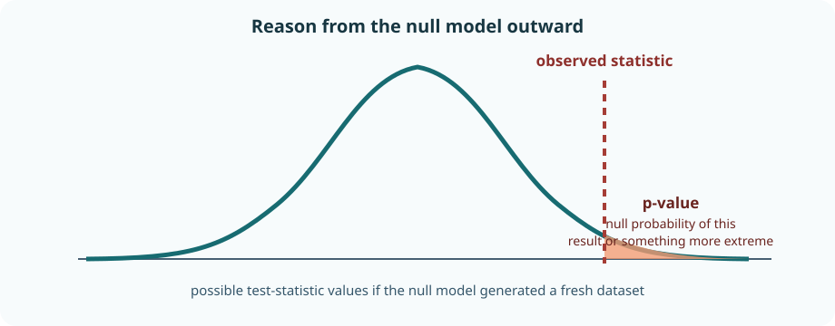
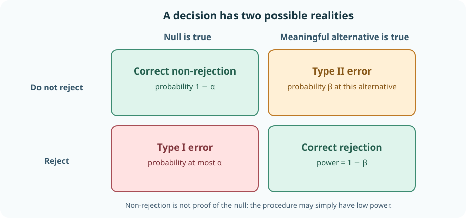
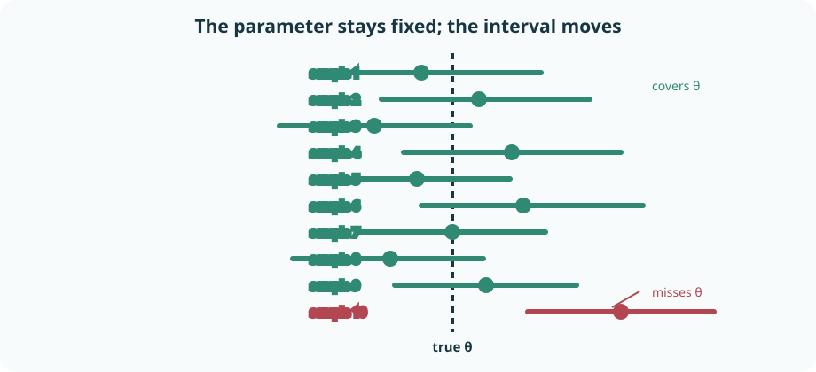
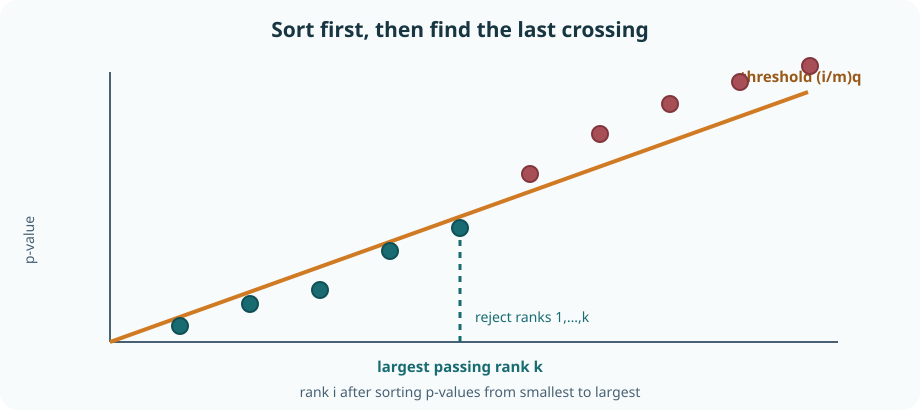

# Hypothesis testing, confidence intervals, power, and multiple comparisons

Estimation asks, “What value is plausible?” Hypothesis testing asks a sharper question: “Would data this incompatible with a proposed explanation be unusual if that explanation generated a fresh dataset?” The answer can challenge a model, but it cannot mechanically prove a scientific story.

This chapter starts with finite binomial experiments so every probability can be inspected. It then develops p-values, error rates, confidence intervals, effect sizes, power, likelihood-ratio tests, and multiple-comparison control. Throughout, the central discipline is to specify the target population, sampling unit, statistic, and selection process before interpreting a number.

By the end, you should be able to construct and interpret a test from its null distribution; distinguish p-values from error probabilities; invert tests to obtain confidence sets; choose paired or independent analyses; separate practical importance from statistical detectability; calculate power and approximate sample size; derive a likelihood-ratio statistic; control family-wise error or false discovery rate; and audit an AI evaluation for dependence, adaptive selection, and multiplicity.

## 0. Begin with the question and the experiment

Suppose a new model answers 74 of 100 evaluation prompts correctly. Before calculating anything, identify six objects:

1. **Target population:** the prompts or interactions to which the conclusion should generalize.
2. **Sampling unit:** the unit treated as a fresh independent draw—perhaps a prompt, user, document, or task.
3. **Estimand:** the population quantity, such as accuracy or the paired accuracy difference.
4. **Null hypothesis:** the set of data-generating distributions being challenged.
5. **Alternative:** the departures the study is designed to detect.
6. **Analysis plan:** the statistic, rejection rule, and any selection or stopping rule.

If the 100 prompts were repeatedly tuned against, they are not an untouched random sample merely because the final report contains a p-value. If ten responses came from each of ten users, the independent unit may be the user rather than the response. Testing formulas inherit the design; they cannot repair it.

**Worked example — a model upgrade.** Model A and model B answer the same 500 prompts. The natural observation is the within-prompt difference, not two unrelated accuracy counts. Easy prompts may be answered correctly by both models and difficult prompts incorrectly by both, so pairing removes shared prompt difficulty from the comparison. The estimand might be the expected accuracy difference on new prompts drawn from the specified deployment mixture.

> **Practice — Foundation:** For a coin-flip study, name the target, sampling unit, estimand, null, and alternative.
>
> **Practice — Core:** In an evaluation with 20 completions from each of 50 users, argue whether the response or user should be the independent unit.
>
> **Practice — Stretch:** Describe an evaluation in which the mathematical test is executed correctly but the scientific conclusion is invalid because the target population was never sampled.

## 1. A hypothesis is a set of probability models

A statistical hypothesis is not merely a verbal claim. It specifies a set of distributions for the observable data.

For iid Bernoulli observations \(X_1,\ldots,X_n\), a **simple null** fixes one distribution:

$$
H_0:p=0.5.
$$

A **composite null** contains many distributions:

$$
H_0:p\leq 0.5.
$$

A two-sided alternative might be

$$
H_1:p\neq0.5,
$$

while a directional alternative might be \(H_1:p>0.5\). The hypotheses must refer to the population parameter, not the observed estimate. Writing \(H_0:\hat p=0.5\) confuses the random statistic with the population quantity.

The null often represents a benchmark, invariance, or absence of a specified effect. It does not need to be literally believable. It supplies a reference distribution against which the observed statistic is calibrated.

**Worked example — equivalence is different.** Failure to reject \(H_0:\delta=0\) does not establish that an accuracy difference \(\delta\) is negligible. An equivalence study instead specifies a tolerance \(\Delta>0\) and asks whether data support

$$
-\Delta<\delta<\Delta.
$$

“No detected difference” and “evidence of practical equivalence” answer different questions.

> **Practice — Foundation:** Classify \(H_0:p=0.2\) and \(H_0:p\leq0.2\) as simple or composite.
>
> **Practice — Core:** Write null and alternative hypotheses for detecting either improvement or degradation relative to 80% accuracy.
>
> **Practice — Stretch:** Formalize a non-inferiority question in which a cheaper model may be at most two percentage points worse than a reference model.

## 2. A test statistic compresses the evidence

A **test statistic** is a function \(T(X_1,\ldots,X_n)\) chosen so values in some direction represent greater incompatibility with the null. For Bernoulli data under \(H_0:p=p_0\), the success count

$$
S=\sum_{i=1}^n X_i
$$

has the exact null distribution

$$
S\sim\operatorname{Binomial}(n,p_0).
$$

For a right-sided test, large \(S\) challenges \(H_0\). A standardized statistic often makes the scale easier to compare:

$$
Z=\frac{\hat p-p_0}{\sqrt{p_0(1-p_0)/n}}.
$$

The denominator is calculated under the null because the null distribution is the reference being tested. An exact test can use the binomial probabilities directly; a large-sample test approximates the distribution of \(Z\) by a standard Gaussian.

The statistic should be chosen before inspecting outcomes. Searching many statistics and reporting the most extreme one changes the null distribution of the reported result.

**Worked example — ten Bernoulli trials.** Under \(H_0:p=0.5\), observe \(S=9\) successes in \(n=10\). The exact right-tail probability is

$$
P_{0.5}(S\geq9)
=\frac{\binom{10}{9}+\binom{10}{10}}{2^{10}}
=\frac{11}{1024}\approx0.0107.
$$

No limiting approximation is needed.

> **Practice — Foundation:** State the null distribution of \(S\) when \(n=20\) and \(p_0=0.3\).
>
> **Practice — Core:** Calculate the exact probability of at least four successes in five trials under \(p_0=0.5\).
>
> **Practice — Stretch:** Give two statistics for comparing paired binary predictions and explain what information one discards that the other retains.

## 3. The p-value is a probability under the null

For a statistic where larger values are more incompatible with \(H_0\), the p-value is

$$
p_{\text{value}}
=P_{H_0}(T(X^{\mathrm{new}})\geq T(x^{\mathrm{obs}})).
$$

The probability concerns a fresh hypothetical dataset \(X^{\mathrm{new}}\) generated under the null. The observed statistic is fixed inside the comparison.

A p-value is **not**:

- the probability that the null is true;
- the probability the result occurred by chance;
- the probability a replication will fail;
- the effect size;
- the false-positive probability for this particular claim.

Those quantities require other ingredients, such as prior probabilities, an explicit replication design, or a population of tested claims.

For a composite null, a valid p-value must control the tail probability across every distribution in the null, often by using the least favorable case:

$$
p_{\text{value}}=\sup_{\theta\in\Theta_0}
P_\theta(T\geq T_{\mathrm{obs}}).
$$

**Worked example — two-sided binomial evidence.** With \(n=10,p_0=0.5,S=9\), symmetry makes \(S\leq1\) equally extreme. The doubled smaller-tail p-value is

$$
2P_{0.5}(S\geq9)=\frac{22}{1024}\approx0.0215.
$$

For asymmetric discrete distributions, “two-sided” has several defensible definitions: double the smaller tail, sum outcomes no more likely than the observed outcome, or invert a chosen family of tests. Software output is not interpretable until its definition is known.

> **Practice — Foundation:** Explain what is random and what is fixed in the definition of a p-value.
>
> **Practice — Core:** Compute right-sided and doubled-tail p-values for nine successes in ten fair trials.
>
> **Practice — Stretch:** Construct an example showing why \(P(\text{data}\mid H_0)\) cannot be reversed into \(P(H_0\mid\text{data})\) without additional assumptions.

## 4. Rejection rules control long-run errors

A level-\(\alpha\) test rejects when its p-value is at most \(\alpha\). Its **Type I error rate** satisfies

$$
\sup_{\theta\in\Theta_0}P_\theta(\text{reject }H_0)\leq\alpha.
$$

This is a property of the procedure across repeated datasets generated under the null. It is not a posterior probability that a particular rejection is wrong.

At a particular alternative \(\theta\in\Theta_1\):

- **Type II error** is \(\beta(\theta)=P_\theta(\text{do not reject})\);
- **power** is \(1-\beta(\theta)=P_\theta(\text{reject})\).

There is no single Type II error rate unless a particular alternative or distribution over alternatives is specified. A test can have high power for a large effect and low power for a small effect.

Discrete tests may be conservative. If attainable binomial tail probabilities jump from 0.061 to 0.031, a nominal 0.05 rule may have an actual Type I error below 0.05 because no boundary produces exactly 0.05.

> **Practice — Foundation:** Define Type I error, Type II error, and power in words.
>
> **Practice — Core:** A procedure rejects 4% of the time at the null and 83% at a specified alternative. Identify its actual size and power.
>
> **Practice — Stretch:** Explain why decreasing \(\alpha\) while holding sample size and rejection-statistic family fixed usually decreases power.

## 5. One-sided and two-sided tests answer different questions

A right-sided test looks for \(\theta>\theta_0\), a left-sided test for \(\theta<\theta_0\), and a two-sided test for either direction. A one-sided test concentrates its rejection probability in one tail and therefore has more power in that prespecified direction. It gives up the ability to call a large result in the opposite direction significant under the same rule.

The direction must come from the decision problem before observing the estimate. Choosing a one-sided direction after seeing the sign roughly halves a symmetric two-sided p-value without having paid the corresponding error-control cost.

**Worked example — latency.** For a safety check, a model being slower than 300 ms may be the only harmful direction, suggesting \(H_1:\mu>300\). For a systems regression test, either unusually slow or unusually fast behavior could indicate a measurement or caching defect, suggesting a two-sided alternative. Direction is substantive, not cosmetic.

Non-inferiority and equivalence tests also require care. They shift the null to a practically meaningful margin instead of using equality at zero. In a non-inferiority test with benefit difference \(\delta\) and allowed loss \(\Delta\), one formulation is

$$
H_0:\delta\leq-\Delta,
\qquad
H_1:\delta>-\Delta.
$$

> **Practice — Foundation:** Choose a direction for detecting whether a defect rate exceeds 1%.
>
> **Practice — Core:** Explain why changing from two-sided to one-sided after observing the data invalidates the advertised error rate.
>
> **Practice — Stretch:** Write hypotheses for an equivalence test with margin \(\Delta\), then explain why rejecting \(H_0:\delta=0\) is neither necessary nor sufficient for equivalence.

## 6. Confidence is coverage by a procedure

A \(100(1-\alpha)\%\) confidence interval is a data-dependent set \(C(X)\) designed so

$$
P_\theta(\theta\in C(X))\geq1-\alpha
$$

for parameter values covered by the method's assumptions. Across repeated datasets, the parameter is fixed and the interval endpoints vary.

After one interval is observed, frequentist coverage does not mean the fixed parameter has a 95% probability of lying inside that realized interval. The procedure either produced an interval containing the truth or it did not; the 95% describes its repeated-sampling calibration. A Bayesian credible interval answers a different probability question under a prior and likelihood.

Coverage is conditional on the assumed sampling process. An interval with 95% iid coverage need not retain 95% coverage under clustering, optional stopping, model selection, or distribution shift.

**Worked example — Gaussian mean with known variance.** If \(X_i\) are iid with mean \(\mu\), known variance \(\sigma^2\), and a valid Gaussian sampling distribution for the standardized mean, then

$$
\bar X\pm z_{1-\alpha/2}\frac{\sigma}{\sqrt n}
$$

has coverage \(1-\alpha\). At 95%, \(z_{0.975}\approx1.96\). The margin of error shrinks as \(1/\sqrt n\), so halving it requires roughly four times as many independent observations.

> **Practice — Foundation:** In repeated confidence-interval construction, identify which quantity is fixed and which quantities vary.
>
> **Practice — Core:** If a margin of error is 6 points at \(n=100\), estimate the sample size required for a 3-point margin under the same design.
>
> **Practice — Stretch:** Explain why an interval can have correct unconditional coverage but poor coverage for a selected subgroup or after choosing the most favorable metric.

## 7. Tests and confidence sets are dual views

For each candidate parameter value \(\theta_0\), imagine a level-\(\alpha\) test of \(H_0:\theta=\theta_0\). Collect every value not rejected:

$$
C(x)=\{\theta_0:\text{the level-}\alpha
\text{ test does not reject }\theta_0\}.
$$

Under suitable construction, \(C(x)\) is a \(1-\alpha\) confidence set. Therefore, a two-sided null value is rejected exactly when it lies outside the corresponding interval.

This duality prevents contradictory reporting. If a two-sided 5% test rejects zero but a claimed 95% interval contains zero, the procedures, approximations, or tails do not match.

It also clarifies what an interval communicates beyond a binary decision: the width shows resolution, and the location shows which effect sizes remain compatible with the data under the method.

**Worked example — practical threshold.** Suppose an estimated accuracy gain is 0.8 percentage points with a 95% interval from 0.1 to 1.5. A test of zero rejects at 5%, but the interval also says that gains above a required 2-point deployment threshold are not supported. Statistical detection does not establish operational value.

> **Practice — Foundation:** State the interval criterion for rejecting \(H_0:\theta=\theta_0\) with a matching two-sided test.
>
> **Practice — Core:** Interpret an interval \([-0.03,0.12]\) for a model's accuracy difference relative to both zero and a required improvement of 0.10.
>
> **Practice — Stretch:** Prove coverage of an inverted confidence set directly from the test's Type I error guarantee.

## 8. Exact binomial inference and the limits of Wald intervals

For \(S=s\) successes in \(n\) iid Bernoulli trials, an exact right-sided test of \(p=p_0\) uses

$$
P_{p_0}(S\geq s)
=\sum_{k=s}^{n}\binom nkp_0^k(1-p_0)^{n-k}.
$$

The corresponding left tail sums from \(0\) to \(s\). A common two-sided rule doubles the smaller tail and caps the result at one.

An **exact equal-tailed interval** can be obtained by inversion. For \(0<s<n\), choose endpoints satisfying

$$
P_{p_L}(S\geq s)=\alpha/2,
\qquad
P_{p_U}(S\leq s)=\alpha/2.
$$

At \(s=0\), set \(p_L=0\); at \(s=n\), set \(p_U=1\). The discreteness makes this interval conservative: its coverage is at least the target rather than exactly equal at every \(p\).

The familiar Wald interval

$$
\hat p\pm z_{1-\alpha/2}
\sqrt{\frac{\hat p(1-\hat p)}{n}}
$$

can fail badly for small samples or boundary estimates. If \(s=0\), it collapses to \([0,0]\), falsely communicating certainty. It can also extend below zero or above one. Score-based or exact intervals are safer in these regimes.

**Worked example — zero observed failures.** Observing 0 failures in 20 trials does not imply the failure probability is exactly zero. For a one-sided 95% upper bound \(u\), solve

$$
P_u(S=0)=(1-u)^{20}=0.05,
$$

so \(u=1-0.05^{1/20}\approx0.139\). Twenty clean trials still allow a substantial rare failure rate.

> **Practice — Foundation:** Write the exact right-tail sum for at least 8 successes in 10 trials under \(p_0=0.5\).
>
> **Practice — Core:** Derive the one-sided upper bound after zero events in \(n\) trials at tail probability \(\alpha\).
>
> **Practice — Stretch:** Simulate coverage of the Wald and exact intervals at \(n=20\) for \(p\in\{0.01,0.1,0.5\}\), and explain the patterns.

## 9. Tests for means: standardization and Student's t

Suppose \(X_1,\ldots,X_n\) are iid with mean \(\mu\). If the population standard deviation \(\sigma\) were known, a standardized mean would be

$$
Z=\frac{\bar X-\mu_0}{\sigma/\sqrt n}.
$$

Usually \(\sigma\) is unknown and replaced by the sample standard deviation \(S\):

$$
t=\frac{\bar X-\mu_0}{S/\sqrt n}.
$$

For iid Gaussian data, this statistic has a Student \(t\) distribution with \(n-1\) degrees of freedom under the null. Its heavier tails account for estimating the denominator. As \(n\) grows, the \(t\) distribution approaches the standard Gaussian.

For non-Gaussian data, the t procedure is often approximately valid for a mean when the sample is sufficiently large and no small number of observations dominates. “Sufficiently large” depends on skewness, tail weight, and dependence; it is not a universal cutoff.

**Worked example — paired latency measurements.** Measure both systems on each of 30 requests and define \(D_i=X_{i,B}-X_{i,A}\). A paired t test is simply a one-sample t test of \(E[D_i]=0\). Its standard error uses variation among differences. An unpaired analysis discards the covariance between measurements and may be much less precise.

> **Practice — Foundation:** Why does a t statistic use \(n-1\) degrees of freedom in the one-sample Gaussian case?
>
> **Practice — Core:** Convert paired observations into a one-sample testing problem and write its statistic.
>
> **Practice — Stretch:** Give a heavy-tailed data-generating process for which the sample mean and t approximation converge slowly, then propose a diagnostic simulation.

## 10. Independent, paired, clustered, and repeated data

The standard error is determined by the source of independent variation.

- **Independent groups:** observations in A and B come from separate units; uncertainty combines two group variances.
- **Paired data:** A and B are measured on the same units; analyze within-unit differences.
- **Clustered data:** rows share users, documents, tasks, or sessions; information grows primarily with independent clusters.
- **Repeated seeds:** multiple runs reveal training randomness but do not create new test prompts or new deployment domains.

For independent sample means,

$$
\operatorname{SE}(\bar X_A-\bar X_B)
\approx\sqrt{\frac{s_A^2}{n_A}+\frac{s_B^2}{n_B}}.
$$

For paired data with differences \(D_i\),

$$
\operatorname{SE}(\bar D)=\frac{s_D}{\sqrt n}.
$$

The covariance hidden inside \(s_D^2=s_A^2+s_B^2-2\operatorname{Cov}(A,B)\) can make pairing far more efficient.

For binary outcomes from two independent groups, let \(\hat p_A=a/n_A\) and \(\hat p_B=b/n_B\). Under the equality null \(p_A=p_B\), the restricted estimate pools successes:

$$
\hat p_{\mathrm{pool}}=\frac{a+b}{n_A+n_B}.
$$

The large-sample null statistic is

$$
Z=\frac{\hat p_A-\hat p_B}
{\sqrt{\hat p_{\mathrm{pool}}(1-\hat p_{\mathrm{pool}})
(1/n_A+1/n_B)}}.
$$

Pooling belongs to the equality-null calibration. A confidence interval for the unrestricted difference instead usually uses the separate plug-in variance

$$
\frac{\hat p_A(1-\hat p_A)}{n_A}
+\frac{\hat p_B(1-\hat p_B)}{n_B}.
$$

Small expected counts or boundary proportions make these Gaussian approximations unreliable; an exact finite-table analysis or a better score-based interval may be appropriate.

**Worked example — paired binary predictions.** For the same evaluation items, record a \(2\times2\) table: both models correct, only A correct, only B correct, and both wrong. Let \(c\) be the A-only count and \(b\) the B-only count. Under a null of equal paired success probabilities, conditional on the \(b+c\) discordant items, the B-only count has

$$
B\mid(B+C=b+c)\sim\operatorname{Binomial}(b+c,0.5).
$$

This is the exact paired binary, or McNemar, test. Agreements contain information about overall difficulty but not about which model wins. The estimated accuracy difference is \((b-c)/n\), so the test and effect estimate should be reported together.

**Worked example — benchmark items and seeds.** Evaluating five seeds on the same 1,000 items produces a crossed structure: seed variability and item variability both matter. Treating all 5,000 predictions as iid ignores shared model instances and shared items. A defensible analysis must say whether it targets a new seed, new item, both, or only these fixed instances.

> **Practice — Foundation:** Classify three designs as independent, paired, or clustered.
>
> **Practice — Core:** Show algebraically how positive within-pair covariance reduces the variance of a difference.
>
> **Practice — Stretch:** Design an uncertainty analysis for models evaluated across seeds, tasks, and examples, making the intended generalization axes explicit.

## 11. Effect size answers “how much?”

A p-value measures incompatibility with a null under a model. An **effect size** measures magnitude on a scientifically meaningful scale.

Examples include:

- absolute accuracy difference \(p_B-p_A\);
- relative risk \(p_B/p_A\);
- odds ratio;
- mean latency difference in milliseconds;
- standardized mean difference \((\mu_B-\mu_A)/\sigma\);
- log-loss difference per token or per document.

Standardization can aid comparison across scales, but it can hide practical meaning. A 20 ms latency reduction and a 0.2-standard-deviation reduction answer different questions. Report raw effects and uncertainty whenever possible.

With very large \(n\), a negligible effect can produce a tiny p-value. With small \(n\), an important effect can remain uncertain. The interval connects magnitude and precision; the decision threshold connects them to utility.

**Worked example — cheap but slightly weaker.** A smaller model is 0.4 percentage points less accurate, with a 95% interval from -0.9 to 0.1 points, and cuts cost by 60%. A zero-effect test does not answer whether that trade is acceptable. A non-inferiority margin based on product utility is more relevant than insisting on exact equality.

> **Practice — Foundation:** Name an interpretable raw effect size for binary accuracy.
>
> **Practice — Core:** Explain how the same effect estimate can be statistically significant at \(n=100{,}000\) and non-significant at \(n=100\).
>
> **Practice — Stretch:** Define a utility-weighted estimand that combines model quality, latency, and cost, then identify assumptions needed to test it.

## 12. Power and sample-size planning

Power is calculated under a specified alternative. For a rough two-sided comparison of a mean-like estimator with standard deviation \(\sigma\), detecting an effect \(\delta\) at level \(\alpha\) and power \(1-\beta\) requires approximately

$$
n\approx
\left(\frac{(z_{1-\alpha/2}+z_{1-\beta})\sigma}{\delta}\right)^2.
$$

This formula exposes the main relationships:

- halving the target effect requires about four times the sample size;
- noisier measurements require more data;
- stricter Type I error control requires more data;
- higher desired power requires more data.

For proportions, the variance depends on the baseline and alternative probabilities. For clusters, replace nominal row count with an effective information calculation or simulate the actual design. For discrete exact tests, compute power by summing alternative probabilities over the exact rejection region.

**Worked example — exact binomial power.** First choose the rejection set \(R\) so \(P_{p_0}(S\in R)\leq\alpha\). At a particular \(p_1\), power is

$$
P_{p_1}(S\in R)
=\sum_{s\in R}\binom ns p_1^s(1-p_1)^{n-s}.
$$

The rejection rule is calibrated under \(p_0\); its detection probability is evaluated under \(p_1\).

Planning should use the **smallest effect worth detecting**, not an optimistic effect chosen to make \(n\) small. Account for attrition, invalid samples, clustering, and multiplicity before data collection.

> **Practice — Foundation:** What happens approximately to required \(n\) when the target effect is halved?
>
> **Practice — Core:** Given a rejection region for a binomial test, write its exact power at an alternative \(p_1\).
>
> **Practice — Stretch:** Plan a benchmark comparison in which prompts are clustered by task and five primary metrics are tested. Explain every adjustment to the naive iid single-test sample size.

## 13. Likelihood-ratio tests compare best fits

Let \(Theta_0\subseteq\Theta\) be the null parameter space inside a larger model. Compare the best likelihood achievable under the null with the best likelihood overall:

$$
\Lambda(x)
=\frac{\sup_{\theta\in\Theta_0}L(\theta;x)}
{\sup_{\theta\in\Theta}L(\theta;x)}.
$$

Because the numerator is optimized over a restricted set, \(0\leq\Lambda\leq1\). Small \(\Lambda\) challenges the restriction. The conventional statistic is

$$
-2\log\Lambda
=2\left[\ell(\hat\theta)-\ell(\hat\theta_0)\right].
$$

Under regularity conditions and a true interior null, Wilks' approximation gives a chi-squared null distribution with degrees of freedom equal to the number of independent restrictions.

**Worked example — Bernoulli likelihood ratio.** For \(s\) successes in \(n\) trials, the unrestricted MLE is \(\hat p=s/n\). Testing \(p=p_0\) gives

$$
-2\log\Lambda
=2\left[
s\log\frac{\hat p}{p_0}
+(n-s)\log\frac{1-\hat p}{1-p_0}
\right],
$$

with zero-count terms interpreted as zero. This is twice \(n\) times the Bernoulli KL divergence from \(\hat p\) to \(p_0\).

Wilks' approximation can fail at boundaries, under non-identifiability, with small samples, after model selection, or when the assumed likelihood is wrong. In finite simple settings, enumerate or simulate the null distribution instead of invoking an asymptotic label automatically.

> **Practice — Foundation:** Explain why \(\Lambda\leq1\).
>
> **Practice — Core:** Derive the Bernoulli likelihood-ratio statistic from the restricted and unrestricted maximized log-likelihoods.
>
> **Practice — Stretch:** Give one boundary and one non-identifiable model where a naive chi-squared calibration is suspect, and propose a finite-sample calibration method.

## 14. One study can contain a family of tests

If \(m\) independent true null hypotheses each have rejection probability exactly \(\alpha\), the probability of at least one false rejection is

$$
1-(1-\alpha)^m.
$$

At \(m=20\) and \(\alpha=0.05\), this is about 0.642. Even without independence, the union bound gives

$$
P(\text{one or more false rejections})\leq m\alpha.
$$

The **family-wise error rate** (FWER) is the probability of at least one false rejection in the declared family.

### Bonferroni

Test each hypothesis at \(\alpha/m\), or multiply each p-value by \(m\) and cap at one. The union bound makes this valid under arbitrary dependence, though it can be conservative.

### Holm's step-down procedure

Sort \(p_{(1)}\leq\cdots\leq p_{(m)}\). Compare \(p_{(1)}\) with \(\alpha/m\), then \(p_{(2)}\) with \(\alpha/(m-1)\), continuing until the first failure. Reject all earlier hypotheses. Holm controls FWER under arbitrary dependence and is never less powerful than ordinary Bonferroni.

The family must be defined by the scientific workflow, not only by the tests displayed in the final table. Hidden metrics, prompt slices, checkpoints, seeds, and analysis variants still create selection opportunities.

> **Practice — Foundation:** Compute the Bonferroni per-test threshold for 20 tests at family level 0.05.
>
> **Practice — Core:** Apply Holm's rule to p-values \(0.003,0.018,0.021,0.20\) at \(\alpha=0.05\).
>
> **Practice — Stretch:** Define the appropriate testing family when a team compares four models on six metrics and reports only the strongest metric for each model.

## 15. False discovery rate permits a different tradeoff

When screening many hypotheses, preventing even one false rejection may be unnecessarily strict. Let \(R\) be the number of rejections and \(V\) the number of rejected true nulls. The **false discovery proportion** is

$$
\operatorname{FDP}=\frac{V}{\max(R,1)},
$$

and the **false discovery rate** is \(E[\operatorname{FDP}]\).

The Benjamini–Hochberg (BH) step-up rule at target \(q\) is:

1. sort p-values \(p_{(1)}\leq\cdots\leq p_{(m)}\);
2. find the largest \(k\) satisfying

$$
p_{(k)}\leq\frac{k}{m}q;
$$

3. reject ranks \(1,\ldots,k\). If no rank passes, reject none.

BH controls FDR under independence and under important forms of positive dependence. Arbitrary dependence, adaptive hypothesis generation, and selected reporting require more care.

Adjusted BH p-values preserve original order after computation. In sorted order they are

$$
\tilde p_{(i)}=
\min_{j\geq i}\min\left(1,\frac{m}{j}p_{(j)}\right).
$$

The reverse cumulative minimum is essential: it makes adjusted values nondecreasing with rank.

**Worked example.** For p-values \(0.004,0.011,0.03,0.20\) and \(q=0.05\), thresholds are \(0.0125,0.025,0.0375,0.05\). The first three pass their thresholds and the fourth does not, so \(k=3\) and the first three hypotheses are rejected.

> **Practice — Foundation:** Distinguish FWER from FDR in one sentence each.
>
> **Practice — Core:** Apply BH at \(q=0.05\) to \(0.004,0.011,0.03,0.20\).
>
> **Practice — Stretch:** Explain why interpreting \(q=0.05\) as “every rejected hypothesis has a 5% probability of being false” is incorrect.

## 16. Selection, optional stopping, and data leakage

A fixed-analysis p-value assumes the reported test was specified independently of the same random outcomes used to calculate it. Common violations include:

- trying many prompts, metrics, subgroups, preprocessing choices, or seeds;
- checking results repeatedly and stopping once \(p\leq0.05\);
- selecting a checkpoint on the evaluation set;
- deleting “outliers” only when they weaken the conclusion;
- writing hypotheses after inspecting surprising patterns;
- repeatedly publishing against the same benchmark.

These choices change the distribution of the final reported statistic. A correction applied only to the visible final tests does not account for hidden search.

**Worked example — repeated peeking.** A team runs an ordinary fixed-\(n\) 5% test after every new batch and stops at the first rejection. Each look creates another opportunity to cross the threshold. The overall false-positive probability can exceed 5%. Valid sequential methods use boundaries or evidence processes designed for repeated looks; simply reusing the fixed-sample threshold is not valid.

Holdout separation helps only when it is real. Once test-set outcomes guide model changes, the set becomes part of training and selection. A new untouched sample, nested evaluation, or explicit reusable-holdout method may be needed.

> **Practice — Foundation:** Give two examples of researcher degrees of freedom that create hidden multiplicity.
>
> **Practice — Core:** Explain why optional stopping changes the Type I error of an ordinary fixed-sample test.
>
> **Practice — Stretch:** Design a three-way data split for architecture selection, threshold tuning, and final evaluation, stating exactly what information may cross each boundary.

## 17. Testing in leading AI research workflows

AI evaluation commonly mixes several randomness sources:

- training initialization and data order;
- sampled model outputs;
- prompts or benchmark items;
- tasks, domains, languages, and user groups;
- human raters;
- system and hardware variability.

A reported standard error should reveal which sources are random and which are conditioned on. Five seeds on one benchmark do not measure benchmark-sampling uncertainty. Ten thousand items from three tasks do not create ten thousand independent task draws. Repeated generations from one prompt measure conditional generation variability, not prompt-population diversity.

For every claim, write an **estimand sentence**:

> Over new draws of [units] from [population], averaging over [randomness], the expected difference between [systems] on [metric] is [parameter].

Then build the test around those units. Prefer paired comparisons when systems see the same items. Report per-task or per-cluster effects when aggregation can hide heterogeneity. Predeclare primary metrics and stopping rules. Include confidence intervals and raw effect sizes, not only stars or thresholds.

**Worked example — twelve tasks, five seeds.** If the scientific claim generalizes to new tasks, task-level variation cannot be ignored. One defensible summary computes a paired model difference within each task, aggregates seeds within task according to the desired seed estimand, and treats tasks as the top-level sampling units. With only twelve tasks, uncertainty will honestly be wide. Counting every generated token as independent would manufacture precision.

> **Practice — Foundation:** List the randomness sources in a two-model benchmark with sampled responses and human ratings.
>
> **Practice — Core:** Write an estimand sentence for generalization to new tasks and new training seeds.
>
> **Practice — Stretch:** Audit a leaderboard where hundreds of teams repeatedly submit to a fixed hidden test set. Identify selection effects that an individual team's nominal p-value omits.

## 18. A disciplined analysis and reporting workflow

Before data:

1. define the population, unit, estimand, and practically meaningful effect;
2. specify hypotheses and whether directionality is justified;
3. choose the statistic and its null calibration;
4. define the family of tests and correction;
5. plan sample size using realistic variance and dependence;
6. fix stopping, exclusion, and missing-data rules.

After data:

1. inspect data quality and design assumptions without silently changing the primary question;
2. report the estimate, interval, test definition, statistic, and p-value;
3. distinguish confirmatory analyses from exploratory follow-ups;
4. disclose all tested outcomes relevant to the family;
5. show sensitivity to clustering, influential units, and reasonable analysis choices;
6. state what population and randomness sources the conclusion does—and does not—cover.

Avoid “accept the null” unless an acceptance or equivalence design supports that claim. Prefer “the procedure did not reject” and describe the interval's remaining uncertainty. Avoid treating \(p=0.049\) and \(p=0.051\) as qualitatively opposite discoveries.

> **Practice — Foundation:** Rewrite “the null is true because \(p=0.31\)” as a calibrated statement.
>
> **Practice — Core:** Produce a minimal results sentence containing an effect estimate, interval, test, p-value, and analysis unit.
>
> **Practice — Stretch:** Create a preregistration outline for comparing two language models across quality, safety, latency, and cost without allowing the final claim to depend on an undisclosed metric search.

## 19. Runnable labs

This chapter has two coding exercises. In the theory reader, each exercise opens in the right-hand Python workspace and appears as its own task tab.

### Lab A — exact binomial test and interval

Implement **exact_binomial_test** in [labs/exercises.py](../../labs/exercises.py). Given a success count, trial count, null probability, confidence level, and alternative, return:

1. the observed success proportion;
2. the exact p-value using the requested left, right, or doubled-smaller-tail rule;
3. the two-sided equal-tailed exact confidence interval obtained by test inversion.

Run:

~~~text
python -m labs.checks binomial-test
~~~

The checks cover one- and two-sided alternatives, boundary samples, symmetry, interval inversion, invalid inputs, and numerical accuracy.

### Lab B — Benjamini–Hochberg correction

Implement **benjamini_hochberg** in [labs/exercises.py](../../labs/exercises.py). Given an iterable of p-values and a target false discovery rate, return:

1. Boolean rejection decisions in original input order;
2. BH-adjusted p-values in original input order.

Run:

~~~text
python -m labs.checks bh-fdr
~~~

The checks cover unsorted inputs, no and multiple discoveries, ties, generators, monotonic adjusted values, input preservation, and invalid probabilities.

### Guided experiment

1. Under several null Bernoulli probabilities, simulate complete datasets and verify that rejection frequency does not exceed the chosen level.
2. Under several alternatives, plot power against effect size and sample size.
3. Compare exact and Wald interval coverage near zero, near one, and at one half.
4. Simulate 100 hypotheses containing known nulls and alternatives. Compare uncorrected testing, Bonferroni, Holm, and BH using both false discoveries and missed effects.
5. Repeat with positively correlated test statistics and describe which conclusions survive.

## 20. Derivations to own

1. Derive exact left and right binomial tail probabilities.
2. Show that a valid null p-value satisfies \(P(p_{\text{value}}\leq\alpha)\leq\alpha\).
3. Derive the relationship between a rejection region and its power function.
4. Prove confidence-set coverage by inverting level-\(\alpha\) tests.
5. Derive a one-sided upper bound after zero observed events.
6. Derive the one-sample t statistic and explain why estimating scale changes its null distribution.
7. Derive the variance of a paired difference and compare it with an independent analysis.
8. Derive the approximate normal-theory sample-size relationship.
9. Derive the Bernoulli likelihood-ratio statistic.
10. Prove Bonferroni FWER control with the union bound.
11. Execute Holm and BH by hand on a small family.
12. Derive BH adjusted p-values using a reverse cumulative minimum.

## 21. End-of-unit practice (graded)

**Foundation — problems 1–5.** Establish definitions and perform direct calculations.

1. **Testing language.** A new model and baseline are scored on the same 200 prompts using a prespecified binary success rubric; the claim is that the new model improves success probability by more than 3 percentage points on fresh prompts from the deployment distribution. Identify the population, sampling unit, estimand, null, alternative, statistic, rejection rule, and possible decisions. State what changes if the 200 prompts are the complete target rather than a sample.
2. **Exact tail.** For \(S=7\) successes in \(n=8\) trials under \(H_0:p=0.5\), enumerate \(P(S=k)\) for \(k=0,\ldots,8\). Compute left-tail, right-tail, and doubled-smaller-tail p-values and note why "two-sided" needs a convention.
3. **Error table.** Fill the four cells formed by truth and decision; label Type I error, Type II error, power, and correct non-rejection.
4. **Interval interpretation.** Correct five common misinterpretations of a 95% confidence interval.
5. **Multiplicity arithmetic.** At family level \(\alpha=0.05\), compute Bonferroni thresholds and, under independent true nulls with unadjusted per-test level 0.05, the probability of at least one false rejection for \(m=5,20,100\).

**Core — problems 6–11.** Connect tests, intervals, power, and realistic designs.

6. **Test inversion.** For \(s=14,n=20\), construct a 95% equal-tailed exact binomial interval numerically by finding parameter values whose tail tests just cease to reject. Compare it with the Wald interval and check coverage by simulation at \(p=0.1,0.5,0.9\).
7. **Paired comparison.** For paired score differences \(d=(1,2,-1,0,3,1,-2,2)\), calculate the mean, standard error, t statistic, 95% t interval, and interpretation. Then incorrectly treat the two systems as independent and explain what covariance information was discarded.
8. **Effect and decision.** A measured accuracy gain is 0.018 with 95% interval \([0.004,0.032]\). Evaluate both \(H_0:\Delta=0\) and a deployment requirement \(\Delta\ge0.03\). State separately what the data establish statistically and operationally.
9. **Power curve.** For \(S\sim\operatorname{Binomial}(20,p)\), fix the rejection region \(S\ge15\), chosen before seeing data. Calculate power at \(p=0.5,0.6,0.7,0.8\) and explain its shape.
10. **Likelihood ratio.** For \(s=14,n=20\), compare \(H_0:p=0.5\) with unrestricted \(p\). Calculate both fitted log-likelihoods, derive \(-2\log\Lambda\), and compare asymptotic and exact-binomial calibrations.
11. **Stepwise correction.** At level \(0.05\), apply Bonferroni, Holm, and BH to \((0.003,0.012,0.018,0.041,0.20)\). Give each rejection set and name the error criterion targeted.

**Stretch — problems 12–17.** Audit complex inference and selection workflows.

12. **Discrete calibration.** Find the exact size of a nominal 5% binomial test for several \(n\) and explain why attainable sizes jump.
13. **Clustered benchmark.** Simulate prompts nested in tasks. Compare row-iid and task-level uncertainty as within-task correlation changes.
14. **Seeds and items.** Construct a crossed seed-by-item evaluation. State two different estimands and show why they require different variance calculations.
15. **Optional stopping.** Simulate repeated fixed-threshold peeking under a true null. Measure false-rejection probability as the maximum number of looks increases.
16. **Hidden multiplicity.** Simulate selecting the strongest among metrics, checkpoints, and subgroups. Compare the advertised single-test error with the workflow's actual error.
17. **Research audit.** Take an unfamiliar model-comparison claim and reconstruct its intended population, sampling units, selection path, test family, practical threshold, and unsupported extrapolations.

Worked solution sketches

1. Let \(D_i=Y_{i,\mathrm{new}}-Y_{i,\mathrm{base}}\). For fresh deployment prompts, \(\Delta=E[D_i]\), with \(H_0:\Delta\le0.03\) versus \(H_1:\Delta>0.03\); the prompt is the paired sampling unit. A statistic such as \(\bar D\) and a prespecified level-\(\alpha\) paired rule produce reject/do-not-reject decisions. If these 200 prompts are the whole target, \(\bar D\) is the finite-population effect and prompt-sampling inference is unnecessary, though model-run or rater randomness may remain.
2. List \(P_{p_0}(S=k)=\binom nkp_0^k(1-p_0)^{n-k}\). Sum the outcomes selected by each tail rule. State the exact definition used for “two-sided.”
3. Rejecting a true null is Type I error; not rejecting a specified false null is Type II error. Correct rejection has probability equal to power, and correct non-rejection under a boundary null has probability at least \(1-\alpha\).
4. Coverage concerns repeated random intervals, not posterior probability for a fixed realized interval. It does not guarantee the model, sampling design, or target population is correct, and it does not make every subgroup's coverage equal to 95%.
5. Bonferroni cutoffs are 0.01, 0.0025, and 0.0005. Unadjusted independent-family false-rejection probabilities are \(1-0.95^m\): approximately 0.226, 0.642, and 0.994 for \(m=5,20,100\).
6. For each candidate \(p_0\), evaluate the chosen exact test and retain non-rejected values. Equal-tailed endpoints can be found by bisection on the relevant binomial tail. Boundary success counts require endpoints zero or one.
7. Here \(\bar d=0.75\), \(s_d^2=19.5/7\approx2.786\), \(\operatorname{SE}\approx0.590\), and \(t\approx1.27\) on 7 degrees of freedom. With \(t_{.975,7}\approx2.365\), the interval is about \([-0.645,2.145]\): inconclusive about the population mean difference. An independent analysis discards the within-prompt covariance that pairing was designed to exploit.
8. The interval excludes zero, so a conventional two-sided zero-effect test rejects at 5%. But it includes effects far below 0.03 and is not wholly above the deployment threshold; the evidence does not establish that the gain is large enough to deploy.
9. Sum alternative binomial probabilities over the rejection region fixed under the null. Power is low near the null and generally rises as the alternative moves into the rejection direction.
10. The unrestricted estimate is \(s/n\); the restricted estimate is \(p_0\). Subtract maximized log-likelihoods and multiply by two. Calibration can be exact rather than asymptotic in the finite binomial model.
11. Bonferroni's 0.01 cutoff rejects only 0.003. Holm compares with 0.01, 0.0125, 0.0167, ... and rejects 0.003 and 0.012 before stopping. BH has rank cutoffs 0.01, 0.02, 0.03, 0.04, 0.05; the largest passing rank is 3, so it rejects 0.003, 0.012, and 0.018. Bonferroni and Holm control FWER; BH controls FDR under its stated dependence conditions.
12. Enumerate success counts and include those whose p-values cross 0.05. Sum their null probabilities. Discreteness prevents arbitrary rejection probability unless randomized tests are allowed.
13. Positive within-task correlation makes nominal row count exaggerate independent information. Row-iid intervals become too narrow while task-level methods reflect the limited number of independent tasks.
14. Generalizing across new items conditional on trained seeds differs from generalizing across both training reruns and items. A crossed analysis must preserve both axes rather than flattening all cells into iid rows.
15. Each look is another chance to cross a fixed boundary. Simulated false-rejection frequency rises with the number of allowed looks. Sequentially valid boundaries explicitly budget evidence across time.
16. The selected maximum is compared with the distribution of one prespecified statistic unless the whole search is included in calibration. Resimulate the complete selection procedure under the null to measure its real error.
17. A complete audit distinguishes design facts from analysis assumptions, includes unreported selection opportunities in the test family, reports effects and intervals, and limits claims to the sampled population and randomness sources.

## Mastery check

Given an unfamiliar research claim, define the population, sampling unit, estimand, hypotheses, statistic, and family of tests; derive or simulate the null distribution; calculate and correctly interpret a p-value and confidence interval; quantify effect size and power; choose paired, independent, or cluster-aware analysis; apply an appropriate multiplicity correction; and identify how optional stopping, adaptive selection, or distribution shift changes the conclusion.

The next unit develops bootstrap and permutation methods, sequentially valid testing, randomization, and experimental design.
