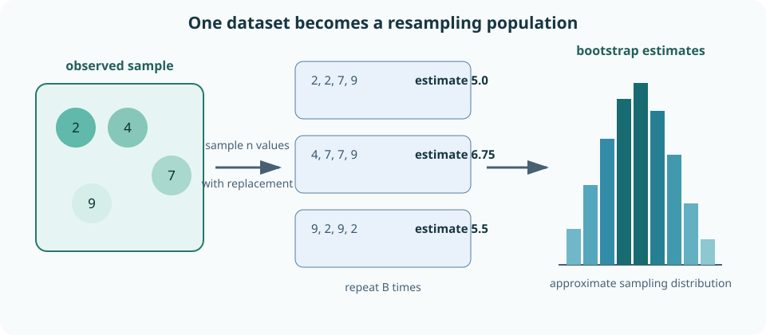
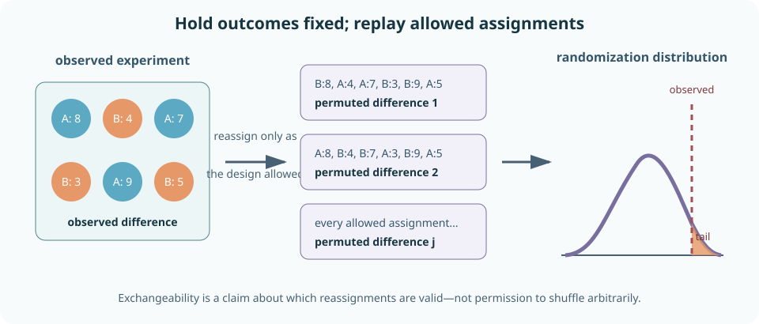
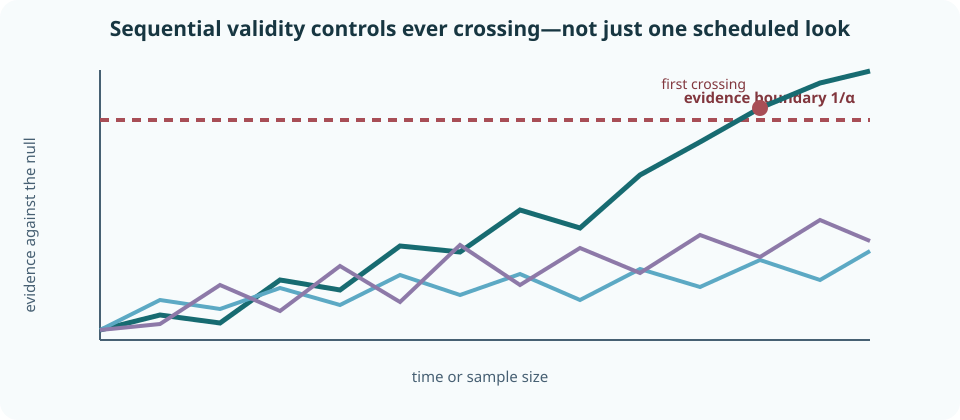
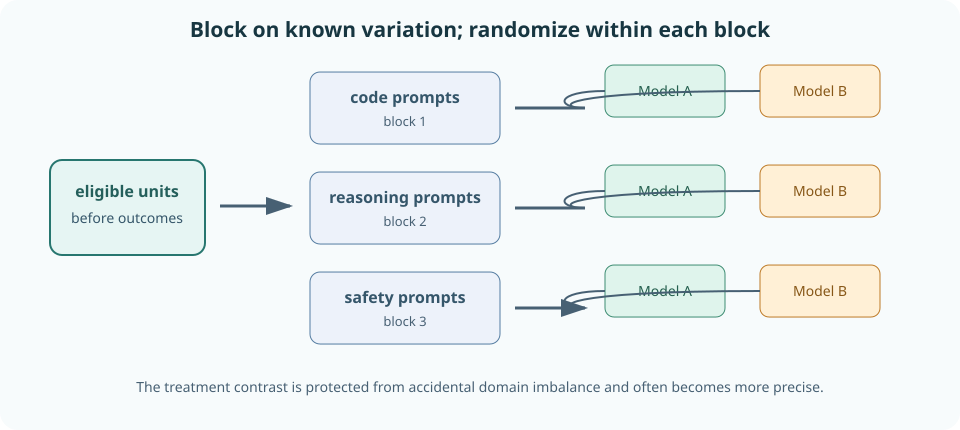

# Bootstrap, permutation tests, sequential inference, and experimental design

The previous chapter calibrated tests from probability models. But real estimators may be nonlinear, analytic standard errors may be unavailable, observations may arrive over time, and experiments may use assignment structures that a generic formula cannot see.

This chapter develops three responses:

- **resampling** approximates repeated datasets using the structure of the observed data or experimental assignment;
- **sequential inference** remains valid when evidence is monitored over time;
- **experimental design** creates trustworthy comparisons before any test is calculated.

The unifying question is: **what could legitimately have varied?** A bootstrap varies sampled units. A permutation test varies assignments or labels permitted by a null. A sequential method varies the stopping time. A randomized experiment varies treatment assignment. Each method is only as valid as that variation story.

By the end, you should be able to construct and diagnose bootstrap distributions; choose row, paired, stratified, cluster, or block resampling; derive exact and Monte Carlo permutation tests; connect randomization inference to an assignment mechanism; explain why ordinary repeated peeking fails; calculate likelihood-ratio e-values and anytime p-values; interpret confidence sequences; and design blocked, paired, factorial, or cluster-randomized experiments for AI systems.

## 0. Repeated sampling is the target

An estimator \(\hat\theta=T(X_1,\ldots,X_n)\) has a sampling distribution across fresh datasets from the target population. Standard errors, bias, intervals, and tests are summaries of that distribution.

Sometimes an exact sampling law is known. A Bernoulli count is binomial, and a Gaussian mean has familiar formulas. But consider:

- the median of a skewed latency distribution;
- the maximum error across safety categories;
- a ratio of two noisy metrics;
- an accuracy difference with prompts nested in tasks;
- a model selected from many checkpoints.

Deriving a correct finite-sample distribution can be difficult or impossible. Resampling constructs hypothetical datasets using an estimated version of the original data-generating process.

That does not make resampling assumption-free. It moves assumptions into the resampling rule. Resampling rows asserts that rows are exchangeable sampling units. Resampling users asserts that users are the independent units. Shuffling treatment labels asserts that the chosen assignments would be equivalent under the null.

**Worked example — median latency.** The sample median is easy to compute but has a sampling distribution that depends on population density near the true median. A bootstrap can approximate its variability without explicitly estimating that density. It still fails if requests were serially dependent and individual requests are resampled as though independent.

> **Practice — Foundation:** The mean latency of \(n=50\) requests sampled from last week's traffic is 210 ms with sample standard deviation 60 ms. Describe the repeated-sampling experiment whose distribution quantifies uncertainty in this mean, and compute its approximate standard error.
>
> **Hint:** Each repetition redraws 50 fresh requests from the same week's traffic; the SD of those means is approximated by \(s/\sqrt n\).
>
> **Practice — Core:** A dataset has 10 users with 30 rows each and within-user correlation \(\rho=0.2\). By what factor does a row-level bootstrap understate the variance of the overall mean, and what assumption does it introduce?
>
> **Hint:** The row bootstrap treats all 300 rows as independent; the true variance carries the design effect \(1+(m-1)\rho\) with \(m=30\).
>
> **Practice — Stretch:** In 1,000 requests, 999 cost \$0 and one incident costs \$10,000. Compute the plug-in bootstrap standard error of the mean cost, and predict when this observed-sample bootstrap underestimates the true error (for example, if real incidents can cost up to \$100,000).
>
> **Hint:** The bootstrap variance of the mean is \((n^{-1}\sum x_i^2-\bar x^2)/n\); no resample can contain a cost above the \$10,000 actually observed.

## 1. The empirical distribution is a fitted population

Given observations \(x_1,\ldots,x_n\), the empirical distribution places probability \(1/n\) on each observed value:

$$
\hat P_n=\frac1n\sum_{i=1}^n\delta_{x_i},
$$

where \(\delta_{x_i}\) is a point mass at \(x_i\). Drawing \(n\) times independently from \(\hat P_n\) is equivalent to sampling the observed rows with replacement.

A **nonparametric bootstrap sample**

$$
X_1^*,\ldots,X_n^*\overset{\mathrm{iid}}{\sim}\hat P_n
$$

has the same size as the original sample. Repeated values are expected; omitted values are expected. Compute the estimator on that sample:

$$
\hat\theta^*=T(X_1^*,\ldots,X_n^*).
$$

Conditional on the observed data, the distribution of \(\hat\theta^*\) approximates the unknown sampling distribution of \(\hat\theta\).



This is a plug-in argument. The unknown population \(P\) is replaced by \(\hat P_n\), then the repeated experiment is replayed under that fitted population.

> **Practice — Foundation:** Write the empirical probabilities assigned to values in the sample \(2,2,5,9\).
>
> **Hint:** Each of the four observations gets mass \(1/4\), and repeated values add their masses.
>
> **Practice — Core:** List the steps from the dataset \((3,1,4,1,5,9,2,6)\) to a bootstrap distribution of the median with \(B=2{,}000\) and seed 0, and report the observed median and the bootstrap standard error you obtain.
>
> **Hint:** Each replicate draws 8 indices with replacement, recomputes the median (the average of the two middle values), and stores it; the SD of the 2,000 medians is the bootstrap SE.
>
> **Practice — Stretch:** For a sample mean with plug-in variance \(\hat\sigma^2=4\) and \(n=100\), compute the bootstrap variance of the resampled mean with resample size \(m=n\) and with \(m=n/2\). Explain why the \(n/2\) version targets a different distribution and give the rescaling that fixes it for the mean.
>
> **Hint:** Conditional on the data, a size-\(m\) resample mean has variance \(\hat\sigma^2/m\); multiply by \(m/n\) to target the size-\(n\) sampling law.

## 2. The bootstrap algorithm

For \(B\) resamples:

1. draw \(n\) indices independently and uniformly from \(1,\ldots,n\);
2. form a same-size sample using those indices;
3. compute \(\hat\theta_b^*\);
4. store the result.

The stored values approximate a conditional distribution given the observed dataset.

The bootstrap estimate of standard error is the sample standard deviation of the bootstrap estimates:

$$
\widehat{\operatorname{SE}}_{\mathrm{boot}}
=
\sqrt{
\frac{1}{B-1}
\sum_{b=1}^B
\left(\hat\theta_b^*-\bar{\hat\theta}^*\right)^2
}.
$$

The bootstrap estimate of bias is

$$
\widehat{\operatorname{bias}}_{\mathrm{boot}}
=\bar{\hat\theta}^*-\hat\theta.
$$

There are two distinct approximation errors:

- **statistical error:** \(\hat P_n\) differs from the population \(P\);
- **Monte Carlo error:** only \(B\) resamples approximate the exact bootstrap distribution.

Increasing \(B\) reduces the second error but cannot create population support missing from the observed sample.

**Worked example — sample mean.** For iid data, the bootstrap standard error of the sample mean approximates \(s/\sqrt n\). This familiar case is useful for debugging code. The real value of the bootstrap is applying the same repeated-computation idea to statistics whose analytic standard errors are less convenient.

> **Practice — Foundation:** A dataset has \(n=250\) users and \(B=2{,}000\) bootstrap replicates are drawn. How many users are in each replicate, and how many estimates make up the bootstrap distribution?
>
> **Hint:** Each replicate has the original sample size; \(B\) counts replicates.
>
> **Practice — Core:** A sample of 500 users is drawn only from desktop traffic (true success rate 0.8), while deployment traffic is half desktop and half mobile (mobile rate 0.6). Compute the target, the estimator's limit, and its bootstrap SE, and explain why increasing \(B\) from 1,000 to 100,000 does not repair the bias.
>
> **Hint:** The target is \(0.5(0.8)+0.5(0.6)\), while the desktop-only mean converges to 0.8; \(B\) only reduces Monte Carlo error around that wrong centre, and the SE is about \(\sqrt{0.16/500}\).
>
> **Practice — Stretch:** Derive the conditional variance of a bootstrap sample mean and compare it with the usual variance estimate \(s^2/n\) of the original sample mean, evaluating both for \(x=(2,4,6,8)\).
>
> **Hint:** Each resampled draw has conditional variance \(\hat\sigma^2=n^{-1}\sum(x_i-\bar x)^2\); the mean of \(n\) iid draws divides this by \(n\), while \(s^2\) divides the squared deviations by \(n-1\).

## 3. Bootstrap intervals summarize the resampling distribution

Let \(q_\gamma^*\) denote the empirical \(\gamma\)-quantile of bootstrap estimates.

### Percentile interval

The percentile interval uses

$$
[q_{\alpha/2}^*,q_{1-\alpha/2}^*].
$$

It is intuitive and transformation-respecting: applying a monotone transformation to all estimates transforms the percentile endpoints in the same way. But skewness and estimator bias can make its coverage inaccurate.

### Basic interval

Reflect bootstrap errors around the observed estimate:

$$
\left[
2\hat\theta-q_{1-\alpha/2}^*,
2\hat\theta-q_{\alpha/2}^*
\right].
$$

This interval attempts to correct displacement of the bootstrap distribution, but it is not invariant to nonlinear transformations.

### Studentized interval

If each estimate has a usable standard-error estimate, bootstrap a standardized pivot:

$$
t_b^*=\frac{\hat\theta_b^*-\hat\theta}
{\widehat{\operatorname{SE}}_b^*}.
$$

Quantiles of \(t_b^*\) can deliver better coverage, at the cost of estimating uncertainty inside every resample.

Bias-corrected and accelerated intervals additionally adjust for median bias and changing standard error. They can improve accuracy but do not rescue a wrong sampling unit or an estimator with unstable behavior.

**Worked example — ratio metric.** A conversion-per-cost ratio is right-skewed when cost can be small. A symmetric estimate \(\pm 1.96\) standard-error interval may extend into impossible values. A bootstrap distribution can reveal skewness, but resamples with near-zero denominator may also expose that the ratio itself is unstable.

> **Practice — Foundation:** From \(B=1{,}000\) sorted bootstrap estimates, which order statistics give the endpoints of a 95% percentile interval?
>
> **Hint:** Take the 2.5% and 97.5% empirical quantiles, the entries near positions \(0.025B\) and \(0.975B\).
>
> **Practice — Core:** Derive the basic interval by reflecting bootstrap error quantiles around \(\hat\theta\), and compute it for \(\hat\theta=5\) with bootstrap 2.5% and 97.5% quantiles 4.2 and 6.5.
>
> **Hint:** Approximate quantiles of \(\hat\theta-\theta\) by those of \(\theta^*-\hat\theta\), then solve for \(\theta\): \([2\hat\theta-q_{0.975},\,2\hat\theta-q_{0.025}]\).
>
> **Practice — Stretch:** With \(\hat\theta=2\) and bootstrap 2.5% and 97.5% quantiles 1.5 and 3.2, compute the percentile and basic intervals for \(\theta\), then compute each on the scale \(\phi=\log\theta\) and map back. Which one transforms automatically?
>
> **Hint:** Percentile endpoints pass through any increasing transformation; basic endpoints use \(2\hat\theta-q\), and \(2\log2-\log3.2\neq\log(2\cdot2-3.2)\).

## 4. The resampling unit must match the sampling unit

If data are iid rows, resample rows. If users are independently sampled and each supplies many rows, resample users with their complete collections. If systems are compared on the same prompts, resample paired prompt records rather than sampling each model separately.

### Cluster bootstrap

Suppose cluster \(j\) contains observations \(X_{j1},\ldots,X_{jn_j}\). Sample clusters with replacement and carry every row in a selected cluster into the bootstrap dataset. This preserves within-cluster dependence.

Unequal cluster sizes raise an estimand question:

- averaging all rows targets the average row or interaction;
- averaging cluster means equally targets the average cluster;
- weighting clusters by a specified deployment distribution targets that mixture.

The bootstrap must recompute the same estimator used for the intended target.

### Stratified bootstrap

If sampling was performed independently within strata, resample within each stratum and preserve planned stratum sizes. This avoids injecting artificial composition variability that the design fixed.

### Block bootstrap

For time series, sample contiguous blocks rather than individual times. Blocks preserve local serial structure. Block length trades dependence preservation against the number of approximately independent pieces.

**Worked example — call-quality evaluation.** Ten thousand utterances come from 80 calls. A row bootstrap treats 10,000 utterances as independent. A call bootstrap draws 80 calls with replacement and includes each selected call's utterances. If deployment generalization is to new calls, the latter mirrors the study's independent sampling axis.

> **Practice — Foundation:** You have 300 responses from 30 users. Choose the resampling unit and describe one bootstrap replicate.
>
> **Hint:** Draw 30 users with replacement and carry every response of each drawn user together.
>
> **Practice — Core:** User A has 100 interactions with success rate 0.9; users B, C, and D have 10 interactions each at rate 0.5. Compute the interaction-weighted and user-weighted mean success rates and say which question each answers.
>
> **Hint:** Pool successes over all 130 interactions for one; average the four per-user rates for the other.
>
> **Practice — Stretch:** A benchmark has 20 tasks with 25 prompts each, task variance component 0.01, and prompt variance component 0.04. Design a two-stage bootstrap, and compute the standard error of the grand mean when targeting new tasks and new prompts versus new prompts within these fixed tasks.
>
> **Hint:** Resampling tasks captures \(\sigma^2_{\text{task}}/20\); resampling prompts within fixed tasks captures only \(\sigma^2_{\text{prompt}}/500\).

## 5. Bootstrap failure modes are structural

The ordinary bootstrap works when the empirical distribution approximates the population in the way relevant to the estimator. Important failures include:

- **extreme statistics:** the empirical distribution has no values beyond the observed maximum, so it cannot reproduce uncertainty in unseen extremes;
- **very small samples:** a few support points poorly approximate the population shape;
- **rare events:** no observed failures means every ordinary resample also has zero failures;
- **non-smooth estimators:** thresholds, model selection, and boundary parameters can change discontinuously;
- **dependence:** row resampling destroys serial or cluster structure;
- **non-identical distributions:** rows from changing policies or domains are not exchangeable;
- **post-selection inference:** resampling only the final chosen model omits the selection procedure.

**Worked example — maximum latency.** Every bootstrap resample uses observed latencies, so its maximum cannot exceed the observed maximum. If the target is a future extreme or high quantile, this truncated support can severely understate tail uncertainty. An explicit tail model or a different estimand may be required.

The remedy is not always a more elaborate bootstrap. Sometimes the data do not contain enough information. Honest uncertainty can be wide or the estimand may be unidentified.

### Model-based and specialized alternatives

A **parametric bootstrap** fits a model \(P_{\hat\theta}\), simulates new datasets from that fitted model, and refits the estimator on every simulation. Unlike an empirical bootstrap, it can generate values not seen in the sample. That is useful for rare events or smooth tail models, but its validity now depends directly on model specification.

Regression residuals should not be resampled blindly when their variance changes with the predictors. Residual, wild, pairs, and cluster bootstraps replay different assumptions. Likewise, an \(m\)-out-of-\(n\) bootstrap uses smaller resamples plus an explicit scaling theory for some irregular estimators. These are distinct methods, not interchangeable software settings.

**Worked example — parametric rare failures.** After observing no failures, an ordinary row bootstrap always estimates zero. A parametric bootstrap from a boundary estimate \(p=0\) does too. Smoothing or a prior-like correction can move the fitted model away from the boundary, but then the result reflects that added model assumption. The data alone did not contain a failure-rate scale.

> **Practice — Foundation:** For the data \((3,7,12,5)\), what values can the maximum of an ordinary bootstrap resample take, and what is \(P(\text{bootstrap max}=12)\)?
>
> **Hint:** Resamples contain only observed values, and the maximum is below 12 only if all four draws avoid 12: probability \((3/4)^4\).
>
> **Practice — Core:** Predict the ordinary bootstrap percentile interval for the failure rate after zero failures in 30 trials, compare it with the exact one-sided 95% upper bound, and explain why the bootstrap is misleading.
>
> **Hint:** Every resample of 30 all-success rows has zero failures; the exact bound solves \((1-p)^{30}=0.05\).
>
> **Practice — Stretch:** Ten checkpoints with equal true accuracy 0.70 are scored on the same 500 items and the best is reported. Bootstrapping only the winner's accuracy gives SE about \(\sqrt{0.7(0.3)/500}\). Using \(E[\max\text{ of 10 iid }\mathcal N(0,1)]\approx1.54\), estimate the winner's optimism, and describe how to bootstrap the complete pipeline.
>
> **Hint:** Each score has SE about 0.0205, so the winner sits about \(1.54\times0.0205\) above the truth; the full-pipeline bootstrap reselects the winner inside every replicate.

## 6. A permutation test needs exchangeability

A permutation test constructs a null distribution by applying transformations that leave the joint data distribution unchanged under the null.



If treatment labels were randomly assigned to \(n_A\) of \(n\) units, the randomization distribution includes the \(\binom n{n_A}\) assignments allowed by that design. Outcomes remain fixed; labels move. For each assignment \(g\), calculate \(T(gx)\). The exact p-value is the fraction of allowed assignments at least as extreme as the observed assignment.

Exchangeability is not the claim that rows look similar. It is a probabilistic invariance: under the null and design, the transformed dataset has the same distribution as the original.

Arbitrarily shuffling labels can be invalid when:

- assignments were blocked or clustered;
- observations are paired;
- time order matters;
- covariate distributions differ by design;
- only some assignments were possible;
- the null makes means equal but not full distributions exchangeable.

> **Practice — Foundation:** Four units have outcomes \((3,5,8,10)\) and labels A, A, B, B. Define exchangeability for a permutation test here, and count the equally likely labelings under the null.
>
> **Hint:** Under the null, relabeling does not change the joint distribution, so each of the \(\binom42=6\) labelings is equally likely.
>
> **Practice — Core:** Count the possible assignments of four units to A and four to B, and give the smallest attainable one-sided permutation p-value.
>
> **Hint:** Choose which 4 of 8 units get A: \(\binom84\); the smallest p-value counts only the observed assignment.
>
> **Practice — Stretch:** Group A has \(n=10\) draws from \(\mathcal N(0,9)\) and group B has \(n=40\) draws from \(\mathcal N(0,1)\), so the means are equal. Simulate 5,000 datasets (seed 0) and run a 999-permutation test of the absolute mean difference on each. Report the rejection rate at 5% and explain why unrestricted label permutation tests more than mean equality.
>
> **Hint:** The permutation test is exact only if groups are exchangeable; when the small group has the large variance, permuted differences understate the spread of the observed difference.

## 7. Paired permutation tests become sign-flip tests

For paired observations, define differences \(D_i=Y_{i,B}-Y_{i,A}\). Under a sharp null that swapping A and B within any pair changes nothing, each difference may have its sign flipped:

$$
D_i^*=S_iD_i,
\qquad
S_i\in\{-1,+1\}.
$$

There are \(2^n\) sign assignments for \(n\) pairs. With statistic \(T=\bar D\), an exact two-sided p-value is

$$
\frac{
\#\{s:|\bar D_s^*|\geq|\bar D_{\mathrm{obs}}|\}
}{2^n}.
$$

Zero differences generate duplicate statistic values but still correspond to distinct equally likely sign assignments. They may be removed for computational efficiency if the probability weights are handled consistently.

**Worked example — three pairs.** Let differences be \(2,-1,3\). The observed mean is \(4/3\). Among eight sign assignments, four produce a mean whose absolute value is at least \(4/3\), so the exact two-sided p-value is \(4/8=0.5\). A positive observed mean is not automatically rare.

For paired binary predictions, sign flipping the discordant outcomes yields the exact McNemar/binomial comparison from Chapter 08.

> **Practice — Foundation:** How many sign assignments exist for six nonzero paired differences?
>
> **Hint:** Each difference independently keeps or flips its sign: \(2^6\).
>
> **Practice — Core:** Enumerate all sign assignments for differences \(2,-1,3\) and verify the two-sided p-value for the statistic \(|\sum_id_i|\).
>
> **Hint:** List the eight sums \(\pm2\pm1\pm3\) and count those with absolute value at least the observed \(|4|\).
>
> **Practice — Stretch:** Four pairs have individual treatment effects \((+3,-3,+1,-1)\). Decide whether the sharp null (every within-pair effect is zero) and the weak null (average effect zero) hold, and explain which one a literal within-pair swap argument needs.
>
> **Hint:** The sharp null requires \(Y_i(1)=Y_i(0)\) for every pair; check each individual effect, then their average.

## 8. Independent-group randomization follows the assignment mechanism

In a completely randomized experiment with \(n_A\) units assigned A and \(n_B\) assigned B, hold outcomes fixed and enumerate every allocation with those group sizes. A difference in means is common:

$$
T=\bar Y_A-\bar Y_B.
$$

Under the sharp null of no treatment effect for any unit, every allowed assignment reveals the outcomes that would have been observed: they are unchanged. The randomization distribution is therefore exact conditional on the observed outcomes.

If the experiment randomized within blocks, permute within blocks. If whole users or classrooms were randomized, permute cluster labels. If treatment was assigned adaptively over time, reproduce that assignment algorithm. The design defines the reference distribution.

For observational groups, label exchangeability is an assumption rather than a consequence of randomization. Covariate adjustment can help but does not manufacture random assignment.

**Worked example — blocked prompt assignment.** Prompts are divided into coding, reasoning, and safety strata before randomly choosing which model serves each prompt. A valid randomization test reassigns model labels within each stratum while preserving its allocation counts. Shuffling across all prompts would allow assignments excluded by the design and could confound domain with model.

> **Practice — Foundation:** Units with outcomes \((3,5,8,10)\) were randomized with units 3 and 4 treated. State what remains fixed and what changes in the randomization test of the sharp null.
>
> **Hint:** Outcomes stay fixed under the sharp null; only the treatment vector is redrawn from the design's \(\binom42\) assignments.
>
> **Practice — Core:** Six users are randomized with three treated, and each contributes 20 responses. Describe the allowed permutations and count them; contrast this with permuting all 120 responses.
>
> **Hint:** Assignment happened at the user level, so permute whole users' labels: \(\binom63\) assignments.
>
> **Practice — Stretch:** Treated outcomes are \((1,1,1,9)\) and control outcomes \((3,3,3,3)\). Compute the difference in means, state the null tested by a randomized-label test and by a Welch unequal-variance \(t\) test, and say whether each null is plausible here.
>
> **Hint:** The randomization test's null is \(Y_i(1)=Y_i(0)\) for all \(i\); Welch's null is equal population means. Here the means are equal but the distributions clearly differ.

## 9. Monte Carlo permutation tests need finite-simulation correction

Enumeration becomes expensive: \(2^{30}\) sign assignments already exceed one billion. Instead sample \(B\) allowed transformations at random.

If \(b\) sampled statistics are at least as extreme as the observed statistic, use

$$
\hat p=\frac{b+1}{B+1},
$$

when the observed assignment and sampled assignments are treated exchangeably. The plus-one correction prevents impossible claims of zero p-value and provides valid finite-\(B\) calibration under the standard Monte Carlo construction.

The smallest reportable value is \(1/(B+1)\). To resolve a threshold near \(10^{-4}\), a few thousand permutations are not enough.

Simulation randomness should be reproducible without mutating application-wide random state. Use a local seeded generator and report \(B\). Near a decision threshold, increase \(B\) or quantify Monte Carlo uncertainty.

**Worked example.** With \(B=999\) sampled permutations and \(b=19\) at least as extreme, the corrected p-value is \(20/1000=0.02\), not \(19/999\) and not zero.

> **Practice — Foundation:** Calculate the corrected p-value for \(b=0,B=999\).
>
> **Hint:** Use \((b+1)/(B+1)\), counting the observed assignment as one of the draws.
>
> **Practice — Core:** Explain why 999 permutations cannot resolve whether a p-value is \(10^{-5}\) or \(10^{-4}\): compute the smallest attainable corrected p-value and the expected number of exceedances \(b\) under each.
>
> **Hint:** The corrected p-value cannot fall below \(1/(B+1)\); the expected exceedance count is \(Bp\).
>
> **Practice — Stretch:** A permutation test finds \(b=38\) exceedances in \(B=999\) permutations, and the decision threshold is 0.05. Construct a 95% confidence interval for the Monte Carlo tail probability and decide whether more permutations are needed.
>
> **Hint:** Treat \(b\) as Binomial\((B,p)\): the interval \(\hat p\pm1.96\sqrt{\hat p(1-\hat p)/B}\) with \(\hat p=(b+1)/(B+1)\) tells you whether 0.05 is excluded.

## 10. Bootstrap and permutation answer different questions

Both methods repeatedly recompute a statistic, but their reference distributions differ.

| Method | What varies? | Main target |
|---|---|---|
| Bootstrap | sampled units from an empirical population | sampling uncertainty of an estimator |
| Permutation/randomization | labels, signs, or assignments allowed by a null/design | null distribution of a test statistic |

A bootstrap sample repeats and omits observations. A permutation usually uses each observed outcome once while changing its assignment. A bootstrap interval need not correspond to a permutation p-value unless specifically constructed as dual procedures.

**Worked example — paired model scores.** Resampling prompt pairs estimates uncertainty in the average model difference over new prompts. Sign-flipping differences tests a symmetry or sharp-null claim conditional on the observed magnitudes. The numerical answers can differ because the hypothetical repetitions differ.

> **Practice — Foundation:** For groups A \((4,6,9)\) and B \((1,2,5)\), state what is resampled in a row bootstrap and what is shuffled in a two-group permutation test.
>
> **Hint:** The bootstrap redraws 3 values from each group with replacement; the permutation test reassigns the six pooled values to two groups of 3 without replacement.
>
> **Practice — Core:** Choose between bootstrap and permutation for estimating the standard error of a median and for testing a randomized treatment assignment.
>
> **Hint:** A median's SE needs replayed sampling; a randomized assignment test needs replayed assignment.
>
> **Practice — Stretch:** In observational data, 5,000 users who opted in to a feature have retention 0.62 and 5,000 who did not have 0.55. Compute the bootstrap-style SE of the difference, and explain why a label-permutation p-value here does not test a causal null.
>
> **Hint:** The SE is \(\sqrt{p_1(1-p_1)/n_1+p_2(1-p_2)/n_2}\); permutation presumes labels were assigned at random, which opt-in violates.

## 11. Randomization creates causal identification

Let \(Y_i(1)\) and \(Y_i(0)\) be unit \(i\)'s potential outcomes under treatment and control. Only one is observed:

$$
Y_i^{\mathrm{obs}}
=Z_iY_i(1)+(1-Z_i)Y_i(0).
$$

Random assignment makes treatment \(Z_i\) independent of the potential outcomes before treatment. Therefore, differences between assigned groups can identify causal effects without assuming the groups were naturally comparable.

The **sharp null**

$$
H_0:Y_i(1)=Y_i(0)\quad\text{for every }i
$$

imputes every missing potential outcome, enabling an exact randomization test. The weaker average null

$$
H_0:\frac1n\sum_i[Y_i(1)-Y_i(0)]=0
$$

does not specify every missing outcome, so exact finite-sample testing requires additional reasoning.

Randomization does not prevent attrition, noncompliance, measurement bias, interference between units, or failure to generalize beyond study units. It identifies a contrast under the implemented intervention and design.

> **Practice — Foundation:** Three users are each shown exactly one of models A or B, with observed outcomes \(Y_1=4\) (A), \(Y_2=7\) (B), \(Y_3=5\) (A). Fill the table of \(Y_i(A)\) and \(Y_i(B)\) with the observed values and '?' marks, and explain why both potential outcomes cannot usually be observed.
>
> **Hint:** Consistency says the observed outcome equals the potential outcome under the treatment actually received; the other is counterfactual.
>
> **Practice — Core:** Units 1 and 2 are treated with outcomes 5 and 7; units 3 and 4 are controls with outcomes 4 and 6. Under the sharp null, fill in every potential outcome, compute the difference in means for all six assignments, and give the two-sided p-value.
>
> **Hint:** Under \(Y_i(1)=Y_i(0)\), each observed value is both potential outcomes; recompute the statistic for each of the \(\binom42=6\) assignments.
>
> **Practice — Stretch:** Ten agents share a tool rate limit of 100 calls per minute, and treated agents make three times as many calls. Describe the interference and explain how it violates a no-interference analysis of an agent-level randomization.
>
> **Hint:** Ask whether a control agent's outcome depends on how many others are treated; if it does, \(Y_i\) is a function of the whole assignment vector.

## 12. Repeated peeking invalidates a fixed-sample threshold

A test designed for one analysis at sample size \(n\) controls

$$
P_{H_0}(p_n\leq\alpha)\leq\alpha.
$$

It does not automatically control

$$
P_{H_0}(\exists t\leq n:p_t\leq\alpha).
$$

Looking after every batch creates many chances for noise to cross the boundary. Stopping at the first favorable result then selects a path precisely because it was extreme.

There are several valid responses:

- **fixed horizon:** do not inspect the confirmatory statistic until the planned sample size;
- **alpha spending:** allocate Type I error across scheduled looks;
- **group-sequential boundaries:** use jointly calibrated early-stopping thresholds;
- **always-valid evidence:** construct e-values or confidence sequences valid at arbitrary stopping times.



**Worked example — union-bound spending.** If five planned analyses use levels \(\alpha_1,\ldots,\alpha_5\) with \(\sum_t\alpha_t\leq0.05\), then the union bound limits the chance of any null rejection to 0.05 regardless of dependence among looks. This simple rule is valid but can be conservative because looks are strongly correlated.

> **Practice — Foundation:** Under a true null, compare \(P(|Z|>1.96)\) at one fixed time with the probability of ever crossing 1.96 across two looks whose \(z\) statistics are independent.
>
> **Hint:** The fixed-time event has probability 0.05; the union over two independent looks has probability \(1-0.95^2\).
>
> **Practice — Core:** Construct an alpha-spending schedule for four planned looks with total at most 0.05, such as \((0.005,0.01,0.015,0.02)\); verify the union-bound guarantee and give the two-sided \(z\) cutoffs.
>
> **Hint:** Nonnegative levels summing to at most 0.05 control the error by the union bound; convert each level \(\alpha_k\) to \(z_{1-\alpha_k/2}\).
>
> **Practice — Stretch:** Simulate 5,000 true-null paths of \(z_t=S_t/\sqrt t\) for standard-normal data up to \(t=1{,}000\) (seed 0), looking after every observation. Compare the fraction that ever cross 1.96 with the fraction that ever cross the Bonferroni boundary \(z_{1-0.025/1000}\approx4.06\).
>
> **Hint:** Compute the cumulative sums along each path, divide by \(\sqrt t\), and count paths whose maximum \(|z_t|\) exceeds each boundary.

## 13. Likelihood-ratio e-values support anytime-valid testing

For a simple null distribution \(P_0\) and alternative \(P_1\), the likelihood ratio after observations \(X_1,\ldots,X_t\) is

$$
E_t
=
\prod_{i=1}^t
\frac{p_1(X_i)}{p_0(X_i)}.
$$

Under \(P_0\), \(E_t\) is a nonnegative martingale with \(E_0=1\). It measures how much more strongly the observed path is supported by the specified alternative than by the null.

Ville's inequality gives

$$
P_0\left(\sup_{t\geq0}E_t\geq\frac1\alpha\right)
\leq\alpha.
$$

Therefore, reject whenever \(E_t\geq1/\alpha\), even if the stopping time is chosen by watching \(E_t\). An anytime p-value through time \(t\) is

$$
p_t^{\mathrm{any}}
=\min\left(1,\frac1{\max_{0\leq s\leq t}E_s}\right).
$$

It never increases because it records the strongest evidence so far.

**Worked example — Bernoulli evidence.** To compare \(H_0:p=p_0\) with \(H_1:p=p_1\), each success multiplies evidence by \(p_1/p_0\), and each failure multiplies it by \((1-p_1)/(1-p_0)\). Compute in log space:

$$
\log E_t
=S_t\log\frac{p_1}{p_0}
+(t-S_t)\log\frac{1-p_1}{1-p_0}.
$$

A poorly chosen point alternative may accumulate evidence slowly even when the null is false. Mixtures over alternatives or predictable adaptive bets can provide broader power while preserving the supermartingale property.

> **Practice — Foundation:** State the e-value rejection threshold for \(\alpha=0.05\), and decide whether \(E=12\) rejects.
>
> **Hint:** Ville's inequality gives \(P(\sup_tE_t\ge1/\alpha)\le\alpha\), so reject when \(E\ge1/\alpha\).
>
> **Practice — Core:** Derive the Bernoulli log likelihood ratio after \(s\) successes in \(t\) observations for \(p_1=0.7\) against \(p_0=0.5\), and evaluate it and the e-value for \(s=7,t=10\).
>
> **Hint:** \(\log E_t=s\log(p_1/p_0)+(t-s)\log((1-p_1)/(1-p_0))\).
>
> **Practice — Stretch:** After \(s=14\) successes in \(t=20\), compute the likelihood ratio against \(p_0=0.5\) with \(p_1=\hat p=0.7\) chosen after seeing the data, and the Beta\((1,1)\) mixture e-value. Explain why the first breaks the martingale argument while the second is valid.
>
> **Hint:** Choosing \(p_1=\hat p\) gives the maximized likelihood ratio, which is not a supermartingale under \(H_0\); the mixture is \(\int_0^1p^{14}(1-p)^6\,dp/0.5^{20}=B(15,7)\,2^{20}\).

## 14. Confidence sequences cover at every time

A \(1-\alpha\) **confidence sequence** is a sequence of sets \(C_t\) satisfying

$$
P_\theta(\theta\in C_t\text{ for every }t\geq1)
\geq1-\alpha.
$$

This is stronger than having a separate 95% confidence interval at each fixed time. Pointwise 95% coverage at every \(t\) does not imply 95% simultaneous coverage across all times.

Confidence sequences can be constructed by inverting families of sequential tests. They are typically wider than fixed-time intervals early on because they pay for continuous validity. Their advantage is operational: data collection can stop for efficacy, futility, budget, or external reasons without invalidating coverage, provided the construction's assumptions remain true.

Optional continuation matters too. If a disappointing study is extended while a favorable one is stopped, a fixed interval at the eventual stopping time inherits selection. An anytime-valid sequence is designed for that behavior.

> **Practice — Foundation:** An analyst reports a pointwise 95% interval at each of 100 looks. Give the union bound on the probability that at least one interval misses, and the per-look level that would make the union bound 0.05.
>
> **Hint:** Each pointwise interval misses with probability 0.05, so the bound is \(\min(1,100\times0.05)\); a confidence sequence must cover at all times simultaneously.
>
> **Practice — Core:** Explain why inverting anytime-valid tests yields simultaneous coverage. Then, after \(s=14\) successes in \(t=20\), use the Beta\((1,1)\) mixture e-value \(E(\theta_0)=B(15,7)/(\theta_0^{14}(1-\theta_0)^6)\) to decide which of \(\theta_0\in\{0.3,0.5,0.9\}\) lie in the 95% confidence sequence.
>
> **Hint:** The confidence sequence is \(\{\theta_0:E_t(\theta_0)<20\}\); its miss event is the null's ever-rejection event, which has probability at most \(\alpha\).
>
> **Practice — Stretch:** Use a confidence sequence \(\hat\Delta_t\pm2.5/\sqrt t\) for a unit-variance effect and a practical threshold 0.1. Design efficacy and futility stopping rules, and find the time at which the expected estimate would trigger efficacy when \(\Delta=0.3\) and futility when \(\Delta=0\).
>
> **Hint:** Stop for efficacy when \(\hat\Delta_t-2.5/\sqrt t>0.1\) and for futility when \(\hat\Delta_t+2.5/\sqrt t<0.1\); substitute \(\hat\Delta_t=\Delta\) and solve for \(t\).

## 15. Design dominates analysis

No analysis can fully repair a study in which treatment is confounded with time, hardware, evaluator, or population.

### Randomization

Randomization prevents systematic pre-treatment differences in expectation and supplies a known assignment distribution.

### Pairing

Expose both systems to the same unit when carryover and interference are controlled. Analyze within-pair differences.

### Blocking

Group units by important pre-treatment variables, then randomize within each block.



### Blinding

Hide assignment from human raters or adjudicators when knowledge of the system could affect measurement.

### Replication

Replicate at the unit where randomness enters. Repeating deterministic scoring on the same fixed outputs is not new replication.

**Worked example — online latency experiment.** Sending model A traffic in the morning and model B traffic in the evening confounds model with load and user mix. Randomly route requests concurrently, block or stratify by region and device when needed, and log assignment before the outcome. If users make repeated requests, randomize at the user level when spillover across a user's sessions is likely.

> **Practice — Foundation:** In a human-rating study of two chatbots over five topics, give one purpose each for randomization, blocking, and blinding.
>
> **Hint:** Randomization removes systematic assignment bias; blocking by topic removes topic variation from the comparison; blinding keeps raters' knowledge of the model out of the ratings.
>
> **Practice — Core:** Design a paired human-preference evaluation for 200 prompts, 10 raters, and models A and B that prevents order and identity effects, stating how many prompts each rater sees in each display order.
>
> **Hint:** Randomize left/right order within each pair (half AB, half BA), hide model names, and give each rater 20 prompts balanced 10 and 10 across the two orders.
>
> **Practice — Stretch:** A conversational assistant has users with 10 turns each, and a treated response on one turn changes the user's later messages. Choose between request-level randomization (10,000 requests) and user-level randomization (1,000 users), and explain the trade-off.
>
> **Hint:** Request-level assignment lets treatment leak into control turns of the same user; user-level randomization keeps each history in one arm at the cost of fewer independent units.

## 16. Factorial designs reveal interactions

Suppose two factors have two levels each: model size \(A\in\{-1,+1\}\) and retrieval \(B\in\{-1,+1\}\). A \(2\times2\) factorial design estimates:

- the main effect of model size, averaged over retrieval settings;
- the main effect of retrieval, averaged over model sizes;
- the interaction: whether retrieval's effect changes with model size.

For cell means \(\bar Y_{ab}\), one interaction contrast is

$$
\frac12[
\bar Y_{++}-\bar Y_{+-}
-\bar Y_{-+}+\bar Y_{--}
].
$$

Testing one factor at a time can miss interactions and uses runs inefficiently. Factorial designs share observations across several planned contrasts.

Interactions must be interpreted on the chosen outcome scale. No interaction in additive accuracy points does not imply no interaction in odds or utility. Multiple planned factors and outcomes also create a test family.

> **Practice — Foundation:** Name the three effects estimable in a two-factor \(2\times2\) design and write each in terms of the cell means \(\mu_{00},\mu_{10},\mu_{01},\mu_{11}\).
>
> **Hint:** Main effects average one factor's difference over the other factor's levels; the interaction is the difference of differences.
>
> **Practice — Core:** Cell accuracies are: baseline prompt without tools 0.60, new prompt without tools 0.66, baseline prompt with tools 0.70, new prompt with tools 0.82. Calculate the difference-in-differences interaction and both main effects.
>
> **Hint:** Compute the prompt effect within each tools level (0.06 and 0.12), then subtract; average them for the main effect.
>
> **Practice — Stretch:** Design a \(2\times2\times2\) factorial for model (M1, M2), prompting strategy, and tool access, where M1 cannot use tools. Identify the prohibited cells and which effects are no longer estimable.
>
> **Hint:** List the 8 cells, strike the two with M1 and tools, and check which contrasts need those cells: any tools effect for M1, and the interactions involving model and tools.

## 17. Sample size, attrition, noncompliance, and interference

Power calculations must reflect the implemented design:

- clustering reduces effective information;
- blocking and pairing can increase precision;
- unequal allocation is sometimes efficient when costs or variances differ;
- multiple primary comparisons require stricter evidence or hierarchical testing;
- sequential boundaries alter fixed-horizon power;
- attrition reduces sample size and may bias comparisons;
- noncompliance changes the meaning of assignment and received treatment;
- interference makes one unit's outcome depend on another unit's assignment.

An **intention-to-treat** effect compares outcomes by randomized assignment, preserving randomization even when treatment is not followed. A per-protocol comparison conditions on behavior after assignment and may reintroduce confounding.

**Worked example — tool-use rollout.** Users randomized to tool access may never invoke the tool. The intention-to-treat estimand measures the effect of offering access. The effect among users who would use the tool is different and generally requires stronger assumptions. Reporting only active tool users destroys the original randomized comparison.

> **Practice — Foundation:** Treatment has 100 randomized users, of whom the 30 least satisfied drop out; control has 100, of whom 5 drop out. Completer satisfaction is 7.5 (treatment) versus 7.0 (control). Explain why this post-assignment attrition can bias the comparison.
>
> **Hint:** Compare who remains in each arm: selective dropout of the least satisfied treated users makes completers no longer comparable randomized groups.
>
> **Practice — Core:** A feature is offered to 1,000 randomized users and 40% of offered users use it (no control user can). The intent-to-treat difference in outcome is 0.02. Distinguish the effect of offering from the effect of using it, and compute the complier average effect.
>
> **Hint:** The ITT is the randomized contrast; divide it by the uptake difference 0.4 to get the complier effect, under exclusion and monotonicity.
>
> **Practice — Stretch:** Forty agents are organized in 8 pools of 5 that share a memory store and a rate limit. Describe the interference, propose a cluster-randomized design with half the pools treated, and count the number of possible assignments.
>
> **Hint:** Randomize whole pools so interference stays within an arm; the randomization units drop to 8, giving \(\binom84\) assignments.

## 18. Resampling and design for AI research

Before running an AI evaluation, draw the hierarchy:

~~~mermaid
flowchart TD
  D[Deployment population] --> T[Sampled tasks or domains]
  T --> P[Prompts within task]
  M[Training procedure] --> S[Model seeds]
  S --> O[Outputs or trajectories]
  P --> O
  O --> R[Human or automated ratings]
~~~

Then decide which nodes are sampled, randomized, fixed, or selected.

- To generalize to new tasks, task variability must appear in uncertainty.
- To generalize over retraining, seed variability must appear.
- To compare systems on common prompts, preserve prompt pairing.
- To include stochastic generation, sample outputs within prompt without pretending they are new prompts.
- To evaluate human ratings, account for raters and blinded assignment.
- To claim causal effects of a system change, randomize the change at a unit insulated from interference.

Selection must be replayed. If the best checkpoint is chosen within each seed, a bootstrap that treats the chosen checkpoints as fixed omits checkpoint-selection variability. If prompts were filtered using both systems' outputs, the filter is part of the data-generating pipeline.

**Worked example — hierarchical benchmark bootstrap.** To target new tasks and new prompts, resample tasks; inside each selected task, resample its prompts; keep both models' results paired on every prompt; recompute task aggregation and the overall difference. If the target treats the twelve benchmark tasks as fixed, do not pretend task resampling estimates a larger task population.

> **Practice — Foundation:** Draw the hierarchy for an evaluation with 8 tasks, 25 prompts per task, 3 seeds, 4 sampled outputs per prompt and seed, and 2 raters per output, and count the total ratings.
>
> **Hint:** Write the nesting task ⊃ prompt, crossed with seed, then output ⊃ rating, and multiply the counts per level.
>
> **Practice — Core:** Specify a hierarchical bootstrap for 10 tasks × 30 prompts, both models run on every prompt, that generalizes across both tasks and prompts while preserving model pairing.
>
> **Hint:** Resample 10 tasks with replacement, then 30 prompts within each selected task, and carry both models' scores for each selected prompt together.
>
> **Practice — Stretch:** Audit an agent evaluation: 200 trajectories from 20 agents run on 5 shared tool servers with a common rate limit, the experimenter stopped after trajectory 120 because success looked good, and agents were assigned to conditions by who was free. Identify dependence, interference, stopping, and assignment issues.
>
> **Hint:** Check each in turn: trajectories within agents, shared servers and rate limits, the data-dependent stop at 120, and the non-random mapping of agents to conditions.

## 19. Runnable labs

This chapter has three coding exercises. Each opens as a separate tab in the lesson's right-hand Python workspace.

### Lab A — bootstrap interval for a mean

Implement **bootstrap_mean_interval** in [labs/exercises.py](../../labs/exercises.py). Given finite values, a resample count, confidence level, and seed, return:

1. the sample mean;
2. the bootstrap standard error;
3. the percentile interval, using linear interpolation between ordered bootstrap estimates.

Run:

~~~text
python -m labs.checks bootstrap
~~~

The checks cover deterministic seeding, generators, input preservation, constant and shifted samples, interval nesting, local random state, and invalid inputs.

### Lab B — exact paired permutation test

Implement **paired_permutation_test** in [labs/exercises.py](../../labs/exercises.py). Enumerate every sign assignment for at most 20 finite paired differences and return the observed mean and inclusive two-sided exact p-value.

Run:

~~~text
python -m labs.checks permutation
~~~

The checks cover hand-enumerated examples, sign and scale invariance, zero differences, generators, limits, and invalid observations.

### Lab C — Bernoulli e-process

Implement **bernoulli_e_process** in [labs/exercises.py](../../labs/exercises.py). For binary outcomes and fixed null and alternative probabilities, return:

1. the likelihood-ratio e-value after every observation;
2. the anytime p-value obtained from the largest e-value seen, including \(E_0=1\).

Run:

~~~text
python -m labs.checks e-process
~~~

The checks cover hand calculations, evidence increases and decreases, identical models, generators, numerical overflow, input preservation, and invalid values.

### Guided experiment

1. Compare analytic and bootstrap standard errors of a mean across Gaussian, skewed, and heavy-tailed populations.
2. Measure percentile-interval coverage as sample size changes.
3. Compare row and cluster bootstraps as within-cluster correlation increases.
4. Verify the null rejection frequency of exact and Monte Carlo sign-flip tests.
5. Repeatedly monitor ordinary fixed-time p-values and an e-process under the null; compare ever-crossing frequencies.
6. Simulate blocked and unblocked randomized experiments when blocks explain substantial outcome variation.

## 20. Derivations to own

1. Derive the empirical distribution and conditional bootstrap variance of a sample mean.
2. Derive bootstrap standard-error and bias estimators.
3. Construct percentile, basic, and studentized interval formulas.
4. Explain why resampling clusters preserves within-cluster dependence.
5. Derive an exact permutation p-value from a finite transformation group.
6. Enumerate a paired sign-flip distribution.
7. Justify the Monte Carlo plus-one correction.
8. Derive randomization inference under a sharp potential-outcome null.
9. Use the union bound to justify an alpha-spending schedule.
10. Show that a simple likelihood ratio has null expectation one.
11. Use Ville's inequality to obtain an anytime rejection boundary.
12. Derive a Bernoulli log e-process and anytime p-value.
13. Explain confidence-sequence coverage by inversion.
14. Derive a \(2\times2\) factorial interaction contrast.

## Prediction experiment

Predict both the baseline and failure-preset results before revealing the calculation. Record the assumptions, change one control at a time, and explain the boundary case. This small deterministic model isolates a mechanism; it is not an empirical validation of a trained system.

```lab
lab: ps-design
```

## 21. End-of-unit practice (graded)

Work each problem before opening its authored solution. Written proofs and design answers require self-review against the rubric; numeric fields check only the stated quantities.


### Foundation — problems 1–5. Reconstruct each method's hypothetical repetition.

**A1 · Foundation · paper — Bootstrap mechanics.** From \(x=(1,2,4,9)\), show that there are \(4^4=256\) equally likely ordered bootstrap index sequences. Write a program that groups them by bootstrap mean, reports each distinct mean and probability, and verifies the exact bootstrap mean and variance against the plug-in formulas.

**A2 · Foundation · paper — Interval construction.** The ordered bootstrap estimates are \((1.1,1.3,1.4,1.8,2.0,2.1,2.4,2.8,3.0,3.6)\), the original estimate is \(2.0\), and this exercise defines the 10% and 90% empirical quantiles as the first and ninth entries. Calculate the corresponding 80% percentile and basic intervals.

**A3 · Foundation · paper — Permutation space.** For four paired differences \(d=(1,2,-1,3)\), enumerate all \(2^4\) sign assignments and the resulting mean differences. Contrast this with a completely randomized experiment assigning two of four labeled units to treatment, which has \(\binom42\) assignments.

**A4 · Foundation · paper — Sequential evidence.** For observations \((1,0,1,1,0,1)\), update the Bernoulli likelihood ratio for \(H_1:p=0.7\) against \(H_0:p=0.5\) after every observation. Report the running maximum e-value and anytime p-value \(\min(1,1/\max_{s\le t}E_s)\).

**A5 · Foundation · paper — Design vocabulary.** An experiment compares two summarization models on 120 documents from 4 domains, with 6 annotators scoring outputs. Give one concrete implementation of each of randomization, pairing, blocking, blinding, replication, and stratification in this experiment, and say what each protects against.

### Core — problems 6–11. Select and execute methods for realistic data structures.

**A6 · Core · paper — Skewed estimator.** Generate \(n=40\) iid lognormal pairs with log-scale correlation 0.6 (seed 2026). Bootstrap the sample median of the first coordinate and the ratio of coordinate means using 10,000 paired resamples. Compare distribution shape, standard error, and percentile interval with a Gaussian approximation; repeat after breaking the pairing and explain the change.

**A7 · Core · paper — Cluster bootstrap.** Four users have (successes, interactions) \((6,8),(0,2),(2,2),(1,4)\). Compute the user-weighted mean of per-user rates and the interaction-weighted pooled rate, then implement a user-level bootstrap (10,000 resamples, seed 2026) and report the bootstrap SE of each estimand.

**A8 · Core · paper — Exact sign flips.** For \(d=(1,2,-1,3)\), calculate the exact two-sided paired permutation p-value using \(|\bar d|\) and inclusive tail counting.

**A9 · Core · paper — Monte Carlo calibration.** For the same statistic, estimate the permutation p-value using \(B=99,999,9{,}999\), seed 2026, and \((b+1)/(B+1)\). Report conditional Monte Carlo standard error and decide which \(B\) can resolve a 0.05 decision reliably.

**A10 · Core · paper — Alpha spending.** Use five prespecified looks after 20, 40, 60, 80, and 100 Bernoulli observations with levels \((0.005,0.005,0.01,0.01,0.02)\), rejecting \(H_0:p=0.5\) at look \(k\) when the one-sided exact binomial p-value is at most \(\alpha_k\). Verify the union-bound guarantee, then simulate the whole stopping rule under \(p=0.5\) and \(p=0.65\), 10,000 trials each, seed 2026. Compare rejection probability and expected stopping look.

**A11 · Core · paper — Blocked experiment.** In blocks A and B, outcomes under the observed assignment are treatment \((8,9)\), control \((5,6)\) and treatment \((21,20)\), control \((19,18)\), respectively. Estimate the equal-block average effect with and without block adjustment; state which target each weighting scheme estimates and why blocking can improve precision.

### Stretch — problems 12–18. Diagnose methods that appear computationally sophisticated but replay the wrong experiment.

**A12 · Stretch · paper — Rare-event bootstrap.** For 0 failures in 30 trials and for 1 failure in 30, compute the ordinary bootstrap 95% percentile interval for the failure rate (10,000 resamples, seed 0) and the exact Clopper–Pearson 95% interval. Explain the bootstrap collapse.

**A13 · Stretch · paper — Time dependence.** Generate 1,000 AR(1) series of length 200 with \(\phi=0.7\) and unit marginal variance (seed 2026). For each, estimate the SE of the series mean using a moving-block bootstrap with block lengths \(L=1,5,10,20,50\) (500 resamples). Compare the average bootstrap SE with the true SD of the mean across series.

**A14 · Stretch · paper — Selection replay.** Ten checkpoints each have true accuracy 0.70 and independent correctness on the same 500 items; the checkpoint with the best observed accuracy is reported. Over 1,000 datasets (seed 2026, 1,000 item-bootstrap resamples each), compare (i) the coverage of 0.70 by a naive 95% percentile interval for the selected checkpoint's accuracy, (ii) the actual mean optimism, and (iii) the bootstrap-estimated optimism from replaying the selection inside each resample.

**A15 · Stretch · paper — Weak versus sharp null.** Eight units have \(Y_i(0)=0\) for all \(i\) and \(Y_i(1)=4\) for \(i=1,\ldots,4\), \(Y_i(1)=-4\) for \(i=5,\ldots,8\), and 4 units are randomized to treatment. Over all 70 assignments, compute the difference-in-means statistic and the randomization p-value for the sharp null using (a) the difference in means and (b) the difference in mean absolute outcomes. Explain the mismatch with the zero average effect.

**A16 · Stretch · paper — Adaptive evidence.** For Bernoulli data testing \(H_0:p=0.5\), compare the point-alternative e-process with \(p_1=0.7\) and the uniform Beta\((1,1)\) mixture e-process, rejecting when \(E_t\ge20\) with at most 500 observations. For true \(p\in\{0.5,0.55,0.6,0.7,0.8,0.9\}\) and 2,000 streams each (seed 2026), report rejection rate and median stopping time.

**A17 · Stretch · paper — Interference.** Twenty groups of 10 users share an agent memory, with outcome \(y=T_i+0.5\bar T_g+\varepsilon\), \(\varepsilon\sim\mathcal N(0,1)\), where \(\bar T_g\) is the treated fraction in the user's group. Over 2,000 repetitions (seed 2026), compare the difference in means under individual randomization (5 of 10 treated in each group) and under cluster randomization (10 of 20 groups fully treated), relative to the total effect of treating everyone versus no one.

**A18 · Stretch · paper — Full protocol.** Design an experiment comparing two models on 12 tasks × 50 prompts with 3 training seeds per model, one primary metric and 3 secondary metrics, human raters, and interim looks after 200, 400, and 600 prompts. Specify randomization, blocking, the sampling hierarchy, a sequential stopping rule with explicit alpha levels, the resampling scheme, and multiplicity control, with total family-wise error 0.05.


## Six-part checkpoint

Complete these without notes, then use the solutions to audit assumptions and reasoning. Passing a numeric check alone does not establish mastery. For implementation and transfer, retain the code/results or written protocol as evidence.

**K1 · Foundation · gate — Concept.** What is the resampling unit in a clustered experiment?

**K2 · Core · gate — Derivation.** Derive the equal-cluster design effect.

**K3 · Core · gate — Calculation.** For cluster size 10 and intraclass correlation 0.2, compute the variance design effect.

**K4 · Core · gate — Implementation audit.** Reproduce two settings of the ps-design experiment independently, including its failure preset. State a numerical invariant or analytic oracle and explain what the plot does not establish.

**K5 · Stretch · gate — Claim audit.** Is repeatedly checking an ordinary fixed-sample p-value until it crosses 0.05 a level-0.05 procedure?

**K6 · Stretch · gate — RE/RS transfer.** Design an evaluation with repeated users and sequential monitoring.

## Mastery check

Given an unfamiliar evaluation, state the repeated experiment; choose the correct resampling or permutation unit; construct an interval or exact test; separate statistical and Monte Carlo error; identify exchangeability assumptions; design a valid sequential stopping rule; map treatment assignment to causal claims; and build an experiment whose randomization, blocking, replication, analysis, and target population all agree.

The next unit develops Bayesian modeling, prior and posterior geometry, posterior predictive checks, importance sampling, and Markov chain Monte Carlo.
