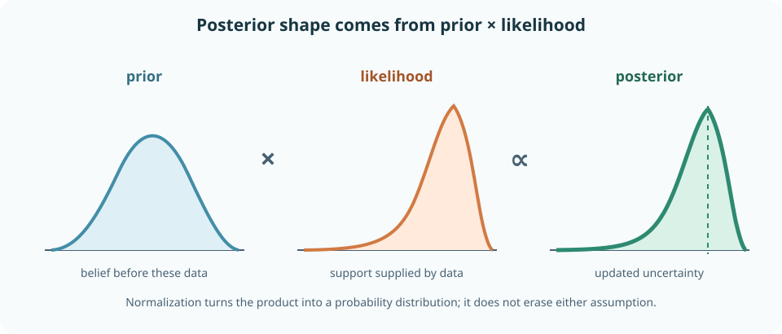
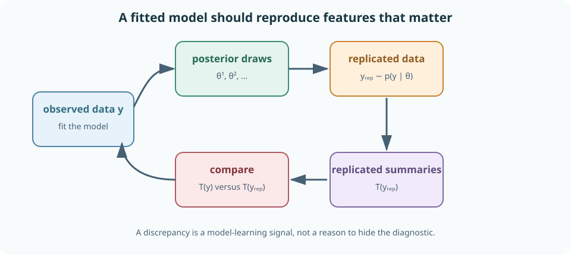
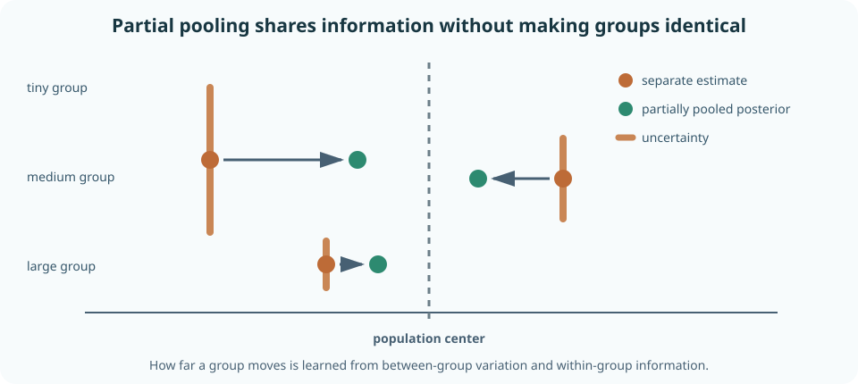
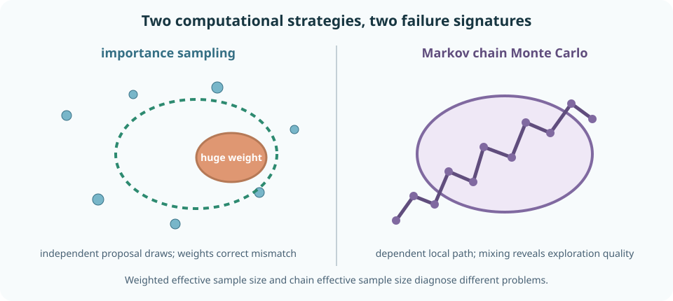

# Bayesian modeling, posterior prediction, importance sampling, and MCMC

Bayesian inference treats unknown quantities as part of a joint probability model. Before observing data, uncertainty about parameters is represented by a prior distribution. The likelihood connects parameters to possible observations. Conditioning the joint model on observed data produces a posterior distribution.

That compact description hides the hard work. A posterior is only as meaningful as its sampling model, prior, parameterization, and computation. A narrow posterior can be precisely wrong under selection bias or misspecification. A sophisticated sampler can faithfully explore an irrelevant model. Bayesian workflow therefore joins modeling, computation, criticism, and decisions.

This chapter starts with finite Bayes' rule and builds toward continuous posterior geometry, hierarchical partial pooling, posterior predictive checks, importance sampling, and Markov chain Monte Carlo. By the end, you should be able to write a generative model; derive conjugate updates; distinguish posterior, predictive, and likelihood quantities; perform prior and posterior predictive checks; calculate posterior decisions; stabilize importance weights; implement Metropolis–Hastings; diagnose effective sample size and convergence; and audit Bayesian claims in AI research.

## 0. Bayes' rule updates possibilities

For a discrete unknown hypothesis \(H\) and observed data \(D=d\),

$$
P(H=h\mid D=d)
=
\frac{P(D=d\mid H=h)P(H=h)}
{\sum_{h'}P(D=d\mid H=h')P(H=h')}.
$$

The pieces have different roles:

- \(P(H=h)\) is the **prior** probability;
- \(P(D=d\mid H=h)\) is the **likelihood** of \(h\) for fixed observed data;
- the denominator is the **prior predictive probability** or **evidence** for the data;
- \(P(H=h\mid D=d)\) is the **posterior** probability.

The likelihood is a function of \(h\) after data are fixed. It is not generally a probability distribution over \(h\). Multiplying prior by likelihood and dividing by the evidence makes a normalized posterior.

In odds form,

$$
\frac{P(H_1\mid d)}{P(H_0\mid d)}
=
\frac{P(H_1)}{P(H_0)}
\times
\frac{P(d\mid H_1)}{P(d\mid H_0)}.
$$

Posterior odds equal prior odds times the likelihood ratio. Evidence changes odds multiplicatively.

**Worked example — rare incidents.** A monitor has 90% sensitivity and a 5% false-alarm rate. If only 0.1% of sessions contain the incident, posterior odds after an alert are

$$
\frac{0.001}{0.999}\times\frac{0.90}{0.05}
\approx0.018.
$$

The posterior probability is about \(0.018/(1+0.018)\approx1.77\%\). A large likelihood ratio does not erase a very small base rate.

> **Practice — Foundation:** Label the prior, likelihood, evidence, and posterior in finite Bayes' rule.
>
> **Practice — Core:** Recalculate the monitoring example if prevalence rises to 2%, then explain the change before interpreting it.
>
> **Practice — Stretch:** Construct two priors that produce materially different posterior probabilities under the same moderate likelihood ratio.

## 1. A Bayesian model is a joint distribution

Let \(\theta\) be an unknown parameter and \(Y\) observed data. A basic model factorizes as

$$
p(\theta,y)=p(\theta)p(y\mid\theta).
$$

This factorization is generative:

1. draw a possible parameter \(\theta\sim p(\theta)\);
2. draw possible data \(Y\sim p(y\mid\theta)\).

After observing \(Y=y\), conditioning gives

$$
p(\theta\mid y)
=
\frac{p(y\mid\theta)p(\theta)}
{\int p(y\mid\vartheta)p(\vartheta)\,d\vartheta}.
$$

The denominator does not depend on \(\theta\), so derivations often begin with

$$
p(\theta\mid y)\propto p(y\mid\theta)p(\theta).
$$

Proportionality identifies the posterior kernel, not its normalizing constant. Expectations and probabilities still require normalization, either analytically or computationally.

**Worked example — model accuracy.** Let \(p\) be accuracy on a defined prompt population, \(p\sim\operatorname{Beta}(\alpha,\beta)\), and \(X_i\mid p\overset{\mathrm{iid}}{\sim}\operatorname{Bernoulli}(p)\). This model says more than “accuracy is unknown.” It says how prior mass is distributed, how prompts are sampled, that their outcomes are conditionally iid given \(p\), and that one stable \(p\) governs them.

> **Practice — Foundation:** Write a joint distribution from a prior and likelihood.
>
> **Practice — Core:** Turn a Gaussian mean model into a step-by-step data-generating story.
>
> **Practice — Stretch:** Identify three assumptions hidden by an iid Bernoulli model for benchmark accuracy and propose a richer model for one of them.

## 2. Priors are model components, not decorations

A prior must be interpreted on the model's parameter scale. It can encode:

- domain knowledge available before the current data;
- population regularity shared across related groups;
- weak constraints that rule out impossible or numerically pathological regions;
- a reference distribution chosen for an explicit calibration goal.

Priors can be informative, weakly informative, or intentionally diffuse, but “flat” is not invariant to reparameterization. A density uniform in \(p\) is not uniform in log odds

$$
\eta=\log\frac{p}{1-p}.
$$

Improper priors do not integrate to one. They can sometimes produce proper posteriors, but they have no prior predictive distribution and can make model evidence undefined.

Before fitting, simulate from the **prior predictive distribution**

$$
p(y)=\int p(y\mid\theta)p(\theta)\,d\theta.
$$

If it routinely generates impossible datasets, the model needs revision before observed outcomes influence judgment.

**Worked example — accuracy prior.** A \(\operatorname{Beta}(1,1)\) prior is uniform in probability and gives substantial mass to accuracies near zero and one. For a competent model on a balanced binary task, that may be less plausible than it first sounds. A prior predictive check asks what success counts this choice produces at the planned sample size.

> **Practice — Foundation:** Explain why a prior uniform in probability is not uniform in log odds.
>
> **Practice — Core:** Derive the prior predictive mean of a Bernoulli observation under a \(\operatorname{Beta}(\alpha,\beta)\) prior.
>
> **Practice — Stretch:** Design a prior predictive check for a latency model and identify at least two simulated features that would trigger revision.

## 3. Beta–Bernoulli conjugacy makes updating visible

For

$$
p\sim\operatorname{Beta}(\alpha,\beta),
\qquad
X_i\mid p\overset{\mathrm{iid}}{\sim}\operatorname{Bernoulli}(p),
$$

observe \(s=\sum_iX_i\) successes and \(f=n-s\) failures. The prior density kernel is

$$
p^{\alpha-1}(1-p)^{\beta-1},
$$

and the likelihood kernel is

$$
p^s(1-p)^f.
$$

Multiplication yields

$$
p\mid x
\sim
\operatorname{Beta}(\alpha+s,\beta+f).
$$

The prior and posterior share a family, so the prior is **conjugate** to the likelihood.

The posterior mean and variance are

$$
E[p\mid x]
=
\frac{\alpha+s}{\alpha+\beta+n},
$$

$$
\operatorname{Var}(p\mid x)
=
\frac{(\alpha+s)(\beta+f)}
{(\alpha+\beta+n)^2(\alpha+\beta+n+1)}.
$$

The mean is a weighted average:

$$
E[p\mid x]
=
\frac{\alpha+\beta}{\alpha+\beta+n}
\frac{\alpha}{\alpha+\beta}
+
\frac{n}{\alpha+\beta+n}\frac{s}{n}.
$$

Thus \(\alpha+\beta\) behaves like a prior information weight and \(\alpha/(\alpha+\beta)\) like its center. This is an interpretation of the algebra, not proof that the prior came from literal observations.

**Worked example.** With prior \(\operatorname{Beta}(2,2)\) and \(8\) successes in \(10\) trials, the posterior is \(\operatorname{Beta}(10,4)\), its mean is \(10/14\approx0.714\), and the next-trial success probability is also \(10/14\).

> **Practice — Foundation:** Update a \(\operatorname{Beta}(3,7)\) prior after 12 successes and 8 failures.
>
> **Practice — Core:** Derive the weighted-average form of the posterior mean.
>
> **Practice — Stretch:** Construct two Beta priors with the same mean but very different concentration and compare their posteriors after a small dataset.

## 4. Posterior summaries answer different questions

A posterior is a distribution, not one number. Common summaries include:

- posterior mean \(E[\theta\mid y]\);
- posterior median;
- posterior mode or MAP estimate;
- posterior standard deviation;
- quantiles and credible intervals;
- probabilities of decision-relevant events.

A \(95\%\) credible interval \(C\) satisfies

$$
P(\theta\in C\mid y)=0.95.
$$

An equal-tailed interval uses the 2.5% and 97.5% posterior quantiles. A highest-posterior-density region contains high-density values and can be shorter, but may be disconnected for a multimodal posterior. Its shape is not invariant under nonlinear reparameterization.

A posterior probability such as

$$
P(p_B-p_A>0.02\mid y)
$$

directly addresses a practical threshold under the model and prior. It is not automatically a causal probability or a guarantee under distribution shift.

**Worked example — mean, mode, and boundary.** A \(\operatorname{Beta}(1,5)\) posterior has mean \(1/6\), while its mode is at the boundary zero. These summaries optimize different losses and tell different stories. Reporting only the mode would hide substantial uncertainty above zero.

> **Practice — Foundation:** Distinguish an equal-tailed credible interval from a highest-density region.
>
> **Practice — Core:** Explain why posterior mean and MAP can differ in a skewed posterior.
>
> **Practice — Stretch:** Show with a nonlinear transformation why highest-density regions are not parameterization invariant.

## 5. Posterior prediction averages parameter uncertainty

For new data \(\tilde y\), the posterior predictive distribution is

$$
p(\tilde y\mid y)
=
\int p(\tilde y\mid\theta)p(\theta\mid y)\,d\theta.
$$

It averages predictions across posterior uncertainty. Plugging in one estimate,

$$
p(\tilde y\mid\hat\theta),
$$

usually understates uncertainty because it treats the selected parameter as known.

For a Beta–Bernoulli model,

$$
P(\tilde X=1\mid x)
=
E[p\mid x]
=
\frac{\alpha+s}{\alpha+\beta+n}.
$$

For \(m\) future trials, integrating \(p\) produces a beta-binomial distribution. Future outcomes become dependent marginally because they share the same uncertain \(p\), even though they are conditionally independent given \(p\).

**Worked example — two future trials.** Under a posterior \(\operatorname{Beta}(a,b)\),

$$
P(\tilde X_1=1,\tilde X_2=1\mid x)
=\frac{a(a+1)}{(a+b)(a+b+1)},
$$

which exceeds \([a/(a+b)]^2\). Learning that one future trial succeeds would raise the predicted probability for the other because both inform the same latent rate.

> **Practice — Foundation:** Write the posterior predictive integral and identify what is averaged.
>
> **Practice — Core:** Derive the Beta–Bernoulli probability of two future successes.
>
> **Practice — Stretch:** Explain how aleatoric observation noise and epistemic parameter uncertainty appear separately in a Gaussian posterior predictive variance.

## 6. Posterior predictive checks criticize the model

Draw a posterior parameter and replicated data:

$$
\theta^{(s)}\sim p(\theta\mid y),
\qquad
y_{\mathrm{rep}}^{(s)}\sim p(y\mid\theta^{(s)}).
$$

Then compare features \(T(y_{\mathrm{rep}})\) with \(T(y)\). Useful discrepancies target aspects that matter:

- tail counts and maxima;
- subgroup error gaps;
- serial runs;
- calibration curves;
- missingness patterns;
- document-length effects;
- cross-task heterogeneity.

A posterior predictive p-value

$$
P(T(y_{\mathrm{rep}})\geq T(y)\mid y)
$$

is a diagnostic, not generally a uniformly distributed frequentist p-value. The observed data are used both to fit and check, making it conservative for some discrepancies.

**Worked example — overdispersed accuracy.** A single Bernoulli rate predicts binomial variation across tasks. If observed task accuracies vary far more than posterior replicated task accuracies, the model misses heterogeneity. A hierarchical task-rate model may be more appropriate than forcing one common \(p\).

> **Practice — Foundation:** Describe the two draws needed to generate posterior replicated data.
>
> **Practice — Core:** Choose three discrepancy statistics for checking a model of per-user failure counts.
>
> **Practice — Stretch:** Explain why choosing a discrepancy only after noticing an anomaly makes the check exploratory and how to validate the revised model honestly.

## 7. Sensitivity analysis reveals prior influence

Posterior conclusions should be recomputed under several defensible priors, likelihoods, and data exclusions. Sensitivity matters when:

- the dataset is small;
- the likelihood is weakly identifying;
- parameters lie near boundaries;
- hierarchical variance is estimated from few groups;
- the target is a tail probability;
- model selection depends on marginal likelihood.

Sensitivity is not an invitation to shop for a preferred result. Specify a plausible range of assumptions and report which conclusions change.

**Worked example — rare safety event.** With zero incidents, the likelihood is \((1-p)^n\). Different priors near \(p=0\) can materially affect posterior upper tails. As \(n\) grows, data dominate for regular interior questions, but an extremely small tail probability may remain prior-sensitive for a long time.

Local sensitivity changes a hyperparameter slightly and differentiates a posterior summary. Global sensitivity fits several qualitatively different models. Simulation-based calibration can test whether a complete inference pipeline recovers parameters generated from its own prior.

> **Practice — Foundation:** Name two situations where prior sensitivity should be expected.
>
> **Practice — Core:** Compare posterior means under two Beta priors after the same success count.
>
> **Practice — Stretch:** Design a sensitivity grid for a hierarchical model's population mean and between-group scale without selecting only favorable cells.

## 8. Marginal likelihood rewards fit and concentration

The evidence for model \(M\) is

$$
p(y\mid M)
=
\int p(y\mid\theta,M)p(\theta\mid M)\,d\theta.
$$

For two models, the Bayes factor is

$$
\operatorname{BF}_{10}
=
\frac{p(y\mid M_1)}{p(y\mid M_0)}.
$$

It updates prior model odds to posterior model odds. Unlike a maximized likelihood, marginal likelihood averages over the prior parameter space. A model spreading prior mass across predictions unsupported by data receives lower average likelihood—an automatic but prior-dependent complexity penalty.

This dependence is strong: changing prior scale can change a Bayes factor even when posterior parameter estimates barely move. Improper priors usually make marginal likelihood undefined up to arbitrary constants.

For predictive model comparison, held-out log predictive density often targets the practical question more directly than posterior model probability. Both approaches require a declared model set; posterior probability cannot assign mass to an omitted model.

> **Practice — Foundation:** Distinguish maximized likelihood from marginal likelihood.
>
> **Practice — Core:** Explain why widening a prior can reduce evidence even when the maximum likelihood stays fixed.
>
> **Practice — Stretch:** Construct a case where Bayes-factor ranking and held-out predictive ranking answer different questions and therefore disagree.

## 9. Posterior geometry controls approximation difficulty

The log posterior is

$$
\log p(\theta\mid y)
=
\log p(y\mid\theta)+\log p(\theta)-\log p(y).
$$

Optimization can find a posterior mode

$$
\hat\theta_{\mathrm{MAP}}
=
\arg\max_\theta[\log p(y\mid\theta)+\log p(\theta)].
$$

The **Laplace approximation** expands the log posterior to second order around an interior mode:

$$
p(\theta\mid y)
\approx
\mathcal N(\hat\theta_{\mathrm{MAP}},H^{-1}),
$$

where \(H\) is the negative Hessian of the log posterior at the mode.

This works best for a single approximately quadratic mode. It can fail for skewness, boundaries, heavy tails, funnels, ridges, non-identifiability, and separated modes. Reparameterization can dramatically improve geometry without changing the underlying probability model.

**Worked example — correlated parameters.** If two parameters trade off to preserve predictions, the posterior may form a narrow tilted ridge. Independent coordinate proposals move across the ridge and are rejected, while geometry-aware proposals move along it. Optimization finding one point does not reveal the ridge's extent.

> **Practice — Foundation:** State the ingredients of a MAP objective.
>
> **Practice — Core:** Derive a one-dimensional Laplace variance from the second derivative of a log posterior.
>
> **Practice — Stretch:** Draw or describe a two-mode posterior for a label-switching mixture and explain why one local Gaussian approximation is misleading.

## 10. Hierarchical models create partial pooling

Suppose task-specific effects \(\theta_j\) vary around a population distribution:

$$
\theta_j\mid\mu,\tau
\sim\mathcal N(\mu,\tau^2),
\qquad
y_j\mid\theta_j
\sim\mathcal N(\theta_j,\sigma_j^2).
$$

Conditional on \(\mu,\tau\), the group posterior mean is a precision-weighted average:

$$
E[\theta_j\mid y_j,\mu,\tau]
=
\frac{\tau^{-2}\mu+\sigma_j^{-2}y_j}
{\tau^{-2}+\sigma_j^{-2}}.
$$

No pooling estimates every group separately. Complete pooling forces one common effect. Partial pooling learns a population distribution and moves noisy group estimates toward its center.

Shrinkage is adaptive. A small \(\tau\) implies similar groups and stronger pooling. A large \(\sigma_j\) means group \(j\) is imprecise and moves more. Hyperparameter uncertainty should also be propagated rather than fixing \(\mu,\tau\) at point estimates.

**Worked example — benchmark tasks.** A task with 20 examples and an extreme observed gain is more strongly pooled than a task with 5,000 examples showing the same gain. Partial pooling counters noisy winner effects while allowing well-supported task differences to remain.

> **Practice — Foundation:** Contrast no pooling, complete pooling, and partial pooling.
>
> **Practice — Core:** Rewrite the conditional posterior mean as weights on \(\mu\) and \(y_j\), then interpret each precision.
>
> **Practice — Stretch:** Explain centered and non-centered parameterizations for a hierarchical Gaussian model and predict which geometry is better when group data are weak.

## 11. Bayesian decisions require a loss function

Inference describes uncertainty. A decision also needs actions and consequences. For action \(a\), parameter \(\theta\), and loss \(L(a,\theta)\), the Bayes action minimizes posterior expected loss:

$$
a^*(y)
=
\arg\min_a E[L(a,\theta)\mid y].
$$

Different losses produce different summaries:

- squared-error loss yields the posterior mean;
- absolute-error loss yields a posterior median;
- zero-one loss over discrete actions yields a posterior mode;
- asymmetric losses yield decision-specific posterior quantiles.

For deployment, actions may include release, collect more data, route selectively, or retain the current system. A threshold on posterior probability is meaningful only after the costs of false deployment and missed improvement are specified.

The expected value of information compares the best decision now with the expected best decision after collecting possible new data, minus data-collection cost. More information is useful when it can change an action, not merely because it narrows a posterior.

**Worked example — ship or wait.** Let \(\Delta\) be utility gain from a new model. Shipping loses 100 units if \(\Delta\leq0\) and gains 10 units if \(\Delta>0\); not shipping has zero loss and zero gain. Under this simplified payoff, shipping requires posterior probability above \(100/(100+10)\approx0.909\), not merely above 0.5.

> **Practice — Foundation:** Match squared, absolute, and zero-one loss with their posterior point summaries.
>
> **Practice — Core:** Derive the posterior-probability threshold for acting when false action costs \(C_F\) and missed action costs \(C_M\).
>
> **Practice — Stretch:** Define an action space and loss for choosing between a larger model, a smaller model, and collecting more evaluation data.

## 12. Posterior expectations become computational problems

Many targets have the form

$$
E[h(\theta)\mid y]
=
\int h(\theta)p(\theta\mid y)\,d\theta.
$$

If independent posterior draws \(\theta^{(1)},\ldots,\theta^{(S)}\) are available, approximate with

$$
\hat\mu_S=\frac1S\sum_{s=1}^S h(\theta^{(s)}).
$$

The law of large numbers provides convergence, and a Monte Carlo standard error quantifies remaining simulation noise. Posterior uncertainty and Monte Carlo error are different:

- posterior standard deviation describes uncertainty about \(\theta\) under the model;
- Monte Carlo standard error describes numerical uncertainty in estimating a posterior summary.

More computation reduces the second but not the first.

For rare posterior events, naive sampling may need enormous \(S\). For multimodal or highly correlated targets, obtaining representative draws is itself difficult. Computational diagnostics are therefore part of inference.

> **Practice — Foundation:** Distinguish posterior standard deviation from Monte Carlo standard error.
>
> **Practice — Core:** Derive the Monte Carlo standard error of an average from independent posterior draws.
>
> **Practice — Stretch:** Estimate the number of independent draws needed to estimate a posterior tail probability near \(10^{-4}\) with a specified relative error.

## 13. Importance sampling corrects proposal mismatch with weights

Suppose the target density is \(\pi(\theta)\) and a proposal density \(q(\theta)\) is easy to sample. If \(q(\theta)>0\) wherever \(\pi(\theta)h(\theta)\neq0\), then

$$
E_\pi[h(\theta)]
=
E_q\left[
h(\theta)\frac{\pi(\theta)}{q(\theta)}
\right]
$$

when \(\pi\) is normalized. With proposal draws \(\theta_s\sim q\), importance weights are

$$
w_s=\frac{\pi(\theta_s)}{q(\theta_s)}.
$$

If the target is known only up to a constant, self-normalized importance sampling uses

$$
\bar w_s=\frac{w_s}{\sum_jw_j},
\qquad
\hat\mu=\sum_s\bar w_sh(\theta_s).
$$

Compute log weights

$$
\ell_s=\log\tilde\pi(\theta_s)-\log q(\theta_s)
$$

and subtract their maximum before exponentiating. This log-sum-exp stabilization prevents avoidable overflow without fixing statistical weight degeneracy.

An importance effective sample size diagnostic is

$$
\operatorname{ESS}_{\mathrm{IS}}
=\frac{1}{\sum_s\bar w_s^2}.
$$

It ranges from one to \(S\). It is a weight-concentration diagnostic, not a guarantee that the proposal covered every important target region.

**Worked example — missed mode.** A narrow proposal centered on one of two posterior modes can give apparently uniform weights and high ESS among sampled points while never visiting the second mode. Support in a mathematical sense is not enough; proposal tail and mode coverage must be practically adequate.

> **Practice — Foundation:** State the support condition required for importance sampling.
>
> **Practice — Core:** Derive self-normalized weights from an unnormalized target and show they sum to one.
>
> **Practice — Stretch:** Construct an importance proposal with finite mean weight but infinite weight variance, and explain the consequence for Monte Carlo convergence.

## 14. Importance resampling and diagnostics

Sampling an index with probability \(\bar w_s\) produces an approximate unweighted target draw. This **sampling-importance-resampling** step is useful inside larger algorithms but does not restore information lost to weight collapse; repeated copies of one high-weight proposal point are still one underlying discovery.

Inspect:

- maximum normalized weight;
- \(\operatorname{ESS}_{\mathrm{IS}}\);
- the distribution of log weights;
- stability across independent proposal runs;
- whether proposal draws cover all known target regions;
- sensitivity of estimates to the largest weights.

Importance estimates of normalizing constants use

$$
\hat Z=\frac1S\sum_{s=1}^S
\frac{\tilde\pi(\theta_s)}{q(\theta_s)}.
$$

This estimator can be unbiased while having enormous or infinite variance. A visually stable finite run does not prove reliability.

**Worked example — one dominant draw.** With normalized weights \(0.97\) and \(0.03/(S-1)\) for all others,

$$
\operatorname{ESS}_{\mathrm{IS}}
\approx\frac1{0.97^2}\approx1.06.
$$

Nominally having thousands of proposal draws does not matter; nearly all estimated mass rests on one point.

> **Practice — Foundation:** Calculate ESS for uniform weights and for one weight equal to one.
>
> **Practice — Core:** Explain why resampling high-weight points does not increase the information in the original proposal sample.
>
> **Practice — Stretch:** Design a defensive mixture proposal combining a fitted approximation with a heavy-tailed component and explain the tradeoff.

## 15. MCMC replaces independence with a stationary distribution

A Markov chain generates

$$
\theta^{(0)},\theta^{(1)},\ldots
$$

where the next state depends on the current state. An MCMC transition is designed so the posterior \(\pi\) is stationary:

$$
\theta^{(t)}\sim\pi
\quad\Longrightarrow\quad
\theta^{(t+1)}\sim\pi.
$$

Stationarity alone is not enough. The chain must be able to reach all relevant regions and should not be trapped in cycles. Under suitable irreducibility, aperiodicity, and recurrence conditions, long-run averages converge:

$$
\frac1S\sum_{t=1}^S h(\theta^{(t)})
\longrightarrow E_\pi[h(\theta)].
$$

MCMC samples are correlated. Ten thousand stored states can contain far less information than ten thousand independent draws.

Discarding early draws as warmup reduces dependence on a poor initial state, but it cannot fix a chain that never crosses between modes or uses an incorrect transition.

> **Practice — Foundation:** Define stationarity for a Markov transition.
>
> **Practice — Core:** Explain why correlated MCMC draws can still estimate posterior expectations consistently.
>
> **Practice — Stretch:** Construct a reducible chain with the desired distribution stationary but whose averages depend permanently on initialization.

## 16. When does a chain actually have the right limit?

The previous section asserted that a well-constructed chain has the posterior as its stationary distribution and that time averages converge to posterior expectations. Both claims need conditions, and knowing them is what separates "my sampler ran" from "my sampler is estimating the thing I want".

**Stationarity.** A distribution \(\pi\) is **stationary** for a transition kernel \(P\) when

$$
\pi(y)=\sum_x\pi(x)P(x\to y)
\qquad\text{(or the integral form for continuous state).}
$$

Start in \(\pi\) and you remain in \(\pi\) forever. Stationarity alone is weak: a chain that never moves has *every* distribution as stationary.

**Detailed balance implies stationarity.** A chain is **reversible** with respect to \(\pi\) when

$$
\pi(x)P(x\to y)=\pi(y)P(y\to x)
\qquad\text{for all }x,y .
$$

Summing both sides over \(x\) gives \(\sum_x\pi(x)P(x\to y)=\pi(y)\sum_xP(y\to x)=\pi(y)\), which is stationarity. This two-line argument is the entire justification for the acceptance ratio of the next section — Metropolis–Hastings is constructed precisely to force detailed balance. Note the implication runs one way: reversibility is sufficient, not necessary, and several high-performance samplers are deliberately non-reversible.

**Irreducibility.** The chain must be able to reach every region of positive probability from every starting point. Without it, the chain has multiple stationary distributions and where you start decides where you end. In practice this fails for multimodal posteriors with deep valleys between modes: the chain is *technically* irreducible but the crossing time exceeds any budget you will run, which is operationally identical to reducibility.

**Aperiodicity.** The chain must not cycle deterministically through subsets with a fixed period. A period-2 chain alternating between two halves of the space has a stationary distribution but never converges to it. Metropolis chains with a nonzero rejection probability are automatically aperiodic, since a rejection means staying put.

**The ergodic theorem.** With irreducibility, aperiodicity, and a stationary \(\pi\), two things hold: the distribution of \(x_t\) converges to \(\pi\) regardless of the starting point, and — this is the part estimation relies on — time averages converge to space averages,

$$
\frac1T\sum_{t=1}^Tf(x_t)\;\longrightarrow\;E_\pi[f]
\qquad\text{almost surely.}
$$

This is the law of large numbers with independence replaced by ergodicity. It licenses everything you do with MCMC output.

**How fast? The spectral gap.** For a reversible chain on a finite state space, the transition matrix has eigenvalue \(1\) with the stationary distribution as its eigenvector; convergence speed is governed by the **second-largest eigenvalue modulus** \(\lambda_2\). The distance to stationarity decays like \(\lambda_2^t\), so the **mixing time** scales as

$$
t_{\text{mix}}\sim\frac1{1-\lambda_2}=\frac1{\text{spectral gap}} .
$$

This is the same eigenvalue-controls-the-rate argument that governed power iteration and gradient descent in [eigenvalues and invariant subspaces](../02-linear-algebra/04-eigenvalues-invariant-subspaces.md) — a chain with a small gap is the probabilistic twin of an ill-conditioned optimization problem, and the geometry that causes it is the same elongated, correlated geometry described earlier in this lesson.

**What you can actually measure.** The spectral gap is not computable for a real posterior. The practical proxy is the **integrated autocorrelation time** \(\tau\), giving an effective sample size

$$
n_{\text{eff}}=\frac T{1+2\sum_{k\ge1}\rho_k}=\frac T\tau ,
$$

exactly the dependence correction developed in [limit theorems and Monte Carlo](05-limit-theorems-monte-carlo.md). A chain of \(100{,}000\) draws with \(\tau=500\) carries the information of \(200\) independent draws, and every standard error must use \(n_{\text{eff}}\), not \(T\).

**Worked example — a two-state chain.** Let the chain move with probability \(a\) from state 1 to 2 and \(b\) from 2 to 1. Stationarity gives \(\pi=(b,a)/(a+b)\), and the eigenvalues are \(1\) and \(1-a-b\). With \(a=b=0.5\) the gap is \(1\) and the chain reaches stationarity in one step. With \(a=b=0.001\) the gap is \(0.002\) and mixing takes on the order of \(500\) steps — the chain is "sticky", and a short run will report whichever state it started in with false confidence.

**The failure this explains.** Convergence diagnostics test whether a chain *looks* stationary, not whether it has explored. A chain trapped in one mode of a multimodal posterior can pass every diagnostic while sampling from the wrong distribution. No amount of running longer fixes a chain that cannot cross; you need a different kernel — tempering, mode-jumping proposals, or multiple dispersed starts.

> **Practice — Foundation:** Verify detailed balance for the two-state chain above and confirm the stated \(\pi\).
>
> **Practice — Core:** Prove that detailed balance implies stationarity, stating where the rows of the kernel summing to one is used. Then give a stationary chain that is not reversible.
>
> **Practice — Stretch:** Construct a bimodal target on which a random-walk Metropolis chain passes a standard convergence diagnostic while covering only one mode. State which assumption is technically satisfied but practically violated, and name two kernels that would repair it along with their costs.

## 17. Metropolis–Hastings corrects proposed moves

At current state \(\theta\):

1. propose \(\theta'\sim q(\theta'\mid\theta)\);
2. calculate

$$
r=
\frac{\tilde\pi(\theta')q(\theta\mid\theta')}
{\tilde\pi(\theta)q(\theta'\mid\theta)};
$$

3. accept with probability \(\min(1,r)\); otherwise repeat \(\theta\).

The target normalizing constant cancels. For a symmetric random-walk proposal, \(q(\theta'\mid\theta)=q(\theta\mid\theta')\), so only the target-density ratio remains.

The acceptance rule satisfies detailed balance:

$$
\pi(\theta)K(\theta,\theta')
=
\pi(\theta')K(\theta',\theta),
$$

which implies stationarity.

Compute in log space. If

$$
\log U<
\min(0,\log r),
\qquad U\sim\operatorname{Uniform}(0,1),
$$

accept. This avoids underflow in tiny densities.

**Worked example — proposal scale.** A tiny random-walk scale accepts nearly every move but advances slowly, producing high autocorrelation. A huge scale proposes low-density states and mostly repeats the current value. A moderate acceptance rate is a symptom, not the objective; exploration and effective sample size matter.

> **Practice — Foundation:** Simplify the acceptance ratio for a symmetric proposal.
>
> **Practice — Core:** Prove detailed balance for the off-diagonal Metropolis–Hastings transition.
>
> **Practice — Stretch:** Explain why adapting proposal scale forever using the complete chain can violate stationarity, and distinguish warmup adaptation from sampling.

## 18. Chain diagnostics test exploration, not truth

For stationary scalar draws with lag-\(k\) autocorrelation \(\rho_k\), a conceptual effective sample size is

$$
\operatorname{ESS}_{\mathrm{chain}}
\approx
\frac{S}{1+2\sum_{k\geq1}\rho_k}.
$$

Monte Carlo standard error is then approximately posterior standard deviation divided by \(\sqrt{\operatorname{ESS}}\).

Use multiple dispersed chains. Compare variation within and between chains; rank-based split-\(\hat R\) near one is desirable. Inspect trace plots, autocorrelation, energy or divergence diagnostics for geometry-aware samplers, and effective sample size for every important functional—not only parameters.

No diagnostic proves convergence. Chains trapped together in the same mode may agree. A high acceptance rate can coexist with negligible movement. A large raw sample count can hide extreme dependence.

Simulation-based calibration tests an inference algorithm end to end:

1. draw \(\theta\) from the prior;
2. draw data from the likelihood;
3. fit the model;
4. check whether the true draw has the expected rank within posterior draws.

Systematic rank patterns reveal computational or implementation errors under the model.

> **Practice — Foundation:** Explain why MCMC effective sample size differs from importance-sampling ESS.
>
> **Practice — Core:** Describe what within-chain and between-chain variation reveal.
>
> **Practice — Stretch:** Construct a multimodal example where every reported chain diagnostic looks acceptable because all chains started in the same mode.

## 19. HMC and variational inference make different approximations

Random-walk Metropolis ignores posterior gradients. Hamiltonian Monte Carlo (HMC) introduces auxiliary momentum and uses gradients to propose long moves that approximately follow constant-energy paths. A correction step removes numerical integration bias. HMC can explore smooth high-dimensional posteriors efficiently, but funnels, discontinuities, bad scaling, and separated modes remain difficult.

Variational inference chooses a tractable family \(q_\phi(\theta)\) and optimizes an objective equivalent to

$$
\operatorname{KL}(q_\phi(\theta)\,\|\,p(\theta\mid y)).
$$

This direction of KL heavily penalizes placing mass where the posterior has little mass, but may tolerate missing posterior regions. Simple mean-field families often underestimate dependence and tail uncertainty.

Laplace, importance sampling, MCMC, HMC, and variational inference are not a ladder where the most complex is automatically best. Choose based on target geometry, dimensionality, required summaries, compute, and diagnostics. Validate against analytic or enumerated cases whenever possible.

> **Practice — Foundation:** Contrast random-walk Metropolis proposals with HMC proposals.
>
> **Practice — Core:** Explain why a mean-field variational approximation cannot represent posterior correlation.
>
> **Practice — Stretch:** Design a validation ladder from exact finite inference through approximate inference for a growing hierarchical model.

## 20. Bayesian workflow for AI research

Bayesian models can express structures common in AI work:

- task and domain effects through hierarchies;
- seed-to-seed training variation;
- annotator bias and reliability;
- paired model comparisons;
- latent difficulty of prompts;
- calibration uncertainty;
- scaling-law parameters and extrapolation;
- online decisions under accumulating evidence.

The hierarchy must match the claim. If tasks are fixed, a task population prior changes the estimand. If seeds are selected, the selection rule belongs in the likelihood or evaluation pipeline. If annotator disagreement is systematic, one exchangeable error rate may be inadequate.

**Worked example — model comparison across tasks and seeds.** Let \(\delta_j\) be task-specific model differences drawn from a population with mean \(\mu_\delta\) and scale \(\tau\). Observed seed and item summaries inform each \(\delta_j\). The posterior for \(\mu_\delta\) addresses average performance over the modeled task population; posterior predictive draws of a new \(\delta_{\mathrm{new}}\) address performance on a new task. These distributions are different: prediction for a new task includes between-task variation.

For every analysis:

1. draw the graphical or generative structure;
2. simulate prior predictive data;
3. fit and diagnose computation;
4. compare posterior replicated data with observations;
5. run sensitivity analyses;
6. validate prediction on held-out or future data;
7. connect posterior summaries to an explicit decision.

> **Practice — Foundation:** Identify latent and observed quantities in a task-by-seed model comparison.
>
> **Practice — Core:** Distinguish the posterior for average task effect from the posterior predictive distribution for a new task.
>
> **Practice — Stretch:** Design a hierarchical preference model with prompts, models, and raters, then list identifiability constraints and posterior predictive checks.

## 21. Runnable labs

This chapter has three coding exercises. Each opens as a separate tab in the lesson's right-hand Python workspace.

### Lab A — Beta–Bernoulli updating

Implement **beta_bernoulli_update** in [labs/exercises.py](../../labs/exercises.py). Given binary outcomes and positive prior shape parameters, return:

1. posterior alpha and beta;
2. posterior mean;
3. posterior variance;
4. posterior predictive probability of success.

Run:

~~~text
python -m labs.checks beta-update
~~~

The checks cover mixed and boundary outcomes, generators, sequential coherence, fractional prior shapes, input preservation, and invalid values.

### Lab B — stable self-normalized importance sampling

Implement **self_normalized_importance** in [labs/exercises.py](../../labs/exercises.py). Given finite values and their finite log importance weights, return:

1. the weighted estimate;
2. normalized weights in input order;
3. importance effective sample size.

Use maximum subtraction before exponentiating.

Run:

~~~text
python -m labs.checks importance
~~~

The checks cover equal and extreme log weights, shift invariance, generators, input preservation, numerical stability, and invalid inputs.

### Lab C — random-walk Metropolis

Implement **random_walk_metropolis** in [labs/exercises.py](../../labs/exercises.py). Given a log-density callable, initial state, positive proposal scale, step count, and seed, return the chain after each proposal and the acceptance rate. Use a local Gaussian proposal and the log acceptance rule.

Run:

~~~text
python -m labs.checks metropolis
~~~

The checks cover deterministic seeding, constant targets, Gaussian targets, rejected proposals, local random state, invalid settings, and non-finite log densities.

### Guided experiment

1. Compare Beta posterior means and variances across prior concentrations and sample sizes.
2. Simulate prior and posterior predictive success counts and check calibration.
3. Move an importance proposal away from a target and track estimate error, maximum weight, and ESS.
4. Run Metropolis chains across proposal scales and compare acceptance, trace plots, autocorrelation, and effective sample size.
5. Fit a two-mode target from dispersed initial states and demonstrate how a single-chain summary can fail.
6. Build a hierarchical task-effect simulation and compare separate estimates with partially pooled posterior estimates.

## 22. Derivations to own

1. Derive discrete and continuous Bayes' rule from a joint distribution.
2. Derive Beta–Bernoulli posterior parameters, mean, variance, and predictive probability.
3. Derive the beta-binomial predictive distribution.
4. Separate posterior predictive variance into observation and parameter components.
5. Derive posterior mean, median, and mode as Bayes actions under three losses.
6. Derive a marginal likelihood and Bayes factor in a finite model.
7. Derive the Laplace approximation from a second-order expansion.
8. Derive Gaussian hierarchical partial pooling with fixed hyperparameters.
9. Derive self-normalized importance weights using an unnormalized target.
10. Derive importance ESS and explain its limits.
11. Prove that a likelihood ratio has null expectation one.
12. Derive the Metropolis–Hastings acceptance probability and detailed balance.
13. Relate autocorrelation to variance of an MCMC average.
14. Explain why posterior predictive checks can detect likelihood misspecification.

## 23. End-of-unit practice (graded)

**Foundation — problems 1–6.** Build fluent distinctions among Bayesian objects.

1. **Bayes table.** A condition has prevalence 0.01. A test has sensitivity 0.90 and false-positive rate 0.05. Build the full \(2\times2\) probability table, calculate evidence \(P(+)\), and find \(P(\text{condition}\mid+)\). Explain the base-rate effect in one sentence.
2. **Conjugate update.** After \(s=8\) successes and \(f=2\) failures, update \(\operatorname{Beta}(1,1)\), \(\operatorname{Beta}(2,8)\), and \(\operatorname{Beta}(1/2,1/2)\) priors. Calculate posterior mean, mode where defined, variance, and one-step predictive probability.
3. **Prediction.** Under each posterior from problem 2, calculate the probability that the next trial succeeds and that both of the next two trials succeed. Compare the latter with the square of the one-step probability and explain the dependence induced by parameter uncertainty.
4. **Intervals and decisions.** Distinguish credible intervals, posterior event probabilities, and loss-optimal actions.
5. **Weights.** For log importance weights \((-1000,-1001,-1004)\), normalize stably, calculate ESS, and show why direct exponentiation is numerically unsafe.
6. **Metropolis step.** On states \(\{0,1,2,3\}\), let target mass be proportional to \((1,2,4,3)\). The proposal moves to either neighboring state with probability 1/2 in the interior and moves inward with probability 1 at a boundary. Calculate every nonzero Metropolis–Hastings acceptance probability, including the proposal-ratio correction.

**Core — problems 7–13.** Connect models, computation, and criticism.

7. **Prior predictive audit.** Simulate from three candidate priors and reject or revise implausible data-generating implications.
8. **Posterior predictive audit.** Fit a simple count model and check tails, zeros, groups, and serial patterns using replicated data.
9. **Partial pooling.** Calculate group posterior means under several within- and between-group variances.
10. **Decision threshold.** Derive an action threshold under asymmetric deployment loss and evaluate posterior expected utility.
11. **Importance collapse.** Vary proposal scale and location, then relate maximum weight and ESS to estimation error across repeated runs.
12. **Metropolis tuning.** Target \(N(0,1)\) with random-walk proposals \(N(x,s^2)\) for \(s=0.1,1,10\). Run four chains of 50,000 iterations from \((-10,-2,2,10)\), discard 10,000, and compare acceptance, trace plots, autocorrelation, bulk/tail ESS, \(\hat R\), and Monte Carlo standard error for the mean and 0.99 quantile.
13. **Approximation comparison.** Compare exact, Laplace, importance, and MCMC summaries for a one-dimensional skewed posterior.

**Stretch — problems 14–20.** Diagnose realistic Bayesian failures.

14. **Prior sensitivity.** With zero events in 50 trials, analyze \(\operatorname{Beta}(1,1)\), \(\operatorname{Beta}(1,99)\), \(\operatorname{Beta}(1/2,1/2)\), and \(\operatorname{Beta}(20,980)\) priors. Report posterior mean, 95% credible interval, and \(P(p>0.05\mid y)\) without selecting a preferred conclusion after seeing the answers.
15. **Marginal-likelihood sensitivity.** Change prior scale while holding the likelihood fixed and explain shifts in Bayes factors.
16. **Missed mode.** Construct importance and MCMC procedures that both miss a posterior mode while reporting reassuring internal diagnostics.
17. **Hierarchical funnel.** Simulate weakly informed groups and compare centered and non-centered parameterizations.
18. **Selection-aware model.** Include checkpoint or prompt selection in a generative evaluation pipeline and compare with conditioning on the winner.
19. **Simulation-based calibration.** Introduce a deliberate implementation bug and diagnose its rank pattern across simulated datasets.
20. **Full AI analysis.** Specify, fit, diagnose, criticize, and make a decision from a hierarchical multi-task, multi-seed, multi-rater model.

Worked solution sketches

1. \(P(C,+)=0.01(0.90)=0.009\) and \(P(C^c,+)=0.99(0.05)=0.0495\), so \(P(+)=0.0585\) and \(P(C\mid+)=0.009/0.0585\approx0.1538\). Even a fairly accurate test produces many false positives when the condition is rare.
2. Posterior shapes are \(\alpha+s,\beta+f\). Mean is \(a/(a+b)\), variance is \(ab/[(a+b)^2(a+b+1)]\), and one-step predictive success equals the mean.
3. Integrate products of Bernoulli probabilities over the Beta posterior. Shared uncertainty makes future outcomes positively dependent after marginalization.
4. A credible interval is posterior probability under a model and prior. A decision minimizes posterior expected loss; it need not correspond to an interval endpoint or 0.5 probability.
5. Subtracting \(-1000\) gives \((0,-1,-4)\); exponentiating and normalizing yields approximately \((0.7214,0.2654,0.0132)\). Thus \(\mathrm{ESS}=1/\sum_iw_i^2\approx1.69\). Direct exponentiation underflows toward zero and can create a meaningless \(0/0\) normalization.
6. Form the target-density ratio, include the reverse/forward proposal ratio, cap at one, and compare with a uniform draw. Symmetric proposals cancel.
7. Generate complete datasets before seeing observations. Check units, ranges, frequencies, tails, and domain constraints; revise priors that imply implausible worlds.
8. Draw posterior parameters and replicated data. Compare discrepancies chosen for scientific relevance. Systematic mismatch indicates the model cannot reproduce an observed feature.
9. Posterior precision is the sum of population and observation precision. Noisy groups receive more population weight; precise groups retain more of their direct estimate.
10. Write expected losses for each action and solve their inequality. Posterior probability alone has no universal action threshold.
11. A proposal missing target mass produces variable or dominant weights. Repeat the entire importance run; high ESS within a missed region does not certify global coverage.
12. Tiny steps accept but mix slowly; huge steps reject. Judge the chain through relevant-function ESS and Monte Carlo error, not a universal acceptance target.
13. Exact calculation supplies the benchmark. Laplace misses skewness, importance depends on proposal overlap, and MCMC depends on exploration; compare both estimates and diagnostic failures.
14. Rare-event likelihoods contain limited tail information. Report conclusions across a prespecified family of priors and identify which quantities remain sensitive.
15. Evidence averages likelihood over prior volume. Wider prior scales can dilute mass near data-supported regions even when posterior location remains similar.
16. Start every chain and proposal in one mode. Within-mode behavior can look excellent. Dispersed initialization, transformed geometry, or independent mode searches reveal the omission.
17. Weak group data couple local effects and population scale into a funnel. A non-centered parameterization often reduces that coupling, while strongly informed groups can favor centering.
18. Generate candidate checkpoints, noisy validation outcomes, the selection rule, and final data. Conditioning only on the winner omits selection uncertainty and optimism.
19. Repeatedly draw parameters and data from the model, fit, and rank the true parameter among posterior draws. Bias, underdispersion, and code errors produce characteristic nonuniform ranks.
20. A defensible solution states the population and hierarchy, uses identifiable parameters and prior predictive checks, validates computation, performs posterior predictive and sensitivity checks, evaluates held-out prediction, and applies an explicit loss.

## Mastery check

Given an unfamiliar Bayesian analysis, write the joint generative model; explain and stress-test the prior; derive or compute posterior and predictive quantities; connect summaries to losses; choose a computational approximation; quantify its Monte Carlo error; diagnose importance weights or chains; perform predictive and sensitivity checks; and restrict conclusions to the population, hierarchy, and selection process actually modeled.

The next unit develops ML evaluation under seed variation, clustering, dependence, selection, contamination, and distribution shift.
