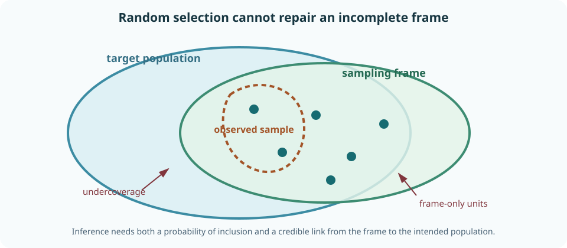
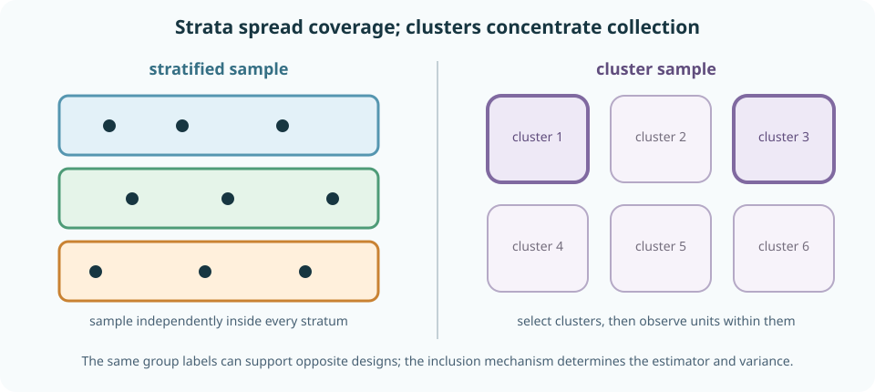
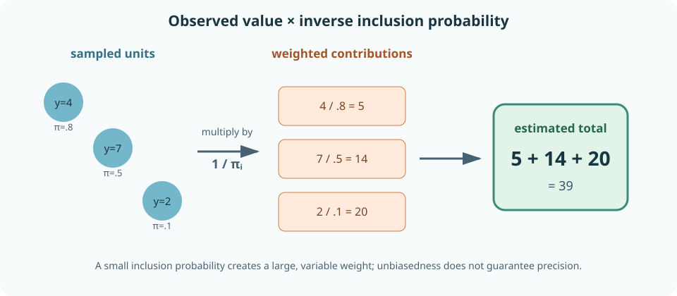
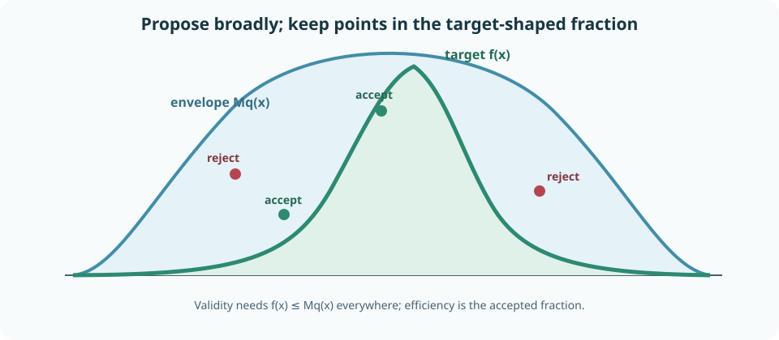
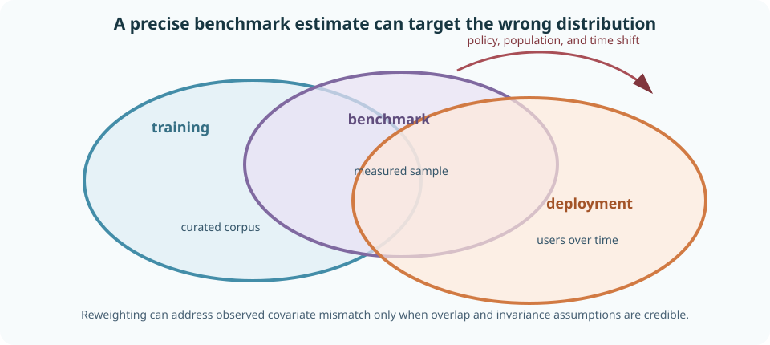

# Sampling design, dataset construction, and rigorous ML evaluation

A statistical calculation begins after data exist, but validity often depends on how those data entered the table. Which units were reachable? Which were sampled? Which responded? Which labels were purchased? Which tasks were selected? Which benchmark versions influenced training? A random number generator cannot repair an undefined population or a biased sampling frame.

This chapter develops sampling as both a data-collection design and a computational technique. It starts with finite populations, sampling with and without replacement, inclusion probabilities, stratification, clustering, multistage designs, weights, and nonresponse. It then adds rejection and variance-reduction sampling before applying the full probability-and-statistics track to ML evaluation under seeds, dependence, adaptive selection, contamination, and distribution shift.

By the end, you should be able to define a target population and sampling frame; derive simple-random-sampling estimators and finite-population corrections; design stratified, cluster, multistage, or unequal-probability samples; use Horvitz–Thompson weighting; diagnose nonresponse and convenience sampling; implement rejection sampling; reason about active and adaptive collection; construct leakage-resistant evaluation splits; quantify several randomness axes; and design an evaluation whose uncertainty and conclusions match deployment.

## 0. Population, frame, sample, and estimand are different objects

A **target population** is the collection to which a claim should apply. A **sampling frame** is the operational list or process from which units can actually be selected. A **sample** is the realized collection. An **estimand** is the population quantity being learned.

For a finite population of \(N\) fixed values \(y_1,\ldots,y_N\), the population mean is

$$
\bar Y_N=\frac1N\sum_{i=1}^Ny_i.
$$

In design-based inference, these values are fixed. Randomness comes from the sample-selection mechanism. In model-based inference, the values may instead be treated as draws from a probability model. Both views can be useful, but their uncertainty refers to different hypothetical repetitions.

Coverage error occurs when target units are absent from the frame or frame units are outside the target. Random selection within a flawed frame gives an excellent probability sample of the wrong population.

**Worked example — product feedback.** The target is all active users, but the frame contains users who opened a feedback widget. Randomly sampling widget openers does not make silent users representative. The selection event may depend on dissatisfaction, platform, language, or engagement.

> **Practice — Foundation:** Distinguish a target population, sampling frame, sample, and estimand in a voter survey.
>
> **Practice — Core:** Define these four objects for evaluating an assistant on future customer conversations.
>
> **Practice — Stretch:** Construct a complete sampling frame whose measurement process still creates selection bias.

## 1. Sampling with and without replacement

In sampling **with replacement**, each draw returns the selected unit before the next draw. A unit can appear several times. Conditional on a fixed finite population and equal draw probabilities, draws are independent.

In sampling **without replacement**, selected units cannot reappear. Draws are dependent: selecting one unit changes later possibilities. This dependence reduces uncertainty because the sample cannot repeatedly waste draws on the same unit.

A **simple random sample without replacement** (SRSWOR) of size \(n\) gives each subset of \(n\) population units equal probability. Each unit has first-order inclusion probability

$$
\pi_i=P(i\text{ is included})=\frac nN.
$$

Each pair \(i\neq j\) has joint inclusion probability

$$
\pi_{ij}
=P(i,j\text{ both included})
=\frac{n(n-1)}{N(N-1)}.
$$

Equal marginal inclusion probabilities alone do not define SRSWOR; joint probabilities determine dependence and variance.

**Worked example — sample two of four.** The six possible unordered samples are \(\{1,2\},\{1,3\},\{1,4\},\{2,3\},\{2,4\},\{3,4\}\). Each unit appears in three samples, so \(\pi_i=3/6=1/2=n/N\). Each pair appears once, so \(\pi_{ij}=1/6\).

> **Practice — Foundation:** Count the SRSWOR samples of size three from ten units.
>
> **Practice — Core:** Derive first- and second-order inclusion probabilities under SRSWOR.
>
> **Practice — Stretch:** Build a fixed-size design with equal first-order probabilities but unequal joint inclusion probabilities, then explain why its variance differs from SRSWOR.

## 2. The finite-population correction measures information left behind

The SRSWOR sample mean

$$
\bar y_s=\frac1n\sum_{i\in s}y_i
$$

is unbiased for \(\bar Y_N\). Define finite-population variance

$$
S_Y^2=\frac1{N-1}\sum_{i=1}^N(y_i-\bar Y_N)^2.
$$

Then

$$
\operatorname{Var}_{\mathrm{design}}(\bar y_s)
=
\left(1-\frac nN\right)\frac{S_Y^2}{n}.
$$

The factor

$$
\sqrt{1-\frac nN}
$$

is the **finite-population correction** (FPC) for the standard error. It matters when the sample fraction \(f=n/N\) is not negligible. If the entire population is observed, \(f=1\) and design uncertainty is zero.

The FPC does not eliminate measurement error, missing outcomes, future-population change, or model uncertainty. A census of today's benchmark has no sampling uncertainty about today's benchmark mean, yet it may poorly predict future deployment.

**Worked example.** Sampling \(400\) of \(1{,}000\) units gives an FPC of \(\sqrt{0.6}\approx0.775\). Ignoring it overstates design standard error by about 29%. Sampling \(400\) from ten million makes the correction effectively one.

> **Practice — Foundation:** Calculate the FPC for \(n=200,N=800\).
>
> **Practice — Core:** Derive the SRSWOR mean variance using inclusion indicators and their negative covariance.
>
> **Practice — Stretch:** Explain why applying an FPC to a benchmark score can be inappropriate when the inferential population is future tasks rather than the finite observed item list.

## 3. Stratified sampling guarantees coverage of declared groups

Partition the population into \(H\) non-overlapping strata. Stratum \(h\) has population size \(N_h\), sample size \(n_h\), population mean \(\bar Y_h\), and weight

$$
W_h=\frac{N_h}{N}.
$$

Sample independently within each stratum. The stratified mean estimator is

$$
\hat{\bar Y}_{\mathrm{strat}}
=\sum_{h=1}^H W_h\bar y_h.
$$

Under SRSWOR within strata, its estimated variance is

$$
\widehat{\operatorname{Var}}(\hat{\bar Y}_{\mathrm{strat}})
=
\sum_{h=1}^H
W_h^2
\left(1-\frac{n_h}{N_h}\right)
\frac{s_h^2}{n_h}.
$$

**Proportional allocation** uses \(n_h\propto N_h\). With equal per-unit costs, **Neyman allocation** uses

$$
n_h\propto N_hS_h,
$$

placing more samples in large, variable strata. Minimum per-stratum sizes may be imposed for subgroup precision even when they are not optimal for the overall mean.

**Worked example — language evaluation.** If deployment is 70% English, 20% Hindi, and 10% Tamil but the evaluation samples 200 examples from every language, the raw average targets an equal-language mixture. Weighting stratum means by \(0.7,0.2,0.1\) targets deployment composition while retaining sufficient Tamil observations for subgroup analysis.

> **Practice — Foundation:** Calculate a stratified mean from two stratum means and known population weights.
>
> **Practice — Core:** Derive the stratified variance estimator under independent within-stratum SRSWOR.
>
> **Practice — Stretch:** Design an allocation balancing overall-score precision, minimum subgroup precision, labeling cost, and a rare safety stratum.

## 4. Cluster sampling trades collection efficiency for information

A cluster contains several population units: students within schools, messages within users, prompts within tasks, or trajectories within environments.

In one-stage cluster sampling, sample clusters and observe every element in each selected cluster. In two-stage sampling, select clusters and then sample elements within them. If cluster \(j\) has inclusion probability \(\pi_j\) and unit \(i\) has conditional probability \(\pi_{i\mid j}\), the unit's overall inclusion probability is

$$
\pi_{ij}=\pi_j\pi_{i\mid j}.
$$

Units within a cluster tend to resemble one another. For equal cluster size \(m\) and intraclass correlation \(\rho\), a common approximation to the variance inflation relative to iid rows is

$$
\operatorname{DEFF}\approx1+(m-1)\rho.
$$

The effective row count is roughly \(n/\operatorname{DEFF}\). More observations inside the same few clusters eventually add little information about variation across clusters.

Strata and clusters are opposites in design logic:

- stratification samples from every stratum to spread representation;
- cluster sampling selects a subset of clusters to reduce collection cost.

The same labels—such as regions—can serve either role depending on the design.

**Worked example — prompt tasks.** One thousand prompts from each of three tasks may provide precise means for those tasks but weak evidence about a broader task population. Thirty prompts from each of one hundred sampled tasks can contain much more information about cross-task generalization.

> **Practice — Foundation:** Calculate the design effect for \(m=20,\rho=0.1\).
>
> **Practice — Core:** Compare information from increasing cluster count versus increasing rows per cluster.
>
> **Practice — Stretch:** Design a three-stage sample of domains, documents, and passages, then derive each passage's inclusion probability.

## 5. Unequal inclusion probabilities require weights

Suppose population unit \(i\) has known inclusion probability \(\pi_i>0\), not necessarily equal across units. Let \(I_i\) indicate whether it appears in the sample. The Horvitz–Thompson estimator of the population total

$$
Y=\sum_{i=1}^Ny_i
$$

is

$$
\hat Y_{\mathrm{HT}}
=
\sum_{i=1}^N\frac{I_iy_i}{\pi_i}
=
\sum_{i\in s}\frac{y_i}{\pi_i}.
$$

It is design-unbiased because

$$
E\left[\frac{I_iy_i}{\pi_i}\right]=y_i.
$$

The population mean estimate is \(\hat Y_{\mathrm{HT}}/N\) when \(N\) is known.

Small \(\pi_i\) creates large weights and potentially enormous variance. Exact design variance depends on joint inclusion probabilities \(\pi_{ij}\), not only marginal weights. Weight trimming trades variance reduction for bias and must be disclosed.

With replacement, selecting unit \(i\) on each draw with probability \(p_i\) leads to the Hansen–Hurwitz total estimator

$$
\hat Y_{\mathrm{HH}}
=
\frac1n\sum_{k=1}^n\frac{y_{i_k}}{p_{i_k}}.
$$

Do not interchange inclusion probability \(\pi_i\) with per-draw selection probability \(p_i\).

> **Practice — Foundation:** Calculate a Horvitz–Thompson total from three observed values and inclusion probabilities.
>
> **Practice — Core:** Prove design unbiasedness using inclusion indicators.
>
> **Practice — Stretch:** Construct a design-unbiased estimator dominated by one tiny inclusion probability and compare bias–variance tradeoffs under weight trimming.

## 6. Nonresponse introduces a second selection mechanism

Sampling a unit does not ensure observing its outcome. Let \(R_i=1\) indicate response and

$$
r_i=P(R_i=1\mid\text{available information})
$$

be response propensity. A combined weight may include both sampling and response probabilities:

$$
w_i=\frac1{\pi_i r_i}.
$$

Weighting is credible only if response propensities are known or estimable from information sufficient to make remaining nonresponse ignorable for the estimand.

- **Missing completely at random:** response is unrelated to observed and missing values.
- **Missing at random:** conditional on observed variables, response does not depend on the missing value.
- **Missing not at random:** response still depends on the unseen value after conditioning.

These are assumptions about distributions, not labels diagnosed conclusively from observed data alone. Sensitivity analysis should vary plausible missing-outcome behavior when nonignorability matters.

**Worked example — human ratings.** Raters may skip outputs that are very long, unsafe, or difficult to assess. Complete-case averages then target easy-to-rate outputs. Logging skip reasons and assignment features supports response modeling, but unseen discomfort may still make missingness nonignorable.

> **Practice — Foundation:** Distinguish sampling probability from response probability.
>
> **Practice — Core:** Derive a combined inverse-probability weight for sampling followed by nonresponse.
>
> **Practice — Stretch:** Specify a sensitivity analysis for ratings missing not at random because low-quality outputs are more often skipped.

## 7. Convenience samples need an identification argument

A convenience sample has unknown or uncontrolled inclusion probabilities. Examples include voluntary surveys, public benchmark submissions, scraped web text, support tickets, and users who enable telemetry.

Large size reduces variance around the convenience-sample distribution. It does not reduce bias between that distribution and the target. If selection depends on unobserved outcomes after conditioning on recorded covariates, reweighting cannot identify the target mean without additional assumptions.

Post-stratification or calibration weighting chooses weights so sample covariate totals match known population totals. This can correct imbalance on observed variables when:

1. every target region has sample overlap;
2. covariates capture selection-related outcome differences;
3. measurements are comparable across sample and population.

**Worked example — web preference data.** Millions of public comparisons may precisely estimate preferences of participating users and prompts. They need not estimate preferences of enterprise users, low-resource languages, or people who decline data sharing. “Internet-scale” is not a sampling design.

> **Practice — Foundation:** Explain why a very large convenience sample can be precisely biased.
>
> **Practice — Core:** State the assumptions needed for post-stratification to recover a target mean.
>
> **Practice — Stretch:** Give two target populations compatible with one web dataset and show why each requires different weights and conclusions.

## 8. Domain mixtures determine what an average means

Let domains \(h=1,\ldots,H\) have target weights \(W_h\) and domain performance \(\mu_h\). The target average is

$$
\mu_{\mathrm{target}}=\sum_hW_h\mu_h.
$$

An unweighted benchmark average instead uses benchmark composition. Changing domain proportions changes the estimand even if every \(\mu_h\) stays fixed.

Under covariate shift, if outcome behavior conditional on \(X\) is stable,

$$
p_{\mathrm{target}}(y\mid x)=p_{\mathrm{source}}(y\mid x),
$$

then

$$
E_{\mathrm{target}}[g(X,Y)]
=
E_{\mathrm{source}}\left[
\frac{p_{\mathrm{target}}(X)}
{p_{\mathrm{source}}(X)}
g(X,Y)
\right].
$$

This requires overlap: source probability must be positive wherever the target places relevant mass. Extreme density ratios behave like extreme sampling weights and destroy precision.

Class balancing is another mixture choice. Oversampling rare classes can improve training, but evaluation must reweight to the intended class prevalence when estimating deployed average loss. Per-class reporting prevents one mixture from hiding failures.

> **Practice — Foundation:** Compute a target metric from three domain means and deployment weights.
>
> **Practice — Core:** Derive the covariate-shift importance identity.
>
> **Practice — Stretch:** Construct two models whose ranking reverses when domain mixture changes, and relate the reversal to the deployment estimand.

## 9. Random-variate generation has several basic constructions

Inverse-CDF sampling handles distributions with computable quantiles. Other reusable ideas include:

### Transformation

Draw a simple variable and transform it. Box–Muller transforms two independent uniform variables into Gaussian variables:

$$
Z_1=\sqrt{-2\log U_1}\cos(2\pi U_2),
\qquad
Z_2=\sqrt{-2\log U_1}\sin(2\pi U_2).
$$

### Composition

For a mixture, first sample component \(K\), then sample from \(p(x\mid K)\).

### Rejection sampling

Suppose target density \(f\) and proposal \(q\) satisfy

$$
f(x)\leq Mq(x)
$$

for every \(x\). Propose \(X\sim q\), draw \(U\sim\operatorname{Uniform}(0,1)\), and accept when

$$
U\leq\frac{f(X)}{Mq(X)}.
$$

The acceptance rate is \(1/M\) when \(f\) and \(q\) are normalized. An invalid envelope biases the sample; a loose envelope is valid but inefficient.

### Discrete tables

CDF lookup supports moderate categorical distributions. Alias tables use preprocessing to permit constant-time repeated draws. The preprocessing, normalization, and finite-precision edge cases remain part of correctness.

> **Practice — Foundation:** Describe the two random draws in rejection sampling.
>
> **Practice — Core:** Prove the conditional density of an accepted rejection-sampling proposal is \(f\).
>
> **Practice — Stretch:** Choose proposals for a bounded multimodal target and explain the tradeoff between envelope validity and acceptance rate.

## 10. Variance reduction changes the simulation design

Monte Carlo accuracy can improve without simply increasing independent draw count.

### Antithetic sampling

If \(U\sim\operatorname{Uniform}(0,1)\), pair \(U\) with \(1-U\). For monotone integrands, their errors are often negatively correlated.

### Control variates

If \(E[C]=\mu_C\) is known, estimate

$$
\hat\mu_{\mathrm{cv}}
=
\bar Y-c(\bar C-\mu_C).
$$

Its variance is minimized at

$$
c^*=\frac{\operatorname{Cov}(Y,C)}{\operatorname{Var}(C)}.
$$

Estimating \(c\) from the same simulation adds uncertainty that should be included or separated by a pilot run.

### Stratified and Latin hypercube sampling

Force samples across regions of the input space rather than allowing random gaps. Weight regional estimates by their probability mass.

### Quasi-Monte Carlo

Low-discrepancy deterministic points fill a unit cube more evenly than iid uniforms. Error theory differs from ordinary Monte Carlo; randomized constructions can restore replication-based uncertainty.

**Worked example — paired model simulation.** Evaluating two systems on the same sampled scenarios estimates their difference with variance

$$
\operatorname{Var}(A-B)
=\operatorname{Var}(A)+\operatorname{Var}(B)-2\operatorname{Cov}(A,B).
$$

Common random numbers create positive covariance and can greatly reduce comparison variance.

> **Practice — Foundation:** Explain the intended effect of antithetic sampling on covariance.
>
> **Practice — Core:** Derive the optimal control-variate coefficient.
>
> **Practice — Stretch:** Compare iid, stratified, Latin hypercube, and randomized quasi-Monte Carlo designs for a high-dimensional simulator with only a few influential coordinates.

## 11. Active and adaptive sampling must record selection probabilities

An active learner chooses which examples to label using current model uncertainty. An adaptive evaluator allocates more samples to promising or risky regions. These strategies can save labels or concentrate safety discovery, but the observed labeled set no longer follows the original population distribution.

At time \(t\), let selection probability

$$
\pi_t=P(I_t=1\mid\mathcal H_{t-1},X_t)
$$

depend on recorded history and current covariates. Inverse-probability or doubly robust estimators can target a population mean if probabilities are known, positive, and the adaptive dependence is handled. Selecting with zero probability makes that region unidentifiable from observed labels.

Model uncertainty is not itself an inclusion probability. A heuristic ranking must be randomized or otherwise modeled if design-based correction is desired.

**Worked example — safety red teaming.** Oversampling prompts likely to elicit failures improves failure discovery. The raw failure fraction then estimates the red-team mixture, not deployment prevalence. Retain known sampling probabilities or combine a probability deployment sample for prevalence with targeted samples for taxonomy and stress testing.

> **Practice — Foundation:** Explain why an active-learning labeled set is not generally an iid population sample.
>
> **Practice — Core:** Write a history-dependent inclusion probability and its inverse-probability contribution.
>
> **Practice — Stretch:** Design a hybrid evaluation combining representative sampling with adaptive rare-failure search while keeping prevalence estimation identifiable.

## 12. Dataset splits must separate the dependence that matters

A random row split is valid only when rows are exchangeable and future use resembles another row from the same population. Common alternatives are:

- **group split:** keep all rows from one user, patient, document, task, or entity together;
- **time split:** train on the past and evaluate on later observations;
- **geographic or domain split:** test transfer to held-out environments;
- **leave-one-group-out:** approximate generalization to a new group;
- **nested split:** place model and hyperparameter selection inside an outer evaluation split.

Leakage occurs whenever information unavailable at prediction time crosses into training or selection. It includes more than duplicate rows:

- fitting normalization or vocabulary on the full dataset;
- selecting features using test labels;
- splitting passages from the same document across train and test;
- using future observations to construct past predictors;
- tuning prompts or thresholds against test outcomes;
- choosing the reported metric after seeing all results.

Every data-dependent transformation belongs inside the training fold. A pipeline evaluated by cross-validation must refit preprocessing, feature selection, calibration, and model selection separately within each fold.

**Worked example — conversation leakage.** Splitting messages randomly lets the same conversation appear in train and test. Style, user identity, and earlier context make rows dependent. A conversation-level split estimates transfer to new conversations; a user-level split asks the harder question of transfer to new users.

> **Practice — Foundation:** Explain why fitting a scaler before splitting leaks test information.
>
> **Practice — Core:** Choose row, document, user, or time splitting for three deployment scenarios.
>
> **Practice — Stretch:** Draw a nested evaluation pipeline that tunes features, model, and decision threshold without exposing the outer test fold.

## 13. Seeds sample some randomness but not all uncertainty

An ML result may vary across:

- sampled training data;
- initialization and minibatch order;
- hyperparameter search;
- checkpoints;
- test items and tasks;
- stochastic outputs;
- raters;
- systems and hardware.

Repeated seeds usually vary initialization and training order while holding the dataset, architecture family, research decisions, and benchmark fixed. Seed-to-seed standard error therefore does not measure uncertainty over new tasks or data.

A conceptual crossed decomposition is

$$
Y_{s,t,i}
=
\mu+A_s+B_t+C_{st}+\varepsilon_{sti},
$$

where \(s\) indexes seed, \(t\) task, and \(i\) item. Whether each term is fixed or random depends on the intended generalization.

**Worked example — five seeds on one benchmark.** The mean across seeds estimates average performance over the implemented seed distribution conditional on that benchmark and training dataset. Treating all seed-item predictions as iid exaggerates information because every seed sees the same items and every item is scored by all seeds.

> **Practice — Foundation:** Name what changes and what stays fixed across ordinary training seeds.
>
> **Practice — Core:** Write two different estimands: one over new seeds on fixed tasks and one over both new seeds and new tasks.
>
> **Practice — Stretch:** Design a crossed seed-by-task sampling plan and state how you would estimate each variance component.

## 14. Metric aggregation defines the estimand

Micro-averaging pools all rows. Macro-averaging gives each group equal weight. A deployment-weighted average uses target mixture weights. None is universally correct.

Nonlinear metrics require additional care:

- average of ratios differs from ratio of totals;
- F-scores couple precision and recall;
- maxima and worst-group metrics are selection-sensitive;
- quantiles have tail-specific uncertainty;
- pass-at-\(k\) depends on a defined repeated-generation process;
- token-average loss weights long sequences more heavily than document-average loss.

Write the estimand as an equation before computing it. For domain means \(\mu_h\):

$$
\mu_W=\sum_hW_h\mu_h.
$$

Changing \(W_h\) changes the question, not merely presentation.

**Worked example — task macro versus item micro.** Model A excels on one enormous easy task and loses slightly on nine small tasks. It can win the item-micro average and lose the task-macro average. Neither ranking is contradictory; they target different populations of items or tasks.

> **Practice — Foundation:** Distinguish micro-, macro-, and deployment-weighted accuracy.
>
> **Practice — Core:** Construct task sizes and accuracies that reverse two models' ranking under micro and macro averages.
>
> **Practice — Stretch:** Define an estimand for tail latency subject to a quality constraint and explain why separate marginal tests may not answer it.

## 15. Evaluation uncertainty should replay the claimed generalization

For two systems evaluated on common items, use paired differences. For tasks containing items, a hierarchical bootstrap can:

1. resample tasks if generalizing to new tasks;
2. resample paired items inside each selected task if generalizing to new items;
3. preserve both systems' results on each item;
4. recompute the complete metric and aggregation.

If tasks are fixed, do not resample them to imply a task superpopulation. If items exhaust a finite benchmark, an FPC can describe that finite list, but a future-item or future-task claim needs a broader population model.

For stochastic generators, repeated outputs within one prompt estimate conditional output variability. They do not increase the number of independent prompts. For human raters, preserve assignment blocks and model rater effects or resample at the relevant rater and item units.

**Worked example — win rate with ties.** Resampling individual model outputs separately breaks prompt pairing. Resample the prompt record containing both outputs and the judge result. If multiple judges rate each pair, decide whether the target averages over this fixed panel or predicts a new rater.

> **Practice — Foundation:** Explain why paired resampling preserves shared item difficulty.
>
> **Practice — Core:** Specify a bootstrap for new prompts within fixed tasks and another for new tasks.
>
> **Practice — Stretch:** Build an uncertainty procedure for tasks, prompts, stochastic outputs, and crossed human raters without flattening all ratings into iid rows.

## 16. Adaptive selection expands the analysis family

The final reported result may have been selected across:

- datasets and filters;
- architectures and checkpoints;
- hyperparameters and prompts;
- seeds;
- metrics and thresholds;
- subgroups;
- stopping times;
- plotting and exclusion choices.

An untouched test set evaluates the chosen pipeline only if no test information influenced selection. Repeatedly checking the same set converts it into development data even when labels remain hidden behind a leaderboard.

Nested evaluation repeats selection inside each outer training sample. Selective inference, reusable-holdout methods, sequentially valid tests, or a fresh confirmation sample address other workflows. None creates information about populations missing from the frame.

**Worked example — best seed reporting.** Selecting the highest of 20 noisy seed scores and attaching a standard error as though the seed were prespecified ignores the maximum operation. The valid repeated experiment must rerun all 20 seeds and reselect the winner, or the estimand must instead average over seeds.

> **Practice — Foundation:** List four choices that belong to an ML analysis family.
>
> **Practice — Core:** Explain how nested cross-validation includes hyperparameter selection in the evaluation repetition.
>
> **Practice — Stretch:** Simulate a full checkpoint-by-seed-by-metric selection workflow and estimate optimism as each search dimension grows.

## 17. Benchmark contamination is dependence, not only duplication

Direct train-test duplication is the clearest contamination, but dependence can be subtler:

- paraphrases or translations of test items appear in training;
- solutions, explanations, or answer keys are present;
- benchmark authors publish development examples that shape methods;
- repeated leaderboard feedback tunes the research community;
- synthetic training data are generated by a model exposed to the benchmark;
- the benchmark is chosen because preliminary performance looked favorable.

Contamination changes the interpretation of performance. The score may measure retrieval or adaptation to a known benchmark rather than generalization to unseen tasks.

Auditing uses provenance, time, semantic similarity, memorization probes, held-out canaries, and comparison with newly collected data. Each method has false positives and false negatives. Absence of detected overlap is not proof of independence.

**Worked example — benchmark saturation.** Even if a final model's training corpus has no exact test rows, years of public optimization against the benchmark can make architectures, prompts, and preprocessing benchmark-specific. Community-level adaptive reuse narrows the meaning of the test set.

> **Practice — Foundation:** Distinguish exact duplication from semantic contamination.
>
> **Practice — Core:** Design a temporal provenance audit for a model and benchmark.
>
> **Practice — Stretch:** Explain how public leaderboard feedback creates adaptive overfitting without any participant seeing hidden labels.

## 18. Distribution shift changes either inputs, outcomes, or their relationship

Let source distribution be \(P_S(X,Y)\) and deployment target be \(P_T(X,Y)\).

- **Covariate shift:** \(P_S(X)\neq P_T(X)\) but \(P_S(Y\mid X)=P_T(Y\mid X)\).
- **Label shift:** \(P_S(Y)\neq P_T(Y)\) but \(P_S(X\mid Y)=P_T(X\mid Y)\).
- **Concept shift:** \(P_S(Y\mid X)\neq P_T(Y\mid X)\).

Covariate-shift weighting cannot repair concept shift. Label-shift correction depends on stable class-conditional features and identifiable confusion behavior. No weighting method extrapolates reliably into target regions with no source overlap.

Detect shift with domain classifiers, density-ratio diagnostics, feature and label summaries, subgroup metrics, and predictive residuals. Detection is easier than proving performance stability: small measured input shift can hide a large change in rare, decision-critical regions.

**Worked example — policy-induced shift.** Deploying a refusal model changes which users continue interacting and which prompts arrive later. The system affects its own future input distribution. A static benchmark sampled before deployment cannot capture this feedback without an explicit longitudinal or causal model.

> **Practice — Foundation:** Distinguish covariate, label, and concept shift.
>
> **Practice — Core:** State the invariance and overlap assumptions required for covariate-shift weighting.
>
> **Practice — Stretch:** Construct a feedback loop where deployment changes future data and propose an evaluation that measures the induced dynamics.

## 19. A rigorous ML evaluation protocol

Before collection:

1. define deployment population, frame, unit, and estimand;
2. identify strata, clusters, time order, and interference groups;
3. choose a probability or justified purposive sample;
4. record inclusion and response probabilities where weighting is planned;
5. predeclare primary metrics, aggregation weights, comparisons, and stopping;
6. separate training, selection, calibration, and confirmation data;
7. plan sample sizes across every claimed random axis.

During collection:

1. preserve pairing and cluster identifiers;
2. log selection, assignment, response, exclusions, versions, and timestamps;
3. blind human assessment where possible;
4. monitor coverage gaps and missingness without silently changing the estimand;
5. quarantine test feedback from development.

After collection:

1. calculate effects and uncertainty using the design;
2. apply finite-population, weight, cluster, and multiplicity adjustments where justified;
3. report subgroup, tail, and sensitivity analyses;
4. quantify seed, task, item, output, and rater variation separately;
5. audit contamination and shift;
6. state unsupported populations and likely failure modes;
7. preserve enough provenance to reproduce the sampling path.

> **Practice — Foundation:** Turn an informal claim that “model B is better” into a population, estimand, and sampling statement.
>
> **Practice — Core:** Audit a study protocol against the three phases above and identify the first validity break.
>
> **Practice — Stretch:** Design a full evaluation for an agent deployed across languages, organizations, and time, including adaptive safety sampling without corrupting prevalence estimates.

## 20. Runnable labs

This chapter has three coding exercises. Each appears as a separate tab in the lesson's right-hand Python workspace.

### Lab A — stratified finite-population mean

Implement **stratified_mean_standard_error** in [labs/exercises.py](../../labs/exercises.py). Given mappings from stratum names to observed finite values and known population sizes, return:

1. the population-weighted mean estimate;
2. its design standard error using within-stratum sample variances and finite-population corrections.

Run:

~~~text
python -m labs.checks stratified
~~~

The checks cover disproportionate sampling, census strata, generators, constant strata, input preservation, and invalid designs.

### Lab B — Horvitz–Thompson estimation

Implement **horvitz_thompson** in [labs/exercises.py](../../labs/exercises.py). Given observed values, their first-order inclusion probabilities, and known population size, return the estimated population total and mean.

Run:

~~~text
python -m labs.checks horvitz-thompson
~~~

The checks cover equal and unequal probabilities, census inclusion, scale behavior, generators, input preservation, and invalid probabilities.

### Lab C — generic rejection sampler

Implement **rejection_sample** in [labs/exercises.py](../../labs/exercises.py). Given a proposal callable that accepts a local random generator, an acceptance-probability callable, desired draw count, seed, and maximum attempts, return:

1. accepted finite values;
2. attempts used;
3. realized acceptance rate.

Run:

~~~text
python -m labs.checks rejection
~~~

The checks cover deterministic and partial acceptance, reproducibility, local random state, exhausted attempt budgets, callback validation, and invalid settings.

### Guided experiment

1. Simulate SRSWOR at several sampling fractions and verify the finite-population correction.
2. Compare proportional, equal, and Neyman stratum allocation under heterogeneous variances.
3. Increase intracluster correlation and compare naive row uncertainty with cluster-aware uncertainty.
4. Simulate unequal-probability designs and measure Horvitz–Thompson bias and weight-driven variance.
5. Vary rejection envelopes and compare correctness with acceptance efficiency.
6. Construct a benchmark mixture where micro, macro, and deployment-weighted rankings disagree.
7. Add covariate then concept shift and test when importance weighting succeeds or fails.

## 21. Derivations to own

1. Derive first- and second-order inclusion probabilities under SRSWOR.
2. Derive unbiasedness and finite-population variance of the sample mean.
3. Derive the stratified mean and variance estimator.
4. Derive proportional and Neyman allocation under equal costs.
5. Derive the cluster design-effect approximation from intraclass correlation.
6. Multiply conditional probabilities in a multistage inclusion design.
7. Prove Horvitz–Thompson design unbiasedness.
8. Distinguish Horvitz–Thompson inclusion weights from Hansen–Hurwitz draw weights.
9. Derive combined sampling-and-response weights.
10. Derive the covariate-shift importance identity.
11. Prove rejection sampling produces the target conditional density.
12. Derive the optimal control-variate coefficient.
13. Expand a crossed seed-by-task variance decomposition.
14. Specify a hierarchical resampling distribution matching an AI generalization claim.

## 22. End-of-unit practice (graded)

**Foundation — problems 1–6.** Reconstruct sampling designs and direct estimators.

1. **Population map.** Identify target, frame, unit, sample, response mechanism, and estimand in three studies.
2. **SRSWOR.** Enumerate samples, calculate inclusion probabilities, a sample mean, and its finite-population standard error.
3. **Strata.** Combine stratum estimates using known population weights and calculate the design standard error.
4. **Clusters.** Calculate design effects across cluster sizes and intraclass correlations.
5. **Weights.** Compute Horvitz–Thompson totals and means from unequal inclusion probabilities.
6. **Rejection sampling.** Verify an envelope, calculate acceptance probability, and trace several proposal decisions.

**Core — problems 7–13.** Design and analyze realistic sampling workflows.

7. **Allocation.** Compare proportional, Neyman, and minimum-subgroup allocations under costs and heterogeneous variance.
8. **Multistage sample.** Sample organizations, users, and conversations; derive final inclusion weights and the target mean.
9. **Nonresponse.** Fit or specify response propensities, combine them with design weights, and run an informative-missingness sensitivity analysis.
10. **Variance reduction.** Apply antithetic and control-variate estimators and compare variance through repeated simulation.
11. **Active labels.** Build a randomized active-sampling policy that preserves population-risk estimation.
12. **Leakage-safe split.** Design nested group-and-time evaluation with preprocessing and calibration fitted in the correct folds.
13. **Evaluation uncertainty.** Construct paired hierarchical resampling across tasks, prompts, outputs, and raters.

**Stretch — problems 14–21.** Diagnose selection, contamination, and shift in research-scale evaluations.

14. **Weight instability.** Simulate rare inclusion and evaluate bias, variance, trimming, and effective sample size.
15. **Convenience-data limits.** Reweight a web sample to known margins, then construct an unobserved selection variable that defeats the correction.
16. **Adaptive safety search.** Separate representative prevalence estimation from targeted failure discovery and maintain valid accounting for both.
17. **Seed fallacy.** Show that increasing seeds cannot estimate new-task uncertainty when tasks remain fixed.
18. **Benchmark reuse.** Simulate repeated leaderboard selection and measure community-level overfitting.
19. **Contamination audit.** Combine exact, semantic, temporal, and provenance checks while quantifying uncertain matches.
20. **Shift failure.** Build covariate shift where weighting succeeds, then concept shift with the same marginals where it fails.
21. **Complete protocol.** Design a deployment-facing evaluation with finite-population structure, clusters, weights, missingness, adaptive sampling, selection, contamination, and temporal shift.

Worked solution sketches

1. The target is the intended claim population; the frame operationalizes access; inclusion and response select the observed sample; the estimand is a population functional. Keep each object explicit.
2. Under SRSWOR every subset has equal probability, \(\pi_i=n/N\), and the mean variance is \((1-n/N)S_Y^2/n\). Estimate \(S_Y^2\) with sample variance.
3. Weight each stratum mean by \(N_h/N\). Sum independent stratum variance contributions \(W_h^2(1-n_h/N_h)s_h^2/n_h\).
4. The approximation \(1+(m-1)\rho\) exposes why adding correlated rows gives diminishing information. Cluster count, not raw row count, usually drives population-of-clusters precision.
5. Sum \(y_i/\pi_i\) over observed unique units. Divide by known \(N\) for the population mean. Tiny probabilities produce unstable weights.
6. Verify \(f(x)\leq Mq(x)\) everywhere. Propose from \(q\) and accept with \(f(X)/(Mq(X))\); the accepted joint density is proportional to \(q(x)f(x)/(Mq(x))=f(x)/M\).
7. Proportional allocation tracks size; Neyman tracks size times standard deviation; minimum guarantees support subgroup goals. Cost-adjusted allocation also divides by square-root cost.
8. Multiply stage-specific conditional inclusion probabilities. Preserve cluster and unit identifiers; compute a weighted estimator and a variance method matching all stages.
9. Combine inverse sampling and response probabilities under conditional ignorability. Vary missing outcomes or response odds to expose conclusions that depend on unverifiable assumptions.
10. Antithetic pairs seek negative error covariance. A control variate subtracts correlated noise with known expectation; \(c^*=\operatorname{Cov}(Y,C)/\operatorname{Var}(C)\).
11. Randomize label requests with known nonzero probabilities based on history. Weight labeled losses by inverse probabilities or use a justified doubly robust estimator.
12. Keep entities and future times outside training. Refit every learned transformation inside inner folds; use outer folds only for pipeline evaluation.
13. Resample every claimed population axis, preserve system pairing, and recompute the complete nonlinear metric. Do not flatten outputs or ratings into independent rows.
14. A few inverse probabilities dominate the estimator. Trimming reduces variance but changes bias. Report weight distributions, target coverage, and sensitivity to trimming.
15. Calibration fixes imbalance only on observed variables with overlap. An unmeasured variable affecting selection and outcomes leaves residual nonidentifiability.
16. Use a probability sample to estimate prevalence and a separately labeled adaptive stream to discover modes. Do not combine raw rates without known mixture and inclusion weights.
17. Seeds sample training randomness conditional on fixed tasks. New-task uncertainty requires sampled tasks or a task-population model regardless of seed count.
18. Selecting leaders using repeated noisy feedback raises hidden-test performance even when true performance is equal. A fresh benchmark or reuse-aware protocol is needed.
19. Each contamination detector has error. Report match rules and uncertain cases, preserve time and source provenance, and validate on newly collected data.
20. Importance weighting works when conditional outcome behavior is invariant and overlap holds. Changing \(P(Y\mid X)\) breaks that identification even if density ratios are known exactly.
21. A complete answer aligns population, frame, design, weights, splits, random axes, estimand, uncertainty, selection control, provenance, shift monitoring, and deployment decision.

## Mastery check

Given an unfamiliar dataset or evaluation, define its target population and frame; reconstruct inclusion and response mechanisms; choose and derive a sampling estimator; account for strata, clusters, stages, and finite-population structure; implement or diagnose computational sampling; identify leakage and adaptive selection; quantify every claimed random axis; audit contamination and distribution shift; and limit conclusions to the population that the design actually represents.

The next unit develops [exponential families, statistical regression, GLMs, and partial pooling](11-exponential-families-regression-glms.md), using these sampling and evaluation tools throughout.
