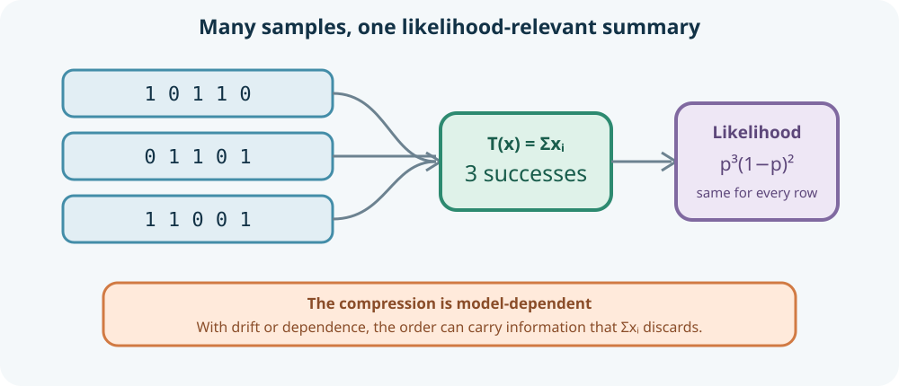
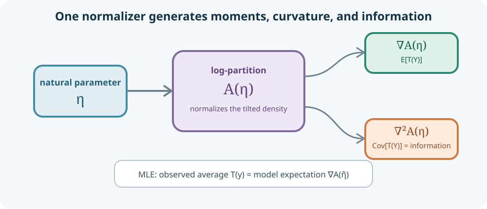
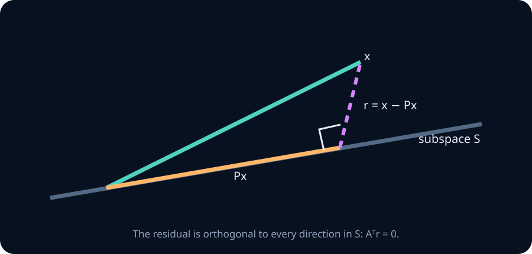
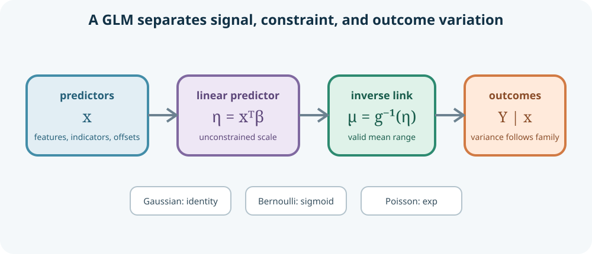
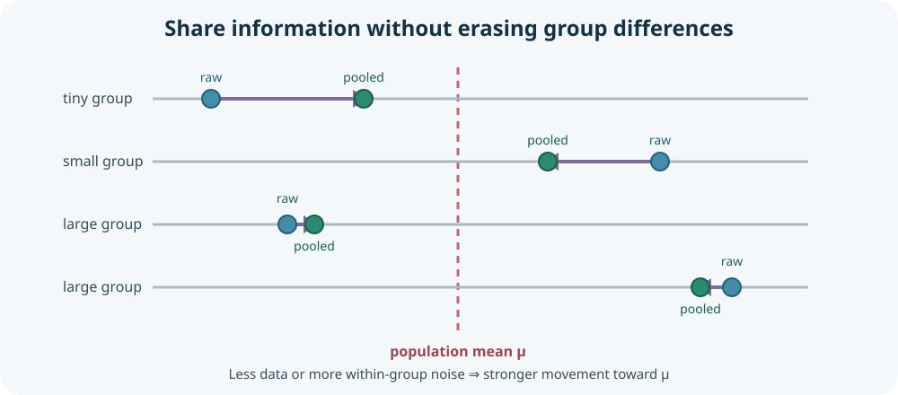

# Exponential families, statistical regression, GLMs, and partial pooling

A regression is not merely a line fitted through points. It is a conditional probability model: the distribution of an outcome is allowed to change with measured inputs. That viewpoint unifies least squares, logistic regression, Poisson regression, analysis of variance, weighted estimation, and many hierarchical models used in AI experiments.

The unification begins one level earlier. A **sufficient statistic** identifies what a probability model permits us to discard, and an **exponential family** exposes a common geometry behind many likelihoods. Generalized linear models then make an exponential-family mean depend on a linear predictor through a link function. The result is a compact language for effects, uncertainty, diagnostics, and partial pooling—not just a collection of optimization objectives.

By the end, you should be able to prove sufficiency with the factorization theorem; recognize and manipulate exponential families; derive moments from a log-partition function; fit and interpret linear, logistic, and Poisson models; derive standard, heteroskedasticity-robust, and cluster-robust uncertainty; connect \(t\)-tests and ANOVA to regression; diagnose misspecification, separation, and overdispersion; explain iteratively reweighted least squares; and use mixed-effects models to represent grouped variation without either ignoring groups or estimating each group in isolation.

## 0. Regression models a conditional distribution

For an outcome \(Y\) and predictors \(X=x\), a regression model specifies some part of

$$
P(Y\mid X=x).
$$

The simplest target is the conditional mean

$$
m(x)=E[Y\mid X=x].
$$

A linear mean model asserts \(m(x)=x^T\beta\). This is a claim about the mean, not necessarily a claim that individual observations lie near a straight line or that \(X\) is random. A full Gaussian linear model adds

$$
Y_i\mid x_i\sim\mathcal N(x_i^T\beta,\sigma^2),
$$

usually with conditional independence across \(i\). The mean structure, variance structure, outcome distribution, and dependence structure are separate assumptions.

**Worked example — latency versus batch size.** Suppose \(Y\) is request latency and \(x\) contains an intercept and batch size. A line for \(E[Y\mid x]\) may be a useful local summary even if latency is right-skewed. Gaussian prediction intervals, however, require more: roughly stable conditional variance and an adequate conditional shape. Estimating an average slope can remain meaningful after Gaussianity fails, while a naive standard error or tail prediction can fail badly.

> **Practice — Foundation:** Distinguish a model for \(E[Y\mid X]\) from a model for the complete distribution \(Y\mid X\).
>
> **Practice — Core:** For \(E[Y\mid X=x]=2+0.4x\), interpret the intercept, slope, and predicted mean at \(x=5\).
>
> **Practice — Stretch:** Construct two conditional distributions with the same linear mean but different variance and tail behavior. State which regression conclusions agree.

## 1. Sufficiency asks what the model lets us forget

Let \(X\) have density or mass \(p_\theta(x)\). A statistic \(T(X)\) is **sufficient** for \(\theta\) if the conditional distribution of the full data given \(T(X)\) does not depend on \(\theta\). Once \(T\) is known, the remaining arrangement contains no additional information about \(\theta\) under the assumed model.

The Fisher–Neyman factorization theorem gives a practical criterion. \(T\) is sufficient when

$$
p_\theta(x)=g_\theta(T(x))h(x),
$$

where \(h\) does not depend on \(\theta\). Every part involving the unknown parameter flows through \(T(x)\).

For iid Bernoulli observations \(x_i\in\{0,1\}\),

$$
p_p(x_{1:n})
=\prod_{i=1}^n p^{x_i}(1-p)^{1-x_i}
=p^{\sum_i x_i}(1-p)^{n-\sum_i x_i}.
$$

Thus \(T(X)=\sum_iX_i\) is sufficient for \(p\). Conditional on \(T=s\), all binary sequences with \(s\) successes have the same probability \(1/\binom ns\), independent of \(p\).

**Worked example — why order suddenly matters.** If the model changes to \(P(X_i=1)=\operatorname{logit}^{-1}(\alpha+\beta i)\), the success count alone is not sufficient for \((\alpha,\beta)\). Early and late successes carry different evidence about the time trend. Sufficiency is never a property of a data summary by itself; it is a property relative to a model.

> **Practice — Foundation:** Factor the iid Poisson likelihood and identify a sufficient statistic for its rate.
>
> **Practice — Core:** Show directly that the conditional distribution of a Bernoulli sequence given its success count does not depend on \(p\).
>
> **Practice — Stretch:** Give a plausible data-generating process for which \((\sum_iX_i,n)\) is insufficient even though each \(X_i\) is binary.

## 2. Minimal sufficiency and information-preserving compression

A sufficient statistic can contain irrelevant detail: the full sample \(X\) is always sufficient for its own model. A statistic is **minimal sufficient** when every other sufficient statistic determines it, up to equivalent representations.

For dominated families, a useful likelihood-ratio criterion is

$$
\frac{p_\theta(x)}{p_\theta(y)}
\text{ is independent of }\theta
\quad\Longleftrightarrow\quad
T(x)=T(y).
$$

For iid Bernoulli data, the likelihood ratio for two sequences is independent of \(p\) exactly when they have the same success count. The count is therefore minimal sufficient.

For iid Gaussian observations with both \(\mu\) and \(\sigma^2\) unknown,

$$
\sum_i(x_i-\mu)^2
=\sum_i x_i^2-2\mu\sum_i x_i+n\mu^2.
$$

The likelihood depends on the data through

$$
T(X)=\left(\sum_iX_i,\sum_iX_i^2\right),
$$

or equivalently \((\bar X,\sum_i(X_i-\bar X)^2)\). The sample mean alone loses information about variance.

**Worked example — distributed aggregation.** Workers processing Gaussian observations need only transmit \(n\), \(\sum x_i\), and \(\sum x_i^2\) to reconstruct the Gaussian likelihood for \((\mu,\sigma^2)\). This is exact under the model, unlike a histogram approximation. If observations have worker-specific means, those global sums cease to preserve all relevant evidence.

> **Practice — Foundation:** Explain why the complete sample is sufficient but usually not minimal.
>
> **Practice — Core:** Factor the Gaussian likelihood with known variance and show that \(sum_iX_i\) is sufficient for \(\mu\).
>
> **Practice — Stretch:** Determine whether a fixed-dimensional sufficient statistic can preserve an arbitrary iid density family, and explain what this suggests about model structure.

## 3. Exponential families expose a shared likelihood form

A regular exponential family has density or mass

$$
p_\eta(y)
=h(y)\exp\!\left(\eta^TT(y)-A(\eta)\right),
$$

where

- \(T(y)\) is the sufficient-statistic vector;
- \(\eta\) is the **natural parameter**;
- \(A(\eta)\) is the **log-partition function** that normalizes the distribution;
- \(h(y)\) is the base measure.

For iid observations,

$$
p_\eta(y_{1:n})
=\left[\prod_i h(y_i)\right]
\exp\!\left(\eta^T\sum_iT(y_i)-nA(\eta)\right),
$$

so \(sum_iT(Y_i)\) is sufficient for \(\eta\).

Common one-parameter examples are:

| Distribution | Natural parameter \(\eta\) | Statistic \(T(y)\) | \(A(\eta)\) |
|---|---:|---:|---:|
| Bernoulli\((p)\) | \(\log[p/(1-p)]\) | \(y\) | \(\log(1+e^\eta)\) |
| Poisson\((\lambda)\) | \(\log\lambda\) | \(y\) | \(e^\eta\) |
| Gaussian\((\mu,\sigma^2) known\) | \(\mu/\sigma^2\) | \(y\) | \(\sigma^2\eta^2/2\) |

The categorical, multinomial, gamma, beta, and full Gaussian families also have exponential-family representations, sometimes with constrained or vector natural parameters.

**Worked example — Bernoulli in natural form.** With \(\eta=\log[p/(1-p)]\), \(p=e^\eta/(1+e^\eta)\). Then

$$
p^y(1-p)^{1-y}
=\exp\left(y\eta-\log(1+e^\eta)\right).
$$

The log odds are not an arbitrary logistic-regression convention; they are the Bernoulli natural parameter.

> **Practice — Foundation:** Rewrite a Poisson mass function using \(\eta=\log\lambda\).
>
> **Practice — Core:** Put a Gaussian with known variance into exponential-family form and identify all terms.
>
> **Practice — Stretch:** Explain why allowing a distribution's support to depend on its parameter can break regular exponential-family arguments.

## 4. The log-partition function generates moments and geometry

Normalization requires

$$
e^{A(\eta)}=\int h(y)e^{\eta^TT(y)}\,dy.
$$

Differentiate \(A\) under regularity conditions:

$$
\nabla A(\eta)=E_\eta[T(Y)],
\qquad
\nabla^2 A(\eta)=\operatorname{Cov}_\eta(T(Y)).
$$

The Hessian is positive semidefinite, so \(A\) is convex. Natural parameters \(\eta\) and mean parameters \(mu_T=E[T(Y)]\) are related by the gradient map. Curvature measures uncertainty and also supplies Fisher information.

**Worked example — Bernoulli curvature.** For Bernoulli data,

$$
A(\eta)=\log(1+e^\eta),\quad
A'(\eta)=\frac{e^\eta}{1+e^\eta}=p,
$$

and

$$
A''(\eta)=p(1-p)=\operatorname{Var}(Y).
$$

For a sample, the log likelihood is

$$
\ell(\eta)=\eta^T\sum_iT(y_i)-nA(\eta)+\text{constant}.
$$

Its score sets empirical sufficient statistics equal to model expectations:

$$
\frac1n\sum_iT(y_i)=\nabla A(\hat\eta).
$$

This **moment matching** explains many familiar MLE formulas.

> **Practice — Foundation:** Differentiate the Poisson log-partition function twice and identify the mean and variance.
>
> **Practice — Core:** Derive the exponential-family score and explain why its zero is a moment-matching equation.
>
> **Practice — Stretch:** Relate strict convexity of \(A\) to one-to-one mapping between natural and mean parameters, noting what can fail in redundant representations.

## 5. Sufficiency helps estimators, but only inside the model

If \(T\) is sufficient and \(U(X)\) is an unbiased estimator, the Rao–Blackwell estimator

$$
\tilde U(T)=E[U(X)\mid T]
$$

is still unbiased and has no larger variance:

$$
\operatorname{Var}(U)
=E[\operatorname{Var}(U\mid T)]
+\operatorname{Var}(E[U\mid T]).
$$

Thus conditioning on \(T\) removes variation irrelevant to \(\theta\) under the model. With an additional **completeness** property, an unbiased function of a complete sufficient statistic is the unique minimum-variance unbiased estimator.

These are model-based guarantees, not universal compression guarantees. If sequence order reveals drift, subgroup labels reveal heterogeneity, or acquisition metadata reveals selection, discarding them may make the model impossible to criticize. A statistic can be sufficient for parameters in a wrong model while hiding why the model is wrong.

**Worked example — one Bernoulli draw selected at random.** Let \(U=X_1\), an unbiased estimator of \(p\). Given \(S=\sum_iX_i\), exchangeability gives \(E[X_1\mid S]=S/n=\bar X\). Rao–Blackwellization turns one noisy bit into the sample proportion, whose variance is \(p(1-p)/n\) rather than \(p(1-p)\).

> **Practice — Foundation:** Use total variance to explain why Rao–Blackwellization cannot increase variance.
>
> **Practice — Core:** Rao–Blackwellize \(X_1\) given the binomial success count and compare variances.
>
> **Practice — Stretch:** Explain why retaining raw data can still be essential even after computing a sufficient statistic for the fitted model.

## 6. Linear regression is projection plus a sampling model

Stack \(n\) outcomes into \(y\in\mathbb R^n\) and predictor rows into \(X\in\mathbb R^{n\times p}\). Ordinary least squares chooses

$$
\hat\beta=\arg\min_b\lVert y-Xb\rVert_2^2.
$$

Differentiating gives the normal equations

$$
X^TX\hat\beta=X^Ty.
$$

When \(X\) has full column rank, the algebraic expression is \((X^TX)^{-1}X^Ty\), but numerical software should solve a least-squares problem with QR or SVD rather than explicitly forming the inverse. The fitted vector

$$
\hat y=X\hat\beta=Hy,
\qquad H=X(X^TX)^{-1}X^T,
$$

is the projection of \(y\) onto the column space of \(X\). Residuals \(e=y-\hat y\) are orthogonal to every fitted predictor column: \(X^Te=0\).

With conditionally iid Gaussian errors, OLS is also the MLE of \(\beta\). The projection result needs no Gaussian assumption; exact small-sample probability statements do.

**Worked example — a binary treatment indicator.** Let \(X\) contain an intercept and \(z_i\in\{0,1\}\). The fitted intercept is the control mean, and the fitted coefficient of \(z\) is treated mean minus control mean. A two-group difference in means is therefore a regression coefficient.

> **Practice — Foundation:** Show from the normal equations that residuals sum to zero when \(X\) includes an intercept.
>
> **Practice — Core:** Derive the intercept and slope formulas for simple linear regression from centered variables.
>
> **Practice — Stretch:** Explain what the fitted vector and coefficient vector mean when \(X\) is rank deficient, and state which object remains unique.

## 7. Coefficients are conditional comparisons, not automatic causes

In the multiple linear mean model

$$
E[Y\mid X]=\beta_0+\beta_1X_1+\cdots+\beta_pX_p,
$$

\(\beta_j\) is the change in fitted conditional mean for a one-unit increase in \(X_j\), holding the other represented predictors fixed. This interpretation depends on coding and functional form.

It is not automatically causal. A causal interpretation additionally needs a design or identification argument: random assignment, an adequate adjustment set under a causal model, or another defensible source of exogenous variation. Controlling for a mediator or collider can create rather than remove bias.

Scaling also matters. Replacing \(X_j\) by \(X_j/1000\) multiplies its coefficient by 1000 without changing predictions. Centering changes the intercept and lower-order terms in models with interactions, not the fitted surface.

**Worked example — model size and benchmark score.** A positive coefficient on parameter count after controlling for training compute compares models at the same represented compute. It does not estimate what would happen if one enlarged a fixed model while keeping every other training choice coherent. Architecture, data, optimizer, and selection may all confound the observed association.

> **Practice — Foundation:** Interpret a coefficient of \(-0.7\) on latency measured in seconds when the outcome is reward.
>
> **Practice — Core:** Show how a coefficient changes when its predictor is converted from bytes to gigabytes while fitted predictions remain unchanged.
>
> **Practice — Stretch:** Draw a causal structure in which adjusting for an additional variable biases an otherwise valid treatment comparison.

## 8. Sampling distributions turn fitted coefficients into uncertain estimates

Under the fixed-design homoskedastic model

$$
y=X\beta+\varepsilon,
\qquad E[\varepsilon\mid X]=0,
\qquad \operatorname{Var}(\varepsilon\mid X)=\sigma^2I,
$$

the OLS error is

$$
\hat\beta-\beta=(X^TX)^{-1}X^T\varepsilon,
$$

so

$$
E[\hat\beta\mid X]=\beta,
\qquad
\operatorname{Var}(\hat\beta\mid X)=\sigma^2(X^TX)^{-1}.
$$

Estimate noise variance by

$$
s^2=\frac{\lVert e\rVert^2}{n-p}.
$$

The \(n-p\) denominator reflects the \(p\) fitted directions consumed by the projection. Under Gaussian errors,

$$
\frac{\hat\beta_j-\beta_j}{s\sqrt{(X^TX)^{-1}_{jj}}}
\sim t_{n-p}.
$$

Without Gaussian errors, the same standardization is often asymptotically normal under suitable conditions, but exact finite-sample \(t\) claims no longer follow.

**Worked example — why predictor spread matters.** In simple regression with an intercept,

$$
\operatorname{SE}(\hat\beta_1)=\frac{s}{\sqrt{\sum_i(x_i-\bar x)^2}}.
$$

More observations help, but so does placing observations across a wider informative range. Repeating the same \(x\) value cannot identify a slope regardless of sample size.

> **Practice — Foundation:** Explain each factor in \(s\sqrt{(X^TX)^{-1}_{jj}}\).
>
> **Practice — Core:** Derive the covariance of \(\hat\beta\) from its linear expression in \(\varepsilon\).
>
> **Practice — Stretch:** Construct a design with many rows but an extremely uncertain slope and diagnose it through \(X^TX\).

## 9. Tests, confidence intervals, and ANOVA are regression operations

A linear hypothesis has the form

$$
H_0:R\beta=r.
$$

For one contrast \(c^T\beta\), a \(t\)-statistic divides the estimated contrast by its standard error. For several simultaneous restrictions, compare the increase in residual sum of squares from a restricted model to the unrestricted residual scale:

$$
F=
\frac{(\operatorname{RSS}_R-\operatorname{RSS}_U)/q}
{\operatorname{RSS}_U/(n-p)},
$$

where \(q\) restrictions were imposed.

Analysis of variance is regression with categorical predictors encoded by indicator columns. A one-way ANOVA tests whether adding group indicators improves fit beyond a common intercept. A factorial ANOVA adds multiple factors and their interaction columns. The method is not a separate universe from linear models.

**Worked example — three prompting strategies.** Encode baseline, chain-of-thought, and tool-use strategies with an intercept plus two indicators. The indicator coefficients compare each strategy with baseline. Testing both coefficients jointly asks whether all three population means are equal. Changing the reference group changes individual coefficient labels but not the joint fitted model or omnibus test.

Multiple comparisons remain multiple comparisons. Inspecting every pair, subgroup, benchmark, and transformation requires prespecification or family-aware uncertainty, as developed in Chapter 8.

> **Practice — Foundation:** Encode a three-level category with an intercept without creating exact column dependence.
>
> **Practice — Core:** Express a two-sample mean comparison as a regression coefficient test.
>
> **Practice — Stretch:** Design contrasts that test a main effect and interaction in a \(2\times2\) factorial experiment, and explain when a main effect is misleading.

## 10. Diagnostics target different assumption failures

Regression assumptions do not collapse into one residual plot. Ask separate questions:

1. **Mean form:** is \(E[Y\mid X]\) represented adequately?
2. **Variance form:** is conditional variance constant or correctly modeled?
3. **Dependence:** are residuals correlated within user, task, time, or run?
4. **Tail behavior:** do a few observations dominate estimates or small-sample approximations?
5. **Leverage:** are some predictor rows geometrically unusual?
6. **Selection:** does the observed sample represent the target population?

Leverage is the diagonal \(h_{ii}\) of the hat matrix. A high-leverage row has unusual predictors and can strongly change the fit if its residual is also large. Influence combines predictor geometry and outcome disagreement; Cook-like diagnostics quantify the fitted change after deletion.

Residual-versus-fitted plots reveal nonlinear means and changing spread; scale-location plots emphasize heteroskedasticity; quantile plots examine residual shape; grouped and time-ordered residual plots reveal dependence. Diagnostics suggest specific revisions—they do not certify a model because a cloud “looks random.”

**Worked example — long-context evaluations.** If residual variance grows with context length, a constant-variance standard error is suspect. If the mean also bends near the context limit, robust standard errors repair neither the linear mean nor extrapolation beyond observed lengths. Add a justified nonlinear term or model separate regions, then evaluate on held-out context ranges.

> **Practice — Foundation:** Distinguish a residual, leverage value, and influence measure.
>
> **Practice — Core:** Match four residual patterns—curve, funnel, clusters, and one remote point—to likely assumption failures.
>
> **Practice — Stretch:** Explain why deleting every influential observation can create a less representative and more biased analysis.

## 11. Sandwich uncertainty tolerates heteroskedasticity

If the conditional mean is correctly specified but

$$
\operatorname{Var}(\varepsilon\mid X)=\Omega
$$

is not \(\sigma^2I\), OLS can still estimate the linear mean consistently under suitable exogeneity and sampling conditions. Its covariance becomes

$$
\operatorname{Var}(\hat\beta\mid X)
=(X^TX)^{-1}X^T\Omega X(X^TX)^{-1}.
$$

The heteroskedasticity-consistent **sandwich estimator** replaces unknown error variances with squared residuals:

$$
\widehat V_{\mathrm{HC0}}
=(X^TX)^{-1}
\left(\sum_i e_i^2x_ix_i^T\right)
(X^TX)^{-1}.
$$

Small-sample variants adjust residuals for degrees of freedom or leverage because high-leverage residuals are mechanically shrunken. “Robust standard error” is incomplete reporting; name the estimator and independent sampling unit.

When rows share a cluster \(g\), preserve within-cluster covariance by aggregating score-like contributions before taking outer products:

$$
\widehat V_{\mathrm{cluster}}
=(X^TX)^{-1}
\left(\sum_g X_g^Te_ge_g^TX_g\right)
(X^TX)^{-1},
$$

plus an appropriate finite-cluster correction. Precision is then governed largely by the number and diversity of clusters, not the number of correlated rows.

**Worked example — repeated prompts.** Comparing two systems on 10,000 outputs generated from only 40 prompts does not create 10,000 independent prompt draws. Row-wise HC standard errors can allow unequal output variance, but they still ignore shared prompt difficulty. Cluster at the prompt level, preserve system pairing, and be cautious with only 40 clusters.

Robust covariance repairs a variance formula. It does not repair omitted-variable bias, nonlinear means, selection bias, measurement error, poor overlap, or an undefined target population.

> **Practice — Foundation:** Identify the bread and meat matrices in the HC0 sandwich estimator.
>
> **Practice — Core:** Explain why clustering sums \(x_ie_i\) within groups before forming outer products.
>
> **Practice — Stretch:** Construct a regression whose HC standard error is valid for its fitted pseudo-parameter but whose causal interpretation remains badly biased.

## 12. Weighted and generalized least squares encode different reasons for weighting

Weighted least squares minimizes

$$
\sum_i w_i(y_i-x_i^T\beta)^2.
$$

If independent errors have known variances \(\operatorname{Var}(\varepsilon_i\mid X)=\sigma_i^2\), choosing \(w_i=1/\sigma_i^2\) gives more influence to precise observations. More generally, if \(\operatorname{Var}(\varepsilon\mid X)=\Sigma\), generalized least squares minimizes

$$
(y-X\beta)^T\Sigma^{-1}(y-X\beta).
$$

Whitening by a matrix \(L\) with \(L^TL=\Sigma^{-1}\) turns this into ordinary least squares on \(Ly\) and \(LX\).

Do not confuse precision weights with sampling or inverse-propensity weights. Precision weighting changes efficiency for a conditional model. Sampling weights change which population the estimating equation represents. Frequency weights describe replicated cases. Software may use the same argument name for all three while their estimands and valid uncertainty differ.

**Worked example — benchmark aggregation.** Suppose task-level score estimates have different Monte Carlo variances. Inverse-variance weighting estimates a precision-weighted task effect, not the average effect over a deployment task distribution. If deployment weights are specified, use those for the estimand and propagate each task's uncertainty separately.

> **Practice — Foundation:** State why an observation with variance four times larger receives one quarter of the inverse-variance weight.
>
> **Practice — Core:** Show algebraically that GLS is OLS after whitening.
>
> **Practice — Stretch:** Give an example where inverse-variance and population weights produce different correct answers to different questions.

## 13. A generalized linear model has three moving parts

A generalized linear model (GLM) specifies:

1. an exponential-family conditional distribution for \(Y_i\mid x_i\);
2. a linear predictor \(eta_i=x_i^T\beta\);
3. a link \(g\) connecting the conditional mean \(mu_i=E[Y_i\mid x_i]\) to the predictor:

$$
g(\mu_i)=\eta_i.
$$

For a one-parameter exponential family with dispersion \(\phi\), a common representation is

$$
p(y\mid\theta,\phi)
=\exp\left(
\frac{y\theta-b(\theta)}{a(\phi)}+c(y,\phi)
\right).
$$

Then

$$
E[Y]=b'(\theta),
\qquad
\operatorname{Var}(Y)=b''(\theta)a(\phi).
$$

The **canonical link** sets the natural parameter \(\theta\) equal to \(x^T\beta\). Identity is canonical for Gaussian means, logit for Bernoulli means, and log for Poisson means. Noncanonical links are allowed when scientific interpretation or constraints favor them.

| Outcome | Mean range | Common link | Conditional variance |
|---|---:|---:|---:|
| Gaussian | \(\mathbb R\) | identity | \(\sigma^2\) |
| Bernoulli | \((0,1)\) | logit | \(\mu(1-\mu)\) |
| Poisson | \((0,\infty)\) | log | \(\mu\) |

The link does not transform observed outcomes into Gaussian data. It transforms the modeled mean. A log link does not mean “take logs and run OLS”; zeros remain valid Poisson outcomes and the variance model remains different.

**Worked example — choosing all three parts.** For whether an evaluation item passes, choose a Bernoulli outcome, linear predictor containing system and task features, and logit link. For failures counted over unequal accelerator-hours, choose a Poisson or overdispersed count family, a predictor with hardware features, a log link, and log exposure as an offset. Changing only the link does not turn a binary outcome into a count model.

> **Practice — Foundation:** Name the random component, linear predictor, and link in logistic regression.
>
> **Practice — Core:** Explain why an identity-link Bernoulli model can produce invalid fitted means while a logit link cannot.
>
> **Practice — Stretch:** Design a noncanonical link for a probability and discuss the interpretive benefit and computational cost.

## 14. Logistic regression models log odds and Bernoulli information

For \(Y_i\in\{0,1\}\), logistic regression sets

$$
p_i=P(Y_i=1\mid x_i)=\sigma(x_i^T\beta),
\qquad
\log\frac{p_i}{1-p_i}=x_i^T\beta.
$$

The log likelihood is

$$
\ell(\beta)=\sum_i\left[y_i\eta_i-\log(1+e^{\eta_i})\right],
\qquad \eta_i=x_i^T\beta.
$$

Its score and observed information are

$$
\nabla\ell=X^T(y-p),
\qquad
-\nabla^2\ell=X^TWX,
$$

where \(W_{ii}=p_i(1-p_i)\). The information vanishes near probabilities zero and one: labels there change the fitted boundary less than uncertain cases with similar predictor geometry.

Exponentiating \(\beta_j\) gives the conditional **odds ratio** for a one-unit predictor increase, holding represented covariates fixed. It is not a risk ratio and not a constant probability difference. The probability change depends on the starting probability:

$$
\frac{\partial p}{\partial x_j}=\beta_jp(1-p).
$$

**Worked example — the same odds ratio, different probability changes.** If \(\beta_j=\log2\), the odds double. Starting at \(p=0.5\), probability becomes \(2/3\), a 0.167 increase. Starting at \(p=0.01\), it becomes about 0.0198, an increase below 0.01.

Evaluate probabilistic predictions with proper losses and calibration, not only a thresholded accuracy. Case-control or outcome-dependent sampling can preserve some slope information while changing the intercept and deployment probabilities; sampling design must be reflected in fitting and recalibration.

> **Practice — Foundation:** Convert a logistic coefficient of \(\log 1.5\) into an odds-ratio interpretation.
>
> **Practice — Core:** Derive the logistic score from the Bernoulli log likelihood.
>
> **Practice — Stretch:** Show numerically why a constant log-odds effect is not a constant risk difference across subgroups with different baselines.

## 15. Poisson regression models rates through exposure

For a count \(Y_i\geq0\), Poisson regression uses

$$
Y_i\mid x_i\sim\operatorname{Poisson}(\mu_i),
\qquad
\log\mu_i=x_i^T\beta.
$$

If observations have exposures \(t_i\), model a rate by including a fixed **offset**:

$$
\log\mu_i=\log t_i+x_i^T\beta.
$$

The offset coefficient is fixed at one. Exponentiating \(\beta_j\) gives a multiplicative rate ratio.

The Poisson variance equals its mean. Real count data often show **overdispersion** from heterogeneity, clustering, excess zeros, or dependence. The Pearson dispersion diagnostic

$$
\hat\phi=\frac1{n-p}\sum_i\frac{(y_i-\hat\mu_i)^2}{\hat\mu_i}
$$

substantially above one signals that model-based Poisson uncertainty is too small. Quasi-Poisson scaling, negative-binomial models, cluster-robust covariance, random effects, or a better mean model address different causes; choose by mechanism rather than by a single diagnostic number.

**Worked example — failures per accelerator-hour.** A machine observed for 100 hours and one observed for 10 hours should not be compared as raw counts. With \(\log t_i\) as an offset, a coefficient for hardware type compares failure rates at equal exposure. Treating exposure as an ordinary learned predictor wrongly estimates whether counts scale proportionally with observed time.

> **Practice — Foundation:** Interpret \(e^{0.2}\) for a Poisson-regression coefficient.
>
> **Practice — Core:** Derive the Poisson score with a log link and exposure offset.
>
> **Practice — Stretch:** Construct three distinct mechanisms producing overdispersion and propose a different model or variance correction for each.

## 16. GLM fitting is repeated local weighted least squares

For canonical GLMs, log likelihood is concave in \(\beta\) when the design is well behaved. Newton's update is

$$
\beta_{\text{new}}
=\beta_{\text{old}}
+(X^TWX)^{-1}X^T(y-\mu).
$$

It can be written as **iteratively reweighted least squares** (IRLS): construct a working response \(z\) by locally linearizing the link, then solve weighted least squares with weights determined by current fitted variance and link derivative. Recompute and repeat.

Numerical safeguards still matter:

- compute logistic loss with stable softplus identities;
- solve linear systems rather than invert \(X^TWX\);
- use line search or trust-region damping when Newton steps are too aggressive;
- standardize poorly scaled predictors for optimization while preserving interpretable transformations;
- check rank, convergence, gradient size, and coefficient path.

In completely separated logistic data, likelihood approaches its supremum as some coefficient norms diverge. The Hessian can be positive semidefinite while no finite MLE exists. Penalization, weakly informative priors, or bias-reduced likelihood can yield finite estimates, but the separation itself should be reported.

**Worked example — rare safety failures.** If one feature perfectly separates all observed failures from successes, an optimizer may return increasingly large coefficients and tiny fitted loss. This is not strong finite evidence for a precisely known effect. It is a boundary estimate driven by limited overlap. Inspect feature-label tables, coefficient paths, and held-out behavior.

> **Practice — Foundation:** Explain why IRLS must change its weights after each iteration.
>
> **Practice — Core:** Derive the logistic Newton step from its gradient and Hessian.
>
> **Practice — Stretch:** Simulate increasingly separated data and compare unpenalized and penalized coefficient paths, calibration, and uncertainty.

## 17. Deviance and residuals compare fitted distributions

For a fitted GLM, the **saturated model** gives each observation enough freedom to reproduce its outcome. Deviance compares fitted log likelihood with saturated log likelihood:

$$
D=2\left(\ell_{\mathrm{sat}}-\ell_{\mathrm{fit}}\right).
$$

For Poisson observations,

$$
D=2\sum_i
\left[y_i\log\frac{y_i}{\hat\mu_i}-(y_i-\hat\mu_i)\right],
$$

with the \(y_i\log(y_i/\hat\mu_i)\) term defined as zero when \(y_i=0\). Deviance residuals assign signed square roots of observation contributions. Pearson residuals scale \(y_i-\hat\mu_i\) by modeled standard deviation.

For nested regular models, a deviance difference is a likelihood-ratio statistic and is often approximately chi-squared with degrees of freedom equal to the parameter-count difference. Boundaries, small samples, adaptive model selection, separation, and misspecification can invalidate that calibration.

Predictive model comparison asks a different question. Cross-validated log loss estimates out-of-sample predictive performance for a specified split distribution. In-sample deviance rewards flexibility and should not be mistaken for deployment evidence.

**Worked example — omitted interaction.** A logistic model fits language and model version as additive effects. Deviance residuals show opposite version errors across languages. Adding a prespecified language-by-version interaction tests whether the version contrast changes by language. If the pattern was discovered by searching hundreds of slices, confirmation needs fresh data or selection-aware inference.

> **Practice — Foundation:** Explain what a saturated model means and why its deviance is zero relative to itself.
>
> **Practice — Core:** Calculate Poisson deviance for observations \(0,3\) and fitted means \(1,2\).
>
> **Practice — Stretch:** Give two cases where a chi-squared deviance-difference reference is unreliable and propose a better evaluation.

## 18. Mixed-effects models represent group variation and partial pooling

Rows in AI research are often nested: outputs within prompts, prompts within tasks, users within organizations, or checkpoints within training runs. A random-intercept model is

$$
y_{ij}=x_{ij}^T\beta+b_j+\varepsilon_{ij},
\qquad
b_j\sim\mathcal N(0,\tau^2),
\qquad
\varepsilon_{ij}\sim\mathcal N(0,\sigma^2).
$$

\(\beta\) describes population-level fixed effects; \(b_j\) describes modeled group deviations. Marginally, two rows in the same group have covariance \(\tau^2\), so the model represents dependence rather than pretending rows are independent.

For a group mean \(\bar y_j\) with \(n_j\) observations and a known population mean \(\mu\), the normal-normal posterior or empirical-Bayes predictor has the form

$$
\tilde\mu_j
=w_j\bar y_j+(1-w_j)\mu,
\qquad
w_j=\frac{\tau^2}{\tau^2+\sigma^2/n_j}.
$$

Small or noisy groups shrink more toward the population; large precise groups shrink less.

**No pooling** fits unrelated group parameters and can overreact to tiny groups. **Complete pooling** erases heterogeneity. **Partial pooling** shares information through an estimated population distribution. Random slopes allow treatment or predictor effects to vary across groups, but estimating their covariance needs enough independent groups.

Maximum likelihood estimates fixed effects and variance components jointly. Restricted maximum likelihood adjusts Gaussian variance-component estimation for fitted fixed effects. Bayesian models place priors on every level and propagate variance-component uncertainty. With few groups, asymptotic standard errors and estimated heterogeneity can be unstable under either approach.

**Worked example — benchmark tasks.** A system effect may vary by task. Treating 5,000 examples as independent understates new-task uncertainty; fitting 20 unrelated effects makes small tasks erratic. A random-slope model estimates the average system effect, between-task variation, and partially pooled task effects. It still requires the sampled tasks to represent the target task population.

> **Practice — Foundation:** Compute \(w_j\) when \(\tau^2=1\), \(\sigma^2=4\), and \(n_j=1,4,100\).
>
> **Practice — Core:** Derive the covariance between two observations in the same random-intercept group and the resulting intraclass correlation.
>
> **Practice — Stretch:** Design a crossed random-effects model for model outputs scored by both prompts and raters, stating the population represented by each random factor.

## 19. A disciplined regression workflow for AI research

### Before fitting

1. Define the population, unit, outcome, intervention or predictor, and target contrast.
2. Draw the dependence structure: task, prompt, user, rater, run, checkpoint, and time.
3. Decide whether the goal is description, prediction, or causal estimation.
4. Specify functional form, interactions, exposure, and link before viewing every result.
5. Reserve data for selection, calibration, and final evaluation at the appropriate group and time level.

### During fitting

1. Inspect support and overlap rather than only marginal histograms.
2. use stable likelihood calculations and rank-aware solvers;
3. record preprocessing, coding, weights, offsets, regularization, and convergence;
4. model or preserve dependence;
5. diagnose mean form, variance, tails, leverage, separation, overdispersion, and group heterogeneity separately.

### After fitting

1. Report effects on an interpretable scale with uncertainty.
2. distinguish conditional coefficients, marginal predictions, and causal effects;
3. compare against held-out data using proper predictive scores and target-weighted summaries;
4. run sensitivity analyses for coding, functional form, clusters, influential groups, missingness, and shift;
5. preserve residual and subgroup diagnostics without turning exploratory discoveries into confirmatory claims.

**Worked example — comparing agent versions.** Use a paired task design and model success with version, task characteristics, and prespecified interactions. Add task random effects and, if enough tasks exist, a random version slope. Report the population-average probability difference using marginal predictions, not only a conditional odds ratio. Validate calibration and performance on later tasks, and keep adaptive failure discovery separate from confirmation.

> **Practice — Foundation:** Label five statements as descriptive, predictive, or causal regression goals.
>
> **Practice — Core:** Write a complete regression specification for repeated binary judgments nested within prompts and raters.
>
> **Practice — Stretch:** Audit a model-comparison paper whose rows are completions but whose claimed population is tasks; redesign its model, uncertainty, and split.

## 20. Runnable labs

This chapter has three coding exercises. Each opens as a separate tab in the lesson's right-hand Python workspace.

### Lab A — simple OLS and slope uncertainty

Implement **simple_ols** in [labs/exercises.py](../../labs/exercises.py). Given finite predictor and outcome iterables, return:

1. fitted intercept;
2. fitted slope;
3. residual standard error using \(n-2\) degrees of freedom;
4. conventional homoskedastic slope standard error.

Run:

~~~text
python -m labs.checks simple-ols
~~~

The checks cover exact lines, noisy data, translation and scaling behavior, generators, input preservation, degenerate predictors, and invalid observations.

### Lab B — stable logistic loss and gradient

Implement **logistic_loss_gradient** in [labs/exercises.py](../../labs/exercises.py). Given a finite rectangular design matrix, binary outcomes, and coefficients, return the mean Bernoulli negative log likelihood and its gradient.

Run:

~~~text
python -m labs.checks logistic-gradient
~~~

The checks cover ordinary and extreme logits, numerical gradients, generators, input preservation, shape failures, and invalid binary labels.

### Lab C — normal-normal partial pooling

Implement **partial_pooling_means** in [labs/exercises.py](../../labs/exercises.py). Given group means, positive group sizes, known within-group variance, a population mean, and between-group variance, return pooled group means and their data weights \(w_j\).

Run:

~~~text
python -m labs.checks partial-pooling
~~~

The checks cover no heterogeneity, noiseless observations, unequal group sizes, translation, generators, input preservation, and invalid variance or sample-size inputs.

### Guided experiment

1. Verify that Bernoulli likelihoods are identical for sequences with the same sufficient count, then add time drift and show the equivalence disappears.
2. Numerically differentiate Bernoulli and Poisson log-partition functions to recover means and variances.
3. Simulate OLS under Gaussian, heavy-tailed, heteroskedastic, and clustered errors; compare model-based, HC, and cluster-robust coverage.
4. Fit the same categorical comparison as a difference in means, regression, and ANOVA contrast.
5. Trace logistic Newton steps as separation increases and compare penalized fits.
6. Simulate Poisson rates with unequal exposure, then add latent rate heterogeneity and diagnose overdispersion.
7. Vary group sizes and variance ratios to visualize partial-pooling weights and new-group predictive uncertainty.

## 21. Derivations to own

1. Prove Bernoulli sufficiency both by factorization and by conditional distribution.
2. Apply the likelihood-ratio criterion for minimal sufficiency.
3. Derive sufficient statistics for Gaussian data with unknown mean and variance.
4. Put Bernoulli, Poisson, categorical, and fixed-variance Gaussian distributions in natural exponential-family form.
5. Derive \(\nabla A(\eta)=E[T]\) and \(\nabla^2A(\eta)=\operatorname{Cov}(T)\).
6. Derive exponential-family MLE moment matching.
7. Prove the Rao–Blackwell variance inequality with total variance.
8. Derive OLS normal equations, projection, and coefficient covariance.
9. Derive \(t\)- and \(F\)-statistics for linear contrasts under Gaussian errors.
10. Derive HC and cluster-sandwich covariance estimators from score contributions.
11. Show GLS is OLS after whitening.
12. Derive logistic and Poisson scores and Hessians.
13. Derive IRLS from a second-order likelihood approximation.
14. Derive Poisson deviance and its zero-count convention.
15. Derive normal-normal partial pooling and the random-intercept intraclass correlation.

## 22. End-of-unit practice (graded)

**Foundation — problems 1–7.** Recognize likelihood structure and compute direct regression quantities.

1. **Factorization.** Identify sufficient statistics in Bernoulli, Poisson, and fixed-variance Gaussian samples.
2. **Natural form.** Convert four common distributions into exponential-family notation.
3. **Partition derivatives.** Recover a Bernoulli or Poisson mean and variance from \(A\).
4. **Simple OLS.** Calculate intercept, slope, residual variance, and slope standard error by hand.
5. **Indicators.** Encode a four-level category and interpret coefficients under two reference choices.
6. **Logistic effects.** Convert log odds to probabilities and compare odds ratios with risk differences.
7. **Poisson exposure.** Fit rate comparisons using offsets and interpret rate ratios.

**Core — problems 8–15.** Connect estimation, diagnostics, and uncertainty.

8. **Minimal sufficiency.** Use likelihood ratios to partition a finite sample space into minimal-sufficient equivalence classes.
9. **Rao–Blackwell.** Improve an unbiased estimator by conditioning on a sufficient statistic and compare exact variances.
10. **ANOVA as regression.** Construct a factorial design matrix, test main and interaction contrasts, and recover cell means.
11. **Heteroskedasticity.** Simulate a correct linear mean with changing variance and compare conventional with HC coverage.
12. **Clusters.** Compare row-wise, cluster-robust, and cluster-mean uncertainty as intraclass correlation changes.
13. **GLS.** Build a correlated covariance matrix, whiten the data, and verify the GLS solution.
14. **Logistic optimization.** Implement damped Newton or IRLS and test it against finite-difference gradients.
15. **Count diagnostics.** Separate omitted mean structure, overdispersion, excess zeros, and exposure mistakes.

**Stretch — problems 16–24.** Analyze research-scale models and assumption failures.

16. **Sufficiency under drift.** Construct samples with identical classical sufficient statistics but different evidence under a nonstationary alternative.
17. **Curved family.** Restrict a multiparameter exponential family to a nonlinear parameter curve and study identifiability and moment matching.
18. **Separation.** Characterize a separating direction, demonstrate coefficient divergence, and compare three remedies.
19. **Post-selection inference.** Search many interactions, select the best, and measure the false confidence of its naive interval.
20. **Target mismatch.** Show how precision, sampling, and frequency weights answer different estimands on the same rows.
21. **Rare outcomes.** Compare logistic, Poisson-rate, and case-control analyses under severe imbalance and deployment shift.
22. **Crossed effects.** Model outputs nested simultaneously within tasks, prompts, raters, and training runs; identify which variance components support each claim.
23. **Partial pooling failure.** Simulate multimodal group effects that violate a single Gaussian random-effects distribution and assess population and subgroup consequences.
24. **Complete AI study.** Design a regression analysis whose sampling frame, link, dependence model, uncertainty, diagnostics, multiplicity control, and held-out evaluation all match one deployment claim.

Worked solution sketches

1. Factor parameter-dependent terms. Bernoulli and Poisson use sums; fixed-variance Gaussian location uses \(\sum y_i\).
2. Choose natural parameters so the exponent is linear in \(T(y)\); whatever normalizes the density enters \(A\), while parameter-free terms enter \(h\).
3. Differentiate \(A\). The first derivative is the mean statistic and the second is its variance because differentiation tilts the normalized density.
4. Center \(x\) and \(y\): \(\hat\beta_1=S_{xy}/S_{xx}\), \(\hat\beta_0=\bar y-\hat\beta_1\bar x\), \(s^2=\operatorname{RSS}/(n-2)\), and \(\operatorname{SE}(\hat\beta_1)=s/\sqrt{S_{xx}}\).
5. Use one fewer indicator than levels with an intercept. Reference changes reparameterize the same fitted cell means.
6. Add coefficients on the log-odds scale, apply sigmoid, and compare probability differences at several baselines. Odds and risk are different denominators.
7. Include log exposure with coefficient fixed at one. Exponentiated learned coefficients compare rates, not raw expected counts.
8. Two samples belong together exactly when their likelihood ratio is parameter-free. The resulting equivalence-class label is minimal sufficient.
9. Compute \(E[U\mid T]\). Total variance shows removal of \(E[\operatorname{Var}(U\mid T)]\), while iterated expectation preserves unbiasedness.
10. Indicator and interaction columns span the cell-mean model. Main-effect interpretation depends on coding and interactions; joint contrasts recover reference-invariant questions.
11. OLS point estimates target the linear conditional mean, but constant-variance standard errors misweight residual information. HC covariance restores large-sample coverage when independent-unit assumptions hold.
12. Positive within-cluster covariance makes row-wise information grow too quickly. Cluster scores preserve shared shocks; with few clusters, use cautious finite-sample or design-based methods.
13. Find \(L\) with \(L^TL=\Sigma^{-1}\), transform \(X,y\), and solve OLS. Both objectives and normal equations coincide.
14. Use \(X^T(p-y)/n\) for loss gradient and \(X^TWX/n\) for its Hessian. Stable softplus prevents overflow; damping ensures actual descent.
15. Plot residuals against fitted means and predictors, inspect zeros and exposure, and use replication or a mechanism-specific model. One dispersion number cannot locate the cause.
16. Reorder equal counts so successes occur early versus late. An iid Bernoulli likelihood ties them; a trend model does not.
17. A nonlinear restriction can make sufficient-statistic dimension exceed parameter dimension and prevent arbitrary moment matching. Analyze the restricted image in mean-parameter space.
18. A direction classifying every observation lets margins grow without likelihood penalty. Penalization, informative priors, or bias reduction make estimates finite but encode additional structure.
19. The selected maximum coefficient has a truncated, winner-biased distribution. Repeat the entire search in resampling or use fresh confirmation data.
20. Precision weights optimize variance, sampling weights reconstruct a population, and frequency weights duplicate cases. Write each estimating equation and read off its target.
21. Separate sampling prevalence from conditional slopes, use offsets for person-time when appropriate, and recalibrate probabilities under changed prevalence.
22. Introduce crossed random intercepts and justified slopes. New-task claims need task variation; new-run claims need run variation; rater uncertainty needs sampled raters.
23. A single Gaussian distribution may overshrink distinct modes toward an implausible center. Compare mixture or structured group models and validate new-group prediction.
24. A complete answer fixes the estimand first, then aligns design matrix, link, weights, grouping, solver, standard error, diagnostic plan, selection control, and final split with it.

## Mastery check

Given an unfamiliar regression claim, reconstruct the conditional probability model; identify its sufficient statistics and exponential-family structure where present; derive its score, information, and estimand; fit it stably; choose uncertainty matching heteroskedasticity and dependence; interpret effects on appropriate conditional and marginal scales; diagnose functional-form, leverage, separation, overdispersion, and selection failures; and decide whether no pooling, complete pooling, or partial pooling matches the population being studied.

The next advanced statistics unit should develop predictive uncertainty, calibration, proper scoring rules, and conformal prediction. Those ideas use GLM probabilities as a concrete starting point while extending guarantees beyond a single parametric outcome model.
