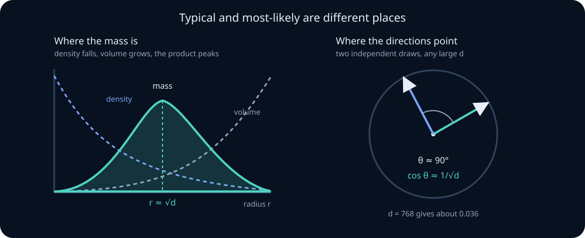

# High-dimensional probability, random vectors, and projections

Every intuition you own about probability was built in one, two, or three dimensions. Embeddings live in 768. Hidden states live in 4096. Parameter vectors live in \(10^{11}\). The claim of this unit is not that high dimensions are *harder*; it is that they are **different in kind**, and that the differences are precise, provable, and directly responsible for facts you already use — why attention divides by \(\sqrt{d_k}\), why initialization scales as \(1/\sqrt{\text{fan\_in}}\), why cosine similarity behaves the way it does, and why a covariance estimated from a few thousand samples is badly wrong in a way that is not obvious from the average.

The unifying phenomenon is **concentration of measure**: as dimension grows, well-behaved functions of a random vector stop being random. Averages concentrate — that was the law of large numbers in [repeated samples and limit theorems](05-limit-theorems-monte-carlo.md). Here, *geometry itself* concentrates.

## 0. Prerequisite check

You should be able to state the weak law and Chebyshev's inequality, compute the mean and variance of a sum of independent variables, recognize \(\chi^2\) as a sum of squared standard normals, and read \(\lVert\cdot\rVert\) and eigenvalues of a symmetric matrix. If the last item is uncertain, revisit [eigenvalues and invariant subspaces](../02-linear-algebra/06-eigenvalues-diagonalization.md) first.

### Learning route: scalar variance to research judgment

Read this chapter in three passes.

1. **Build the geometry.** Sections 1–4 use only sums, variances, and symmetry. After them, predict the scale of a norm, dot product, or cosine before calculating it.
2. **Turn geometry into guarantees.** Sections 5–6 explain what random projection preserves and why covariance estimation fails when \(d/n\) is not small. Track whether each statement is an exact moment calculation, a high-probability bound, or an asymptotic approximation.
3. **Audit an ML claim.** Sections 7–8 ask whether an observed effect concerns predictions, distances, eigenvectors, or parameters. Those claims require different stability checks.

A useful habit is to write the scalar random sum first. The high-dimensional phenomena in this chapter are ordinary one-dimensional concentration applied to the right sum.

## 1. Two dimensions lie to you

Draw \(x\sim\mathcal N(0,I_d)\): each coordinate is an independent standard normal. Ask a simple question — *where is this vector?*

In \(d=1\), the density peaks at the origin, so the typical point is near zero. That intuition is correct in \(d=1\), survives in \(d=2\), and is **false** in \(d=100\).

The density is still maximal at the origin. But the *volume* available at radius \(r\) grows like \(r^{d-1}\), and the product of a shrinking density with an exploding volume concentrates sharply away from zero. The mass is not where the density is highest. This is the first and most important correction to low-dimensional intuition: **in high dimensions, typical and most-likely are different places.**

Three consequences follow, and the next three sections prove each one.

1. Almost every sample has nearly the same norm, \(\lVert x\rVert\approx\sqrt d\).
2. Almost every pair of samples is nearly orthogonal.
3. Almost all the mass sits in a thin shell, not in the interior and not in any corner.

> **Practice — Foundation:** For \(x\sim\mathcal N(0,I_{50})\), compute \(E[\lVert x\rVert^2]\) and the approximate typical norm \(\lVert x\rVert\).
>
> **Hint:** Sum the 50 coordinate second moments \(E[x_i^2]=1\); the typical norm is about the square root of that sum.
>

> **Practice — Core:** Compare the relative standard deviations of squared norms in d=2 and d=200.
>
> **Hint:** Compute \(\operatorname{sd}/\text{mean}=\sqrt{2d}/d\) for each \(d\), rather than comparing absolute standard deviations, which grow with \(d\).
>

> **Practice — Stretch:** Draw \(x,y\) independently from \(\mathcal N(0,I_{100})\). Compute the mean and standard deviation of \(\lVert x-y\rVert^2\) and the approximate relative standard deviation of \(\lVert x-y\rVert\). Repeat for the distance between their first two coordinates only, and explain why a two-dimensional scatterplot hides the concentration.
>
> **Hint:** \(x-y\sim\mathcal N(0,2I_d)\), so \(\lVert x-y\rVert^2=2\chi^2_d\) has mean \(2d\) and variance \(8d\); set \(d=100\) and then \(d=2\), and use the delta method to halve the relative SD for the unsquared distance.

## 2. The norm concentrates: \(\lVert x\rVert\approx\sqrt d\)

Let \(x\sim\mathcal N(0,I_d)\). Then \(\lVert x\rVert^2=\sum_{i=1}^dx_i^2\) is a sum of \(d\) independent terms, each with

$$
E[x_i^2]=1,
\qquad
\operatorname{Var}(x_i^2)=E[x_i^4]-1=3-1=2 .
$$

So by linearity and independence,

$$
E\bigl[\lVert x\rVert^2\bigr]=d,
\qquad
\operatorname{Var}\bigl(\lVert x\rVert^2\bigr)=2d .
$$

This is already the whole story. The *mean* grows like \(d\) while the *standard deviation* grows only like \(\sqrt{2d}\), so the **relative** fluctuation is

$$
\frac{\operatorname{sd}(\lVert x\rVert^2)}{E[\lVert x\rVert^2]}
=\frac{\sqrt{2d}}d
=\sqrt{\frac2d}
\;\longrightarrow\;0 .
$$

Chebyshev's inequality converts this into a bound: for any \(t>0\),

$$
P\left(\left|\frac{\lVert x\rVert^2}d-1\right|\ge t\right)
\le\frac{2}{dt^2}.
$$

**Worked example — \(d=4096\).** The relative standard deviation of \(\lVert x\rVert^2\) is \(\sqrt{2/4096}\approx0.022\). The delta-method approximation gives relative norm standard deviation \(1/\sqrt{2d}\approx1.1\%\). A ±1% band is therefore only about 0.91 standard deviations, containing roughly 63% under this large-d normal approximation—not an overwhelming majority. A ±3% band contains roughly 99.3% under the same approximation. Both length and direction remain random; relative length variation becomes small as dimension grows.

The Chebyshev bound is weak — it decays like \(1/d\). Because \(x_i^2\) is sub-exponential rather than bounded, Bernstein's inequality (developed in [the concentration section of the limit-theorems lesson](05-limit-theorems-monte-carlo.md)) sharpens it to an exponential ceiling,

$$
P\bigl(\bigl|\lVert x\rVert^2-d\bigr|\ge td\bigr)
\le2\exp\bigl(-c\,d\min(t,t^2)\bigr),
$$

for an absolute constant \(c\). Deviations of fixed relative size become exponentially unlikely **in the dimension**.

> **Practice — Foundation:** Compute \(E[\lVert x\rVert^2]\) and \(\operatorname{Var}(\lVert x\rVert^2)\) for \(x\sim\mathcal N(0,I_{100})\).
>
> **Hint:** The squared norm is a sum of independent squared standard normals.
>
> **Practice — Core:** Use Chebyshev to bound \(P(\lVert x\rVert^2\ge1.2d)\) at \(d=1000\), then compare with the exponential form above at \(c=1/8\).
>
> **Hint:** Insert t=0.2 into each stated bound and cap a probability ceiling at one.
>
> **Practice — Stretch:** Repeat the mean/variance computation for \(x\) with iid coordinates of mean zero, variance \(\sigma^2\), and finite fourth moment \(\kappa\sigma^4\). Show the relative fluctuation is \(\sqrt{(\kappa-1)/d}\) and identify which distributions make concentration slower.
>
> **Hint:** Compute Var(X²) from the fourth moment before summing coordinates.

## 3. Random directions are nearly orthogonal

Let \(x,y\sim\mathcal N(0,I_d)\) be independent and let \(\theta\) be the angle between them:

$$
\cos\theta=\frac{x^Ty}{\lVert x\rVert\,\lVert y\rVert}.
$$

By rotational invariance of the standard Gaussian we may condition on \(y\) and rotate it to \(e_1\) without changing the distribution of \(\cos\theta\). Then

$$
\cos\theta=\frac{x_1}{\lVert x\rVert}.
$$

Symmetry across coordinates gives \(E[x_i^2/\lVert x\rVert^2]=1/d\) for every \(i\), since the \(d\) terms are exchangeable and sum to one. Therefore

$$
E[\cos\theta]=0,
\qquad
E[\cos^2\theta]=\frac1d,
\qquad
\operatorname{sd}(\cos\theta)=\frac1{\sqrt d}.
$$

**Worked example — \(d=768\).** The typical cosine similarity between two independent random directions is about \(1/\sqrt{768}\approx0.036\). Two random 768-dimensional vectors are, to a very good approximation, perpendicular.

This single fact underwrites a great deal of embedding practice. A cosine similarity of \(0.30\) sounds unimpressive on a \([-1,1]\) scale, but in \(d=768\) it is more than eight standard deviations from the random baseline. **Similarity scores must be read against the high-dimensional null, not against 1.0.** It also explains why very many nearly-orthogonal directions fit in a space of dimension \(d\): the number of unit vectors with pairwise \(|\cos|\le\varepsilon\) grows exponentially in \(d\), which is what allows a model to store far more distinguishable features than it has dimensions.



> **Practice — Foundation:** Compute the typical \(|\cos\theta|\) between random directions at \(d=64\), \(d=768\), and \(d=4096\).
>
> **Hint:** The standard-deviation scale is 1/sqrt(d), not 1/d.
>
> **Practice — Core:** A retrieval system reports a cosine similarity of \(0.12\) at \(d=1536\). Express this as a number of standard deviations from the random baseline, and say what further evidence you would want before calling it a match.
>
> **Hint:** Multiply the cosine by sqrt(d), then question isotropy and multiple comparisons.
>
> **Practice — Stretch:** Model embeddings as \(x=\mu+z\) with \(z\sim\mathcal N(0,I_{768})\) and a shared mean \(\mu\) with \(\lVert\mu\rVert^2=384\). Compute the approximate cosine between two independent, unrelated embeddings, then the cosine after subtracting \(\mu\), and state what the correction assumes when \(\mu\) is estimated from data.
>
> **Hint:** \(x^Ty\approx\lVert\mu\rVert^2\) and \(\lVert x\rVert^2\approx\lVert\mu\rVert^2+d\), so the raw cosine is about \(384/1152\); after subtracting \(\mu\) you recover the isotropic scale \(1/\sqrt{768}\). Fit any estimated centering on separate data.

## 4. The thin shell, and why "corners" are empty

Combining the previous two sections: the norm is essentially \(\sqrt d\) and the direction is uniform. So the Gaussian in high dimensions is, for practical purposes, the **uniform distribution on a sphere of radius \(\sqrt d\)**, smeared over a shell of thickness \(O(1)\).

The same effect shows in the cube. For \(u\) uniform on \([-1,1]^d\),

$$
E[\lVert u\rVert^2]=d\cdot E[u_1^2]=\frac d3,
$$

so \(\lVert u\rVert\approx\sqrt{d/3}\approx0.577\sqrt d\), while the corner \((\pm1,\ldots,\pm1)\) has norm \(\sqrt d\). The corners are a vanishing fraction of the volume; the inscribed ball is also a vanishing fraction. Almost all the volume of a high-dimensional cube is neither near the center nor near the corners.

The practical reading: **uniform sampling in a high-dimensional box does not explore the box.** Random hyperparameter search, random perturbation baselines, and naive "sample a random point in the region" procedures all inherit this. If you need to cover a region, cover it deliberately — see the sampling designs in [sampling design and ML evaluation](10-sampling-design-ml-evaluation.md).

> **Practice — Foundation:** Compute \(E[\lVert u\rVert]\) approximately for \(u\) uniform on \([-1,1]^{300}\).
>
> **Hint:** Each uniform coordinate has second moment 1/3.
>
> **Practice — Core:** Estimate the fraction of the volume of \([-1,1]^d\) lying inside the inscribed unit ball at \(d=20\), and explain why rejection sampling with a cube proposal fails in high dimensions.
>
> **Hint:** Divide the unit-ball volume pi^(d/2)/Gamma(d/2+1) by 2^d.
>
> **Practice — Stretch:** A robustness study samples perturbations uniformly from the \(\ell_2\) ball of radius 1 in \(d=100\). Compute \(P(\lVert\delta\rVert<0.9)\) and the median radius, say which part of the ball is being tested, and propose a radius distribution that probes the interior as well.
>
> **Hint:** A uniform-volume radius has CDF \(r^d\), so \(P(r<0.9)=0.9^{100}\) and the median solves \(r^{100}=1/2\); choosing the radius uniformly on \([0,1]\) targets a different stress test.

## 5. Johnson–Lindenstrauss: distances survive random projection

If high dimensions are so strange, can we shrink them? Remarkably, yes, and the amount of shrinkage needed does **not** depend on the original dimension.

Let \(A\in\mathbb R^{m\times d}\) have iid \(\mathcal N(0,1/m)\) entries. For a fixed vector \(v\),

$$
E\bigl[\lVert Av\rVert^2\bigr]=\lVert v\rVert^2 ,
$$

because each row \(a_j\) satisfies \(E[(a_j^Tv)^2]=\lVert v\rVert^2/m\). So a random projection preserves squared length *in expectation*, for any \(v\), with no assumptions at all.

Concentration strengthens expectation preservation to a quantified high-probability statement; it does not make a finite-sample failure probability zero. Writing \(\lVert Av\rVert^2/\lVert v\rVert^2\) as an average of \(m\) independent squared standard normals — exactly the object of section 2, with \(m\) in place of \(d\) — gives

$$
P\left(\left|\frac{\lVert Av\rVert^2}{\lVert v\rVert^2}-1\right|>\varepsilon\right)
\le2\exp\left(-\frac{m(\varepsilon^2-\varepsilon^3)}4\right).
$$

For a fixed set of \(n\ge2\) points and \(0<\varepsilon<1\), apply the bound to its nonzero pairwise differences and union bound:

$$
P(\text{any squared-distance failure})\le n(n-1)\exp[-m(\varepsilon^2-\varepsilon^3)/4].
$$

Thus success probability at least \(1-\delta\) is sufficient when

$$
m\ge\left\lceil\frac{4\log(n(n-1)/\delta)}{\varepsilon^2-\varepsilon^3}\right\rceil.
$$

This preserves **squared** distances by factors \(1\pm\varepsilon\); distances themselves lie between \(\sqrt{1-\varepsilon}\) and \(\sqrt{1+\varepsilon}\) times their originals, hence also within the looser factors \(1\pm\varepsilon\). Positive success probability establishes existence. No guarantee here covers a dataset chosen after inspecting the random projection.

**The Johnson–Lindenstrauss lemma.** A fixed finite set of n points has an embedding into \(O(\varepsilon^{-2}\log n)\) dimensions preserving pairwise distances up to the stated distortion. The explicit conservative bound above includes the failure probability; it is not a claim that so many dimensions are necessary. If it exceeds the ambient dimension, keeping the original coordinates is already an exact embedding.

For example, n=1,000,000, epsilon=0.1, delta=0.01 gives a sufficient m of 14,328 under this bound. The scaling does not depend on ambient dimension. Bounds can be pessimistic. Preserving distances still allows nearest-neighbor identities to change when distance gaps are small; preserve a sufficient margin before inferring ranking stability.

> **Practice — Foundation:** Using the explicit sufficient bound with \(\delta=0.05\), compute target dimensions for \(n=10^4\), \(\varepsilon=0.2\) and \(\varepsilon=0.05\). Explain when keeping the original coordinates is preferable.
>
> **Hint:** Use the epsilon³ term and an explicit failure probability; the bound is sufficient, not necessary.
>
> **Practice — Core:** Show \(E[\lVert Av\rVert^2]=\lVert v\rVert^2\) directly from the entry distribution of \(A\), and identify where independence is used.
>
> **Hint:** Expand a row's squared dot product and use zero cross-moments.
>
> **Practice — Stretch:** A projection preserves every pairwise distance within factors \(1\pm\varepsilon\) with \(\varepsilon=0.1\). A query's true nearest neighbour is at distance 1.00 and the runner-up at 1.15. Show that the top-1 neighbour can change, and derive the margin condition on the distance ratio that prevents it.
>
> **Hint:** In the worst case the near distance grows to \(1.1\times1.00\) while the far one shrinks to \(0.9\times1.15=1.035\); no flip is possible when \(d_2/d_1>(1+\varepsilon)/(1-\varepsilon)\approx1.222\).

## 6. Estimated covariance is not the covariance

Sections 2 through 5 concerned a *single* random vector. Now take \(n\) samples and estimate the covariance:

$$
\hat\Sigma=\frac1n\sum_{i=1}^nx_ix_i^T .
$$

Every entry of \(\hat\Sigma\) is an average of \(n\) terms, so each entry is individually accurate to \(O(1/\sqrt n)\). But \(\hat\Sigma\) has \(d^2\) entries, and the *matrix* error in operator norm behaves like

$$
\lVert\hat\Sigma-\Sigma\rVert_{\text{op}}
\;\lesssim\;
\lVert\Sigma\rVert\left(\sqrt{\frac dn}+\frac dn\right),
$$

as a typical-rate statement for independent, centered sub-Gaussian observations with a controlled sub-Gaussian scale; a specified high-probability theorem also includes its confidence parameter and constants. This is not an arbitrary-data deterministic bound. The governing quantity is the **aspect ratio** \(d/n\), not \(n\) alone. Accurate covariance estimation requires \(n\gg d\), not merely \(n\) large.

**Marchenko–Pastur.** Make the truth as simple as possible: let observations have independent, centered, unit-variance entries (Gaussian entries are a concrete example), so \(\Sigma=I_d\), and let \(\gamma=d/n\) be fixed as both grow. The eigenvalues of \(\hat\Sigma\) do **not** converge to \(1\). They spread across

$$
\bigl[(1-\sqrt\gamma)^2,\;(1+\sqrt\gamma)^2\bigr].
$$

The displayed interval is the limiting continuous spectral support, not a deterministic finite-sample enclosure. If \(\gamma>1\), there is also an atom at zero of mass \(1-1/\gamma\): a d-by-d sample covariance has rank at most n. Identity covariance alone, without the distributional assumptions, does not justify this null.

**Worked example — \(d=100\), \(n=400\).** Here \(\gamma=1/4\), so the sample eigenvalues fill \([(1-0.5)^2,(1+0.5)^2]=[0.25,\,2.25]\). The true spectrum is a single point at \(1\). With four times as many samples as dimensions, the estimated spectrum spans a factor of nine. The largest sample eigenvalue is biased **up**, the smallest biased **down**, and the "top principal component" of pure isotropic noise looks convincingly dominant.

Three consequences that matter in practice:

- **PCA on modest sample sizes overstates structure.** A scree plot with a visible leading eigenvalue is not evidence of signal until you compare against the Marchenko–Pastur edge for your \(\gamma\).
- **Whitening amplifies noise.** Whitening divides by \(\sqrt{\hat\lambda_i}\); small sample eigenvalues can be severely underestimated, so unregularized whitening may greatly amplify estimation error. This is the ill-conditioning argument of [SVD and PCA](../02-linear-algebra/08-svd-low-rank.md) with a statistical cause.
- **Shrinkage is not optional decoration.** Ledoit–Wolf-style estimators pull \(\hat\Sigma\) toward a scaled identity precisely to undo the spreading above.

This section is also the probabilistic half of a claim made in [nonconvex landscapes](../03-optimization/05-nonconvex-landscapes-training-dynamics.md): some random-matrix models yield many negative-curvature directions. That analogy alone does not determine the distribution of Hessians at critical points selected by training; claims about saddle prevalence require a specified landscape model.

> **Practice — Foundation:** Compute the Marchenko–Pastur support for \(\gamma=0.01\), \(\gamma=0.25\), and \(\gamma=1\).
>
> **Hint:** Square one plus/minus sqrt(gamma); also check the zero atom when gamma exceeds one.
>
> **Practice — Core:** You have \(n=2000\) samples in \(d=512\) dimensions. Give the MP edges and interpret the lower continuous edge as an asymptotic reference, not the smallest eigenvalue possible in a finite sample. What does this imply about the rank you would select?
>
> **Hint:** \(\gamma=512/2000=0.256\), so \(\sqrt\gamma\approx0.506\) and the edges are about \([0.244,2.268]\); only eigenvalues clearly above the upper edge are candidate signal.
>
> **Practice — Stretch:** With NumPy seed 0, generate \(n=200\) rows in \(d=50\): 47 independent \(\mathcal N(0,1)\) features plus 3 features with pairwise correlation 0.9. Build a permutation null by shuffling each column independently 100 times; compare the top eigenvalue of the sample correlation matrix with the permutation 95th percentile and the MP upper edge at \(\gamma=0.25\). State which null each reference tests.
>
> **Hint:** Shuffling each column independently keeps every feature's marginal distribution but destroys all cross-feature dependence, so the null is mutual independence; MP additionally assumes iid unit-variance entries in a proportional limit, with edge \((1+0.5)^2=2.25\).

## 7. Where this already appears in your models

- **Attention scaling.** For \(q,k\) with iid zero-mean, unit-variance entries, \(q^Tk\) is a sum of \(d_k\) independent terms, so \(\operatorname{Var}(q^Tk)=d_k\) and the logits have standard deviation \(\sqrt{d_k}\). Without the \(1/\sqrt{d_k}\) divisor, softmax inputs grow with head dimension and saturate. This is section 2 applied to an inner product — see [causal transformers](../12-llm-systems/01-causal-transformers-training-systems.md).
- **Initialization.** For \(y=Wx\) with \(W\) entries of variance \(\sigma^2\) and \(x\in\mathbb R^{d}\), \(\operatorname{Var}(y_j)=d\sigma^2\operatorname{Var}(x)\). Holding activation scale constant across layers forces \(\sigma^2\propto1/\text{fan\_in}\). Every initialization scheme is a variance-of-a-sum calculation.
- **Embedding similarity.** Cosine baselines are \(1/\sqrt d\), not \(0\), and anisotropy shifts them further.
- **Random projections and hashing.** JL is the guarantee behind random-projection LSH, sketching, and dimensionality reduction before nearest-neighbour search.
- **Covariance-based methods.** Whitening, PCA, Mahalanobis distances, natural-gradient preconditioners and linear probes all estimate a covariance and all inherit section 6's aspect-ratio problem.
- **Noise injection.** A Gaussian perturbation of standard deviation \(\sigma\) per coordinate has total norm \(\approx\sigma\sqrt d\). Reporting "we added noise of size 0.01" is meaningless without the dimension.

> **Practice — Foundation:** For \(q,k\in\mathbb R^{64}\) with iid \(\mathcal N(0,1)\) coordinates, compute \(\operatorname{Var}(q^Tk)\) and the standard deviation of the logit before and after dividing by \(\sqrt{64}\).
>
> **Hint:** Each product \(q_jk_j\) has mean 0 and variance \(E[q_j^2]E[k_j^2]=1\), and the 64 products are independent.
>

> **Practice — Core:** Let the pairs \((q_j,k_j)\) be iid jointly Gaussian with unit variances and \(\operatorname{Corr}(q_j,k_j)=0.5\), for \(d_k=64\). Compute \(E[q^Tk]\) and \(\operatorname{Var}(q^Tk)\), compare with the independent case, and state which assumption of the \(\sqrt{d_k}\) argument is violated.
>
> **Hint:** For jointly Gaussian unit-variance \(q_j,k_j\) with correlation \(\rho\), \(E[q_jk_j]=\rho\) and \(E[q_j^2k_j^2]=1+2\rho^2\); the logits are shifted by \(\rho d_k\), not just rescaled.
>

> **Practice — Stretch:** A paper claims that weight variance \(2/\text{fan-in}\) keeps ReLU activations stable. Test it: 20 ReLU layers of width 512 with weights \(\mathcal N(0,\sigma^2/512)\) for \(\sigma^2\in\{1,2,4\}\), seeds 0–4, and 1,000 held-out \(\mathcal N(0,I_{512})\) inputs. Report the mean squared activation at layers 0, 10, and 20, and say what this diagnostic does not establish.
>
> **Hint:** Each ReLU layer multiplies the mean square by about \(\sigma^2/2\), so predict roughly \(2^{-20}\), 1, and \(2^{20}\) at depth 20 before running; also compare gradients, which this forward check does not measure.

## 8. Failure modes

- **Quoting per-coordinate scale as if it were vector scale.** Always convert: per-coordinate \(\sigma\) means norm \(\sigma\sqrt d\).
- **Comparing cosine similarities across different dimensions** without renormalizing by the \(1/\sqrt d\) baseline.
- **Reading a scree plot without a null.** Structure must be judged against the MP edge or a permutation null.
- **Whitening with an ill-conditioned \(\hat\Sigma\)** when \(n\) is not \(\gg d\).
- **Assuming random search explores a box.** It samples the shell.
- **Treating JL as lossless.** Distances are preserved within \(1\pm\varepsilon\); ties, margins, and rankings are not guaranteed.
- **Applying Gaussian intuition to heavy-tailed coordinates.** Concentration slows as the fourth moment grows, and fails entirely without one.

### Worked research audit: one transformer block

Suppose a head uses \(d_k=64\), a residual stream has width 4096, and a linear probe uses \(n=2000\) examples.

**Attention scale.** If query and key coordinates are independent with mean zero and variance one, then

$$
q^\top k=\sum_{j=1}^{64}q_jk_j,
\qquad E[q^\top k]=0,
\qquad \operatorname{Var}(q^\top k)=64.
$$

Unscaled logits have standard deviation 8. Dividing by \(\sqrt{64}=8\) restores order-one variation. This is a scale argument, not a claim that trained queries and keys remain independent Gaussians.

**Initialization scale.** A linear unit with 4096 independent, unit-variance inputs and weights of variance \(1/4096\) has output variance \(4096(1/4096)=1\). The \(1/\sqrt{\text{fan-in}}\) weight scale is the same variance-of-a-sum calculation.

**Probe geometry.** Here \(d/n=4096/2000\approx2.05\). The sample covariance is singular, with at least \(4096-2000\) zero eigenvalues before centering costs another degree of freedom. Stable held-out predictions can coexist with unstable weights: prediction stability concerns the fitted function, whereas coefficient stability asks whether feature directions are identified. Bootstrap both held-out performance and coefficient direction; do not use one as evidence for the other.

> **Practice — Foundation:** With NumPy seed 0, simulate 20 replicates of \(X\in\mathbb R^{200\times100}\) with iid \(\mathcal N(0,1)\) entries, and record the largest eigenvalue of \(X^TX/200\) each time. Compare the results with the MP upper edge \((1+\sqrt{0.5})^2\approx2.914\), and explain why the edge is not a finite-sample guarantee.
>
> **Hint:** Near the edge, the largest eigenvalue fluctuates on the Tracy–Widom scale of order \(n^{-2/3}\) and has finite-\(n\) bias, so expect values around 2.7–2.95, only a minority above 2.914.
>

> **Practice — Core:** You try 20 random projections to 64 dimensions (seeds 0–19) and keep the one with the best validation accuracy, 0.842; across seeds, accuracy has mean 0.815 and SD 0.01. Estimate the expected best-of-20 score under pure seed noise, and explain why the chosen projection needs a new validation set.
>
> **Hint:** The maximum of 20 roughly normal scores sits about 1.87 SD above their mean, near 0.834, so part of 0.842 is selection; re-evaluate the chosen seed on untouched data.
>

> **Practice — Stretch:** Compare \(A_1=\operatorname{diag}(2.01,1.99)\) with \(A_2=\begin{pmatrix}2&0.01\\0.01&2\end{pmatrix}\). Show that they have identical singular values but top singular vectors \(45^\circ\) apart, and relate this to the eigengap and a repeated singular value of \(2I\).
>
> **Hint:** Both matrices have eigenvalues 2.01 and 1.99, but their top eigenvectors are \(e_1\) and \((e_1+e_2)/\sqrt2\); Davis–Kahan bounds the rotation by perturbation size over eigengap, and the gap here is only 0.02.

## 9. Runnable lab: random projection distortion

Implement `projection_distortion` in the [learner exercises file](../../labs/exercises.py). Given a list of points, a target dimension \(m\), and a seed, build \(A\in\mathbb R^{m\times d}\) with iid \(\mathcal N(0,1/m)\) entries and return the **largest** relative squared-distance distortion over all distinct pairs:

$$
\max_{i<j}\left|\frac{\lVert A(x_i-x_j)\rVert^2}{\lVert x_i-x_j\rVert^2}-1\right| .
$$

Requirements: reject an empty point list, points of differing length, a non-positive target dimension, and any pair of identical points (the distortion is undefined when the denominator is zero). Seed a local `random.Random(seed)` so results are reproducible without disturbing global state.

Then, outside the graded function, study the behaviour:

1. Fix \(n=60\) points in \(d=512\) and sweep \(m\in\{8,32,128,512\}\). Plot the maximum distortion against \(m\) and compare with the \(\varepsilon\approx\sqrt{8\log n/m}\) prediction.
2. Hold \(m\) fixed and increase \(d\) from \(64\) to \(4096\). Confirm the distortion does **not** grow with \(d\).
3. Increase \(n\) at fixed \(m\) and observe the \(\log n\) penalty appear as a slow rise.
4. Replace Gaussian entries with \(\pm1/\sqrt m\) signs. Verify the distortion is comparable and explain why the proof still works.

## 10. Derivations to own

1. \(E[\lVert x\rVert^2]=d\) and \(\operatorname{Var}(\lVert x\rVert^2)=2d\) for \(x\sim\mathcal N(0,I_d)\), including the \(E[x_i^4]=3\) step.
2. \(E[\cos^2\theta]=1/d\) by rotational invariance and exchangeability.
3. \(E[\lVert Av\rVert^2]=\lVert v\rVert^2\) for a \(1/m\)-variance Gaussian projection.
4. The union-bound step from a single-vector concentration bound to the JL lemma, including where \(\binom n2\) enters.
5. Why \(\operatorname{Var}(q^Tk)=d_k\) and therefore why attention divides by \(\sqrt{d_k}\).
6. The variance-propagation argument giving \(\sigma^2\propto1/\text{fan\_in}\).

## Prediction experiment

Predict both the baseline and failure-preset results before revealing the calculation. Record the assumptions, change one control at a time, and explain the boundary case. This small deterministic model isolates a mechanism; it is not an empirical validation of a trained system.

```lab
lab: ps-highdim
```

## 11. End-of-unit practice (graded)

Work each problem before opening its authored solution. Written proofs and design answers require self-review against the rubric; numeric fields check only the stated quantities.


**Foundation**

**A1 · Foundation · paper — Cumulative problem 1.** For \(x\sim\mathcal N(0,I_{1024})\), give the mean and standard deviation of \(\lVert x\rVert^2\), and the approximate value of \(\lVert x\rVert\).

**A2 · Foundation · paper — Cumulative problem 2.** Give the typical cosine similarity between independent random directions at \(d=1536\).

**A3 · Foundation · paper — Cumulative problem 3.** State the Marchenko–Pastur support at \(\gamma=0.09\).

**Core**

**A4 · Core · paper — Cumulative problem 4.** A team adds Gaussian noise with per-coordinate \(\sigma=0.02\) to a \(4096\)-dimensional activation \(h\) with \(\lVert h\rVert=6.4\) (per-coordinate RMS 0.1) and reports a "2% perturbation". Compute the approximate noise norm \(\lVert\varepsilon\rVert\approx\sigma\sqrt d\), the relative size \(\lVert\varepsilon\rVert/\lVert h\rVert\), the typical ratio \(\lVert h+\varepsilon\rVert/\lVert h\rVert\), and the typical cosine between \(h\) and \(h+\varepsilon\). Then correct the claim.

**A5 · Core · paper — Cumulative problem 5.** Using the explicit sufficient bound of section 5 with failure probability \(\delta=0.01\), compute the JL target dimension for \(n=5\times10^5\) points and \(\varepsilon=0.1\), and explain why the answer is unchanged if the points live in \(d=10^4\) or \(d=10^7\).

**A6 · Core · paper — Cumulative problem 6.** Take the typical-rate expression \(\lVert\hat\Sigma-\Sigma\rVert_{\text{op}}/\lVert\Sigma\rVert\approx\sqrt{d/n}+d/n\) with constant one. For \(d=768\), find the smallest integer \(n\) for which it is at most \(0.1\), evaluate it for a probing dataset of \(n=5{,}000\), and comment on whether typical probing datasets meet the target.

**A7 · Core · paper — Cumulative problem 7.** Show that the \(\pm1\) sign projection has the same first two moments as the Gaussian projection, and explain the practical advantage.

**Stretch**

**A8 · Stretch · paper — Cumulative problem 8.** A linear probe on \(d=4096\) features trained with \(n=2000\) examples has stable held-out accuracy. (a) Show that the training design has a null space of dimension at least 2096, and that adding any null-space vector to the weights leaves every training prediction unchanged. (b) Separate the two claims empirically. With NumPy seed 0, draw \(x_i\sim\mathcal N(0,I_{4096})\), a true direction \(w^\star\) equal to \(1/\sqrt{20}\) on the first 20 coordinates and 0 elsewhere, labels \(y_i=\operatorname{sign}(x_i^Tw^\star)\) flipped with probability 0.05, and 5,000 clean test points. Fit ridge regression on the \(\pm1\) labels with \(\lambda=1\) on 10 bootstrap resamples. Report the mean and SD of test accuracy, the mean pairwise cosine between the bootstrap weight vectors, their mean cosine with \(w^\star\), and the overlap of each fit's 20 largest-magnitude weights with the true support.

**A9 · Stretch · paper — Cumulative problem 9.** Retrieval quality drops when embeddings are projected from 1536 to 256 dimensions, even though every measured squared-distance distortion is under 5%. (a) For a query whose true nearest neighbour is at distance 1.00 and runner-up at 1.03, show that a 5% squared-distance guarantee permits the order to flip, and find the smallest runner-up-to-neighbour distance ratio that rules out a flip. (b) Give two further mechanisms consistent with both observations, and one experiment that discriminates among all three.

**A10 · Stretch · paper — Cumulative problem 10.** (a) For iid Student-\(t_5\) coordinates, compute the kurtosis \(\kappa=E[x^4]/E[x^2]^2\) and the relative standard deviation of \(\lVert x\rVert^2\) at \(d=1000\), and compare with the Gaussian value. (b) Show that \(t_3\) coordinates have \(E[x^4]=\infty\). (c) With NumPy seed 0, draw 2,000 vectors with iid \(t_3\) coordinates at \(d=1000\) and \(d=10{,}000\), and report the 1st, 50th, and 99th percentiles of \(\lVert x\rVert^2/(3d)\) alongside the Gaussian analogue \(\lVert x\rVert^2/d\). (d) Say what this implies for JL: which randomness does the JL guarantee use, and what fails if the projection entries themselves are \(t_3\)?


## Six-part checkpoint

Complete these without notes, then use the solutions to audit assumptions and reasoning. Passing a numeric check alone does not establish mastery. For implementation and transfer, retain the code/results or written protocol as evidence.

**K1 · Foundation · gate — Concept.** What do Marchenko–Pastur edges describe?

**K2 · Core · gate — Derivation.** Derive a finite-set JL dimension bound from a one-vector tail bound.

**K3 · Core · gate — Calculation.** For aspect ratio d/n=4, what is the limiting zero-eigenvalue mass of the d-by-d sample covariance?

**K4 · Core · gate — Implementation audit.** Reproduce two settings of the ps-highdim experiment independently, including its failure preset. State a numerical invariant or analytic oracle and explain what the plot does not establish.

**K5 · Stretch · gate — Claim audit.** Does a JL guarantee for a fixed finite dataset automatically cover points chosen after seeing the projection?

**K6 · Stretch · gate — RE/RS transfer.** Audit whitening high-dimensional embeddings.

## Mastery check

Derive the norm and angle concentration results without notes; convert freely between per-coordinate and whole-vector scales; state and justify the JL dimension for a given \(n\) and \(\varepsilon\), including its independence from \(d\); compute Marchenko–Pastur edges for a given aspect ratio and use them to judge whether an observed spectrum shows real structure; and explain, from variance of a sum, why attention divides by \(\sqrt{d_k}\) and why initialization scales as \(1/\sqrt{\text{fan\_in}}\).
