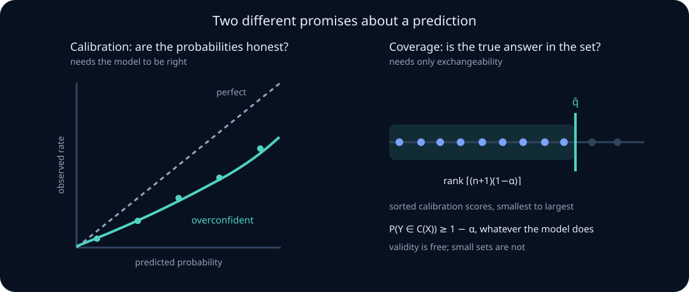

# Calibration, proper scoring rules, and conformal prediction

A model that outputs \(0.8\) is making a claim. This unit is about what that claim means, how to test it, how to score it without rewarding dishonesty, and how to attach a guarantee to a prediction even when the model is badly wrong.

Three separate questions get confused constantly, so separate them now:

- **Calibration** — when the model says \(0.8\), does the event happen \(80\%\) of the time? A property of the *probabilities*.
- **Scoring** — how good is this forecast overall, in a way that cannot be gamed? A property of the *evaluation rule*.
- **Coverage** — can I produce a set of outcomes that contains the truth with a stated probability, with no assumption that the model is correct? A property of a *procedure*.

A model can be perfectly calibrated and useless. A model can be sharp and dangerously overconfident. And a model can be both bad and still support a valid coverage guarantee. Each section below makes one of those statements precise.

## 0. Prerequisite check

You should be comfortable with conditional expectation, the law of total expectation, the idea of a sampling distribution, quantiles of an empirical distribution, and the meaning of a coverage statement from [hypothesis testing and confidence intervals](07-hypothesis-testing-confidence-power.md). Exchangeability, developed for permutation tests in [resampling and experimental design](08-resampling-sequential-experimental-design.md), is the central assumption of section 7.

### Learning route: claim, score, decision, guarantee

Keep four layers separate as you read.

1. **Claim:** calibration says what repeated events should do conditional on a reported probability.
2. **Score:** a proper scoring rule evaluates the full probabilistic forecast and rewards honest probabilities in expectation.
3. **Decision:** costs convert probabilities into actions; a better score need not improve a fixed downstream policy.
4. **Guarantee:** conformal prediction gives marginal coverage under exchangeability, not calibrated probabilities, conditional coverage, or immunity to shift.

For each method, complete the sentence: “randomness is over ___, conditioning is on ___, and the guarantee is ___.” That habit prevents most category errors in calibration papers.

## 1. What calibration actually claims

Let \(q(X)\in[0,1]\) be a model's predicted probability that \(Y=1\). The model is **perfectly calibrated** when

$$
P\bigl(Y=1\;\big|\;q(X)=p\bigr)=p
\qquad\text{for every }p\text{ in the range of }q .
$$

Equivalently \(E[Y\mid q(X)]=q(X)\): the predicted probability is the conditional mean given itself. This is a statement about a *joint* distribution of \((X,Y)\), not a property the model carries around on its own.

Two immediate observations, both of which people get wrong:

**Calibration is not accuracy.** Predict the base rate \(\bar p\) for every input. Then \(P(Y=1\mid q(X)=\bar p)=\bar p\) exactly, so the model is perfectly calibrated — and it has learned nothing. The missing property is **sharpness**: how far the predictions spread away from the base rate. Calibration without sharpness is worthless, and section 4 makes the tradeoff arithmetic.

**Accuracy is not calibration.** A classifier that outputs \(0.99\) whenever it is right \(90\%\) of the time can have excellent accuracy and terrible probabilities. Any decision that compares a probability to a cost threshold — abstain, escalate, retry, route to a human — breaks under that model even though its top-1 accuracy looks fine.

> **Practice — Foundation:** A spam model outputs \(0.3\) for 400 emails. State in one sentence what it claims, give the expected number of spam emails among them, and give an approximate two-standard-deviation range that a calibrated model should usually land in.
>
> **Hint:** Calibration claims that 30% of emails scored 0.3 are spam: expect \(0.3\times400=120\) with SD \(\sqrt{400\cdot0.3\cdot0.7}\approx9.2\).
>
> **Practice — Core:** Two equally likely input types have true \(P(Y=1)\) of 0.9 and 0.4. Model A predicts 0.99 and 0.45; model B predicts 0.65 for both. Compute each model's accuracy (predict 1 iff \(q>0.5\)) and per-type calibration gaps, then evaluate the rule “buy, at price 0.95, a contract paying 1 if \(Y=1\), whenever \(q>0.95\).” Which model does each criterion prefer?
>
> **Hint:** Accuracy uses only the side of 0.5 (A is right 90% and 60% of the time on the two types); under the contract rule, A buys only on type 1, where expected profit per purchase is \(0.9-0.95\).
>
> **Practice — Stretch:** Show that \(E[Y\mid q(X)]=q(X)\) implies \(E[Y]=E[q(X)]\). Then check the converse fails: a model predicts 0.2 on half the inputs and 0.6 on the other half, while the true rate is 0.4 in both halves. Compute \(E[q]\), \(E[Y]\), and each half's calibration gap.
>
> **Hint:** Apply total expectation, \(E[Y]=E[E[Y\mid q]]=E[q]\); in the example both averages equal 0.4 while each half is off by 0.2.

## 2. Reliability diagrams and the trouble with ECE

Calibration conditions on \(q(X)=p\), an event of probability zero for a continuous score. In practice we bin. Partition \([0,1]\) into \(K\) bins, and in bin \(k\) with \(n_k\) observations record the mean predicted probability \(\bar q_k\) and the empirical rate \(o_k\). Plotting \(o_k\) against \(\bar q_k\) gives a **reliability diagram**; perfect calibration is the diagonal.

The usual summary is the **expected calibration error**

$$
\widehat{\mathrm{ECE}}=\sum_{k=1}^K\frac{n_k}n\bigl|\bar q_k-o_k\bigr| .
$$

Two distinct errors matter. Write \(Q=q(X)\), \(r(Q)=E[Y\mid Q]\), and fix bins \(B_k\). The population calibration error is \(E|Q-r(Q)|\); its binned counterpart is

$$
\mathrm{CE}_{\mathrm{bin}}=\sum_k P(Q\in B_k)\left|E[Q-Y\mid Q\in B_k]\right|\le E|Q-r(Q)|.
$$

The inequality is conditional Jensen: positive and negative miscalibration can cancel inside a bin. **Binning can underestimate population miscalibration.** For equally likely scores 0.2 and 0.8 with true outcome probabilities 0.4 and 0.6, the population error is 0.2, but putting both scores in one bin gives zero binned error.

**Finite-sample noise has a different effect.** Conditional on fixed scores and independent Bernoulli outcomes under the calibration null, the observed bin gap has mean zero. Taking its absolute value produces a nonnegative noise contribution. For \(n_k\) scores all equal to \(p\), away from extreme \(p\) and at sufficiently large \(n_k\),

$$
E|o_k-p|\approx\sqrt{\frac{2}{\pi}}\sqrt{\frac{p(1-p)}{n_k}}.
$$

For differing scores within a bin, the conditional variance of its observed mean is \(\sum_{i\in B_k}q_i(1-q_i)/n_k^2\). For dependent outcomes, covariance terms must also be included. The approximation is an expected noise scale, **not a lower bound on every realized ECE**. Sampling noise and coarsening can pull in opposite directions; there is no universal upward-bias claim relative to population calibration error. See [Roelofs et al.](https://proceedings.mlr.press/v151/roelofs22a.html) for the distinction.

**Worked example — calibrated forecasts with nonzero empirical ECE.** Suppose ten fixed, occupied bins each contain 100 scores sufficiently close to 0.5 for the approximation. The expected absolute gap in each is about \(0.798\sqrt{0.25/100}=0.040\). The weighted average has approximately that expected value even under perfect calibration. Equal-width bins need not be equally occupied; scores concentrated near 0.5 do not fill ten equal-width bins.

Report bin boundaries, counts, sample size, and a calibrated-null distribution. Conditional on held-out scores, simulate independent \(Y_i\sim\mathrm{Bernoulli}(q_i)\) only when that independence assumption matches the evaluation design; reproduce clustering otherwise using a justified model or design. This tests compatibility with that calibration null, not usefulness or robustness to shift. Equal-mass binning changes the coarsening/noise tradeoff; it does not remove it.



> **Practice — Foundation:** For a hypothetical fixed partition with 15 equally occupied bins, 3,000 points, and within-bin null variances approximated by 0.25, compute the expected ECE noise scale. Explain why equal-width bins do not ensure these counts.
>
> **Hint:** With 200 points per bin, \(E|o_k-p|\approx\sqrt{2/\pi}\sqrt{0.25/200}\approx0.798\times0.0354\); equal-width bins fill equally only if the scores are spread evenly over \([0,1]\).
>
> **Practice — Core:** A model's 1,000 held-out scores are 800 in \([0.9,1]\) and 200 spread evenly over \([0,0.9)\). For \(K=10\), give the bin counts under equal-width and equal-mass binning. Using \(E|o_k-p|\approx0.798\sqrt{p(1-p)/n_k}\) with \(p=0.95\) for top-region bins and \(p=0.5\) elsewhere, compute the expected null ECE for each scheme, and state what equal-mass costs in interpretability.
>
> **Hint:** Equal-width puts 800 points in the top bin and about 22 in each of the other nine; equal-mass puts 100 in every bin, eight of them inside \([0.9,1]\). Weight each bin's noise scale by \(n_k/n\).
>
> **Practice — Stretch:** With NumPy seed 0, fix 1,000 scores \(q_i=i/1001\) and simulate a calibrated-null distribution of 10-bin equal-width ECE from 2,000 draws of \(Y_i\sim\operatorname{Bernoulli}(q_i)\). Report the null mean and 95th percentile, decide whether an observed ECE of 0.06 is compatible with calibration, and explain why passing this test would not show the model is useful.
>
> **Hint:** Keep the scores fixed, redraw every outcome, and recompute the entire statistic with the same bins; a constant base-rate forecaster would also pass, because the null says nothing about resolution.

## 3. Proper scoring rules: evaluation that cannot be gamed

A scoring rule \(S(q,y)\) assigns a loss to forecast \(q\) when outcome \(y\) is observed. It is **proper** if, whenever the true probability is \(p\), the expected score is minimized by reporting \(q=p\), and **strictly proper** if \(p\) is the unique minimizer. Properness is exactly the statement that *honesty is optimal*.

**The Brier score is strictly proper.** With \(S(q,y)=(q-y)^2\),

$$
E_p\bigl[S(q,Y)\bigr]=p(1-q)^2+(1-p)q^2 .
$$

Differentiating in \(q\),

$$
\frac{d}{dq}E_p[S]= -2p(1-q)+2(1-p)q=2(q-p),
$$

which vanishes only at \(q=p\), and the second derivative is \(2>0\). Reporting anything other than your true belief strictly increases expected loss.

**The log score is strictly proper.** With \(S(q,y)=-[y\log q+(1-y)\log(1-q)]\),

$$
E_p[S(q,Y)]
=-p\log q-(1-p)\log(1-q)
=H(p)+\operatorname{KL}(p\Vert q),
$$

and \(\operatorname{KL}(p\Vert q)\ge0\) with equality only at \(q=p\) by Gibbs' inequality. This is cross-entropy: **the standard training loss is a strictly proper scoring rule**, which is why maximum likelihood and honest probability reporting are the same objective — see [estimation and likelihood](06-estimation-likelihood-fisher.md).

**Threshold accuracy is not strictly proper for probability forecasts.** With a fixed tie convention at 0.5, reporting the true \(p\) yields a Bayes-optimal class, but every report on the same optimal side has the same expected classification loss. Thus this binary threshold score is weakly proper and cannot identify an honest probability report uniquely. For example, at \(p=0.6\), reports 0.6 and 0.99 have the same accuracy and different expected log loss. Optimizing accuracy alone gives no incentive to retain calibration. Other task metrics need their own analysis; a sequence-level metric cannot automatically inherit a binary scoring-rule theorem.

The two proper rules differ in what they punish. Log score is unbounded: a confident wrong answer costs infinity, so it punishes overconfidence severely. Brier is bounded by 1, so it is more forgiving of a confident mistake and more sensitive to bulk miscalibration. Choose by the decision you face, and say which you chose.

> **Practice — Foundation:** Compute the Brier and log scores for \(q=0.9\) with \(y=1\) and with \(y=0\).
>
> **Hint:** Brier is \((q-y)^2\) and log loss is \(-\log q\) if \(y=1\) and \(-\log(1-q)\) if \(y=0\); use natural logarithms.
>
> **Practice — Core:** Prove strict properness of the log score directly from Gibbs' inequality, stating where strictness comes from.
>
> **Hint:** The KL gap vanishes only when the reported distribution equals the true distribution on the relevant support.
>
> **Practice — Stretch:** In a group where the true \(P(Y=1)=0.55\), a model reports 0.45. Compare threshold-0.5 accuracy and expected log loss for reports 0.45, 0.55, and 0.99, and show that the move from 0.45 to 0.99 raises accuracy while worsening log loss. Propose a leaderboard reporting rule that prevents this.
>
> **Hint:** Accuracy depends only on which side of 0.5 the report falls (0.45 versus 0.55 correct); expected log loss is \(-[0.55\log q+0.45\log(1-q)]\).

## 4. The decomposition: calibration is only one term

For a forecast that is constant within each bin (including a forecast explicitly replaced by its bin means), with base rate \(\bar o\), the Brier score decomposes exactly as

$$
\mathrm{BS}
=\underbrace{\sum_k\frac{n_k}n(\bar q_k-o_k)^2}_{\text{reliability (lower better)}}
-\underbrace{\sum_k\frac{n_k}n(o_k-\bar o)^2}_{\text{resolution (higher better)}}
+\underbrace{\bar o(1-\bar o)}_{\text{uncertainty (fixed)}} .
$$

Reliability measures squared bin calibration error; resolution measures variation in conditional outcome rates. Resolution is not simply dispersion of predicted probabilities. If original forecasts vary within a bin, this three-term identity applies to the coarsened forecast, not automatically to the original empirical Brier score: within-bin forecast variance and covariance terms matter. Uncertainty depends on the evaluated population.

**Worked example — calibrated versus useful.** Let the base rate be \(\bar o=0.3\), so uncertainty is \(0.3\times0.7=0.21\).

- *Model A* predicts \(0.3\) for everyone. Reliability \(=0\), resolution \(=0\). \(\mathrm{BS}=0.21\).
- *Model B* splits the data in half, predicting \(0.1\) for one half where the rate really is \(0.1\), and \(0.5\) for the other half where the rate really is \(0.5\). Reliability \(=0\), resolution \(=\tfrac12(0.1-0.3)^2+\tfrac12(0.5-0.3)^2=0.04\). \(\mathrm{BS}=0.21-0.04=0.17\).

Both are perfectly calibrated. Only B carries predictive information. Collapsing all scores to the base rate destroys resolution, but a finite, invertible temperature transformation of a binary score preserves the information in that score and hence its population resolution. Apparent resolution changes under fixed bins may be coarsening artifacts. Report proper scores, the grouping convention, and downstream decisions separately.

> **Practice — Foundation:** Compute the three terms for a model that predicts \(0.5\) everywhere when the base rate is \(0.5\).
>
> **Hint:** A constant honest forecast has zero reliability and zero resolution, so the Brier score equals the uncertainty \(0.5\times0.5\).
>
> **Practice — Core:** With base rate 0.3, model C predicts 0.05 on half the data (true rate 0) and 0.6 on the other half (true rate 0.6). Compute its reliability, resolution, and Brier score, and explain how it beats model B (\(\mathrm{BS}=0.17\)) despite worse reliability.
>
> **Hint:** Reliability is \(\tfrac12(0.05-0)^2+\tfrac12(0.6-0.6)^2\); resolution uses the true rates 0 and 0.6 around 0.3, and the uncertainty is 0.21.
>
> **Practice — Stretch:** Derive the Brier decomposition for a forecast \(q(X)\) with \(r(q)=E[Y\mid q]\) from \(E[(q-Y)^2]=E[(q-r(q))^2]+E[(r(q)-Y)^2]\) and the law of total variance for \(Y\). Identify each term, and verify the result numerically on model B of the worked example.
>
> **Hint:** The cross term vanishes because \(E[Y-r(q)\mid q]=0\); then \(E[(r(q)-Y)^2]=E[\operatorname{Var}(Y\mid q)]=\operatorname{Var}(Y)-\operatorname{Var}(r(q))\).

## 5. Recalibration: fixing probabilities without retraining

Miscalibration is often a monotone distortion, which means it can be repaired by a one-dimensional post-hoc map fitted on **held-out** data.

- **Platt scaling** fits \(\sigma(as+b)\) to a score \(s\) by logistic regression: two parameters.
- **Isotonic regression** fits the best nondecreasing map: flexible, but it can overfit small calibration sets and produces a step function.
- **Temperature scaling** divides logits by a single \(T>0\) before the softmax, fitted by minimizing held-out log loss. Because dividing all logits by a positive constant cannot change their order, **temperature scaling leaves argmax predictions and therefore accuracy exactly unchanged**. It only moves the probabilities. \(T>1\) softens an overconfident model; \(T<1\) sharpens an underconfident one.

Two rules that are violated constantly. **Fit the calibration map on data the model did not train on**, or you will simply relearn the training-set overconfidence. And **evaluate calibration on a third split**, because the calibration set is now fitted data.

> **Practice — Foundation:** For logits \((2.0,1.0,-1.0)\), compute the softmax probabilities at \(T=1\) and \(T=2\), and verify that the argmax is unchanged.
>
> **Hint:** Dividing by \(T>0\) preserves the order \(2.0>1.0>-1.0\), so class 1 stays the argmax while its probability falls from about 0.705 to 0.547.
>
> **Practice — Core:** A model has 99% training accuracy. A temperature fitted on the training set gives training ECE 0.004, but on held-out data accuracy is 85% while average top-label confidence is 0.97. Give a lower bound on held-out top-label ECE, say what went wrong, and state the splits you would use instead.
>
> **Hint:** Top-label ECE is at least \(|\text{average confidence}-\text{accuracy}|\) on the same data, here \(0.97-0.85\); refit \(T\) on a held-out calibration split and evaluate on a third split.
>
> **Practice — Stretch:** Isotonic regression on a 500-point calibration set produces a 40-step map. Compute the average points per step and the binomial SE of a step's event rate at \(p=0.8\), and propose and justify a lower-variance alternative with a held-out comparison.
>
> **Hint:** With about 12.5 points per step, the SE is \(\sqrt{0.8\cdot0.2/12.5}\approx0.11\); compare with a two-parameter Platt map by held-out log loss.

## 6. Calibration under distribution shift

Calibration is a property of the joint distribution of \((X,Y)\). A distribution change can break it; not every shift necessarily does.

The cleanest case is **prior shift**: \(P(X\mid Y)\) is unchanged but the class balance moves from \(\pi_{\text{train}}\) to \(\pi_{\text{test}}\). Then the correctly adjusted odds are

$$
\frac{P_{\text{test}}(Y=1\mid x)}{P_{\text{test}}(Y=0\mid x)}
=\frac{P_{\text{train}}(Y=1\mid x)}{P_{\text{train}}(Y=0\mid x)}
\cdot\frac{\pi_{\text{test}}/(1-\pi_{\text{test}})}{\pi_{\text{train}}/(1-\pi_{\text{train}})} .
$$

A model calibrated on a 50/50 training mixture and deployed where the positive rate is \(1\%\) will be wildly overconfident until this correction is applied — and the correction requires knowing the new base rate.

A predictor equal to the true conditional probability remains calibrated under pure covariate shift when that conditional law is unchanged; a merely calibrated coarsened score need not. Under concept drift, a correction requires additional information about the changed outcome mechanism. The practical conclusion is that a calibration claim must name the distribution it was measured on, and that recalibration is an ongoing operation, not a one-time fix. This is the same lesson as the evaluation-under-shift material in [sampling design and ML evaluation](10-sampling-design-ml-evaluation.md).

> **Practice — Foundation:** Apply the prior-shift correction to a predicted probability of \(0.6\) when training prevalence was \(0.5\) and deployment prevalence is \(0.05\).
>
> **Hint:** Convert 0.6 to odds 1.5, multiply by the prevalence-odds ratio \((0.05/0.95)/(0.5/0.5)\), and convert back with \(p=\text{odds}/(1+\text{odds})\).
>
> **Practice — Core:** Derive the odds-ratio formula from Bayes' rule, stating exactly where \(P(X\mid Y)\) invariance is used. Verify it numerically with \(P(x\mid Y=1)=0.3\), \(P(x\mid Y=0)=0.1\), \(\pi_{\text{train}}=0.5\), and \(\pi_{\text{test}}=0.1\).
>
> **Hint:** Posterior odds equal the likelihood ratio \(P(x\mid1)/P(x\mid0)\) times the prior odds; the ratio 3 is shared by both populations only because \(P(X\mid Y)\) is invariant.
>
> **Practice — Stretch:** Production makes 5,000 predictions per week; labels arrive 30 days later, and only for the 20% of cases that were escalated (all with \(q>0.2\)). Design a weekly calibration monitor: compute the SE of the observed rate in a labeled bin of 200 cases with \(q\approx0.3\) and the smallest drift detectable at about 2 SE, and name the blind spots.
>
> **Hint:** The SE is \(\sqrt{0.3\cdot0.7/200}\); because only escalated cases get labels, drift among scores \(q\le0.2\) stays invisible without a small random audit sample, and the 30-day lag delays every alarm.

## 7. Conformal prediction: coverage without believing the model

Everything above tries to make the model's probabilities trustworthy. Conformal prediction takes the opposite route: **assume nothing about the model, and still guarantee coverage.**

**Split conformal.** Fit any model on a training split. Take a separate calibration set of \(n\) examples and compute a **nonconformity score** \(s_i=s(X_i,Y_i)\) — any function measuring how badly the model fits that pair. For regression, \(s_i=|Y_i-\hat f(X_i)|\). For classification, \(s_i=1-\hat q(X_i)_{Y_i}\), one minus the probability assigned to the true label. Larger means stranger.

Set

$$
\hat q_\alpha=\text{the }\left\lceil(n+1)(1-\alpha)\right\rceil\text{-th smallest of }s_1,\ldots,s_n ,
$$

and for a new input predict the set

$$
C(X_{n+1})=\bigl\{y:\;s(X_{n+1},y)\le\hat q_\alpha\bigr\} .
$$

If \(k=\lceil(n+1)(1-\alpha)\rceil=n+1\), define the threshold as \(+\infty\); no observed order statistic is available at that rank. This gives the full outcome space and conservative coverage.

**Theorem.** Conditional on a fixed training fit and score rule, if \((X_1,Y_1),\ldots,(X_{n+1},Y_{n+1})\) are exchangeable, then

$$
P\bigl(Y_{n+1}\in C(X_{n+1})\bigr)\ge1-\alpha ,
$$

and if the scores are almost surely distinct, coverage is also at most \(1-\alpha+\tfrac1{n+1}\).

**Why it is true.** For distinct exchangeable scores, the test score's rank among the \(n+1\) scores is uniform. For \(k\le n\), having rank at most \(k\) is equivalent to falling below the \(k\)-th calibration score, giving probability \(k/(n+1)\). With ties, use randomized tie breaking to establish the rank argument; the deterministic rule including all scores equal to the threshold is conservative. At \(k=n+1\), the infinite threshold covers everything. The fitted model and score rule must be fixed independently of calibration/test outcomes, or conditional exchangeability must otherwise be justified.

**Worked example.** With \(n=1000\) and \(\alpha=0.1\), \(k=\lceil1001\times0.9\rceil=\lceil900.9\rceil=901\), so \(\hat q_\alpha\) is the 901st smallest of the 1000 calibration residuals. A finite observed threshold requires \(k\le n\): at \(\alpha=0.05\) at least 19 calibration points are needed. Smaller samples remain valid using the infinite-threshold convention, but produce an uninformative set.

**What the guarantee does and does not say.**

- It is **marginal**, averaged over \(X\). Coverage can be \(99\%\) on easy inputs and \(60\%\) on hard ones while the average hits \(90\%\). For fixed groups with the appropriate within-group exchangeability and group-specific quantiles, Mondrian conformal gives group-marginal coverage. Nontrivial distribution-free coverage conditional on every input is generally unavailable without further assumptions.
- It says nothing about **set size**. A trivially wide set covers perfectly. Model quality shows up as *efficiency*, not validity — always report average set size alongside coverage.
- It requires **exchangeability** of calibration and test scores, conditional on training. Temporal drift, some clustered sampling schemes, or data reuse can violate this. Dependence alone does not: observations drawn iid conditional on one shared random parameter are dependent but exchangeable. A violation determines neither the sign nor magnitude of coverage error.
- Every reuse of the calibration set to *select* a model or score function re-enters the selection problem of the hypothesis-testing lesson.

In an LLM setting this is the principled backbone of selective prediction: define a nonconformity score from the model's own confidence, calibrate a threshold, and abstain when the prediction set is too large or does not meet the threshold. The marginal set-coverage guarantee does not automatically bound the error rate conditional on answering. An abstention policy needs a separate selective-risk evaluation. See [Angelopoulos and Bates](https://arxiv.org/abs/2107.07511) for the rank guarantee and its assumptions.

> **Practice — Foundation:** Compute \(k\) for \(n=500,\alpha=0.05\) and for \(n=50,\alpha=0.01\). Is the second feasible?
>
> **Hint:** \(k=\lceil501\times0.95\rceil=476\le500\) is fine; for \(n=50\), \(\lceil51\times0.99\rceil=51=n+1\), so the threshold is \(+\infty\).
>
> **Practice — Core:** Let \(P\sim\operatorname{Uniform}(0,1)\) and, given \(P\), let \(Y_1,Y_2,Y_3\) be iid Bernoulli\((P)\). Compute \(P(Y_1=1)\) and \(P(Y_1=Y_2=1)\), show that the \(Y_i\) are dependent but exchangeable, and explain why the conformal rank argument needs only exchangeability.
>
> **Hint:** \(E[P]=1/2\) and \(E[P^2]=1/3\), so \(\operatorname{Cov}(Y_1,Y_2)=1/3-1/4>0\); the joint law depends only on the success count, so permuting indices leaves it unchanged.
>
> **Practice — Stretch:** Thresholds calibrated in January for 90% coverage give 78% in June. (a) Show that 70% January-like tasks covered at 90% plus 30% new tasks covered at 50% reproduces 78%. (b) Give two other mechanisms and the measurement that distinguishes each. (c) Name an adaptive method, such as adaptive conformal inference with step size \(\gamma=0.005\), and state what its guarantee does and does not cover.
>
> **Hint:** Coverage mixes over task types, \(0.7(0.9)+0.3(0.5)\); compare coverage by task type, score distributions under a frozen model version, and within-user dependence. Adaptive conformal inference controls long-run average coverage, not coverage in any given week.

## 8. Failure modes

- **Reporting ECE without a null or a bin count.** Both are required for the number to mean anything.
- **Optimizing an improper metric** and then wondering why probabilities are extreme.
- **Calling a flattened model "better calibrated"** when resolution was destroyed.
- **Recalibrating on training data**, or evaluating calibration on the calibration split.
- **Quoting calibration measured on one distribution as if it holds on another.**
- **Presenting conformal coverage without set size**, or using conformal sets under clear drift.
- **Treating a proper score as a complete evaluation.** It measures forecast quality, not utility, fairness, or cost-weighted risk — those need the decision-theoretic machinery of [information, learning, and decisions](../06-information-learning-decision/01-entropy-generalization-decisions.md).

### Worked deployment audit: calibration can change the action

An escalation system predicts the probability of a costly failure. Missing a failure costs 4 units and an unnecessary escalation costs 1. If \(q=P(Y=1\mid X)\), escalating has expected loss \(1-q\); not escalating has loss \(4q\). Therefore

$$
1-q<4q
\quad\Longleftrightarrow\quad
q>0.2.
$$

Suppose the raw model outputs 0.30 for a group, but held-out recalibration maps that score to 0.18. The argmax class is unchanged, yet the loss-optimal action flips. Thus “temperature scaling cannot change accuracy” does not imply that it cannot change product behavior.

Now suppose a split-conformal wrapper attains 90% marginal coverage. That does not decide whether to escalate: a prediction set answers whether the outcome is included under exchangeability, while the action depends on calibrated risk and costs. Report proper score, decision loss, and coverage plus set size separately on an untouched, deployment-representative test set.

> **Practice — Foundation:** A forecaster predicts 0.3 for all 1,000 cases, and 300 events occur. Show that it is perfectly calibrated, and compute its reliability, resolution, and Brier score.
>
> **Hint:** Conditioning on its only forecast value 0.3 recovers the base rate 0.3, so reliability and resolution are both 0 and \(\mathrm{BS}=0.3\times0.7\).
>

> **Practice — Core:** Two equally likely score groups, 0.1 and 0.7, have event rates 0.3 and 0.5. Compute the population absolute calibration error, then the binned error when both groups share one bin.
>
> **Hint:** The population error is \(\tfrac12|0.1-0.3|+\tfrac12|0.7-0.5|\); in one bin the average score and the average rate are both 0.4.
>

> **Practice — Stretch:** A conformal predictor achieves 90% marginal coverage, and 80% of inputs are easy with coverage 95%. Compute the coverage on hard inputs, explain why this does not contradict the marginal theorem, and state what Mondrian conformal would need to guarantee 90% within each group.
>
> **Hint:** Solve \(0.8(0.95)+0.2c=0.9\) for \(c\); the theorem averages over \(X\). Mondrian needs within-group exchangeability and a separate quantile computed from each group's calibration scores.

## 9. Runnable labs

**Lab A — expected calibration error.** Implement `expected_calibration_error` in the [learner exercises file](../../labs/exercises.py). Given predicted probabilities, binary outcomes, and a bin count, place each probability into an equal-width bin over \([0,1]\), and return the ECE together with per-bin summaries of count, mean predicted probability, and observed rate. Reject empty input, mismatched lengths, probabilities outside \([0,1]\), outcomes other than 0/1, and non-positive bin counts. Empty bins contribute nothing.

Then investigate: simulate a perfectly calibrated model by drawing \(q_i\sim\mathrm{Uniform}(0,1)\) and \(y_i\sim\mathrm{Bernoulli}(q_i)\). Compute ECE for \(K\in\{5,10,20,50\}\) at \(n\in\{500,5000,50000\}\) and tabulate the results. Confirm the bias grows with \(K\) and shrinks with \(n\), and compare against the \(\sqrt{2/(\pi n_k)}\cdot\sqrt{p(1-p)}\) prediction.

**Lab B — split conformal threshold.** Implement `conformal_threshold` in the [learner exercises file](../../labs/exercises.py). Given calibration nonconformity scores and a miscoverage level \(\alpha\), return the \(\lceil(n+1)(1-\alpha)\rceil\)-th smallest score. Reject an empty score list, non-finite scores, \(\alpha\) outside \((0,1)\), and any \((n,\alpha)\) pair for which the required rank exceeds \(n\) — this exercise deliberately implements a finite observed-order-statistic API. The mathematical construction uses +infinity when that rank is n+1; a deployment wrapper must handle that case explicitly rather than substituting the largest observed score. Additional known score bounds could justify a finite conservative threshold, but this API does not assume one.

Then investigate: generate calibration and test scores from the same distribution, and estimate empirical coverage over many repetitions. Confirm it lands in \([1-\alpha,\;1-\alpha+1/(n+1)]\). Then make the test scores systematically larger — a stand-in for distribution shift — and measure how fast coverage degrades.

## 10. Derivations to own

1. Strict properness of the Brier score by differentiating the expected loss.
2. Strict properness of the log score via \(E_p[S]=H(p)+\operatorname{KL}(p\Vert q)\).
3. The impropriety of thresholded accuracy, and why it drives reports to the extremes.
4. The reliability–resolution–uncertainty decomposition of the Brier score.
5. The upward bias of ECE under perfect calibration, including the \(\sqrt{2/\pi}\) factor.
6. The prior-shift odds correction from Bayes' rule.
7. The conformal rank argument, from exchangeability to the \(\lceil(n+1)(1-\alpha)\rceil\) quantile.

## Prediction experiment

Predict both the baseline and failure-preset results before revealing the calculation. Record the assumptions, change one control at a time, and explain the boundary case. This small deterministic model isolates a mechanism; it is not an empirical validation of a trained system.

```lab
lab: ps-calibration
```

## 11. End-of-unit practice (graded)

Work each problem before opening its authored solution. Written proofs and design answers require self-review against the rubric; numeric fields check only the stated quantities.


**Foundation**

**A1 · Foundation · paper — Cumulative problem 1.** A weather model says \(0.7\) on 200 days and it rains on 130. Is this consistent with calibration? Give a rough check.

**A2 · Foundation · paper — Cumulative problem 2.** Compute the Brier and log scores for \(q=0.02\) when \(y=1\). Which rule punishes more, and by how much?

**A3 · Foundation · paper — Cumulative problem 3.** For \(n=200\) and \(\alpha=0.1\), give the conformal rank \(k\).

**Core**

**A4 · Core · paper — Cumulative problem 4.** Decompose the Brier score for a model with base rate \(0.4\) that predicts \(0.2\) on half the data (true rate \(0.25\)) and \(0.6\) on the other half (true rate \(0.55\)). Report all three terms.

**A5 · Core · paper — Cumulative problem 5.** Show that temperature scaling is a monotone reparameterization of the logits and therefore cannot change any argmax-based metric. Then say precisely which metrics it can change.

**A6 · Core · paper — Cumulative problem 6.** A model reports ECE \(=0.035\) with \(K=20\) bins on \(n=4000\) points. Assuming equal bin counts and conditional Bernoulli variances approximately 0.25, estimate the null noise scale. State why bin counts and scores are needed for a defensible null calculation.

**A7 · Core · paper — Cumulative problem 7.** Prove that conformal coverage is at least \(1-\alpha\) using only the uniformity of the rank of \(s_{n+1}\).

**Stretch**

**A8 · Stretch · paper — Cumulative problem 8.** An escalation system escalates when \(q>0.2\) (a missed failure costs 4, an unnecessary escalation costs 1). Group G1 has 600 tickets with raw score 0.30 and true failure rate 0.22; group G2 has 400 tickets with raw score 0.10 and true failure rate 0.02. Temperature scaling with \(T=0.56\) is applied to the logits. (a) Compute the new scores for both groups. (b) Compute ECE (with the two groups as bins), mean log loss, and Brier score before and after. (c) Compute the total expected decision loss before and after. (d) Explain how ECE and proper scores can improve while downstream performance falls, name the quantity that moved in the wrong direction, and design a held-out experiment that confirms it.

**A9 · Stretch · paper — Cumulative problem 9.** An LLM abstention system calibrates split conformal at \(\alpha=0.1\) on a static benchmark where each prompt comes from a distinct user and nonconformity scores are \(|\varepsilon|\) with \(\varepsilon\sim\mathcal N(0,1)\), giving threshold \(z_{0.95}\approx1.645\). Live prompts arrive in bursts of 10 from the same user, with \(\varepsilon=u+e\), a user effect \(u\sim\mathcal N(0,0.25)\), and \(e\sim\mathcal N(0,0.75)\), so each prompt's marginal score law is unchanged. (a) Compute the coverage for a user with \(u=0\) and a user with \(u=1\). (b) Compute live marginal coverage if the user-effect variance is instead 0.5 (with \(e\) variance still 0.75), and if it is 0 with \(e\) variance 0.5, giving undercoverage and overcoverage examples. (c) Explain why bursty collection can violate calibration/test exchangeability even in the unchanged-marginal case, state the assumptions needed for a group-level method, and say whether resampling alone restores a finite-sample guarantee.

**A10 · Stretch · paper — Cumulative problem 10.** For the Brier score, derive the Bayes risk of an uninformative honest forecast at prevalence p. Compare p=0.5 and p=0.01. Explain why raw scores across these populations cannot be read as a pure comparison of forecast skill, and define a same-population baseline comparison instead.


## Six-part checkpoint

Complete these without notes, then use the solutions to audit assumptions and reasoning. Passing a numeric check alone does not establish mastery. For implementation and transfer, retain the code/results or written protocol as evidence.

**K1 · Foundation · gate — Concept.** Distinguish calibration, resolution, and marginal conformal coverage.

**K2 · Core · gate — Derivation.** Explain why split conformal uses ceil((n+1)(1−alpha)).

**K3 · Core · gate — Calculation.** Two equally likely scores are 0.2 and 0.8, with true event rates 0.4 and 0.6. Find the population absolute calibration error before binning.

**K4 · Core · gate — Implementation audit.** Reproduce two settings of the ps-calibration experiment independently, including its failure preset. State a numerical invariant or analytic oracle and explain what the plot does not establish.

**K5 · Stretch · gate — Claim audit.** Does binned empirical ECE always overestimate the full population calibration error?

**K6 · Stretch · gate — RE/RS transfer.** Design a held-out calibration and conformal evaluation.

## Mastery check

State what a calibration claim asserts and test it with an appropriate null rather than a bare ECE number; prove properness for Brier and log scores and explain why threshold accuracy is not strictly proper for probability forecasts; decompose a Brier score into reliability, resolution, and uncertainty and use it to audit reliability and resolution without confusing resolution with forecast dispersion; correct probabilities for prior shift; and construct a split-conformal predictor from scratch, state its guarantee exactly, name the assumption it rests on, and report coverage together with set size.
