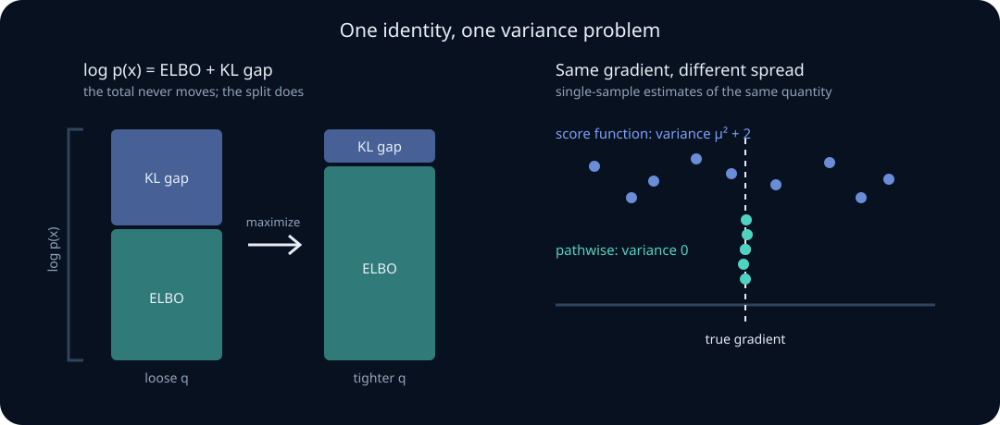

# Latent variables, the ELBO, and gradient estimators

Two problems block every modern generative model, and both are probability problems rather than engineering problems.

The first: a latent-variable model defines \(p_\theta(x)=\int p_\theta(x\mid z)p(z)\,dz\), and that integral is intractable. You cannot evaluate the likelihood you want to maximize.

The second: even once you have an objective of the form \(E_{q_\phi(z)}[f(z)]\), you need its gradient with respect to \(\phi\) — and \(\phi\) is inside the *distribution*, not just inside the function. The ordinary "differentiate under the integral" move needs care, and the two standard answers have wildly different variance.

This unit solves both. The evidence lower bound handles the first; the score-function and pathwise estimators handle the second. Between them they account for variational autoencoders, variational inference for Bayesian posteriors, the policy gradient in reinforcement learning, and the discrete-relaxation tricks used whenever a model must sample a token or route to an expert.

## 0. Prerequisite check

You need the change-of-variables machinery from [transformations, convolution, and Jacobians](03-transformations-convolution-jacobians.md), importance sampling and KL divergence from [Bayesian modeling and computation](09-bayesian-modeling-computation.md), and the fact that \(E[\nabla\log q]=0\), which appeared as the justification for policy-gradient baselines in [limit theorems and Monte Carlo](05-limit-theorems-monte-carlo.md).

### Learning route: one model, three approximation problems

Do not memorize “ELBO = reconstruction minus KL” as an isolated formula. Follow this chain:

1. The latent model defines \(p_\theta(x,z)\), but marginalization makes \(p_\theta(x)\) hard.
2. A variational distribution \(q_\phi(z\mid x)\) creates a computable lower bound whose gap is an explicit posterior KL.
3. Amortization replaces one optimization per observation with a learned inference map, adding another approximation gap.
4. Monte Carlo makes the bound usable in practice; score-function and pathwise gradients trade generality and variance differently.

At each step, label whether error comes from model misspecification, variational-family restriction, amortization, finite Monte Carlo, or optimization. “The ELBO is low” does not identify which one failed.

For multivariable differentiation, review the [local calculus bridge](03-transformations-convolution-jacobians.md#local-calculus-bridge-gradients-and-jacobians): gradient/Jacobian shapes, the chain rule, Hessians, and the separate conditions for differentiating an expectation.

## 1. The intractable marginal

A latent-variable model says: draw \(z\sim p(z)\) from a simple prior, then draw \(x\sim p_\theta(x\mid z)\). The observed likelihood requires marginalizing:

$$
p_\theta(x)=\int p_\theta(x\mid z)\,p(z)\,dz .
$$

For a linear-Gaussian decoder this integral is closed-form. For any neural decoder it is not, and the dimension of \(z\) makes quadrature hopeless.

**Why naive Monte Carlo fails.** The integral is an expectation, so sample it:

$$
\hat p_\theta(x)=\frac1K\sum_{k=1}^Kp_\theta(x\mid z_k),
\qquad z_k\sim p(z).
$$

This is unbiased, and it is useless. For a typical \(x\), almost all prior samples \(z_k\) produce a decoder that assigns \(x\) essentially zero probability; the estimator is dominated by the rare \(z\) near the true posterior \(p(z\mid x)\). The effective sample size collapses — exactly the proposal-mismatch failure diagnosed for importance sampling in the Bayesian-computation lesson. In \(d\) latent dimensions the mismatch grows geometrically.

The fix is to propose from something close to the posterior. That is what the next section builds.

> **Practice — Foundation:** Let \(z\in\{1,2\}\) with \(P(z=1)=0.3\), \(x\mid z=1\sim\mathcal N(0,1)\) and \(x\mid z=2\sim\mathcal N(3,1)\). Write \(p(x)\) as a sum over \(z\) and evaluate \(p(x=0)\) to three decimals.
>
> **Hint:** \(p(0)=0.3\,\varphi(0)+0.7\,\varphi(-3)\) with \(\varphi(0)\approx0.3989\) and \(\varphi(3)\approx0.00443\); the answer is about 0.123.
>
> **Practice — Core:** For \(z\sim\mathcal N(0,1)\) and \(x\mid z\sim\mathcal N(z,0.01)\), compute the fraction of prior samples landing within two decoder standard deviations of \(x=3\), and say what that implies for \(K\).
>
> **Hint:** The relevant prior interval is [2.8,3.2]; compare its probability with 1/K.
>
> **Practice — Stretch:** In the Core model with \(x=3\), write \(\hat p(x)=\frac1K\sum_k w_k\) with \(w_k=p(x\mid z_k)\), \(z_k\sim p(z)\), and show that \(\sum_k w_kz_k/\sum_k w_k\) instead estimates \(E[z\mid x=3]=300/101\). Then, with \(K=1000\), compute the expected number of draws in \([2.8,3.2]\) and the probability that none land there, and use this to explain why the fixed \(\operatorname{KL}(p(z\mid x)\Vert p(z))\approx6.22\) nats does not determine the realized effective sample size.
>
> **Hint:** Self-normalizing divides by \(\sum_k w_k\), whose expectation is \(K\,p(x)\), so the ratio targets a posterior mean; for the counts use \(1000\times0.00187\approx1.87\) and \((1-0.00187)^{1000}\approx0.15\).

## 2. The ELBO, derived twice

Introduce any distribution \(q(z)\) with support covering the posterior. Two derivations, and the second is the one worth memorizing.

**Derivation one — Jensen's inequality.**

$$
\log p_\theta(x)
=\log\int q(z)\frac{p_\theta(x,z)}{q(z)}dz
=\log E_q\!\left[\frac{p_\theta(x,z)}{q(z)}\right]
\;\ge\;
E_q\!\left[\log\frac{p_\theta(x,z)}{q(z)}\right]
=:\mathcal L(\theta,q).
$$

The inequality is Jensen applied to the concave \(\log\). This proves \(\mathcal L\) is a lower bound but says nothing about how loose it is.

**Derivation two — the exact decomposition.** Write \(p_\theta(x,z)=p_\theta(z\mid x)p_\theta(x)\) inside the bound:

$$
\mathcal L(\theta,q)
=E_q\!\left[\log\frac{p_\theta(z\mid x)p_\theta(x)}{q(z)}\right]
=\log p_\theta(x)-\operatorname{KL}\bigl(q(z)\,\Vert\,p_\theta(z\mid x)\bigr).
$$

Rearranged:

$$
\boxed{\;\log p_\theta(x)=\mathcal L(\theta,q)+\operatorname{KL}\bigl(q(z)\Vert p_\theta(z\mid x)\bigr)\;}
$$

**The gap is exactly a KL divergence.** Three consequences follow immediately, and they are the entire logic of variational inference:

1. The bound is tight precisely when \(q\) equals the true posterior.
2. Maximizing \(\mathcal L\) over \(q\) *is* minimizing \(\operatorname{KL}(q\Vert p(z\mid x))\) — you get posterior approximation for free while doing likelihood maximization.
3. Because \(\operatorname{KL}\ge0\), improving \(\mathcal L\) never overstates \(\log p_\theta(x)\). But a *higher ELBO* does not guarantee a higher likelihood, since the gap can shrink while the likelihood falls. Comparing models by ELBO compares bounds, not likelihoods.

The direction matters. This is the **reverse** KL \(\operatorname{KL}(q\Vert p)\), which is mode-seeking: it punishes \(q\) placing mass where \(p\) has none, and tolerates \(q\) ignoring entire modes of \(p\). Variational posteriors are therefore characteristically too narrow.

**The practical form.** Split the joint:

$$
\mathcal L=\underbrace{E_q\bigl[\log p_\theta(x\mid z)\bigr]}_{\text{reconstruction}}
-\underbrace{\operatorname{KL}\bigl(q(z)\Vert p(z)\bigr)}_{\text{stay near the prior}} .
$$

Every VAE loss you have read is this line with a sign flip.



> **Practice — Foundation:** A binary latent has prior \((0.5,0.5)\) and likelihoods \(p(x\mid z)=(0.16,0.04)\), so \(p(x)=0.1\) and the posterior is \((0.8,0.2)\). For \(q=(0.5,0.5)\), use \(\log p(x)=\mathcal L+\operatorname{KL}\) to compute \(\mathcal L\), and explain why \(\mathcal L\le\log p(x)\) for every \(q\) without invoking Jensen.
>
> **Hint:** \(\operatorname{KL}=0.5\log(0.5/0.8)+0.5\log(0.5/0.2)\approx0.223\), so \(\mathcal L\approx\log0.1-0.223\approx-2.526\); the gap is a KL, which is never negative.
>
> **Practice — Core:** Derive the reconstruction-minus-KL form from \(E_q[\log p_\theta(x,z)-\log q(z)]\). Check it on the Foundation model with \(q=(0.6,0.4)\): compute \(E_q[\log p(x\mid z)]\) and \(\operatorname{KL}(q\Vert p(z))\), and confirm their difference equals \(\log0.1-\operatorname{KL}(q\Vert(0.8,0.2))\).
>
> **Hint:** Split \(\log p(x,z)=\log p(x\mid z)+\log p(z)\); numerically the reconstruction is about \(-2.387\), the prior KL about \(0.020\), and both routes give \(\mathcal L\approx-2.407\).
>
> **Practice — Stretch:** Model A is the Foundation model (\(p_A(x)=0.1\)) with \(q\) equal to its exact posterior. Model B has prior \((0.5,0.5)\) and likelihoods \((0.22,0.02)\), so \(p_B(x)=0.12\), but its variational family forces \(q=(0.2,0.8)\). Compute both ELBOs, show A's ELBO is higher although B has higher evidence, and state the inequality their posterior gaps must satisfy for this to happen.
>
> **Hint:** B's posterior is \((11/12,1/12)\), giving gap \(\approx1.505\) and \(\mathcal L_B\approx-3.625\) versus \(\mathcal L_A=\log0.1\approx-2.303\); the reversal needs \(\text{gap}_B-\text{gap}_A>\log p_B-\log p_A\approx0.182\).

## 3. Amortization

Optimizing a separate \(q\) per datapoint is expensive. Amortized inference trains one encoder \(q_\phi(z\mid x)\) to output variational parameters for any \(x\):

$$
\mathcal L(\theta,\phi)=E_{q_\phi(z\mid x)}\bigl[\log p_\theta(x\mid z)\bigr]-\operatorname{KL}\bigl(q_\phi(z\mid x)\Vert p(z)\bigr).
$$

This introduces a second gap. The total looseness is now

$$
\log p_\theta(x)-\mathcal L
=\underbrace{\operatorname{KL}(q^\star\Vert p(z\mid x))}_{\text{approximation gap}}
+\underbrace{\mathcal L(q^\star)-\mathcal L(q_\phi)}_{\text{amortization gap}},
$$

where \(q^\star\) is the best member of the variational family for this \(x\). The first is the price of the family (for example, diagonal Gaussians cannot represent correlated posteriors); the second is the price of using a shared network. They have different fixes — richer family versus more encoder capacity or per-datapoint refinement — so diagnose which one dominates before changing anything.

**The Gaussian KL, in closed form.** For \(q=\mathcal N(\mu,\sigma^2)\) and \(p=\mathcal N(0,1)\),

$$
E_q[\log q]=-\tfrac12\log(2\pi\sigma^2)-\tfrac12,
\qquad
E_q[\log p]=-\tfrac12\log(2\pi)-\tfrac12(\sigma^2+\mu^2),
$$

so

$$
\operatorname{KL}\bigl(\mathcal N(\mu,\sigma^2)\Vert\mathcal N(0,1)\bigr)
=\tfrac12\bigl(\sigma^2+\mu^2-1-\log\sigma^2\bigr).
$$

For a diagonal Gaussian this sums over coordinates. The closed form matters: it removes one source of Monte Carlo noise entirely, which is why the KL term is almost never sampled in practice.

> **Practice — Foundation:** Evaluate the Gaussian KL at \(\mu=0,\sigma=1\) and confirm it is zero.
>
> **Hint:** Every term cancels for the standard-normal variational law.
>
> **Practice — Core:** Derive the closed form above, stating where \(E_q[z^2]=\sigma^2+\mu^2\) is used, then evaluate it at \(\mu=1,\sigma^2=0.5\).
>
> **Hint:** Expand both Gaussian log densities and take expectations under q; the check value is \(\tfrac12(0.5+1-1-\log0.5)\approx0.597\).
>
> **Practice — Stretch:** The true posterior is \(\mathcal N\!\left(0,\begin{pmatrix}1&0.8\\0.8&1\end{pmatrix}\right)\). Find the diagonal Gaussian \(q\) minimizing \(\operatorname{KL}(q\Vert p)\), compute the approximation gap, and compare \(q\)'s marginal variances with the true marginal variance 1.
>
> **Hint:** For reverse KL the optimal diagonal variances are \(1/(\Sigma^{-1})_{ii}=1-\rho^2=0.36\); the trace term then equals 2, leaving gap \(-\tfrac12\log(1-\rho^2)\approx0.511\) nats.

## 4. The gradient problem

Now the second obstacle. We need

$$
\nabla_\phi\,E_{q_\phi(z)}\bigl[f(z)\bigr]
=\nabla_\phi\int q_\phi(z)f(z)\,dz .
$$

The parameter sits in the measure. Moving the gradient inside gives \(\int\nabla_\phi q_\phi(z)\,f(z)\,dz\), which is **not** an expectation under \(q_\phi\) and so cannot be sampled directly. Two constructions repair this, and they are genuinely different — not two implementations of one idea.

### Estimator one: the score function (REINFORCE)

Use the log-derivative identity \(\nabla_\phi q_\phi=q_\phi\nabla_\phi\log q_\phi\):

$$
\nabla_\phi E_{q_\phi}[f(z)]
=\int q_\phi(z)f(z)\nabla_\phi\log q_\phi(z)\,dz
=E_{q_\phi}\bigl[f(z)\,\nabla_\phi\log q_\phi(z)\bigr].
$$

Now it *is* an expectation, so sample it. Properties:

- **Requires almost nothing.** \(f\) need not be differentiable, or even continuous. \(z\) may be discrete.
- **Unbiased**, given that differentiation and integration may be exchanged.
- **Admits baselines.** Since \(E_{q_\phi}[\nabla_\phi\log q_\phi]=\nabla_\phi\!\int q_\phi=\nabla_\phi1=0\), subtracting any constant \(b\) keeps the estimator unbiased: \(E[(f(z)-b)\nabla\log q_\phi]\). This is the identical argument that licenses advantage baselines in [policy gradients](../13-reinforcement-learning/02-policy-gradients-actor-critic.md).
- **High variance**, because \(f\) multiplies a score that can be large, and no information about \(f\)'s *shape* is used — only its value.

### Estimator two: the pathwise (reparameterization) gradient

Suppose \(z\) can be written as a deterministic, differentiable transform of parameter-free noise:

$$
z=g_\phi(\varepsilon),
\qquad
\varepsilon\sim p(\varepsilon)\ \text{independent of }\phi .
$$

Then the expectation is over a fixed distribution and the gradient passes straight through:

$$
\nabla_\phi E_{q_\phi}[f(z)]
=\nabla_\phi E_{p(\varepsilon)}\bigl[f(g_\phi(\varepsilon))\bigr]
=E_{p(\varepsilon)}\bigl[\nabla_zf(g_\phi(\varepsilon))\,\nabla_\phi g_\phi(\varepsilon)\bigr].
$$

For a Gaussian, \(z=\mu+\sigma\odot\varepsilon\) with \(\varepsilon\sim\mathcal N(0,I)\) — a location–scale transformation, which is exactly the change-of-variables construction of the transformations lesson. Properties: it needs \(f\) differentiable and \(g\) differentiable in \(\phi\); it fails outright for discrete \(z\); and it typically has **far** lower variance because it uses the gradient of \(f\), not just its value.

### How much lower? An exact comparison

Take \(q_\mu=\mathcal N(\mu,1)\) and \(f(z)=z\), so the true gradient is \(\nabla_\mu E[z]=1\).

*Score function.* \(\nabla_\mu\log q_\mu(z)=z-\mu\), so the single-sample estimator is \(z(z-\mu)\). Writing \(z=\mu+\varepsilon\):

$$
E\bigl[z(z-\mu)\bigr]=E[(\mu+\varepsilon)\varepsilon]=1,
$$

$$
E\bigl[z^2(z-\mu)^2\bigr]=E\bigl[(\mu+\varepsilon)^2\varepsilon^2\bigr]
=\mu^2E[\varepsilon^2]+2\mu E[\varepsilon^3]+E[\varepsilon^4]
=\mu^2+3,
$$

so the variance is \(\mu^2+3-1=\mu^2+2\).

*Pathwise.* \(z=\mu+\varepsilon\), so \(\nabla_\mu f(z)=1\) identically. The estimator is the constant \(1\): **variance zero**, exactly.

The contrast is stark and it is not an artifact of the toy problem: the score-function variance even *grows* with \(\mu\), meaning it degrades as the distribution moves away from the origin, while the pathwise estimator is exact. This is why continuous latent variables are reparameterized whenever possible, and why discrete latents are the hard case.

> **Practice — Foundation:** Write the reparameterization for \(\mathcal N(\mu,\sigma^2)\) and for \(\mathrm{Uniform}(a,b)\), then produce the samples for \(\mu=1,\sigma=2,\varepsilon=-0.5\) and for \(a=2,b=5,u=0.4\).
>
> **Hint:** Use \(z=\mu+\sigma\varepsilon\) and \(z=a+(b-a)u\); the samples are 0 and 3.2.
>
> **Practice — Core:** For \(q_\mu=\mathcal N(\mu,1)\) and \(f(z)=z^2\) (true gradient \(2\mu\)), compute the variance of the single-sample score-function estimator \(z^2(z-\mu)\) and of the pathwise estimator \(2z\) as functions of \(\mu\), and evaluate both at \(\mu=1\).
>
> **Hint:** Write \(z=\mu+\varepsilon\) and use \(E\varepsilon^2=1,E\varepsilon^4=3,E\varepsilon^6=15\); you should get \(\mu^4+14\mu^2+15\) (30 at \(\mu=1\)) versus the constant 4.
>
> **Practice — Stretch:** Show that the optimal constant baseline for the score-function estimator is \(b^\star=E[f\lVert\nabla\log q\rVert^2]/E[\lVert\nabla\log q\rVert^2]\), evaluate it for \(q_\mu=\mathcal N(\mu,1)\) and \(f(z)=z\), and give the variance of the baselined estimator.
>
> **Hint:** Minimize expected squared estimator norm as a quadratic in \(b\); here \(b^\star=E[(\mu+\varepsilon)\varepsilon^2]=\mu\), leaving the estimator \(\varepsilon^2\) with variance 2 instead of \(\mu^2+2\).

## 5. Discrete latents: Gumbel-max and its relaxation

When \(z\) is a category, no differentiable reparameterization exists — the map from parameters to a discrete sample is piecewise constant, so its derivative is zero almost everywhere and undefined on a measure-zero set. Two tools.

**The Gumbel-max trick.** Let \(G_1,\ldots,G_K\) be iid standard Gumbel, so \(G_i=-\log(-\log U_i)\) with \(U_i\sim\mathrm{Uniform}(0,1)\). Then

$$
\operatorname*{arg\,max}_i\bigl(\log\pi_i+G_i\bigr)\sim\mathrm{Categorical}(\pi).
$$

*Why.* \(P(\text{index }k\text{ wins})=\int f(g)\prod_{i\ne k}F\bigl(g+\log\pi_k-\log\pi_i\bigr)dg\) with \(F(g)=\exp(-e^{-g})\); the product of Gumbel CDFs is itself a Gumbel CDF with the log-weights accumulating inside the exponent, and the integral collapses to \(\pi_k/\sum_j\pi_j\).

Two properties worth noticing. The trick is **shift-invariant**: adding a constant to every \(\log\pi_i\) leaves the argmax unchanged, which is why unnormalized logits work directly. And taking the **top \(k\)** of \(\log\pi_i+G_i\) rather than the top 1 gives an exact sample of size \(k\) *without replacement* — the standard way to draw a diverse set of candidates in one pass.

**The Gumbel-softmax (Concrete) relaxation.** Replace the argmax with a temperature-controlled softmax:

$$
\tilde z=\operatorname{softmax}\!\left(\frac{\log\pi+G}{\tau}\right).
$$

Now \(\tilde z\) is differentiable in \(\log\pi\), and as \(\tau\to0\) it converges to the one-hot sample. This buys pathwise gradients at the cost of **bias**: for \(\tau>0\) you are differentiating a different objective than the one you wrote down. The bias–variance tradeoff is explicit — small \(\tau\) means low bias and high gradient variance, large \(\tau\) the reverse — and \(\tau\) is typically annealed.

**Straight-through** takes the hard sample forward and the relaxed gradient backward. It is more biased still and has no guarantee behind it; treat it as a heuristic that often works, in the same spirit as the straight-through estimator for quantization in [constrained and composite optimization](../03-optimization/07-constrained-composite-distributed-optimization.md).

> **Practice — Foundation:** Draw a categorical sample from \(\pi=(0.2,0.5,0.3)\) using Gumbel-max with uniforms \(u=(0.8,0.5,0.3)\).
>
> **Hint:** \(G=-\log(-\log u)\approx(1.500,0.367,-0.186)\); adding \(\log\pi\approx(-1.609,-0.693,-1.204)\) gives \((-0.109,-0.327,-1.390)\), so index 1 wins.
>
> **Practice — Core:** Add \(c=5\) to every logit in the Foundation problem and recompute the perturbed scores with the same uniforms; then prove for general \(c\) that the argmax is unchanged, and explain why this means logits need no normalization.
>
> **Hint:** Every score rises by exactly 5, to about \((4.891,4.673,3.610)\); a common additive shift cannot change an argmax, and normalization is just such a shift by \(-\log\sum_i e^{\ell_i}\).
>
> **Practice — Stretch:** Take three categories with logits \(\theta=(0,0,0)\) and reward \(r=(1,0,-1)\). Compute the exact gradient of \(E_{z\sim\operatorname{softmax}(\theta)}[r_z]\), then specify an experiment (seed 0, \(10^5\) samples per \(\tau\in\{0.1,0.5,1,2\}\)) that estimates the Gumbel-softmax gradient of \(r\cdot\tilde z\) and reports its bias and per-coordinate variance against that exact value. State which estimator you would ship for a routing layer with 64 experts.
>
> **Hint:** The exact gradient is \(\pi_k(r_k-\pi\cdot r)=(1/3,0,-1/3)\); a gap between the Gumbel-softmax mean and this vector that persists beyond Monte Carlo standard error is bias.

## 6. Tightening and reporting the bound

The single-sample ELBO is not the only bound. The importance-weighted bound

$$
\mathcal L_K=E\!\left[\log\frac1K\sum_{k=1}^K\frac{p_\theta(x,z_k)}{q_\phi(z_k\mid x)}\right],
\qquad z_k\stackrel{\text{iid}}\sim q_\phi ,
$$

satisfies \(\mathcal L_1\le\mathcal L_K\le\mathcal L_{K+1}\le\log p_\theta(x)\), when the importance weights and log expectations are well defined. Convergence \(\mathcal L_K\to\log p_\theta(x)\) needs conditions permitting convergence of the expected log estimate, such as positive weights bounded above and away from zero; a sample-mean law of large numbers alone is insufficient for that expectation claim. Inside the logarithm is an ordinary importance-sampling estimate of evidence, not a self-normalized estimate of a posterior expectation. Weight concentration still makes effective sample size a useful diagnostic, without certifying an accurate log-evidence estimate. The [IWAE paper](https://arxiv.org/abs/1509.00519) develops the multi-sample bound. Reporting \(\mathcal L_{1}\) and \(\mathcal L_{64}\) together is a cheap, honest way to show how loose your bound is.

> **Practice — Foundation:** For \(z\sim\mathcal N(0,1)\), \(x\mid z\sim\mathcal N(z,1)\), \(x=2\) and proposal \(q=\mathcal N(0,1)\), two draws \(z_1=0,z_2=1\) enter a \(K=2\) importance-weighted bound. Which distribution supplied them? Compute \(w_k=p(x,z_k)/q(z_k)\) and the realized \(\log\frac12(w_1+w_2)\).
>
> **Hint:** The draws come from the proposal \(q\) in the denominator; because \(q\) is the prior here, \(w_k=\varphi(2-z_k)\approx(0.0540,0.2420)\), giving about \(-1.911\).
>

> **Practice — Core:** An unbiased evidence estimator \(\hat Y\) equals 0.05 or 0.15 with probability \(\tfrac12\) each, so \(E\hat Y=p(x)=0.1\). Compute \(E[\log\hat Y]\), compare it with \(\log0.1\), and explain the sign of the difference.
>
> **Hint:** \(\tfrac12(\log0.05+\log0.15)\approx-2.446<\log0.1\approx-2.303\); Jensen's inequality for the concave logarithm forces this direction.
>

> **Practice — Stretch:** Let \(U\sim\mathrm{Uniform}(0,1)\) and \(\hat Y_n=1\) if \(U\ge1/n\), \(\hat Y_n=e^{-n^2}\) if \(U<1/n\). Show \(\hat Y_n\to1\) almost surely, compute \(E[\log\hat Y_n]\), and conclude whether almost-sure convergence of positive estimates implies convergence of their expected logarithms.
>
> **Hint:** For any fixed \(U>0\), eventually \(1/n<U\); but \(E[\log\hat Y_n]=(1/n)(-n^2)=-n\to-\infty\), because the logarithm is unbounded near zero.

## 7. Failure modes

- **Posterior collapse.** If the decoder is powerful enough to model \(x\) without \(z\), the optimizer drives \(q_\phi(z\mid x)\to p(z)\), the KL term to zero, and the latent becomes unused. Diagnose by reporting per-dimension KL, not the total.
- **Comparing ELBOs across models.** Different likelihood parameterizations (discretized versus continuous, different data scaling) change the number without changing the model's quality. Continuous densities are not probabilities and can be positive in log — the random-variables lesson's warning, resurfacing.
- **Reporting an ELBO as a likelihood.** It is a bound with an unmeasured gap. Report \(\mathcal L_K\) for growing \(K\) if you want to claim tightness.
- **KL annealing without disclosure.** Down-weighting the KL term optimizes a different objective; the resulting number is no longer a bound on \(\log p_\theta(x)\).
- **Using REINFORCE without a baseline** and concluding the method does not work.
- **Using a relaxation and reporting it as exact.** Gumbel-softmax gradients are biased at any \(\tau>0\).
- **Ignoring the amortization gap** and adding capacity to the wrong component.

### Worked example: an ELBO whose answer is known

Let \(z\sim N(0,1)\), \(x\mid z\sim N(z,1)\), and observe \(x=2\). Gaussian conditioning gives

$$
p(z\mid x=2)=N(1,1/2),
\qquad p(x)=N(0,2).
$$

For any Gaussian \(q(z)=N(m,v)\),

$$
\mathcal L(q)=\log p(x=2)-\operatorname{KL}\!\left(N(m,v)\Vert N(1,1/2)\right).
$$

Choosing the exact posterior makes the gap zero. Choosing the prior \(q=N(0,1)\) gives

$$
\operatorname{KL}\!\left(N(0,1)\Vert N(1,1/2)\right)
=\frac12\left[\log\frac{1/2}{1}+\frac{1+(0-1)^2}{1/2}-1\right]
\approx1.153.
$$

The generative model is unchanged; only inference is poor. This is why an ELBO gap cannot automatically be blamed on the decoder.

For \(z\sim N(\mu,\sigma^2)\) and \(J=E[z^2]=\mu^2+\sigma^2\), reparameterize \(z=\mu+\sigma\varepsilon\). A one-sample pathwise gradient for \(\mu\) is \(2(\mu+\sigma\varepsilon)\), with expectation \(2\mu\). The score-function estimator \(z^2(z-\mu)/\sigma^2\) has the same expectation but usually much larger variance. This is the concrete reason to prefer reparameterization when available.

> **Practice — Foundation:** Two 4-dimensional VAEs report test-averaged per-dimension KL: run A \((0.002,0.001,0.003,0.002)\), run B \((3.1,0.002,2.4,0.001)\) nats. Compute each total KL, count active dimensions (KL above 0.01 nats), and say what run A's numbers suggest about \(q(z\mid x)\).
>
> **Hint:** Totals are 0.008 and 5.503 nats with 0 and 2 active dimensions; near-zero KL everywhere means \(q(z\mid x)\approx p(z)\) for every \(x\), so the encoder ignores the observation.
>

> **Practice — Core:** For 100 test inputs you compute reconstruction log-likelihood with the input's own code \(z=\mu(x)\) and with a code \(\mu(x')\) from a randomly chosen other input. Model A gives \(-88.1\) versus \(-88.2\) nats; model B gives \(-80.4\) versus \(-131.7\). Which decoder uses its latent, and why does this swap test distinguish that from a low total KL alone?
>
> **Hint:** Compute each drop (0.1 versus 51.3 nats); holding everything else fixed and intervening on \(z\) measures the decoder's sensitivity directly.
>

> **Practice — Stretch:** A run with free bits \(\lambda=0.5\) nats on each of 8 dimensions optimizes \(E_q[\log p(x\mid z)]-\sum_j\max(\lambda,\operatorname{KL}_j)\). With reconstruction \(-90.0\) and every \(\operatorname{KL}_j=0.1\), compute the reported objective and the true ELBO, and explain why the modified objective must be reported and not compared with another model's ELBO.
>
> **Hint:** The objective is \(-90-8(0.5)=-94.0\) while the ELBO is \(-90-0.8=-90.8\); the training criterion is a different number that is not a bound on this model's \(\log p(x)\).

## 8. Runnable labs

**Lab A — the Gaussian ELBO terms.** Implement `gaussian_elbo_terms` in the [learner exercises file](../../labs/exercises.py). Given a reconstruction log-likelihood and the diagonal Gaussian parameters \(\mu\) and \(\log\sigma^2\) produced by an encoder, return the KL to the standard normal prior and the resulting ELBO, using the closed form of section 3. Reject mismatched parameter lengths, empty parameters, and non-finite values.

Then investigate: hold the reconstruction fixed and sweep \(\mu\) and \(\log\sigma^2\) to see which configurations the KL term punishes. Confirm the KL is zero only at \(\mu=0,\log\sigma^2=0\), and show that a collapsed latent is exactly the minimizer of the KL term alone.

**Lab B — Gumbel-max sampling.** Implement `gumbel_max_sample` in the [learner exercises file](../../labs/exercises.py). Given unnormalized log-weights and a seed, draw one uniform per category in index order from a local `random.Random(seed)`, form \(g_i=-\log(-\log u_i)\), and return the index maximizing \(\log w_i+g_i\). Reject an empty weight list and non-finite weights.

Then investigate: draw many samples across seeds and compare the empirical frequencies with \(\operatorname{softmax}(\log w)\). Verify shift invariance numerically by adding a large constant to all log-weights. Then implement Gumbel top-\(k\) by taking the \(k\) largest perturbed values, and check its frequencies against sampling without replacement.

## 9. Derivations to own

1. The ELBO by Jensen, and again by the exact \(\log p=\mathcal L+\operatorname{KL}\) decomposition.
2. The reconstruction-minus-KL form.
3. The closed-form Gaussian KL \(\tfrac12(\sigma^2+\mu^2-1-\log\sigma^2)\).
4. The score-function identity via \(\nabla q=q\nabla\log q\), and the unbiasedness of baselines from \(E[\nabla\log q]=0\).
5. The pathwise gradient for a location–scale family.
6. The exact variance comparison \(\mu^2+2\) versus \(0\) for \(f(z)=z\).
7. The Gumbel-max claim, at least to the level of the CDF-product argument.

## Prediction experiment

Predict both the baseline and failure-preset results before revealing the calculation. Record the assumptions, change one control at a time, and explain the boundary case. This small deterministic model isolates a mechanism; it is not an empirical validation of a trained system.

```lab
lab: ps-gradient
```

## 10. End-of-unit practice (graded)

Work each problem before opening its authored solution. Written proofs and design answers require self-review against the rubric; numeric fields check only the stated quantities.


**Foundation**

**A1 · Foundation · paper — Cumulative problem 1.** Compute \(\operatorname{KL}(\mathcal N(2,0.25)\Vert\mathcal N(0,1))\).

**A2 · Foundation · paper — Cumulative problem 2.** State the reparameterization for \(\mathcal N(\mu,\sigma^2)\) and say why \(\varepsilon\) must not depend on \(\phi\).

**A3 · Foundation · paper — Cumulative problem 3.** Given \(\log w=(0,1,2)\), compute \(\operatorname{softmax}(\log w)\).

**Core**

**A4 · Core · paper — Cumulative problem 4.** Prove \(E_{q_\phi}[\nabla_\phi\log q_\phi(z)]=0\) and explain precisely why this makes baselines unbiased.

**A5 · Core · paper — Cumulative problem 5.** Derive the ELBO gap as a KL divergence, and use it to explain why maximizing the ELBO over \(q\) performs posterior inference.

**A6 · Core · paper — Cumulative problem 6.** Let \(q_\mu=\mathcal N(\mu,1)\) and \(f(z)=\mathbf 1\{z>0\}\), so the target is \(\tfrac{d}{d\mu}P(z>0)=\tfrac{d}{d\mu}\Phi(\mu)=\varphi(\mu)\). Show that the score-function estimator \(f(z)(z-\mu)\) has expectation \(\varphi(\mu)\) and evaluate it at \(\mu=0\). Then show the pathwise estimator \(\partial_\mu f(\mu+\varepsilon)\) is 0 almost surely, and explain why it is wrong here.

**A7 · Core · paper — Cumulative problem 7.** A VAE team reports held-out numbers (nats per example): at epoch 10, reconstruction \(E_q[\log p(x\mid z)]=-92.0\) and \(\operatorname{KL}(q\Vert p(z))=12.0\); at epoch 20, reconstruction \(-95.5\) and KL \(6.0\). Compute the ELBO at both epochs and explain, using the two terms, how the ELBO improved while reconstruction worsened.

**Stretch**

**A8 · Stretch · paper — Cumulative problem 8.** A text VAE with an autoregressive decoder and 32 latent dimensions reaches, after 2,000 steps, total KL 0.04 nats (every dimension below 0.003 nats) and reconstruction \(-61.2\) nats per sentence, and its samples look fluent. (a) Name the failure. (b) Decoding each sentence with the latent code of a different sentence changes reconstruction by only 0.1 nats, whereas a healthy reference VAE changes by 38 nats; what does this establish that the total KL alone does not? (c) You add free bits with \(\lambda=0.25\) nats per dimension: below what total KL does the modified objective stop penalizing, and what cost must be reported?

**A9 · Stretch · paper — Cumulative problem 9.** A routing layer chooses one of 64 experts per token. On a probe batch whose exact router gradient can be enumerated, you measure per-token relative variance \(\operatorname{tr}\operatorname{Cov}(\hat g)/\lVert g\rVert^2\): REINFORCE with a mean baseline gives 24 and is unbiased; Gumbel-softmax at \(\tau=0.5\) gives 0.6, and its mean gradient has cosine similarity 0.95 with the exact gradient. (a) How many tokens per batch does REINFORCE need to match the Gumbel-softmax variance at a batch of 512 tokens? (b) Which estimator's error shrinks to zero as batch size grows, and which does not? (c) Explain how a differentiable load-balancing penalty on the router probabilities interacts with each estimator, and recommend one with the evidence you would still collect.

**A10 · Stretch · paper — Cumulative problem 10.** Prove \(\mathcal L_K\le\mathcal L_{K+1}\) for the importance-weighted bound, and explain why larger \(K\) reduces the bound gap but not necessarily the gradient variance.


## Six-part checkpoint

Complete these without notes, then use the solutions to audit assumptions and reasoning. Passing a numeric check alone does not establish mastery. For implementation and transfer, retain the code/results or written protocol as evidence.

**K1 · Foundation · gate — Concept.** What is the gap between log evidence and the ELBO?

**K2 · Core · gate — Derivation.** Derive the score-function identity with its conditions.

**K3 · Core · gate — Calculation.** The exact binary posterior and variational distribution both assign probability 0.3 to state one. What is their ELBO gap?

**K4 · Core · gate — Implementation audit.** Reproduce two settings of the ps-gradient experiment independently, including its failure preset. State a numerical invariant or analytic oracle and explain what the plot does not establish.

**K5 · Stretch · gate — Claim audit.** Is an importance-weighted evidence estimate a self-normalized posterior expectation?

**K6 · Stretch · gate — RE/RS transfer.** Compare a pathwise and score-function gradient implementation.

## Mastery check

Derive the ELBO both ways and state exactly what the gap is; produce the reconstruction-minus-KL form and the closed-form Gaussian KL from scratch; derive both gradient estimators, state the assumptions each requires, and reproduce the exact variance comparison; explain why discrete latents break reparameterization and what Gumbel-max and its relaxation do about it; and, shown a training run whose ELBO improves while samples worsen, name the term responsible and the diagnostic that proves it.
