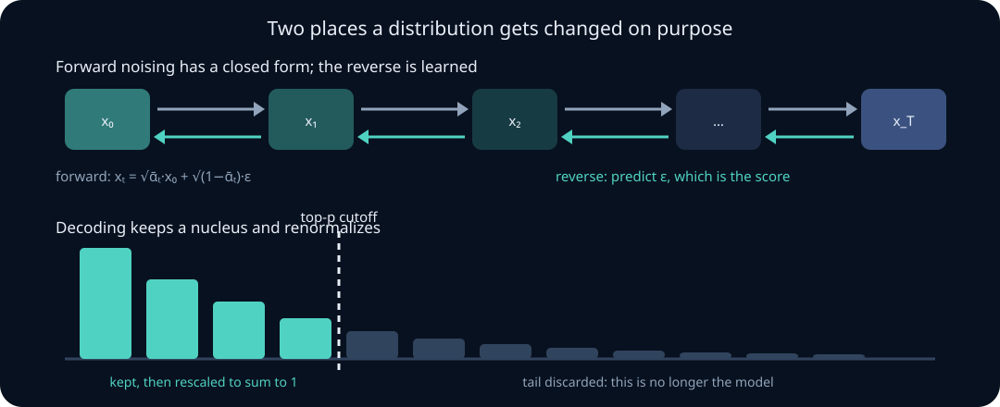

# Score matching, diffusion, and sampling from generative models

The previous unit handled an intractable *integral* — the marginal likelihood — with a bound. This unit handles an intractable *constant*, and then asks a question that is usually skipped entirely: once you have a trained generative model, what distribution are you actually sampling from?

The answer to the second question is almost never "the model's distribution", and the gap between the two is where a great deal of confused evaluation lives.

Three threads run through the unit. **Scores** let you learn a density without ever computing its normalizer. **Diffusion** turns score estimation into a noise-prediction regression, and turns out to be the evidence lower bound of the previous unit applied to a fixed hierarchical encoder. **Decoding** — temperature, top-\(k\), top-\(p\) — is distribution surgery performed after training, and it silently invalidates the likelihood numbers you reported.

## 0. Prerequisite check

You need the ELBO and the reparameterization trick from [latent variables and the ELBO](14-latent-variables-elbo-gradient-estimators.md), the convolution-of-Gaussians result from [transformations and convolution](03-transformations-convolution-jacobians.md), and the fact that a density is not a probability from [random variables and distributions](01-random-variables-distributions.md).

## 1. The normalizer is the enemy; the score does not care

An energy-based model writes

$$
p_\theta(x)=\frac{\exp\bigl(-E_\theta(x)\bigr)}{Z_\theta},
\qquad
Z_\theta=\int\exp\bigl(-E_\theta(x)\bigr)dx .
$$

\(Z_\theta\) is an integral over the whole data space. In \(d=3\times10^5\) pixels it is not merely expensive, it is unapproachable. Maximum likelihood needs \(\nabla_\theta\log Z_\theta\), so maximum likelihood is blocked.

Now take the gradient **with respect to \(x\)** instead:

$$
s(x):=\nabla_x\log p_\theta(x)=-\nabla_xE_\theta(x)-\underbrace{\nabla_x\log Z_\theta}_{=0} .
$$

\(Z_\theta\) does not depend on \(x\), so it vanishes. The **score** \(\nabla_x\log p(x)\) is a complete description of the density up to a constant, and it is computable from an unnormalized model. This single observation is why the entire modern generative-modelling stack is built on scores rather than likelihoods.

Geometrically the score is a vector field pointing uphill in density: follow it and you move toward regions where data lives.

> **Practice — Foundation:** Compute \(\nabla_x\log p(x)\) for \(p=\mathcal N(\mu,\sigma^2)\) and confirm it points toward \(\mu\).
>
> **Practice — Core:** Show that two energies differing by a constant give the same score and the same distribution, and explain what this means for identifiability of \(E_\theta\).
>
> **Practice — Stretch:** Given a score field, describe a procedure to recover the density up to normalization, and state when the field is a valid score at all (hint: it must be a gradient).

## 2. Score matching and Hyvärinen's identity

We want \(s_\theta\approx\nabla_x\log p_{\text{data}}\), but we cannot evaluate the target — that is the whole problem. The Fisher divergence

$$
J(\theta)=\tfrac12E_{p_{\text{data}}}\Bigl[\bigl\lVert s_\theta(x)-\nabla_x\log p_{\text{data}}(x)\bigr\rVert^2\Bigr]
$$

still mentions the unknown. Expand the square:

$$
J(\theta)=E_p\Bigl[\tfrac12\lVert s_\theta\rVert^2\Bigr]
-E_p\bigl[s_\theta(x)^T\nabla_x\log p(x)\bigr]
+\text{const} .
$$

The middle term is the one to attack. Using \(p\nabla\log p=\nabla p\) and integrating by parts (the boundary term vanishes when \(p\) decays at infinity),

$$
-\int p(x)\,s_\theta(x)^T\nabla_x\log p(x)\,dx
=-\int s_\theta(x)^T\nabla_xp(x)\,dx
=\int p(x)\,\nabla_x\!\cdot s_\theta(x)\,dx .
$$

Therefore

$$
\boxed{\;J(\theta)=E_{p_{\text{data}}}\Bigl[\operatorname{tr}\bigl(\nabla_xs_\theta(x)\bigr)+\tfrac12\lVert s_\theta(x)\rVert^2\Bigr]+\text{const}\;}
$$

The unknown density appears only as the distribution we average over — which we have samples from. This is **Hyvärinen's identity**, and it is a genuinely surprising result: an objective that references an unknown function has been rewritten using only quantities we can compute.

The catch is \(\operatorname{tr}(\nabla_xs_\theta)\), the trace of a \(d\times d\) Jacobian, costing \(d\) backward passes. At \(d=10^5\) that is fatal. Sliced score matching estimates the trace with random projections (the Hutchinson estimator, \(\operatorname{tr}(A)=E_v[v^TAv]\) for \(E[vv^T]=I\)), which works but adds variance. The next section removes the problem entirely.

> **Practice — Foundation:** For \(s_\theta(x)=-\theta x\) in one dimension, write \(J(\theta)\) explicitly using the identity.
>
> **Practice — Core:** Carry out the integration-by-parts step in one dimension, stating the decay condition used.
>
> **Practice — Stretch:** Verify the Hutchinson identity \(E_v[v^TAv]=\operatorname{tr}(A)\) for \(v\) with independent \(\pm1\) entries, and compute the variance of the single-sample estimate.

## 3. Denoising score matching: the trace disappears

Perturb the data with known noise. Let \(\tilde x=x+\sigma\varepsilon\) with \(\varepsilon\sim\mathcal N(0,I)\), giving the conditional

$$
q_\sigma(\tilde x\mid x)=\mathcal N(\tilde x;x,\sigma^2I),
\qquad
\nabla_{\tilde x}\log q_\sigma(\tilde x\mid x)=-\frac{\tilde x-x}{\sigma^2}=-\frac{\varepsilon}\sigma .
$$

The conditional score is available in closed form because we chose the noise. Vincent's identity states that matching this conditional score is equivalent, up to a constant, to matching the score of the *smoothed* marginal \(q_\sigma(\tilde x)=\int q_\sigma(\tilde x\mid x)p(x)dx\):

$$
E_{q_\sigma(\tilde x)}\Bigl[\bigl\lVert s_\theta(\tilde x)-\nabla\log q_\sigma(\tilde x)\bigr\rVert^2\Bigr]
=E_{p(x)q_\sigma(\tilde x\mid x)}\Bigl[\bigl\lVert s_\theta(\tilde x)-\nabla\log q_\sigma(\tilde x\mid x)\bigr\rVert^2\Bigr]+\text{const}.
$$

Substituting the conditional score and writing \(s_\theta(\tilde x)=-\hat\varepsilon_\theta(\tilde x)/\sigma\), the objective becomes

$$
E\Bigl[\bigl\lVert\hat\varepsilon_\theta(\tilde x)-\varepsilon\bigr\rVert^2\Bigr].
$$

**Predicting the noise is estimating the score.** That is the whole training objective of a diffusion model: add known noise, regress on it, and you have learned \(\nabla\log q_\sigma\) for free, with no trace, no normalizer, and no bound.

Two consequences worth stating plainly. The minimizer is \(\hat\varepsilon^\star(\tilde x)=E[\varepsilon\mid\tilde x]\), a conditional expectation — the same object that the law of total expectation in the joint-distributions lesson called the best mean-squared predictor. And you learn the score of the **smoothed** density \(q_\sigma\), not of \(p_{\text{data}}\); the two agree only as \(\sigma\to0\), which is precisely the regime where the score is hardest to estimate because data lies on a thin manifold. This tension is why a *range* of noise levels is used.

> **Practice — Foundation:** Verify \(\nabla_{\tilde x}\log\mathcal N(\tilde x;x,\sigma^2I)=-(\tilde x-x)/\sigma^2\).
>
> **Practice — Core:** Show the minimizer of the denoising objective is \(E[\varepsilon\mid\tilde x]\), and rewrite it as a statement about \(E[x\mid\tilde x]\).
>
> **Practice — Stretch:** Explain why small \(\sigma\) gives an accurate target but a poorly conditioned learning problem, and why large \(\sigma\) gives the reverse. Propose a weighting across noise levels and justify it.

## 4. The forward process is a Gaussian chain with a closed form

Diffusion uses a whole schedule of noise levels, arranged as a Markov chain. With \(\beta_1,\ldots,\beta_T\in(0,1)\),

$$
q(x_t\mid x_{t-1})=\mathcal N\bigl(\sqrt{1-\beta_t}\,x_{t-1},\;\beta_tI\bigr).
$$

Set \(\alpha_t=1-\beta_t\) and \(\bar\alpha_t=\prod_{s\le t}\alpha_s\). Composing Gaussians — the convolution result of the transformations lesson, since a scaled Gaussian plus an independent Gaussian is Gaussian with added variances — gives the **closed-form marginal**

$$
q(x_t\mid x_0)=\mathcal N\bigl(\sqrt{\bar\alpha_t}\,x_0,\;(1-\bar\alpha_t)I\bigr),
\qquad
x_t=\sqrt{\bar\alpha_t}\,x_0+\sqrt{1-\bar\alpha_t}\,\varepsilon .
$$

**Check the induction once.** If \(x_{t-1}=\sqrt{\bar\alpha_{t-1}}x_0+\sqrt{1-\bar\alpha_{t-1}}\,\varepsilon'\), then

$$
x_t=\sqrt{\alpha_t}x_{t-1}+\sqrt{\beta_t}\,\varepsilon''
=\sqrt{\bar\alpha_t}x_0+\sqrt{\alpha_t(1-\bar\alpha_{t-1})}\,\varepsilon'+\sqrt{1-\alpha_t}\,\varepsilon'' ,
$$

and the two independent Gaussian terms have total variance \(\alpha_t(1-\bar\alpha_{t-1})+(1-\alpha_t)=1-\bar\alpha_t\). The schedule is called **variance-preserving** exactly because signal coefficient squared plus noise variance is \(\bar\alpha_t+(1-\bar\alpha_t)=1\).

This closed form is what makes training cheap: to train at step \(t\) you never simulate the chain, you jump straight to \(x_t\) in one draw.

**The reverse posterior is also exactly Gaussian** when conditioned on \(x_0\):

$$
q(x_{t-1}\mid x_t,x_0)=\mathcal N(\tilde\mu_t,\tilde\beta_tI),
$$

$$
\tilde\mu_t=\frac{\sqrt{\bar\alpha_{t-1}}\,\beta_t}{1-\bar\alpha_t}x_0
+\frac{\sqrt{\alpha_t}\,(1-\bar\alpha_{t-1})}{1-\bar\alpha_t}x_t,
\qquad
\tilde\beta_t=\frac{1-\bar\alpha_{t-1}}{1-\bar\alpha_t}\beta_t .
$$

The model does not know \(x_0\) at sampling time, so it predicts it (equivalently, predicts \(\varepsilon\)) and substitutes.

> **Practice — Foundation:** For \(\beta=(0.5,0.5)\), compute \(\bar\alpha_1,\bar\alpha_2\) and the signal and noise coefficients at each step.
>
> **Practice — Core:** Complete the induction above, stating where independence of \(\varepsilon'\) and \(\varepsilon''\) is used.
>
> **Practice — Stretch:** Show \(\tilde\beta_t\le\beta_t\) and interpret the inequality: why is the reverse step less uncertain than the forward step it undoes?

## 5. Diffusion is the ELBO of a fixed-encoder hierarchical VAE

Put the previous unit next to section 4. A diffusion model is a latent-variable model with latents \(z=(x_1,\ldots,x_T)\), an encoder \(q(x_{1:T}\mid x_0)\) that is **fixed, not learned**, and a decoder \(p_\theta(x_{t-1}\mid x_t)\). Its ELBO is

$$
\log p_\theta(x_0)\ \ge\
E_q\Bigl[\log p(x_T)+\sum_t\log\frac{p_\theta(x_{t-1}\mid x_t)}{q(x_t\mid x_{t-1})}\Bigr],
$$

which regroups into a sum of KL divergences between Gaussians — one per timestep — plus a reconstruction term. Because both distributions in each KL are Gaussian with known variances, each term reduces to a squared difference of means, and with the \(\varepsilon\)-parameterization and a particular weighting it collapses to

$$
E_{t,x_0,\varepsilon}\Bigl[\bigl\lVert\hat\varepsilon_\theta(x_t,t)-\varepsilon\bigr\rVert^2\Bigr] .
$$

The same objective arrived at from denoising score matching in section 3. **Two independent derivations, one loss.** That is the strongest evidence that the object is natural rather than engineered.

One honest caveat: the simple unweighted MSE used in practice is *not* the ELBO — it drops the per-timestep weights. It works better empirically, and it means the reported loss is not a likelihood bound. If you want a likelihood number, compute the weighted bound.

## 6. Sampling: stochastic, deterministic, and guided

Training gives a score field. Getting samples is a separate algorithmic question.

- **Ancestral (stochastic) sampling** walks the reverse chain, adding fresh noise at each step. Many steps, high diversity.
- **Probability-flow ODE.** There is a deterministic ODE whose marginals match the stochastic process at every \(t\). Solving it gives sampling with far fewer steps, exactly invertible trajectories, and — because it is a deterministic change of variables — an exact likelihood via the change-of-variables formula of the transformations lesson. Determinism costs diversity at a fixed seed.
- **Classifier-free guidance** interpolates conditional and unconditional scores:

$$
\tilde s=s_\theta(x\mid\varnothing)+w\bigl(s_\theta(x\mid c)-s_\theta(x\mid\varnothing)\bigr).
$$

For \(w>1\) this is a score of \(p(x)\,p(c\mid x)^{w}\) up to normalization — a **sharpened**, temperature-like distribution, not \(p(x\mid c)\). Samples look better on human preference and are *less diverse and less faithful to the model's actual conditional*. Report \(w\); a guided FID is not comparable to an unguided one.

## 7. Decoding is distribution surgery

Autoregressive models raise the same issue in a form people rarely name. A trained language model defines \(p_\theta(x_t\mid x_{<t})\). Generation almost never samples from it.

**Temperature.** With logits \(z\),

$$
p_T(i)=\frac{\exp(z_i/T)}{\sum_j\exp(z_j/T)}\ \propto\ p(i)^{1/T} .
$$

\(T\to0\) concentrates on the argmax; \(T\to\infty\) tends to uniform; \(T=1\) is the model. Entropy increases monotonically in \(T\). This is the same exponential tilt that appeared as the maximum-entropy solution in [convexity and duality](../03-optimization/03-convexity-smoothness-duality.md) — temperature is the Lagrange multiplier.

**Top-\(k\) and top-\(p\) (nucleus).** Sort descending, keep either the top \(k\) tokens or the smallest prefix whose cumulative probability reaches \(p\), zero the rest, renormalize. This is conditioning on the event "the token is in the kept set" — a genuinely different distribution, with all tail mass redistributed onto the head.

**The consequence people skip.** Perplexity, cross-entropy, and every likelihood-based evaluation describe \(p_\theta\). Generation uses \(p_{T,k,p}\). These are different distributions, so:

- A perplexity improvement need not improve generations at your decoding settings.
- Two systems compared at different temperatures are not comparable.
- Likelihood-based detection, watermarking, and calibration arguments all assume the untruncated distribution.
- Truncation removes exactly the tail where rare-but-correct tokens live, which is why factual recall and greedy decoding interact badly.

Always report decoding parameters alongside any generation result. A generation claim without \(T\), \(k\), \(p\), and the seed policy is not reproducible.

**Sampling without replacement.** To draw \(k\) distinct candidates in one pass, take the \(k\) largest of \(\log p_i+G_i\) with Gumbel noise — the Gumbel top-\(k\) trick from the previous unit. This is exactly a without-replacement sample, unlike \(k\) independent draws.

> **Practice — Foundation:** For logits \((0,\log 3)\), compute the distribution at \(T=1\) and at \(T=2\).
>
> **Practice — Core:** Show \(p_T\propto p^{1/T}\) follows from the softmax definition, and explain why adding a constant to all logits changes nothing.
>
> **Practice — Stretch:** Construct a case where nucleus sampling at \(p=0.9\) removes the correct answer, and propose an evaluation protocol that would have detected the problem.

## 8. Failure modes

- **Reporting the simple diffusion MSE as a likelihood bound.** It is the unweighted loss; the ELBO has weights.
- **Comparing guided and unguided samples** on the same metric without saying so.
- **Reporting generation quality without decoding parameters.**
- **Assuming perplexity predicts sample quality** across decoding settings.
- **Score matching at a single small \(\sigma\)**, which estimates the score accurately only where there is data — nowhere useful at initialization.
- **Forgetting that the learned score belongs to the smoothed density**, not the data density.
- **Treating the probability-flow likelihood as the stochastic sampler's likelihood.** They are different samplers.
- **Using a relaxation or a truncation and calling the result a sample from the model.** It is a sample from a modified model; name it.

## 9. Runnable labs

**Lab A — decoding as distribution surgery.** Implement `decode_distribution` in the [learner exercises file](../../labs/exercises.py). Given logits, a temperature, and a nucleus threshold, divide the logits by the temperature, convert to probabilities with a numerically stable softmax, keep the smallest prefix of the descending-sorted probabilities whose cumulative mass reaches the threshold, and renormalize over the kept tokens, returning probabilities in the original index order. Break ties toward the lower index. Reject empty logits, non-finite values, non-positive temperature, and a threshold outside \((0,1]\).

Then investigate: sweep \(T\) from \(0.1\) to \(5\) on a fixed logit vector and plot the entropy. Sweep the nucleus threshold and record how many tokens survive. Then construct a distribution where the correct token sits just outside the nucleus, and quantify how the probability of a correct generation changes.

**Lab B — the forward diffusion schedule.** Implement `forward_diffusion_coefficients` in the [learner exercises file](../../labs/exercises.py). Given a list of \(\beta_t\in(0,1)\), return for each timestep the triple \((\bar\alpha_t,\;\sqrt{\bar\alpha_t},\;\sqrt{1-\bar\alpha_t})\). Reject an empty schedule and any \(\beta\) outside \((0,1)\).

Then investigate: compare a linear and a cosine schedule at \(T=1000\) by plotting \(\bar\alpha_t\). Verify numerically that composing the per-step Gaussians matches the closed-form marginal by simulating the chain and comparing sample moments. Then compute \(\tilde\beta_t\) and confirm \(\tilde\beta_t\le\beta_t\).

## 10. Derivations to own

1. Why \(\nabla_x\log p_\theta(x)\) is free of \(Z_\theta\).
2. Hyvärinen's identity, including the integration-by-parts step and its decay condition.
3. The conditional score \(-(\tilde x-x)/\sigma^2\) and the reduction of denoising score matching to noise prediction.
4. That the minimizer of the denoising objective is \(E[\varepsilon\mid\tilde x]\).
5. The closed-form marginal \(q(x_t\mid x_0)\) by induction, and why the schedule is variance-preserving.
6. The reverse posterior mean \(\tilde\mu_t\) and variance \(\tilde\beta_t\).
7. \(p_T\propto p^{1/T}\), and top-\(p\) as conditioning on a set.

## 11. End-of-unit practice (graded)

**Foundation**

1. Compute the score of \(\mathcal N(3,4)\) at \(x=1\).
2. For \(\beta=(0.1,0.2)\), compute \(\bar\alpha_1,\bar\alpha_2\) and the noise coefficient at \(t=2\).
3. For logits \((2,1,0)\), give the distribution at \(T=1\) and the surviving set at \(p=0.7\).

**Core**

4. Derive Hyvärinen's identity in one dimension and state precisely which boundary condition you used.
5. Show that predicting \(\varepsilon\) and predicting \(x_0\) are equivalent parameterizations, and write the conversion formula.
6. Explain why classifier-free guidance with \(w=3\) does not sample from \(p(x\mid c)\), and identify the distribution it does target.
7. A model's perplexity improves by 4% but human raters prefer the old model's generations at \(T=0.8,p=0.95\). Give three explanations consistent with both facts.

**Stretch**

8. Prove that the probability-flow ODE permits exact likelihood computation, naming the theorem from the transformations lesson that makes it possible, and state the cost.
9. A team reports FID improving with guidance weight up to \(w=7\) and concludes the model has improved. Critique the claim, name the quantity that is silently degrading, and design the measurement that exposes it.
10. Argue whether denoising score matching can recover the data score exactly in the limit of infinite data and capacity at a fixed \(\sigma>0\). State what it recovers instead and what that implies for sampling.

Solution sketches

1. \(\nabla\log p=-(x-\mu)/\sigma^2=-(1-3)/4=0.5\), pointing toward the mean.
2. \(\alpha=(0.9,0.8)\), \(\bar\alpha_1=0.9\), \(\bar\alpha_2=0.72\); noise coefficient \(\sqrt{1-0.72}=\sqrt{0.28}\approx0.529\).
3. Denominator \(e^2+e^1+e^0=7.389+2.718+1=11.107\), giving \((0.665,0.245,0.090)\). At \(p=0.7\) the first token alone gives \(0.665<0.7\), so two tokens survive, renormalized to \((0.731,0.269,0)\).
4. Expand the square, write \(p\,\partial_x\log p=\partial_xp\), integrate \(-\int s_\theta\partial_xp\) by parts to get \(\int p\,\partial_xs_\theta\); the boundary term \([s_\theta p]_{-\infty}^{\infty}\) must vanish, which holds when \(p\) decays faster than \(s_\theta\) grows.
5. From \(x_t=\sqrt{\bar\alpha_t}x_0+\sqrt{1-\bar\alpha_t}\varepsilon\), solve \(\hat x_0=(x_t-\sqrt{1-\bar\alpha_t}\hat\varepsilon)/\sqrt{\bar\alpha_t}\). The two parameterizations are affine reparameterizations of each other at fixed \(t\), differing only in loss weighting.
6. The guided score is \(\nabla\log p(x)+w\nabla\log p(c\mid x)\), which is the score of \(p(x)p(c\mid x)^w\) up to normalization. For \(w=1\) this is \(p(x\mid c)\); for \(w>1\) it is a sharpened version that over-weights the conditioning signal.
7. Perplexity is measured on the untruncated distribution while generation uses truncation; the improvement may live entirely in the tail that decoding discards. Alternatively the gain is on a domain unlike the rating prompts, or the new model is better calibrated but less confident, which interacts badly with a fixed nucleus threshold.
8. The instantaneous change-of-variables formula: along a deterministic flow, \(d\log p/dt=-\nabla\cdot f\), so the log-density change is the integrated divergence. That divergence is a Jacobian trace, estimated by Hutchinson, so the cost is an ODE solve with trace estimates at each step.
9. FID is computed against a reference set and rewards sharpened, prototypical samples; diversity is the quantity degrading. Measure recall or coverage alongside precision, report per-prompt sample diversity at fixed conditioning, and compare at matched diversity rather than matched \(w\).
10. At fixed \(\sigma>0\) it recovers \(\nabla\log q_\sigma\), the score of the data convolved with Gaussian noise — not \(\nabla\log p_{\text{data}}\). Sampling from that score produces a slightly blurred distribution, which is why a schedule of decreasing \(\sigma\) is used rather than one fixed level.

## Mastery check

Explain why the score sidesteps the normalizer; derive Hyvärinen's identity and say why its trace term is impractical; derive denoising score matching and show it is noise prediction; derive the closed-form diffusion marginal and the reverse posterior; explain in one paragraph why the diffusion loss is simultaneously an ELBO and a score-matching objective; and, given a generation result, state exactly which distribution it was sampled from and what that does to the reported likelihood numbers.
