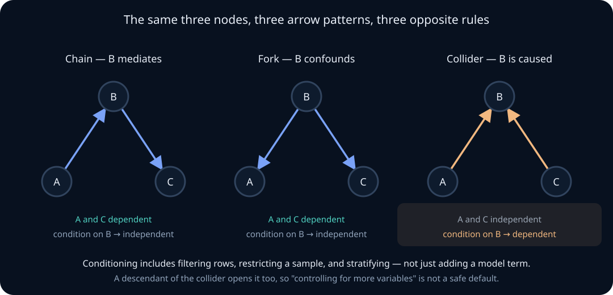
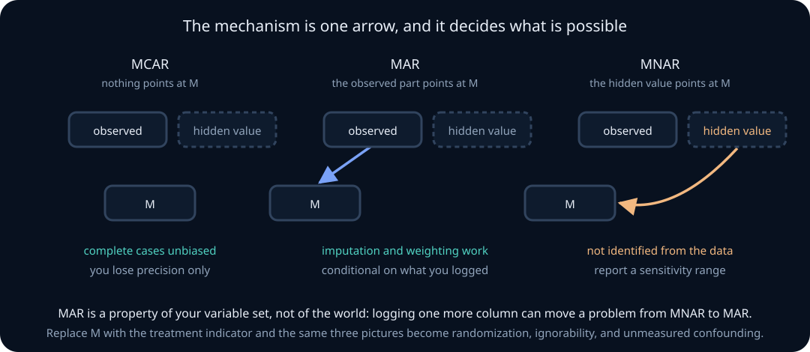

# Observational causal inference, quasi-experiments, and missing data

A randomized experiment answers a causal question by construction. Most of the data you will actually analyze was not randomized: production logs, user telemetry, historical evaluation runs, scraped corpora, human ratings collected whenever a rater happened to be available. The question you care about is still causal — *would accuracy improve if we changed the system?* — but the data was generated by a process that mixed the intervention with everything correlated with it.

This unit develops the machinery for that situation. The central discipline is a separation that no amount of estimation skill can substitute for: **identification** asks whether the causal quantity is a function of the observable distribution at all, and **estimation** asks how well you can approximate that function from a finite sample. Every technique below — graphs, backdoor adjustment, propensity weighting, doubly robust estimation, instruments, difference-in-differences — is an identification argument first and a statistical procedure second.

The unit ends with missing data, which is not an appendix. The fundamental problem of causal inference *is* a missing-data problem: for every unit you observe one potential outcome and the other is missing, and the mechanism that decided which one you see is the treatment assignment. The MCAR/MAR/MNAR taxonomy and the ignorability conditions of causal inference are the same mathematics wearing different notation.

By the end, you should be able to state a causal estimand precisely; encode assumptions in a DAG and read conditional independences off it by d-separation; apply the backdoor criterion and know when adjustment *creates* bias instead of removing it; derive standardization, inverse probability weighting, and the doubly robust estimator, and prove what each one needs; diagnose positivity failures; use instruments, difference-in-differences, and regression discontinuity, along with the assumption each one trades for; quantify sensitivity to unmeasured confounding; classify missingness as MCAR, MAR, or MNAR; and choose between complete cases, single imputation, and multiple imputation with Rubin's rules.

## Learning route: identification before estimation

Use four passes rather than reading the methods as a menu.

1. **Define the counterfactual contrast.** Name treatment versions, population, time horizon, and whether the target is ATE, ATT, or CATE.
2. **Argue identification.** Draw assignment and measurement, then state the exchangeability, consistency, positivity, exclusion, or trend assumption that turns the counterfactual into observed-data quantities.
3. **Estimate and diagnose.** Only now choose standardization, weighting, AIPW, IV, DiD, RD, or imputation. Check overlap, balance, nuisance fit, and dependence at the units relevant to the claim.
4. **Stress the untestable assumption.** Use negative controls, falsification tests, and sensitivity parameters. Sampling error around a nonidentified target is false precision.

For every problem, write an identification line before any estimator: \(\text{causal estimand}=\text{observed-data functional}\) under named assumptions.

## 0. A regression coefficient is not an effect

Lesson 11 established that a regression coefficient is a conditional comparison: with the other columns of the design matrix held fixed, \(\beta_j\) is the difference in fitted conditional mean per unit of \(x_j\). Nothing in that derivation licenses the sentence "raising \(x_j\) would raise \(Y\) by \(\beta_j\)."

The gap has a precise shape. A coefficient describes

$$
E[Y\mid X_j=x+1,X_{-j}]-E[Y\mid X_j=x,X_{-j}],
$$

a contrast between two subpopulations that *already differ* in \(X_j\). A causal claim describes

$$
E[Y\mid \operatorname{do}(X_j=x+1)]-E[Y\mid \operatorname{do}(X_j=x)],
$$

a contrast between two states of the same population under two interventions. Conditioning selects units; intervening changes them. The two coincide only under assumptions that the regression itself cannot check, because both quantities are computed from data that looks identical.

**Worked example — the retrieval-augmented system that appears to hurt.** You log 200,000 production requests. Some were served by a retrieval-augmented pipeline, some by the base model, with routing decided by a heuristic that sends hard queries to retrieval. Regressing answer quality on a retrieval indicator gives a negative coefficient. The coefficient is a correct description of the log: retrieval-served answers *were* worse. It is a useless answer to "should we route everything to retrieval," because query difficulty caused both the routing and the quality. No standard error, robustness check, or larger sample repairs this. The defect is in identification, and a tighter confidence interval only makes the wrong number look more credible.

> **Practice — Foundation:** State in one sentence the difference between conditioning on \(X=x\) and intervening to set \(X=x\).
>
> **Practice — Core:** Give a concrete pair of production variables for which a regression coefficient is a good description and a bad intervention forecast, and say which quantity each sentence refers to.
>
> **Practice — Stretch:** Construct a joint distribution over \((X,Y)\) in which the regression slope is positive but every unit's outcome would fall under an intervention that raises \(X\). Identify the structural feature that makes this possible.

## 1. Potential outcomes and the estimand you actually want

Fix a binary treatment \(T\in\{0,1\}\). For each unit \(i\), postulate two **potential outcomes**: \(Y_i(1)\), the outcome if treated, and \(Y_i(0)\), the outcome if untreated. Both are properties of the unit, defined before any assignment happens. The **individual treatment effect** is

$$
\tau_i=Y_i(1)-Y_i(0).
$$

Two assumptions are doing silent work, and they are collected under the name SUTVA. **Consistency** links potentials to observation:

$$
Y_i=T_iY_i(1)+(1-T_i)Y_i(0),
$$

which asserts that the treatment is well enough defined that "treated" means the same thing for every unit. **No interference** asserts that unit \(i\)'s outcome does not depend on unit \(j\)'s treatment, which fails in ranking systems, marketplaces, shared caches, and any setting where a model update changes user behavior that other users see.

Because \(\tau_i\) is never observed for any unit, the targets are averages. The three that matter most:

$$
\text{ATE}=E[Y(1)-Y(0)],\qquad
\text{ATT}=E[Y(1)-Y(0)\mid T=1],\qquad
\text{CATE}(x)=E[Y(1)-Y(0)\mid X=x].
$$

These are different numbers and different questions. The ATE answers "what if we treated everyone"; the ATT answers "what did treatment do for those who got it"; the CATE answers "what would it do for units like this one." Estimators are not interchangeable across them, and a method that identifies one may not identify another. Deciding which one your decision requires is the first analytic step, not a technicality.

**Worked example — three deployment questions, three estimands.** A safety filter is currently applied to 4% of traffic flagged by a classifier. "Should we keep the filter on the flagged traffic?" is an ATT question. "Should we apply it to all traffic?" is an ATE question, and it requires extrapolating to units the filter has never touched. "Which segments should get it?" is a CATE question. A single analysis that reports one number and answers all three is answering at most one of them.

> **Practice — Foundation:** Write the consistency assumption and explain what it rules out.
>
> **Practice — Core:** For a 60/40 population split where treatment helps group A by 3 and hurts group B by 1, compute the ATE and the ATT when treatment is given only to group A.
>
> **Practice — Stretch:** Describe an ML deployment in which no-interference fails, and state what estimand remains meaningful once units influence each other.

## 2. What randomization buys, and exactly what it does not

Randomized assignment makes \(T\) independent of the potential outcomes:

$$
(Y(1),Y(0))\perp T.
$$

This is why the difference in observed means identifies the ATE:

$$
E[Y\mid T=1]-E[Y\mid T=0]
=E[Y(1)\mid T=1]-E[Y(0)\mid T=0]
=E[Y(1)]-E[Y(0)].
$$

The first equality is consistency; the second is independence. Both steps are visible, and only the second requires randomization.

Note what randomization does *not* supply. It does not supply no-interference, which is a property of the system, not the assignment. It does not survive post-treatment filtering: if you analyze only sessions that completed, and treatment affects completion, the surviving groups are no longer comparable. It does not make small samples balanced — it makes imbalance *random*, which is what the inference in lessons 07 and 08 accounts for. And it does not extend to the population you did not sample from; randomization gives internal validity, sampling design gives external validity, and lesson 10's coverage discussion is the other half of any deployment claim.

Under non-random assignment, the independence above is replaced by a conditional version, **ignorability** or **unconfoundedness**:

$$
(Y(1),Y(0))\perp T\mid X.
$$

Treatment is as-if randomized within cells of \(X\). This is the assumption every adjustment method in the next twelve sections depends on, in one form or another. It is untestable from the observed data, because it constrains the joint distribution of quantities that are never jointly observed.

**Worked example — intention to treat versus the analysis you want.** In a rollout where 30% of assigned users never actually received the new model, comparing *receivers* to *non-receivers* destroys randomization, because receipt is a choice. Comparing by *assignment* preserves it and identifies the intention-to-treat effect, which is a different, smaller, and honestly identified quantity. Section 15 shows how the assignment can then be used as an instrument to recover an effect for compliers.

> **Practice — Foundation:** State ignorability and say why it cannot be tested from observed data alone.
>
> **Practice — Core:** Show the two-line derivation that a randomized difference in means equals the ATE, naming the assumption used at each step.
>
> **Practice — Stretch:** Design an A/B test that is correctly randomized but whose headline metric is still confounded, and locate the failure precisely.

## 3. Identification precedes estimation

An estimand is **identified** when it can be written as a functional of the distribution of observed variables. Identification is a property of assumptions plus the observational regime; it has nothing to do with sample size. If a quantity is not identified, an infinite sample leaves it unknown, and the appearance of a narrow confidence interval means the interval is answering a different question than you think.

The working order is therefore fixed:

1. **Estimand.** Write the causal quantity in potential-outcome notation.
2. **Identification.** Prove it equals a functional of observables, listing every assumption.
3. **Estimation.** Choose an estimator for that functional.
4. **Inference.** Quantify sampling uncertainty in the estimator.
5. **Sensitivity.** Ask how much the answer moves when step 2's assumptions are wrong.

Most applied failures happen at step 2 and are then debated at steps 3 and 4. Switching from ordinary least squares to gradient boosting, or from model-based to cluster-robust standard errors, changes steps 3 and 4 and leaves an identification failure exactly where it was.

**Worked example — the flexible-model temptation.** A team fits a large gradient-boosted model of quality on 400 logged features including a retrieval indicator, then reads the partial dependence of the retrieval feature as its effect. The model is a superb estimator of \(E[Y\mid X]\). It is not an estimator of anything causal unless the 400 features happen to satisfy a backdoor condition, and if a post-treatment feature is among them, flexibility makes the bias *worse* by fitting the mediated path more accurately.

> **Practice — Foundation:** Define identification without referring to sample size.
>
> **Practice — Core:** Give an estimand that is identified under one assumption set and not identified under a weaker one, and name the assumption that does the work.
>
> **Practice — Stretch:** Explain why increasing model capacity can increase causal bias while decreasing predictive error, using a concrete feature set.

## 4. Causal DAGs make the assumptions writable

A **causal directed acyclic graph** has one node per variable and an arrow \(A\to B\) when \(A\) is a direct cause of \(B\) relative to the variables in the graph. The graph is a compact encoding of a structural model: each variable is a function of its parents and an independent noise term,

$$
V_j=f_j(\mathrm{pa}(V_j),U_j),\qquad U_1,\dots,U_p\text{ jointly independent}.
$$

Missing arrows are the content. An arrow you draw claims only that an effect may exist; an arrow you omit claims that it does not. The omitted-arrow assumptions are the strong ones, and they are the ones the graph forces you to write down rather than leave implicit in a variable list.

Two consequences follow immediately. First, the joint distribution factorizes along the graph,

$$
p(v_1,\dots,v_p)=\prod_{j=1}^p p(v_j\mid \mathrm{pa}(v_j)),
$$

which is the Markov property for DAGs. Second, intervention has a clean graphical meaning: \(\operatorname{do}(T=t)\) deletes every arrow *into* \(T\) and fixes its value, producing the **truncated factorization**

$$
p(v\mid \operatorname{do}(T=t))=\prod_{j:V_j\neq T} p(v_j\mid \mathrm{pa}(v_j))\Big|_{T=t}.
$$

Everything downstream keeps its mechanism; only the assignment mechanism is replaced. This single formula generates the adjustment results of sections 7 and 8.

**Worked example — writing the routing graph.** For the retrieval example: query difficulty \(D\to\) routing \(T\), \(D\to\) quality \(Y\), and \(T\to Y\). Drawing it takes ten seconds and makes the problem obvious: there is a path \(T\leftarrow D\to Y\) that carries association without causation. It also makes the *fix* precise — anything that blocks that path suffices — and exposes the uncomfortable question of whether the logged difficulty score is the real \(D\) or a noisy proxy for it.

> **Practice — Foundation:** Write the Markov factorization for a four-node chain.
>
> **Practice — Core:** Draw the DAG for a logged evaluation where model version affects both latency and quality, and latency affects user retries.
>
> **Practice — Stretch:** Explain why a DAG with every possible arrow present is useless, and relate this to identification.

## 5. Chains, forks, and colliders behave differently

Three elementary three-node structures generate every reading rule. Take \(A\), \(B\), \(C\).

**Chain (mediation):** \(A\to B\to C\). Here \(A\) and \(C\) are dependent, and conditioning on \(B\) makes them independent. \(B\) transmits the association; blocking \(B\) stops it. If \(B\) is a mediator of a causal effect you want, conditioning on it removes exactly the part of the effect you were trying to measure.

**Fork (common cause):** \(A\leftarrow B\to C\). Again \(A\) and \(C\) are dependent, and conditioning on \(B\) makes them independent. This is confounding: the dependence is real but not causal, and adjustment removes it.

**Collider (common effect):** \(A\to B\leftarrow C\). Here \(A\) and \(C\) are *independent*, and conditioning on \(B\) — or on any descendant of \(B\) — makes them *dependent*. This is the structure that reverses the usual intuition, and it is the reason "control for more variables" is not a conservative default.

The collider case deserves a concrete mechanism. Suppose \(A\) and \(C\) are independent coin flips and \(B=A+C\). Knowing \(A\) says nothing about \(C\). But knowing \(B=1\) makes them perfectly anti-dependent: \(A=1\) forces \(C=0\). Selection on a common effect creates association between its causes, which is why filtered datasets acquire correlations that the unfiltered population does not have.

**Worked example — why "parses correctly" is dangerous to filter on.** Let model capability \(A\) and prompt formatting quality \(C\) be independent in your corpus, and let both raise the probability that an output parses, \(B\). If you evaluate only on parsed outputs, capability and formatting become negatively correlated inside your evaluation set: among parsed outputs, a weak model must have had good formatting. Any analysis conditioned on that filter inherits the induced dependence, and the induced sign can be opposite to the population sign.

> **Practice — Foundation:** For each of the three structures, state whether \(A\) and \(C\) are marginally dependent and whether they are dependent given \(B\).
>
> **Practice — Core:** With \(A,C\) independent Bernoulli(1/2) and \(B=A\lor C\), compute \(P(A=1\mid C=1,B=1)\) and \(P(A=1\mid B=1)\) and interpret the difference.
>
> **Practice — Stretch:** Construct an evaluation pipeline whose filtering step is a collider conditioning, and quantify the sign of the induced bias.

## 6. d-separation reads independences off the graph

A **path** is any sequence of adjacent nodes, ignoring arrow direction. A path is **blocked** by a conditioning set \(S\) when at least one of the following holds:

1. the path contains a chain \(\cdot\to B\to\cdot\) or a fork \(\cdot\leftarrow B\to\cdot\) with \(B\in S\); or
2. the path contains a collider \(\cdot\to B\leftarrow\cdot\) with \(B\notin S\) and no descendant of \(B\) in \(S\).

Sets \(A\) and \(C\) are **d-separated** by \(S\) when every path between them is blocked. The soundness theorem says d-separation implies conditional independence in every distribution compatible with the graph:

$$
A\perp_d C\mid S\ \Longrightarrow\ A\perp C\mid S.
$$

The converse holds for almost all parameterizations — the exceptions are **faithfulness** violations, where two paths cancel exactly. A canonical example: \(T\to M\to Y\) with effect \(+2\) and \(T\to Y\) with effect \(-2\) produces zero total association despite two live causal paths. Faithfulness is an assumption, and exact cancellation is not merely a measure-zero curiosity in engineered systems where a controller is actively tuned to null out an effect.

Notice the asymmetry in rule 2: colliders are blocked *by default* and opened by conditioning, including by conditioning on a descendant. A sample restriction, a dropped row, a filter, or a stratification are all conditioning operations, whether or not they appear in your model formula.

**Worked example — a descendant is enough.** In \(A\to B\leftarrow C\) with \(B\to S\), conditioning on \(S\) partially determines \(B\) and therefore opens the collider. If \(S\) is "the row survived deduplication" and \(B\) is a quality score, deduplicating on quality opens a path between everything that causes quality.

> **Practice — Foundation:** List the two blocking rules and note which one is reversed relative to the other.
>
> **Practice — Core:** In \(T\to M\to Y\), \(T\leftarrow U\to Y\), determine whether \(\{M\}\), \(\{U\}\), and \(\{M,U\}\) d-separate \(T\) from \(Y\).
>
> **Practice — Stretch:** Build a faithfulness violation with two paths of opposite sign, and explain what a conditional independence test would wrongly conclude.

## 7. Confounding and the backdoor criterion

A **backdoor path** from \(T\) to \(Y\) is a path that begins with an arrow *into* \(T\). Such a path carries association that is not causal, because it flows against the direction of assignment. A set \(S\) satisfies the **backdoor criterion** relative to \((T,Y)\) when

1. \(S\) blocks every backdoor path from \(T\) to \(Y\); and
2. \(S\) contains no descendant of \(T\).

The second clause is not decorative. Conditioning on a descendant of \(T\) either blocks part of the causal effect (if it is a mediator) or opens a collider (if it is a common effect of \(T\) and something else). Both are ways of making the answer worse by adding a variable, and both are invisible to any goodness-of-fit statistic.

When \(S\) satisfies the criterion, the backdoor adjustment formula holds:

$$
P(Y=y\mid \operatorname{do}(T=t))=\sum_{s}P(Y=y\mid T=t,S=s)\,P(S=s),
$$

and in mean form,

$$
E[Y(t)]=E_S\big[E[Y\mid T=t,S]\big].
$$

Read the formula carefully, because the two distributions over \(S\) differ deliberately: the inner expectation conditions on \(S=s\) *and* \(T=t\), while the outer average uses the *marginal* distribution of \(S\). Conditioning uses \(P(S\mid T)\); intervening uses \(P(S)\). That single substitution is the whole of adjustment.

The graphical criterion and the potential-outcome condition are the same assumption in two languages: a set satisfying the backdoor criterion yields \((Y(1),Y(0))\perp T\mid S\).

**Worked example — which variables to adjust for, and which to refuse.** In the routing graph, \(\{D\}\) satisfies the backdoor criterion. Adding response latency — caused by \(T\) — violates clause 2, because latency is a mediator of retrieval's effect; adjusting for it estimates a direct effect that no deployment decision corresponds to. Adding "user complained" — caused by both \(T\) and \(Y\) — is collider conditioning and induces bias where none existed.

> **Practice — Foundation:** Define a backdoor path and state both clauses of the criterion.
>
> **Practice — Core:** Derive the mean-form adjustment formula from the truncated factorization for a single confounder.
>
> **Practice — Stretch:** Give a graph where no observed set satisfies the backdoor criterion, yet the effect is still identified by another route.

## 8. Standardization computes the intervention you asked about

The estimation form of the backdoor formula is **standardization**, also called the g-formula. Fit or tabulate \(\hat m_t(s)=\hat E[Y\mid T=t,S=s]\), then average over the empirical marginal of \(S\):

$$
\widehat{\text{ATE}}=\frac1n\sum_{i=1}^n\big(\hat m_1(S_i)-\hat m_0(S_i)\big).
$$

Every unit contributes both a treated and an untreated prediction, including units that were never treated. That is the imputation step: standardization fills in the missing potential outcome with a model-based prediction. Its correctness rests on the outcome model being right, or at least right enough where the data is.

Two contrasts are worth holding. First, standardization is *not* the same as reading a coefficient off a regression that includes \(S\), unless the model is linear with no \(T\times S\) interaction; with interactions, the coefficient on \(T\) is an effect at the reference level of \(S\), while standardization returns the population average. Second, standardization averages over the marginal distribution of \(S\) in whatever sample you use; averaging over the treated units' distribution of \(S\) yields the ATT instead. The estimand is chosen by the outer average, not by the model.

**Worked example — a two-stratum computation.** Suppose difficulty \(S\in\{\text{easy},\text{hard}\}\) with population shares \(0.7\) and \(0.3\). Within easy queries, mean quality is \(0.90\) with retrieval and \(0.86\) without; within hard queries, \(0.62\) and \(0.55\). The crude difference can be negative if retrieval is concentrated on hard queries, but standardization gives \(0.7(0.90-0.86)+0.3(0.62-0.55)=0.028+0.021=0.049\). The effect is positive in every stratum and positive on average; the crude comparison reported the opposite sign.

> **Practice — Foundation:** Compute a standardized mean from two strata with given shares and cell means.
>
> **Practice — Core:** Show that standardizing over the treated units' covariate distribution returns the ATT, and say when ATE and ATT coincide.
>
> **Practice — Stretch:** Construct a case where a correctly specified outcome model gives a badly biased standardized estimate because of extrapolation, and connect it to section 13.

## 9. Adjustment can create bias: colliders, selection, and M-bias

The instinct that "more controls is safer" is false, and the failure modes have names.

**Collider stratification bias.** Conditioning on a common effect of \(T\) and \(Y\), or of their causes, opens a non-causal path. Restricting an analysis to sessions that reached checkout, users who stayed thirty days, or outputs that passed a filter are all instances.

**M-bias.** Consider \(T\leftarrow U_1\to Z\leftarrow U_2\to Y\) with \(U_1,U_2\) unobserved. The path through \(Z\) is blocked, because \(Z\) is a collider on it, so the unadjusted comparison is unconfounded. Adjusting for the *pretreatment* covariate \(Z\) opens the path and introduces bias. This refutes the common shortcut "adjust for everything measured before treatment": temporal priority is not sufficient.

**Berkson's paradox.** In a set selected for having at least one of two qualities, the qualities are negatively associated even when independent in the population. This is the mechanism behind "everything in our curated dataset seems to trade off against everything else."

**Overadjustment for mediators.** Conditioning on a variable on the causal path removes part of the effect you want. The resulting quantity is a controlled direct effect, which is a legitimate estimand but rarely the one a deployment decision needs.

A useful discipline: never choose adjustment sets by significance, model fit, or variance reduction. Choose them from the graph, then check their statistical behavior. Variables selected because they improve \(R^2\) can be colliders, and colliders often improve fit precisely because they are downstream of the outcome.

**Worked example — the safety-filter evaluation that reverses.** Analysts restrict to conversations the user continued after the first response. Continuation is caused by both the filter and answer quality: a collider. Within continuers, filtered conversations look worse because a user who continued despite a filtered response must have had a good response for other reasons. The measured harm is manufactured by the restriction.

> **Practice — Foundation:** Name three distinct ways that adding a covariate can increase bias.
>
> **Practice — Core:** Draw the M-bias graph and verify with d-separation that the unadjusted comparison is unconfounded and the \(Z\)-adjusted one is not.
>
> **Practice — Stretch:** Explain why automated covariate selection by predictive performance is unsafe for causal adjustment, with a graph where it selects a collider.

## 10. Simpson's paradox is a question about the graph

Simpson's paradox is the observation that an association can reverse when a population is split into subgroups. The arithmetic is not mysterious: a weighted average of stratum-specific differences need not have the sign of the pooled difference when the stratum weights differ between treatment arms.

What matters is that the arithmetic alone does not tell you which number to report. Both the pooled and the stratified analyses are correct descriptions of the data. The choice between them is a causal question:

- If \(S\) is a **confounder** (\(T\leftarrow S\to Y\)), the stratified analysis is the causally relevant one, and standardization over \(P(S)\) is correct.
- If \(S\) is a **mediator** (\(T\to S\to Y\)), the pooled analysis gives the total effect, and stratifying removes the part of the effect that flows through \(S\).
- If \(S\) is a **collider**, stratifying creates bias and the pooled analysis is the correct one.

The same table of numbers supports three different answers depending on the graph, and no amount of staring at the table distinguishes them. This is the sharpest available demonstration that identification is an assumption, not a computation.

**Worked example — the same cells, three verdicts.** Take treated-group rates \(0.90\) and \(0.62\) in strata with treated shares \(0.2/0.8\), and control rates \(0.86\) and \(0.55\) with control shares \(0.8/0.2\). The pooled treated rate is \(0.676\) and the pooled control rate is \(0.798\): treatment looks harmful. Stratum by stratum it helps. If the stratifier is pre-treatment difficulty, report the stratified effect. If it is a post-treatment property that the treatment itself changes, the pooled number is the total effect and the stratified one answers a narrower question.

> **Practice — Foundation:** Build a 2×2×2 table exhibiting a sign reversal and verify both computations.
>
> **Practice — Core:** For your table, state which causal graph makes the pooled number correct and which makes the stratified number correct.
>
> **Practice — Stretch:** Find a real evaluation report whose subgroup breakdown reverses a headline claim, and determine which analysis its decision actually requires.

## 11. Propensity scores compress the adjustment set

Define the **propensity score**

$$
e(x)=P(T=1\mid X=x).
$$

Its central property is that it is a **balancing score**:

$$
X\perp T\mid e(X).
$$

Among units sharing a propensity value, the covariate distribution is the same in both arms. The proof is short and worth owning: it suffices to show \(P(T=1\mid X,e(X))=P(T=1\mid e(X))\), and the left side is \(e(X)\) by definition while the right side is \(E[e(X)\mid e(X)]=e(X)\).

The consequence that matters for identification is that ignorability given \(X\) implies ignorability given \(e(X)\):

$$
(Y(1),Y(0))\perp T\mid X
\ \Longrightarrow\
(Y(1),Y(0))\perp T\mid e(X).
$$

A high-dimensional adjustment problem collapses to a one-dimensional one. This is a genuine reduction in the curse of dimensionality for the *adjustment* step — but only for it. The propensity score does not create ignorability; if \(X\) omits a confounder, \(e(X)\) omits it too, and the scalar summary makes the omission harder to see rather than less harmful.

Propensity scores can be used by matching, by stratification into quantile blocks, by weighting (section 12), or as an ingredient in a doubly robust estimator (section 14). Matching and stratification are intuitive and discard data; weighting uses all units and is sensitive to extreme scores.

The right diagnostic for a propensity model is not its AUC. A model that predicts treatment perfectly is a catastrophe: it means the arms do not overlap and no comparison is possible. The correct diagnostic is **covariate balance after weighting or matching** — standardized mean differences near zero for every covariate, typically checked at a threshold like 0.1.

**Worked example — the too-good propensity model.** A team reports an AUC of 0.97 for their treatment model and treats it as a success. It means that for nearly every unit, one arm is essentially empty. The subsequent weighted estimate is dominated by a handful of units with weights in the hundreds, and its effective sample size is a small fraction of the nominal one.

> **Practice — Foundation:** Prove that \(e(X)\) is a balancing score.
>
> **Practice — Core:** Show that ignorability given \(X\) implies ignorability given \(e(X)\), stating where each step uses the balancing property.
>
> **Practice — Stretch:** Explain why propensity-model discrimination is the wrong success criterion, and propose a balance-based alternative with a decision rule.

## 12. Inverse probability weighting reconstructs the intervened population

Weighting treats the observed sample as a biased sample from the population under intervention, and reweights it back — exactly the Horvitz–Thompson logic from lesson 10, with the propensity score playing the role of an inclusion probability.

The identity to derive is

$$
E\left[\frac{TY}{e(X)}\right]=E[Y(1)],
$$

which follows by iterated expectation: condition on \(X\), use consistency to replace \(Y\) with \(Y(1)\) on \(\{T=1\}\), use ignorability to separate \(T\) from \(Y(1)\) given \(X\), and cancel \(E[T\mid X]=e(X)\). Symmetrically \(E[(1-T)Y/(1-e(X))]=E[Y(0)]\), giving the **Horvitz–Thompson IPW estimator**

$$
\widehat{\text{ATE}}_{\text{HT}}
=\frac1n\sum_{i=1}^n\left(\frac{T_iY_i}{\hat e(X_i)}-\frac{(1-T_i)Y_i}{1-\hat e(X_i)}\right).
$$

This estimator is unbiased under a correct propensity model but notoriously unstable: its weights do not sum to \(n\) in any given sample, so a run with too few high-weight treated units produces an estimate that is off in a way that has nothing to do with the effect. The **Hájek** or stabilized form normalizes by the realized weights:

$$
\widehat{\text{ATE}}_{\text{H\'ajek}}
=\frac{\sum_i T_iY_i/\hat e_i}{\sum_i T_i/\hat e_i}
-\frac{\sum_i (1-T_i)Y_i/(1-\hat e_i)}{\sum_i (1-T_i)/(1-\hat e_i)}.
$$

The Hájek form is biased in finite samples and consistent, with dramatically lower variance; it is also invariant to adding a constant to \(Y\), which the Horvitz–Thompson form is not. That invariance is a good way to remember which one to reach for by default.

There is an important structural point hiding here. Weighting by the inverse probability of *being treated* and weighting by the inverse probability of *being observed* are the same estimator. Section 21 uses this to handle missing outcomes, and it is why the causal and missing-data literatures share their machinery.

**Worked example — the constant-shift test.** Add \(100\) to every outcome. The Hájek estimate is unchanged, because both normalized means shift by \(100\). The Horvitz–Thompson estimate shifts by \(100(\frac1n\sum_i T_i/\hat e_i-\frac1n\sum_i(1-T_i)/(1-\hat e_i))\), which is zero only in expectation. Running this test on your own pipeline takes one line and detects a whole class of weighting bugs.

> **Practice — Foundation:** Compute Horvitz–Thompson and Hájek ATEs for a five-unit dataset with given propensities.
>
> **Practice — Core:** Derive \(E[TY/e(X)]=E[Y(1)]\), naming consistency and ignorability at the steps that use them.
>
> **Practice — Stretch:** Prove the shift invariance of the Hájek estimator and the shift sensitivity of Horvitz–Thompson, then say what this implies about variance.

## 13. Positivity, overlap, and the weights that tell you to stop

Every adjustment method needs **positivity**:

$$
0<e(x)<1\quad\text{for all }x\text{ with positive density.}
$$

If some covariate region is never treated, no method recovers what treatment would have done there, and an estimator that returns a number anyway is extrapolating from the model rather than learning from data. Positivity failures come in two flavors: **structural**, where treatment is impossible by design (a feature not available in a region, a filter that always fires), and **practical**, where treatment is possible but rare enough that the region is represented by a handful of units.

Three diagnostics, in increasing order of usefulness:

1. **Propensity overlap plots.** Histograms of \(\hat e(X)\) by arm. Non-overlapping mass is a structural warning.
2. **Extreme weights.** Report the largest weights and the share of total weight they carry. A single unit carrying 15% of the treated weight means the estimate is a statement about that unit.
3. **Effective sample size.** The weights \(w_i\) carry their own diagnostic, defined below.

$$
\text{ESS}=\frac{\left(\sum_iw_i\right)^2}{\sum_iw_i^2}.
$$

This is the same quantity as the importance-sampling effective sample size in lesson 09, and for the same reason: weighting is importance sampling from the observed distribution to the intervened one. An ESS of 400 from 20,000 rows means your effective study is small, whatever the nominal standard error says.

The remedies all involve changing the question. **Trimming** discards units with \(\hat e\) outside \([\alpha,1-\alpha]\) and changes the estimand to an effect on the overlap population. **Weight truncation** caps weights, trading bias for variance. **Overlap weights** \(w=e(1-e)\) target a population weighted toward the region of genuine equipoise, with the best variance properties of the family. Each is defensible if reported; none is defensible if the estimand is still described as the population ATE afterwards.

**Worked example — 20,000 rows, 300 effective.** A logged comparison has 20,000 requests, but the new model was routed to a narrow slice of traffic. Propensities are below \(0.01\) for most of the population, ESS is about 300, and the nominal cluster-robust interval is \(\pm 0.004\). The honest report is an effect on the overlap population with an interval from 300 effective units, and a statement that the untreated region is not identified by this data.

> **Practice — Foundation:** Compute the effective sample size for a small weight vector and interpret it.
>
> **Practice — Core:** Distinguish structural from practical positivity violations and give the correct response to each.
>
> **Practice — Stretch:** Show that trimming changes the estimand, write the new estimand precisely, and explain when it still answers the deployment question.

## 14. Doubly robust estimation gives you two chances

Standardization needs a correct outcome model; IPW needs a correct propensity model. The **augmented IPW** estimator needs only one of the two. Define \(m_t(x)=E[Y\mid T=t,X=x]\). Then

$$
\hat\psi_1=\frac1n\sum_{i=1}^n\left(\hat m_1(X_i)+\frac{T_i\big(Y_i-\hat m_1(X_i)\big)}{\hat e(X_i)}\right),
$$

with the symmetric expression for \(\hat\psi_0\), and \(\widehat{\text{ATE}}_{\text{AIPW}}=\hat\psi_1-\hat\psi_0\). Read it as standardization plus a weighted residual correction: the first term imputes, and the second uses the observed data to correct the imputation wherever the outcome model errs on treated units.

The **double robustness** property is that \(\hat\psi_1\) is consistent for \(E[Y(1)]\) if *either* \(\hat m_1\to m_1\) *or* \(\hat e\to e\). The proof is an exercise in adding and subtracting. Writing \(m_1^\ast\) and \(e^\ast\) for the probability limits of the fitted models, the asymptotic bias is

$$
E\left[\left(\frac{e(X)}{e^\ast(X)}-1\right)\big(m_1(X)-m_1^\ast(X)\big)\right].
$$

The bias is a *product* of the two model errors. If either factor vanishes, the product vanishes, whatever the other factor does. That product structure is the whole result, and it also explains the estimator's second benefit: even when both models are somewhat wrong, the bias is second-order rather than first-order, so moderate errors in each are far less damaging than a large error in one.

Two practical consequences follow. First, AIPW pairs naturally with flexible machine-learning nuisance models, since it tolerates the slow convergence rates those models have — provided you use **cross-fitting**: split the sample, fit the nuisance models on one part, evaluate the estimating equation on the other, and swap. Without cross-fitting, overfitting the nuisance models induces a bias that the double-robustness argument does not cover. Second, AIPW inherits IPW's positivity problem: a near-zero \(\hat e\) blows up the correction term regardless of how good the outcome model is.

**Worked example — where the correction earns its keep.** Suppose the outcome model is linear but the truth is quadratic in \(X\), and the propensity model is correct. Standardization is biased by the functional-form error. AIPW's correction term averages residuals with weights that reconstruct the treated population, cancelling the misspecification to first order. If instead the propensity model is wrong but the outcome model is right, the residuals \(Y-\hat m_1\) have conditional mean zero and the correction term contributes nothing asymptotically, so the estimator reduces to standardization.

> **Practice — Foundation:** Write the AIPW estimator and identify which term is imputation and which is correction.
>
> **Practice — Core:** Verify algebraically that the correction term has mean zero when the outcome model is correct, and that the estimator reduces to IPW when the outcome model is a constant.
>
> **Practice — Stretch:** Derive the product-of-errors bias expression and explain why cross-fitting is required when nuisance models are flexible.

## 15. Instrumental variables trade confounding for a different assumption

When unmeasured confounding is unavoidable, adjustment is hopeless, and a different identification strategy is needed. An **instrument** \(Z\) is a variable satisfying three conditions:

1. **Relevance:** \(Z\) affects \(T\), that is \(\operatorname{Cov}(Z,T)\neq0\).
2. **Exclusion:** \(Z\) affects \(Y\) only through \(T\); there is no direct arrow \(Z\to Y\) and no other path.
3. **Independence:** \(Z\) is unconfounded with \(Y\) — no common cause of \(Z\) and \(Y\).

Relevance is testable. Exclusion and independence are not, and exclusion is usually the one that fails.

For binary \(Z\) with a constant treatment effect, the **Wald estimator** is

$$
\hat\tau_{\text{IV}}
=\frac{E[Y\mid Z=1]-E[Y\mid Z=0]}{E[T\mid Z=1]-E[T\mid Z=0]}
=\frac{\operatorname{Cov}(Y,Z)}{\operatorname{Cov}(T,Z)}.
$$

The numerator is the effect of the instrument on the outcome — the intention-to-treat effect when \(Z\) is random assignment — and the denominator rescales it by how much the instrument actually moved treatment. For continuous instruments and covariates, the same estimator is computed as **two-stage least squares**: regress \(T\) on \(Z\) and covariates, then regress \(Y\) on the fitted \(\hat T\) and the same covariates. The second-stage standard errors must be corrected for the first stage; naively reusing the second regression's standard errors understates uncertainty.

Without a constant effect, a fourth assumption is needed. **Monotonicity** says the instrument never pushes anyone in the opposite direction — no defiers. Under relevance, exclusion, independence, and monotonicity, the Wald estimator identifies not the ATE but the **local average treatment effect**

$$
\text{LATE}=E[Y(1)-Y(0)\mid \text{complier}],
$$

the effect among units whose treatment status the instrument changes. Compliers are not identifiable individually, and they are generally not a population anyone chose: the LATE is the effect on whoever this particular instrument happened to move. Reporting a LATE as if it were an ATE is one of the most common overclaims in applied causal work.

**Worked example — the rollout as an instrument.** A new model is assigned to 50% of users, but only 60% of assigned users update their client. Comparing updaters to non-updaters is confounded by whatever drives updating. Using assignment as the instrument, the ITT is the assignment-to-outcome difference, and the LATE divides it by the \(0.6-0.05=0.55\) compliance contrast. Exclusion here asserts that being assigned changes outcomes only through actually running the new model — plausible if assignment is invisible to users, and false if assignment also triggered a notification.

> **Practice — Foundation:** State the three core IV assumptions and say which is testable.
>
> **Practice — Core:** Compute a Wald estimate from a 2×2×2 table of assignment, uptake, and outcome, and identify the ITT within it.
>
> **Practice — Stretch:** Give a rollout in which exclusion fails, describe the resulting bias direction, and propose a design change that restores it.

## 16. Weak instruments fail in a way that hides itself

The Wald estimator divides by a first-stage contrast. When that denominator is small relative to its own sampling noise, the ratio behaves badly in ways that are not captured by its reported standard error.

Three facts to carry:

- **Bias toward OLS.** The finite-sample bias of two-stage least squares is approximately \(\text{bias}_{\text{OLS}}/F\), where \(F\) is the first-stage \(F\)-statistic. A weak instrument does not give you a noisy unbiased answer; it gives you the confounded answer you were trying to escape.
- **Non-normal distribution.** With a weak first stage, the estimator's sampling distribution is skewed and heavy-tailed, and conventional intervals undercover badly. The ratio of two noisy normals has no moments in the limit of an uninformative denominator.
- **Diagnostics.** The traditional rule of thumb was a first-stage \(F\) above 10. This is now known to be far too permissive for inference; screening on \(F\) also induces a selection effect, since conditioning on a large observed \(F\) is conditioning on a collider. Report the first stage, use identification-robust intervals such as Anderson–Rubin when the instrument is marginal, and treat a weak first stage as a reason not to publish a point estimate.

**Worked example — the 3% compliance instrument.** An instrument moves uptake from 2% to 5%. The denominator is \(0.03\), so any error in the numerator is multiplied by roughly 33. A numerator standard error of \(0.002\) becomes an effect standard error of \(0.067\) — but only if the denominator were known. It is estimated, so the true sampling distribution has a much heavier tail than the delta-method interval suggests.

> **Practice — Foundation:** Explain why dividing by a small estimated denominator inflates uncertainty non-linearly.
>
> **Practice — Core:** Simulate a weak instrument and compare the empirical coverage of the delta-method interval with its nominal level.
>
> **Practice — Stretch:** Explain why selecting analyses on a large first-stage \(F\) is itself a collider conditioning, and propose a pre-registration protocol that avoids it.

## 17. Difference-in-differences removes what is constant over time

When treatment arrives at a point in time for some units and not others, the pre-period provides a way to remove time-invariant confounding. With two groups and two periods, the estimator is

$$
\widehat{\text{DiD}}
=\big(\bar Y_{\text{treat},\text{post}}-\bar Y_{\text{treat},\text{pre}}\big)
-\big(\bar Y_{\text{ctrl},\text{post}}-\bar Y_{\text{ctrl},\text{pre}}\big).
$$

The first difference removes anything fixed about the treated group; the second removes anything common to both groups over time. What remains is identified under **parallel trends**:

$$
E[Y_{\text{post}}(0)-Y_{\text{pre}}(0)\mid \text{treated}]
=E[Y_{\text{post}}(0)-Y_{\text{pre}}(0)\mid \text{control}],
$$

the assumption that *in the absence of treatment* both groups would have moved together. Levels may differ arbitrarily. Note what the assumption is not: it is not an assumption about the observed post-period, and it is not verified by the pre-period trends matching, though divergent pre-trends do falsify it. It is also scale-dependent — parallel trends in levels and in logs are different assumptions, and a transformation can create or destroy it.

The regression form is the two-way fixed effects model

$$
Y_{it}=\alpha_i+\gamma_t+\tau\,\text{Treated}_{it}+\varepsilon_{it},
$$

which reproduces the 2×2 estimator in the two-period, two-group case. In the general **staggered adoption** case — units switching on at different times, which is the usual shape of a phased rollout — this is a trap. The two-way fixed effects coefficient is a weighted average of all possible 2×2 comparisons, and some of those comparisons use already-treated units as controls for later-treated units. When effects change over time, those weights can be negative, and \(\hat\tau\) can have the opposite sign from every unit-level effect in the data. Use an estimator built for staggered timing — group-time average treatment effects aggregated explicitly, or an event-study specification with never-treated or not-yet-treated controls.

Standard errors need the clustering discussion from lesson 11: serial correlation within units makes naive standard errors far too small, and clustering at the unit level with too few clusters brings its own finite-sample problems.

**Worked example — the regional rollout.** A latency optimization ships to region A in March and region B in June. A two-way fixed effects regression over January–September uses B as a control for A in the spring, which is fine, and A as a control for B in the summer, which is not: A is already treated, so its post-period level embeds the treatment effect, and if that effect grows over time the comparison is contaminated with a negative weight.

> **Practice — Foundation:** Compute a 2×2 difference-in-differences from four cell means and state the identifying assumption.
>
> **Practice — Core:** Show that the two-way fixed effects coefficient equals the 2×2 estimator in the two-group, two-period case.
>
> **Practice — Stretch:** Construct a staggered rollout with growing treatment effects where two-way fixed effects returns a negative estimate although every unit's effect is positive.

## 18. Discontinuities and other quasi-experiments

When treatment is assigned by a threshold rule on a running variable \(R\) — a score above a cutoff \(c\) triggers review, a usage level above a limit triggers throttling — the **regression discontinuity** design identifies a local effect. The identifying assumption is that the potential outcome means \(E[Y(0)\mid R=r]\) and \(E[Y(1)\mid R=r]\) are continuous at \(c\), so that any jump in observed outcomes at the cutoff must come from the treatment:

$$
\tau_{\text{RD}}=\lim_{r\downarrow c}E[Y\mid R=r]-\lim_{r\uparrow c}E[Y\mid R=r].
$$

This is an ATE at \(R=c\) and nowhere else, which is honest and often narrow. The practical concerns are bandwidth choice, which trades bias against variance exactly as in kernel smoothing; the use of local linear rather than high-order global polynomial fits, since global polynomials produce artifacts at the boundary; and **manipulation** of the running variable, which destroys the design and is detectable as a density discontinuity at the cutoff.

Two related designs are worth knowing by name. **Fuzzy RD** applies when crossing the threshold changes the probability of treatment rather than determining it, and is estimated as IV with the threshold indicator as the instrument. **Synthetic control** constructs a weighted combination of untreated units that matches the treated unit's pre-period trajectory, and is the natural tool when there is one treated unit and many candidate controls.

**Worked example — the throttling threshold.** Requests above 1,000 per minute get throttled. Comparing throttled to unthrottled customers is hopeless, since volume causes everything. Comparing customers just above to just below 1,000 is a clean local comparison — unless customers can see the limit and shape traffic to stay below it, in which case the units just below are a self-selected group and the density of \(R\) jumps at the cutoff. Plot that density before anything else.

> **Practice — Foundation:** State the RD continuity assumption and the estimand it identifies.
>
> **Practice — Core:** Explain why a high-order global polynomial is a poor choice at the boundary and what replaces it.
>
> **Practice — Stretch:** Design a manipulation test for a threshold rule in a production system, and say what you would conclude from each outcome.

## 19. Sensitivity analysis prices the assumption you cannot test

Every adjustment result rests on "no unmeasured confounding," which cannot be verified. The productive response is not to assert it but to quantify how strong an unmeasured confounder would have to be to overturn the conclusion.

For a risk-ratio estimate, the **E-value** is the minimum strength of association — on the risk-ratio scale, with both the treatment and the outcome — that an unmeasured confounder would need in order to explain away the observed effect:

$$
\text{E-value}=\text{RR}+\sqrt{\text{RR}(\text{RR}-1)}\qquad(\text{RR}\ge1).
$$

An observed risk ratio of 1.5 has an E-value of about 2.37: a confounder would need to be associated with both treatment and outcome by a factor of at least 2.37 to account for the finding. Applying the same formula to the confidence limit rather than the point estimate gives the strength needed to move the interval across the null.

The interpretive step is comparative, not absolute. An E-value of 2.37 is reassuring if the strongest measured confounder in your data has a risk ratio of 1.2, and worthless if one has a risk ratio of 4. Sensitivity analysis is only as good as the benchmark you compare it against, and benchmarking against observed covariates is the standard practice.

For matched designs, **Rosenbaum bounds** parameterize how much two matched units may differ in their odds of treatment, by a factor \(\Gamma\), and report the largest \(\Gamma\) at which the conclusion survives. For weighted and doubly robust estimators, modern sensitivity frameworks bound the bias in terms of how much residual variation in treatment and outcome an omitted confounder could explain, which maps naturally onto the partial-\(R^2\) quantities an analyst can reason about.

**Worked example — a defensible observational claim.** A logged comparison estimates a 4% quality improvement with a 95% interval excluding zero. The report states the adjustment set, shows post-weighting balance below 0.1 for every covariate, reports an ESS of 6,200 from 40,000 rows, and states that a confounder would need associations of at least 1.9 with both treatment and outcome to nullify the effect, against a strongest measured covariate association of 1.3. That is a claim a reviewer can argue with on its merits, which is the goal.

> **Practice — Foundation:** Compute the E-value for a risk ratio of 2.0 and interpret it in a sentence.
>
> **Practice — Core:** Explain why an E-value must be benchmarked against measured covariates rather than read on an absolute scale.
>
> **Practice — Stretch:** Design a sensitivity analysis for a weighted estimate where the suspected confounder is a variable you deliberately excluded, and state what evidence would change your conclusion.

## 20. Missing data has a mechanism, and the mechanism is the whole problem

Let \(Y\) denote the complete data, partitioned into observed and missing parts \(Y_{\text{obs}}\) and \(Y_{\text{mis}}\), and let \(M\) be the missingness indicator matrix. The **mechanism** is the distribution \(P(M\mid Y,\phi)\). Rubin's taxonomy classifies it by what the mechanism is allowed to depend on.

**MCAR — missing completely at random.**

$$
P(M\mid Y_{\text{obs}},Y_{\text{mis}},\phi)=P(M\mid\phi).
$$

Missingness is unrelated to anything in the data. The observed rows are a random subsample of the complete rows, so complete-case analysis is unbiased for everything, and loses only precision. MCAR is rare and is the only one of the three with a partially testable implication: observed covariate distributions should not differ between rows with and without a missing field.

**MAR — missing at random.**

$$
P(M\mid Y_{\text{obs}},Y_{\text{mis}},\phi)=P(M\mid Y_{\text{obs}},\phi).
$$

Missingness depends only on what you *observed*. This is the workhorse assumption: it justifies likelihood-based inference and multiple imputation, and it is where the "at random" name misleads people. MAR does not mean missingness is random; it means it is random *conditional on the observed data*, which is a statement about your variable set, not about nature. Adding a variable that predicts missingness can convert an MNAR problem into a MAR one, which is the practical reason to log the auxiliary variables you will later need.

**MNAR — missing not at random.** Neither condition holds: missingness depends on the unobserved values themselves. Nothing in the observed data identifies the missing distribution, so analysis requires an explicit model of the mechanism — a selection model factorizing \(P(Y)P(M\mid Y)\), or a pattern-mixture model factorizing \(P(Y\mid M)P(M)\) — and the conclusions depend on untestable parameters of that model. The honest MNAR analysis is a sensitivity analysis across a range of assumed mechanisms.

For likelihood and Bayesian inference, the useful theorem is that the mechanism is **ignorable** when MAR holds *and* the parameters of the mechanism are distinct from the parameters of interest. Under ignorability you may maximize the observed-data likelihood without modeling \(M\) at all. Note that ignorability is a statement about likelihood-based inference; it does not license complete-case analysis, which is a different procedure.

**Worked example — three reasons a rating is missing.** Raters skip items when a scheduler drops them at random (MCAR); when the item is in a language the rater pool underserves, and language is logged (MAR); when the item is so ambiguous that raters abandon it, and ambiguity is exactly what you were trying to measure (MNAR). Identical missingness rates, three different correct analyses, and only the third has no unbiased solution from this data.

> **Practice — Foundation:** State the three mechanisms in conditional-probability notation.
>
> **Practice — Core:** For a survey where high earners decline to report income, classify the mechanism with and without an occupation variable in the dataset.
>
> **Practice — Stretch:** Explain why MAR is a property of the dataset rather than of the world, and give a logging change that converts a specific MNAR problem to MAR.

## 21. Complete cases and single imputation: what each one breaks

**Complete-case analysis** discards any row with a missing field. It is unbiased under MCAR. It is also valid in a case that is more useful than it first appears: for a regression of \(Y\) on \(X\), complete-case analysis is consistent whenever missingness is independent of \(Y\) given \(X\), which permits missingness to depend on \(X\) in arbitrary ways — even strongly, even non-monotonically. Conditioning on \(X\) is already part of the estimator, so selection on \(X\) does not bias the conditional model. Selection on the outcome does. This is the same asymmetry as collider bias, and for the same reason.

The cost is precision, and it is severe when missingness is scattered: with 10 columns each missing 5% independently, about 40% of rows are lost.

**Single imputation** fills one value per hole and then analyzes the completed table as if it were real. Four variants, in increasing order of respectability:

- **Mean imputation** replaces missing values with the column mean. It preserves the mean, shrinks the variance toward zero, and attenuates every correlation involving the column. It is essentially always wrong and remains common.
- **Last observation carried forward** assumes the value did not change, which is a strong causal claim usually made by accident.
- **Regression imputation** predicts the missing value from the other columns. It preserves means and improves on mean imputation, but because the predicted values are noiseless, imputed points lie exactly on the fitted surface, which inflates correlations and shrinks residual variance.
- **Stochastic regression imputation** adds a draw of residual noise to the prediction. This restores the variance and is the conceptual bridge to multiple imputation.

The defect shared by all four is not bias but **false confidence**: after imputation, the analysis treats imputed values as observed, so standard errors reflect a sample size you do not have. That defect is what section 22 exists to fix.

The **missing-indicator method** — impute a constant and add a binary flag — deserves separate treatment because its status differs by purpose. For pure prediction where the same missingness pattern will occur at inference time, it is often fine and sometimes optimal, since missingness itself carries signal. For causal adjustment it is biased in general, because the indicator conditions on a variable that may be a collider and the constant destroys the covariate's adjustment role.

**Worked example — the attenuated correlation.** Two columns with population correlation \(0.6\) are 30% missing on the second, MCAR. Mean-imputing the second column leaves the covariance roughly proportional to the 70% observed pairs while the imputed variance is only 70% of the truth; the computed correlation drops to roughly \(0.6\sqrt{0.7}\approx0.50\). Nothing in the output flags this, and a downstream feature-selection step will rank the column lower than it deserves.

> **Practice — Foundation:** State the condition under which complete-case regression is consistent even when missingness depends on the covariates.
>
> **Practice — Core:** Show that mean imputation attenuates a correlation and derive the approximate attenuation factor under MCAR.
>
> **Practice — Stretch:** Explain when the missing-indicator method is acceptable for prediction but not for causal adjustment, using a graph to locate the failure.

## 22. Multiple imputation and Rubin's rules

Multiple imputation restores the uncertainty that single imputation throws away. The procedure has three stages.

**Impute.** Draw \(m\) completed datasets from the posterior predictive distribution of the missing values given the observed ones, \(P(Y_{\text{mis}}\mid Y_{\text{obs}})\). In practice this is done either by a joint model or, far more commonly, by **chained equations**: cycle through columns, imputing each from a regression on all the others, repeating until the draws stabilize.

**Analyze.** Run the complete-data analysis separately on each dataset, obtaining estimates \(\hat Q_1,\dots,\hat Q_m\) and variances \(U_1,\dots,U_m\).

**Pool.** Combine with **Rubin's rules**. The pooled estimate is the average,

$$
\bar Q=\frac1m\sum_{k=1}^m\hat Q_k,
$$

and the total variance separates within-imputation from between-imputation uncertainty,

$$
\bar U=\frac1m\sum_{k=1}^m U_k,\qquad
B=\frac1{m-1}\sum_{k=1}^m(\hat Q_k-\bar Q)^2,\qquad
T=\bar U+\left(1+\frac1m\right)B.
$$

\(\bar U\) is the uncertainty you would have had with complete data; \(B\) is the extra uncertainty caused by not knowing the missing values; the \(1+1/m\) factor corrects for using finitely many imputations. Inference uses a \(t\) reference distribution with the Barnard–Rubin degrees of freedom, which reduce to \((m-1)(1+\bar U/((1+1/m)B))^2\) in the large-sample case. The **fraction of missing information**, roughly \((1+1/m)B/T\), is the diagnostic worth reporting: it says how much of your final uncertainty comes from missingness rather than sampling.

Two conditions are easy to violate. The imputation model must be at least as rich as the analysis model — if the analysis includes an interaction or a nonlinear term, the imputation model must too, or the imputations will be drawn from a distribution in which that structure is absent and the analysis will find it attenuated. This requirement is called **congeniality**. And the outcome variable must be included in the imputation model, which surprises people: excluding \(Y\) to avoid "circularity" biases every association with \(Y\) toward zero.

**Worked example — how many imputations.** With a fraction of missing information around 0.3, \(m=5\) was the classical recommendation and gives a noticeably unstable standard error. Because the penalty term scales as \(1+1/m\), and because reproducibility across reruns matters more than the efficiency argument alone suggests, \(m=20\) to \(50\) is the defensible modern default. Report \(m\), the imputation model, and the fraction of missing information, or the analysis is not reproducible.

> **Practice — Foundation:** Compute \(\bar Q\) and \(T\) from five estimates and variances.
>
> **Practice — Core:** Explain each term in \(T=\bar U+(1+1/m)B\) and say which one single imputation omits.
>
> **Practice — Stretch:** Construct an uncongenial imputation model that biases an interaction toward zero, and verify the direction by simulation.

## 23. The two problems are one problem

The unification is exact, and it is the most useful thing in this unit.

Causal inference is missing data: for each unit, \(Y(T_i)\) is observed and \(Y(1-T_i)\) is missing. The assignment mechanism \(P(T\mid X,Y(1),Y(0))\) *is* the missingness mechanism. Under this dictionary:

| Causal inference | Missing data |
|---|---|
| Randomized assignment | MCAR |
| Ignorability given \(X\) | MAR given \(X\) |
| Unmeasured confounding | MNAR |
| Positivity \(0<e(x)<1\) | Every pattern has positive probability |
| Propensity score \(e(x)\) | Response propensity |
| IPW | Inverse probability of response weighting |
| Standardization / g-formula | Regression imputation of the missing arm |
| Doubly robust AIPW | Imputation plus weighted residual correction |

Reading the table in both directions pays. The g-formula is regression imputation of the unobserved potential outcome, which is why its failure mode is extrapolation. IPW for treatment and IPW for response are the same estimator, which is why the ESS diagnostic from section 13 is also the right diagnostic for a reweighted survey. And multiple imputation applied to the missing potential outcome is a legitimate causal estimator, sometimes a very good one, because it propagates the uncertainty that a single standardization pass hides.

Two cautions travel with the dictionary. First, positivity has a missing-data analogue that is frequently violated silently: a covariate pattern for which *every* row is missing the outcome contributes nothing, and no imputation model can tell you so. Second, in real pipelines both problems occur at once — confounded assignment *and* missing outcomes — and the weights multiply. The combined estimator weights by \(1/(e(X)\cdot r(X))\) where \(r\) is the probability of observing the outcome, and both factors must satisfy positivity.

**Worked example — the evaluation with missing labels.** You compare two models on logged traffic where routing was confounded and only 40% of responses received a human rating, with raters more likely to rate long responses. Two mechanisms are at work: assignment and rating. Handle them together — weight by the product of the inverse propensity and the inverse rating probability, or impute the missing ratings under a MAR model that includes routing and length — and diagnose positivity for both. Treating either mechanism alone leaves a bias the other one causes.

> **Practice — Foundation:** Fill in the missing-data analogue for each causal concept in the table from memory.
>
> **Practice — Core:** Express the fundamental problem of causal inference as a missingness pattern and identify which mechanism randomization produces.
>
> **Practice — Stretch:** Write the combined estimator for confounded assignment with missing outcomes and state the positivity conditions it requires.

## 24. A disciplined causal workflow for AI research

The steps below are ordered so that each one can fail loudly before the next one wastes effort.

1. **Write the decision.** Name the intervention, the population, and the outcome. If you cannot write the intervention as something a person could do, there is no causal question yet.
2. **Write the estimand.** ATE, ATT, or CATE, in potential-outcome notation, over a stated population.
3. **Draw the graph.** Include unobserved variables. The arrows you omit are the assumptions you are making.
4. **Find an identification strategy.** Backdoor adjustment if a sufficient set is observed; instrument, difference-in-differences, or discontinuity if not; and if none applies, say so and stop rather than estimating anyway.
5. **Check positivity before estimating.** Overlap plots, extreme weights, effective sample size. Redefine the estimand explicitly if you trim.
6. **Estimate with two chances.** Doubly robust with cross-fitting where possible; report the standardization and IPW estimates alongside it, since large disagreement between them is a misspecification signal.
7. **Get the uncertainty right.** Bootstrap the whole pipeline including nuisance fitting, or use influence-function standard errors. Cluster by the unit of dependence, per lesson 11.
8. **Handle missingness explicitly.** Classify the mechanism, choose complete cases or multiple imputation on that basis, and report the fraction of missing information.
9. **Quantify sensitivity.** E-value or an equivalent, benchmarked against measured covariates.
10. **State what would falsify it.** Negative controls, pre-trend tests, placebo outcomes, and refutation checks such as adding a random common cause or replacing the treatment with a random variable and confirming the effect vanishes.

Three AI-specific traps close the list. **Post-treatment filtering** — dropping failed generations, truncated responses, or non-parsing outputs — is collider conditioning on the largest scale, and it is embedded in most evaluation harnesses. **Feedback loops** violate no-interference and stationarity at once, because a deployed model changes the data that trains its successor. And **evaluation on a distribution shaped by the previous model** means the population in your estimand has already been altered by the thing you are evaluating.

**Worked example — a complete observational study.** Question: should the retrieval pipeline serve all traffic? Estimand: ATE on next month's traffic distribution. Graph: difficulty confounds routing and quality; latency is a mediator and is excluded from the adjustment set. Strategy: backdoor on logged difficulty features and time-of-day. Positivity: 4% of traffic has \(\hat e<0.02\); trim and report the effect on the overlap population. Estimation: cross-fit AIPW, with standardization and Hájek IPW alongside. Uncertainty: cluster-bootstrap by user. Missingness: 12% of quality ratings absent, MAR given length and difficulty, multiple imputation with \(m=30\) and a reported fraction of missing information of 0.18. Sensitivity: E-value 2.1 against a strongest measured confounder association of 1.4. Falsification: a placebo outcome unaffected by retrieval shows no effect.

> **Practice — Foundation:** List the workflow steps in order and name the failure each one catches.
>
> **Practice — Core:** Apply steps 1 through 4 to a logged comparison of two prompting strategies and state where identification fails or holds.
>
> **Practice — Stretch:** Audit a published evaluation for post-treatment filtering, determine the sign of the induced bias, and propose a design that avoids it.

## 25. Runnable labs

This chapter has three coding exercises. Each opens as a separate tab in the lesson's right-hand Python workspace.

### Lab A — backdoor adjustment and Simpson reversal

Implement **backdoor_adjustment** in [labs/exercises.py](../../labs/exercises.py). Given strata, each described by a treated count and mean and a control count and mean, return:

1. the crude difference in pooled arm means;
2. the standardized difference \(\sum_s\frac{n_s}{N}(\bar y_{1s}-\bar y_{0s})\), where \(n_s\) is the total stratum size.

Run:

~~~text
python -m labs.checks backdoor
~~~

The checks cover balanced strata where the two answers agree, a full Simpson sign reversal, single strata, weighting by total rather than treated size, input preservation, and invalid or empty-arm strata.

### Lab B — inverse probability weighting and effective sample size

Implement **ipw_ate** in [labs/exercises.py](../../labs/exercises.py). Given binary treatments, outcomes, and propensity scores, return the Horvitz–Thompson ATE, the Hájek ATE, and the effective sample size of the combined weights \(w_i=T_i/e_i+(1-T_i)/(1-e_i)\).

Run:

~~~text
python -m labs.checks ipw
~~~

The checks cover constant propensities where both estimators reduce to a difference in means, the shift-invariance test from section 12, a confounded example where weighting recovers the true effect, effective sample size against equal weights, generators, input preservation, and propensities at or outside the open unit interval.

### Lab C — the Wald instrumental-variable estimator

Implement **wald_iv_estimate** in [labs/exercises.py](../../labs/exercises.py). Given a binary instrument, binary treatment uptake, and outcomes, return the intention-to-treat effect, the first-stage compliance contrast, and their ratio, the local average treatment effect.

Run:

~~~text
python -m labs.checks iv-wald
~~~

The checks cover perfect compliance where the ratio reduces to the intention-to-treat effect, partial compliance, a weak first stage, input preservation, empty instrument arms, and a zero first stage that must be rejected rather than divided by.

### Guided experiment

1. Simulate the routing example: difficulty drives both assignment and outcome, then compare the crude difference, standardized estimate, and true ATE.
2. Add a collider to the same simulation and confirm that adjusting for it moves the estimate away from the truth.
3. Build the M-bias graph and verify numerically that adjusting for the pre-treatment covariate introduces bias.
4. Fit a propensity model, plot overlap, and track effective sample size as you make assignment more deterministic.
5. Compare Horvitz–Thompson and Hájek estimates across 1,000 simulated datasets and compare their variances and shift behavior.
6. Misspecify the outcome model, then the propensity model, and confirm that AIPW survives each failure separately and not both together.
7. Simulate an instrument whose strength you control, and plot the bias and interval coverage of the Wald estimator against the first-stage \(F\).
8. Build a staggered rollout with growing effects and show that two-way fixed effects returns the wrong sign.
9. Delete outcomes under MCAR, MAR, and MNAR mechanisms in turn, and compare complete cases, mean imputation, and multiple imputation against the complete-data answer.
10. Verify Rubin's rules by comparing the pooled variance to the empirical variance of the estimate across repeated complete datasets.

## 26. Derivations to own

1. Derive the difference-in-means identification of the ATE under randomization, naming consistency and independence separately.
2. Derive the truncated factorization from the structural model and use it to obtain the backdoor adjustment formula.
3. Prove the three d-separation rules on the elementary chain, fork, and collider.
4. Show algebraically that conditioning on \(B=A+C\) makes independent \(A\) and \(C\) dependent.
5. Prove that the propensity score is a balancing score.
6. Prove that ignorability given \(X\) implies ignorability given \(e(X)\).
7. Derive \(E[TY/e(X)]=E[Y(1)]\) by iterated expectation.
8. Prove the shift invariance of the Hájek estimator.
9. Derive the doubly robust estimator's product-of-errors bias and read off both consistency cases.
10. Derive the Wald estimator as a ratio of covariances and as a ratio of arm differences.
11. Derive the LATE interpretation under monotonicity by decomposing the population into compliers, always-takers, and never-takers.
12. Show that the two-way fixed effects coefficient equals the 2×2 difference-in-differences estimator in the two-period, two-group case.
13. State the parallel-trends assumption formally and show which quantity it makes counterfactual.
14. Derive the condition under which complete-case regression is consistent despite covariate-dependent missingness.
15. Derive the attenuation of a correlation under mean imputation.
16. Derive Rubin's total-variance rule and interpret each of its three factors.

## 27. End-of-unit practice (graded)

**Foundation — problems 1–7.** Read graphs and compute direct causal quantities.

1. **Estimands.** A new router can be deployed to all users, and \(Y(1),Y(0)\) are next-week resolution indicators. Write ATE, ATT, and \(\operatorname{CATE}(x)\), then match them to: “effect for all eligible users,” “effect for users already routed,” and “effect for enterprise users with covariates \(X=x\).”
2. **Structures.** For the path \(A-B-C\), classify \(A\to B\to C\), \(A\leftarrow B\leftarrow C\), \(A\leftarrow B\to C\), and \(A\to B\leftarrow C\). State whether \(A\perp C\) marginally and conditional on \(B\) in each.
3. **d-separation.** In the DAG \(C\to T,C\to Y,T\to M,M\to Y,T\to S,Y\to S\), decide whether each path from \(T\) to \(Y\) is open given \(\varnothing\), \(\{C\}\), and \(\{C,M\}\). Then explain what conditioning on selection node \(S\) opens.
4. **Backdoor sets.** Add \(Z\to T,Z\to Y\) to the DAG in problem 3. Evaluate candidate sets \(\varnothing,\{C\},\{Z\},\{C,Z\},\{C,Z,M\},\{C,Z,S\}\) for the total effect of \(T\) on \(Y\), rejecting each invalid set by a named open path or descendant.
5. **Standardization.** In low-risk users, treated outcomes are 16/20 and controls 56/80; in high-risk users, treated outcomes are 32/80 and controls 6/20. Each stratum contains 100 users. Compute stratum effects, the standardized ATE, and the crude treated-minus-control difference; explain the sign reversal.
6. **Weights.** For \(A=(1,1,1,1,1,0,0,0,0,0)\), observed \(Y=(8,7,6,5,4,3,2,2,1,0)\), and propensities \(e=(.8,.7,.6,.4,.2,.8,.6,.5,.3,.2)\), compute the Horvitz–Thompson and Hájek ATE estimates and \((\sum w_i)^2/\sum w_i^2\), where \(w_i=A_i/e_i+(1-A_i)/(1-e_i)\).
7. **Mechanisms.** Classify as MCAR, MAR given recorded variables, or MNAR: a random logging outage; response depending on recorded country; low ratings being less likely to be submitted; lab values ordered from recorded age and diagnosis; timeouts missing because latency exceeded an unrecorded threshold; and a random 10% audit sample. State the conditioning set or missing value driving each call.

**Core — problems 8–16.** Connect identification, estimation, and diagnostics.

8. **Simpson.** Construct a table with a full sign reversal and give the three graphs under which the pooled, stratified, and neither answer is correct.
9. **Collider damage.** Simulate an evaluation filter that conditions on a common effect and measure the sign and size of the induced bias.
10. **M-bias.** Verify numerically that adjusting for a pre-treatment covariate can introduce bias, and locate the open path.
11. **Balance.** Fit a propensity model, weight, and report standardized mean differences before and after; decide whether to proceed.
12. **Positivity.** Increase assignment determinism and track effective sample size, extreme weights, and interval width together.
13. **Doubly robust.** Misspecify each nuisance model in turn and confirm that AIPW remains consistent in both single-failure cases.
14. **Cross-fitting.** Show empirically that flexible nuisance models without sample splitting bias the AIPW estimate, and that cross-fitting removes it.
15. **Instruments.** Estimate ITT, first stage, and LATE for a partial-compliance rollout, and state the population the LATE describes.
16. **Multiple imputation.** Implement chained-equation imputation for one missing column and verify Rubin's rules against a simulation of the complete-data sampling distribution.

**Stretch — problems 17–24.** Analyze research-scale designs and assumption failures.

17. **Unidentified estimand.** Build a graph where no observed set satisfies the backdoor criterion, prove non-identification, and find a second route that identifies it.
18. **Weak instrument.** Simulate declining instrument strength and plot bias against \(1/F\); then show that screening on a large observed \(F\) is itself a collider conditioning.
19. **Staggered adoption.** Construct a rollout with heterogeneous, growing effects where two-way fixed effects returns a negative estimate although every unit effect is positive, and fix it with a group-time estimator.
20. **Parallel trends on a scale.** Find a dataset where parallel trends holds in logs and fails in levels, and decide which scale the decision requires.
21. **Sensitivity.** Compute an E-value for an observational claim, benchmark it against measured covariates, and state the confounder that would overturn it.
22. **Two mechanisms.** Combine confounded assignment with MAR-missing outcomes, derive the product-weighted estimator, and verify positivity for both factors.
23. **MNAR sensitivity.** Build a pattern-mixture model for outcome-dependent missingness, sweep its untestable parameter, and report the range of conclusions.
24. **Complete observational study.** Take one real logged comparison through all ten workflow steps, including a falsification test, and write the paragraph a reviewer would need in order to disagree with you on the merits.

Worked solution sketches

1. \(\operatorname{ATE}=E[Y(1)-Y(0)]\) targets all eligible users, \(\operatorname{ATT}=E[Y(1)-Y(0)\mid A=1]\) targets already-routed users, and \(\operatorname{CATE}(x)=E[Y(1)-Y(0)\mid X=x]\) targets the named enterprise covariate cell. The estimand is fixed by the population in the question, not by the available estimator.
2. Chains and forks are marginally dependent and conditionally independent; colliders are the reverse. The reversal is what makes covariate selection unsafe.
3. Apply the two blocking rules path by path, and remember that a descendant of a collider counts as conditioning on it.
4. A valid set blocks every backdoor path and contains no descendant of the treatment. Reject sets by naming the specific open path or the specific descendant.
5. Both stratum effects equal \(0.1\), so equal population weights give standardized ATE \(0.1\). Pooled treated risk is \(48/100=0.48\), while pooled control risk is \(62/100=0.62\), giving crude difference \(-0.14\). Treatment is concentrated in the high-risk stratum, creating the reversal.
6. Treated weighted outcome sum is 62.5 and control sum is about 25.429, so the Horvitz–Thompson ATE is \((62.5-25.429)/10\approx3.707\). Weight sums are 11.845 and 12.179, giving Hájek difference \(62.5/11.845-25.429/12.179\approx3.188\). The combined weight ESS is about 7.546, below 10 because propensities are uneven.
7. Random outage and random audit are MCAR. Country-dependent response and ordering by recorded age/diagnosis are MAR conditional on those recorded variables. Rating-dependent submission and threshold-caused missing timeout values are MNAR unless the rating or threshold-driving quantity is observed. Adding the relevant driver can change an MNAR description to MAR.
8. The arithmetic is a weighted-average reversal. The graph decides: confounder favors stratified, mediator favors pooled, collider favors pooled.
9. Filtering on a common effect of treatment and outcome induces negative association among its causes within the selected set; measure it against the unfiltered truth.
10. In \(T\leftarrow U_1\to Z\leftarrow U_2\to Y\), conditioning on \(Z\) opens the path through the two unobserved causes. Temporal priority does not protect you.
11. Report standardized mean differences per covariate; a threshold near 0.1 is conventional. Discrimination of the propensity model is the wrong criterion.
12. As assignment becomes deterministic, propensities approach the boundary, a few weights dominate, and effective sample size collapses while the nominal interval narrows.
13. With the outcome model correct, the correction term has conditional mean zero; with the propensity correct, the weighted residuals recover the treated mean. Each case kills one factor of the product bias.
14. Fitting nuisance models on the same rows used for the estimating equation correlates the residuals with the weights. Splitting and swapping restores the orthogonality the theory assumes.
15. LATE is the ITT divided by the compliance contrast, and it describes compliers only — a subpopulation defined by the instrument, not chosen by you.
16. Impute \(m\) times, analyze each, then pool with \(\bar Q\) and \(T=\bar U+(1+1/m)B\). Compare \(T\) with the empirical variance across simulated complete datasets.
17. Prove non-identification by exhibiting two structural models that agree on the observed distribution and disagree on the effect. Then look for an instrument, a front-door path, or a discontinuity.
18. Bias scales roughly as \(\text{bias}_{\text{OLS}}/F\), and the sampling distribution is skewed with heavy tails. Selecting on a realized large \(F\) conditions on a common effect of the true strength and the sampling noise.
19. Already-treated units serve as controls for later-treated ones, and growing effects give those comparisons negative weights. Aggregating group-time effects with clean controls repairs it.
20. Parallel trends is not transformation-invariant. Choose the scale on which the decision's cost function is linear, and state the choice.
21. \(\text{E-value}=\text{RR}+\sqrt{\text{RR}(\text{RR}-1)}\), applied to both the estimate and the confidence limit, then compared against the strongest measured covariate association.
22. Weight by \(1/(e(X)r(X))\), where \(r\) is the probability of observing the outcome, and check overlap for each factor separately, since the product hides which one failed.
23. Factor as \(P(Y\mid M)P(M)\), parameterize the shift between respondents and non-respondents, and report the conclusion as a function of that parameter rather than a single number.
24. A complete answer fixes the decision, estimand, graph, identification strategy, positivity check, estimator, uncertainty, missingness handling, sensitivity bound, and falsification test, and says which of them is the weakest link.

## Mastery check

Given an unfamiliar observational claim, state the estimand in potential-outcome notation; draw the graph the analysis implicitly assumes; decide whether the effect is identified and by which route; reject adjustment sets containing mediators, colliders, or descendants of treatment; check positivity before estimating and restate the estimand if you trim; estimate with a doubly robust, cross-fitted procedure and cross-check it against standardization and weighting; propagate uncertainty through the whole pipeline; classify the missingness mechanism and handle it explicitly; quantify how strong an unmeasured confounder would have to be to overturn the result; and name the falsification test you would run before believing your own answer.

The next advanced statistics unit should develop mixture models, the EM algorithm, and graphical models proper — directed and undirected factorizations, parameter learning, and the identifiability failures that latent structure introduces. The d-separation machinery built here is the same machinery those models are read with, and the ELBO from the latent-variable unit is where EM comes from.
