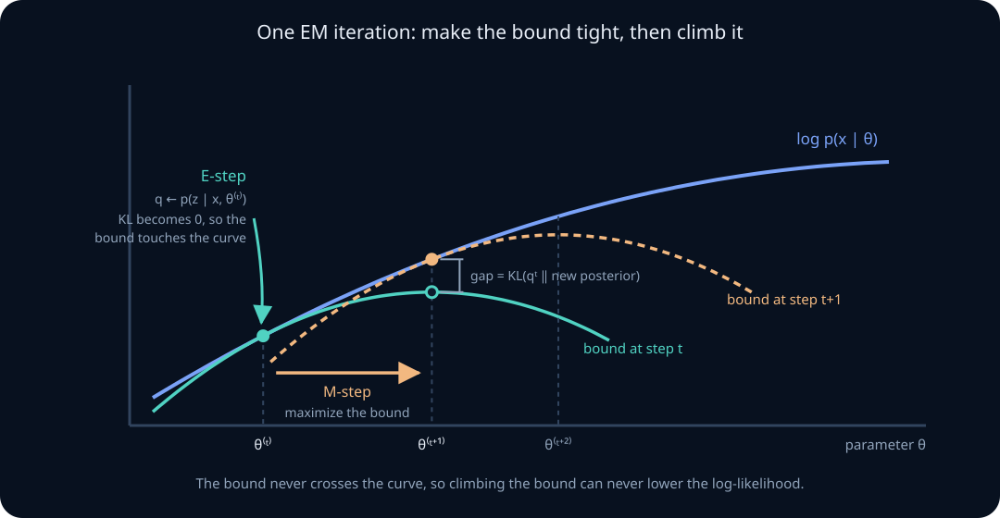
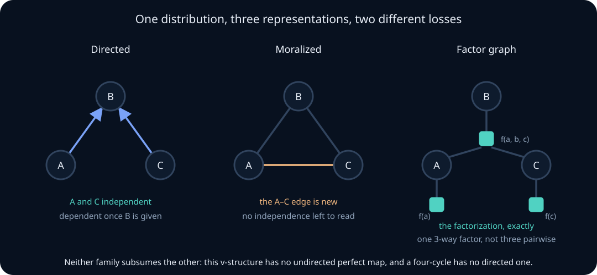

# Mixtures, the EM algorithm, and graphical models

A latent variable is a quantity the model needs and the data does not contain: which subpopulation a request came from, which topic a document is about, which hidden state a system occupied at time \(t\). Introducing one is cheap to write and expensive to fit, because the likelihood you can evaluate is a sum or integral over everything you did not see.

This unit develops the classical machinery for that situation, and it does so from a bound you already own. Lesson 14 proved the exact decomposition \(\log p_\theta(x)=\mathcal L(\theta,q)+\operatorname{KL}(q\Vert p_\theta(z\mid x))\) and used it to build variational inference for models where the posterior is intractable. The expectation–maximization algorithm is the *other* branch from the same identity: when the posterior over latents **is** tractable, you can set \(q\) equal to it exactly, the KL term vanishes, and coordinate ascent on the bound becomes an algorithm with a monotonicity guarantee. EM is not a different idea from the ELBO; it is the ELBO with the inner optimization solved in closed form.

The second half generalizes the structure. A mixture is the simplest possible latent-variable graph — one hidden node pointing at one observed node. Graphical models let you write down arbitrary conditional-independence structure and then ask what it costs to compute with it. You already know how to *read* a directed graph: lesson 16 built d-separation to decide which adjustment sets are valid. Here the same graphs carry probability rather than causation, they acquire an undirected counterpart, and the question shifts from "what is identified" to "what is computable, and at what price."

By the end, you should be able to write a mixture likelihood and explain why maximizing it directly is hard; derive EM as coordinate ascent on the ELBO and prove its monotonicity; write the E-step and M-step for a Gaussian mixture from scratch; explain why the likelihood is unbounded and what to do about it; distinguish label switching from genuine non-identifiability; choose a component count without misusing a likelihood-ratio test; recognize K-means as a degenerate limit; apply EM to missing data and censoring; convert between directed, undirected, and factor-graph representations and say what each conversion loses; run variable elimination and predict its cost from treewidth; and recognize forward–backward as sum-product and Baum–Welch as EM.

## 0. What a latent variable buys, and what it costs

Write the model with the latent variable included and the joint distribution is usually simple:

$$
p_\theta(x,z)=p_\theta(z)\,p_\theta(x\mid z).
$$

Both factors are typically standard families with closed-form maximum likelihood estimators. If \(z\) were observed, fitting would be a counting exercise or a weighted least-squares problem.

The **complete-data log likelihood** \(\log p_\theta(x,z)\) is therefore easy. The one you can actually evaluate is the **incomplete-data** or **marginal** log likelihood,

$$
\ell(\theta)=\log p_\theta(x)=\log\sum_z p_\theta(x,z),
$$

and the sum sits inside the logarithm. That single structural fact causes everything difficult in this unit: the log of a sum does not decompose into terms, the score function acquires a posterior weighting, the objective loses concavity, and symmetry of the latent labels makes the parameter space redundant.

The compensation is expressiveness. A latent variable lets a model represent heterogeneity, clustering, sequence structure, and missingness with a small number of parameters, and it lets a simple family generate a complicated marginal.

**Worked example — two lines of code, two very different fits.** Fitting a single Gaussian to request latencies gives a mean and a variance and a bad fit to a bimodal histogram. Adding one binary latent — cache hit or miss — turns the model into a two-component mixture with five parameters and a marginal that reproduces both modes. The likelihood you now have to maximize has no closed-form maximizer, several local optima, and an infinite supremum at the boundary. That is the trade, in full.

> **Practice — Foundation:** Write the complete-data and incomplete-data log likelihoods for a two-component mixture and say which one contains a log of a sum.
>
> **Practice — Core:** Explain why the complete-data maximum likelihood estimator is usually closed-form while the marginal one is not.
>
> **Practice — Stretch:** Give a latent-variable model whose marginal is a familiar closed-form distribution, and one whose marginal has no name.

## 1. Finite mixtures

A **finite mixture** with \(K\) components has a categorical latent \(Z\in\{1,\dots,K\}\) with mixing weights \(\pi_k=P(Z=k)\), and a component distribution \(p(x\mid\theta_k)\) for each:

$$
p(x\mid\pi,\theta)=\sum_{k=1}^K\pi_k\,p(x\mid\theta_k),
\qquad \pi_k\ge0,\ \sum_{k=1}^K\pi_k=1 .
$$

Sampling is two-stage: draw the component, then draw from it. This is exactly the ancestral-sampling recipe from the sampling-design lesson, and it makes simulation trivial even when the density is awkward.

A Gaussian mixture in one dimension has parameters \(\{\pi_k,\mu_k,\sigma_k^2\}\) and density

$$
p(x)=\sum_{k=1}^K\pi_k\,\frac{1}{\sqrt{2\pi\sigma_k^2}}\exp\!\left(-\frac{(x-\mu_k)^2}{2\sigma_k^2}\right).
$$

Two properties are worth stating early, because they cause most misuse. First, mixture moments are averages, not mixtures of averages: \(E[X]=\sum_k\pi_k\mu_k\), while the variance picks up a between-component term,

$$
\operatorname{Var}(X)=\sum_k\pi_k\sigma_k^2+\sum_k\pi_k(\mu_k-E[X])^2,
$$

which is the law of total variance from lesson 02 with \(Z\) as the conditioning variable. Second, the number of modes of a mixture is not the number of components: two Gaussians whose means are closer than roughly one standard deviation produce a single-peaked density.

**Worked example — overdispersion from an unmodelled mixture.** A Poisson mixture with rates 2 and 20 in equal proportion has mean 11 and variance \(11+81=92\), against the variance of 11 a single Poisson would demand. Lesson 11 diagnosed this as overdispersion in a GLM; the mixture is a model of the mechanism causing it, rather than a dispersion parameter absorbing it.

> **Practice — Foundation:** Compute the mean and variance of a two-component Gaussian mixture with given weights, means, and variances.
>
> **Practice — Core:** Find two Gaussian components with distinct means whose equal-weight mixture is unimodal, and state the separation threshold you used.
>
> **Practice — Stretch:** Show that a mixture of exponentials has a decreasing hazard rate even though each component has a constant one, and interpret the result.

## 2. A component is not a cluster

Mixtures get used for two different purposes, and conflating them produces most of the bad conclusions in applied work.

As a **density estimator**, a mixture is a flexible family that approximates a complicated shape with a sum of simple ones. Enough Gaussians approximate any smooth density arbitrarily well, and no component is required to mean anything. The right diagnostics are held-out log-likelihood and calibration, and the number of components is a capacity choice.

As a **model of latent groups**, each component is a claim that the population genuinely contains subpopulations, and the responsibilities are estimates of membership. The right diagnostics are stability across resamples, external validation of the recovered groups, and substantive interpretation.

The same fitted object supports both readings and the data rarely distinguishes them. A three-component fit to skewed unimodal data will happily use two components to bend one tail — an excellent density estimate and a meaningless clustering.

**Worked example — the "three user segments" that were one.** A mixture fitted to session-length data returns three components, and a deck is written around three user segments. Refitting on a bootstrap resample returns components with different means; fitting a single skewed distribution achieves nearly the same held-out likelihood with four fewer parameters. The components were approximating skew, not finding groups. The test that would have caught it is stability, not fit.

> **Practice — Foundation:** State the two purposes a mixture can serve and the diagnostic appropriate to each.
>
> **Practice — Core:** Fit a two-component Gaussian mixture to samples from a single skewed distribution and report what the components represent.
>
> **Practice — Stretch:** Design a stability check that distinguishes a genuine latent grouping from a density-approximation artifact, and state its failure modes.

## 3. The likelihood is not concave

For \(n\) independent observations the objective is

$$
\ell(\pi,\theta)=\sum_{i=1}^n\log\left(\sum_{k=1}^K\pi_k\,p(x_i\mid\theta_k)\right).
$$

Setting a derivative to zero does not separate. Differentiating with respect to \(\mu_k\) in the Gaussian case gives

$$
\frac{\partial\ell}{\partial\mu_k}
=\sum_{i=1}^n\underbrace{\frac{\pi_k\,p(x_i\mid\theta_k)}{\sum_j\pi_j\,p(x_i\mid\theta_j)}}_{\gamma_{ik}}\cdot\frac{x_i-\mu_k}{\sigma_k^2},
$$

so the stationarity condition is \(\mu_k=\sum_i\gamma_{ik}x_i/\sum_i\gamma_{ik}\): a weighted mean whose weights depend on the parameters you are solving for. The equations are coupled through \(\gamma\), and the objective is not concave in \((\pi,\mu,\sigma^2)\) — it has multiple local maxima, saddle points, and, as section 9 shows, an unbounded supremum.

This is the shape of the problem EM solves. Notice that the fixed-point condition above is *already* the M-step, and the quantity \(\gamma_{ik}\) is *already* the E-step. EM can be read as the natural iterative scheme for these equations, and separately as an ELBO argument that explains why the iteration is guaranteed to improve.

**Worked example — why a good initialization matters more than a good optimizer.** Two runs of EM on the same 5,000 latency observations from different random starts reach log-likelihoods of \(-7{,}412\) and \(-7{,}389\), with visibly different component means. Neither run failed; the surface has several basins. Standard practice is multiple restarts with a sensible seeding scheme, keeping the best final objective — and reporting that this was done.

> **Practice — Foundation:** Write the mixture log likelihood and identify the term that prevents separation.
>
> **Practice — Core:** Derive the stationarity condition for \(\mu_k\) and show the weights depend on all parameters.
>
> **Practice — Stretch:** Construct a two-component mixture dataset with two distinct local maxima and describe the basin boundary.

## 4. Responsibilities are a posterior

The quantity appearing above,

$$
\gamma_{ik}=P(Z_i=k\mid x_i,\theta)=\frac{\pi_k\,p(x_i\mid\theta_k)}{\sum_{j=1}^K\pi_j\,p(x_i\mid\theta_j)},
$$

is the **responsibility** of component \(k\) for observation \(i\). It is nothing more than Bayes' rule with \(\pi\) as prior and the component density as likelihood, and it satisfies \(\sum_k\gamma_{ik}=1\) for every \(i\).

Responsibilities are soft assignments, and the softness carries information a hard assignment destroys. An observation lying midway between two components has \(\gamma\approx(0.5,0.5)\) and contributes half of itself to each component's update; an observation deep inside one component contributes essentially all of itself to that one. The sum \(N_k=\sum_i\gamma_{ik}\) is the **effective count** of observations assigned to component \(k\), and it need not be an integer.

Computing responsibilities requires care with underflow. The numerator and denominator both involve densities that can be \(10^{-300}\) for a distant observation. Compute in logs and subtract the maximum before exponentiating — the same stable-softmax discipline as in the numerical-stability lesson, applied to \(\log\pi_k+\log p(x_i\mid\theta_k)\).

**Worked example — responsibilities under separation.** With components at \(-10\) and \(10\), both with unit variance, the observation \(x=-9\) has log numerators \(\log 0.5-0.5\) and \(\log 0.5-180.5\). The difference is 180 nats, so the responsibility is \(1\) to within \(10^{-79}\) and the soft assignment is effectively hard. Exponentiating the raw densities first would have produced \(0/0\).

> **Practice — Foundation:** Compute responsibilities for one observation under a two-component mixture with given parameters.
>
> **Practice — Core:** Show \(\sum_k\gamma_{ik}=1\) and interpret \(N_k=\sum_i\gamma_{ik}\) as an effective count.
>
> **Practice — Stretch:** Write the log-space computation of responsibilities and state the largest component-separation your implementation tolerates before returning exact zeros.

## 5. EM is coordinate ascent on the ELBO

Take the decomposition proved in lesson 14, now written for the whole dataset with one \(q_i\) per observation:

$$
\log p_\theta(x)=\mathcal L(\theta,q)+\operatorname{KL}\bigl(q(z)\,\Vert\,p_\theta(z\mid x)\bigr),
\qquad
\mathcal L(\theta,q)=E_q[\log p_\theta(x,z)]+H(q).
$$

The bound holds for *any* \(q\), and the gap is exactly the KL divergence between \(q\) and the true posterior. Two facts follow, and together they are the entire algorithm.

**E-step.** Fix \(\theta=\theta^{(t)}\) and maximize \(\mathcal L\) over \(q\). Since \(\log p_\theta(x)\) does not depend on \(q\), maximizing the bound is the same as minimizing the KL term, which is minimized — at zero — by

$$
q^{(t)}(z)=p_{\theta^{(t)}}(z\mid x).
$$

For a mixture this posterior is the responsibility vector, available in closed form. **The bound now touches the objective:** \(\mathcal L(\theta^{(t)},q^{(t)})=\log p_{\theta^{(t)}}(x)\).

**M-step.** Fix \(q=q^{(t)}\) and maximize \(\mathcal L\) over \(\theta\). Since \(H(q)\) does not depend on \(\theta\), this maximizes the **expected complete-data log likelihood**

$$
Q(\theta\mid\theta^{(t)})=E_{q^{(t)}}\bigl[\log p_\theta(x,z)\bigr],
$$

and the expectation is now *outside* the logarithm. That single interchange is why the M-step is closed-form whenever the complete-data problem was.

The two steps alternate, each maximizing the same function \(\mathcal L(\theta,q)\) over one argument. That is all EM is. Variational inference, from lesson 14, is the same coordinate ascent restricted to a family \(\mathcal Q\) that does not contain the true posterior — the E-step then leaves a nonzero KL gap, the bound never touches, and the monotonicity guarantee applies to the bound rather than to the likelihood.

**Worked example — reading the two steps off the picture.** At \(\theta^{(t)}\) the E-step raises the bound curve until it is tangent to \(\log p_\theta(x)\). The M-step moves to the bound's maximizer \(\theta^{(t+1)}\). Because the bound lies below the log-likelihood everywhere and touches at \(\theta^{(t)}\), the log-likelihood at \(\theta^{(t+1)}\) is at least the bound's value there, which is at least its value at \(\theta^{(t)}\), which equals the old log-likelihood. The proof in section 7 is this sentence in symbols.

> **Practice — Foundation:** State what the E-step and the M-step each optimize, and over which argument.
>
> **Practice — Core:** Show that the E-step choice \(q=p_\theta(z\mid x)\) makes the bound tight, using the KL decomposition.
>
> **Practice — Stretch:** Explain precisely where the EM guarantee weakens when \(q\) is restricted to a variational family, and what survives.

## 6. EM for a Gaussian mixture, in full

Specialize. The complete-data log likelihood with one-hot indicators \(z_{ik}\) is

$$
\log p_\theta(x,z)=\sum_{i=1}^n\sum_{k=1}^K z_{ik}\bigl[\log\pi_k+\log\mathcal N(x_i\mid\mu_k,\sigma_k^2)\bigr].
$$

It is linear in \(z_{ik}\), so taking the expectation under \(q^{(t)}\) simply replaces \(z_{ik}\) by \(\gamma_{ik}\):

$$
Q(\theta\mid\theta^{(t)})=\sum_{i=1}^n\sum_{k=1}^K\gamma_{ik}\bigl[\log\pi_k+\log\mathcal N(x_i\mid\mu_k,\sigma_k^2)\bigr].
$$

Maximizing gives weighted versions of the ordinary Gaussian estimators. With \(N_k=\sum_i\gamma_{ik}\):

$$
\pi_k^{(t+1)}=\frac{N_k}{n},\qquad
\mu_k^{(t+1)}=\frac{1}{N_k}\sum_{i=1}^n\gamma_{ik}x_i,\qquad
\sigma_k^{2,(t+1)}=\frac{1}{N_k}\sum_{i=1}^n\gamma_{ik}\bigl(x_i-\mu_k^{(t+1)}\bigr)^2 .
$$

The \(\pi\) update requires the constraint \(\sum_k\pi_k=1\), enforced with a Lagrange multiplier; the multiplier turns out to be \(n\), which is why the update is a plain share of effective counts.

Three implementation notes that separate working code from almost-working code. Use the **updated** mean in the variance update, not the old one. Track the incomplete-data log-likelihood \(\sum_i\log\sum_k\pi_kp(x_i\mid\theta_k)\) every iteration and assert it never decreases — that assertion catches nearly every implementation bug. And compute everything in logs with a max-subtraction, since responsibilities for separated components underflow immediately.

In \(d\) dimensions the same derivation gives \(\Sigma_k^{(t+1)}=\frac1{N_k}\sum_i\gamma_{ik}(x_i-\mu_k)(x_i-\mu_k)^T\), with the covariance-structure choices — full, diagonal, spherical, tied — trading parameters against flexibility exactly as in the multivariate Gaussian lesson.

**Worked example — one step by hand.** Three observations \(0,2,4\) with two identical initial components at \(\mu=2,\sigma^2=1,\pi=0.5\). Every responsibility is \(0.5\) by symmetry, so \(N_1=N_2=1.5\), both weights stay at \(0.5\), both means become \(2\), and both variances become \(\frac{4+0+4}{3}=\frac83\). Identical components stay identical forever: symmetric initialization is a fixed point, and this is the first thing to check when EM appears not to move.

> **Practice — Foundation:** Write the three M-step updates and identify the effective count in each.
>
> **Practice — Core:** Derive the \(\pi_k\) update with a Lagrange multiplier and show the multiplier equals \(n\).
>
> **Practice — Stretch:** Derive the full-covariance M-step in \(d\) dimensions and count the free parameters for full, diagonal, spherical, and tied structures.

## 7. Monotonicity, and what EM does not promise

**Theorem.** Each EM iteration satisfies \(\log p_{\theta^{(t+1)}}(x)\ge\log p_{\theta^{(t)}}(x)\).

**Proof.** By the bound and the E-step's tightness,

$$
\log p_{\theta^{(t)}}(x)=\mathcal L(\theta^{(t)},q^{(t)})
\le\mathcal L(\theta^{(t+1)},q^{(t)})
\le\log p_{\theta^{(t+1)}}(x).
$$

The equality is E-step tightness, the first inequality is the M-step's definition, and the second is the ELBO bound at the new parameters with the old \(q\). No assumptions beyond those two steps being performed exactly.

An equivalent statement in terms of \(Q\) is worth carrying, since it shows where the improvement comes from:

$$
\ell(\theta')-\ell(\theta)=\underbrace{Q(\theta'\mid\theta)-Q(\theta\mid\theta)}_{\ge0\text{ by the M-step}}+\underbrace{\operatorname{KL}\bigl(p_\theta(z\mid x)\Vert p_{\theta'}(z\mid x)\bigr)}_{\ge0\text{ always}} .
$$

Now the disclaimers, all of which matter.

- Monotone **does not mean convergent to a global maximum.** EM converges to a stationary point of \(\ell\) under mild conditions, and which one depends on the initialization.
- A stationary point **need not be a maximum.** Saddle points are fixed points of EM; symmetric initializations sit on them exactly, as section 6 showed.
- The likelihood sequence converges, but **the parameter sequence need not** if the likelihood has a ridge of equal-valued maxima.
- Monotonicity is in the **incomplete-data likelihood**, not in any held-out metric. EM will happily climb toward the degenerate solutions of section 9.

**Worked example — the assertion that saves a day.** Add `assert loglik[t+1] >= loglik[t] - 1e-9` to an EM loop. A decrease means one of: the variance update used the old mean, the responsibilities were not normalized, the log-likelihood was computed at the wrong parameters, or a component collapsed. All four are common, and none is visible from the fitted plot.

> **Practice — Foundation:** State the monotonicity theorem and name the two steps its proof uses.
>
> **Practice — Core:** Prove the theorem from the ELBO decomposition in three lines.
>
> **Practice — Stretch:** Derive the \(Q\)-plus-KL difference identity and use it to explain why EM slows near convergence.

## 8. Convergence speed is the fraction of missing information

EM converges **linearly**, not quadratically: near a stationary point the error contracts by a constant factor each iteration. The factor has a precise and memorable meaning.

Write \(I_{\text{comp}}\) for the expected complete-data information — the information you would have had if \(z\) were observed — and \(I_{\text{obs}}\) for the observed-data information. The missing information principle states

$$
I_{\text{obs}}=I_{\text{comp}}-I_{\text{miss}},
$$

where \(I_{\text{miss}}\) is the expected information about \(\theta\) contained in the posterior of \(z\) given \(x\). The EM map's Jacobian at the fixed point is \(I_{\text{miss}}I_{\text{comp}}^{-1}\), so the convergence rate is the largest eigenvalue of that matrix: **the fraction of information that is missing.**

This is the same quantity as the fraction of missing information reported after multiple imputation in lesson 16, and the interpretation transfers. When components are well separated, the latent labels are nearly determined by the data, little information is missing, and EM converges in a handful of iterations. When components overlap heavily, most of the information about which component generated each point is missing, and EM crawls — hundreds or thousands of iterations with visibly decreasing step sizes.

Two consequences for practice. Slow convergence is diagnostic, not merely annoying: it says the components are weakly identified by this data, which is information about your model, not your optimizer. And the standard errors are governed by \(I_{\text{obs}}\), so the same overlap that slows EM also widens the intervals — a fast fit and a precise fit are the same condition.

**Worked example — two datasets, same code.** Components separated by five standard deviations converge in 6 iterations. The same code on components separated by half a standard deviation takes 1,400 iterations to move the log-likelihood less than \(10^{-6}\), and the resulting means have overlapping confidence regions. Nothing is wrong; the second dataset contains little information about the partition.

> **Practice — Foundation:** State the missing information principle and name the quantity that controls EM's convergence rate.
>
> **Practice — Core:** Explain why well-separated mixtures converge quickly, in terms of the posterior over labels.
>
> **Practice — Stretch:** Relate the convergence rate to the width of confidence intervals for the component means, and design an experiment that demonstrates the link.

## 9. The likelihood is unbounded, and EM will find out

For a Gaussian mixture with free variances, the likelihood has no maximum. Put \(\mu_1=x_1\) for some observation and let \(\sigma_1^2\to0\). That component's density at \(x_1\) grows like \(1/\sigma_1\), so the term \(\log(\pi_1\mathcal N(x_1\mid x_1,\sigma_1^2)+\dots)\to\infty\) while every other observation is still explained by the remaining components. The supremum is \(+\infty\) and it is attained on a boundary, not at an interior stationary point.

These **degenerate spikes** are real features of the objective, not numerical artifacts, and EM reaches them: once a component's responsibility concentrates on a single point, its variance update returns nearly zero, which concentrates the responsibility further. The collapse is self-reinforcing and typically takes a handful of iterations.

Four standard remedies, in rough order of preference:

1. **Variance floor.** Refuse \(\sigma_k^2<\varepsilon\) for a small \(\varepsilon\) tied to the data scale. Crude, effective, and easy to report.
2. **MAP-EM with a prior.** Put an inverse-gamma prior on \(\sigma_k^2\) (or inverse-Wishart on \(\Sigma_k\)) and maximize the posterior instead. The M-step gains an additive term in numerator and denominator, the spike is penalized away, and the procedure remains EM with \(\log p(\theta)\) added to \(Q\).
3. **Tied or constrained covariances.** A shared \(\sigma^2\) across components removes the degeneracy entirely, at the price of flexibility.
4. **Restart and reject.** Detect collapse by monitoring the smallest effective count \(N_k\) and the smallest variance, and restart from a new seed.

The general lesson outlives mixtures: an unbounded likelihood means maximum likelihood is not well-posed for that family, and something — a prior, a constraint, or a penalty — must supply the missing regularity. Lesson 06's asymptotic theory assumed an interior maximum with positive-definite information; here that assumption fails visibly.

**Worked example — the component that ate one point.** After 40 iterations a component has \(N_k=1.0000\), \(\sigma_k^2=3\times10^{-12}\), and the log-likelihood is \(+\infty\) for practical purposes. The fit is a perfect explanation of one observation and a useless model. A variance floor at \(10^{-4}\) times the sample variance, plus a restart policy, converts this failure into a run that finishes.

> **Practice — Foundation:** Show that letting one component's variance go to zero at an observation drives the likelihood to infinity.
>
> **Practice — Core:** Derive the MAP-EM variance update under an inverse-gamma prior and show how it prevents collapse.
>
> **Practice — Stretch:** Compare a variance floor, a prior, and tied covariances on the same collapsing dataset, and state what each one changes about the estimand.

## 10. Label switching is symmetry, not instability

The mixture likelihood is invariant to permuting the component labels: relabelling \((\pi_1,\theta_1)\leftrightarrow(\pi_2,\theta_2)\) leaves \(p(x)\) unchanged. With \(K\) components there are \(K!\) parameter settings giving identical densities, so the parameters are **not identifiable** in the strict sense of lesson 06, even with infinite data.

Two consequences, which differ sharply by inference method.

For **maximum likelihood**, this is harmless. Any optimizer lands in one of the \(K!\) equivalent basins, and the fitted density is the same. Report components in a canonical order — sorted by mean, or by weight — and the ambiguity disappears from the output.

For **Bayesian inference**, it is a genuine obstacle. The posterior is \(K!\)-symmetric, so the marginal posterior of \(\mu_1\) is identical to that of \(\mu_2\), and a sampler that mixes well across the symmetry produces posterior means that are all equal to the global average. The lesson 09 warning about multimodal posteriors and misleading local Gaussian approximations is exactly this situation. Remedies are ordering constraints, post-hoc relabelling algorithms, or reporting only label-invariant functionals such as the predictive density, the number of occupied components, or the partition of observations.

The deeper point is that **label switching is not the same as non-identifiability of the model**. The mixture *distribution* — the unordered set of weighted components — is identifiable for Gaussian mixtures (and most common families) up to permutation. What fails is the labelling, which was never the estimand. Section 11 covers failures that are not so benign.

**Worked example — the posterior mean that means nothing.** An MCMC run over a two-component mixture with true means \(-3\) and \(3\) mixes across the label symmetry and reports posterior means of \(0.02\) and \(-0.01\) for \(\mu_1\) and \(\mu_2\), with wide bimodal marginals. Nothing failed: the sampler is correct and the summary is meaningless. Reporting the posterior of \(\min(\mu_1,\mu_2)\) and \(\max(\mu_1,\mu_2)\), or of the predictive density, restores usable output.

> **Practice — Foundation:** Count the number of equivalent parameter settings for a \(K\)-component mixture and explain why the density is unchanged.
>
> **Practice — Core:** Explain why label switching is benign for maximum likelihood and damaging for posterior summaries.
>
> **Practice — Stretch:** Propose three label-invariant posterior summaries and say which scientific questions each one can and cannot answer.

## 11. Identifiability failures that are not about labels

Beyond permutation, mixtures have genuine identifiability problems, and they differ by family.

**Overfitted order.** If the true model has two components and you fit three, the extra component can go anywhere with zero weight, or duplicate an existing component and split its weight arbitrarily. The parameter set achieving the maximum is a continuum, the Fisher information is singular, and the usual asymptotic theory does not apply. This is precisely the nonregular case flagged in lesson 06.

**Families that are not identifiable at all.** A mixture of Bernoulli distributions on a single binary variable is hopeless: any mixture of Bernoulli\((p_1)\) and Bernoulli\((p_2)\) with weights \(\pi\) produces Bernoulli\((\pi p_1+(1-\pi)p_2)\), a one-parameter family. No amount of data recovers the components, because the marginal has one degree of freedom and the model has three.

**What restores identifiability.** For product distributions over several conditionally independent features, identifiability returns: three or more binary features with conditional independence given the latent class make the latent-class model generically identifiable, a result following from uniqueness of three-way tensor decompositions. This is why latent class analysis needs several indicators per construct rather than one, and it is the same principle as needing multiple noisy measurements to separate signal from noise.

**Continuous families are usually fine.** Finite mixtures of Gaussians, of Poissons, and of exponentials are identifiable up to permutation. The distinguishing property is that the component family is linearly independent as a set of functions, which the Bernoulli family on one variable fails.

**Worked example — one item is not a scale.** A latent-class model of "user intent" fitted to a single binary click indicator returns whatever class proportions the prior implies, and the fit is perfect regardless. Adding two more conditionally independent behavioral indicators makes the classes estimable. The diagnostic that reveals the problem is parameter instability across restarts with identical likelihood — the signature of a flat ridge rather than a peak.

> **Practice — Foundation:** Show that a two-component mixture of Bernoulli distributions on one binary variable is not identifiable.
>
> **Practice — Core:** Explain what goes wrong asymptotically when the fitted number of components exceeds the true number.
>
> **Practice — Stretch:** State the conditional-independence condition under which a latent class model with binary indicators becomes identifiable, and explain why three indicators is the threshold.

## 12. Choosing the number of components

The natural test is a likelihood-ratio test of \(K\) against \(K+1\). It is invalid, and for two reinforcing reasons: under the null the extra component has weight zero, which is on the **boundary** of the parameter space, and its parameters are **unidentified** because they do not affect the likelihood. Both violate the regularity conditions of lesson 07's Wilks theorem, and the null distribution is not \(\chi^2\) with the naive degrees of freedom. Using the naive test overstates evidence for extra components, sometimes dramatically.

Workable alternatives:

- **Held-out log-likelihood.** Fit on training data, evaluate \(\sum_i\log p_{\hat\theta}(x_i)\) on a held-out split. Honest, assumption-light, and directly aligned with a density-estimation purpose.
- **Information criteria.** BIC \(=-2\ell+p\log n\) is the standard choice and works acceptably in practice despite the regularity failure; AIC tends to overselect components. Report which you used and do not treat small differences as decisive.
- **Parametric bootstrap for the likelihood-ratio statistic.** Simulate from the fitted \(K\)-component model, refit both models, and build the null distribution empirically. Expensive, and correct.
- **Stability across resamples.** If the recovered partition changes qualitatively across bootstrap samples, the component count is not supported whatever the criterion says.
- **Bayesian nonparametrics.** A Dirichlet process mixture puts a prior over the number of occupied components and estimates it jointly, at the cost of a more demanding computation.

For a clustering purpose, add the substantive test: do the components correspond to anything you can check externally? A component count chosen by BIC and unrecognizable to the people who own the system is a modelling artifact.

**Worked example — three criteria, three answers.** On the same 4,000 latency observations, AIC selects 7 components, BIC selects 4, and held-out likelihood is flat between 3 and 5. The honest report is that the data supports 3–5 components for density estimation and does not determine a cluster count, with the fitted density shown for \(K=4\).

> **Practice — Foundation:** State the two regularity violations that invalidate the likelihood-ratio test for component count.
>
> **Practice — Core:** Compare BIC and held-out likelihood on a simulated mixture and report where they disagree.
>
> **Practice — Stretch:** Implement the parametric bootstrap null for the likelihood-ratio statistic and compare it against the naive chi-square reference.

## 13. K-means is EM in a degenerate limit

Fix all components to be spherical with common variance \(\sigma^2\) and equal weights, and let \(\sigma^2\to0\). The responsibility

$$
\gamma_{ik}=\frac{\exp\bigl(-\Vert x_i-\mu_k\Vert^2/2\sigma^2\bigr)}{\sum_j\exp\bigl(-\Vert x_i-\mu_j\Vert^2/2\sigma^2\bigr)}
$$

is a softmax over negative squared distances with temperature \(\sigma^2\). As \(\sigma^2\to0\) it becomes the indicator of the nearest centroid. The M-step then sets each \(\mu_k\) to the mean of its assigned points. That is Lloyd's algorithm, and the EM objective reduces to the within-cluster sum of squares.

So K-means is EM with the temperature set to zero. What the limit costs is worth stating explicitly:

- **No uncertainty.** Boundary points contribute entirely to one cluster; the model cannot express "this point is ambiguous."
- **Implicit geometry.** Equal spherical covariances mean the method finds clusters of equal size and round shape, and will split an elongated cluster rather than recognize it.
- **No density.** K-means gives no likelihood, so held-out comparison, calibration, and model selection all become ad hoc.
- **Same weaknesses.** Local optima, initialization sensitivity, and the need for restarts persist, because they come from the objective's non-convexity, not from the softness.

Read in the other direction, this makes a Gaussian mixture the principled generalization of K-means: soft assignments, per-cluster shape through \(\Sigma_k\), unequal cluster sizes through \(\pi_k\), and a likelihood you can hold out.

**Worked example — the elongated cluster.** Two clusters, one spherical and one stretched along a diagonal, are split incorrectly by K-means, which cuts the elongated cluster in half to satisfy its round-cluster prior. A full-covariance Gaussian mixture from the same initialization recovers both. The failure is in the geometry the objective assumes, not in the optimizer.

> **Practice — Foundation:** Show that the responsibility becomes a nearest-centroid indicator as \(\sigma^2\to0\).
>
> **Practice — Core:** Derive the within-cluster sum of squares as the limit of the EM objective under the stated constraints.
>
> **Practice — Stretch:** Construct a dataset where K-means and a full-covariance mixture disagree, and explain the disagreement geometrically.

## 14. EM is for missing data generally, not just mixtures

Lesson 16 established that a latent variable and a missing value are the same object seen from two directions. EM makes that concrete: anything you would have analyzed easily had you seen \(z\) is a candidate for EM, with \(z\) the missing part.

**Missing covariates or outcomes.** Treat the missing entries as \(z\). The E-step computes their conditional distribution given the observed entries and current parameters; the M-step refits on the completed sufficient statistics. Under MAR with distinct parameters, the mechanism is ignorable and need not be modelled — that is precisely the ignorability theorem from lesson 16 §20, and it is what licenses running EM on the observed-data likelihood alone.

**Censored and truncated data.** For a right-censored observation known only to exceed \(c\), the E-step replaces the unobserved value by its conditional expectation given \(X>c\), not by \(c\). Substituting the censoring point is the classic bias, and EM says exactly what to substitute instead.

**Mixed-effects models.** The random effects of lesson 11 are latents. EM alternates between the conditional distribution of the group effects given the data and current variance components, and closed-form variance-component updates. This is one of several routes to the same partial-pooling estimates.

**Factor and latent-trait models.** Factor analysis, probabilistic PCA, and item-response models are all EM targets with continuous latents, where the E-step returns a conditional mean and covariance rather than a discrete posterior.

One caution that ties the two lessons together: EM under MAR gives valid point estimates from the observed-data likelihood, but the **standard errors from the completed data are wrong**, because they treat imputed quantities as observed. Correct uncertainty comes from the observed information \(I_{\text{obs}}\) — via Louis's identity, the supplemented-EM computation, or a bootstrap of the whole fitting procedure. This is the same false-confidence failure that section 22 of lesson 16 diagnosed for single imputation, appearing again in a different costume.

**Worked example — censored latencies.** Requests timing out at 30 seconds are recorded as 30. Fitting a lognormal to the raw values underestimates the mean and badly underestimates the tail. EM replaces each censored value's contribution by \(E[\log X\mid \log X>\log 30]\) under the current parameters, and the fitted tail moves to where the data actually implies it is.

> **Practice — Foundation:** Identify the latent variable in a censored-data problem and state what the E-step computes.
>
> **Practice — Core:** Write the EM updates for a Gaussian sample with right-censored observations.
>
> **Practice — Stretch:** Explain why completed-data standard errors are too small, and describe two corrections.

## 15. Discrete mixtures and latent class models

For binary or categorical data the same machinery specializes cleanly. A **latent class model** with \(K\) classes and \(D\) conditionally independent binary features has

$$
p(x)=\sum_{k=1}^K\pi_k\prod_{d=1}^D\theta_{kd}^{x_d}(1-\theta_{kd})^{1-x_d},
$$

the **conditional independence** assumption — features independent *given* the class — doing all the work. The E-step is Bayes' rule over \(K\) classes; the M-step sets \(\theta_{kd}\) to the responsibility-weighted fraction of ones on feature \(d\).

Two observations matter here. First, this is exactly naive Bayes with an unobserved label: supervised naive Bayes counts, unsupervised naive Bayes runs EM. The mixture and the classifier are the same model differing only in whether \(z\) is seen. Second, conditional independence is a strong and checkable claim: if two features remain correlated within a class, the model responds by adding spurious classes to absorb the correlation, which is a common cause of inflated component counts.

Multinomial mixtures of the same shape underlie topic models; adding a per-document distribution over topics rather than a single latent class is the step from a mixture to latent Dirichlet allocation, where the E-step is no longer closed-form and variational inference from lesson 14 takes over.

**Worked example — the correlated pair that invented a class.** A latent class model of four error indicators returns five classes on data generated from two, because two of the indicators are mechanically linked and violate conditional independence within class. Adding a direct dependence between that pair returns the count to two. The diagnostic is the within-class residual correlation matrix, which should be near zero and was not.

> **Practice — Foundation:** Write the latent class likelihood and state the conditional independence assumption explicitly.
>
> **Practice — Core:** Derive the M-step for \(\theta_{kd}\) and show it is a responsibility-weighted frequency.
>
> **Practice — Stretch:** Show how a violated conditional independence inflates the estimated number of classes, and propose a diagnostic.

## 16. Variants: MAP, generalized, stochastic, and variational EM

The two-step template survives many weakenings, and knowing which guarantee each one keeps is the practical point.

**MAP-EM.** Add \(\log p(\theta)\) to the M-step objective. The monotonicity proof goes through with the log posterior in place of the log likelihood, giving a monotone sequence in \(\log p(\theta\mid x)\). This is the principled fix for the degeneracies of section 9.

**Generalized EM.** The M-step need not maximize — it only needs to *increase* \(Q\). A single gradient or Newton step suffices, and the monotonicity proof, which used only \(Q(\theta^{(t+1)}\mid\theta^{(t)})\ge Q(\theta^{(t)}\mid\theta^{(t)})\), is unchanged. This rescues EM for models whose M-step has no closed form.

**ECM and its relatives.** Replace one hard maximization with several conditional ones, maximizing over parameter blocks in turn. Monotonicity survives for the same reason.

**Stochastic and online EM.** Compute the E-step on a minibatch and update sufficient statistics with a decaying step size. Monotonicity is lost; what replaces it is the stochastic-approximation convergence theory from the optimization track, with the same step-size conditions.

**Variational EM.** When the posterior \(p_\theta(z\mid x)\) is intractable, restrict \(q\) to a tractable family. The E-step becomes an optimization rather than a formula, the bound no longer touches, and monotonicity holds for \(\mathcal L\) rather than for \(\ell\). This is the bridge back to lesson 14: EM and variational inference are the exact and approximate versions of one coordinate ascent.

**Monte Carlo EM.** Approximate the E-step expectation by sampling. Monotonicity becomes probabilistic, and the sample size must grow as the iteration proceeds or the algorithm stalls in a noise ball.

**Worked example — choosing a variant.** A GLM mixture has no closed-form M-step for the regression coefficients. Rather than abandoning EM, take one IRLS step per iteration — generalized EM — and the monotone log-likelihood sequence is retained at a fraction of the cost per iteration.

> **Practice — Foundation:** State which EM variant keeps monotonicity when the M-step cannot be solved exactly.
>
> **Practice — Core:** Verify that the monotonicity proof only requires \(Q\) to increase, not to be maximized.
>
> **Practice — Stretch:** Explain what replaces the monotonicity guarantee in stochastic EM, and state the step-size conditions it needs.

## 17. Directed graphical models: structure, plates, and learning

A **Bayesian network** over variables \(V_1,\dots,V_p\) is a DAG together with the factorization

$$
p(v_1,\dots,v_p)=\prod_{j=1}^p p\bigl(v_j\mid \mathrm{pa}(v_j)\bigr).
$$

Lesson 16 introduced exactly this object and read causal claims off it. Here the reading is purely probabilistic: the graph is a compact encoding of conditional independences and a specification of which conditional tables or densities the model contains. A graph with a causal interpretation is a Bayesian network with an extra commitment; a Bayesian network without that commitment is still a perfectly good factorization.

The saving is parametric. A joint distribution over 20 binary variables has \(2^{20}-1\) free parameters. If each variable has at most 3 parents, the factorization needs at most \(20\times2^3=160\). Structure buys statistical efficiency, and it buys it in proportion to how many arrows you can honestly omit.

**Plate notation** compresses repetition: a box around a subgraph annotated with \(i=1,\dots,n\) means "replicate this, with the enclosed variables indexed by \(i\)." A mixture model in plate notation is one plate over observations containing \(z_i\to x_i\), with \(\pi\) and \(\theta\) outside the plate as shared parameters. Every hierarchical model in lesson 11 has such a diagram, and drawing it makes the difference between shared and per-unit parameters unambiguous.

**Parameter learning** splits sharply by observability:

- **Fully observed.** The log-likelihood decomposes into a sum over families \(\sum_j\sum_i\log p(v_{ij}\mid\mathrm{pa}_{ij})\), so each conditional table is fitted independently — counting for discrete variables, weighted regression for continuous ones. The problem is convex per family and embarrassingly parallel.
- **Partially observed.** The decomposition breaks, and you are back to EM, with the E-step requiring an inference algorithm to compute the posterior over the unobserved nodes. Sections 20 to 22 supply those algorithms.

**Structure learning** — recovering the graph itself — is a harder problem with two families of methods, constraint-based (test conditional independences and orient what the tests determine) and score-based (search over graphs optimizing a penalized likelihood). Both recover only the **Markov equivalence class**: graphs with the same skeleton and the same v-structures are indistinguishable from observational data, which is the statistical statement behind lesson 16's insistence that causal direction requires assumptions or intervention.

**Worked example — the mixture as a two-node network.** The Gaussian mixture is the Bayesian network \(Z\to X\) inside a plate over \(i\), with parameters \(\pi\) and \(\{\mu_k,\sigma_k^2\}\) outside. Written this way, the E-step is "inference in this network" and the M-step is "fully observed learning given the inferred distribution." Every algorithm in the rest of the unit is that sentence applied to a bigger graph.

> **Practice — Foundation:** Write the factorization for a five-node DAG and count its free parameters under binary variables.
>
> **Practice — Core:** Draw the plate diagram for a Gaussian mixture and identify which parameters are shared across observations.
>
> **Practice — Stretch:** Explain what a Markov equivalence class is and why observational structure learning cannot resolve it.

## 18. Undirected models and the price of a partition function

Some dependence structures have no natural direction: pixels in an image, labels in a grid, spins in a lattice. A **Markov random field** puts an undirected graph on the variables and factorizes over its cliques:

$$
p(v)=\frac1Z\prod_{c\in\mathcal C}\psi_c(v_c),
\qquad
Z=\sum_{v}\prod_{c\in\mathcal C}\psi_c(v_c).
$$

The **potentials** \(\psi_c\ge0\) are arbitrary nonnegative functions, not conditional probabilities; they express compatibility rather than a normalized belief. **Hammersley–Clifford** makes the correspondence exact: for strictly positive distributions, being Markov with respect to \(G\) — every variable conditionally independent of the rest given its neighbours — is equivalent to factorizing over the cliques of \(G\).

The normalizer \(Z\) is the whole difficulty. It couples every parameter to every other, so the log-likelihood

$$
\ell(\theta)=\sum_c\log\psi_c(v_c;\theta)-\log Z(\theta)
$$

has a gradient involving \(E_\theta[\cdot]\) under the model, which requires inference on every gradient step. This is the structural reason undirected models are harder to fit than directed ones: a Bayesian network's normalizer is 1 by construction, and its fully observed likelihood decomposes; an MRF's does not.

Practical responses include contrastive divergence and other MCMC-in-the-loop schemes, pseudolikelihood, which replaces the joint by a product of conditionals and is consistent but less efficient, and score matching from lesson 15 — which is best understood here as the principled way to avoid \(Z\) entirely by working with \(\nabla_x\log p\), where the normalizer differentiates away.

**Worked example — an Ising model on a small grid.** On a \(4\times4\) binary grid with nearest-neighbour potentials, \(Z\) sums \(2^{16}=65{,}536\) terms and is computable. On a \(100\times100\) grid it sums \(2^{10{,}000}\) terms and is not. Nothing about the model changed; only the feasibility of the normalizer did, and every fitting method for the large grid is an answer to that one problem.

> **Practice — Foundation:** Write the clique factorization for a four-node cycle and identify its maximal cliques.
>
> **Practice — Core:** State Hammersley–Clifford including its positivity condition, and give a distribution that violates the condition.
>
> **Practice — Stretch:** Derive the MRF log-likelihood gradient and explain why each step requires inference under the model.

## 19. Directed, undirected, and what conversion loses

The two families are not interchangeable, and the precise statement is about which conditional independences each can represent.

**Separation.** In an undirected graph, \(A\perp C\mid S\) whenever every path from \(A\) to \(C\) passes through \(S\). This is simple graph separation, with none of d-separation's collider exception.

**Moralization** converts a DAG to an MRF: connect every pair of nodes sharing a child ("marry the parents"), then drop all arrow directions. The resulting undirected graph is a valid Markov blanket structure for the same distribution — but it has **lost** information. The v-structure \(A\to B\leftarrow C\) becomes a triangle, and the marginal independence \(A\perp C\) that the collider encoded is no longer readable from the undirected graph.

This is one half of a symmetric limitation, stated in terms of **perfect maps** — graphs whose separations are exactly the distribution's independences:

- The v-structure \(A\to B\leftarrow C\) has a directed perfect map and **no** undirected one, since no undirected graph makes \(A\perp C\) while \(A\not\perp C\mid B\).
- The four-cycle with independences \(A\perp C\mid\{B,D\}\) and \(B\perp D\mid\{A,C\}\) has an undirected perfect map and **no** directed one, since any acyclic orientation creates a v-structure that asserts an independence the distribution lacks.

So neither family subsumes the other, and some distributions have no perfect map in either. **Factor graphs** are the neutral representation: a bipartite graph with one node per variable and one per factor, with edges to the variables that factor depends on. A factor graph records the factorization exactly, distinguishes \(\psi(a,b)\psi(b,c)\) from \(\psi(a,b,c)\) where an undirected graph cannot, and is the representation the message-passing algorithms of section 20 are actually defined on.

**Worked example — why inference code uses factor graphs.** The triangle \(A-B-C\) as an undirected graph is ambiguous between one three-way potential and three pairwise ones. The two have different parameter counts and different inference costs. A factor graph distinguishes them by construction, which is why libraries convert every model to one before running inference.

> **Practice — Foundation:** Apply moralization to a three-node v-structure and state the independence that is lost.
>
> **Practice — Core:** Give a distribution with a directed perfect map and no undirected one, and one with the reverse.
>
> **Practice — Stretch:** Explain what a factor graph records that an undirected graph cannot, and give a case where the distinction changes inference cost.

## 20. Sum-product: inference as message passing

Inference means computing marginals \(p(v_j)\) or conditionals \(p(v_j\mid\text{evidence})\). Done naively this sums over all assignments of every other variable, at exponential cost. On a tree it can be done exactly in linear time by distributing the sum over the product.

The **sum-product algorithm** passes two kinds of messages on a factor graph. From a variable \(v\) to a factor \(f\):

$$
m_{v\to f}(v)=\prod_{g\in N(v)\setminus f}m_{g\to v}(v),
$$

and from a factor \(f\) to a variable \(v\):

$$
m_{f\to v}(v)=\sum_{\mathbf{u}\in N(f)\setminus v}f(v,\mathbf u)\prod_{u\in N(f)\setminus v}m_{u\to f}(u).
$$

A variable's marginal is the product of all incoming messages, normalized. On a tree, a leaves-to-root-to-leaves schedule computes every marginal exactly, and the whole computation is the distributive law applied systematically: \(\sum_b f(a,b)g(b,c)\) is computed once and reused rather than recomputed inside every outer sum.

Two variations worth knowing. Replacing the sum with a maximum gives **max-product**, which returns the most probable joint assignment rather than marginals — a different question with a different answer, since the vector of individually most probable values is generally not the most probable vector. Running the same updates on a graph **with cycles** gives loopy belief propagation: no guarantee of convergence or correctness, often useful in practice, and the entry point to the approximate-inference literature.

**Worked example — the marginals-versus-mode trap.** In a chain where each variable is individually most likely to be 0 but the joint most-probable configuration is all 1s, sum-product and max-product disagree completely. Reporting the marginal-wise argmax as "the model's prediction" is a common and silent error in structured prediction.

> **Practice — Foundation:** Write both message updates and state which one contains the sum.
>
> **Practice — Core:** Run sum-product by hand on a three-node chain with binary variables and verify against brute-force enumeration.
>
> **Practice — Stretch:** Construct a distribution whose marginal-wise argmax differs from its joint mode, and say which algorithm answers which question.

## 21. Variable elimination and the cost of a graph

For general graphs, **variable elimination** is the basic exact algorithm. To compute \(p(q)\), pick an order for the non-query variables and eliminate them one at a time: multiply together all factors containing the variable, sum it out, and put the resulting factor back in the pool.

The correctness is just the distributive law. The cost is entirely in the **intermediate factors**: eliminating a variable creates a factor over all its neighbours in the current graph, and the running time is exponential in the largest such factor.

Formally, eliminating in a given order induces a chordal graph whose largest clique has size \(w+1\), where \(w\) is the **induced width** of that order. The minimum induced width over all orders is the **treewidth** of the graph, and exact inference costs \(O(p\cdot r^{w+1})\) for \(r\)-ary variables. Trees have treewidth 1; a \(\sqrt n\times\sqrt n\) grid has treewidth \(\Theta(\sqrt n)\), so exact inference on a \(100\times100\) grid is hopeless while a chain of any length is trivial.

Finding the optimal elimination order is NP-hard, and the standard heuristics are min-degree (eliminate the variable with fewest neighbours) and min-fill (eliminate the variable whose elimination adds the fewest new edges). Order choice matters enormously: on the same graph, a good order can be linear and a bad one exponential.

**Worked example — the order that changes everything.** In a star graph with one centre and \(m\) leaves, eliminating the leaves first produces only single-variable factors and costs \(O(m)\). Eliminating the centre first creates one factor over all \(m\) leaves, costing \(O(2^m)\). Same graph, same answer, and the difference between a millisecond and a millennium.

> **Practice — Foundation:** Eliminate one variable from a three-factor model by hand and write the resulting factor's scope.
>
> **Practice — Core:** Compute the induced width of two different elimination orders on the same graph and compare the costs.
>
> **Practice — Stretch:** Explain why treewidth, not node count, determines feasibility, and estimate the treewidth of a grid.

## 22. Junction trees, and where exact inference dies

Variable elimination answers one query. Computing all marginals by rerunning it per variable repeats work; the **junction tree** algorithm organizes the computation once and answers every query.

The construction: moralize the graph if it was directed, **triangulate** it so every cycle longer than three has a chord, collect the maximal cliques as nodes, and connect them into a tree satisfying the **running intersection property** — every variable's cliques form a connected subtree. Message passing between cliques then proceeds exactly as sum-product, with each message a factor over the separator between two cliques. Two passes give calibrated marginals for every clique.

The cost is again exponential in the largest clique, which is the treewidth plus one. This is not an artifact of the algorithm: exact inference in general graphical models is #P-hard, so no method avoids the barrier in the worst case. The junction tree makes the cost explicit rather than fixing it.

When treewidth is too large, the options are the approximate methods the rest of the track covers: **variational inference** (lesson 14) restricts \(q\) to a tractable family and optimizes a bound; **MCMC** (lesson 09) samples instead of summing; **loopy belief propagation** runs the tree updates anyway and often works; and problem-specific structure — low rank, sparsity, symmetry, conditional Gaussianity — sometimes restores tractability exactly.

**Worked example — why a chain is the exception.** A hidden Markov model is a graphical model whose treewidth is 1, which is the entire reason forward–backward is linear in sequence length. Add a single long-range dependency between the first and last state and the treewidth jumps, the junction tree acquires a large clique, and exact inference becomes exponential in the added coupling.

> **Practice — Foundation:** List the four steps of junction tree construction.
>
> **Practice — Core:** Build a junction tree for a small loopy graph and verify the running intersection property.
>
> **Practice — Stretch:** Explain why exact inference is #P-hard in general and what structural assumptions restore tractability.

## 23. Hidden Markov models: forward–backward is sum-product, Baum–Welch is EM

A **hidden Markov model** has latent states \(Z_{1:T}\) forming a Markov chain and observations \(X_t\) depending only on \(Z_t\):

$$
p(z_{1:T},x_{1:T})=p(z_1)\prod_{t=2}^{T}p(z_t\mid z_{t-1})\prod_{t=1}^{T}p(x_t\mid z_t).
$$

Its graph is a chain, so everything in this unit specializes to a clean algorithm.

**Forward recursion.** With \(\alpha_t(k)=p(x_{1:t},z_t=k)\),

$$
\alpha_1(k)=p(z_1=k)\,p(x_1\mid k),
\qquad
\alpha_t(k)=p(x_t\mid k)\sum_{j}\alpha_{t-1}(j)\,p(z_t=k\mid z_{t-1}=j),
$$

and \(p(x_{1:T})=\sum_k\alpha_T(k)\). The **backward** recursion \(\beta_t(k)=p(x_{t+1:T}\mid z_t=k)\) runs symmetrically, and the smoothed posterior is \(\gamma_t(k)\propto\alpha_t(k)\beta_t(k)\). These are precisely the sum-product messages on the chain, computed in a specific schedule.

**Scaling is mandatory.** \(\alpha_t\) is a joint probability over \(t\) observations, so it decays geometrically and underflows a float64 after a few hundred steps. Normalize \(\alpha_t\) to sum to one at each step, keep the scale factor \(c_t\), and recover \(\log p(x_{1:T})=\sum_t\log c_t\). The normalized \(\alpha\) is the filtered posterior \(p(z_t\mid x_{1:t})\), which is usually what you wanted anyway.

**Baum–Welch** is EM for this model. The E-step computes \(\gamma_t(k)\) and the pairwise posteriors \(\xi_t(j,k)=p(z_{t-1}=j,z_t=k\mid x_{1:T})\) by forward–backward; the M-step re-estimates the initial distribution, the transition matrix as normalized \(\sum_t\xi_t(j,k)\), and the emission parameters as \(\gamma\)-weighted fits. Every property from sections 7 to 12 applies unchanged: monotone likelihood, local optima, label switching across states, and an unbounded likelihood if the emissions are Gaussian with free variances.

Finally, **Viterbi** replaces the sum with a max in the forward recursion and returns the single most probable state path — the max-product specialization, answering the different question flagged in section 20.

**Worked example — filtering versus smoothing.** For a monitoring system, \(p(z_t\mid x_{1:t})\) is what you can compute online and act on. \(p(z_t\mid x_{1:T})\) uses future observations and is strictly better informed, and is the right quantity for a retrospective incident analysis. Reporting the smoothed state as if it had been available in real time overstates what the detector could have done.

> **Practice — Foundation:** Write the forward recursion and identify the emission and transition factors.
>
> **Practice — Core:** Show that the normalized forward variable is the filtered posterior and that \(\log p(x_{1:T})=\sum_t\log c_t\).
>
> **Practice — Stretch:** Derive the Baum–Welch transition update from the pairwise posteriors, and state which EM guarantee it inherits.

## 24. Diagnosing latent-structure models

Latent-variable fits fail quietly, because they always return something. A short checklist, ordered by how often it catches the problem:

1. **Monotone likelihood.** Assert it every iteration. A decrease is a bug, always.
2. **Multiple restarts.** Report the spread of final log-likelihoods, not just the best. A wide spread means the surface is rough and any single fit is arbitrary.
3. **Degeneracy watch.** Monitor the smallest \(N_k\) and the smallest variance. A component with \(N_k<2\) is not a component.
4. **Label-invariant reporting.** Sort components canonically; for posterior summaries, report only invariant functionals.
5. **Held-out likelihood.** The only honest comparison across component counts and model families.
6. **Stability of the partition.** Refit on bootstrap resamples and compare the induced clusterings. Unstable partitions do not support substantive claims about groups.
7. **Assumption residuals.** For latent class models, check within-class correlations; for mixtures, check within-component fit rather than only the overall density.
8. **Uncertainty from the observed information.** Never from the completed data.
9. **Identifiability sanity check.** Count parameters against what the marginal can determine, especially with few indicators per class.
10. **Inference cost before model choice.** If the graph's treewidth makes exact inference infeasible, decide which approximation you will use *before* fitting, since the approximation becomes part of the model.

**Worked example — a fit that passed every plot and failed every check.** A five-component mixture reproduced the marginal histogram beautifully. Restarts spanned 90 nats of log-likelihood, two components held fewer than three effective observations, and bootstrap refits produced unrecognizable partitions. The density estimate was fine; every sentence written about "the five user types" was unsupported.

> **Practice — Foundation:** List three checks that detect a collapsed component.
>
> **Practice — Core:** Design a restart protocol and state what you would report from it.
>
> **Practice — Stretch:** Build a latent-structure fit that passes marginal goodness-of-fit and fails stability, and explain which claims each diagnostic licenses.

## 25. Runnable labs

This chapter has three coding exercises. Each opens as a separate tab in the lesson's right-hand Python workspace.

### Lab A — one EM step for a Gaussian mixture

Implement **em_step_gaussian_mixture** in [labs/exercises.py](../../labs/exercises.py). Given one-dimensional observations and current weights, means, and variances, return:

1. the incomplete-data log likelihood at the **input** parameters;
2. the updated weights;
3. the updated means;
4. the updated variances, computed around the updated means.

Run:

~~~text
python -m labs.checks em-step
~~~

The checks cover identical components as a fixed point, well-separated components where responsibilities are effectively hard, monotone log-likelihood across repeated steps, a separation large enough that naive exponentiation would underflow, generators, input preservation, and invalid weights, variances, or lengths.

### Lab B — the scaled forward algorithm

Implement **hmm_forward** in [labs/exercises.py](../../labs/exercises.py). Given an initial state distribution, a row-stochastic transition matrix, and per-step emission likelihoods, return the log likelihood of the observation sequence and the final filtered state distribution.

Run:

~~~text
python -m labs.checks hmm-forward
~~~

The checks cover a single-state chain, a uniform chain whose answer is a product of mixture terms, a deterministic alternating chain, a two-thousand-step sequence that underflows without scaling, an impossible observation that must be rejected, generators, input preservation, and non-stochastic or mismatched inputs.

### Lab C — deciding d-separation

Implement **d_separated** in [labs/exercises.py](../../labs/exercises.py). Given the edges of a DAG, a source, a target, and a conditioning set, return whether every path between source and target is blocked under the two blocking rules from lesson 16 §6.

Run:

~~~text
python -m labs.checks d-separation
~~~

The checks cover chains, forks, and colliders with and without conditioning, a collider opened by a descendant, the M-bias graph, a graph where one of two paths is blocked and the other is not, generators, input preservation, and invalid inputs including a cycle, an unknown node, and a conditioned endpoint.

### Guided experiment

1. Simulate a two-component mixture, run EM from ten random starts, and plot the spread of final log-likelihoods.
2. Verify monotonicity numerically, then deliberately use the old mean in the variance update and watch it break.
3. Sweep component separation from 0.5 to 5 standard deviations and plot iterations-to-convergence against the fraction of missing information.
4. Force a variance collapse, then repair it with a floor and with an inverse-gamma prior, and compare the fits.
5. Run an MCMC sampler on a two-component mixture and demonstrate label switching in the trace plots.
6. Compare AIC, BIC, and held-out likelihood for component counts 1 through 8 on data generated from three components.
7. Take the same data through K-means and a full-covariance mixture, and construct a dataset where they disagree.
8. Right-censor a Gaussian sample, then compare naive substitution of the censoring point against EM.
9. Moralize a v-structure and confirm numerically that the marginal independence is no longer readable from the undirected graph.
10. Run variable elimination on a star graph under both elimination orders and measure the intermediate factor sizes.
11. Implement forward–backward, verify it against brute-force enumeration on a short chain, then run it on a long chain without scaling and observe the underflow.
12. Implement Baum–Welch on simulated sequences and confirm the monotone likelihood and the recovery of transition structure up to state permutation.

## 26. Derivations to own

1. Derive the mixture mean and variance, identifying the between-component term as the law of total variance.
2. Derive the responsibility formula from Bayes' rule and show the responsibilities sum to one.
3. Derive the mixture score with respect to a component mean and show the weights are responsibilities.
4. Derive the E-step from the ELBO by showing the KL term is minimized at the exact posterior.
5. Derive the M-step objective \(Q\) and explain why the expectation moves outside the logarithm.
6. Derive all three Gaussian-mixture M-step updates, including the Lagrange multiplier for the weights.
7. Prove EM monotonicity in three lines from the ELBO decomposition.
8. Derive the \(Q\)-plus-KL difference identity for the likelihood increment.
9. State the missing information principle and derive the EM convergence rate from it.
10. Show the Gaussian mixture likelihood is unbounded, and derive the MAP-EM variance update that removes the spike.
11. Show a two-component Bernoulli mixture on one binary variable is not identifiable.
12. Derive K-means as the zero-variance limit of EM for a spherical equal-weight mixture.
13. Derive the EM updates for a Gaussian sample with right-censored observations.
14. Derive the latent class M-step as a responsibility-weighted frequency.
15. State Hammersley–Clifford and derive the MRF log-likelihood gradient, identifying the term requiring inference.
16. Moralize a v-structure and prove the marginal independence is not represented in the moral graph.
17. Derive both sum-product message updates and verify exactness on a chain.
18. Derive the cost of variable elimination in terms of induced width, and show that treewidth is the minimum induced width over all elimination orders.
19. Derive the forward recursion, the scaling identity \(\log p(x_{1:T})=\sum_t\log c_t\), and the filtered-posterior interpretation.
20. Derive the Baum–Welch transition update from the pairwise posteriors.

## 27. End-of-unit practice (graded)

**Foundation — problems 1–7.** Compute mixture and graph quantities directly.

1. **Mixture moments.** Compute the mean, variance, and modality of three given two-component mixtures.
2. **Responsibilities.** Compute responsibilities for five observations under a given two-component mixture, in logs.
3. **One EM step.** Perform a complete E-step and M-step by hand on six observations and report the log-likelihood before and after.
4. **Factorization.** Write the joint factorization for a six-node DAG and count parameters under binary variables.
5. **Separation.** Decide five conditional independence queries in an undirected graph by graph separation.
6. **Forward recursion.** Run two steps of the scaled forward algorithm by hand and report the log likelihood.
7. **Elimination.** Eliminate two variables from a small factor set and record each intermediate factor's scope.

**Core — problems 8–16.** Connect algorithms, guarantees, and diagnostics.

8. **Monotonicity in code.** Implement EM, assert monotonicity, then introduce three classic bugs and identify which assertion catches each.
9. **Local optima.** Map the basins of a two-component problem by running EM from a grid of initializations.
10. **Missing information.** Measure iterations-to-convergence against component separation and relate it to interval widths for the means.
11. **Degeneracy.** Trigger a variance collapse, then compare a floor, a prior, and tied variances on the resulting estimand.
12. **Label switching.** Sample the posterior of a two-component mixture, demonstrate the symmetry, and report three invariant summaries.
13. **Model selection.** Compare AIC, BIC, held-out likelihood, and a parametric bootstrap likelihood-ratio test for component count.
14. **K-means limit.** Show empirically that EM approaches Lloyd's algorithm as the shared variance shrinks, and where the two diverge.
15. **Censoring.** Fit censored data by naive substitution and by EM, and compare bias in the mean and in a tail quantile.
16. **Sum-product.** Implement message passing on a tree and verify every marginal against brute-force enumeration.

**Stretch — problems 17–24.** Analyze structure, identifiability, and cost.

17. **Unbounded likelihood.** Characterize the set of degenerate maxima for a \(K\)-component Gaussian mixture and explain why restarts alone do not solve it.
18. **Identifiability.** Show a latent class model with two binary indicators is unidentified and that three restores identifiability; verify numerically with a flat-ridge diagnostic.
19. **Overfitted order.** Fit \(K+1\) components to \(K\)-component data, exhibit the continuum of maximizers, and show the information matrix is singular.
20. **Conditional independence violation.** Generate latent class data with one correlated feature pair and measure how many spurious classes appear as a function of the correlation.
21. **Perfect maps.** Construct a distribution with a directed perfect map and no undirected one, and one with the reverse; prove both claims.
22. **Treewidth.** Compute induced widths under min-degree and min-fill orders for a grid and a chain, and predict runtime before measuring it.
23. **Marginals versus mode.** Build a structured prediction problem where the marginal-wise argmax has lower joint probability than the Viterbi path, and quantify the gap.
24. **Complete latent-structure study.** Take one real dataset from mixture specification through restarts, degeneracy control, component selection, stability assessment, observed-information uncertainty, and a written statement of which claims the fit supports.

Worked solution sketches

1. Mean is the weighted average of component means; variance adds the weighted average of component variances to the spread of the means. Modality requires comparing separation against component width, not counting components.
2. Work with \(\log\pi_k+\log p(x_i\mid\theta_k)\), subtract the row maximum, exponentiate, and normalize.
3. Compute responsibilities, then effective counts, then the three weighted updates, using the new mean inside the variance. The log-likelihood must not decrease.
4. One conditional table per node, of size \(2^{|\mathrm{pa}|}\) free parameters each; the saving over \(2^p-1\) is the omitted arrows.
5. Undirected separation has no collider exception: a path is blocked exactly when it meets the conditioning set.
6. Normalize the forward vector each step, accumulate \(\log c_t\), and read the filtered posterior off the normalized vector.
7. The eliminated variable's factor has scope equal to its current neighbours; record how the scope grows as the order proceeds.
8. Classic bugs are the stale mean in the variance update, unnormalized responsibilities, and the log-likelihood evaluated after the update. The monotonicity assertion catches the first two; comparing against a brute-force likelihood catches the third.
9. The basins partition the initialization grid. Boundaries are typically near symmetric configurations, which are saddle points EM cannot leave.
10. Convergence rate is the largest eigenvalue of \(I_{\text{miss}}I_{\text{comp}}^{-1}\); overlap raises it and simultaneously widens the intervals, so slow fitting and imprecise estimates are one phenomenon.
11. A floor changes the feasible set, a prior changes the objective, and tying changes the model. All three remove the spike; only the third changes what the components mean.
12. The posterior is \(K!\)-symmetric. Invariant summaries include the predictive density, the induced partition, and order statistics of the component parameters.
13. AIC overselects, BIC is more conservative, held-out likelihood is often flat over a range, and the bootstrap gives the only valid null for the likelihood-ratio statistic.
14. As the shared variance shrinks, responsibilities approach indicators and the updates approach Lloyd's. They diverge whenever cluster shapes or sizes differ, which the limit cannot represent.
15. Substituting the censoring point biases the mean downward and the tail severely; EM substitutes the conditional expectation given exceedance and removes most of the bias.
16. Leaves-to-root-to-leaves gives every marginal in one sweep pair; verify against enumeration on a small tree before trusting the implementation.
17. Every observation supports a degenerate spike, so the set of degenerate maxima has one element per data point per component. Restarts change which basin you find, not that the supremum is infinite; a constraint or a prior is required.
18. Two indicators give fewer free marginal quantities than model parameters, so a continuum of parameters fits identically. Three indicators supply enough three-way structure to pin the classes down; the diagnostic is identical likelihood at different parameters.
19. The extra component can take zero weight or duplicate another with split weight, so the maximizer is a set, and the information matrix is singular along those directions. Standard asymptotics do not apply.
20. The model absorbs within-class correlation by adding classes; the count of spurious classes grows with the correlation strength and with sample size.
21. The v-structure is directed-only; the four-cycle with two conditional independences is undirected-only. Prove each by exhibiting the independence no graph in the other family can encode.
22. Chains have induced width 1 under any sensible order; grids grow with the side length. Predict runtime as \(r^{w+1}\) before running anything.
23. Take a chain with strong positive coupling and weak individual biases; the marginals favour one value and the joint mode favours the other.
24. A complete answer states the purpose, controls degeneracy, reports restart spread, selects a component count with a stated criterion, assesses stability, computes uncertainty from the observed information, and separates density claims from group claims.

## Mastery check

Given an unfamiliar latent-variable model, write its complete- and incomplete-data likelihoods; identify whether the posterior over latents is tractable and therefore whether EM or variational inference applies; derive the E-step and M-step and prove the resulting monotonicity; predict convergence speed from the fraction of missing information; detect and repair unbounded-likelihood degeneracies; distinguish label switching from genuine non-identifiability and report accordingly; choose a component count without misusing a likelihood-ratio test; draw the model as a directed, undirected, and factor graph and say what each conversion loses; predict exact-inference cost from treewidth before writing code; and state which claims the fit supports and which it does not.

The next advanced statistics unit should develop nonparametric and order statistics — empirical CDF theory with Glivenko–Cantelli and DKW, order statistics and extreme values, rank-based tests, kernel density estimation with its bandwidth-bias tradeoff, and Rao–Blackwellization. Those tools answer the question this unit repeatedly deferred: what can be estimated when no parametric family is assumed at all.
