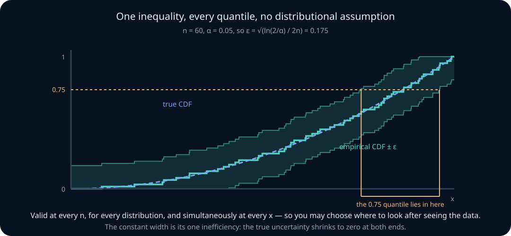
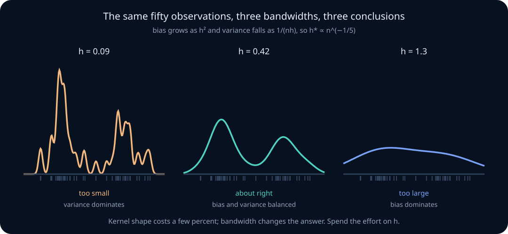

# Order statistics, empirical processes, rank tests, and density estimation

Every method so far has assumed a family. Maximum likelihood needs a likelihood; a GLM needs a link and a variance function; a mixture needs component shapes. This unit asks what remains estimable when you refuse to name a family at all, and the answer is more than most people expect — but the guarantees change character, from "efficient if the model is right" to "valid whatever the distribution, at a cost in efficiency."

Three threads run through it. **Order statistics** are what you get by sorting, and they turn out to have exact, computable distributions that depend on the population only through its CDF. **Empirical process theory** upgrades the plug-in principle from pointwise consistency, which lessons 06 and 08 established, to *uniform* control over the whole distribution function, with a finite-sample band you can draw. **Ranks** replace values by their positions, and because the rank vector has the same distribution under any continuous population, statistics built from ranks have null distributions you can compute exactly without knowing anything.

The practical payoff for AI work is concentrated and specific. A win rate between two models is an ordinal estimand, and which one depends on the design: across independent prompts, \(P(B>A)\) is exactly the Mann–Whitney estimand, while the fraction of *matched* prompts on which B beats A is a paired quantity that the sign test addresses. The two differ whenever prompts share difficulty, and conflating them has consequences for ranking that most leaderboards get wrong. A p99 latency claim is a statement about an order statistic, with uncertainty that behaves nothing like a mean's. And the conformal threshold from lesson 13 is literally an order statistic, its coverage guarantee a rank argument.

By the end, you should be able to derive the distribution of any order statistic; state the asymptotic distribution of a sample quantile and explain the density in its denominator; distinguish Glivenko–Cantelli from the pointwise law of large numbers and both from DKW; draw a finite-sample uniform confidence band; explain why rank statistics are distribution-free and what that costs in efficiency; compute and correctly interpret Mann–Whitney, including why it is not a test of medians and why win rates are not transitive; recognize U-statistics as the common framework; use kernel density estimation with a defensible bandwidth and know its rate and boundary problems; and apply Rao–Blackwellization to reduce Monte Carlo variance.

## Learning route: exact ranks to smooth densities

The chapter moves from the fewest assumptions to progressively stronger ones.

1. **Sorting and ranks:** finite-sample combinatorics give exact laws under iid continuity or exchangeability.
2. **Empirical CDFs:** DKW controls a whole distribution function without smoothness, but independence still matters.
3. **Rank tests and U-statistics:** define the estimand before choosing paired or independent comparisons; the pair count is not the independent sample size.
4. **Quantiles and densities:** local precision depends on \(f(q_p)\), and KDE adds smoothness plus bandwidth assumptions. Boundary corrections change the estimator and must be named.
5. **Research audit:** report the exchangeable unit, target population, estimand, dependence structure, and tuning or selection procedure before quoting “distribution-free.”

When stuck, transform through \(U=F(X)\). For continuous \(F\), order and rank questions become uniform problems; then translate back carefully.

## 0. What distribution-free means, and what it does not

A procedure is **distribution-free** when its behaviour under the null hypothesis does not depend on the population distribution. A **nonparametric** model is one whose parameter is the distribution itself rather than a finite-dimensional vector. The two often travel together and are not the same thing.

Three clarifications prevent most confusion.

**Distribution-free is a statement about the null, not about power.** The Wilcoxon test's null distribution is the same for every continuous population, so its type I error is exact. Its *power* depends heavily on the population, and so does the meaning of the alternative it detects.

**Nonparametric does not mean assumption-free.** Independence, identical distribution, exchangeability, continuity, and smoothness are all still assumptions, and the first is usually the one that fails in logged data. A nonparametric method applied to dependent rows is wrong in exactly the way lesson 10 described for clustered evaluation.

**Assuming less costs something, and the currency is rate.** Estimating a mean converges at \(n^{-1/2}\). Estimating a whole density converges at \(n^{-2/5}\) in one dimension and worse in more, because you are estimating infinitely many things at once. Refusing to name a family is not free; it is paid for in sample size.

**Worked example — the same question, three commitments.** "Is model B better?" can mean: the mean score difference is positive (a parametric or asymptotic claim about one number), the median difference is positive (a location claim needing much less structure), or \(P(B>A)>1/2\) (a purely ordinal claim). The three can disagree in sign on the same data, and the choice among them is substantive, not statistical.

> **Practice — Foundation:** Classify each as distribution-free, nonparametric, both, or neither: (a) the Wilcoxon rank-sum test with \(m=n=5\); (b) a kernel density estimate of latencies; (c) a two-sample \(t\)-test. For (a), compute the null probability that the first sample holds exactly the ranks \(\{1,\dots,5\}\), and say why it is the same for every continuous population.
>
> **Hint:** Under the null all \(\binom{10}{5}=252\) rank subsets are equally likely whatever \(F\) is, so the probability is \(1/252\approx0.004\); a KDE estimates \(F\) itself (nonparametric) but has no \(F\)-free null law.
>
> **Practice — Core:** A 'nonparametric' A/B comparison uses 10,000 logged requests from 200 sessions of 50 requests each, with within-session correlation 0.1. Name three assumptions the rank test still makes, compute the design effect and effective sample size, and say which assumption fails.
>
> **Hint:** The design effect for clusters of size \(m\) is \(1+(m-1)\rho=1+49(0.1)=5.9\), so the 10,000 rows carry the information of about 1,700 independent ones; independence is the assumption that fails.
>
> **Practice — Stretch:** Model A scores 1 on every prompt; model B scores 2 with probability 0.9 and \(-20\) with probability 0.1. Compute \(P(B>A)\) and \(E[B-A]\), and say which one a deployment decision that cares about catastrophic failures needs.
>
> **Hint:** \(P(B>A)=0.9\) while \(E[B-A]=0.9(2)+0.1(-20)-1=-1.2\); the ordinal and mean estimands disagree in sign.

## 1. Order statistics

Given \(X_1,\dots,X_n\), sort them to get the **order statistics**

$$
X_{(1)}\le X_{(2)}\le\dots\le X_{(n)}.
$$

For iid observations with CDF \(F\), the distribution of each is exact and elementary. The event \(X_{(k)}\le x\) says at least \(k\) of the observations fell at or below \(x\), and each does so independently with probability \(F(x)\). Hence

$$
P\bigl(X_{(k)}\le x\bigr)=\sum_{j=k}^n\binom nj F(x)^j\bigl(1-F(x)\bigr)^{n-j}.
$$

Two special cases are worth memorizing: \(P(X_{(n)}\le x)=F(x)^n\) for the maximum and \(P(X_{(1)}>x)=(1-F(x))^n\) for the minimum.

Differentiating gives the density, when \(F\) has one:

$$
f_{(k)}(x)=\frac{n!}{(k-1)!\,(n-k)!}\,F(x)^{k-1}\bigl(1-F(x)\bigr)^{n-k}f(x).
$$

Read it as a multinomial count: \(k-1\) observations below \(x\), one at \(x\), and \(n-k\) above, with the factorials counting arrangements.

The uniform case is the master case, because \(F(X)\sim\mathrm{Unif}(0,1)\) under the probability integral transform. For uniforms,

$$
U_{(k)}\sim\mathrm{Beta}(k,\,n-k+1),
\qquad
E[U_{(k)}]=\frac{k}{n+1},
\qquad
\operatorname{Var}(U_{(k)})=\frac{k(n-k+1)}{(n+1)^2(n+2)}.
$$

Everything else follows by the transformation \(X_{(k)}=F^{-1}(U_{(k)})\), which is why order-statistic results are usually stated for uniforms and then pushed through a quantile function.

**Worked example — where the expected maximum sits.** For \(n=100\) uniforms, \(E[U_{(100)}]=100/101\approx0.990\), not \(1\). The expected largest of \(n\) draws sits at the \(n/(n+1)\) quantile — a useful sanity check whenever a maximum is being used to estimate a bound, and the source of the standard bias correction in "largest observed value" estimators.

> **Practice — Foundation:** For \(n=5\) iid Exponential(1) observations, write the CDFs of the maximum and the minimum and evaluate \(P(X_{(5)}\le1)\) and \(P(X_{(1)}\le1)\).
>
> **Hint:** \(P(X_{(n)}\le x)=F(x)^n\) and \(P(X_{(1)}\le x)=1-(1-F(x))^n\) with \(F(1)=1-e^{-1}\): about 0.101 and \(1-e^{-5}\approx0.993\).
>
> **Practice — Core:** Derive the density of \(X_{(k)}\) from the multinomial argument, specialize to \(n=2\) uniforms to get \(f_{(1)}(u)=2(1-u)\) and \(f_{(2)}(u)=2u\), check each integrates to one, and compute \(E[U_{(1)}]\) and \(E[U_{(2)}]\).
>
> **Hint:** Count \(k-1\) points below \(u\), one at \(u\), \(n-k\) above: \(\frac{n!}{(k-1)!(n-k)!}u^{k-1}(1-u)^{n-k}\); the means are \(k/(n+1)=1/3\) and \(2/3\).
>
> **Practice — Stretch:** Use the probability integral transform to write the median of five Exponential(1) observations as \(X_{(3)}=-\log(1-U_{(3)})\) with \(U_{(3)}\sim\mathrm{Beta}(3,3)\); compute \(P(X_{(3)}\le\log2)\) and \(E[X_{(3)}]\).
>
> **Hint:** \(X_{(3)}\le\log2\) iff \(U_{(3)}\le1/2\), which has probability 1/2 by the symmetry of Beta(3,3); for the mean use Rényi, \(1/5+1/4+1/3=47/60\approx0.783\).

## 2. Joint distributions and spacings

The joint density of the full ordered sample is

$$
f_{(1),\dots,(n)}(x_1,\dots,x_n)=n!\prod_{i=1}^n f(x_i)
\qquad\text{on }x_1<x_2<\dots<x_n,
$$

and zero elsewhere. The \(n!\) is the number of unordered samples mapping to the same ordered one; sorting loses exactly the ordering information, which is the intuition behind the order statistics being sufficient for an iid model with unknown \(F\).

**Spacings** are the gaps \(D_k=X_{(k)}-X_{(k-1)}\), and they carry the local density information. For the exponential distribution the result is exceptionally clean: by the **Rényi representation**, the scaled spacings

$$
(n-k+1)\bigl(X_{(k)}-X_{(k-1)}\bigr)
$$

are independent and identically Exponential(\(\lambda\)) for \(k=1,\dots,n\), with \(X_{(0)}=0\). The memorylessness of the exponential makes each gap a fresh exponential race among the survivors, and the number of survivors shrinks by one each time.

Spacings are the basis of several practical tools: goodness-of-fit tests that look at whether gaps behave as expected, uniformity tests, and nearest-neighbour density estimates, which are spacing-based in one dimension.

**Worked example — why the last gaps are enormous.** With \(n=1000\) exponential latencies, the expected gap between the 999th and 1000th order statistic is \(\lambda^{-1}/1\), while the gap between the 500th and 501st is \(\lambda^{-1}/501\). The tail is sparse by construction, which is precisely why estimating a p999 from 1,000 observations is hopeless: the data in that region is a single gap.

> **Practice — Foundation:** Write the joint density of the ordered sample for \(n=3\) iid Uniform(0,1) and verify it integrates to one over \(0<x_1<x_2<x_3<1\); explain the factor \(3!\).
>
> **Hint:** The density is \(3!\cdot1=6\) on the ordered region, whose volume is \(1/3!\); the 6 counts the unordered samples that sort to the same ordered one.
>
> **Practice — Core:** For \(n=10\) iid Exponential(rate 2), use the Rényi representation to find the distributions and means of the first spacing \(X_{(1)}\) and the last spacing \(X_{(10)}-X_{(9)}\).
>
> **Hint:** \((n-k+1)(X_{(k)}-X_{(k-1)})\sim\text{Exp}(2)\) independently, so the first spacing is Exp(rate 20) with mean 0.05 and the last is Exp(rate 2) with mean 0.5.
>
> **Practice — Stretch:** For \(n=1000\) iid Exponential(1), write \(X_{(1000)}=\sum_{k}E_k/(n-k+1)\), compute \(\operatorname{Var}(X_{(1000)})=\sum_{j=1}^{1000}j^{-2}\), and find the share contributed by the last three gaps. Relate this to why the bootstrap fails for extremes.
>
> **Hint:** The variance is about 1.644, and the last three gaps contribute \(1+1/4+1/9\approx1.361\), about 83%; resampling cannot create values beyond the observed maximum, so it cannot reproduce those gaps.

## 3. Sample quantiles and the density in the denominator

The sample \(p\)-quantile \(\hat q_p\) is an order statistic, typically \(X_{(\lceil np\rceil)}\) with conventions varying by interpolation rule. It is consistent for the population quantile \(q_p\) whenever \(F\) is strictly increasing at \(q_p\), and its asymptotic distribution is

$$
\sqrt n\,\bigl(\hat q_p-q_p\bigr)\ \xrightarrow{d}\ \mathcal N\!\left(0,\ \frac{p(1-p)}{f(q_p)^2}\right).
$$

The numerator is familiar Bernoulli variance: whether an observation falls below \(q_p\) is a coin flip with probability \(p\). The interesting term is the **density in the denominator**, and it governs everything about quantile uncertainty.

Where the density is high, many observations sit near the quantile and it is pinned down precisely. Where the density is low — in a tail — few observations are nearby and the quantile wanders. The variance scales as \(1/f(q_p)^2\), so a density ten times smaller gives a standard error a hundred times larger in variance terms.

Three consequences for practice:

- **The median is the easy case.** \(p(1-p)=1/4\) is maximal but \(f\) is typically largest at the centre, and for a Gaussian the median's variance is \(\pi/2\approx1.57\) times the mean's — the familiar 64% efficiency of the median under normality.
- **Extreme quantiles are hard, and the difficulty is not fixed by more data alone.** The standard error of a p99 shrinks at \(n^{-1/2}\), but the constant involves \(1/f(q_{0.99})\), which for a heavy-tailed latency distribution can be enormous.
- **Estimating the standard error requires estimating a density**, which is the problem of sections 17 to 19. This is why practitioners use the bootstrap or distribution-free order-statistic intervals for quantiles instead.

The distribution-free alternative is exact and often better: since \(\sum_i 1\{X_i\le q_p\}\sim\mathrm{Binomial}(n,p)\), an interval for \(q_p\) can be formed from two order statistics \([X_{(r)},X_{(s)}]\) whose binomial tail probabilities give the desired coverage. No density, no asymptotics.

**Worked example — a p99 latency SLO.** With 2,000 logged requests, the p99 is roughly \(X_{(1980)}\), and the binomial method gives an exact central interval from \(X_{(1971)}\) to \(X_{(1989)}\) for 95% coverage — 95.78% precisely, since discreteness forbids hitting 95% exactly — a range spanning 19 order statistics. Reporting the p99 as a single number without that width is the most common quantitative error in latency reporting.

> **Practice — Foundation:** State the asymptotic variance of a sample quantile and evaluate the standard error of the median and of the 0.99 quantile for \(n=100\) draws from \(N(0,1)\).
>
> **Hint:** Use \(p(1-p)/(nf(q_p)^2)\) with \(f(0)=0.399\) and \(f(2.326)=0.0267\): the SEs are about 0.125 and 0.373.
>
> **Practice — Core:** Compute the asymptotic relative efficiency of the median against the mean for a Gaussian population, and use it to say how many observations the median needs to match the mean's precision at \(n=100\).
>
> **Hint:** \(\operatorname{Var}(\text{median})\approx\frac{1}{4nf(0)^2}=\frac{\pi\sigma^2}{2n}\) against \(\sigma^2/n\), so the ARE is \(2/\pi\approx0.637\) and the median needs about 157 observations.
>
> **Practice — Stretch:** For \(n=50\), find order statistics \([X_{(r)},X_{(s)}]\) forming the shortest distribution-free interval for the 0.9 quantile with coverage at least 95%, compute its exact coverage from the binomial, and describe a simulation that would confirm it.
>
> **Hint:** Coverage is \(P(r\le B\le s-1)\) with \(B\sim\text{Bin}(50,0.9)\); searching over \((r,s)\) gives \([X_{(40)},X_{(49)}]\) with coverage about 0.957, whatever the continuous \(F\).

## 4. Extremes need their own theory

The central limit theorem describes averages. Maxima have a parallel theory with a different set of limits, and using the wrong one is a common failure in tail-risk work.

The **Fisher–Tippett–Gnedenko theorem** says that if \((X_{(n)}-b_n)/a_n\) converges in distribution to a nondegenerate limit, that limit belongs to one of three families, unified as the **generalized extreme value** distribution

$$
G_\xi(z)=\exp\left(-\bigl(1+\xi z\bigr)^{-1/\xi}\right),
$$

with \(\xi=0\) interpreted as the limit, giving **Gumbel** (light tails: normal, exponential), \(\xi>0\) giving **Fréchet** (heavy tails: Pareto, Cauchy, \(t\)), and \(\xi<0\) giving **Weibull** (bounded support). The shape parameter \(\xi\) is the whole story, and it is a property of the tail that no amount of central data reveals.

The complementary approach is **peaks over threshold**: by the Pickands–Balkema–de Haan theorem, exceedances over a high threshold \(u\) converge to a **generalized Pareto** distribution. This uses all observations above \(u\) rather than one maximum per block, and is the standard practical tool.

Two warnings. First, **the bootstrap fails for extremes**, as lesson 08 stated: the empirical distribution has no mass beyond the observed maximum, so resampling cannot represent uncertainty about unseen values. Second, **threshold choice is the entire difficulty** — too low and the asymptotic approximation fails, too high and almost no data remains. Mean-residual-life plots and stability of \(\hat\xi\) across thresholds are the standard diagnostics, and they are genuinely ambiguous.

**Worked example — a tail index changes the question.** Two latency distributions have identical medians and p95s. One has \(\xi=0\), so the p9999 is about 1.3 times the p99; the other has \(\xi=0.4\), so the p9999 is about 6 times the p99. The central statistics that a dashboard reports are identical, and the capacity plan implied by the two is not.

> **Practice — Foundation:** Name the three extreme-value families, and classify the maximum of Exponential(1), Pareto(\(\alpha=3\)), and Uniform(0,1) data with the value of \(\xi\) for each.
>
> **Hint:** Light tails give Gumbel (\(\xi=0\)), polynomial tails give Fréchet (\(\xi=1/\alpha\)), and bounded support gives Weibull (\(\xi<0\), here \(-1\)).
>
> **Practice — Core:** For the maximum \(M_n\) of \(n\) Exponential(1) observations, show \(P(M_n-\log n\le x)=(1-e^{-x}/n)^n\to\exp(-e^{-x})\), and compare the exact value at \(n=100\), \(x=1\) with the Gumbel limit.
>
> **Hint:** Use \(P(M_n\le x+\log n)=F(x+\log n)^n\) and \((1+a/n)^n\to e^a\); the two values are about 0.6917 and 0.6922.
>
> **Practice — Stretch:** For Pareto(\(x_m=1,\alpha=2\)), show that exceedances \(X-u\) given \(X>u\) are exactly generalized Pareto with \(\xi=1/2\) and \(\sigma=u/2\) at every threshold \(u\in\{2,5,10\}\), and recover the p9999 from the \(u=10\) fit with \(P(X>10)=0.01\). Then say what you would report if \(\hat\xi\) drifted across thresholds on real data.
>
> **Hint:** \(P(X>u+y\mid X>u)=(1+y/u)^{-2}=(1+\xi y/\sigma)^{-1/\xi}\); solve \(0.01(1+y/10)^{-2}=10^{-4}\) to get \(y=90\), so the p9999 is 100.

## 5. The empirical CDF as a random function

Lessons 06 and 08 introduced the empirical distribution as a fitted population. Here it is treated as a **random function** rather than a plug-in device, which is what makes uniform statements possible.

Define

$$
\hat F_n(x)=\frac1n\sum_{i=1}^n\mathbf 1\{X_i\le x\}.
$$

At any fixed \(x\), \(n\hat F_n(x)\sim\mathrm{Binomial}(n,F(x))\), so \(\hat F_n(x)\) is unbiased with variance \(F(x)(1-F(x))/n\). The pointwise law of large numbers and CLT follow immediately, and give a pointwise confidence interval at any single \(x\).

That is not enough for most purposes. A pointwise interval is valid at one pre-chosen \(x\); scanning a plot for the largest discrepancy and reading off its pointwise interval is the multiple-comparisons error of lesson 07, applied to a continuum. Any statement about the *whole* function — a goodness-of-fit test, a band drawn around a curve, a supremum distance — requires uniform control, and that is what the next two sections supply.

The covariance structure is worth noting because it drives everything downstream:

$$
\operatorname{Cov}\bigl(\hat F_n(s),\hat F_n(t)\bigr)=\frac{F(s\wedge t)-F(s)F(t)}{n},
$$

which is the covariance of a Brownian bridge divided by \(n\). The variance vanishes at both ends, where \(F\) is 0 or 1 — a fact that will explain the tail insensitivity of the Kolmogorov–Smirnov test in section 16.

**Worked example — the band that was not a band.** An engineer plots an empirical CDF with pointwise 95% intervals and observes the fitted lognormal leaving the interval somewhere in the middle. That excursion is not evidence at the 5% level, because the maximum of many pointwise deviations exceeds any single one. The correct object is a uniform band, and it is roughly 1.4 times wider at the centre.

> **Practice — Foundation:** At a point where \(F(x)=0.3\), state the mean, variance, and standard error of \(\hat F_n(x)\) for \(n=50\).
>
> **Hint:** \(n\hat F_n(x)\sim\text{Bin}(50,0.3)\), so the mean is 0.3, the variance \(0.3(0.7)/50=0.0042\), and the SE about 0.065.
>
> **Practice — Core:** Derive \(\operatorname{Cov}(\hat F_n(s),\hat F_n(t))\), evaluate it and the correlation for \(F(s)=0.2\), \(F(t)=0.6\), \(n=50\), and say where the covariance vanishes.
>
> **Hint:** For \(s<t\), \(\operatorname{Cov}(\mathbf1\{X\le s\},\mathbf1\{X\le t\})=F(s)-F(s)F(t)\): the covariance is \(0.08/50=0.0016\) and the correlation \(0.08/\sqrt{0.16\cdot0.24}\approx0.41\); it vanishes when \(F(s)=0\) or \(F(t)=1\).
>
> **Practice — Stretch:** For \(n=200\), compare the half-width of a pointwise 95% interval for \(F(x)\) at \(F(x)=0.5\) with the DKW 95% uniform band, explain why the pointwise intervals cannot be read as a band, and give the ratio.
>
> **Hint:** The pointwise half-width is \(1.96\sqrt{0.25/200}\approx0.069\) and the band is \(\sqrt{\ln40/400}\approx0.096\), a ratio of about 1.39; scanning the whole curve is a multiple comparison.

## 6. Glivenko–Cantelli: the fundamental theorem of statistics

**Theorem (Glivenko–Cantelli).** For iid observations from any CDF \(F\),

$$
\sup_{x\in\mathbb R}\bigl|\hat F_n(x)-F(x)\bigr|\ \xrightarrow{\text{a.s.}}\ 0 .
$$

The empirical distribution converges to the truth **uniformly**, not merely at each point, and with no assumptions on \(F\) whatever — not continuity, not moments, not a density.

The proof idea is worth carrying because it generalizes. Partition the range into finitely many cells at quantiles \(F^{-1}(j/m)\); apply the pointwise law of large numbers at those finitely many points; and use monotonicity of both \(\hat F_n\) and \(F\) to control the function between grid points by its values at the grid, with error at most \(1/m\). Take \(m\) large. Monotonicity is doing the work of turning finitely many pointwise statements into a uniform one.

This result is why the plug-in principle works at all, and why the bootstrap has any hope: every functional that is continuous with respect to the supremum distance inherits consistency automatically. Substituting \(\hat F_n\) for \(F\) in a continuous functional gives a consistent estimator, which retroactively justifies the bootstrap machinery of lesson 08 and the plug-in estimators of lesson 06.

The generalization is one of the load-bearing ideas of statistical learning theory: replace the class of half-lines \(\{(-\infty,x]\}\) by a richer class of sets or functions, and uniform convergence holds if and only if the class is not too rich — VC dimension for sets, metric entropy for functions. The uniform convergence of empirical means over a hypothesis class is exactly what generalization bounds require, so lesson 06's entropy-and-generalization material and this theorem are the same mathematics at different levels of generality.

**Worked example — why "it works on my sample" generalizes.** Evaluating one fixed metric on a held-out sample needs only the pointwise law of large numbers. Selecting the best of 500 model variants on that sample needs uniform convergence over 500 functions, and the penalty is roughly \(\sqrt{\log 500/(2n)}\). Glivenko–Cantelli is the continuum version of the same accounting.

> **Practice — Foundation:** State Glivenko–Cantelli, then compute \(\sup_x|\hat F_n(x)-x|\) for the sample \((0.1,0.4,0.7)\) from Uniform(0,1), and say how this differs from the pointwise law of large numbers.
>
> **Hint:** The supremum is attained at a jump: check \(|i/n-x_{(i)}|\) and \(|(i-1)/n-x_{(i)}|\) at each point; the largest, \(1-0.7=0.3\), is the uniform distance that GC sends to zero.
>
> **Practice — Core:** Sketch the grid-plus-monotonicity proof. With grid points \(t_j\) at \(F(t_j)=j/10\), show that if \(|\hat F_n(t_j)-F(t_j)|\le0.02\) at every grid point, then \(\sup_x|\hat F_n(x)-F(x)|\le0.12\).
>
> **Hint:** For \(t_{j-1}\le x<t_j\), monotonicity sandwiches both \(\hat F_n(x)\) and \(F(x)\) between their values at \(t_{j-1}\) and \(t_j\), which are \(0.1\) apart in \(F\).
>
> **Practice — Stretch:** For threshold classifiers \(h_t(x)=\mathbf1\{x\le t\}\), show the empirical risks over all \(t\) are exactly \(\hat F_n(t)\). Use DKW at \(n=1000\), \(\alpha=0.05\) to bound the uniform deviation, and compare with Hoeffding for one fixed threshold. What does this say about generalization bounds?
>
> **Hint:** DKW gives \(\sqrt{\ln40/2000}\approx0.043\) simultaneously for all \(t\), exactly the single-threshold Hoeffding radius; this class pays nothing for uniformity, which is what a small-capacity class means.

## 7. DKW gives a finite-sample band you can draw

Glivenko–Cantelli is asymptotic. The **Dvoretzky–Kiefer–Wolfowitz inequality**, with Massart's sharp constant, is not:

$$
P\left(\sup_x\bigl|\hat F_n(x)-F(x)\bigr|>\varepsilon\right)\le 2e^{-2n\varepsilon^2}
\qquad\text{for all }\varepsilon>0 .
$$

Inverting it gives a **uniform confidence band** valid at every sample size and for every distribution. Setting the right side to \(\alpha\),

$$
\varepsilon_n=\sqrt{\frac{\ln(2/\alpha)}{2n}},
\qquad
\hat F_n(x)\pm\varepsilon_n\ \text{(clipped to }[0,1]\text{)},
$$

contains the entire true CDF with probability at least \(1-\alpha\), simultaneously at every \(x\). This is one of the most useful inequalities in applied statistics and one of the least used.



Three properties to appreciate. It is **distribution-free**: no continuity, no moments, nothing. It is **finite-sample**: no asymptotic approximation to apologize for. And it is **uniform**, so you may look at the band, choose the most interesting \(x\) after seeing the data, and still make a valid statement — the multiplicity is already paid for.

The band has constant width, which is its main inefficiency: the true uncertainty is smaller in the tails, where the binomial variance vanishes, so a constant-width band is conservative there and the shape is wrong for tail questions. Weighted bands and the Anderson–Darling weighting address this at the cost of simplicity.

For \(\alpha=0.05\), \(\varepsilon_n=\sqrt{\ln 40/(2n)}\approx1.358/\sqrt n\). At \(n=1000\) that is \(\pm0.043\) — a useful, honest, half-line calculation.

**Worked example — certifying a latency distribution.** With 5,000 logged latencies, \(\varepsilon_n\approx0.019\). The band around the empirical CDF then certifies, simultaneously, every quantile claim you can read off it: the true p95 lies between the empirical \(0.931\) and \(0.969\) quantiles. One inequality, all quantiles, no distributional assumption.

> **Practice — Foundation:** Compute \(\varepsilon_n\) for \(\alpha=0.05\) at \(n=400\) and state what the band guarantees.
>
> **Hint:** Solve \(2e^{-2n\varepsilon^2}=0.05\) to get \(\varepsilon=\sqrt{\ln40/800}\approx0.068\); the band holds simultaneously at every \(x\) with probability at least 0.95.
>
> **Practice — Core:** With \(n=400\) and \(\varepsilon=0.068\), convert the DKW band into simultaneous bounds on the p50 and p90, naming the order statistics that bracket each.
>
> **Hint:** The true \(q_p\) lies between the empirical \((p-\varepsilon)\) and \((p+\varepsilon)\) quantiles: \([X_{(173)},X_{(228)}]\) for the p50 and \([X_{(333)},X_{(388)}]\) for the p90, clipped to \([0,1]\) where needed.
>
> **Practice — Stretch:** At \(n=400\), compare the DKW radius 0.068 with the pointwise binomial SE of \(\hat F_n\) where \(F=0.01\), explain why a constant-width band is conservative in the tails, and propose a variance-weighted band.
>
> **Hint:** The pointwise SE at \(F=0.01\) is \(\sqrt{0.01(0.99)/400}\approx0.005\), about 14 times smaller; weight the deviation by \(\sqrt{F(1-F)}\), as Anderson–Darling does, and calibrate the weighted supremum.

## 8. The empirical process and where bootstrap guarantees come from

Scale the deviation by \(\sqrt n\) and it converges to a nondegenerate random function. The **empirical process**

$$
\mathbb G_n(x)=\sqrt n\bigl(\hat F_n(x)-F(x)\bigr)
$$

converges weakly, for continuous \(F\), to \(B(F(x))\), where \(B\) is a **Brownian bridge** — a Gaussian process on \([0,1]\) with mean zero, covariance \(s\wedge t-st\), and \(B(0)=B(1)=0\).

This single result supplies the null distributions of the classical goodness-of-fit tests. The Kolmogorov–Smirnov statistic \(\sqrt n\sup_x|\hat F_n-F|\) converges to \(\sup_t|B(t)|\), whose distribution is a known series; the Cramér–von Mises and Anderson–Darling statistics are integrals of \(B^2\) against different weights. That these limits do not depend on \(F\) is the reason the tests are distribution-free, and it traces back to the probability integral transform: \(F(X)\) is uniform, so the problem is always the uniform problem in disguise.

The same theory explains the bootstrap's asymptotic validity. The bootstrap resamples from \(\hat F_n\) rather than \(F\), and works when the functional of interest is suitably differentiable with respect to the distribution — the **functional delta method**, with the derivative being the **influence function**. Lesson 08's practical account of when the bootstrap fails is the applied face of this: failures occur exactly where the functional is not smooth in \(F\) (the maximum, a boundary parameter) or where the process does not converge as assumed (dependence, heavy tails without moments).

Influence functions are also the bridge to the sandwich estimators of lesson 11 and the doubly robust estimators of lesson 16: writing an estimator as an average of influence-function contributions plus a negligible remainder gives its asymptotic variance immediately, which is why modern causal inference is phrased in those terms.

**Worked example — reading the bridge.** Simulate 10,000 datasets of \(n=500\) uniforms, compute \(\sqrt n\sup|\hat F_n-F|\), and the histogram matches the Kolmogorov distribution regardless of whether you generated uniforms, exponentials, or Cauchy variables and transformed. That invariance *is* distribution-freeness, visible in one experiment.

> **Practice — Foundation:** State the limit of \(\sqrt n(\hat F_n-F)\), name its covariance function, and evaluate that covariance for uniform data at \(s=0.25\), \(t=0.75\).
>
> **Hint:** The limit is the Brownian bridge \(B(F(\cdot))\) with covariance \(s\wedge t-st\), here \(0.25-0.1875=0.0625\).
>
> **Practice — Core:** For the sample \((0.5,1.2,2.0)\) tested against Exponential(1), transform by \(u=1-e^{-x}\) and show the KS statistic equals the KS statistic of the \(u\) values against Uniform(0,1). Explain why this makes the null distribution independent of \(F\).
>
> **Hint:** The \(u\) values are about \((0.393,0.699,0.865)\), and \(\hat F_n(x)-F(x)=\hat G_n(u)-u\) at matching points, so both statistics equal about 0.393; under the null the \(u\) values are iid uniforms for every continuous \(F\).
>
> **Practice — Stretch:** Write the influence functions of the mean and of the median at \(N(0,1)\), evaluate each at \(x=100\), and compute their variances \(E[\mathrm{IF}^2]\). Relate the two forms to robustness.
>
> **Hint:** \(\mathrm{IF}_{\text{mean}}(x)=x\) and \(\mathrm{IF}_{\text{med}}(x)=\operatorname{sign}(x)/(2f(0))\): at \(x=100\) they are 100 and 1.253, with variances 1 and \(\pi/2\); a bounded IF means one point cannot move the estimate far.

## 9. Ranks are distribution-free because the rank vector is uniform

Replace each observation by its position in the sorted sample. For a continuous population, ties have probability zero, and the resulting **rank vector** \((R_1,\dots,R_n)\) is a permutation of \(1,\dots,n\).

The key fact: under the null hypothesis that the observations are exchangeable, every permutation is equally likely,

$$
P\bigl((R_1,\dots,R_n)=\pi\bigr)=\frac1{n!}\qquad\text{for every permutation }\pi,
$$

**whatever the population distribution is**. The ranks carry no information about \(F\), only about relative order, so any statistic computed from ranks alone has a null distribution that can be enumerated exactly by combinatorics.

This is the whole source of distribution-freeness. It requires only continuity (so ranks are well defined) and exchangeability under the null (so all permutations are equally likely). It requires nothing about shape, moments, or tails.

Three structural consequences:

- **Exact small-sample tests.** For small \(n\) the null distribution can be enumerated exhaustively rather than approximated. No normality, no asymptotics.
- **Robustness to outliers is automatic.** Replacing the largest observation by \(10^6\) does not change its rank, so rank statistics have bounded influence functions.
- **Information is discarded.** Ranks retain order and nothing else. If the spacings carry signal — and for a location shift with known shape they do — a rank test cannot use it, which is the source of the efficiency loss quantified in section 13.

The connection to lesson 13 is exact and worth making explicit: split conformal prediction takes the \(\lceil(n+1)(1-\alpha)\rceil\)-th order statistic of the calibration scores, and its coverage guarantee is precisely the statement that the test point's score is equally likely to take any rank among the \(n+1\) scores under exchangeability. Conformal prediction is a rank argument wearing machine-learning clothes.

**Worked example — counting instead of assuming.** With \(n=6\) paired differences, the signed-rank statistic takes finitely many values, and the exact null probability of each is a count over the \(2^6=64\) sign assignments. A p-value from that enumeration is exact at any sample size, where a \(t\)-test at \(n=6\) is leaning entirely on an assumption you cannot check.

> **Practice — Foundation:** For \(n=4\) exchangeable continuous observations, give the probability of any specific rank vector and of the event \(R_1=4\), and state why these hold for every population.
>
> **Hint:** Exchangeability makes all \(4!=24\) orderings equally likely, so the answers are \(1/24\) and \(6/24=1/4\), with no dependence on \(F\).
>
> **Practice — Core:** Enumerate the null distribution of the sum of the ranks of a randomly chosen subset of size 2 from 4 observations.
>
> **Hint:** List the 6 pairs from \(\{1,2,3,4\}\): the sums are \(3,4,5,5,6,7\), so \(P(5)=1/3\) and each other value has probability \(1/6\).
>
> **Practice — Stretch:** With \(n=19\) calibration scores and \(\alpha=0.1\), split conformal uses the \(\lceil(n+1)(1-\alpha)\rceil\)-th smallest score. Compute that rank, show the coverage is exactly \(18/20\) by a rank argument, and identify the exchangeability assumption it needs.
>
> **Hint:** The test score is equally likely to take any of the 20 ranks among the \(n+1\) scores, and it is covered iff its rank is at most 18; ties or drift between calibration and test break this.

## 10. The sign test and the Wilcoxon signed-rank test

For paired data — the same prompts scored by two models, the standard design from lesson 07 — compute differences \(D_i\) and test whether they are centred at zero.

**The sign test** uses only the signs. Under the null that \(P(D>0)=1/2\), the number of positive differences is \(\mathrm{Binomial}(n,1/2)\), and the p-value is an exact binomial tail. Assumptions: independence and a median of zero. Nothing else — not symmetry, not continuity beyond handling ties, not finite moments. It is the most assumption-light test in common use, and correspondingly the least powerful.

**The Wilcoxon signed-rank test** uses signs *and* the ranks of \(|D_i|\). Let \(W^+\) be the sum of ranks of the positive differences. Under the null that the \(D_i\) are symmetric about zero,

$$
E[W^+]=\frac{n(n+1)}4,
\qquad
\operatorname{Var}(W^+)=\frac{n(n+1)(2n+1)}{24},
$$

with exact enumeration available for small \(n\) and a normal approximation with continuity correction for large \(n\).

The extra assumption is **symmetry** of the difference distribution about its centre, and it is not cosmetic. If the differences are skewed — very common when one model occasionally fails catastrophically — the signed-rank test can reject even when the median difference is zero, because large-magnitude differences on one side dominate the rank sum. The sign test remains valid there. Choosing between them is choosing which assumption you are willing to make, and the asymmetry of model-comparison score differences makes this a live question rather than a textbook one.

**Worked example — a skew that fooled a test.** Model B beats A slightly on 60% of prompts and loses catastrophically on 5%. The median difference favours B. The mean favours A. The signed-rank statistic, which weights by magnitude rank, sits between and depends on how heavy the catastrophic tail is. Three defensible tests, three answers, and the right one depends on whether rare catastrophic failures matter for the decision — which is a product question, not a statistical one.

> **Practice — Foundation:** Compute an exact sign-test p-value for 9 positives out of 12.
>
> **Hint:** \(P(B\ge9)=(220+66+12+1)/4096\approx0.073\) for \(B\sim\text{Bin}(12,1/2)\); double it for the two-sided p-value, about 0.146.
>
> **Practice — Core:** For the paired differences \((1.2,-0.4,2.5,0.8,-0.1,1.9,3.1,0.6)\), compute \(W^+\), its exact two-sided p-value by enumerating the \(2^8\) sign assignments, and the normal-approximation p-value with continuity correction.
>
> **Hint:** The ranks of \(|d|\) give \(W^+=33\) (only ranks 1 and 2 are negative); \(P(W^+\ge33)=5/256\) under the null, and \(E=18\), \(\operatorname{Var}=51\).
>
> **Practice — Stretch:** Let the differences be \(D=-E\) with probability 1/2 and \(D=3E\) with probability 1/2, where \(E\sim\text{Exp}(1)\), so the median is 0. Simulate \(n=20\) pairs 4,000 times and report the rejection rates at 5% of the signed-rank test and the exact sign test.
>
> **Hint:** Positive differences are larger in magnitude, so they take the high ranks: expect the signed-rank test to reject about 14% of the time, and the sign test to stay at or below 5% (about 4%).

## 11. Mann–Whitney estimates \(P(X>Y)\), not a difference of medians

For two independent samples \(X_1,\dots,X_m\) and \(Y_1,\dots,Y_n\), pool and rank. The **Wilcoxon rank-sum** statistic is the sum of ranks in the first sample; the equivalent **Mann–Whitney** form counts pairwise wins,

$$
U=\sum_{i=1}^m\sum_{j=1}^n\left[\mathbf 1\{X_i>Y_j\}+\tfrac12\mathbf 1\{X_i=Y_j\}\right],
$$

related by \(U=R_X-\frac{m(m+1)}2\). Under the null that both samples come from the same distribution,

$$
E[U]=\frac{mn}2,
\qquad
\operatorname{Var}(U)=\frac{mn(m+n+1)}{12},
$$

with a tie correction subtracting \(\frac{mn\sum_j(t_j^3-t_j)}{12(m+n)(m+n-1)}\) for tie groups of sizes \(t_j\).

Now the part that matters most and is most often stated wrongly. The estimand is

$$
\hat\theta=\frac U{mn}\ \longrightarrow\ \theta=P(X>Y)+\tfrac12P(X=Y),
$$

the probability that a randomly chosen \(X\) beats a randomly chosen \(Y\). This is **not** a difference of medians, and it is not a difference of means. It coincides with a statement about medians only under an added **location-shift model** — the assumption that the two distributions have the same shape and differ by a constant. Without that assumption:

- Mann–Whitney can be significant when the two medians are **identical**, if the distributions differ in shape.
- Two distributions with the same \(\theta=1/2\) can have very different means.
- Most importantly, \(\theta\) is **not transitive**: there exist distributions with \(P(A>B)>1/2\), \(P(B>C)>1/2\), and \(P(C>A)>1/2\). Non-transitive dice are the standard construction.

That last point has a direct consequence for AI evaluation. A **win rate** between two models is exactly \(\hat\theta\). Building a global ranking from pairwise win rates therefore assumes a structure the statistic does not provide, and observed preference cycles in model arenas are not necessarily noise or rater error — they are what a non-transitive functional does. Fitting a Bradley–Terry model, as lesson 11 §15 does, imposes transitivity by assumption; the honest report includes how badly that assumption fits.

**Worked example — the tie in win rate that hides everything.** Model A scores uniformly on \([0,1]\). Model B scores \(0.4\) always. Then \(P(A>B)=0.6\), so B looks worse. Model C scores \(0.55\) always, so \(P(C>A)=0.55\) and \(P(C>B)=1\). Now replace A with a bimodal model and the cycle appears. The win rate is a real quantity; it is just not an ordering.

> **Practice — Foundation:** For \(X=(3,5,7)\) and \(Y=(2,5,6,8)\), compute \(U\) counting ties as one half, and \(\hat\theta=U/(mn)\).
>
> **Hint:** Count the wins of each \(x\) over the four \(y\) values: \(1+1.5+3=5.5\), so \(\hat\theta=5.5/12\approx0.458\).
>
> **Practice — Core:** Let \(X\sim\text{Unif}(-1,1)\) and let \(Y\) be \(\text{Unif}(-0.2,0)\) with probability 1/2 and \(\text{Unif}(0,1)\) with probability 1/2, so both have median 0. Compute \(\theta=P(X>Y)\), and explain why Mann–Whitney's power tends to one as \(m,n\to\infty\).
>
> **Hint:** \(P(X>y)=(1-y)/2\); average over each half of \(Y\) to get \(0.5(0.55)+0.5(0.25)=0.40\ne1/2\), and the test is consistent for \(\theta\ne1/2\).
>
> **Practice — Stretch:** The dice \(A=(2,2,4,4,9,9)\), \(B=(1,1,6,6,8,8)\), \(C=(3,3,5,5,7,7)\) are fair. Compute \(P(A>B)\), \(P(B>C)\), \(P(C>A)\), and explain what a Bradley–Terry fit to many rolls of each pair would report.
>
> **Hint:** Each probability is \(5/9\), a perfect cycle; Bradley–Terry forces a total order, so by symmetry it gives equal strengths and predicts 1/2 for every pair.

## 12. Hodges–Lehmann estimates and distribution-free intervals

A test is more useful with an estimate attached. Inverting a rank test — collecting the set of shift values not rejected — gives both.

The **Hodges–Lehmann estimator** for a two-sample shift is the median of all \(mn\) pairwise differences,

$$
\hat\Delta_{\text{HL}}=\operatorname{median}\{X_i-Y_j\},
$$

and for the one-sample symmetric case it is the median of the \(\binom n2+n\) **Walsh averages** \((D_i+D_j)/2\) for \(i\le j\). These are the point estimates whose associated tests are the rank-sum and signed-rank tests respectively, in the same sense that the sample mean is the estimate associated with the \(t\)-test.

The confidence interval comes free: the endpoints are order statistics of the pairwise differences, at ranks determined by the critical values of the rank statistic. The result is **distribution-free** — under the shift model \(G(x)=F(x-\Delta)\), the coverage is exact for every continuous \(F\) and does not depend on which one. Drop the shift assumption and the interval no longer brackets a well-defined single parameter, so the estimand has to be restated before the guarantee means anything. It is also robust, with a breakdown point of about 29% for the two-sample version, against 0% for the difference of means.

The efficiency is excellent. Under normality the Hodges–Lehmann estimator has asymptotic relative efficiency \(3/\pi\approx0.955\) against the sample mean, so the insurance costs about 5% of sample size. Under heavier tails it wins, often by a lot.

**Worked example — the interval that survives one bad row.** Two samples of 40 model scores give a mean difference of \(0.031\) with interval \([0.004,0.058]\). One logged score is corrupted to \(-50\). The mean difference becomes \(-1.22\) with an interval spanning zero; the Hodges–Lehmann estimate moves from \(0.029\) to \(0.028\) and its interval barely changes. Robustness is not an abstraction when data comes from a pipeline.

> **Practice — Foundation:** Compute the two-sample Hodges–Lehmann estimate for \(X=(4,7,9)\), \(Y=(1,3,8)\).
>
> **Hint:** Form all nine differences \(x_i-y_j\) and take their median: the sorted list is \(-4,-1,1,1,3,4,6,6,8\), so the estimate is 3.
>
> **Practice — Core:** For \(X=(4,7,9,12)\), \(Y=(1,3,8,10)\), invert the rank-sum test to get an interval for the shift: using the exact null of \(U\) (\(P(U\le1)=2/70\)), show the interval is \([D_{(2)},D_{(15)}]\) of the 16 pairwise differences with coverage \(1-4/70\approx0.943\), and compute it.
>
> **Hint:** A shift \(\Delta\) is not rejected iff \(U\) computed from \(X-\Delta\) lies in \([2,14]\), which happens iff \(\Delta\) lies between the 2nd and 15th ordered differences, here \([-4,9]\).
>
> **Practice — Stretch:** With \(m=n=40\) and a fraction \(\varepsilon\) of each sample corrupted, show the Hodges–Lehmann estimator breaks down once \((1-\varepsilon)^2<1/2\) (about 12 points per sample), against one point for the mean difference. Combine this with the efficiencies 0.955 (normal) and 1.5 (Laplace) to say when each estimator is preferable.
>
> **Hint:** A pairwise difference is clean only if both of its points are clean, so the median of the differences survives while more than half of them, \((1-\varepsilon)^2\), are clean; \(\varepsilon^\ast=1-1/\sqrt2\approx0.293\).

## 13. Efficiency: the price of assuming less

Pitman asymptotic relative efficiency compares the sample sizes two tests need for the same limiting power against specified local alternatives. The numbers below concern independent-sample location-shift models with the regularity conditions needed for the comparison; they do not compare arbitrary distribution changes, clustered data, or different estimands.

| Comparison | Gaussian | Uniform | Logistic | Laplace | Heavy tails |
|---|---|---|---|---|---|
| Wilcoxon vs \(t\) | 0.955 | 1.00 | 1.10 | 1.50 | \(\to\infty\) |
| Sign vs \(t\) | 0.637 | 0.33 | 0.82 | 2.00 | \(\to\infty\) |

Three facts follow.

**The cost under ideal conditions is small.** Wilcoxon needs about 5% more data than the \(t\)-test when the \(t\)-test's assumptions hold exactly. That is a modest insurance premium.

**The gain under non-ideal conditions is unbounded.** For heavy-tailed populations the \(t\)-test's efficiency collapses, because the sample mean's variance is driven by rare extremes while ranks are unaffected. For a Cauchy population the \(t\)-test is not even consistent for a location comparison, while Wilcoxon is perfectly well behaved.

**A qualified lower bound.** In the independent two-sample location-shift setting, the classical Wilcoxon-versus-t Pitman efficiency has a lower bound of \(0.864\). For an absolutely continuous density \(f\) with finite variance and the required regularity, the comparison is \(12\sigma^2(\int f^2)^2\). This is an asymptotic local-power statement, not a guarantee for every finite dataset or every continuous alternative. Infinite-variance cases require separate treatment of the t statistic rather than substituting an undefined variance into this formula. See [Hodges and Lehmann, The Efficiency of Some Nonparametric Competitors of the t-Test](https://doi.org/10.1214/aoms/1177728261).

The counterargument deserves a fair statement: rank methods answer an ordinal question. If the decision depends on the size of an effect on the original scale — cost per request, tokens saved, seconds of latency — then a shift in \(P(X>Y)\) does not answer it, and converting back requires the location-shift assumption you were avoiding.

**Worked example — matched estimand and design.** Under a Gaussian location shift, Wilcoxon rank-sum has efficiency \(3/\pi\approx0.955\), corresponding to about \(\pi/3\approx1.047\) times as many independent observations for matched local power. Before using that comparison for model evaluation, decide whether the data are paired and whether the target is a location shift, a superiority probability, or an original-scale mean. The independent-sample rank-sum calculation does not justify ignoring pairing; a signed-rank analysis introduces its own symmetry assumptions. Rare catastrophic costs may be central to the estimand and should not be dismissed merely because ranks are less sensitive to their magnitudes.

> **Practice — Foundation:** State the ARE of the Wilcoxon test relative to the \(t\)-test under normality, and convert it into the Wilcoxon sample size matching a \(t\)-test with \(n=100\) per group.
>
> **Hint:** The ARE is \(3/\pi\approx0.955\), so Wilcoxon needs about \(100/0.955\approx105\) per group for the same local power.
>
> **Practice — Core:** For a \(t_3\) population (variance 3), compute the ARE \(12\sigma^2(\int f^2)^2\) of Wilcoxon against \(t\) numerically, and explain in terms of the sample mean's variance why the \(t\)-test loses.
>
> **Hint:** Integrate \(f^2\) numerically, getting about 0.2297, so the ARE is about \(36(0.2297)^2\approx1.90\); the mean's variance \(3/n\) is driven by rare extremes that ranks ignore.
>
> **Practice — Stretch:** Simulate power for a shift of 0.5 with \(n=30\) per group, 2,000 replications, and \(\alpha=0.05\), under Gaussian, unit-variance Laplace, and contaminated \(0.9N(0,1)+0.1N(0,9)\) errors, for the rank-sum and \(t\) tests. Check the ordering against the table.
>
> **Hint:** Expect roughly Gaussian 0.45 (rank) against 0.47 (\(t\)), Laplace 0.62 against 0.48, and contaminated 0.38 against 0.32: the rank test's robustness wins once the tails thicken.

## 14. U-statistics are the common framework

Many of the estimators above share a form. Given a symmetric **kernel** \(h\) of \(m\) arguments, the **U-statistic** is the average over all subsets:

$$
U_n=\binom nm^{-1}\sum_{i_1<\dots<i_m}h(X_{i_1},\dots,X_{i_m}).
$$

It is the unique minimum-variance unbiased estimator of \(\theta=E[h(X_1,\dots,X_m)]\) among unbiased estimators symmetric in the data — a Rao–Blackwell argument, since the order statistics are sufficient for an iid model with unknown \(F\) and the U-statistic is the conditional expectation of \(h\) given them. That is the direct link back to lesson 11 §5.

Examples make the unification concrete:

- \(h(x)=x\) gives the sample mean, \(m=1\).
- \(h(x_1,x_2)=\frac12(x_1-x_2)^2\) gives the unbiased sample variance, \(m=2\).
- \(h(x,y)=\mathbf 1\{x>y\}\) across two samples gives Mann–Whitney.
- \(h(x_1,x_2)=\mathbf 1\{x_1+x_2>0\}\) gives the signed-rank statistic in disguise.
- Gini's mean difference, Kendall's \(\tau\), and the energy-distance statistics are all U-statistics.

The **Hoeffding decomposition** gives the asymptotics. Define the projection \(h_1(x)=E[h(x,X_2,\dots,X_m)]-\theta\) and \(\zeta_1=\operatorname{Var}(h_1(X_1))\). Then whenever \(\zeta_1>0\),

$$
\sqrt n\,(U_n-\theta)\ \xrightarrow{d}\ \mathcal N(0,\ m^2\zeta_1),
$$

so a U-statistic is asymptotically a sample mean of its own projection — which is its influence function, connecting back to section 8. The **degenerate** case \(\zeta_1=0\) has a different, non-Gaussian limit built from chi-square variables, and it is exactly the case arising under the null for kernel two-sample tests, which is why those tests use permutation rather than normal approximations for their null distributions.

**Worked example — the variance of a win rate.** A two-sample kernel has *two* projections, and both matter: \(h_{10}(x)=P(x>Y)-\theta\) and \(h_{01}(y)=P(X>y)-\theta\), with variances \(\zeta_{10}\) and \(\zeta_{01}\), giving \(\operatorname{Var}(\hat\theta)\approx\zeta_{10}/m+\zeta_{01}/n\) for \(\hat\theta=U/(mn)\). Neither term goes away when the models are close. If \(F=G\) is continuous then \(P(x>Y)=F(x)\) is uniform over \(x\sim F\), so \(\zeta_{10}=\zeta_{01}=1/12\) — not small — and \((mn)^2(1/12)(1/m+1/n)=mn(m+n)/12\) recovers the exact null variance of section 11 to leading order. A model that wins on some prompts and loses badly on others pushes the projections toward their maximum of \(1/4\). The standard error of a win rate is therefore *not* \(\sqrt{\theta(1-\theta)/N}\): at \(\theta=1/2\) with \(m=n=N/2\), that binomial formula gives \(0.25/N\) against the correct \(1/(3N)\), understating it.

> **Practice — Foundation:** Write the sample variance as a U-statistic, identify its kernel, and verify on \(x=(1,2,4)\) that the U-statistic equals \(s^2\).
>
> **Hint:** The kernel is \(h(a,b)=(a-b)^2/2\); the pair values are \(0.5,4.5,2\), whose average \(7/3\) matches \(s^2=\frac{1}{2}\sum(x_i-\bar x)^2\).
>
> **Practice — Core:** For the Mann–Whitney kernel with \(X,Y\) iid Uniform(0,1), compute the projection \(h_{10}(x)=P(x>Y)-\theta\), its variance \(\zeta_{10}\), and the approximate SE of \(\hat\theta\) for \(m=n=50\). Interpret the projection.
>
> **Hint:** \(h_{10}(x)=x-1/2\), so \(\zeta_{10}=1/12\); \(\operatorname{Var}(\hat\theta)\approx\zeta_{10}/m+\zeta_{01}/n=1/300\), an SE of about 0.058.
>
> **Practice — Stretch:** For the kernel \(h(x_1,x_2)=x_1x_2\) with \(X\sim N(0,1)\), show \(\zeta_1=0\) and that \(nU_n\to\chi^2_1-1\) rather than a normal. Compute \(P(nU_n>0)\) in the limit, and explain why kernel two-sample tests calibrate by permutation.
>
> **Hint:** \(h_1(x)=xE[X]=0\); write \(nU_n=\frac{n}{n-1}\bigl[(\sum X_i)^2/n-\sum X_i^2/n\bigr]\), where \((\sum X_i)^2/n\sim\chi^2_1\), so \(P(nU_n>0)\to P(\chi^2_1>1)\approx0.317\), not 1/2.

## 15. Permutation or rank: exchangeability against ordinal structure

Lesson 08 built permutation tests; this unit builds rank tests. They are close relatives and the distinction is precise.

A **permutation test** uses the actual values and derives its null distribution by re-randomizing labels. It is exact under exchangeability, works with any test statistic you like — including a difference of means, an AUC, or a neural network's loss — and adapts its null distribution to the observed data.

A **rank test** first replaces values by ranks and then, usually, uses the known combinatorial null distribution. It is exact under the same exchangeability condition, but its null distribution is universal rather than data-dependent, which is why critical values can be tabulated.

The relationship is that a rank test *is* a permutation test applied to rank-transformed data. The consequences:

- **Choose permutation** when you want a specific statistic on the original scale, when the estimand must be interpretable in original units, or when you have a complicated statistic with no theory.
- **Choose ranks** when you want robustness to outliers and a tabulated or exactly enumerable null, or when the meaningful signal is ordinal.
- **Both fail identically** when exchangeability fails. Clustered rows, temporal drift, and repeated prompts break both, and no amount of resampling repairs them. The remedy is to permute at the level of the exchangeable unit, exactly as lesson 10 insisted on clustering at the unit of dependence.

**Worked example — permuting the wrong thing.** An evaluation has 50 prompts, each answered 10 times by each model. Permuting all 500 rows treats responses as exchangeable and produces a null far too narrow, so every comparison is significant. Permuting the model label within prompts, or at the prompt level, respects the dependence and gives a null with the right width.

> **Practice — Foundation:** Six prompts are each scored under models A and B. State the exchangeability assumption a paired permutation or signed-rank test uses, and count the equally likely relabelings under the null.
>
> **Hint:** Under the null, the two labels within each prompt can be swapped, independently across prompts, giving \(2^6=64\) relabelings.
>
> **Practice — Core:** For \(X=(1.2,3.4,0.8)\) and \(Y=(5.1,4.0,2.2)\), compute the rank sum of \(X\) and its exact permutation p-value \(P(R_X\le\text{observed})\) over the \(\binom63=20\) relabelings, and explain in what sense this is a permutation test on ranks.
>
> **Hint:** The ranks of \(X\) are \(\{2,4,1\}\), so \(R_X=7\); only \(\{1,2,3\}\) and \(\{1,2,4\}\) give a sum of 7 or less, so \(p=2/20=0.1\).
>
> **Practice — Stretch:** Design a permutation scheme for 50 prompts, each scored by 3 raters for both models, state the null hypothesis it tests, count its relabelings, and say why permuting all 300 rows is wrong.
>
> **Hint:** Swap the model labels for all of a prompt's ratings together, independently across prompts: that gives \(2^{50}\) relabelings and tests exchangeability of (A, B) within each prompt.

## 16. Kolmogorov–Smirnov and its blind spots

The **Kolmogorov–Smirnov** statistic is the supremum distance between empirical and reference CDFs,

$$
D_n=\sup_x\bigl|\hat F_n(x)-F_0(x)\bigr|,
$$

with null distribution from the Brownian bridge of section 8. The two-sample version compares two empirical CDFs. It is distribution-free, simple, and widely used — and it has three failure modes that make it a poor default.

**It is insensitive in the tails.** The bridge's variance \(t(1-t)\) vanishes at the ends, so a deviation near the extremes contributes little to the supremum relative to its own scale. If the question is about tail behaviour — and in latency, loss, and risk work it usually is — KS is close to the worst available test. **Anderson–Darling**, which integrates the squared deviation weighted by \(1/(F_0(1-F_0))\), is the standard fix and is materially more powerful in the tails.

**It is invalid with estimated parameters.** If you estimate \(\mu\) and \(\sigma\) from the same data and then test against \(\mathcal N(\hat\mu,\hat\sigma^2)\), the null distribution is no longer Kolmogorov's — the fitted curve is pulled toward the data, so \(D_n\) is stochastically smaller and the test is badly conservative. The Lilliefors correction or a parametric bootstrap is required, and this error is extremely common.

**It answers a question nobody asked.** At large \(n\) every goodness-of-fit test rejects, because no parametric family is exactly true. A p-value of \(10^{-9}\) for normality of 10 million latencies conveys nothing; the useful question is whether the deviation matters for the decision, which is a question about a specific functional, not about the whole distribution.

The constructive alternative for most applied purposes is the DKW band of section 7: it shows *where* and *by how much* the fit deviates, with a simultaneous guarantee, instead of compressing everything into one number that large \(n\) makes meaningless.

**Worked example — two rejections, one useful.** KS rejects lognormality of latency at \(p<10^{-6}\). The DKW band shows the fit is within \(0.004\) everywhere below the p95 and diverges by \(0.06\) above the p99. The test says "not lognormal"; the band says "usable for central quantiles, useless for tail capacity planning," which is the sentence the capacity plan needs.

> **Practice — Foundation:** Compute the KS statistic of \((0.2,0.5,0.6,0.9)\) against Uniform(0,1), and say where along the distribution the KS test is least sensitive.
>
> **Hint:** Check \(|i/n-x_{(i)}|\) and \(|(i-1)/n-x_{(i)}|\) at each point; the maximum is 0.25, and sensitivity is lowest in the tails, where the bridge variance \(F(1-F)\) vanishes.
>
> **Practice — Core:** For \(n=50\), compare the 5% KS critical value \(\approx1.36/\sqrt n\) with the Lilliefors value \(\approx0.886/\sqrt n\) for normality with estimated \(\mu,\sigma\), and explain why estimating the parameters invalidates the standard null.
>
> **Hint:** The critical values are about 0.192 and 0.125: fitting pulls \(F_0\) toward the data, making \(D_n\) stochastically smaller, so the naive test is badly conservative; simulate the fitting step in the null.
>
> **Practice — Stretch:** The truth is \(0.98\,\text{Exp}(1)+0.02\,\text{Exp}(\text{mean }5)\) and the null is Exp(1). Compute the population \(\sup_x|F-F_0|\) and compare it with the \(n=500\) KS critical value and DKW radius. Say what Anderson–Darling does differently and which you would report.
>
> **Hint:** \(F-F_0=0.02(e^{-x}-e^{-x/5})\) peaks at \(x=\tfrac54\ln5\approx2.01\) with size about 0.011, far below \(1.36/\sqrt{500}\approx0.061\); the weight \(1/(F_0(1-F_0))\) is what lets Anderson–Darling see the upper tail.

## 17. Kernel density estimation

A histogram estimates a density by counting into bins, and its defects are the bin width and the arbitrary bin origin. **Kernel density estimation** removes the origin problem by centring a small bump on every observation:

$$
\hat f_h(x)=\frac1{nh}\sum_{i=1}^nK\!\left(\frac{x-X_i}h\right),
$$

where the **kernel** \(K\) is a symmetric density — Gaussian, Epanechnikov \(\frac34(1-u^2)\) on \([-1,1]\), triangular — and \(h>0\) is the **bandwidth**. The estimate is itself a density: nonnegative and integrating to one, since each bump does.

Equivalently, \(\hat f_h\) is the density of the empirical distribution convolved with a scaled kernel. That view explains what the estimator does: it is the plug-in estimate smoothed, because the empirical distribution itself has no density at all — it is a sum of point masses. Smoothing is not an optional refinement here; it is what makes the problem well posed.

The two choices are not equally important. **Kernel shape barely matters**: the Epanechnikov kernel is optimal in an asymptotic mean-integrated-squared-error sense, and the Gaussian kernel's efficiency relative to it is about 0.95, so the choice costs a few percent. **Bandwidth matters enormously**: too small and the estimate is a spiky rendering of the sample, too large and genuine structure is smoothed away. Section 18 makes this precise, and the practical rule is to spend no time on kernel choice and real time on bandwidth.

**Worked example — the same data, three stories.** Latency data with a genuine bimodality from cache hits and misses: at \(h\) one-tenth the optimal value the plot shows 40 spurious modes, one per cluster of observations; at the optimal \(h\) it shows two; at ten times optimal it shows one. Nothing but a single scalar changed, and the engineering conclusion inverted.

> **Practice — Foundation:** For data \((0,1,3)\), a Gaussian kernel, and \(h=1\), evaluate \(\hat f_h(1)\), and verify that \(\hat f_h\) integrates to one.
>
> **Hint:** \(\hat f_h(1)=\frac13[\varphi(1)+\varphi(0)+\varphi(2)]\approx0.232\); each term \(\frac1{nh}K((x-X_i)/h)\) integrates to \(1/n\).
>
> **Practice — Core:** Explain why the empirical distribution of \((0,1,3)\) has no density, then show that convolving it with \(N(0,1)\) gives the Gaussian KDE with \(h=1\), and compute the smoothed CDF at 0.
>
> **Hint:** The empirical law is three point masses; convolution adds independent \(N(0,1)\) noise to a draw from it, so the CDF is \(\frac13[\Phi(0)+\Phi(-1)+\Phi(-3)]\approx0.220\).
>
> **Practice — Stretch:** For data \((0,1,3)\), evaluate \(\hat f(1)\) with a Gaussian kernel at \(h=1\), an Epanechnikov kernel at \(h=\sqrt5\) (the same kernel SD), and a Gaussian kernel at \(h=2\), and compare the kernel effect with the bandwidth effect.
>
> **Hint:** Epanechnikov \(\frac34(1-u^2)\) has variance \(1/5\), so \(h=\sqrt5\) matches SD 1: expect about 0.232 (Gaussian) and 0.224 (Epanechnikov), a 3% difference, against 0.165 at \(h=2\).

## 18. Bias, variance, and the bandwidth

Expand for a smooth density. The bias at an interior point is

$$
E\bigl[\hat f_h(x)\bigr]-f(x)=\frac{h^2}2\mu_2(K)f''(x)+o(h^2),
\qquad \mu_2(K)=\int u^2K(u)\,du,
$$

and the variance is

$$
\operatorname{Var}\bigl(\hat f_h(x)\bigr)=\frac{R(K)f(x)}{nh}+o\!\left(\frac1{nh}\right),
\qquad R(K)=\int K(u)^2du .
$$

Read both carefully, because they encode the entire tradeoff. **Bias grows with \(h^2\)** and is proportional to the second derivative: the estimator flattens peaks and fills valleys, so curvature is where the bias lives. **Variance falls with \(nh\)**, the effective number of observations contributing to each point. Larger \(h\) means more smoothing: less variance, more bias.

Integrating the squared error gives the asymptotic mean integrated squared error

$$
\mathrm{AMISE}(h)=\frac{h^4}4\mu_2(K)^2R(f'')+\frac{R(K)}{nh},
$$

minimized at

$$
h^\ast=\left(\frac{R(K)}{\mu_2(K)^2R(f'')\,n}\right)^{1/5}\propto n^{-1/5},
\qquad
\mathrm{AMISE}(h^\ast)\propto n^{-4/5}.
$$

Two conclusions that generalize far beyond density estimation. The optimal bandwidth **shrinks slowly**, as \(n^{-1/5}\): a hundredfold increase in data reduces the bandwidth by only a factor of about 2.5. And the achievable rate is \(n^{-4/5}\) in mean integrated squared error, **strictly slower than the \(n^{-1}\)** of a parametric mean-squared error. That gap is the price of not naming a family, stated exactly.

The optimal \(h^\ast\) depends on \(R(f'')=\int f''(x)^2dx\), a functional of the unknown density — the usual circularity of smoothing problems, and the reason section 19 exists.



**Worked example — why doubling the data barely changes the plot.** Going from 1,000 to 2,000 observations reduces \(h^\ast\) by \(2^{-1/5}\approx0.87\). The visible resolution of a density plot improves slowly with sample size, which is why small structures in a KDE should be treated with suspicion unless the sample is very large or the structure is very pronounced.

> **Practice — Foundation:** For \(f=N(0,1)\), a Gaussian kernel, \(n=100\), and \(h=0.5\), evaluate the leading bias and variance of \(\hat f_h(0)\), and say which grows and which shrinks with \(h\).
>
> **Hint:** The bias is \(\frac{h^2}2\mu_2f''(0)=0.125(-0.399)\approx-0.050\) and the variance \(R(K)f(0)/(nh)=0.282(0.399)/50\approx0.0023\); bias grows with \(h\), variance shrinks.
>
> **Practice — Core:** Derive \(h^\ast\) by minimizing AMISE, and evaluate it for a Gaussian kernel and \(f=N(0,1)\) (\(R(f'')=3/(8\sqrt\pi)\)) at \(n=100\).
>
> **Hint:** Setting \(h^3\mu_2^2R(f'')=R(K)/(nh^2)\) gives \(h^\ast=(R(K)/(\mu_2^2R(f'')n))^{1/5}=1.06\,n^{-1/5}\approx0.42\) at \(n=100\).
>
> **Practice — Stretch:** Going from \(n=100\) to \(n=10{,}000\), by what factor does the optimal KDE's AMISE fall, and by what factor does a parametric MSE fall? Connect the gap to the number of quantities being estimated.
>
> **Hint:** Compare \(100^{4/5}\approx40\) with \(100\); the density's value at every point is a separate local estimate that borrows only an \(h\)-wide window, and \(h\) must shrink.

## 19. Choosing a bandwidth, and the boundary problem

Three families of bandwidth selectors, in increasing order of effort:

**Rules of thumb.** Silverman's rule substitutes a Gaussian reference for \(R(f'')\):

$$
h_{\text{Silverman}}=0.9\,\min\!\left(\hat\sigma,\ \frac{\mathrm{IQR}}{1.34}\right)n^{-1/5}.
$$

The \(\min\) with a scaled interquartile range guards against a variance inflated by outliers. It is fast, reasonable for unimodal data, and **oversmooths multimodal densities** — the exact case where you most wanted to see structure.

**Cross-validation.** Least-squares cross-validation minimizes \(\int\hat f_h^2-\frac2n\sum_i\hat f_{h,-i}(X_i)\), an unbiased estimate of the integrated squared error up to a constant. Likelihood cross-validation maximizes \(\sum_i\log\hat f_{h,-i}(X_i)\) and is not recommended for heavy tails, where it degenerates. Cross-validation is data-driven and notoriously variable, with a selected bandwidth that itself has large sampling variation.

**Plug-in methods.** Estimate \(R(f'')\) with its own pilot bandwidth and substitute. The Sheather–Jones selector is the standard and is generally the best default: more stable than cross-validation, less biased than a rule of thumb.

**Boundary bias** is the other practical problem. Near an edge of the support — and latencies, durations, counts, and probabilities all have one at zero — part of the kernel mass falls outside the support, so the estimator is biased downward. Worse, at the boundary itself the bias does not vanish at all: with support \([0,\infty)\) and a symmetric kernel, half the kernel mass at \(x=0\) falls on negative values, so \(\mathbb{E}[\hat f(0)]\to f(0)/2\). The bias there is \(O(1)\) and the estimator is not even consistent, against \(O(h^2)\) in the interior; integrated over the \(O(h)\)-wide boundary region it costs \(O(h)\) overall. Three fixes: **reflect** the data across the boundary, use **boundary kernels** designed for the edge, or **transform** to an unbounded scale, estimate there, and transform back with the Jacobian from lesson 03. For strictly positive data the log transform is usually the cleanest.

**Adaptive bandwidths** vary \(h\) with local density, using a wider kernel where data is sparse. They help substantially in the tails and complicate the theory.

**Worked example — the density that dipped at zero.** A KDE of response times shows density falling toward zero as \(t\to0^+\), and a team infers a minimum processing time. Half the kernel mass at small \(t\) is being placed on negative times, which is impossible. Log-transforming, estimating, and transforming back removes the artifact entirely and shows a density rising to a mode near the true minimum.

> **Practice — Foundation:** Compute Silverman's bandwidth for \(n=200\) observations with standard deviation 12 and interquartile range 13.4.
>
> **Hint:** \(\min(12,13.4/1.34)=10\), so \(h=0.9(10)(200)^{-1/5}\approx3.12\).
>
> **Practice — Core:** For Exponential(1) data (\(f(0)=1\)) and a Gaussian kernel with \(h=0.2\), compute \(E[\hat f_h(0)]=e^{h^2/2}(1-\Phi(h))\), explain why the estimate is inconsistent at the edge, and describe reflection and the log transform as fixes.
>
> **Hint:** Half the kernel mass falls on negative values, so the expectation is about \(0.429\approx f(0)/2\) however large \(n\) is; reflection adds \(\hat f(-x)\) back, and the log transform moves the boundary to \(-\infty\).
>
> **Practice — Stretch:** For \(n=400\) from \(0.5N(-2,1)+0.5N(2,1)\), compute Silverman's \(h\) (using the true SD \(\sqrt5\) and IQR) and the AMISE-optimal \(h^\ast\) from the true \(R(f'')\), and say which one a plug-in selector targets. Use \(E\hat f=f\ast N(0,h^2)\) to compare the dip at 0 relative to the mode at each \(h\).
>
> **Hint:** The true IQR is about 4.0, so \(h_S=0.9\sqrt5(400)^{-1/5}\approx0.61\), against \(h^\ast\approx0.36\) (with \(R(f'')\approx0.118\)); the dip-to-peak ratio of \(E\hat f\) is about 0.46 against 0.34 (truth 0.27), so Silverman oversmooths the valley.

## 20. Density estimation stops working in several dimensions

In \(d\) dimensions the same analysis gives the optimal rate

$$
\mathrm{AMISE}(h^\ast)\propto n^{-4/(4+d)} ,
$$

which degrades quickly: \(n^{-4/5}\) in one dimension, \(n^{-4/6}\) in two, \(n^{-1/2}\) in four, \(n^{-4/14}\) in ten. To achieve the same error in \(d\) dimensions as \(n\) observations give in one, you need roughly \(n^{(4+d)/5}\) observations — exponential in dimension.

The geometric reason is the concentration phenomena of lesson 12. A kernel of bandwidth \(h\) covers a volume proportional to \(h^d\), so to keep a fixed number of neighbours inside the window as \(d\) grows, \(h\) must grow toward the scale of the whole dataset, at which point the estimator is smoothing over everything and estimating nothing local. In high dimensions, nearly all the volume of a neighbourhood is near its boundary, so "local" averaging is not local.

The practical consequences are worth stating plainly. **Nonparametric density estimation is a tool for one to three dimensions.** Beyond that, use structure: a parametric family, a mixture (lesson 17), a latent-variable model with a learned decoder (lesson 14), or a normalizing flow or score-based model (lesson 15). Modern generative models are exactly the response to this barrier — they impose structure through architecture rather than smoothing through a kernel, which is how they evade a rate that would otherwise be hopeless.

A useful corollary: **do not use a kernel density estimate on embeddings.** A 768-dimensional KDE is not an approximation to anything; the bandwidth that gives nonzero density everywhere gives an essentially constant function.

**Worked example — the anomaly detector that detected nothing.** A team estimates a KDE over 50-dimensional embeddings to flag outliers by low density. At any bandwidth giving nonzero density on held-out points, the density ranking is nearly the ranking of distance-to-centroid, and the detector reduces to a crude norm threshold. The method did not fail loudly; it quietly degenerated.

> **Practice — Foundation:** State the optimal nonparametric density rate in \(d\) dimensions and evaluate its exponent for \(d=1,2,5,10\).
>
> **Hint:** The AMISE is \(\propto n^{-4/(4+d)}\): the exponents are 0.8, 0.667, 0.444, and 0.286.
>
> **Practice — Core:** Compute how many observations are needed in five dimensions to match the error of 1,000 in one.
>
> **Hint:** Set \(n_5^{-4/9}=1000^{-4/5}\), which gives \(n_5=1000^{9/5}\approx2.5\times10^5\).
>
> **Practice — Stretch:** For \(n=10^6\) uniform points in \([0,1]^d\), compute the edge length of a cube expected to contain 10 points, for \(d=1,10,50\), and use it to explain the rate degradation. Name three structural alternatives.
>
> **Hint:** The cube needs volume \(10^{-5}\), so its edge is \(10^{-5/d}\): \(10^{-5}\), about 0.32, and about 0.79. At \(d=50\) a 'local' window spans most of the range, so assume structure instead (mixtures, latent-variable models, flows or score models).

## 21. Nonparametric regression: local averages done properly

The same smoothing ideas estimate a conditional mean \(m(x)=E[Y\mid X=x]\) without assuming a functional form. The **Nadaraya–Watson** estimator is a kernel-weighted average,

$$
\hat m(x)=\frac{\sum_iK\!\left(\frac{x-X_i}h\right)Y_i}{\sum_iK\!\left(\frac{x-X_i}h\right)},
$$

a weighted mean of nearby outcomes. It suffers exactly the boundary problem of section 19, and for the same reason: near an edge the local window is one-sided, so a local *constant* fit is pulled by the slope.

**Local linear regression** fixes this by fitting a weighted least-squares line in each window rather than a constant, and reporting its value at \(x\). The bias improves to \(O(h^2)\) at the boundary as well as the interior, and the estimator becomes **design-adaptive**: its bias does not depend on the density of the \(X\) values, which the Nadaraya–Watson bias does. Local linear is the sensible default; local polynomial of higher order helps for derivative estimation.

Two connections close the loop. The regression discontinuity estimator of lesson 16 §18 is precisely local linear regression on each side of a cutoff, which is why bandwidth choice and boundary bias are its central technical issues. And the bias-variance decomposition here is the same one from lesson 06, with \(h\) as the capacity knob: small \(h\) is a high-capacity model that overfits, large \(h\) is a low-capacity model that underfits, and the optimal \(h\) balances them at rate \(n^{-1/5}\).

**Worked example — the slope at the edge.** Fitting Nadaraya–Watson to a rising trend truncates the rise near the right boundary, because the window there contains only points to the left, all with lower \(Y\). A local linear fit extrapolates the local slope correctly. If the quantity you care about is the value at the boundary — which is exactly the case in regression discontinuity — the difference between the two estimators is the entire result.

> **Practice — Foundation:** For \(x=(0,1,2,3)\), \(y=(1,3,2,5)\), a Gaussian kernel, and \(h=1\), compute the Nadaraya–Watson estimate at \(x_0=1.5\), and describe its weights.
>
> **Hint:** The weights \(\varphi(x_0-x_i)\) are \((0.130,0.352,0.352,0.130)\) (normalize them to sum to 1), giving about 2.63.
>
> **Practice — Core:** For noise-free data \(y=x\) at \(x=(0,1,2,3,4)\), a Gaussian kernel, and \(h=1\), compute the Nadaraya–Watson estimate at the boundary point \(x_0=4\), show local linear regression returns exactly 4, and explain the difference.
>
> **Hint:** Nadaraya–Watson averages only points at or left of 4, giving about 3.48; a weighted least-squares line reproduces any linear trend exactly.
>
> **Practice — Stretch:** A regression discontinuity reports local linear jump estimates 2.1 (SE 0.9), 1.8 (SE 0.6), and 0.9 (SE 0.4) at \(h=0.5,1,2\). Interpret the pattern in bias–variance terms, and say what a sensitivity analysis over \(h\) should show before the effect is reported.
>
> **Hint:** The SEs shrink with \(h\), while the drop at \(h=2\) suggests curvature bias; a credible effect should be stable over a range of small-to-moderate \(h\), reported with its bias-aware interval.

## 22. Rao–Blackwellization reduces Monte Carlo variance

Lesson 11 §5 proved the Rao–Blackwell inequality: conditioning an unbiased estimator on a sufficient statistic preserves unbiasedness and cannot increase variance, because

$$
\operatorname{Var}(U)=E\bigl[\operatorname{Var}(U\mid T)\bigr]+\operatorname{Var}\bigl(E[U\mid T]\bigr).
$$

That was a statement about estimators of a parameter. The same identity is a general-purpose **variance reduction technique for simulation**, and in that guise it appears everywhere in computational statistics and machine learning.

The recipe: whenever part of an expectation can be computed **analytically**, do not simulate that part. Replace \(\hat\psi=g(Z_1,Z_2)\) by \(E[g(Z_1,Z_2)\mid Z_1]\) wherever the inner expectation is available in closed form. The result has the same mean and no more variance, and the reduction equals the variance you were needlessly simulating.

Four instances worth recognizing:

- **Mixtures.** To estimate \(E[g(X)]\) for \(X\) from a mixture, do not sample the component label; average \(\sum_k\pi_kE[g(X)\mid Z=k]\) if the conditional expectations are available, or at least condition on the label to avoid simulating it.
- **Gibbs sampling.** To estimate a marginal density from a Gibbs chain, average the **conditional densities** \(\frac1M\sum_m p(x\mid z^{(m)})\) rather than histogramming the \(x^{(m)}\) draws. The variance reduction is often an order of magnitude, and the estimate is smooth rather than jagged.
- **Discrete latents in gradient estimators.** Lesson 14's score-function estimator has high variance for a categorical latent with few values. Summing exactly over the categories, weighted by their probabilities, is Rao–Blackwellization and typically reduces variance dramatically. This is why "enumerate the latent when \(K\) is small" is standard advice.
- **Evaluation.** When a metric depends on a sampled decoding, averaging the metric over the decoding distribution analytically — where possible — beats sampling one completion per prompt.

The cost is always the same: you must be able to compute the conditional expectation. The rule is to look for it before adding more samples, because an analytic conditional beats a larger \(M\) at zero marginal cost.

**Worked example — a smooth posterior marginal from a jagged chain.** A Gibbs sampler for a hierarchical model gives 2,000 draws of a group effect. The histogram is visibly rough. Averaging the 2,000 conditional Gaussian densities, each available in closed form from the model, produces a smooth curve whose Monte Carlo error is several times smaller — from the same draws, at negligible extra cost.

> **Practice — Foundation:** Let \(Z\sim\text{Bern}(0.5)\) and \(X\mid Z\sim N(3Z,1)\). Compare \(\operatorname{Var}(X)\) with \(\operatorname{Var}(E[X\mid Z])\) as estimators of \(E[X]\), and state the identity that explains the difference.
>
> **Hint:** \(\operatorname{Var}(X)=E[\operatorname{Var}(X\mid Z)]+\operatorname{Var}(E[X\mid Z])=1+2.25\); conditioning removes the first term.
>
> **Practice — Core:** To estimate \(P(X>2)\) for \(X\sim0.5N(0,1)+0.5N(3,1)\), compare the per-draw variance of the indicator \(\mathbf1\{X>2\}\), of its Rao–Blackwellized version \(P(X>2\mid Z)\), and of full enumeration over \(Z\).
>
> **Hint:** The target is about 0.432, so the indicator's variance is \(p(1-p)\approx0.245\); \(P(X>2\mid Z)\) takes the values 0.0228 and 0.841, with variance about 0.168; summing over \(Z\) has variance 0.
>
> **Practice — Stretch:** For \(z\in\{0,1,2\}\) with \(q_\phi=\operatorname{softmax}(\phi)\) at \(\phi=0\) and \(f(z)=z^2\), compute the mean and variance of the score-function estimator \(f(z)(\mathbf1\{z=0\}-q_0)\) of \(\partial E_q[f]/\partial\phi_0\), and compare it with exact enumeration.
>
> **Hint:** The estimator takes the values \(0,-1/3,-4/3\) with probability 1/3 each: mean \(-5/9\), variance \(26/81\approx0.32\); enumeration gives \(-5/9\) with variance 0.

## 23. When nonparametric methods fail

Each failure below has a specific cause, and none is fixed by more data alone.

**Dependence.** Every result in this unit assumes independence or exchangeability. Under dependence, the empirical CDF still converges but at the wrong rate, DKW is invalid, rank tests have the wrong null, and KDE bandwidths chosen by cross-validation collapse toward zero because neighbouring correlated points look like a local mode. Cluster, block, or model the dependence.

**Extremes and tails.** The empirical distribution has no mass beyond the sample maximum, so extrapolation is impossible without a tail model. This defeats the bootstrap, KDE, and quantile estimation alike above the largest observation.

**Dimension.** Rates degrade as \(n^{-4/(4+d)}\), and neighbourhood-based reasoning fails geometrically. Three dimensions is a practical ceiling for density estimation.

**Boundaries and support.** Estimators that ignore known support produce mass where none can exist and bias of an order worse at the edge.

**Discreteness and ties.** Rank methods assume continuity; heavy ties require corrections, and with very few distinct values — a 1-to-5 rating scale — the corrections matter and the distribution-free guarantees weaken.

**Small samples for large claims.** A distribution-free method with \(n=20\) gives valid but very wide statements. Validity is not precision, and reporting a valid interval that spans the whole plausible range as if it settled the question is its own error.

**Worked example — cross-validation defeated by autocorrelation.** A KDE of per-minute request rates uses least-squares cross-validation, which selects a bandwidth near zero. The cause is temporal autocorrelation: each point has near-duplicates a minute away, so leaving one out leaves its neighbours in, and the criterion rewards spikes. Thinning the series or blocking the cross-validation fixes it; more data makes it worse.

> **Practice — Foundation:** Name the violated assumption in each case: (a) a DKW band on 1,440 per-minute latencies with lag-1 autocorrelation 0.9; (b) a Gaussian-kernel KDE of response times near 0; (c) a KDE on 768-dimensional embeddings. For (a), compute the AR(1) effective sample size \(n(1-\rho)/(1+\rho)\).
>
> **Hint:** (a) independence, with effective size \(1440(0.1)/1.9\approx76\); (b) unbounded support; (c) low dimension (smoothness at a usable rate).
>
> **Practice — Core:** For an AR(1) series with \(\rho=0.99\) and marginal SD \(\sigma\), compute the SD of successive differences, and use it to explain why leave-one-out cross-validation drives the KDE bandwidth toward zero.
>
> **Hint:** \(\operatorname{SD}(X_t-X_{t-1})=\sigma\sqrt{2(1-\rho)}\approx0.14\sigma\): each left-out point keeps a near-duplicate neighbour, so tiny \(h\) scores well.
>
> **Practice — Stretch:** Design blocked cross-validation for an AR(1) series with \(\rho=0.9\): choose the gap so the autocorrelation across it falls below 0.05, and state what the scheme assumes about the dependence range.
>
> **Hint:** Solve \(0.9^k<0.05\), which gives \(k\ge29\); this assumes the dependence decays geometrically and is stationary, and blocking gives an approximate, not finite-sample, guarantee.

## 24. A distribution-free workflow for AI evaluation

The pieces assemble into a default procedure for comparing two systems on a benchmark, with assumptions stated rather than inherited.

1. **Identify the exchangeable unit.** Prompt, user, session, or task — not the row. Everything downstream permutes, resamples, or clusters at that level.
2. **Pick the estimand deliberately.** Mean difference, median difference, or \(P(B>A)\). These are different questions; write down which one the decision needs.
3. **Pair when the design allows it.** Same prompts through both systems removes prompt difficulty and is usually worth more than any test choice.
4. **Use a rank or permutation test by default.** Wilcoxon signed-rank for paired symmetric differences, sign test when symmetry is doubtful, permutation on the original statistic when the scale must be interpretable.
5. **Report an estimate with the test.** Hodges–Lehmann for a shift; for a win rate, \(\hat\theta=U/(mn)\) when the samples are unpaired and the proportion of positive paired differences when the design is matched — they estimate different things. Each gets a distribution-free interval.
6. **Do not build a global ranking from pairwise win rates** without acknowledging non-transitivity, or without fitting and checking a model like Bradley–Terry that imposes the structure explicitly.
7. **Report quantiles with uncertainty.** Binomial order-statistic intervals for p95 and p99; never a bare number.
8. **Use a DKW band instead of a goodness-of-fit p-value** when the question is whether a distributional approximation is usable.
9. **Estimate densities only in low dimensions**, with a plug-in bandwidth, a boundary correction for bounded support, and explicit suspicion of small modes.
10. **Rao–Blackwellize anything you are simulating** that has an analytic conditional expectation, before increasing the sample count.

**Worked example — a complete comparison.** 800 prompts, both models, three samples each. Exchangeable unit: prompt. Estimand: the paired \(P(B>A)\) on per-prompt mean scores, because the product question is ordinal and the design is matched. Method: paired sign test plus Hodges–Lehmann on the differences, with a prompt-level permutation null as a cross-check. Report: \(\hat\theta=0.57\), the fraction of the 800 prompts on which B wins — not a Mann–Whitney \(U/(mn)\), which answers the unpaired question — with a distribution-free interval \([0.53,0.61]\), a note that three pairwise comparisons in the suite exhibit a cycle, p95 latency with a binomial interval, and a DKW band showing the score distribution is not usable above the p99. Every number in that report has a stated assumption, and the strongest one is prompt-level exchangeability.

> **Practice — Foundation:** An evaluation has 800 prompts, each answered 3 times by both models. Name the exchangeable unit and the number of units, and for steps 1, 3, 4, and 7 of the workflow name the assumption each protects.
>
> **Hint:** The unit is the prompt, so there are 800 units, not 4,800 rows; unit choice protects independence, pairing removes prompt difficulty, rank tests protect against shape assumptions, and quantile intervals protect against a bare-number tail claim.
>
> **Practice — Core:** Paired per-prompt differences (B − A) are \((0.3,0.1,-0.2,0.4,0.0,0.5,0.2,-0.1,0.6,0.3)\). Apply steps 1–5: drop the zero, run the exact two-sided sign test, compute the Hodges–Lehmann estimate (the median of the Walsh averages), and report the paired win proportion.
>
> **Hint:** Nine nonzero differences with 7 positive give \(p=2P(B\ge7)=46/256\approx0.18\); the 45 Walsh averages have median 0.25, and B wins on 7/9 of the decisive prompts.
>
> **Practice — Stretch:** A leaderboard reports \(P(A>B)=0.6\), \(P(B>C)=0.6\), \(P(C>A)=0.55\). Show that no Bradley–Terry model reproduces these, using \(\operatorname{logit}p_{AB}+\operatorname{logit}p_{BC}+\operatorname{logit}p_{CA}=0\), and propose a report that is honest about the cycle.
>
> **Hint:** Bradley–Terry makes each logit a difference of strengths, so the three must sum to zero; here they sum to about 1.01. Report the pairwise matrix with intervals and the cycle, not only a ranked list.

## 25. Runnable labs

This chapter has three coding exercises. Each opens as a separate tab in the lesson's right-hand Python workspace.

### Lab A — the empirical CDF with a DKW band

Implement **ecdf_dkw_band** in [labs/exercises.py](../../labs/exercises.py). Given samples, a level \(\alpha\), and query points, return one triple per query: the empirical CDF value, and the lower and upper endpoints of the uniform band \(\hat F_n\pm\sqrt{\ln(2/\alpha)/(2n)}\), clipped to \([0,1]\).

Run:

~~~text
python -m labs.checks dkw-band
~~~

The checks cover exact step values including at sample points, queries below and above the whole sample, clipping at both ends, the band width against a hand-computed \(\varepsilon_n\), monotonicity across sorted queries, generators, input preservation, and invalid levels or empty samples.

### Lab B — Mann–Whitney with ties

Implement **mann_whitney_u** in [labs/exercises.py](../../labs/exercises.py). Given two samples, return the \(U\) statistic for the first sample, the estimate \(\hat\theta=U/(mn)\) of \(P(X>Y)+\frac12P(X=Y)\), and the tie-corrected normal-approximation \(z\) statistic.

Run:

~~~text
python -m labs.checks mann-whitney
~~~

The checks cover complete separation in both directions, a fully tied pair of samples, the identity \(U_{XY}+U_{YX}=mn\), the tie correction against its formula, invariance under any strictly increasing transformation of both samples, generators, input preservation, and empty or non-finite inputs.

### Lab C — Gaussian kernel density estimation

Implement **gaussian_kde** in [labs/exercises.py](../../labs/exercises.py). Given samples, a positive bandwidth, and query points, return the Gaussian kernel density estimate at each query.

Run:

~~~text
python -m labs.checks kde
~~~

The checks cover a single observation reproducing a Gaussian density, the average of two bumps, shift equivariance, scale equivariance including the Jacobian factor, approximate integration to one on a fine grid, decay far from the data, extreme but finite magnitudes that must not overflow, generators, input preservation, and nonpositive or non-finite bandwidths.

### Guided experiment

1. Simulate uniform samples and check \(E[U_{(k)}]=k/(n+1)\) against the Beta result.
2. Verify the Rényi spacing representation for exponential order statistics.
3. Estimate the variance of a sample quantile at several \(p\) and compare against \(p(1-p)/f(q_p)^2\).
4. Build binomial order-statistic intervals for a p99 and check their coverage by simulation.
5. Draw DKW bands at several \(n\) and confirm the coverage claim empirically.
6. Simulate \(\sqrt n\sup|\hat F_n-F|\) from three different populations and confirm the distribution is the same.
7. Compare the power of the \(t\)-test, Wilcoxon, and sign test under Gaussian, Laplace, and contaminated-normal alternatives.
8. Construct three score distributions with a win-rate cycle and fit Bradley–Terry to them.
9. Compute the standard error of a win rate by the U-statistic projection and compare it to the naive binomial formula.
10. Sweep KDE bandwidth over three orders of magnitude on bimodal data and locate the range that recovers both modes.
11. Estimate a density for strictly positive data with and without a log transform, and measure the boundary artifact.
12. Rao–Blackwellize a Gibbs marginal density estimate and measure the variance reduction against histogramming.

## 26. Derivations to own

1. Derive the CDF and density of the \(k\)-th order statistic from the multinomial argument.
2. Show \(U_{(k)}\sim\mathrm{Beta}(k,n-k+1)\) and compute its mean and variance.
3. Derive the joint density of the full ordered sample and explain the factorial.
4. Prove the Rényi representation for exponential spacings.
5. Derive the asymptotic distribution of a sample quantile, identifying the density in the denominator.
6. Construct a distribution-free quantile interval from binomial tail probabilities.
7. Derive the limiting distribution of the maximum of \(n\) exponential observations.
8. Derive the mean, variance, and covariance function of the empirical CDF.
9. Prove Glivenko–Cantelli by the grid-plus-monotonicity argument.
10. Invert the DKW inequality to obtain the band width \(\varepsilon_n\).
11. Show that the rank vector is uniform over permutations under exchangeability.
12. Derive the mean and variance of the Wilcoxon signed-rank statistic.
13. Derive the mean and variance of \(U\), including the tie correction.
14. Show \(E[U/(mn)]=P(X>Y)+\frac12P(X=Y)\) and construct a non-transitive triple.
15. Derive the Hodges–Lehmann estimator by inverting the rank-sum test.
16. Write the sample variance and Mann–Whitney as U-statistics and compute their Hoeffding projections.
17. Derive the leading bias and variance of a kernel density estimate.
18. Minimize AMISE to obtain \(h^\ast\propto n^{-1/5}\) and the \(n^{-4/5}\) rate.
19. Show that \(\mathbb{E}[\hat f(0)]\to f(0)/2\) at the edge of the support, so boundary bias is \(O(1)\) rather than the interior \(O(h^2)\), and that reflection removes the leading term.
20. Derive the \(d\)-dimensional rate \(n^{-4/(4+d)}\) and interpret it.
21. Derive the Rao–Blackwellized Monte Carlo estimator and its exact variance reduction.

## Prediction experiment

Predict both the baseline and failure-preset results before revealing the calculation. Record the assumptions, change one control at a time, and explain the boundary case. This small deterministic model isolates a mechanism; it is not an empirical validation of a trained system.

```lab
lab: ps-empirical
```

## 27. End-of-unit practice (graded)

Work each problem before opening its authored solution. Written proofs and design answers require self-review against the rubric; numeric fields check only the stated quantities.


### Foundation — problems 1–7. Compute order-statistic, rank, and smoothing quantities directly.

**A1 · Foundation · paper — Order statistics.** For five iid \(U(0,1)\) draws, compute the normalized density and expectation of \(U_{(3)}\).

**A2 · Foundation · paper — Extremes.** Write the CDF of the maximum of \(n\) iid draws for Exponential\((1)\), Pareto\((x_m=1,\alpha=2)\), and Uniform\((0,1)\). Identify the Gumbel, Fréchet, or Weibull limiting family and give a suitable centering/scaling when straightforward.

**A3 · Foundation · paper — Empirical CDF.** For \((1,1,2,4,4,4,7,9,10,12)\), tabulate \(\hat F_n\) and evaluate it at \(x=(0,1,3,4,13)\), respecting right continuity.

**A4 · Foundation · paper — DKW.** At \(\alpha=0.05\), compute \(\varepsilon_n=\sqrt{\log(2/\alpha)/(2n)}\) for \(n=100,1000,10000\). State exactly what probability is at least 0.95 and over which randomness.

**A5 · Foundation · paper — Sign test.** Compute inclusive exact two-sided sign-test p-values for paired differences \((1,2,3,4,5)\), \((1,-2,3,-4,5)\), and \((0,1,-1,2,-2,3)\), removing zeros before setting \(n\).

**A6 · Foundation · paper — Mann–Whitney.** For independent samples \(X=(1,2,2)\) and \(Y=(2,3,4)\), compute midranks, \(U_X\), \(\hat\theta=P(X>Y)+\tfrac12P(X=Y)\), the tie-corrected null variance, and \(z\) without continuity correction. State why the nine pair indicators are not independent.

**A7 · Foundation · paper — Bandwidth.** For \(x=(-1,0,1)\), use sample SD, the median-of-halves IQR excluding the overall median, and \(h=0.9\min(s,\mathrm{IQR}/1.34)n^{-1/5}\). Evaluate the Gaussian KDE at \(-1,0,1\), showing the normalization factor.

### Core — problems 8–16. Connect the theory to procedures and diagnostics.

**A8 · Core · paper — Quantile uncertainty.** For \(n=100\) iid Exponential(1) observations, the sample \(p\)-quantile is \(X_{(k)}\) with \(k=50,90,99\) for \(p=0.5,0.9,0.99\). Compute each exact variance from the Rényi representation, \(\operatorname{Var}(X_{(k)})=\sum_{j=n-k+1}^{n}j^{-2}\), compare it with the asymptotic \(p(1-p)/(nf(q_p)^2)=p/(n(1-p))\), and explain the divergence pattern.

**A9 · Core · paper — Distribution-free intervals.** For \(n=100\), find the shortest order-statistic interval \([X_{(r)},X_{(s)}]\) with coverage at least 95% for the quantiles \(p=0.5\), \(0.9\), and \(0.99\), using \(P(r\le B\le s-1)\) with \(B\sim\text{Bin}(100,p)\). Report each interval's exact coverage and explain why it does not depend on \(F\). If no two-sided interval exists, give the best one-sided bound instead, and say what a simulation over two continuous populations would show.

**A10 · Core · paper — Uniform versus pointwise.** Draw \(n=100\) Uniform(0,1) observations 5,000 times (Python random.seed(0) or any seed). On the 19 grid points \(F=0.05,0.10,\dots,0.95\), check whether every 95% Wald interval \(\hat F_n\pm1.96\sqrt{F(1-F)/n}\) contains the truth, and whether the DKW band \(\pm0.136\) contains the whole CDF. Report the single-point coverage at \(F=0.5\), the simultaneous coverage of the 19 pointwise intervals, and the DKW coverage.

**A11 · Core · paper — Distribution-freeness.** With \(n=20\) and 5,000 replications, simulate the KS statistic against the true CDF for Exponential(1), \(N(0,1)\), and standard Cauchy data, and report the 95th percentile of each. Then draw from \(N(5,2^2)\), test against \(N(\bar x,s^2)\) fitted to the same sample, and report that null's 95th percentile and the rejection rate at the naive cutoff.

**A12 · Core · paper — Efficiency.** Compute the Pitman AREs of Wilcoxon versus \(t\), \(12\sigma^2(\int f^2)^2\), and of the sign test versus \(t\), \(4\sigma^2f(0)^2\), exactly for Gaussian, Uniform\((-1,1)\), standard logistic, and standard Laplace populations, and check them against the table. Then describe how a power simulation at matched local alternatives would confirm the Gaussian and Laplace entries.

**A13 · Core · paper — Symmetry assumption.** Let the paired differences be \(D=-E\) with probability 1/2 and \(D=3E\) with probability 1/2, where \(E\sim\text{Exp}(1)\), so the median is exactly 0 but the distribution is skewed. For \(n=20,50,100\) and 4,000 replications, report the rejection rate at nominal 5% of the signed-rank test (normal approximation with continuity correction) and of the exact two-sided sign test, and compute the sign test's exact size at each \(n\).

**A14 · Core · paper — Win rates.** For independent scores \(X=(0.62,0.71,0.55,0.80,0.68,0.59,0.74,0.66)\) of model A and \(Y=(0.58,0.66,0.49,0.73,0.61,0.52)\) of model B, compute \(\hat\theta=U/(mn)\) with ties counted as one half, the placement values \(V_{10}(x_i)=\hat P(x_i>Y)\) and \(V_{01}(y_j)=\hat P(X>y_j)\), and the U-statistic standard error \(\sqrt{s^2_{10}/m+s^2_{01}/n}\). Compare it with the naive binomial standard error \(\sqrt{\hat\theta(1-\hat\theta)/(mn)}\).

**A15 · Core · paper — Bandwidth selection.** Draw \(n=200\) from \(N(0,1)\) and \(n=200\) from \(0.5N(-2,1)+0.5N(2,1)\) (Python random.seed(0) for each). For each sample, compute the Gaussian-kernel bandwidth by Silverman's rule, by least-squares cross-validation over \(h\in\{0.10,0.15,\dots,1.50\}\), and by the AMISE formula with the true \(R(f'')\) (the target a plug-in rule estimates: \(0.2116\) and \(0.1181\)). Report each \(h\), the number of modes of the KDE on \([-7,7]\), and the integrated squared error against the truth.

**A16 · Core · paper — Boundary bias.** Draw \(n=500\) from Exponential(1) (Python random.seed(0)). Estimate the density with a Gaussian KDE at Silverman's bandwidth in three ways: directly; by reflection, \(\hat f(x)+\hat f(-x)\); and on the log scale, with the back-transform \(\hat g(\log x)/x\). Evaluate each at \(x=0,0.05,0.2,0.5,1,2\), compare with \(e^{-x}\), and say which fix suits this density and why.

### Stretch — problems 17–24. Analyze failures, rates, and evaluation design.

**A17 · Stretch · paper — Tail estimation.** Draw \(n=5000\) from Pareto(\(x_m=1,\alpha=2\)) (so \(\xi=0.5\) and the true p9999 is 100) with Python random.seed(0). Fit a generalized Pareto by maximum likelihood to the exceedances over the empirical 90%, 95%, and 99% quantiles. Report \(\hat\xi\), \(\hat\sigma\), the exceedance count \(k\), the rough SE \((1+\hat\xi)/\sqrt k\), and the implied p9999 \(u+\frac{\hat\sigma}{\hat\xi}[((k/n)/10^{-4})^{\hat\xi}-1]\) at each threshold, and state what you would report about the p9999.

**A18 · Stretch · paper — Bootstrap failure.** For \(n=50\) iid Uniform(0,1), compare the true law of \(T=n(1-X_{(n)})\) with the bootstrap law of \(T^\ast=n(X_{(n)}-X^\ast_{(n)})\). Compute the limit of \(P(T\le t)\) and the exact bootstrap probability \(P^\ast(T^\ast=0)=1-(1-1/n)^n\), and explain the failure in terms of the empirical distribution's support.

**A19 · Stretch · paper — Non-transitivity.** The fair dice \(A=(2,2,4,4,9,9)\), \(B=(1,1,6,6,8,8)\), and \(C=(3,3,5,5,7,7)\) stand for three models' score distributions. Compute \(P(A>B)\), \(P(B>C)\), and \(P(C>A)\) exactly. Suppose each pair is compared 900 times and the observed win proportions equal these probabilities. Fit Bradley–Terry, and quantify the misfit by the deviance \(G^2\) and its degrees of freedom.

**A20 · Stretch · paper — Degenerate U-statistics.** For the kernel \(h(x_1,x_2)=x_1x_2\) with \(X\sim N(0,1)\), so \(\theta=0\), show \(\zeta_1=0\), derive \(nU_n=\frac{n}{n-1}[(\sum X_i)^2/n-\sum X_i^2/n]\to\chi^2_1-1\), and compute the limit's mean, variance, and \(P(nU_n>0)\). Explain why the \(\sqrt n\) normal approximation fails, and why kernel two-sample tests (MMD, energy distance) are calibrated by permutation.

**A21 · Stretch · paper — Dependence.** Simulate a stationary Gaussian AR(1), \(X_t=\rho X_{t-1}+e_t\) with \(e_t\sim N(0,1)\), at \(\rho=0.8\) and \(\rho=-0.5\), with \(n=500\) and 1,000 replications. Report how often the iid DKW 95% band (\(\varepsilon=0.0607\)) contains the true stationary CDF \(N(0,1/(1-\rho^2))\). Then widen the band by \(\sqrt{(1+\rho)/(1-\rho)}\) (an effective-sample-size correction, used only when it exceeds 1), report its coverage, and state the assumptions behind this correction and behind a moving-block alternative.

**A22 · Stretch · paper — Rate barrier.** For a \(N(0,I_d)\) truth and a product Gaussian kernel with bandwidth \(h\), the exact MISE is \((4\pi)^{-d/2}\bigl[n^{-1}h^{-d}+(1-n^{-1})(1+h^2)^{-d/2}-2^{1+d/2}(2+h^2)^{-d/2}+1\bigr]\). Minimize it over \(h\) for \(d=1,2,4\) and \(n=10^2,10^3,10^4,10^5\), report the optimal \(h\) and MISE, and compare the empirical log-log slopes with \(-4/(4+d)\).

**A23 · Stretch · paper — Rao–Blackwell.** Let \(z\in\{0,1,2,3\}\) with \(q_\phi=\operatorname{softmax}(\phi)\) at \(\phi=(0,0.5,1,1.5)\), and \(f(z)=(z-1)^2\). Compute the exact gradient \(\nabla_\phi E_q[f]\), the total variance (trace of the covariance) of the single-sample score-function estimator \(f(z)\nabla_\phi\log q_\phi(z)\), the same with the baseline \(b=E_q[f]\), and the variance of the Rao–Blackwellized (enumerated) estimator.

**A24 · Stretch · paper — Complete distribution-free evaluation.** Twelve prompts give per-prompt mean score differences (B − A) of \((0.12,0.05,-0.03,0.20,0.08,0.00,0.15,-0.06,0.10,0.07,0.18,0.04)\). Take them through the workflow. Name the exchangeable unit and the estimand. Run the exact sign test and the exact signed-rank test after dropping the zero. Compute the Hodges–Lehmann estimate with its exact signed-rank interval, and the win proportion with a Clopper–Pearson interval. Say whether a 95% distribution-free interval for the p90 difference exists at this \(n\). Name the weakest assumption.


## Six-part checkpoint

Complete these without notes, then use the solutions to audit assumptions and reasoning. Passing a numeric check alone does not establish mastery. For implementation and transfer, retain the code/results or written protocol as evidence.

**K1 · Foundation · gate — Concept.** What assumptions support the iid DKW confidence band?

**K2 · Core · gate — Derivation.** Invert the DKW tail inequality into a confidence radius.

**K3 · Core · gate — Calculation.** For observations [−1,0,0,1,2], find the empirical CDF at zero.

**K4 · Core · gate — Implementation audit.** Reproduce two settings of the ps-empirical experiment independently, including its failure preset. State a numerical invariant or analytic oracle and explain what the plot does not establish.

**K5 · Stretch · gate — Claim audit.** Does thinning an arbitrary dependent series restore the iid DKW guarantee?

**K6 · Stretch · gate — RE/RS transfer.** Audit a nonparametric tail-quantile estimate for model latency.

## Mastery check

Given an unfamiliar distributional question, derive the distribution of the relevant order statistic; state and use the asymptotic law of a sample quantile, including why its precision depends on the local density; distinguish pointwise from uniform convergence and draw a valid finite-sample band; explain why rank statistics are distribution-free and quantify what that costs; compute and interpret a win rate as \(P(X>Y)\) rather than as a difference of medians, and refuse to build a ranking from it without acknowledging non-transitivity; choose a bandwidth with a defensible rule, correct for boundaries, and state the dimension beyond which you would not attempt density estimation at all; and reduce Monte Carlo variance by conditioning before increasing the sample size.

The next unit in this track should develop stochastic processes and time series — Markov chains beyond MCMC, stationarity and autocorrelation, AR and ARMA processes, Poisson and renewal processes, martingales, and forecasting with time-dependent uncertainty. It is the last of the six clusters identified for this track, and the order statistics and empirical process theory built here are what its estimators are analyzed with.
