# Connectionism and the threshold unit

A speech recogniser turns a waveform into words. A captioner turns pixels into a sentence. A game engine turns a board position into a move. Each of these is a box with something going in and something coming out, so each is a **function**. The question this track answers is how to build a machine that can become almost any such function by learning from examples.

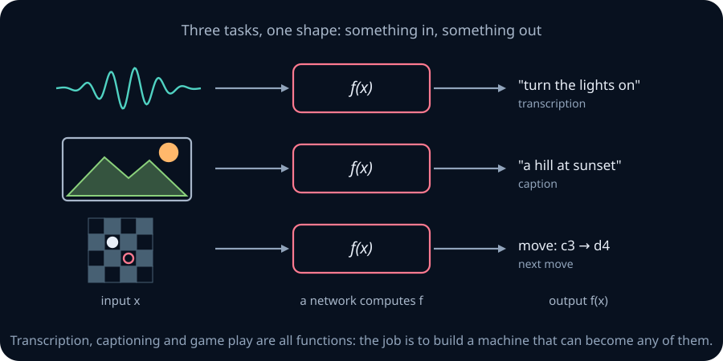

Start with a small machine: inputs x=(1,0), weights w=(2,−1), and bias b=−1. Its score is 2·1−1·0−1=1. Because the score is at least zero, its output is 1. Change the input to (0,1): the score becomes −2, so the output becomes 0. A **threshold unit** turns a weighted score into a yes/no answer. We will build networks by connecting these small decisions.

The idea started as a theory of the brain. This chapter follows the historical path to threshold units, then constructs exact Boolean functions and unions of polygons, and approximates continuous curves on bounded intervals. The weighted score survives in modern neural networks, although their activations and learning rules differ from these early models. The history explains why each ingredient was introduced; the constructions show exactly what it buys us.

Ten activities appear in the progress panel, alongside three additional interactive figures and seven runnable Python tasks. Ticks record activity completion, not demonstrated mastery.

```lab
nn-overview
```

## 0. Route and prerequisite diagnostic

The chapter builds five ideas, each defined where it first appears.
1. A **connectionist machine** stores what it knows in the strengths of the connections between simple units, not in a separate program.
2. A **threshold unit** adds up weighted evidence and fires when the total reaches a threshold.
3. A **learning rule** changes the weights from experience. Hebb's rule strengthens connections that fire together. The perceptron rule corrects a unit only when it makes a mistake.
4. One threshold unit can only draw a straight boundary, so it cannot compute XOR. A **network** of units can compute any Boolean function.
5. With real-valued inputs, networks can represent finite unions of polygons exactly. We will define how to approximate curved regions within a bounded window. With a summing output, they can approximate continuous functions of one variable on a bounded closed interval.

**Notation.** Inputs are x=(x₁,…,\(x_N\)), weights are w=(w₁,…,\(w_N\)), and the bias is b. Thus x and w are lists of N real numbers (written x,w∈ℝᴺ); b and the score z are single real numbers. A unit computes the **pre-activation** z=w·x+b=Σᵢwᵢxᵢ+b, then the **threshold activation** θ(z)=1 if z≥0 and 0 otherwise. Writing b=−T turns "z≥0" into "Σᵢwᵢxᵢ≥T", where T is the **threshold**. Boolean values are 0 and 1. AND is 1 when all inputs are 1, OR when at least one is 1, and NOT reverses 0 and 1; NAND means NOT AND and NOR means NOT OR. A **truth table** lists a function's output for every input pattern. Symbols ∧, ∨ and ¬ mean AND, OR and NOT.

Check these before starting. Each comes with a short repair.
- Can you evaluate Σᵢwᵢxᵢ for w=(2,−1,3) and x=(1,1,0)? The answer is 1. If sums with signs are unfamiliar, review the summation notation in [mathematical language](../00-foundations/00-mathematical-language.md).
- Can you write the truth table of AND, OR and XOR on two inputs? XOR is 1 exactly when the inputs differ.
- Do you know what the line w₁x₁+w₂x₂+b=0 looks like? It is a straight line, and (w₁,w₂) points from it towards the side where the expression is positive.
- Can you distinguish a function's inputs, parameters, and output? Here x is the input, w and b are parameters, and the output is 0 or 1. Parameters stay fixed during a prediction; a learning rule changes them between predictions.

**Prerequisites by route.** The main route requires signed arithmetic, inequalities, sums, and functions from [mathematical language](../00-foundations/00-mathematical-language.md). A line is the set of points satisfying ax₁+bx₂+c=0; replacing equality with ≥ selects one side. No probability, calculus, or eigendecomposition is required for the main route. For the Python tasks, first practise functions, loops, lists, and exceptions using [Python](../01-python/01-python-memory-iteration.md); robust input validation is a programming objective alongside the neural-network mathematics. NumPy and PyTorch exercises are optional local extensions; use [tensors and autograd](../08-pytorch/01-tensors-autograd-training.md) before the PyTorch exercises. The spectral extension in Section 4 lists its additional prerequisites there.

**Suggested study route (20 hours including practice).** Spend about 3 hours on Sections 0–3 and gates, 4 on scalar Hebb and perceptron learning, 4 on Boolean and geometric networks, 3 on skyline approximation, and 6 on implementations and the checkpoint. These are planning estimates, not a speed target. Historical details, the spectral extension, Section 8's cylinder derivation, and NumPy/PyTorch work are optional deeper routes and may take additional time. Required practice is Foundation/Core in Sections 4–7 and 9, the Foundation gates in Section 2, Python labs A/B/D/E/F, paper A1/A2/A4/A10, and K1–K6. Historical Section 1 practice, Section 3 practice, heat/cold timing, and all Stretch prompts outside the checkpoint are enrichment. Static solution sketches follow section practice; attempt each prompt before revealing them.

**How to use the help on this page.** The **?** buttons open notes anchored to the passage. You can use them as private written notes, or connect an optional LLM tutor for hints and feedback. All required explanations and reference solutions are available without a model connection. The tutor sees the anchored passage, so include any other context it needs.

## 1. Associations, connections, and the connectionist machine

**The question.** When you see lightning, you brace for thunder. When you hear thunder, you wonder where the lightning struck. Something links the two experiences. What is that link, and where is it kept?

**Associationism** answered the first half: the mind learns by linking ideas that occur together. Around 350 BC, Aristotle listed four ways ideas become linked:
- **Contiguity:** things that occur close together in space or time get linked.
- **Frequency:** the more often two things occur together, the stronger the link.
- **Similarity:** thinking of one thing recalls things like it.
- **Contrast:** thinking of one thing can recall its opposite.

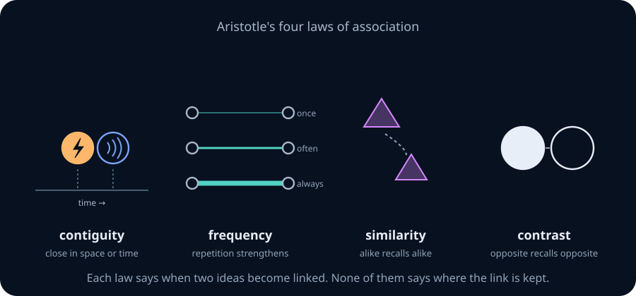

Later associationists developed theories of learning through links between experiences. Behaviourists studied how experience and feedback change observable behaviour. For this chapter, the useful question is where such learned links could be stored physically.

None of this said where the links are stored. In 1749 David Hartley guessed that sensations are vibrations in the nerves, and memories are fainter vibrations he called *vibratiuncles*, in the same places. That was a physical theory without the physical parts. Nobody yet knew about neurons.

**The picture.** By the mid-1800s, microscopes showed that the brain is a mass of interconnected cells. Many fibres run into each nerve cell and many run out, so the brain is a **network**. In 1873 Alexander Bain drew the conclusion that defines this whole subject: *the information is in the connections*.

Think of a city's road network. There is no central office where routes are written down. A route is a pattern of streets, and the routes people use most get widened. Bain's brain worked the same way. "For every act of memory, every exercise of bodily aptitude, every habit, recollection, train of ideas," he wrote, "there is a specific grouping, or co-ordination, of sensations and movements, by virtue of specific growths in the cell junctions" (*Mind and Body*, p. 91).

Bain proposed two mechanisms that sound modern:
- **Groupings.** One input fibre can produce different outputs depending on which other fibres are active with it and how strongly it is stimulated (pp. 110–115). A weak current reaches one set of cells and a strong one spreads further: "What begins as mere difference of intensity in one track ends in difference of grouping."
- **Making memories.** When two impressions occur together, "the nerve-currents find some bridge or place of continuity" (p. 117), leaving "a strengthened connexion or diminished obstruction—a preference track for that line." That is Hebbian learning, three quarters of a century before Hebb.

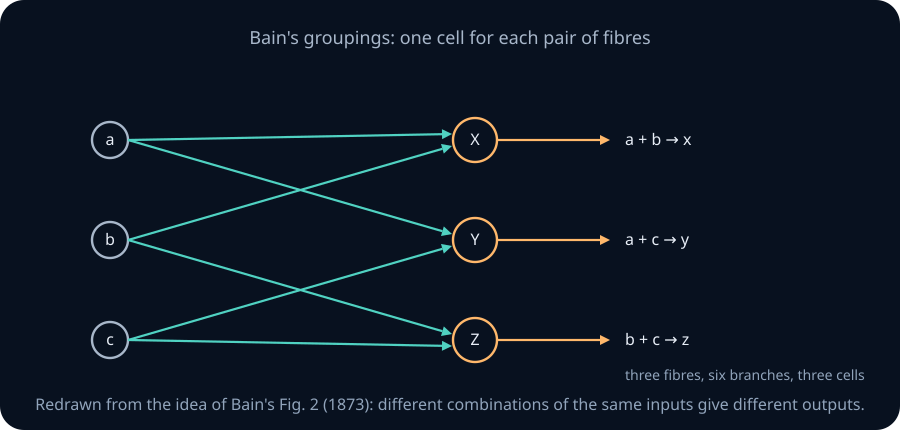

<details>
<summary>Historical enrichment: Bain's storage-capacity estimate</summary>

Bain worried whether a brain was big enough to hold a lifetime of associations, so he estimated both sides (pp. 101–108).
1. **Demand.** The multiplication table is 144 facts. Bain guessed it is about one fiftieth of what an arithmetician knows, so arithmetic alone needs more than 7,000 links. Adding music, languages and faces, he estimated a lifetime of learning in the "thousands, and even tens of thousands" of acquisitions.
2. **Supply.** The cortex covers over 300 square inches and is about a tenth of an inch thick. With 500 cells per linear inch and 16 layers of cells, that is about 1,200 million cells. With four fibres per cell, it is about 4,800 million fibres. He rounded these to 1,000 million cells and 5,000 million fibres.
3. **Ratio.** Even at 200,000 acquisitions, each one could have its own 5,000 cells and 25,000 fibres. He concluded there was "no improbability in supposing an independent nervous track for each separate acquisition."

Bain's figures were far too small: the cortex has about 16 billion neurons and the brain about 10¹⁴ synapses. Notice also that he counted fibres, which are wires, not synapses, which are junctions. These are historical estimates, not a modern account of how memories are allocated. The useful method is comparing storage demand with available connections.

</details>

**Connectionist machines.** A **connectionist machine** is a network of simple processing units in which everything the machine knows is stored in the connections between units. Neural networks are connectionist machines.

The contrast with an ordinary computer is sharp. A **von Neumann machine** has a processor, a separate memory holding the program and the data, and a loop that fetches one instruction after another. Think of a chef who reads a recipe card one step at a time. A connectionist machine is more like a jazz band with no sheet music. The "program" is how the players listen to each other, and changing what the band plays means changing those habits, not editing a card.

In practice, a stored-program computer usually executes the neural network's computations. The analogy concerns how the model represents learned behavior: learned connection strengths work together with a chosen architecture and activation rule. Networks with loops can also carry temporary information in their activation state.

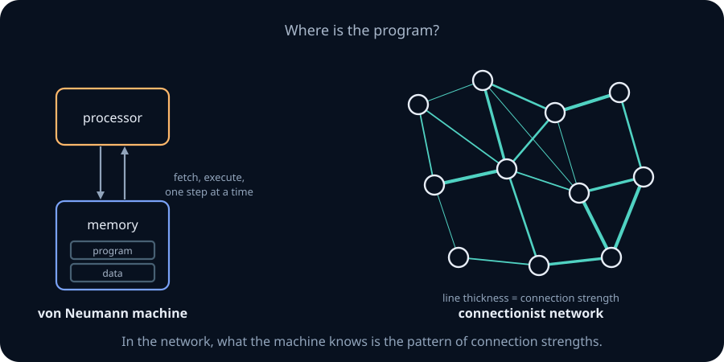

The working ingredients are units, connections, an activation rule, and a learning rule. The last is missing from the earliest models.

<details>
<summary>Historical enrichment: the PDP checklist</summary>

Rumelhart, Hinton and McClelland's *Parallel Distributed Processing* (1986) listed eight requirements:
1. a set of processing units;
2. a state of activation;
3. an output function for each unit;
4. a pattern of connectivity among units;
5. a propagation rule that sends activity through the connections;
6. an activation rule that combines a unit's inputs with its current state;
7. a learning rule that changes connectivity with experience;
8. an environment in which the system operates.

Bechtel and Abrahamsen (1991) emphasized connectivity, activation, learning, and semantic interpretation. These lists are historical reference, not facts you must memorize.

</details>

**What is still missing?** Saying that knowledge lives in connections does not specify a computation. We next need a unit whose output we can calculate.

```lab
nn-history
```

> **Practice — Foundation:** Classify each statement as associationist, connectionist, or both: (a) learning forms links between ideas that occur together; (b) those links are stored as strengths of connections between units; (c) the program and the data share one memory.
>
> **Hint:** Associationism is about what learning does; connectionism adds where the result is stored. Statement (c) belongs to neither.

> **Practice — Core:** Redo Bain's supply estimate for a cortex of 2,000 square centimetres at 0.25 cm thick, with 200 cells per linear centimetre and 25 layers. Give cells and fibres, using his four fibres per cell, and the cells available per acquisition if there are 50,000 acquisitions.
>
> **Hint:** Cells per square centimetre are 200², then multiply by the area and the number of layers.

> **Practice — Stretch:** Bain's Fig. 2 gives every pair of input fibres its own meeting cell. How many meeting cells does his scheme need for all pairs, and for all triples, of n input fibres? Why does this growth make a one-cell-per-combination design hopeless, and what does a network of threshold units do instead?
>
> **Hint:** Count the pairs with n(n−1)/2 and the triples with a binomial coefficient. A threshold unit can respond to many combinations through its weights.

<details>
<summary>Section 1 practice — solution sketches</summary>

Foundation: (a) associationism; (b) connectionism (it also fits an associationist account); (c) neither: it describes stored-program architecture.

Core (historical enrichment): 200²×2,000×25=2,000,000,000 cells; four fibres per cell gives 8,000,000,000 fibres. Dividing cells by 50,000 acquisitions gives 40,000 per acquisition. Thickness does not multiply the result again because the layer count already supplies the depth.

Stretch: n(n−1)/2 pairs and n(n−1)(n−2)/6 triples. Higher-order combinations grow rapidly; weighted tests can respond to many patterns rather than allocating one unit to each. This does not imply every Boolean function has a small network.

</details>

## 2. The McCulloch–Pitts neuron

**The question.** If knowledge lives in connections, what are the units being connected, and what does one of them compute?

**The picture.** A real neuron gathers signals through its **dendrites** into the cell body, the **soma**, and sends one output down its single **axon** to other neurons. It fires in an all-or-nothing way: a pulse either goes or it doesn't. In 1943 the neurophysiologist Warren McCulloch and the self-taught logician Walter Pitts turned this into mathematics. Their paper, "A logical calculus of the ideas immanent in nervous activity," treats each neuron as a device that decides whether a logical proposition about its inputs is true.

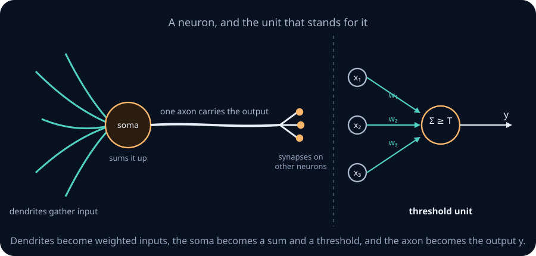

Picture a committee that votes on a motion. Each ordinary member (an **excitatory** synapse) votes yes or abstains. The motion passes if enough members vote yes. Some members hold a **veto** (an **inhibitory** synapse): if any of them objects, the motion fails no matter how many voted yes.

McCulloch and Pitts stated five assumptions (p. 101 of the 1990 reprint):
1. The activity of the neuron is an "all-or-none" process.
2. A fixed number of synapses must be excited within a short summation period to fire the neuron. That number does not depend on past activity or on where the synapses sit.
3. The only significant delay in the nervous system is the synaptic delay.
4. "The activity of any inhibitory synapse absolutely prevents excitation of the neuron at that time."
5. The structure of the net does not change with time.

The fifth assumption rules out learning on purpose. The authors showed that some kinds of learning could be imitated by fixed nets with loops, but their neurons never change.

**A worked example.** Take three excitatory inputs A, B, C and threshold 2, with no inhibitory input. Count the active inputs in each of the eight patterns. The unit fires on (1,1,0), (1,0,1), (0,1,1) and (1,1,1), and stays silent otherwise. That is "at least two of three", the majority function. Now add an inhibitory input D. Whenever D is active, the unit is silent, so it computes "majority of A, B, C, and not D".

**The definition.** A **McCulloch–Pitts unit** has excitatory inputs e₁,…,\(e_m\), inhibitory inputs i₁,…,\(i_k\) (all 0 or 1) and a threshold θ. It outputs 1 at time t exactly when no inhibitory input was active at time t−1 and the number of active excitatory inputs at t−1 reached the threshold. One time step is one synaptic delay.

There is a subtlety in "reached". The 1943 paper says the count must *exceed* θ. The labs here and most modern texts fire when the count is *at least* θ. The difference is a shift of the threshold by one, except at the edge case of θ=0, which you will meet below.

**What it can compute.** With threshold 2 and two excitatory inputs, the unit is AND. With threshold 1 it is OR. With A excitatory, B inhibitory and threshold 1 it is "A and not B". Feed outputs of such units into other units and you can build any formula of propositional logic.

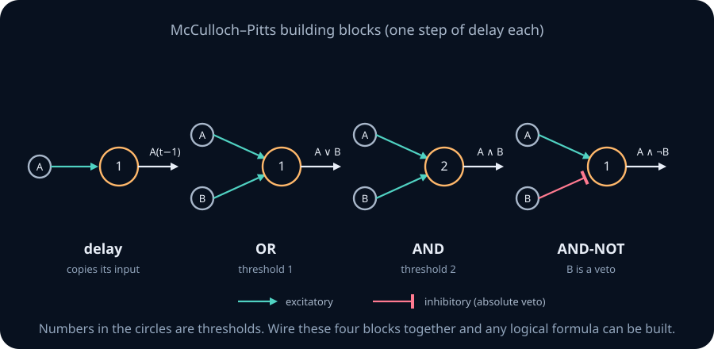

One case is impossible, and McCulloch and Pitts proved it (their Theorem 3). With a strict threshold, a net whose inputs are all silent can never fire, because no unit gets any excitation. So **a McCulloch–Pitts net cannot compute a function that is true when every input is off**, such as NOT A or NOR. The usual fix is a unit that is always on and feeds the net a constant 1. A bias does the same job in modern networks. The lab's NOR challenge uses the "at least" convention with θ=0 to do this, which is exactly the loophole.

```lab
nn-mp
```

### An illusion built from logic

McCulloch and Pitts used their units to explain a strange fact about the skin. If a cold object touches the skin only briefly, you feel *heat*. Hold it there and you feel cold. A net of five units, each with one step of delay, produces exactly this (Fig. 1e of the paper). Write h(t) for the heat receptor and c(t) for the cold receptor:
- unit a copies the cold receptor one step later;
- unit b fires when a fired but the cold receptor has just gone quiet (a excites b, the cold receptor inhibits it);
- heat is felt one step after h *or* b fires;
- cold is felt one step after both a and the cold receptor fire.

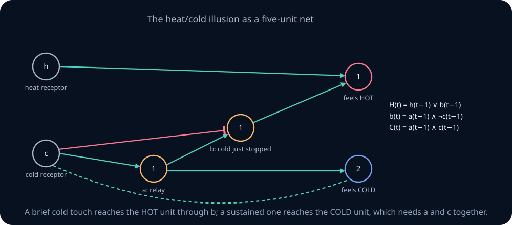

Assume all receptors and units were silent before t=0. Unrolled, the sensations are

$$H(t)=h(t-1)\ \lor\ \big[c(t-3)\land\lnot c(t-2)\big],\qquad C(t)=c(t-2)\land c(t-1).$$

A one-step cold touch sets c at a single time, so the bracket in H becomes true three steps later and nothing ever makes C true: you feel heat. A sustained touch keeps c on, so the bracket stays false and C turns on after two steps: you feel cold. The point McCulloch and Pitts drew is that what we perceive depends on the wiring between the receptors and the sensation, not only on the world.

```lab
nn-heatcold
```

### Loops, memory, and the Turing claim

So far every signal flows forward. If a unit's output feeds back into its own input, activity can circulate indefinitely. Think of a light switch that, once pressed, holds itself on by its own current. That **reverberating loop** remembers that it was pressed. In 1930 the psychiatrist Lawrence Kubie had suggested such closed loops as the basis of memory, and McCulloch and Pitts showed that nets with loops can depend on events arbitrarily far in the past.

They also claimed that a net equipped with a tape, scanners and suitable outputs could compute exactly what a Turing machine computes. They wrote that this "is easily shown" but gave no proof. That, and the absence of any way for the net to learn, are the main criticisms of the model.

> **Practice — Foundation:** Give the threshold and synapse types of a McCulloch–Pitts unit that computes "at least three of five inputs are on", and of one that computes "A and B, but not C".
>
> **Hint:** Count how many excitatory inputs must be active. Inhibition is a veto, so C belongs on an inhibitory synapse.

> **Practice — Core:** In the heat/cold net, give the sensations at every step when the cold receptor fires at t=0 and t=4 only, and nothing else happens. Then do the same when it fires at t=0 and t=1.
>
> **Hint:** Use the two unrolled formulas. For H, look for times where c was on three steps earlier and off two steps earlier.

> **Practice — Stretch:** Using Theorem 3, list which of the sixteen Boolean functions of two inputs a strict McCulloch–Pitts net without loops cannot compute. Then show how one extra input that is always on removes the restriction.
>
> **Hint:** The forbidden functions are exactly those whose value on the input (0,0) is 1. Count them.

<details>
<summary>Section 2 practice — solution sketches</summary>

Foundation: five excitatory inputs and threshold 3; for A AND B AND NOT C, make A and B excitatory, C inhibitory, threshold 2.

Core (timing extension): assume all receptor histories are zero before t=0 and heat input is always zero. Cold at 0 and 4 gives heat at 3 and 7 only and no cold sensation. Cold at 0 and 1 gives cold sensation at 2 only and heat at 4 only, after release. All other times are silent.

Stretch: the eight truth tables whose (0,0) row is 1 are excluded by the all-silent restriction, assuming no initial stored activity. A constant active input supplies excitation; for example, constant-1 excitatory input plus A as inhibitor and threshold 1 computes NOT A.

</details>

## 3. Turing's unorganised machines

**The question.** McCulloch–Pitts nets are designed by hand, wire by wire. Could a network start out random and be *trained* into doing something useful?

**The picture.** In 1948 Alan Turing wrote a report for the National Physical Laboratory called "Intelligent Machinery." It was not published until 1969, which is one reason nobody built on it. In it he described **unorganised machines**, and wrote that "the cortex of the infant is an unorganised machine, which can be organised by suitable interfering training."

Think of an old telephone exchange where every cable has a little switch on it. Nobody plans the cabling, which is random. Training means a supervisor flips switches until the right calls get through.

**The definitions.**
- An **A-type machine** has N units, each with two inputs chosen at random from the other units, all updated together by a clock. Each unit computes NAND of its two inputs from the previous tick. NAND is **universal**: any Boolean function can be built from NAND gates alone. Enough NAND gates with suitable wiring can express any Boolean function of finitely many bits. This does not guarantee that a particular fixed-size random A-type realizes that function; its wiring cannot be changed.
- A **B-type machine** is an A-type in which every connection passes through a small device with a **modifier**. In Turing's definition the device has two modes. In one, its output is the *negation* of its input. In the other, its output is stuck at 1, which cuts the connection, since a NAND unit ignores an input that is always 1. Training means setting each modifier to one of the two modes.
- A **P-type machine** is not a network. It is a table-driven machine trained with "pleasure" and "pain" signals that keep or cancel random tentative choices.

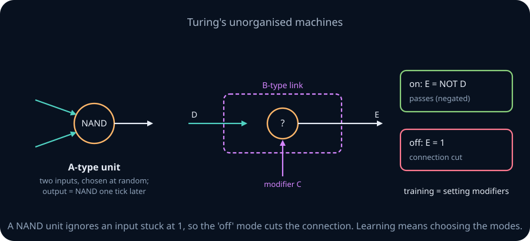

Many retellings describe the "on" mode as letting the signal "sail through". In Turing's report it inverts the signal. Copeland and Proudfoot (1996) point out that with the definition as written, some functions are out of reach for a given B-type. Their fix is two modifiers in series on each connection, since inverting twice passes the signal unchanged. The figure below uses Turing's definition, so you can find a function the little machine cannot learn.

```lab
nn-btype
```

**Why the idea stalled.** Each modifier flips a connection completely on or off. Copeland and Proudfoot call this "a savage all-or-nothing shift". Compare a light switch with a dimmer. With only switches, a small change to the network makes a large, unpredictable change in its behaviour, so there is nothing to guide a search except trying settings. Turing had no training algorithm beyond exhaustive or random search. The key ingredient that came later was **graded weights**, which let learning take small steps.

> **Practice — Foundation:** Show that NOT x, x AND y, and x OR y can each be built from NAND gates alone, giving one formula for each.
>
> **Hint:** NAND(x,x) is NOT x. AND is NOT of NAND. For OR, use De Morgan: x OR y = NAND(NOT x, NOT y).

> **Practice — Core:** In the B-type figure, the "Search all 16 settings" button finds every modifier setting that realises a target. Predict, before searching, which of OR, AND, and NOT A the machine can realise, and explain your prediction from the two link modes.
>
> **Hint:** Work out what N1 can be for each pair of modifiers on L1 and L2, then what N2 does with N1 and A.

> **Practice — Stretch:** Explain why every A-type machine, started from any state, must eventually repeat a state and then cycle forever. Give an upper bound on how long the sequence of states can run before repeating, as a function of N.
>
> **Hint:** The next state depends only on the current state, and there are finitely many states.

<details>
<summary>Section 3 practice — solution sketches</summary>

Foundation: with N(x,y)=NAND(x,y), NOT x=N(x,x), AND=N(N(x,y),N(x,y)), OR=N(N(x,x),N(y,y)).

Core: N1 can be 0, A, B, or A OR B. N2 can then be 0, N1, A, or N1 OR A. Thus OR is reachable (first three modifiers on, fourth off), but AND and NOT A are not reachable in this particular wiring. This is a limitation of this machine, not of all NAND circuits.

Stretch: there are 2ᴺ activation states. Among the first 2ᴺ+1 visited states one repeats. Deterministic synchronous updates then repeat the same future cycle; at most 2ᴺ distinct states occur before the first repetition.

</details>

## 4. Hebbian learning, and why it explodes

**The question.** McCulloch–Pitts nets cannot learn, and Turing's switches change too abruptly. How could connection strengths change gradually with experience?

**The picture.** Think of a lawn between two buildings. Nobody plans a path, but where people walk most the grass wears away, and a worn path invites even more people to take it. In 1949 the psychologist Donald Hebb proposed that synapses work this way. His *neurophysiological postulate* (*The Organization of Behavior*, p. 62) reads:

> When an axon of cell A is near enough to excite a cell B and repeatedly or persistently takes part in firing it, some growth process or metabolic change takes place in one or both cells such that A's efficiency, as one of the cells firing B, is increased.

Two details matter. First, A must *take part in firing* B, which is about cause and timing, not mere coincidence. Second, Hebb named no mechanism; the cellular story of long-term potentiation came decades later. The slogan "neurons that fire together wire together" is a later summary and does not appear in Hebb's book.

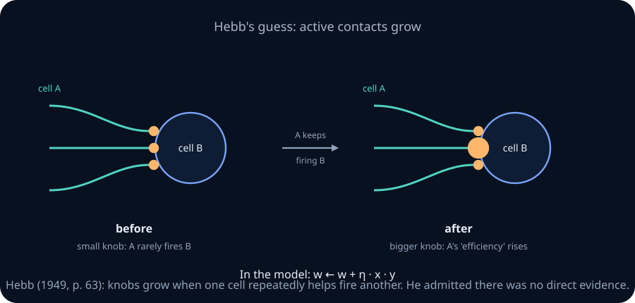

**A worked example.** The simplest mathematical version updates the weight w from input x to output y by

$$w \leftarrow w + \eta\,x\,y,$$

where η>0 is a small **learning rate**. Take one linear unit y=wx with a single input that is always x=1, start at w=0.5, and use η=0.1. Each step multiplies w by 1.1: 0.5, 0.55, 0.605, 0.6655, … After n steps w=0.5·1.1ⁿ, so after 100 steps w is about 6,900. Nothing ever makes it smaller.

**The fix: response-dependent shrinkage.** Oja's rule adds a competing term:

$$w \leftarrow w + \eta\,y\,(x-yw),\qquad y=w\cdot x.$$

In the scalar example x=1, y=w, so Δw=ηw(1−w²). For positive w below 1 the update increases w; above 1 it decreases w. With w=0.5 and η=0.1, the next value is 0.5375, compared with Hebb's 0.55. The shrinkage grows with the response, creating competition against unchecked reinforcement. This is a model of stabilization, not a supervised correction toward a label.

**A small step matters.** Discrete updates can overshoot: with x=1, w=2 and η=1, Oja gives w=−4 and then w=56. The stabilizing term alone does not guarantee that an arbitrary learning rate is safe. With noisy inputs, even a sensible fixed step generally leaves fluctuations around a principal direction rather than exact convergence.

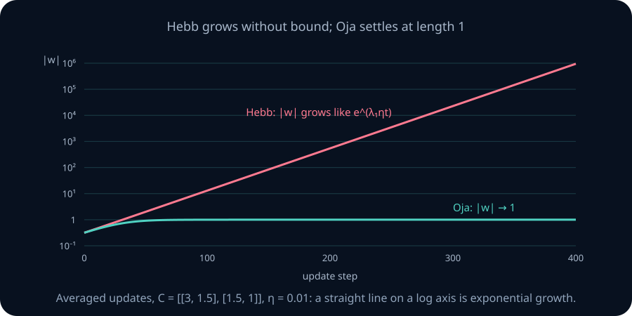

**What failed, and what comes next?** Plain Hebbian reinforcement can amplify a response without bound, while Oja supplies response-dependent shrinkage. Neither rule asks whether the prediction is correct. Section 5 introduces an explicit error signal.

<details>
<summary>Mathematical extension: second moments, eigenvectors, and the mean-field ODE</summary>

This extension uses [covariance and expectation](../05-probability-statistics/02-joint-distributions-conditioning-covariance.md), [symmetric eigendecomposition](../02-linear-algebra/07-spectral-theorem-quadratic-forms.md), and derivatives from [calculus](../03-optimization/01-calculus-gradients-optimization.md). It can be skipped without losing the main argument.

Let x∈ℝᴺ be a fresh random input, w∈ℝᴺ the current weights, y=wᵀx∈ℝ the output, and C=E[xxᵀ]∈ℝᴺˣᴺ the **second-moment matrix**. Its entry Cᵢⱼ is E[xᵢxⱼ]. If E[x]=0, C is also the covariance matrix; otherwise C=Cov(x)+E[x]E[x]ᵀ. Centre the data before interpreting its leading eigenvector as a direction of greatest variance. A constant input has zero variance but can have a nonzero second moment.

Assume each input is drawn independently from a fixed distribution with finite second moments, independently of current w. Conditional on w, Δw=ηyx=ηxxᵀw, hence

$$\mathbb{E}[\Delta w\mid w] = \eta\,C\,w.$$

For small steps, rescale time by η and study the **mean-field ODE** dw/dt=Cw. This describes an averaged drift, not an equality for every sampled trajectory. First try C=diag(3,1), w₀=(1,2): the coordinates satisfy dw₁/dt=3w₁ and dw₂/dt=w₂, giving w(t)=(e³ᵗ,2eᵗ). Their ratio w₂/w₁=2e⁻²ᵗ shrinks; the first coordinate grows faster.

More generally C is symmetric and positive semidefinite, so it has orthonormal eigenvectors uᵢ with eigenvalues λ₁≥λ₂≥…≥0. Each coordinate grows like \(e^{\lambda_i t}\):

$$w(t)=\sum_i e^{\lambda_i t}\,(u_i^\top w_0)\,u_i .$$

If λ₁>λ₂ and u₁ᵀw₀≠0, the direction approaches either u₁ or −u₁, and for λ₁>0 its length grows exponentially. Without that initial component it stays in the other eigenspaces in this ODE; a repeated top eigenvalue gives a leading subspace rather than a unique direction. Indeed d‖w‖²/dt=2wᵀCw≥0, so length cannot decrease, but it need not grow if w lies in the nullspace.

This is what "fundamentally unstable" means here. Strong connections strengthen themselves, nothing weakens them, and connections do not compete. The instability belongs to the formula Δw=ηxy, not to Hebb's theory. Hebb himself was willing to assume "that an unused connection decays" (p. 231).

Oja's mean-field ODE is dw/dt=Cw−(wᵀCw)w. Taking the dot product with w gives d‖w‖²/dt=2(wᵀCw)(1−‖w‖²). When wᵀCw>0, the length moves toward 1. Every unit eigenvector is a resting point; zero and nullspace weights are additional exceptions to the simple normalization story. With λ₁>λ₂ and a nonzero leading component, the stable principal directions are ±u₁. Thus for centred data the mean-field rule extracts the **first principal component** under these assumptions. Discrete stochastic convergence needs additional step-size and sampling conditions; the lab illustrates one chosen dataset and step size.

Sanger's generalized Hebbian rule extends the idea to several outputs, subtracting components already explained by earlier outputs. It is an optional reading direction, not a derivation required here.

</details>

```lab
nn-hebb
```

> **Practice — Foundation:** A single-input linear unit starts at w=2 with constant input x=1 and η=0.05. Give w after one and two Hebbian steps, and the number of steps needed to pass w=20.
>
> **Hint:** Each step multiplies w by 1+η, so solve 2·1.05ⁿ>20 with logarithms.

> **Practice — Core:** With constant x=1, w=0.8 and η=0.1, calculate one Hebb update and one Oja update. Does Oja's shrinkage depend on whether a teacher says the output was correct? Explain.
>
> **Hint:** Both use y=w. Oja adds ηw(1−w²), while Hebb adds ηw. Neither uses a target label.

> **Practice — Stretch:** In the mathematical extension, assume λ₁>λ₂. Starting from dw/dt=Cw−(wᵀCw)w, show that every unit eigenvector of C is a resting point. Then argue that u₂ is unstable by perturbing it toward u₁. What changes when λ₁=λ₂?
>
> **Hint:** Substitute w=u₂+εu₁ and keep terms of first order in ε. Check whether the u₁ coefficient grows.

<details>
<summary>Section 4 practice — solution sketches</summary>

Foundation: w₁=2.1 and w₂=2.205. The first integer n with 1.05ⁿ>10 is 48, since ln(10)/ln(1.05)≈47.19.

Core: Hebb gives 0.8+0.1×0.8=0.88. Oja gives 0.8+0.1×0.8×(1−0.8²)=0.8288. Shrinkage depends on the response and current weights, not a teacher label.

Stretch (spectral extension): at a unit eigenvector uⱼ, Cuⱼ=λⱼuⱼ and uⱼᵀCuⱼ=λⱼ, so the drift is zero. At u₂+εu₁, the leading perturbation grows at rate (λ₁−λ₂)ε. If the eigenvalues tie, the direction within that eigenspace is not uniquely selected.

</details>

## 5. Rosenblatt's perceptron

**The question.** Hebb's rule strengthens whatever happens, right or wrong. Can a unit learn from its *mistakes* and settle once it is right?

**The picture.** In 1958 the psychologist Frank Rosenblatt published "The perceptron: a probabilistic model for information storage and organization in the brain." He took the connectionist side explicitly. Information, he wrote, "is contained in connections or associations rather than topographic representations." He then built machines that learned, first simulated on an IBM 704 and later in hardware.

His original **photoperceptron** had several stages:
- **sensory points (S)** on a retina, which respond all-or-nothing;
- a **projection area \(A_{\mathrm{I}}\)** of association units, each collecting from a cluster of nearby sensory points;
- an **association area \(A_{\mathrm{II}}\)**, randomly connected to \(A_{\mathrm{I}}\);
- **response units (R)**, each receiving from its own source set in \(A_{\mathrm{II}}\).

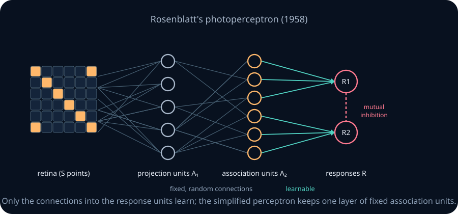

Connections could be excitatory or inhibitory. Feedback from each response unit inhibited the source sets of the others, which made the responses mutually exclusive. The **simplified perceptron** kept only fixed association units and learnable weights into the response units.

Learning in the 1958 paper is not the rule you will see below. It used "value" reinforcement schemes, in which active association units gained or lost value. The **error-correction rule** and its convergence proofs were developed over the next few years, by Rosenblatt (*Principles of Neurodynamics*, 1962) and by Block, Novikoff and Papert. Minsky and Papert note that Agmon's 1954 method for solving linear inequalities already contained the key argument.

Think of the simplified perceptron as a nightclub bouncer with a points system. Each feature of a guest (input xᵢ) earns points (weight wᵢ), positive or negative. If the total reaches the bar (threshold T), the guest gets in. The bouncer learns by being corrected by a manager: whenever the bouncer lets in someone who should have been refused, the points for that guest's features go down. Whenever the bouncer refuses someone who should have been admitted, they go up. When the bouncer is right, nothing changes.

**The definition.** A **perceptron** with real inputs x∈ℝᴺ, weights w∈ℝᴺ and bias b computes

$$y=\theta(w\cdot x+b)=\begin{cases}1 & \text{if } \sum_i w_i x_i + b \ge 0,\\ 0 & \text{otherwise.}\end{cases}$$

The map x↦w·x is **linear**: it sends 0 to 0, and it respects sums and scaling. The map x↦w·x+b is **affine**: a linear map plus a constant. A perceptron applies a threshold to an affine function. For nonzero w, its **decision boundary** w·x+b=0 is a line in two dimensions, a plane in three, and a **hyperplane** in general. If w=0, the output is constant and there is no separating hyperplane. A perceptron with nonzero w is a **linear classifier**: it fires on one side of a hyperplane and not on the other.

The **perceptron learning rule** processes examples one at a time. For an input x with desired output d,

$$w \leftarrow w + \eta\,(d-y)\,x,\qquad b\leftarrow b+\eta\,(d-y).$$

If the answer was right, d−y=0 and nothing changes. If the unit fired when it should not have, d−y=−1 and w moves away from x. If it stayed silent when it should have fired, w moves towards x.

**A worked example.** Train an OR gate with η=1, starting from w=(0,0) and b=0, presenting the inputs in the order (0,0), (0,1), (1,0), (1,1).
1. Epoch 1, input (0,0), target 0. z=0, so y=1. Wrong, so b becomes −1.
2. Input (0,1), target 1. z=−1, so y=0. Wrong, so w becomes (0,1) and b becomes 0.
3. Input (1,0), target 1. z=0, so y=1. Right.
4. Input (1,1), target 1. z=1, so y=1. Right.
5. Epoch 2, input (0,0), target 0. z=0, so y=1. Wrong, so b becomes −1.
6. Input (0,1): z=0, right. Input (1,0): z=−1, so y=0. Wrong, so w becomes (1,1) and b becomes 0.
7. Input (1,1): z=2, right.
8. Epoch 3, input (0,0): z=0, so y=1. Wrong, so b becomes −1. The other three are now right: z=0, 0 and 1.
9. Epoch 4 makes no mistakes, so training stops with w=(1,1) and b=−1. The unit fires when x₁+x₂≥1, which is OR.

**The convergence theorem.** For a finite dataset, if the two classes can be separated by a hyperplane with a positive margin and all examples are repeatedly presented, the rule with a fixed positive learning rate makes only finitely many mistakes. A **margin** is a positive gap between the separating hyperplane and the nearest example. Module NN03 proves the bound. With inconsistent or nonseparable labels, a clean epoch is impossible; stop at a chosen epoch budget and report failure to converge.

**The limit.** Some simple functions have no separating line. For XOR, suppose some w₁, w₂ and threshold T worked.
- The input (0,0) must not fire, so 0<T.
- The inputs (1,0) and (0,1) must fire, so w₁≥T and w₂≥T. Adding these gives w₁+w₂≥2T.
- Since T>0, 2T>T, so w₁+w₂>T. But then the input (1,1) fires, and it must not.

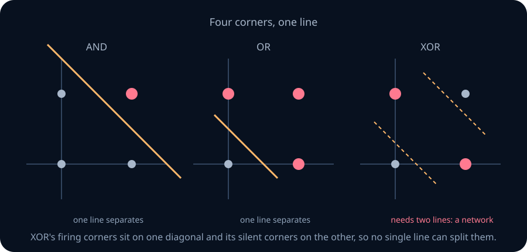

No single perceptron computes XOR. In *Perceptrons* (1969), Marvin Minsky and Seymour Papert proved much stronger results: some properties of images, such as parity and connectedness, need perceptrons whose units each look at more and more of the image as it grows. In the 1988 epilogue they insisted they had never claimed networks were useless: "for any particular size of retina we can make a perceptron that will recognize any predicate," but the general predicate "requires perceptrons of unbounded order." The lesson the field took was simpler: **individual units are weak, so networks of units are required.**

```lab
nn-perceptron
```

> **Practice — Foundation:** Give weights and a bias for a perceptron that computes NOR on two inputs, and check all four rows.
>
> **Hint:** NOR fires only at (0,0). Use negative weights and a bias just large enough to fire when both inputs are 0.

> **Practice — Core:** Run the perceptron rule by hand on AND with η=1, starting from w=(0,0) and b=0, with inputs in the order (0,0), (0,1), (1,0), (1,1). Give the weights after each epoch and the epoch with no mistakes.
>
> **Hint:** Keep a table with columns x, d, z, y and the new (w, b). The boundary convention z≥0 fires matters on the first row.

> **Practice — Stretch:** Prove that XNOR (1 exactly when the two inputs are equal) is not computable by a single perceptron. Then explain why multiplying the weights and the bias by any positive number never changes what a perceptron computes.
>
> **Hint:** Write the four inequalities for XNOR with threshold T, and combine the two rows that must fire against the two that must not.

<details>
<summary>Section 5 practice — solution sketches</summary>

Foundation: NOR uses w=(−1,−1), b=0: scores on 00,01,10,11 are 0,−1,−1,−2, giving outputs 1,0,0,0.

Core: the epoch-end (w₁,w₂,b) values are (1,1,0), (2,1,−1), (2,1,−2), (2,2,−2), (2,1,−3), then (2,1,−3) again. Epoch 6 is the first clean epoch. Compute predictions before updating, using z≥0.

Stretch: XNOR requires b≥0, w₁+b<0, w₂+b<0, and w₁+w₂+b≥0. Adding the middle two gives w₁+w₂+b<−b≤0, a contradiction. Positive rescaling preserves the sign, including zero, of every score.

</details>

## 6. Networks of perceptrons compute any Boolean function

Before building networks, here is where the story stands: two thousand years of ideas about association, then four decades in which the neuron became a computing element.

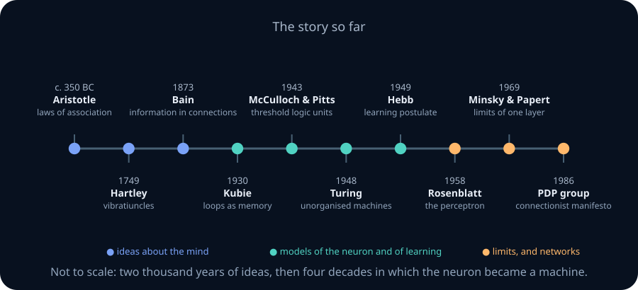

**The question.** One unit cannot compute XOR. How many units, arranged how, can compute anything?

**The picture.** Think of Lego. One brick shape is not enough to build a castle, but with enough bricks of a few shapes you can build any shape. Threshold units are the bricks. A unit can be AND, OR or NOT, and those three gates build any Boolean function.

A **multilayer perceptron (MLP)** is a network of perceptrons arranged in layers. The first layer reads the inputs, and each later layer reads the outputs of the layer before. The layers between the inputs and the output are called **hidden layers**, because nothing outside the network sees their values directly.

**A worked example: XOR in three units.** XOR is "at least one input is on, but not both". Write that as two hidden units and an output:
- h₁ = OR(X,Y): weights 1 and 1, threshold 1;
- h₂ = NAND(X,Y), that is, NOT X OR NOT Y: weights −1 and −1, threshold −1;
- XOR = AND(h₁,h₂): weights 1 and 1, threshold 2.

Check all four rows. At (0,0), h₁=0, so the output is 0. At (0,1) and (1,0), h₁=1 and h₂=1, so the output is 1. At (1,1), h₂=0, so the output is 0.

| X | Y | h₁=OR | h₂=NAND | output=AND(h₁,h₂) |
|---|---|---|---|---|
| 0 | 0 | 0 | 1 | 0 |
| 0 | 1 | 1 | 1 | 1 |
| 1 | 0 | 1 | 1 | 1 |
| 1 | 1 | 1 | 0 | 0 |

The hidden layer changes the representation: the positive XOR inputs become the hidden pattern (1,1), which the output can separate from (0,1) and (1,0). These weights were constructed by hand; the single-unit perceptron update does not yet tell us how to train this hidden layer.

**The general construction.** Any Boolean function can be written in **disjunctive normal form (DNF)**: an OR of AND terms, one for each input pattern on which the function is 1. For example, a function of three inputs that is 1 on exactly the patterns (1,0,1) and (0,1,1) is (X AND NOT Y AND Z) OR (NOT X AND Y AND Z). Each AND term is a single threshold unit: weight +1 on inputs that must be on, −1 on inputs that must be off, and threshold equal to the number of inputs that must be on. The OR is one more unit. So **every Boolean function is computed by an MLP with one hidden layer**.

The price of this construction can be steep: direct DNF uses one hidden unit per true row, up to 2ᴺ. Choosing the function or its complement, whichever has fewer true rows, gives at most 2ᴺ⁻¹ hidden units; the output either ORs them or negates their OR. This is an upper bound for a construction, not a lower bound for every network. Parity illustrates the distinction: its DNF has 2ᴺ⁻¹ terms, but N threshold units that count “at least k inputs are on,” followed by one alternating-sum output, compute it in N+1 units. NN02 compares constructions under explicit gate, depth, and parameter-count conventions. The interactive figure also shows a layered formula over four inputs.

```lab
nn-boolean-mlp
```

> **Practice — Foundation:** Write the single threshold unit for the AND term "X and not Y and not Z": its three weights and its threshold. Check the pattern that should fire and one that should not.
>
> **Hint:** Use +1 for inputs that must be on and −1 for inputs that must be off. The threshold is the number of +1 inputs.

> **Practice — Core:** Build a one-hidden-layer network for "exactly one of three inputs is on" using the DNF construction. How many hidden units does it use? Then find a network with only two hidden units.
>
> **Hint:** For the smaller network, use a unit that fires when at least one input is on and another that fires when at least two are on.

> **Practice — Stretch:** Explain why the DNF construction can never need more than 2ᴺ⁻¹ AND terms for a function of N inputs, if you are allowed to build the complement instead when that is shorter.
>
> **Hint:** A function and its complement have 2ᴺ patterns between them, so one has at most half. NOT of an OR of ANDs is still one output unit with flipped weights.

<details>
<summary>Section 6 practice — solution sketches</summary>

Foundation: w=(1,−1,−1), threshold 1. Pattern 100 scores 1 and fires; 110 scores 0 and does not.

Core: DNF uses three hidden units for 100,010,001 and an OR output. A smaller network uses h₁=θ(x₁+x₂+x₃−1), h₂=θ(x₁+x₂+x₃−2), and output θ(h₁−h₂−1). It fires exactly when the count is 1.

Stretch: a function and its complement have 2ᴺ true rows between them. Build the shorter DNF. If it is the complement, use output θ(−sum of hidden outputs), which fires only when no complement minterm fires. This is a construction bound, not a lower bound for a different network.

</details>

## 7. Perceptrons on real inputs carve out regions

**The question.** Brains do not receive 0s and 1s, and they do not only answer yes or no. What can a network do with real-valued inputs?

**The picture.** With real inputs, a perceptron fires on one side of a line. Its firing side is a **half-space**. A region is **convex** if the straight segment between any two of its points stays inside it. Think of each unit as a **fence** across a field: it reports which side of the fence you are standing on. To mark out a pen, put up several fences and ask whether you are on the inside of *all* of them, which is an AND. To mark out two separate pens, ask whether you are inside one pen *or* the other, which is an OR of two ANDs.

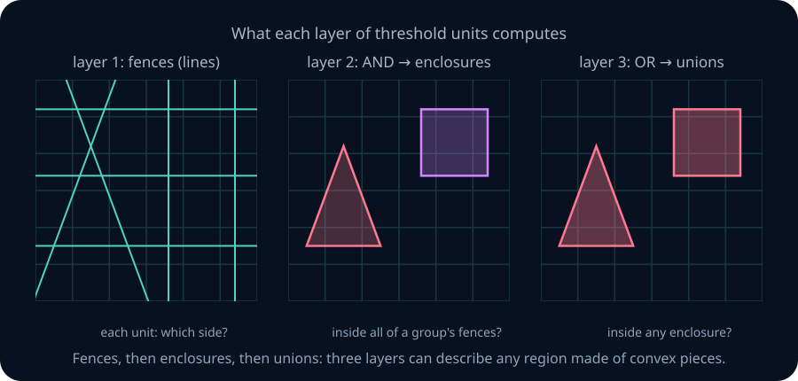

**A worked example: a pentagon.** Take a regular pentagon and give each of its five edges a unit that fires on the inside of that edge. A point inside the pentagon fires all five units. A point outside fires at most four, because it is outside at least one edge. So an output unit that fires when the sum of the five hidden outputs is at least 5 detects the pentagon. In general, a convex polygon with K edges needs K edge units plus one output: K+1 threshold units in two layers.

**A worked progression: a square, its outside, and two squares.** Read each figure from left to right: the fences on the left are the hidden units on the right.

1. **The square |x₁|≤1, |x₂|≤1.** Each edge is one inequality. Rewrite each one so that "inside" means "≥0": x₁≤1 becomes 1−x₁≥0, so h₁=θ(−x₁+1), with weight −1 and bias 1. The other three are h₂=θ(−x₂+1), h₃=θ(x₁+1) and h₄=θ(x₂+1). The output fires when all four do: y=θ(h₁+h₂+h₃+h₄−4). That is a 2–4–1 network: two inputs, four hidden units, one output.

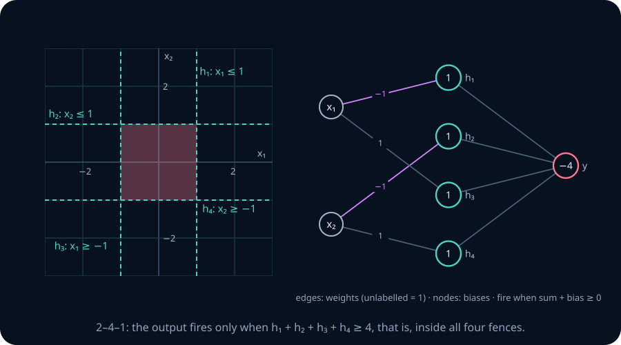

2. **Everything outside the square.** You might expect to flip every fence. You do not need to. "Outside" is "NOT inside", and by De Morgan's law NOT(h₁ AND h₂ AND h₃ AND h₄) is (NOT h₁) OR … OR (NOT h₄): the point is outside when *at least one* fence disagrees, that is, when at most three of them fire. Keep the hidden layer and change only the output, to y=θ(3−h₁−h₂−h₃−h₄). A point exactly on an edge fires all four hidden units (z=0 fires), so it counts as inside the square and not outside: the two networks split the plane with no overlap and no gap.

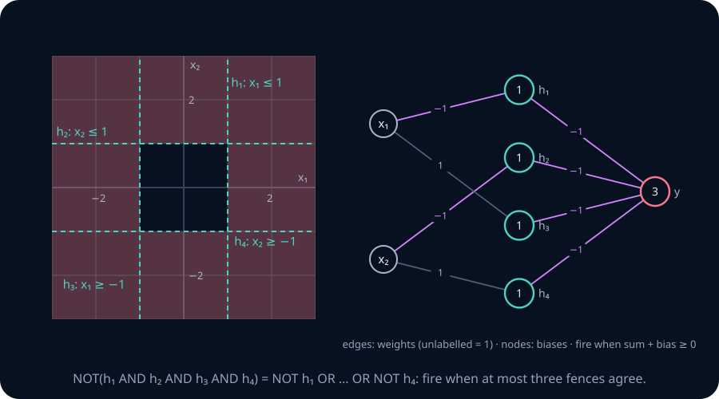

3. **Two squares that share fences.** Two squares side by side, at the same height, need two ANDs and an OR. Built separately they use 4+4=8 edge units, a 2–8–2–1 network. But both squares have the same top edge and the same bottom edge, so one unit for each can feed *both* AND units. That leaves six edge units, a 2–6–2–1 network. A hidden unit is a reusable test, and any later unit may read it.

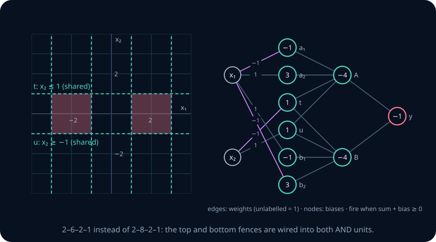

For a region that is not convex or has separate pieces, this construction uses more stages. Build each convex piece with its own AND unit, then OR the pieces together. That gives a third layer of threshold units. This describes one reliable construction, not a proof that every such region requires three layers.

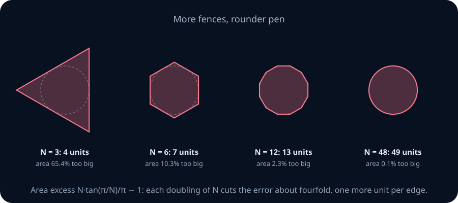

**Exact representation versus approximation.** A finite union of closed polygons is represented exactly by the edge–AND–OR construction, including its specified boundaries. A disc is different: finitely many straight edges do not make a circle. Within a fixed bounded viewing window, define **disagreement area** as the area assigned different labels by the target and the network. A polygon around the unit disc has disagreement area N·tan(π/N)−π, which tends to zero as its number N of sides grows. For bounded regions with piecewise smooth boundaries, sufficiently fine unions of grid rectangles also make disagreement area as small as requested: only cells touching the boundary can be wrong, and their total area shrinks with cell width. This does not promise an exact label at every boundary point or cover every pathological set.

The construction extends to higher dimensions with hyperplanes and boxes. A 28×28 image can be represented by 784 coordinates; geometrically it is a point in a high-dimensional input space. Calling networks **universal classifiers** requires specifying a domain, a class of targets, and a notion of error. NN02 studies that statement more carefully.

**Three different questions.** Representation asks whether suitable weights exist. Learning asks whether an algorithm can find them from examples. Generalization asks whether predictions are reliable on new examples. A dense grid can check our construction within its window, but cannot settle the latter two questions or certify every boundary point.

```lab
nn-regions
```

> **Practice — Foundation:** Write the four edge units and the output unit for the square with corners (±2, ±2), centred at the origin. How many threshold units is that?
>
> **Hint:** Each edge is one inequality, such as x₁≤2, rewritten as step(2−x₁).

> **Practice — Core:** An L-shaped region is the union of the rectangle 0≤x₁≤3, 0≤x₂≤1 and the rectangle 0≤x₁≤1, 0≤x₂≤3. Build a three-layer network for it and count the units. Then reuse shared edges to reduce the count, and explain which edges can be shared.
>
> **Hint:** Both rectangles use the edges x₁≥0 and x₂≥0. A shared edge needs only one unit, read by both AND units.

> **Practice — Stretch:** Explain why a single perceptron's decision region in ℝᴺ is always convex, and why the AND of any number of perceptrons is also convex. What does this imply about where an OR layer is required?
>
> **Hint:** A half-space contains the segment between any two of its points. An intersection of convex sets is convex.

<details>
<summary>Section 7 practice — solution sketches</summary>

Foundation: use θ(2−x₁), θ(2+x₁), θ(2−x₂), θ(2+x₂), then θ(sum−4): five threshold units.

Core: separate rectangles use eight edges, two ANDs, and one OR: eleven units. Share θ(x₁) and θ(x₂), leaving six edge units, two ANDs, and one OR: nine. The other four edges have different offsets and cannot be identified.

Stretch: a half-space contains the segment between any two of its points. An intersection preserves that property, so an AND of half-spaces is convex. A nonconvex union cannot be made by this AND alone. An OR is the next step in the construction, not a universal lower bound on all architectures.

</details>

## 8. From polygons to cylinders · optional extension

**The question.** What information is lost when an AND replaces a collection of half-space outputs? What if we keep the number of units firing instead? This extension uses trigonometry and limits; the main route can continue at Section 9.

**The picture.** Stand inside a polygonal room and count how many walls have you on their inside: all of them. Walk far away and look back. Roughly half the walls still count you as inside their half-plane. Keeping the count gives a graded response instead of a single AND decision.

**The derivation.** Take a regular N-gon circumscribed around the unit circle, with outward unit normals at angles φₖ=2πk/N. Unit k fires when x₁cos φₖ+x₂sin φₖ≤1; its weights are (−cos φₖ,−sin φₖ) and its bias is 1. Each line is tangent to the circle, so every point in the closed unit disc fires all N units. For a point at distance r and angle α, the condition is r·cos(α−φₖ)≤1. As N grows, the angles spread evenly around the circle. For r>1, the excluded interval has length 2arccos(1/r), so

$$\text{fraction firing}\ \to\ 1-\frac{\arccos(1/r)}{\pi}=\frac12+\frac{\arcsin(1/r)}{\pi}.$$

This equals 1 at r=1 and tends to ½ as r→∞. The count is a **soft cylinder**: a flat top and a decaying tail. The floor N/2 is a far-distance limit, not the count everywhere outside the disc.

Thresholding the count at τN, for ½<τ≤1, gives a region whose limiting radius is r*=1/sin(π(τ−½)). With finite N the boundary is polygonal; with τ=1 it is exactly the circumscribed polygon.

**A tempting argument that fails.** Suppose two counts S₁ and S₂ target discs of radius 2 centred at (−3,0) and (3,0). Each alone uses τ=2/3. Try the combined rule S₁/N+S₂/N−1/2≥2/3, subtracting one presumed background floor. At the midpoint (0,0), outside both discs, the limiting score is 2[1/2+arcsin(1/3)/π]−1/2≈0.7163. It exceeds 2/3, so the gap is incorrectly filled. The tails overlap above their distant floors. More edges do not fix this: the counterexample already uses the limiting curve.

Keep the edge–AND–OR construction for exact polygon unions. A one-hidden-layer approximation theorem needs a separate argument with explicit assumptions; this experiment is not that proof. NN02 takes up that question.

```lab
nn-cylinder
```

> **Practice — Foundation:** Use the limit formula to give the fraction of units firing at r=√2, and the count threshold τ that makes the output a disc of radius √2.
>
> **Hint:** arcsin(1/√2)=π/4.

> **Practice — Core:** Two cylinders target discs of radius √2, centred at (−2,0) and (2,0). At their midpoint, evaluate S₁/N+S₂/N−1/2 in the infinite-edge limit. Does thresholding it at τ=3/4 reproduce the union there? What does this say about subtracting a distant floor?
>
> **Hint:** Each distance is 2 and each limiting count fraction is 2/3. Compare 5/6 with 3/4.

> **Practice — Stretch:** For finite N, explain why the region where the output fires is a polygon-like shape rather than an exact disc, and why its edges get smoother as N grows.
>
> **Hint:** The count changes only when the point crosses one of the N edge lines, so the region's boundary is made of pieces of those lines.

<details>
<summary>Section 8 practice — solution sketches</summary>

Foundation: the fraction and threshold are 1/2+(π/4)/π=3/4.

Core: the midpoint has distance 2 from each centre, so the normalized score is 2×(2/3)−1/2=5/6. It exceeds 3/4 despite being outside both radius-√2 discs. Subtracting a distant limit does not remove finite-distance tails.

Stretch: each finite count changes only across one of finitely many edge lines, giving polygonal boundaries. At fixed τ, angular refinement approaches the radial limiting boundary; it does not fix the tail interaction when cylinders are added.

</details>

## 9. Continuous outputs: pulses and regression

**The question.** Classification answers yes or no. Many tasks need a real number: a price, a temperature, the next sample of a waveform. Can a network with threshold hidden units produce a real-valued approximation? Its output can be real-valued even though a finite staircase is not continuous in x.

**The picture.** Draw a city skyline. Each building is a flat-topped block, and the skyline is the sum of blocks of different heights. Two threshold units and a linear summing output build one block: θ(x−T₁)−θ(x−T₂) is 1 on [T₁,T₂) and 0 elsewhere. The left edge is included and the right edge excluded because θ(0)=1. Scale each block by the desired height and add them up. The output now sums numbers instead of making a final yes/no decision.

**A worked example.** Approximate f(x)=sin x on [0,2π] with K equal blocks of width Δ=2π/K at midpoint heights. For x in a block, |x−c|≤Δ/2. Since |sin x−sin c|≤|x−c|, the error is at most π/K. At the final endpoint 2π the pulse sum is 0, which matches sin(2π)=0. Thus the bound holds on this whole closed interval. K≥63 guarantees error below 0.05; the lab estimates whether fewer blocks suffice.

**Why continuous curves can be approximated.** On a bounded closed interval [a,b], a continuous f is **uniformly continuous**: for every requested error ε>0, there is a δ>0 such that |x−c|<δ guarantees |f(x)−f(c)|<ε everywhere on the interval. Choose block widths with Δ/2<δ and use midpoint heights. This bounds the maximum vertical error on [a,b). To include b for a general target, add f(b)·θ(x−b) to the pulse sum: at b the pulses are off and the extra term gives f(b). Values outside [a,b] are outside this guarantee. This endpoint correction needs no extra hidden unit, because θ(x−b) already occurs at the final edge.

**A useful quantitative bound.** If |f(x)−f(c)|≤L|x−c|, we call f **L-Lipschitz**. Midpoint blocks then have error at most LΔ/2 before the final endpoint, which is matched separately. A differentiable function with slope bounded by L satisfies this condition. Continuity alone gives no universal 1/K rate.

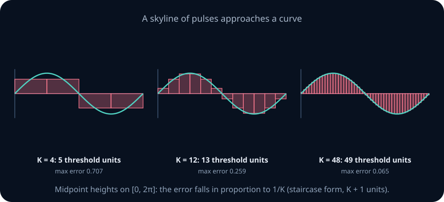

**Counting units.** Each block needs two threshold units, so K blocks need 2K units and a summing output. Neighbouring blocks share an edge, and that saves units. Write the skyline as a sum over edges:

$$\sum_{k=1}^{K} h_k\big[\theta(x-T_k)-\theta(x-T_{k+1})\big]=\sum_{k=1}^{K+1}(h_k-h_{k-1})\,\theta(x-T_k),$$

with \(h_0=h_{K+1}=0\). This is a **staircase** with K+1 threshold units. If the target is nonzero at the last edge, add that value to the coefficient of the final unit as described above. On a fixed interval, the midpoint error bound for an L-Lipschitz function is proportional to 1/K. On a fixed d-dimensional box, a uniform grid for such a target uses O((1/ε)ᵈ) cells, with constants depending on L, dimension, and the box. That is a cost of this construction, not a lower bound for all networks.

**Other activations change the count completely.** A network of units with activation sin z can compute cos(2x) exactly with *one* unit: cos(2x)=sin(2x+π/2), so the weight is 2 and the bias is π/2. Matching the activation to the function can replace thousands of threshold units.

**What else networks do.** The same building blocks do more than classify and regress:
- networks with loops remember patterns, as Kubie proposed in 1930;
- networks can represent probability distributions over integers, real numbers and complex numbers, both conditional and unconditional, and can generate data from them;
- inputs and outputs can encode transcription, captioning, and selecting a move. Our bounded-interval curve construction does not by itself prove a theorem about these structured tasks; later chapters introduce their representations, learning objectives, and models.

```lab
nn-pulses
```

> **Practice — Foundation:** Write the two-threshold-unit network with a summing output for a pulse of height 1.5 on [2,5). Evaluate it at x=1, x=2, x=3, x=5 and x=6.
>
> **Hint:** The output weights on the two threshold units are +1.5 and −1.5.

> **Practice — Core:** For f(x)=x² on [0,1], use K equal blocks at midpoint heights and the final-endpoint correction. Bound the maximum error in terms of K and find the smallest K that the Lipschitz bound certifies gives error below 0.01.
>
> **Hint:** The slope of x² on [0,1] is at most 2, so the error is at most 2·(Δ/2).

> **Practice — Stretch:** Show that a staircase with K+1 threshold units and a summing output computes exactly the same function as K separate pulses with 2K threshold units. Then say what goes wrong at the right end if you forget the final unit.
>
> **Hint:** Expand the telescoping sum and collect the coefficient of each \(\theta(x-T_k)\).

<details>
<summary>Section 9 practice — solution sketches</summary>

Foundation: output 1.5[θ(x−2)−θ(x−5)]. At x=1,2,3,5,6 the values are 0,1.5,1.5,0,0.

Core: x² is 2-Lipschitz on [0,1]. With Δ=1/K the bound is 1/K on [0,1); the endpoint correction makes the value at 1 exact. To certify error strictly below 0.01 using this bound, take K≥101. The bound need not be the sharp error for a specific K.

Stretch: collecting coefficients of each θ(x−Tₖ) gives hₖ−hₖ₋₁, with \(h_0=h_{K+1}=0\). The final coefficient \(-h_K\) cancels the last block after its right edge. Omitting it leaves that height on forever. For a closed-interval target add f(b) to that final coefficient.

</details>

## 10. Code katas

These five short programs rebuild the chapter's models in JavaScript, with tests that run in your browser: a McCulloch–Pitts unit, perceptron training, Oja's rule, XOR from three units, and parity in n+1 units. Each solution also shows a NumPy version. The last kata contains a surprise: parity is not a function that needs depth when units can count.

```lab
nn-katas
```

## 11. Seven runnable coding labs

These labs use standard-library Python and run in the reader's browser workspace or locally with `python -m labs.checks <task>`. Each one has a reference implementation and behavioural checks, including invalid inputs.

### Lab A — a threshold gate that cannot be fooled by cancellation

Open [threshold gate](../../labs/exercises.py). Implement `threshold_gate(weights, bias, inputs)`, returning 1 when Σwᵢxᵢ+b≥0 and 0 otherwise. Accept nonempty lists or tuples of finite reals of the same length, and a finite real bias. Reject bools, mismatched lengths and non-finite values with ValueError, using the supplied `_finite_real_vector`. Use `math.fsum`: a naive running sum can lose a small term between two huge cancelling ones and flip the decision. Do not mutate the inputs.

### Lab B — fences, enclosures, and votes

Open [half-space composition](../../labs/exercises.py). Implement `compose_halfspaces(halfspaces, k, point)`, returning `(count, fires)`: how many of the threshold units fire at the point, and whether at least k of them do. With k equal to the number of units it is an AND (a convex polygon), with k=1 it is an OR, and in between it is the vote that builds a cylinder. Validate every unit, keep k an integer between 0 and the number of units, and do not mutate the inputs.

### Lab C — Hebb diverges, Oja settles

Open [Hebbian update](../../labs/exercises.py). Implement `hebbian_update(samples, w0, eta, rule)`, running one pass of Hebb's rule (`"hebb"`) or Oja's rule (`"oja"`) over the samples in order and returning the new weights. Detect divergence: if the response or any weight becomes non-finite, raise ValueError instead of returning infinities. For the specific dataset, initialization, and small learning rate in the checks, Oja's weights approach unit length near a principal direction while Hebb's grow rapidly. These finite checks do not prove convergence for arbitrary data or step sizes.

### Lab D — the error-correction rule

Open [perceptron training](../../labs/exercises.py). Implement `perceptron_train(samples, labels, eta, max_epochs)`, returning `(weights, bias, epochs_run, converged)`. Start from zero, visit the samples in order, fire on z≥0, and update only on mistakes. Stop after a clean epoch or after `max_epochs`. The checks replay the OR trace from Section 5 exactly, confirm the rule learns AND, NAND, NOR and three-input majority, and confirm it reports failure on XOR instead of looping forever.

### Lab E — any truth table becomes a network

Open [DNF network](../../labs/exercises.py). Implement `dnf_network(truth)`, which takes a truth table in binary order and returns one hidden AND unit per true row plus an OR output. Each hidden unit must fire on exactly its own row. Notice how the bias lets a unit fire on the all-zero input, the case a strict McCulloch–Pitts net cannot handle. The checks build all sixteen two-input functions and random four-input ones and evaluate every row.

### Lab F — a skyline with shared walls

Open [staircase weights](../../labs/exercises.py). Implement `staircase_weights(heights, edges)`, rewriting K pulses as K+1 threshold units whose coefficients are the jumps \(h_k-h_{k-1}\). The checks compare the staircase with the pulse sum at interior points and exactly on the edges, where the convention step(0)=1 decides which pulse a boundary point belongs to.

### Lab G — an illusion from five units

Open [heat/cold net](../../labs/exercises.py). Implement `heat_cold_sensations(heat, cold)` from the units a and b of Section 2, one step of delay each, and return the felt heat and felt cold at every step. The checks compare your network with the unrolled formulas on two hundred random receptor histories, so the unit-by-unit construction must match the logic exactly.

## 12. Exercises · by hand

These are the paper problems of Lab 9. Work each with pen and paper, then type numerical answers to check them, submit your written argument for marking, or open the reference solution. The panel tracks how many you have attempted.

```lab
nn-problems
```

**A1 · Foundation · paper — XOR is not linearly separable.** Write the four inequalities a single perceptron w₁x₁+w₂x₂≥T would need for XOR, and derive a contradiction algebraically, without a picture.

**A2 · Core · paper — at least 3 of 5, and exactly 2 of 3.** (a) Give one perceptron for "at least 3 of 5 inputs are on". (b) Prove that "exactly 2 of 3 inputs are on" needs more than one neuron, and build a two-layer network for it.

**A3 · Core · paper — a diamond with a hole.** Build a network for 1≤|x₁|+|x₂|≤2. How many layers does the natural construction use? Can it be done with one hidden layer? Lab 5 checks your answer.

**A4 · Core · paper — two disjoint shapes.** Build a network for the union of the diamond |x₁+1|+|x₂|≤1 and the square 1≤x₁≤2, −0.5≤x₂≤0.5. Count the neurons, and say where the OR happens.

**A5 · Stretch · paper — a restricted shallow output.** For the two shapes of A4, keep the eight edge units and let D and S be their two firing counts. Show that no output of the form θ(aD+bS−c) represents the union exactly. Locate errors made by θ(D+2S−10). Does the proof also rule out eight separately chosen output weights? Explain the distinction.

**A6 · Stretch · paper — the cylinder derivation and its limit.** Take a regular N-gon circumscribed around the unit circle, with outward normals at angles φₖ=2πk/N. Give each unit’s weights and bias, derive the limiting fraction ½+arcsin(1/r)/π for r>1, and find the count threshold for radius 3. Explain why subtracting distant floors does not by itself turn a sum of cylinders into a union.

**A7 · Stretch · paper — parity: shallow versus deep.** (a) Count the units in the minterm (DNF) construction for n-bit parity with one hidden layer. (b) Count the units in a tree of two-input XOR blocks. (c) Find a one-hidden-layer network with only n+1 units. What does this say about whether depth is needed? Kata 5 checks (c).

**A8 · Core · paper — how many regions can lines make?** (a) What is the largest number of regions that N lines can cut the plane into? (b) In a network of threshold units, why can the first hidden layer of N units never distinguish more points than that, however deep the network is?

**A9 · Core · paper — Hebb's knob argument.** Hebb argued (p. 66) that bigger synaptic contacts let fewer active inputs fire a cell. Model a cell as a threshold unit with four inputs, all weights 1 and threshold 4. Which input patterns fire it? Now Hebbian growth raises the weights of inputs 1 and 2 to 1.5. Give the smallest number of active inputs that can fire the cell, and list every pattern with exactly three active inputs that fires it.

**A10 · Core · paper — reuse the fences, twice.** (a) Three squares sit in a row at the same height: −5≤x₁≤−3, −1≤x₁≤1 and 3≤x₁≤5, each with −1≤x₂≤1. Using shared edges wherever possible, how many threshold units does the edge–AND–OR network use in total? (b) For the two-square network of Section 7, give a network for the region outside both squares that keeps every hidden unit and changes only the output layer. Check a point on a shared edge.

## 13. Review quiz

Twelve questions: ten check calculation, construction, or interpretation, and two connect the historical models to their limitations. Every answer follows from this chapter.

```lab
nn-quiz
```

## 14. Exercises · NumPy

These run locally with NumPy. Use fixed seeds and report the numbers you measured, not only whether a check passed.

**B1 · Foundation · NumPy — score a region network on a grid.** Vectorise the hexagon network with vertices (±1, 0) and (±0.5, ±1) over a 600×600 grid on [−3, 3]², and report the fraction of grid points where it agrees with the exact region. Then move the top edge unit to step(1.05−x₂) and report the agreement again. Explain what the lost fraction measures, and why agreement on a grid is an estimate of an area.

**B2 · Core · NumPy — Hebb, Oja, and the eigenvector.** Draw 5,000 samples from a zero-mean Gaussian with covariance [[2, 1.2], [1.2, 1]] (seed 0). Use `rng=np.random.default_rng(0)`, initialize both rules at w₀=(0.3,0.1), and run Oja's rule with η=0.002. Compare the learned direction with the top eigenvector from `np.linalg.eigh`, reporting the angle in degrees and the final length. Then run plain Hebb on the same samples with the same η and report the first sample where the length exceeds 10⁶, or report that it did not cross within 5,000 samples. Use the angle to the principal axis, ignoring the eigenvector's arbitrary sign.

**B3 · Core · NumPy — count the cylinder.** For N=128 edge units around the unit circle, estimate the fraction of units firing at r=1.5, 2, 4 and 10 by averaging over 360 directions. Compare each with ½+arcsin(1/r)/π and explain the size of the gap.

**B4 · Stretch · NumPy — perceptron updates and the margin.** Generate 200 points uniformly in the unit square, label by x₁+2x₂>1.2, and drop points whose Euclidean distance to this line is below 0.05 (seed 1). Append 1 to each retained input: x̃=(x₁,x₂,1), and use the separator v=(1,2,−1.2). Train the perceptron with η=1 from zero and count mistakes. Compare with (R/γ)², using R=max‖x̃‖ and γ=min |v·x̃|/‖v‖. Repeat with the distance filter at 0.01. Explain why the distance used to filter the original plane differs from the augmented margin in the bound.

## 15. Exercises · PyTorch

**C1 · Core · PyTorch — the threshold has no useful gradient.** Build a perceptron as `torch.heaviside(x @ w + b, torch.tensor(1.0))` with `w` requiring gradients, compute a squared error on a few points, and call `backward()`. Report what happens. Then replace the step with `torch.sigmoid(k*(x @ w + b))` for k=1, 10 and 100, and report the gradient norm. Explain why the perceptron rule is not gradient descent on the classification error, and what this means for training networks of threshold units.

**C2 · Stretch · PyTorch — a region network as tensors.** Write the natural edge–AND–OR network of A4 as three weight matrices and three bias vectors. Give every shape, evaluate a batch of one million random points in [−3,3]², and check against direct Python evaluation on 1,000 of them plus points on each edge and vertex. Report time per point and agreement; distinguish a sampled check from proof of exact equivalence.

## 16. Derivations to own

Rebuild each of these without notes, including the assumptions, and know a case where the result fails when an assumption is dropped.
1. **A single perceptron cannot compute XOR.** Four inequalities and a contradiction. The result fails if the unit has an extra input x₁x₂, which makes XOR separable.
2. **Every Boolean function is a one-hidden-layer network.** The DNF construction with one AND unit per true pattern and one OR unit. State when this DNF construction uses 2ᴺ⁻¹ hidden units, and explain why that is not a lower bound for all threshold networks.
3. **A strict McCulloch–Pitts net cannot fire on all-silent input.** No unit receives excitation, so none fires. A constant input or a bias removes the restriction.
4. **Hebbian growth.** Derive wₙ=w₀(1+η)ⁿ for a scalar linear unit with x=1. Optional extension: derive the conditional mean update and state the assumptions of the eigenvector analysis.
5. **Oja's competition.** Derive the scalar update ηw(1−w²), explain its sign, and give a discrete overshoot example. Optional extension: derive the mean-field norm equation and state its exceptions.
6. **The cylinder limit (optional).** Derive the radial count formula and explain why its nonzero tails invalidate the proposed baseline-subtraction union rule.
7. **The staircase.** Telescope 2K pulse units into K+1 edge units, handle the final endpoint, and distinguish uniform continuity from the stronger LΔ/2 error bound.

## 17. Exercises · cumulative

**M1 · Core · mixed — from committee to perceptron.** A McCulloch–Pitts unit has excitatory inputs A, B, C, an inhibitory input D, and threshold 2 (fire when at least two excitatory inputs are on and D is off). Write a single perceptron with real weights and a bias that computes the same function on all sixteen inputs, and justify the size of D's weight. What feature of the McCulloch–Pitts model does this show is not needed?

**M2 · Core · mixed — what Bain would have needed.** Using Bain's own figure of 25,000 fibres per acquisition at 200,000 acquisitions, and modern figures of about 1.6×10¹⁰ cortical neurons and 10¹⁴ synapses, how many acquisitions could the modern synapse count support at Bain's rate? State two reasons the comparison is misleading.

**M3 · Stretch · mixed — changing a learned task.** Start with w=(2,1), b=−3, which computes AND. Switch the targets to OR and use η=1, presenting (0,0), (0,1), (1,0), (1,1) in order. Count the updates before the first clean epoch and give the final parameters. Compare changing real-valued weights with flipping B-type modifiers: does a small parameter change guarantee a small change in hard-threshold predictions?

**M4 · Stretch · mixed — is Hebb's rule a perceptron rule?** Write the perceptron update as a Hebbian product of an input and an error signal. Explain the role of the teacher signal d, and why plain Hebbian learning with y in place of d−y cannot learn to stop. Then distinguish Oja's response-dependent shrinkage from supervised error correction: which rule uses a teacher, and which can fluctuate with a fixed step size?

## 18. Exercises · checkpoint

**K1 · Foundation · gate — name the parts.** Define a threshold unit, its pre-activation and its decision boundary. Say what makes a function linear rather than affine, and which of the two a perceptron applies its threshold to.

**K2 · Stretch · gate — prove a separation result.** Prove that no single threshold unit computes "x₁ and x₂ are equal" on two Boolean inputs, then give a network of three threshold units that does, with weights and thresholds.

**K3 · Core · gate — size a region network.** A convex polygon with 9 edges must be detected, and a second, disjoint convex polygon with 5 edges must be detected too, with one output that fires inside either. Using the edge–AND–OR construction with no shared edges, how many threshold units does the network use in total?

**K4 · Core · gate — debug and trace an update.** A student replaces the prediction error with the target, updating w←w+ηdx and b←b+ηd on every example. Explain why negative examples cannot correct this rule. Give a separable two-point counterexample and a separator that works. Then, from w=(0,0), b=0, process x=(2,−1), d=0 with η=0.5 using the correct rule: report the prediction and the new weights and bias.

**K5 · Core · gate — distinguish approximation from learning.** A student says: “Because threshold networks are universal, this fixed finite network represents a disc exactly, my training will find the weights, and accuracy on a grid proves performance on unseen data.” Identify the three distinct claims, explain which conclusions the chapter actually supports, and state a precise disagreement-area claim within a bounded window.

**K6 · Stretch · gate — can fixed decay replace Oja?** A scalar linear unit has constant x=1 and y=w. A student proposes w←w+η(y−αw), with fixed α>0, as a replacement for Oja. Use η=0.05 and α=0.5 to compare both updates at w=0.6 and w=1.4. Rewrite the proposed rule as multiplication by one constant. Can any fixed α make w=1 an attracting resting point in this example? Explain what Oja’s response-dependent term changes, and whether either rule uses a teacher label.

## Research connection and reading

These primary sources provide optional historical enrichment. Required exercises and checkpoints can be answered from the chapter; reading the originals is not a prerequisite.
- McCulloch, W. S., & Pitts, W. (1943). A logical calculus of the ideas immanent in nervous activity. *Bulletin of Mathematical Biophysics*, 5, 115–133. Read the five assumptions, Theorem 3, and the heat/cold construction.
- Hebb, D. O. (1949). *The Organization of Behavior*. Wiley. Chapter 4, pp. 60–78, states the postulate and the cell assembly.
- Rosenblatt, F. (1958). The perceptron: a probabilistic model for information storage and organization in the brain. *Psychological Review*, 65(6), 386–408. Compare its value-reinforcement schemes with the error-correction rule taught here, and read its own statement of limits on pp. 404–405.
- Turing, A. M. (1948). Intelligent machinery. NPL report, published in *Machine Intelligence 5* (1969). Read with Copeland, B. J., & Proudfoot, D. (1996), On Alan Turing's anticipation of connectionism, *Synthese*, 108, 361–377.
- Bain, A. (1873). *Mind and Body: The Theories of Their Relation*. Pages 91–117 contain the groupings, the capacity estimate and the learning principle.
- Minsky, M., & Papert, S. (1988). *Perceptrons*, expanded edition, Epilogue: "The new connectionism", pp. 247–280. Their own account of what the 1969 book proved, and their critique of back-propagation's scaling.
- Rumelhart, D. E., McClelland, J. L., & the PDP Research Group (1986). *Parallel Distributed Processing*, vol. 1, ch. 2, for the eight requirements.

Two open questions connect this history to current research. First, Minsky and Papert asked how the cost of learning grows with problem size; scaling laws for modern networks are a partial answer, not a settled one. Second, Hebb's postulate is about *causal timing*, and spike-timing-dependent plasticity in neuroscience still has no agreed counterpart in the training of artificial networks.

## Mastery check and remaining coverage

You are ready for NN02 when you can, without notes: construct and check gates and a multilayer Boolean network; prove XOR’s single-unit limitation; trace the perceptron rule; design and count a union-of-polygons network; explain scalar Hebbian growth and Oja’s competing term; and state an approximation guarantee with its domain and error measure. K1–K6 test those goals. Historical recall and the spectral/cylinder extensions are enrichment, not prerequisites for progressing.

This chapter constructs weights and trains a single perceptron. It does not prove the perceptron convergence bound (NN03), fully compare expressivity and network cost (NN02), or train a hidden layer (NN04–NN05). Hard thresholds have no useful ordinary derivative for gradient learning. Later modules introduce differentiable activations and also piecewise differentiable ones such as ReLU.
