# What a network can represent

A long hallway has one light and six switches, one by each door. Flipping any switch toggles the light, so the light is on exactly when an odd number of switches are up. This function is called **parity**, and it is an instructive first example of how the allowed units change a size claim.

Here are three ways to wire six-bit parity from threshold units:
- One AND unit for each of the 32 switch patterns that turn the light on, followed by an OR, uses 33 units.
- A knockout tournament of XOR blocks, pairing the switches and then pairing the winners, uses 15.
- Six units that each ask "are at least k switches up?", followed by one output, use 7.

All three compute the same function on all 64 inputs. A function does not have a single size; each construction gives its own count.

This chapter asks what networks of a given shape can represent, and how many units, connections and layers that representation costs. Two kinds of claim are easy to confuse. A **construction** proves that some network of a given size exists, so it gives an **upper bound** on the size needed. An **impossibility result** proves that no network of a stated kind is smaller, so it gives a **lower bound**. A lower bound only means something once the kind of network is fixed. The 33-unit construction is the smallest possible among networks whose hidden units may only compute ANDs, yet the counting network is far smaller. Think of a building contractor. "No house of this design can be built with fewer than 33 bricks" is a statement about the design; a different design may need only 7.

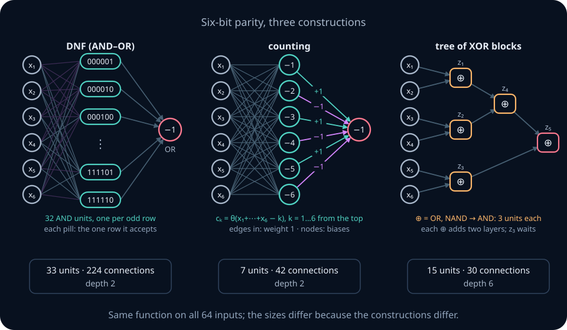

The chapter follows the same plan for Boolean inputs and for real inputs. For each it gives constructions, then lower bounds for stated classes of networks, then counting arguments that hold for almost every target. It proves a universal approximation theorem from scratch, with every assumption stated. It proves that depth can save exponentially many units for a real-valued function, and shows what a narrow or thresholding layer destroys. It ends by counting how many different functions an architecture with W parameters can represent.

The core route develops explicit networks and the arguments needed to assess them. A separate mathematical extension gives the full universal-approximation proof, circuit counting, arithmetic circuits, and VC theory. Results cited without proof appear in boxes marked *Beyond this chapter*. You can continue to NN03 after the core route; the extension remains available for deeper study.

Ten activities appear in the progress panel. Seven are interactive workbenches; the others are code katas, paper problems and a quiz. Six runnable Python tasks implement the chapter's constructions. Ticks record activity completion, not demonstrated mastery.

```lab
nn02-overview
```

## 0. Route and prerequisite diagnostic

The chapter proves five central results.
1. **Boolean representation.** Every Boolean function is a one-hidden-layer threshold network. Among networks whose hidden units are ANDs of literals, n-bit parity needs exactly 2ⁿ⁻¹ hidden units; threshold units that count need only n.
2. **Most functions are expensive.** Almost every Boolean function of n inputs needs more than 2ⁿ/(4n) two-input gates, and any one architecture that represents all of them needs more than 2ⁿ/(n+1) parameters.
3. **Real-input classifiers.** A threshold network's decision boundary lies on the hyperplanes of the units that read the input. Information that a layer merges cannot be recovered later. An exact checkerboard needs two hidden layers.
4. **Universal approximation.** One hidden layer of threshold units, or of ReLU units, approximates every continuous function on a box to any uniform accuracy. The theorem asserts existence only. It gives no practical size guarantee independent of the target and no guarantee about learning or generalization, and it fails for polynomial activations.
5. **Depth for real functions.** The k-fold sawtooth is computed exactly by 2k ReLU units in k hidden layers, but no one-hidden-layer ReLU network with fewer than 2ᵏ−1 units approximates it with uniform error strictly below ½.

**Notation.** NN01's conventions carry over: θ(z)=1 if z≥0 and 0 otherwise, a unit computes θ(w·x+b), and Boolean values are 0 and 1. A **literal** is an input xᵢ or its negation x̄ᵢ=1−xᵢ. **ReLU** is the activation ReLU(z)=max(0,z). Fixed symbols in this chapter:
- n is the number of Boolean inputs, and d the dimension of a real input x∈ℝᵈ;
- N is a number of hyperplanes, polygon sides or line units; m is a layer width;
- L is a network's depth, s a number of gates, and W a number of parameters (a weight matrix always carries a layer index, as in W⁽ℓ⁾);
- K is a number of staircase blocks, k a number of sawtooth compositions, and λ a Lipschitz constant;
- ε is an error tolerance, and |x| the number of ones in a Boolean vector x.

**Shapes.** A layer of m units reading a vector of width q has weight matrix W⁽ℓ⁾∈\(\mathbb{R}^{m\times q}\), bias b⁽ℓ⁾∈ℝᵐ, and output h⁽ℓ⁾=θ(W⁽ℓ⁾h⁽ℓ⁻¹⁾+b⁽ℓ⁾)∈{0,1}ᵐ, with θ applied to each entry. For a batch of B inputs stacked as rows of H⁽ℓ⁻¹⁾∈\(\mathbb{R}^{B\times q}\), the same layer computes H⁽ℓ⁾=θ(H⁽ℓ⁻¹⁾W⁽ℓ⁾ᵀ+𝟏b⁽ℓ⁾ᵀ)∈\(\{0,1\}^{B\times m}\), where 𝟏∈ℝᴮ is a column of ones.

Check these before starting. Each comes with a short repair.
- Can you build XOR from three threshold units and check all four rows? The recipe is h₁=OR, h₂=NAND and output AND(h₁,h₂). If it is unfamiliar, work [NN01 §6](01-connectionism-threshold-unit.md).
- Can you write a truth table as an OR of AND terms, one term per true row? This is the **disjunctive normal form (DNF)**, recalled in Section 2.
- Do you know that C(N,k), "N choose k", counts the ways to pick k items from N? The chapter uses C(N,2)=N(N−1)/2 and proves the one identity it needs. The counting section of [probability foundations](../05-probability-statistics/00-probability-foundations.md) introduces C(N,k).
- Do you remember NN01's staircase? A step θ(x−T₁)−θ(x−T₂) builds a block of height 1 on [T₁,T₂), and blocks add up to a skyline. Section 7 restates its error bound and proves it.
- Do you know that a system of fewer equations than unknowns, Wv=0 with \(W\in\mathbb{R}^{m\times d}\) and m<d, has a solution v≠0? This is rank–nullity, in [systems and subspaces](../02-linear-algebra/02-systems-elimination-subspaces.md). Elimination leaves at least d−m free unknowns.
- Can you read O(·) and Θ(·) notation and compute log₂ 2ⁿ=n? See [mathematical language](../00-foundations/00-mathematical-language.md). O(g) means "at most a constant times g", Θ(g) means "within constant factors of g", and Ω(g) means "at least a constant times g".

**Prerequisites by route.** The core route needs NN01, signed sums and inequalities, logarithms, the idea of continuity, and simple geometric area calculations. Section 6 introduces the trigonometric quantities used in its polygon formulas. Section 9's width proof uses rank–nullity; the diagnostic above links the repair. The full mathematical extension additionally needs polynomial differentiation and Rolle's theorem from [calculus](../03-optimization/01-calculus-gradients-optimization.md), and bases, spans, and linear maps from [vector spaces](../02-linear-algebra/01-vectors-spaces-bases.md) and [systems and subspaces](../02-linear-algebra/02-systems-elimination-subspaces.md). Its polynomial proof supplies a short bridge to linear functionals. Binomial coefficients and the binomial theorem are needed for the Bernstein proof and circuit counting. Python work needs functions, lists, loops, and exceptions; review [Python](../01-python/01-python-memory-iteration.md) first. NumPy and PyTorch work is optional; use [tensors and autograd](../08-pytorch/01-tensors-autograd-training.md) before PyTorch.

**Two study routes.**

| Route | Read and practise | Completion evidence |
|---|---|---|
| Core | Sections 1–3, 5–6, the skyline/tower/ridge examples and theorem statement in Section 7, Sections 8–9, and the coding labs | Foundation/Core practice in these sections, Python A–F, paper A1/A2/A4/A7/A9/A10, and K1–K6 |
| Mathematical extension | Section 4, the optional interpolation and Bernstein/polarization proofs in Section 7, polynomial-activation failure, and Sections 10–11 | Section 4/10/11 practice, A6/A11/A12, M2, and reconstruction of the extension proofs with their assumptions |

**Study time.** The existing 28-hour estimate is a planning allowance for the chapter and selected extensions, not a measured completion time. On the first pass, allocate roughly one quarter to Boolean constructions, one quarter to geometry and bottlenecks, one quarter to approximation and depth, and one quarter to implementation and checks. Full proof reconstruction and optional local experiments may take longer. Historical research boxes and Stretch work outside the checkpoint are optional. Attempt the prompts before opening their static solutions.

**How to use the help on this page.** The **?** buttons open notes anchored to the passage. You can use them as private written notes, or connect an optional LLM tutor for hints and feedback. All required explanations and reference solutions are available without a model connection.

## 1. Networks as graphs: depth, layers, and size

**The question.** Claims such as "deeper networks need fewer units" have no content until depth and size are defined. Which paths count towards depth, and does a size count include zero weights?

**The picture.** Think of an office where memos pass from desk to desk. Each clerk reads the memos that arrive, combines them, and passes one memo on. The **depth** of the office is the longest chain of hand-offs from the mailroom to the boss. A memo that jumps past a desk is a shortcut, and a clerk who only copies a memo forward is a courier. A network is the same: draw each input and each unit as a node, and each nonzero weight as an arrow from the node it reads to the unit that reads it. The figure shows one network twice. On the left, the output reads an input directly as well as a hidden unit. On the right, every arrow joins neighbouring columns, because two copying units carry the inputs forward.

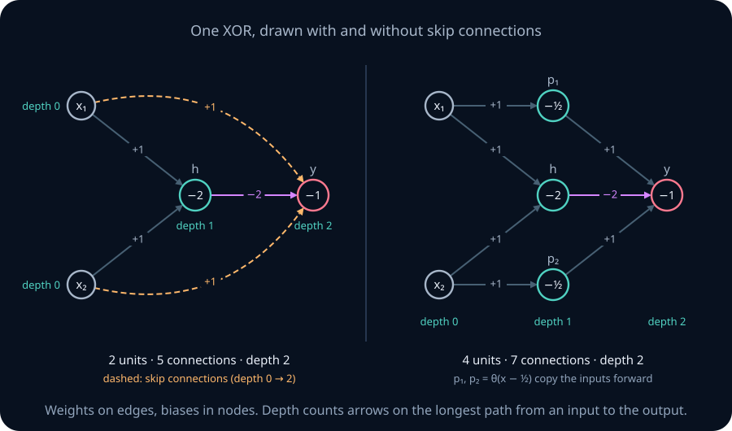

**A worked example: XOR in two units.** Let h=θ(x₁+x₂−2), which is AND, and let the output be y=θ(x₁+x₂−2h−1). On the four inputs:
- (0,0): h=0 and the output score is −1, so y=0.
- (0,1) and (1,0): h=0 and the score is 0, so y=1.
- (1,1): h=1 and the score is 2−2−1=−1, so y=0.

So y is XOR. Now measure it. There are 2 units. There are 5 connections: x₁→h, x₂→h, x₁→y, x₂→y and h→y. There are 2 biases, so 7 parameters. The path x₁→h→y has two arrows and the path x₁→y has one, so the longest path from an input to the output has length 2.

**The definitions.**
- A **feedforward network** is a directed acyclic graph. Its **sources** are the inputs; every other node is a unit that applies an activation to a weighted sum of the nodes with arrows into it, plus a bias. **Acyclic** means no sequence of arrows returns to its start.
- The **depth** of a node is 0 for an input and otherwise 1 plus the largest depth among the nodes it reads. The depth L of a network is the depth of its output: the number of arrows on the longest path from an input to the output. A **layer** is the set of units at one depth. The layers before the output are **hidden**. A **one-hidden-layer** network has depth 2. A network is called **deep** when L≥3, that is, when it has at least two hidden layers.
- A network is **strictly layered** when every arrow goes from depth ℓ−1 to depth ℓ. An arrow that jumps over a layer is a **skip connection**.
- The **size** of a network can mean four different numbers: the number of **units**; the number of **connections**, meaning nonzero weights; the number of **biases**, one per unit; and the number of **parameters**, which is connections plus biases. For a strictly layered network with widths m₀ (the inputs), m₁, …, \(m_L\), the **dense parameter count** \(\sum_\ell (m_{\ell-1}m_\ell+m_\ell)\) also counts the zero entries of every weight matrix. A software library stores the dense count.

**Copying a value forward.** On Boolean inputs, a **pass-through unit** p=θ(x−½) outputs 1 exactly when x=1, so it copies x into the next layer. Any feedforward threshold network on Boolean inputs can be made strictly layered: give each node a chain of pass-through units from its own depth up to one less than the depth of its deepest reader. This adds units and connections but does not change the function or the depth.

For the two-unit XOR, copying x₁ and x₂ forward gives the strictly layered network on the right of the figure. It has 4 units (p₁, p₂, h, y), 7 connections (one into each copier, two into h, three into y), 4 biases, and 11 parameters. Its dense count is 3·2+3=9 for the first layer, where p₁'s weight on x₂ is a stored zero, plus 1·3+1=4 for the output, so 13. NN01's three-unit XOR (OR, NAND, then AND) is already strictly layered: 3 units, 6 connections, 3 biases, and a dense count of 9 with no zeros.

**Activations and outputs.** The **activation** is the function applied to a unit's weighted sum. This chapter uses θ, the **sigmoid** \(1/(1+e^{-z})\), **tanh**, **ReLU**, and **softplus** \(\log(1+e^z)\). A **summing output** has no final activation: it returns a weighted sum plus a constant. Otherwise every output lies in the activation's range: {0,1} for θ, (0,1) for sigmoid, (−1,1) for tanh, [0,∞) for ReLU, and (0,∞) for softplus. Exact representation requires target values in that range. Approximation to arbitrary accuracy only requires target values in its **closure**, which includes limiting endpoints; for example a sigmoid output with a very negative bias can approximate the constant zero, even though it never equals zero. This range condition is necessary, not a sufficient approximation theorem.

**Linear and affine.** A function is **linear** when it maps 0 to 0 and preserves sums and scalar multiples, such as 3x+7y. A function is **affine** when it is linear plus a constant, such as 3x+7y+4. Every linear function is affine; 3x+7y+4 is affine but not linear. A unit applies its activation to an affine function of its inputs.

**What is still missing?** These definitions say what to count. The next section counts the cost of Boolean functions in one-hidden-layer networks.

> **Practice — Foundation:** A network has inputs x₁, x₂, x₃. Unit a reads x₁ and x₂; unit b reads x₂ and x₃; unit c reads a and x₃; the output y reads a, b and c. Give each node's depth, the network's depth, the number of connections, and whether it is strictly layered.
>
> **Hint:** An input has depth 0. Each unit's depth is one more than the deepest node it reads. Check every arrow against "from depth ℓ−1 to depth ℓ".

> **Practice — Core:** Make the network of the Foundation prompt strictly layered with pass-through units, assuming Boolean inputs. How many pass-through units do you need, and what are the new unit, connection, bias and dense parameter counts?
>
> **Hint:** Find every arrow that jumps over a layer. One chain of copies per node can serve all of that node's late readers.

> **Practice — Stretch:** Prove that inserting pass-through units never changes the depth of a network, and give an example in which it multiplies the number of units by more than 2.
>
> **Hint:** A copy chain ends one layer below its deepest reader, so no path gets longer than the longest existing path. For the example, let many deep units each read an input directly.

<details>
<summary>Section 1 practice — solution sketches</summary>

Foundation: x₁, x₂, x₃ have depth 0; a and b have depth 1; c has depth 2; y has depth 3. The network has depth 3 and 9 connections: two each into a, b and c, and three into y. It is not strictly layered: x₃→c jumps from depth 0 to 2, and a→y and b→y jump from 1 to 3.

Core: x₃ needs one copy at depth 1 to feed c. The values a and b each need one copy at depth 2 to feed y. That is 3 pass-through units, giving 7 units, 12 connections (each copy adds one, and every rewired reader keeps its count) and 7 biases. The widths are 3, 3, 3, 1 (inputs; a, b and the copy of x₃; c and the two copies; y), so the dense count is (3·3+3)+(3·3+3)+(1·3+1)=28.

Stretch: a chain for a node at depth a holds copies at depths a+1, …, c−1, where c is the depth of the node's deepest reader. A reader at depth e now reads the copy at depth e−1 instead of the original node. By induction in topological order, every original node keeps its depth, and every copy is shallower than its deepest reader, so the output's depth is unchanged. Example: let u₁ read x₁ and x₂, and let each later \(u_j\) read \(u_{j-1}\), x₁ and x₂, for j=2, …, t. Strict layering needs t−1 copies of x₁ and t−1 copies of x₂, so the units grow from t to 3t−2, more than double once t≥3.

</details>

## 2. Universal gates and reduced DNF

**The question.** NN01 showed that any Boolean function is computed by one AND unit per true row of its truth table, followed by an OR. For example, if f(x₁,x₂) is 1 only on the rows (0,1) and (1,0), the AND units test "x₁=0 and x₂=1" and "x₁=1 and x₂=0", and the OR fires when either does. That is XOR. Which Boolean functions does a single unit compute, and how small can the one-hidden-layer network be made?

**The picture.** Picture a bouncer with a guest list of ten people, each described in full: "no hat, no scarf, no gloves, no coat", and so on. A sharper bouncer notices that four of the ten share "no hat and no coat", whatever else they wear, and replaces those four entries with one short rule. Shorter rules mean fewer AND units. A Karnaugh map makes such shared descriptions visible. It lays a four-input truth table out as a 4×4 grid. The rows and columns are in Gray-code order, so neighbouring cells differ in exactly one input, and the grid wraps around at its edges. A block of neighbouring true cells whose sides are powers of two is a single AND term with fewer literals. The figure shows the chapter's worked example with its groups, and the smaller network they give.

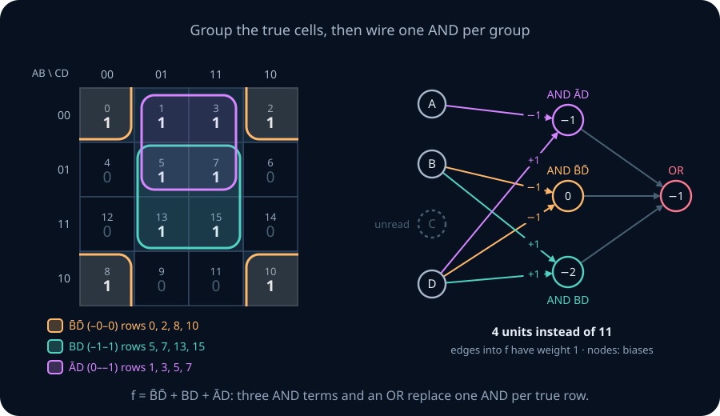

**One unit: at least r literals.** Choose a set P of inputs to appear plainly and a set Q to appear negated. The statement "at least r of the literals are true" is
$$\sum_{i\in P} x_i + \sum_{i\in Q} (1-x_i) \ge r,\quad\text{which rearranges to}\quad \sum_{i\in P} x_i - \sum_{i\in Q} x_i + (|Q|-r) \ge 0.$$

That is one threshold unit, with weight +1 on P, weight −1 on Q, and bias |Q|−r. Choosing r=|P|+|Q| gives an AND of the literals, r=1 gives an OR, and values between give majority-style votes.

Take the vote "at least 2 of x₁, x₂, x̄₃". Here P={1,2}, Q={3} and r=2, so the weights are (1,1,−1) and the bias is 1−2=−1.
- At (0,0,0) the literals are 0, 0, 1, so one is true. The score is −1 and the unit is silent.
- At (1,0,0) the literals are 1, 0, 1, so two are true. The score is 1−1=0 and the unit fires.
- At (1,1,1) the literals are 1, 1, 0, again two. The score is 1+1−1−1=0 and the unit fires.
- At (0,1,1) the literals are 0, 1, 0, only one. The score is 1−1−1=−1 and the unit is silent.

**Smaller sums of products.** An **implicant** of f is an AND of literals that is true only on rows where f is 1. Its true rows form a **subcube**: the inputs it mentions are fixed, and the others are free. A **prime implicant** is an implicant from which no literal can be deleted without it becoming true on some row where f is 0. A **cover** is a set of implicants whose true rows together are exactly the true rows of f. A DNF formula is a cover, and so is a one-hidden-layer network with one AND unit per implicant and an OR output.

**A worked example.** Let f(A,B,C,D) be 1 exactly when ĀB̄ or BD or B̄D̄ holds. Number each row by the binary number ABCD. Then ĀB̄ is true on rows 0–3, BD on rows 5, 7, 13 and 15, and B̄D̄ on rows 0, 2, 8 and 10. Their union has ten rows:

f=1 on {0, 1, 2, 3, 5, 7, 8, 10, 13, 15}.

The plain DNF network has one AND unit per row, so 10 hidden units and 11 in total.

Now find the prime implicants. Write a term as a pattern over A, B, C, D with "-" marking a free input.
1. B̄D̄ is -0-0: rows 0, 2, 8, 10, all true. Freeing B lets row 4 in, and f(4)=0. Freeing D lets row 1 in (fine) but also row 9, and f(9)=0. So B̄D̄ is prime.
2. BD is -1-1: rows 5, 7, 13, 15. Freeing B adds row 9, and freeing D adds row 4, so BD is prime.
3. ĀD is 0--1: rows 1, 3, 5, 7. Freeing A adds row 9, and freeing D adds row 4, so ĀD is prime.
4. ĀB̄ is 00--: rows 0–3. Freeing A adds rows 9 and 11, and freeing B adds row 4, so ĀB̄ is prime.

No other implicant is prime. A minimum cover needs B̄D̄, because it is the only prime implicant containing row 8. It also needs BD, the only one containing row 13. These two are **essential**. Together they cover {0, 2, 5, 7, 8, 10, 13, 15}, leaving rows 1 and 3, which either ĀD or ĀB̄ covers. So f has two minimum covers, each with three terms, for example f = B̄D̄ + BD + ĀD.

Each term becomes one AND unit, with weight +1 on plain literals, −1 on negated literals, and threshold equal to the number of plain literals:
- B̄D̄: weights −1 on B and D, bias 0;
- BD: weights +1 on B and D, bias −2;
- ĀD: weight −1 on A and +1 on D, bias −1;
- output: OR of the three, bias −1.

That is 4 units instead of 11.

**The definitions and the theorem.** Call a one-hidden-layer network an **AND–OR network** if every hidden unit computes an AND of literals and the output computes an OR of hidden units.

**Theorem (AND–OR networks are DNF formulas).** The fewest hidden units of an AND–OR network for f equals the fewest terms of a DNF formula for f. A minimum formula can be chosen to use only prime implicants.

*Proof.* An AND–OR network and a DNF formula are the same object: each hidden unit is one term, and the output is the OR. For the second claim, take a minimum formula and replace each term with a prime implicant that contains it. Delete literals from the term while it stays an implicant; this stops at a prime implicant. Every term still covers only true rows and covers at least the rows it covered before, so the formula is still exact and has the same number of terms. ∎

**Theorem (parity has no shortcuts in DNF).** Every implicant of n-bit parity contains all n inputs. Hence every DNF formula for parity, and every AND–OR network for it, has at least 2ⁿ⁻¹ terms. The same holds for even parity.

*Proof.* Suppose an implicant omits the input xᵢ. Take any row on which it is true; this row has parity 1. Flipping xᵢ leaves the term true, because the term does not mention xᵢ, but changes the parity to 0. So the term is true on a row where parity is 0, and is not an implicant. Each implicant therefore mentions every input and is true on exactly one row. Parity is 1 on 2ⁿ⁻¹ rows, so a cover needs 2ⁿ⁻¹ terms. Even parity has the same number of true rows and the same argument applies. ∎

On a Karnaugh map, parity is a checkerboard: no two neighbouring cells share a value, so nothing can be grouped. The theorem is a lower bound **for AND–OR networks only**. Section 3 shows that threshold units that count avoid it.

**A note on cost.** Listing all prime implicants is mechanical: Lab A does it by testing every pattern, and the Quine–McCluskey method organizes the same idea. Choosing a minimum cover can require searching over subsets, and no efficient method is known for large n. The checks in this chapter use small n, where exhaustive search is fast.

```lab
nn-kmap
```

> **Practice — Foundation:** Give the weights and bias of one threshold unit that fires when at least 2 of x₁, x̄₂, x̄₃, x₄ are true, and check it at (0,1,1,0) and (1,1,0,0).
>
> **Hint:** Plain literals get +1, negated ones −1, and the bias is the number of negated literals minus r.

> **Practice — Core:** For g(A,B,C,D)=1 on rows {0, 1, 4, 5, 10, 11, 14, 15}, find every prime implicant, a minimum cover, and the number of units in the plain DNF network and in the reduced network.
>
> **Hint:** Rows 0, 1, 4 and 5 differ only in B and D. Look for a second block of four with A=1.

> **Practice — Stretch:** Prove that the minimum number of terms in a DNF for n-input majority (1 when at least ⌈(n+1)/2⌉ inputs are on, n odd) equals C(n,(n+1)/2), and contrast it with the number of threshold units majority needs.
>
> **Hint:** A prime implicant of majority is a set of plain literals of minimum size. A row with exactly (n+1)/2 ones lies in exactly one such term.

<details>
<summary>Section 2 practice — solution sketches</summary>

Foundation: weights (1,−1,−1,1) and bias 2−2=0. At (0,1,1,0) the literals are 0, 0, 0, 0 and the score is −1−1=−2, so the unit is silent. At (1,1,0,0) the literals are 1, 0, 1, 0, two true, and the score is 1−1=0, so it fires.

Core: g is ĀC̄ (rows 0, 1, 4, 5) or AC (rows 10, 11, 14, 15); in pattern form 0-0- and 1-1-. Both are prime and essential, and there is no other prime implicant. The plain DNF network has 8 hidden units and 9 in total; the reduced one has 2 hidden units and 3 in total.

Stretch: write h=(n+1)/2. A prime implicant contains no negated literal. If a term contains x̄ⱼ, delete that literal. On any row where the shorter term is true and xⱼ=1, switching xⱼ to 0 gives a row where the original term is true, which therefore has at least h ones; the row with xⱼ=1 has one more. So the shorter term is still an implicant. A term of plain literals is an implicant only if it names at least h inputs, so prime implicants name exactly h. A row with exactly h ones satisfies only the term naming its ones, so every such term is essential. The minimum DNF therefore has C(n,h) terms. One threshold unit, all weights 1 and bias −h, computes majority.

</details>

## 3. Parity three ways: depth versus size

**The question.** Parity needs 2ⁿ⁻¹ hidden units in an AND–OR network. Does it need many units in every network, or only in that one kind?

Go back to the hallway. An AND–OR network has to memorize every switch pattern that turns the light on, one AND unit per pattern. A person would not do that. They would either count the switches that are up and ask whether the count is odd, or pair the switches and combine the answers like a knockout tournament. Both habits become networks.

**The picture.** The figure at the top of the chapter draws the three six-bit constructions. The figure below plots their unit and connection counts against n on a logarithmic axis. The DNF curve rises in a straight line, which means exponential growth. The other two grow only linearly or quadratically.

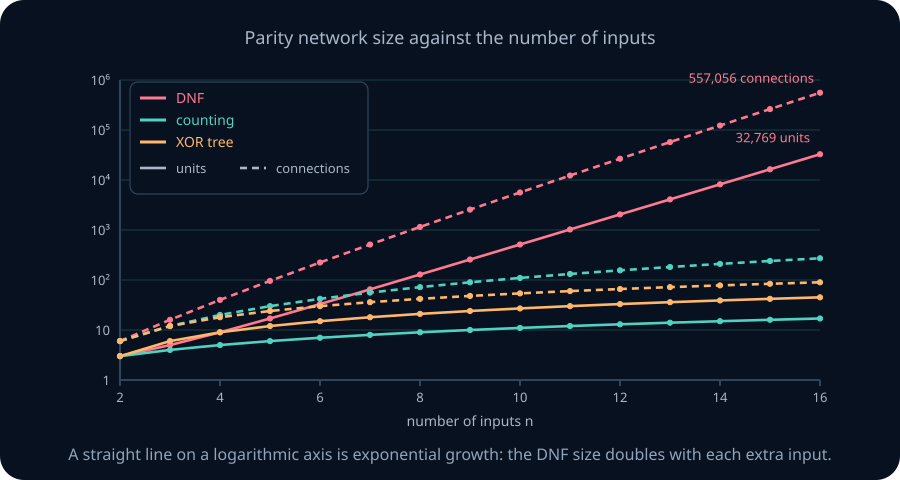

**Construction 1: DNF.** One AND unit per odd row reads all n inputs; the OR output reads all of them. That is 2ⁿ⁻¹+1 units, (n+1)·2ⁿ⁻¹ connections, 2ⁿ⁻¹+1 biases, and depth 2.

**Construction 2: counting.** Count the switches that are up, then ask whether the count is odd. Let \(c_k=\theta(x_1+\dots+x_n-k)\) for k=1, …, n, so \(c_k\) fires when at least k inputs are on. The output is

$$y=\theta\Big(\sum_{k=1}^{n}(-1)^{k+1}c_k-1\Big).$$

If exactly j inputs are on, then c₁, …, \(c_j\) fire and the others do not. The alternating sum is 1−1+1−⋯ with j terms, which is 1 when j is odd and 0 when j is even. So y is parity. This network has n+1 units, n²+n connections, n+1 biases and depth 2. It is strictly layered with no zero weights, so its dense count is (n+1)².

**Construction 3: a tree of XOR blocks.** Run a knockout tournament. Pair the inputs, XOR each pair with the three-unit block (OR and NAND, then AND), then pair the results and repeat. Each block turns two values into one, so n inputs need n−1 blocks: 3(n−1) units, 6(n−1) connections and 3(n−1) biases. Each round of pairing takes two layers, and ⌈n/2⌉ values remain after a round, so ⌈log₂ n⌉ rounds suffice and the depth is 2⌈log₂ n⌉. The two-unit XOR of Section 1 gives a smaller tree, 2(n−1) units and 5(n−1) connections, at the price of skip connections.

**A worked example: n=6, counted four ways.** Pair (x₁,x₂), (x₃,x₄) and (x₅,x₆) in round 1, giving three values z₁, z₂, z₃. Round 2 pairs z₁ with z₂ and carries z₃. Round 3 pairs the result with z₃.

| construction | units | connections | biases | depth | strictly layered |
|---|---:|---:|---:|---:|---|
| DNF | 33 | 224 | 33 | 2 | yes |
| counting | 7 | 42 | 7 | 2 | yes |
| tree, three-unit blocks | 15 | 30 | 15 | 6 | no |
| tree, two-unit blocks | 10 | 25 | 10 | 6 | no |
| tree, three-unit blocks, layered | 17 | 32 | 17 | 6 | yes |

The DNF row has 32 hidden units reading 6 inputs each, 192 connections, plus 32 into the output. The three-unit tree is not strictly layered: z₃ is computed at depth 2 but read at depth 5, in round 3. Two pass-through units copy it through depths 3 and 4, giving the layered row. Its widths, starting with the 6 inputs, are 6, 6, 3, 3, 2, 2, 1, so its dense count is (6·6+6)+(3·6+3)+(3·3+3)+(2·3+2)+(2·2+2)+(1·2+1)=92, against 32+17=49 nonzero parameters.

The tree's paths have different lengths. The path from x₅ through z₃ to the output has 4 arrows, while the path from x₁ has 6. Depth is the longest path, so the tree has depth 6. Which network is smaller depends on what is counted. The counting network is shallowest and has the fewest units, but its connections grow like n², while the tree's grow like n.

**What this does and does not show.** Threshold units compute parity in depth 2 with n+1 units, so a statement that parity requires depth cannot be about threshold networks. The 2ⁿ⁻¹ lower bound of Section 2 holds because AND–OR hidden units cannot count. With n inputs, depth trades against connections: the tree uses 6(n−1) connections at depth 2⌈log₂ n⌉, and the counting network uses n²+n at depth 2. This chapter proves neither construction optimal for its depth.

```lab
nn-parity-builder
```

> **Practice — Foundation:** For n=8, give the units, connections and depth of the DNF, counting, and three-unit tree constructions.
>
> **Hint:** Use 2ⁿ⁻¹+1 and (n+1)2ⁿ⁻¹; n+1 and n²+n; 3(n−1), 6(n−1) and 2⌈log₂ n⌉.

> **Practice — Core:** In the counting construction for n=4, list which of c₁, …, c₄ fire on x=(1,0,1,1) and on x=(1,1,0,0), and evaluate the output. Then show that replacing the output bias −1 with 0 breaks the network, and say on which inputs.
>
> **Hint:** The alternating sum is 0 or 1, so the bias decides between "always fires" and "fires when the sum is 1".

> **Practice — Stretch:** Prove that the pairing tree for n inputs has depth exactly 2⌈log₂ n⌉, and that a strictly layered version needs no pass-through units when n is a power of two.
>
> **Hint:** After r rounds, ⌈n/2ʳ⌉ values remain. When n=2ᵖ every round pairs everything, so every value is read in the next round.

<details>
<summary>Section 3 practice — solution sketches</summary>

Foundation: DNF has 129 units, 9·128=1152 connections, depth 2. Counting has 9 units, 72 connections, depth 2. The tree has 21 units, 42 connections, depth 6.

Core: for (1,0,1,1), three inputs are on, so c₁, c₂, c₃ fire and c₄ does not. The alternating sum is 1−1+1=1 and the score 0 fires, so the output is 1. For (1,1,0,0), c₁ and c₂ fire, the sum is 0, and the score −1 is silent, so the output is 0. With bias 0, the score is the alternating sum itself, which is never negative, so the output is 1 on all sixteen inputs and is wrong on the eight even rows.

Stretch: by induction, round r takes \(\lceil n/2^{r-1}\rceil\) values to ⌈n/2ʳ⌉, using ⌈x/2⌉ halving. The rounds end when one value remains, after the least r with 2ʳ≥n, namely ⌈log₂ n⌉. Each round adds two layers, and the longest path passes through every round. When n=2ᵖ, round r has \(2^{p-r+1}\) values and pairs them all, so no value waits and every arrow joins neighbouring layers.

</details>

## 4. Lower bounds: what restrictions buy, and Shannon's count · mathematical extension

**Route.** This is the optional circuit-counting extension. Core readers can continue at Section 5 after keeping one distinction: a small construction is an upper bound; a lower bound must rule out every smaller network in a specified class.

**The question.** A construction shows that some network of a given size exists. A claim that a function *needs* many units says that no smaller network exists. Against which networks can such a claim be proved, and how strong can it be?

**The picture.** A town has 2000 houses but only 300 house numbers, so some houses must share a number. That is the **pigeonhole principle**: when there are more things to name than names, most things cannot get a short name of their own. A small network is a short description of a function. If there are far more functions than small networks, most functions cannot have a small network. The figure plots, for n=10, an upper bound on the base-2 logarithm of the number of circuits with s gates, against s. The horizontal line is log₂ of the number of Boolean functions of 10 inputs, 2¹⁰=1024. Below the crossing point there are too few circuits to compute every function.

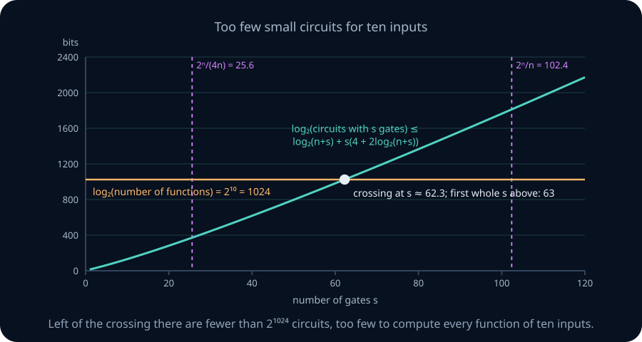

**Three kinds of statement.** Keep these apart throughout the chapter.
1. **Construction (upper bound).** Some network of this size computes f. Every network drawn so far is one.
2. **Lower bound for a restricted class.** No network *of a stated kind* smaller than this computes f. Section 2 proved one: AND–OR networks need 2ⁿ⁻¹ hidden units for parity. The restriction is essential, since threshold units do far better.
3. **Counting bound for almost all functions.** For any kind of network that is described by a list of choices, most functions need a large one. This is Shannon's argument, proved below. It names no particular hard function.

This chapter proves one restricted lower bound (Section 2) and one counting bound (below). Each is short, and each says precisely which networks it covers.

<details>
<summary>Beyond this chapter: depth lower bounds in circuit complexity</summary>

For circuits of AND, OR and NOT gates with unbounded fan-in, depth is a real constraint. Håstad (1986) proved that a depth-L circuit of this kind computing n-bit parity needs \(2^{\Omega(n^{1/(L-1)})}\) gates, and constructions of size \(2^{O(n^{1/(L-1)})}\) exist. At L=2 this agrees with the exact DNF count of Section 2. In complexity-theory notation, parity is not in AC⁰, the class of polynomial-size constant-depth circuits of this kind. The proof uses random restrictions and the switching lemma (Arora and Barak, *Computational Complexity*, ch. 14).

None of this transfers to threshold networks, because the counting network of Section 3 computes parity in depth 2 with n+1 units. For threshold circuits even depth two is poorly understood. The best lower bounds known for explicit functions in depth-two threshold circuits are only slightly superlinear (Kane and Williams, 2016), and whether every function in the class NEXP has polynomial-size depth-two threshold circuits is an open problem.

</details>

**Shannon's count: a worked example.** Fix the circuit model. A **fan-in-2 circuit** on inputs x₁, …, xₙ is a list of s **gates**. Each gate applies one of the 16 Boolean functions of two arguments to two nodes, each node an input or a gate, and one node is designated the output. Its **size** is s.

Count the circuits with n=10 and s=25. Each gate chooses its function in 16 ways and its two argument nodes in at most (n+s)² ways, and the output is one of n+s nodes:

$$\text{number of circuits} \le (n+s)\cdot\big[16(n+s)^2\big]^s = 35\cdot 19600^{25}.$$

This count includes wirings that loop and are not real circuits, which only makes it larger. In base-2 logarithms, log₂ 35≈5.13 and log₂ 19600≈14.26, so the count is at most \(2^{5.13+25\cdot 14.26}\approx 2^{361.6}\). A circuit with fewer than 25 gates can be padded with unused gates to exactly 25 without changing its output. So at most \(2^{362}\) of the \(2^{1024}\) functions of 10 inputs have circuits with 25 or fewer gates: a fraction below \(2^{-662}\).

**Theorem (Shannon's counting argument).** Let n≥5 and s≤2ⁿ/(4n). The fraction of n-input Boolean functions computable by a fan-in-2 circuit with at most s gates is at most \(2^{n+2^n/n-2^{n-1}}\).

*Proof.* As in the example, at most \((n+s)\cdot[16(n+s)^2]^s\) functions are computable, so

log₂(count) ≤ log₂(n+s) + s·(4 + 2 log₂(n+s)).

Since s≤2ⁿ/(4n), we have n+s≤2ⁿ for n≥2, so log₂(n+s)≤n. Then

log₂(count) ≤ n + s(4+2n) ≤ n + (2ⁿ/(4n))(4+2n) = n + 2ⁿ/n + 2ⁿ⁻¹.

There are \(2^{2^n}\) functions, so the fraction is at most \(2^{n+2^n/n+2^{n-1}-2^n} = 2^{n+2^n/n-2^{n-1}}\). For n=5 the exponent is 5+6.4−16=−4.6, and it decreases rapidly as n grows. ∎

**What the count means.** Almost every Boolean function of many inputs needs a circuit whose size is exponential in n. This holds in a fixed basis of two-input gates with no restriction on depth, so depth cannot rescue most functions. Like the pigeonhole argument in the town, it shows that hard functions exist without naming one. Section 11 proves the same kind of statement for threshold networks, counting parameters instead of gates.

<details>
<summary>Beyond this chapter: sharp constants and explicit functions</summary>

Shannon (1949) proved the sharp form: almost all functions need (1−ε)2ⁿ/n gates. Lupanov (1958) proved that (1+o(1))2ⁿ/n gates suffice for every function. Finding an explicit hard function is a central open problem. Polynomial-time algorithms can be turned into polynomial-size circuits, so if some problem in NP needed circuits of super-polynomial size, P would differ from NP. The best lower bounds proved for explicit functions in fan-in-2 circuits are only a small constant times n.

</details>

> **Practice — Foundation:** Use the theorem's bound to give an upper bound on the fraction of 7-input Boolean functions computable with at most 4 fan-in-2 gates. Check first that s=4 satisfies the theorem's hypothesis.
>
> **Hint:** The hypothesis is s≤2⁷/28. The exponent is n+2ⁿ/n−2ⁿ⁻¹ with n=7.

> **Practice — Core:** Repeat the counting argument for fan-in-3 gates, of which there are 2⁸=256 kinds. Show that for s≤2ⁿ/(6n) and n≥6 the fraction of n-input functions computable with at most s such gates tends to 0.
>
> **Hint:** Each gate now chooses 3 argument nodes, at most (n+s)³ ways, and 256=2⁸. Bound log₂(n+s) by n as before.

> **Practice — Stretch:** Explain why Shannon's argument cannot exhibit a particular hard function. Then explain why the counting network for parity does not contradict the 2ⁿ⁻¹ lower bound of Section 2.
>
> **Hint:** A counting argument compares two set sizes. For the second part, compare the hidden units the two networks allow.

<details>
<summary>Section 4 practice — solution sketches</summary>

Foundation: 2⁷/28≈4.57, so s=4 is allowed. The exponent is 7+128/7−64≈−38.7, so at most a fraction \(2^{-38.7}\) of the functions qualify. The direct count, \(11\cdot(16\cdot121)^4\approx2^{47.1}\) circuits against \(2^{128}\) functions, gives the stronger \(2^{-80.9}\).

Core: the count is at most \((n+s)\cdot[256(n+s)^3]^s\), so log₂(count) ≤ n + s(8+3n). With s≤2ⁿ/(6n) this is at most n + 2ⁿ(8+3n)/(6n) = n + 2ⁿ⁻¹ + 4·2ⁿ/(3n). Subtracting 2ⁿ leaves n + 4·2ⁿ/(3n) − 2ⁿ⁻¹, which is about −11.8 at n=6 and tends to −∞.

Stretch: the argument shows that the set of functions with small circuits is smaller than the set of all functions. It says nothing about which functions lie outside it. The lower bound of Section 2 is about AND–OR networks, whose hidden units can only compute ANDs of literals. The counting network's hidden units compute "at least k inputs are on", which is not an AND of literals once 1<k<n. The two results concern different classes of networks.

</details>

## 5. Exact classifiers on real inputs: cells, checkerboards, and two hidden layers

**The question.** NN01 represented finite unions of polygons exactly, with edge units, then AND units, then an OR: two hidden layers. When is one hidden layer enough, and how many first-layer units does an exact network need?

**The picture.** Cut a large flat cake with straight knife strokes. One cut makes 2 pieces, two crossing cuts make 4, and a third cut that crosses both makes 7. The third cut meets the two earlier cuts at two points, so it passes through 3 pieces and splits each in two. Lines in the plane cut it the same way into convex pieces called **cells**. The figure adds four lines one at a time and counts the cells: 1, 2, 4, 7, 11.

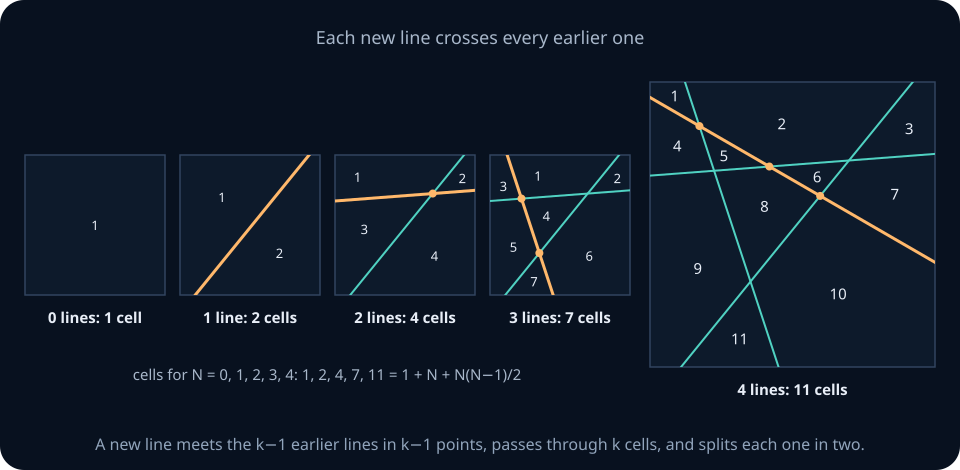

**The definitions.** An **arrangement** is a finite set of hyperplanes {x: w·x+b=0}, w≠0, in ℝᵈ. Its **cells** are the connected pieces left after removing the hyperplanes. They are open convex intersections of half-spaces. N hyperplanes are in **general position** when, for each k with 1≤k≤min(N,d), every k of them intersect in an affine subspace of dimension d−k, and no d+1 share a point. Thus in the plane no two lines are parallel and no three meet; in ℝ³ two planes must meet in a line even when N<3. Write

$$\Phi(N,d)=\sum_{k=0}^{d}\binom{N}{k}.$$

**Theorem (counting cells).** N hyperplanes in ℝᵈ make at most Φ(N,d) cells, with equality in general position.

*Proof.* Use induction on N. With no hyperplanes there is one cell, and Φ(0,d)=1. On a line, d=1, N points make at most N+1=Φ(N,1) intervals. Now add a hyperplane H to an arrangement of N−1 hyperplanes. If H duplicates an old hyperplane, it adds no cells and the bound already holds. Otherwise discard old hyperplanes parallel to H; the remaining old hyperplanes meet H in at most N−1 hyperplanes of H, a copy of \(\mathbb{R}^{d-1}\), which therefore cut H into at most Φ(N−1,d−1) pieces. Each piece P lies inside exactly one old cell C, because P is connected and crosses no old hyperplane. H splits C into two cells, and C∩H is exactly P: it is convex, contains P, and crosses no old hyperplane. So each piece of H adds one cell, and

cells ≤ Φ(N−1,d) + Φ(N−1,d−1) = Φ(N,d),

by Pascal's rule C(N−1,k)+C(N−1,k−1)=C(N,k) applied to each term. (Pascal's rule holds because a choice of k items from N either leaves out the last item, which leaves C(N−1,k) choices, or includes it, which leaves C(N−1,k−1).) In general position the N−1 traces on H are again in general position in H, every bound is attained, and equality holds. ∎

In the plane Φ(N,2)=1+N+N(N−1)/2, which gives 11 cells for four lines, as in the figure.

**Cell constancy.** In this section, the units that read the input read *only* the input. They form the **first layer**. Every later unit reads earlier units, possibly through skip connections, but not the input.

**Lemma (cell constancy).** Every unit of a threshold network is constant on each cell of the arrangement formed by its first-layer hyperplanes. So is the output.

*Proof.* A first-layer unit θ(w·x+b) is constant on each side of its own hyperplane, so it is constant on each cell. A later unit reads only units that are already constant on the cell, so it is too. This is induction in topological order. ∎

Call x a **boundary point** of the decision region if every small disc around x contains both points the network labels 1 and points it labels 0.

**Corollary (where boundaries can be).** The decision boundary of a threshold network lies on the union of its first-layer hyperplanes.

*Proof.* A point on none of the hyperplanes lies in an open cell, so some small disc around it lies inside that cell. The output is constant there, so the point is not a boundary point. ∎

**Corollary (a first-layer lower bound).** Suppose the boundary of a target region in ℝ² contains a segment of positive length on each of N different lines. Then every exact threshold network for that region has at least N first-layer units, whatever its depth and width.

*Proof.* Take one of the target's lines ℓ and its boundary segment. Each first-layer line other than ℓ meets ℓ in at most one point. If ℓ were not a first-layer line, finitely many lines would cover infinitely many points of the segment, which is impossible. So each of the N lines is a first-layer hyperplane. ∎

**A worked example: the 8+8 checkerboard.** On the window [0,8]², draw the eight vertical lines x₁=0.5, 1.5, …, 7.5 and the eight horizontal lines x₂=0.5, …, 7.5. Let k be the number of vertical lines at or to the left of x, and m the number of horizontal lines at or below it. The target fires when k+m is odd. The lines make 9×9=81 rectangular cells. Exactly 40 of them are target cells, because the (k,m) pairs with an odd sum number 2·5·4=40.

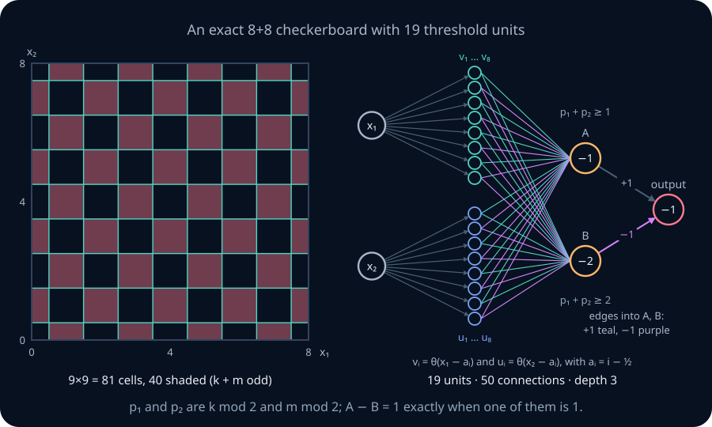

Crossing any one line changes k+m by 1 and flips the label, so every point of every line is a boundary point. The first-layer corollary then requires at least 16 first-layer units.

**Is one hidden layer enough?** Picture a seesaw balanced on the crossing point. At a point where a vertical and a horizontal line cross, the four nearby quarter-cells alternate: two opposite quarters are in the region and the other two are not. This is XOR, drawn on real inputs.

**Theorem (crossing obstruction).** Suppose a target region has a point p and a small disc around p in which the region is exactly two opposite sectors cut out by two lines crossing at p. Then no threshold network with one hidden layer, of any width, represents the region exactly.

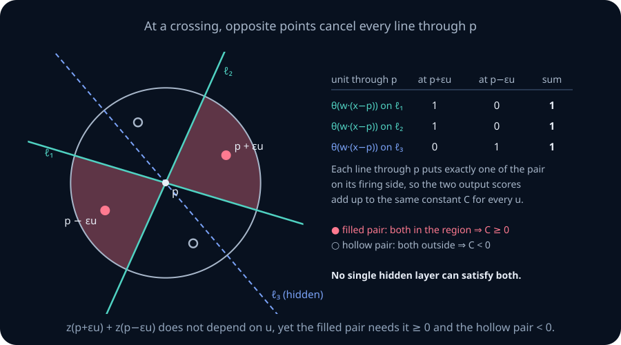

*Proof.* Let the hidden units be hᵢ and the output θ(z) with z=Σᵢ vᵢhᵢ+v₀. Shrink the disc until every hidden line not through p misses it. On the disc each of those units is constant, say hᵢ=cᵢ. A hidden unit whose line passes through p has the form θ(wᵢ·(x−p)). For a unit vector u off all the hidden lines and a small ε>0, exactly one of wᵢ·u and wᵢ·(−u) is positive, so hᵢ(p+εu)+hᵢ(p−εu)=1. The two ends of the seesaw always add up to the same amount. Adding the two scores gives

$$z(p+\varepsilon u) + z(p-\varepsilon u) = \sum_{\text{lines through }p} v_i + \sum_{\text{others}} 2v_ic_i + 2v_0 = C,$$

the same constant C for every such u. Opposite sectors carry the same target label. Choose u in a sector inside the region: both scores are at least 0, so C≥0. Choose u in a sector outside it: both scores are negative, so C<0. That is a contradiction. ∎

So the checkerboard needs at least two hidden layers. Here are four exact constructions, all with the 16 line units \(v_i=\theta(x_1-a_i)\) and \(u_j=\theta(x_2-a_j)\), where aᵢ=i−½.
1. **One AND per cell, then OR.** This is NN01's construction: 16 line units, 40 AND units, and an OR, so 57 units in three threshold layers.
2. **Count, then compare.** The vertical units fire as a staircase: v₁, …, \(v_k\) fire and the rest do not. So p₁=v₁−v₂+v₃−⋯−v₈ equals k mod 2, which is 1 when k is odd. Likewise p₂ is the alternating sum of the u's. These are weighted sums, not units. Let A=θ(p₁+p₂−1) and B=θ(p₁+p₂−2), and output θ(A−B−1). That is 16+2+1=19 units, strictly layered, with 16+32+2=50 connections.
3. **Count, then use a skip connection.** Let c=θ(p₁+p₂−2), and output θ(p₁+p₂−2c−1), which reads the line units and c. This is the two-unit XOR of Section 1 applied to p₁ and p₂: 18 units.
4. **An XOR tree.** k+m is odd exactly when an odd number of the 16 line units fire, so a tree of 15 XOR blocks works: 16+45=61 units, with depth 1+2·4=9.

**Theorem (the smallest exact checkerboard).** Among threshold networks in which only the first layer reads the input, every exact network for the 8+8 checkerboard has at least 18 units, and at least 19 if it is strictly layered. Constructions 3 and 2 attain these counts.

*Proof.* The first layer needs at least 16 units. If the output read only first-layer units, the network would have one hidden layer, which the crossing obstruction rules out. So some unit is neither in the first layer nor the output, giving at least 18. Now suppose the network is strictly layered. If its depth is 3 and its second layer is a single unit c, the output θ(αc+β) equals c, 1−c, or a constant, so c or its complement would be a one-hidden-layer network for the checkerboard. The complement also has crossings, so the obstruction rules both out. The second layer therefore has at least two units. If the depth is 4 or more, the layers between the first and the output contain at least two units anyway. Either way there are at least 16+2+1=19 units. ∎

The lesson is the same as for parity. The 57-unit construction is natural, but it is not a lower bound; units that count cut it to 19. And the true minimum depends on whether skip connections are allowed.

```lab
nn-checkerboard
```

> **Practice — Foundation:** How many cells do 5 lines in general position make in the plane, and how many do 4 planes in general position make in ℝ³?
>
> **Hint:** Use Φ(N,d), the sum of C(N,k) for k=0, …, d.

> **Practice — Core:** For the 3+3 checkerboard on [0,4]², with lines at 1, 2 and 3 on both axes and target "k+m odd", give the unit counts of all four constructions, and write the two second-layer units of the counting construction.
>
> **Hint:** Count the cells with odd k+m among the 4×4. The alternating sums now have three terms each.

> **Practice — Stretch:** The checkerboard's complement is also exact with 19 units. Give the change to the counting network that produces it, and explain why the crossing obstruction applies to the complement.
>
> **Hint:** Negate the output unit. Swapping the labels of all four sectors at a crossing still leaves opposite sectors with equal labels.

<details>
<summary>Section 5 practice — solution sketches</summary>

Foundation: Φ(5,2)=1+5+10=16 cells and Φ(4,3)=1+4+6+4=15 cells.

Core: the grid has 16 cells, and the odd-sum (k,m) pairs with k,m∈{0,…,3} number 2·2·2=8. AND per cell: 6+8+1=15 units. Counting: 6+2+1=9. With a skip: 8. XOR tree: 6+3·5=21. With p₁=v₁−v₂+v₃ and p₂=u₁−u₂+u₃, the second layer is A=θ(p₁+p₂−1) and B=θ(p₁+p₂−2).

Stretch: replace the output θ(A−B−1) by θ(B−A), which fires exactly when A−B=0, that is, when k+m is even. In the complement the two in-region sectors at a crossing are the formerly outside pair, which are still opposite sectors with equal labels, so the proof applies unchanged.

</details>

## 6. Approximate classifiers: error measures, polygon nets, and bottlenecks

**The question.** A circle meets each line in at most two points, so by the boundary corollary no threshold network represents a disc exactly. Representation therefore has to mean approximation. What error is being measured, and what is the best a fixed first layer allows?

**The definitions.** Fix a bounded **window** B, such as a square containing everything of interest. The **disagreement area** between a network's decision region and a target region R is the area of the set of points of B where the two labels differ. A grid score, the fraction of grid points in B where the labels agree, estimates one minus the disagreement area divided by the area of B. Disagreement area ignores how far apart the two boundaries are; a thin sliver of error costs little area.

**The picture.** The figure plots the disagreement area of regular polygons with the unit disc against the number of sides N, on logarithmic axes. Both lines fall with slope −2, so doubling N divides the error by about 4. Beyond N=4 the circumscribed polygon's line sits below the inscribed one's, by a factor that approaches 2.


**Triangle repair.** In a right triangle, sin of an angle is opposite side divided by hypotenuse, and tan is opposite divided by adjacent side. Angles here are in radians, with a full turn equal to 2π. Splitting a regular polygon into triangles gives the area formulas below. You may use these formulas directly on the core route; their small-angle asymptotics use calculus and are optional.

**A worked example: an octagon around the disc.** A regular octagon circumscribed about the unit disc is made of 8 isosceles triangles, each with its apex at the centre, height 1, and base 2tan(π/8). Its area is 8tan(π/8)=8(√2−1)≈3.3137, so the disagreement area is 3.3137−π≈0.1721. The inscribed octagon is made of 8 triangles with two sides of length 1 and apex angle π/4, so its area is 8·½sin(π/4)=2√2≈2.8284 and its disagreement area is π−2.8284≈0.3132. Either network uses N+1=9 threshold units: one per edge and an AND.

**Theorem (polygon error).** With N+1 threshold units, the circumscribed regular N-gon has disagreement area N tan(π/N)−π=π³/(3N²)+O(N⁻⁴) with the unit disc, and the inscribed one has π−(N/2)sin(2π/N)=2π³/(3N²)+O(N⁻⁴).

<details>
<summary>Mathematical extension: deriving the N⁻² asymptotic error</summary>

*Proof.* The areas follow from the triangle decompositions in the example. With u=π/N, tan u=u+u³/3+O(u⁵), so N tan u−π=Nu³/3+O(Nu⁵)=π³/(3N²)+O(N⁻⁴). With v=2π/N, sin v=v−v³/6+O(v⁵), so π−(N/2)sin v=Nv³/12+O(N⁻⁴)=2π³/(3N²)+O(N⁻⁴). ∎


</details>

For a disagreement area of at most 0.01 the circumscribed polygon needs N tan(π/N)−π≤0.01. N=32 gives 0.0101 and N=33 gives 0.0095, so 34 units suffice. The asymptotic estimate N≈√(π³/(3ε)) predicts the same: units grow like \(\varepsilon^{-1/2}\) in the plane.

<details>
<summary>Beyond this chapter: polytopes in higher dimensions</summary>

In d dimensions, the best polytope with N facets approximating a ball has volume error of order \(N^{-2/(d-1)}\). This is a classical result in convex geometry; Gruber (1993) surveys it. The edge–AND construction therefore needs about \(\varepsilon^{-(d-1)/2}\) first-layer units for error ε, which grows exponentially with d for fixed ε. That is a cost of this construction, not a lower bound for every network.

</details>

**Bottlenecks: what later layers cannot recover.** A sorting office routes letters by postcode alone. If two houses share a postcode, no clerk downstream can deliver differently to them, however clever the clerk is. A layer is a postcode for the input. A **cut** of a network is a set of units through which every path from the input to the output passes. Write φ(x) for the vector of the cut's outputs, its **code** at x. The network computes some function of the code, f(x)=g(φ(x)), where g is whatever the later layers compute.

**Lemma (no downstream repair).** If φ(x)=φ(x′), then f(x)=f(x′) for every choice of later layers, of any depth, width or activation. So if the target labels x and x′ differently, the network is wrong on one of them.

*Proof.* f(x)=g(φ(x))=g(φ(x′))=f(x′). ∎

For a cut of threshold units the code takes finitely many values, and the lemma becomes a formula. For each code value c, let \(A^1_c\) and \(A^0_c\) be the areas of the parts of B with code c where the target is 1 and 0.

**Theorem (irreducible error).** For a cut of threshold units, the smallest disagreement area achievable by any choice of later layers is \(\sum_c \min(A^1_c, A^0_c)\). Two more threshold layers achieve it.

*Proof.* Whatever the later layers compute, they give each code c one label g(c). The error inside code c is \(A^0_c\) if g(c)=1 and \(A^1_c\) if g(c)=0, so at least \(\min(A^1_c,A^0_c)\). Summing over codes gives the lower bound. To achieve it, label each code by its majority. This makes g a Boolean function of the code bits, and by Section 2 an AND–OR network computes it with one hidden layer and an output. ∎

**A worked example: one missing line.** Take the 3+3 checkerboard of the Section 5 practice: lines at 1, 2 and 3 on both axes, window [0,4]², 16 unit cells, 8 of them in the target. With all six lines in the first layer every code region is a single cell, and the floor is 0. Now drop the line x₁=2. The columns [1,2] and [2,3] get the same code. In each of the four rows, the merged pair contains one target cell and one non-target cell of area 1, so min(A¹,A⁰)=1 for each of those four codes. The other eight codes are single cells, with error 0. The floor is 4: at least a quarter of the window is mislabelled, whatever the later layers do.

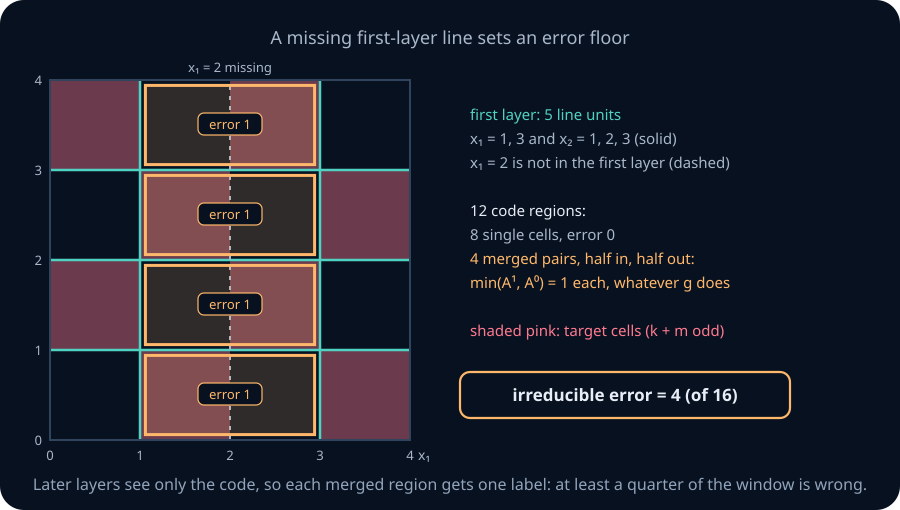

If the cut is a first layer of m threshold units on ℝᵈ, its codes on the open cells number at most Φ(m,d), by the cell-counting theorem; any cut of m threshold units has at most 2ᵐ codes. Points on the hyperplanes can carry extra codes, but they have zero area and do not change the floor. Graded activations such as ReLU do not quantize in this way. Section 9 returns to them.

```lab
nn-polygon-net
```

> **Practice — Foundation:** Give the disagreement areas of the circumscribed and inscribed regular hexagons with the unit disc, exactly and to four decimals.
>
> **Hint:** tan(π/6)=1/√3 and sin(π/3)=√3/2.

> **Practice — Core:** For a disc of radius 2, how does the circumscribed N-gon's disagreement area depend on the radius? Find the smallest N for which it is at most 0.04.
>
> **Hint:** Scaling the whole picture by 2 multiplies every area by 4.

> **Practice — Stretch:** In the one-missing-line example, add a first-layer line x₁=2+δ with 0<δ≤1. Compute the irreducible error as a function of δ, and prove that adding a first-layer unit never raises the irreducible error.
>
> **Hint:** The new line splits the merged columns into [1,2+δ) and [2+δ,3]. More units refine the codes, and a refined labelling can copy the old one.

<details>
<summary>Section 6 practice — solution sketches</summary>

Foundation: circumscribed, 6tan(π/6)−π=2√3−π≈0.3225; inscribed, π−3·sin(π/3)=π−3√3/2≈0.5435.

Core: every area scales by ρ², so the error is 4(N tan(π/N)−π). It is at most 0.04 when N tan(π/N)−π≤0.01, first at N=33.

Stretch: in each row, the code region [1,2+δ) contains area 1 with one label and area δ with the other, so it costs δ; the region [2+δ,3] is a single label. The floor is 4δ, which tends to 0 as the extra line approaches the missing one. For the general claim: refined codes split each old code region, so the old labelling g gives each new code the label of the old code containing it, with the same error. The minimum over labellings of the refined codes is therefore no larger.

</details>

## 7. Universal approximation of continuous functions

**The question.** NN01 approximated any continuous function of one variable on a closed interval with a skyline of threshold units. Does the same hold in d dimensions, how many hidden layers does it take, and what exactly does such a theorem promise?

**Two facts about continuity.** This section uses two facts about continuous functions, both of the kind NN01 §9 used.
- A continuous function f on a closed bounded box is **bounded**: |f|≤μ for some number μ.
- It is **uniformly continuous**: for every ε>0 there is a δ>0 such that any two points of the box closer than δ have values closer than ε.

The second fact is what makes a fine enough grid work everywhere at once.

**The one-variable skyline, restated.** Let g be continuous on [α,β]. Cut the interval into K blocks of width Δ=(β−α)/K, with edges Tᵢ=α+iΔ, and give block i the height hᵢ=g(cᵢ) of its midpoint cᵢ. The skyline is

$$S(t) = \sum_{i=0}^{K-1} h_i\big[\theta(t-T_i)-\theta(t-T_{i+1})\big] + g(\beta)\,\theta(t-\beta).$$

Each bracket is 1 exactly on [Tᵢ,Tᵢ₊₁), and the last term fixes the endpoint t=β, where every bracket is 0. Collecting the coefficient of each θ(t−Tᵢ) turns the K blocks into K+1 threshold units. On block i, |g(t)−S(t)|=|g(t)−g(cᵢ)| with |t−cᵢ|≤Δ/2. So if Δ/2<δ for a tolerance ε, the error is below ε everywhere on [α,β]. If g is λ-Lipschitz, meaning |g(t)−g(t′)|≤λ|t−t′|, the error is at most λΔ/2.

### 7.1 A city of towers: two hidden layers

**The picture.** In two dimensions the skyline becomes a city. Lay a grid of square plots over the square, and on each plot build a flat-topped tower whose height is the target's value at the plot's centre. Seen from a distance, the roofs follow the landscape. One hidden layer draws the grid lines, a second hidden layer recognizes each plot, and the output adds up the towers.

**Theorem (towers).** Let f be continuous on the box [0,1]ᵈ and ε>0. A threshold network with two hidden layers and a summing output approximates f within ε at every point of the box.

*Proof.* Choose δ for tolerance ε, measuring distance by the largest coordinate difference, and choose K with 1/(2K)<δ. The first layer has the grid units \(G_{i,j}=\theta(x_i-j/K)\) for each coordinate i and j=1, …, K−1. Along coordinate i, the plot [j/K,(j+1)/K) is where \(G_{i,j}\) fires and \(G_{i,j+1}\) does not. For j=0 drop the first test, and for j=K−1 drop the second, so the last plot includes xᵢ=1. A plot is a choice \(J=(j_1,\dots,j_d)\), and its unit \(B_J\) is an AND of these d interval tests, firing when all of them hold. Write the AND's score as a sum of first-layer outputs with weights +1 for "fires" tests and −1 for "does not fire" tests, and compare it with the number of "fires" tests. Every point of the box lies in exactly one plot, so exactly one \(B_J\) fires. The output \(\sum_J f(\mathrm{centre}_J)\,B_J\) equals the value at the centre of x's plot, which is within 1/(2K)<δ of x in every coordinate, so the error is below ε. ∎

The towers use d(K−1) grid units and Kᵈ plot units. Their number grows exponentially with the dimension: with K=10 in d=6 there are already a million plots. That is a cost of this construction. Can one hidden layer do the job without counting plots?

### 7.2 Ridges: one hidden layer

**The picture.** A ploughed field is a **ridge function**: its height changes as you walk across the furrows and stays constant as you walk along them. A single threshold unit θ(w·x+b) is the simplest ridge, a cliff running along the line w·x+b=0. A one-hidden-layer network with a summing output adds up cliffs, so it is a sum of ploughed fields running in different directions. The figure shows that two fields, at right angles, already give the saddle xy.

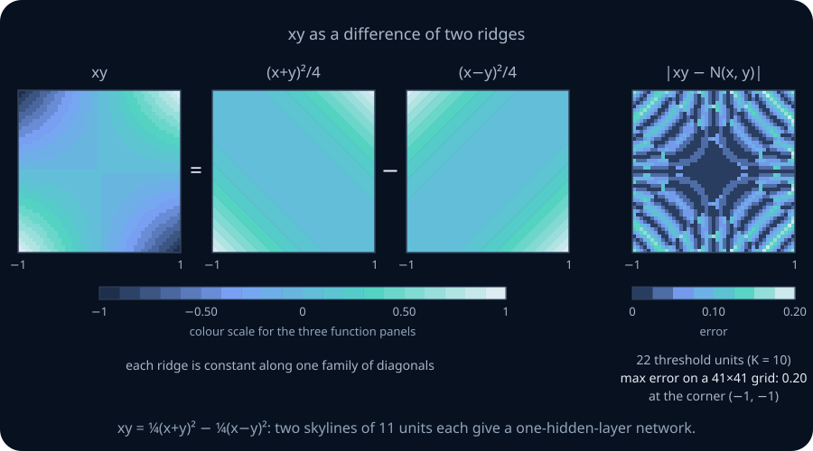

**A worked example: xy from two ridges.** Expanding the squares gives the identity

xy = ¼(x+y)² − ¼(x−y)².

Let g(t)=t²/4. Then xy=g(x+y)−g(x−y), and on the square [−1,1]² both t=x+y and t=x−y lie in [−2,2]. Approximate g on [−2,2] by a skyline S with K blocks. Since |g′(t)|=|t|/2≤1 there, g is 1-Lipschitz, and the skyline's error is at most Δ/2=2/K. Then

N(x,y) = S(x+y) − S(x−y)

is a one-hidden-layer network: each term of S(x+y) is a unit θ(x+y−Tᵢ) with weights (1,1), and each term of S(x−y) is a unit with weights (1,−1). It has 2(K+1) threshold units and a summing output, and its error is at most 2/K+2/K=4/K everywhere on the square. (For even K, g is symmetric, so the unit at t=0 gets output weight g(Δ/2)−g(−Δ/2)=0 in each skyline and could be dropped; the counts below keep it.) With K=10 the network has 22 units and the bound is 0.4; on a 41×41 grid the measured largest error is 0.2. With K=80 it has 162 units and the bound is 0.05.

**ReLU does better on smooth targets.** A ReLU network in one variable can represent any continuous piecewise-linear function exactly. Let I be piecewise linear on [α,β] with knots \(\alpha=t_0<t_1<\dots<t_K=\beta\) and slope sᵢ on [tᵢ,tᵢ₊₁]. Then

$$I(t) = I(t_0) + s_0\,\mathrm{ReLU}(t-t_0) + \sum_{i=1}^{K-1} (s_i-s_{i-1})\,\mathrm{ReLU}(t-t_i)\quad\text{for } t\in[\alpha,\beta],$$

because on [tⱼ,tⱼ₊₁] the active terms add up to slope s₀+(s₁−s₀)+⋯+(sⱼ−sⱼ₋₁)=sⱼ, and the value at t₀ matches. Interpolating g at K+1 equally spaced knots on [−2,2] uses K ReLU units. For this quadratic, on an interval [a,b], direct expansion gives I(t)−g(t)=(t−a)(b−t)/4. Its maximum is (b−a)²/16, at the midpoint. With width Δ=4/K this is 1/K². Adding the two ridge errors gives 2/K² for xy, using 2K hidden ReLU units and a summing output. This derivation uses algebra only. K=7 gives 14 hidden units and bound 2/49≈0.041; a sampled maximum is about 0.020.

<details>
<summary>Mathematical extension: the interpolation bound for other smooth targets</summary>

 On each interval the error e=g−I vanishes at both ends. For a fixed t between them, apply Rolle's theorem twice to φ(u)=e(u)−e(t)·(u−tᵢ)(u−tᵢ₊₁)/((t−tᵢ)(t−tᵢ₊₁)), which vanishes at tᵢ, t and tᵢ₊₁. This gives |e(t)|≤½(t−tᵢ)(tᵢ₊₁−t)·max|g″|≤(Δ²/8)·max|g″|. Here g″=½, so the error is at most Δ²/16=1/K². The xy network then uses 2K ReLU units with error at most 2/K². K=7 gives 14 units and the bound 0.041; the measured largest error is 0.020. A skyline has a first-order bound in Δ for Lipschitz targets, while interpolation has a second-order bound when the second derivative is bounded.

</details>

**Theorem (universal approximation, one hidden layer).** Let f be continuous on a box B⊂ℝᵈ, and ε>0. Then there are J≥1, wⱼ∈ℝᵈ, and bⱼ, cⱼ, c₀∈ℝ such that

$$\max_{x\in B}\Big|f(x)-c_0-\sum_{j=1}^{J}c_j\,\theta(w_j\cdot x+b_j)\Big|<\varepsilon.$$

The same holds with ReLU in place of θ.

The hypotheses are: a closed bounded box, a continuous target, the uniform (largest-error) measure, one hidden layer, and a summing output. The proof has three steps. It approximates f by a polynomial, rewrites the polynomial as a sum of ridges, and builds each ridge from a skyline. The first two steps are lemmas.

<details>
<summary>Mathematical extension: full proof via Bernstein polynomials and polarization</summary>

**Lemma (Bernstein polynomials).** If f is continuous on [0,1]ᵈ, then for every ε>0 some polynomial P satisfies |f−P|<ε on [0,1]ᵈ.

*Proof.* Start in one variable. For a whole number n and k=0, …, n, let \(p_k(x)=\binom{n}{k}x^k(1-x)^{n-k}\). These weights are never negative, and they have three sums:
1. \(\sum_k p_k(x)=(x+(1-x))^n=1\), by the binomial theorem.
2. \(\sum_k k\,p_k(x)=nx\). Differentiate \((x+y)^n=\sum_k \binom{n}{k}x^ky^{n-k}\) with respect to x, multiply by x, and set y=1−x.
3. \(\sum_k k(k-1)p_k(x)=n(n-1)x^2\), by differentiating twice and multiplying by x².

From these, \(\sum_k (k-nx)^2p_k = n(n-1)x^2+nx-2nx\cdot nx+n^2x^2 = nx(1-x)\), so

$$\sum_k \Big(\frac{k}{n} - x\Big)^2 p_k(x) = \frac{x(1-x)}{n} \le \frac{1}{4n}.$$

In d variables, use a whole-number vector \(k=(k_1,\dots,k_d)\) with entries from 0 to n and the product weights \(p_k(x)=\prod_i \binom{n}{k_i}x_i^{k_i}(1-x_i)^{n-k_i}\). They still sum to 1, and summing coordinate by coordinate gives \(\sum_k \|k/n-x\|^2p_k(x)\le d/(4n)\). Define the **Bernstein polynomial**

$$B_n(x) = \sum_k f(k/n)\, p_k(x).$$

Let |f|≤μ, and choose δ for tolerance ε/2. Split the sum \(f(x)-B_n(x)=\sum_k (f(x)-f(k/n))\,p_k(x)\) into near terms, with ‖k/n−x‖<δ, and far terms. Near terms contribute at most \((\varepsilon/2)\sum_k p_k\le\varepsilon/2\). Each far term is at most \(2\mu\,p_k\), and on far terms \(\|k/n-x\|^2/\delta^2\ge1\), so the far terms contribute at most \(2\mu\sum_k(\|k/n-x\|^2/\delta^2)\,p_k\le 2\mu d/(4n\delta^2)\). For n>μd/(εδ²) the total is below ε. ∎

The Bernstein weights are a smoothed vote: \(p_k(x)\) is largest when k/n is near x, so \(B_n\) averages f over sample points near x. The convergence is slow; the lemma is used for existence, not for building networks efficiently.

**Bridge to polarization.** A monomial is a product x₁ᵅ¹⋯x_dᵅᵈ. Polynomials of a fixed total degree form a finite-dimensional vector space with these monomials as basis vectors. A **linear functional** assigns a scalar to each polynomial, respecting sums and scaling; specifying its values on basis vectors specifies it everywhere. If U is a proper subspace of V, extend a basis of U to one of V, assign value zero to U's basis vectors and value one to one added vector. This constructs the nonzero functional used below. The multinomial coefficient k!/α! counts the ways to choose which of k factors supply each variable when expanding (a·x)ᵏ. A polynomial that vanishes everywhere has zero coefficients: successively differentiating at the origin isolates each coefficient.

**Lemma (polarization).** Every homogeneous polynomial of degree k in x∈ℝᵈ is a finite linear combination of powers (a·x)ᵏ with a∈ℝᵈ. A **homogeneous** polynomial of degree k is a sum of monomials that all have total degree k.

*Proof.* Let V be the space of homogeneous polynomials of degree k. Its basis is the monomials \(x^\alpha=x_1^{\alpha_1}\cdots x_d^{\alpha_d}\) with \(\alpha_1+\dots+\alpha_d=k\). Let U⊆V be the span of all (a·x)ᵏ. If U≠V, some nonzero linear functional ℓ on V vanishes on U, say \(\ell(\sum_\alpha c_\alpha x^\alpha)=\sum_\alpha \lambda_\alpha c_\alpha\) with not all \(\lambda_\alpha\) zero. The multinomial theorem gives \((a\cdot x)^k=\sum_\alpha (k!/\alpha!)\, a^\alpha x^\alpha\), where \(\alpha!=\alpha_1!\cdots\alpha_d!\). So \(\sum_\alpha \lambda_\alpha (k!/\alpha!)\, a^\alpha=0\) for every a∈ℝᵈ. A polynomial in a that vanishes on all of ℝᵈ has all coefficients zero, so every \(\lambda_\alpha=0\), a contradiction. ∎

The worked example used the case d=2, k=2: xy=¼(x+y)²−¼(x−y)².

*Proof of the theorem.* For a box with nonzero side lengths, rescale each coordinate affinely so that B becomes [0,1]ᵈ. A zero-length coordinate can be omitted. An affine change of coordinates turns polynomials into polynomials and threshold units into threshold units, so nothing is lost. Follow the error budget.
1. **A polynomial.** By the Bernstein lemma, choose a polynomial P with |f−P|<ε/2 on the box. If P is constant, a constant output already suffices; otherwise continue.
2. **Ridges.** Split P into its homogeneous parts and apply polarization to each. Put the constant part into the output bias c₀. For the remaining terms this writes \(P(x)-c_0=\sum_{j=1}^{J} q_j(a_j\cdot x)\), where each \(q_j(t)=c_jt^{k_j}\) is a polynomial in one variable.
3. **Skylines.** As x ranges over the box, tⱼ=aⱼ·x ranges over a closed interval Iⱼ. The polynomial qⱼ is continuous there, so a skyline Sⱼ(t)=Σᵢ γⱼᵢθ(t−Tⱼᵢ) satisfies |qⱼ−Sⱼ|<ε/(2J) on Iⱼ.
4. **Assemble.** Each term γⱼᵢθ(aⱼ·x−Tⱼᵢ) is a threshold unit in x with weight vector aⱼ and bias −Tⱼᵢ. The sum N(x)=c₀+Σⱼ Sⱼ(aⱼ·x) is a one-hidden-layer network, and

|f−N| ≤ |f−P| + Σⱼ |qⱼ(aⱼ·x)−Sⱼ(aⱼ·x)| < ε/2 + J·ε/(2J) = ε on the box.

For ReLU, replace the skylines by piecewise-linear interpolation. On each interval the interpolant lies between its two endpoint values, so its error is at most the largest change of qⱼ over an interval of width Δ, which uniform continuity makes small. ∎


</details>

**What the theorem does not say.**
- *Size.* J and the number of blocks can be enormous. The construction's size depends on the degree of the Bernstein polynomial, and nothing in it is efficient.
- *Learning.* It says nothing about whether gradient descent finds these weights; that is the subject of NN03–NN05.
- *Generalization.* It is a statement about f on the box, not about a finite sample.
- *Outside the box.* Outside the box nothing is promised; the network's ridges extend unchanged forever.
- *The output unit.* The theorem as stated uses a summing output. With an output activation σ, exact values lie in its range and arbitrarily close approximations can reach its closure. For a target whose values lie in a closed interval inside the range of the sigmoid, approximate σ⁻¹∘f first and then apply σ; because σ is Lipschitz, the error stays small.

<details>
<summary>Beyond this chapter: general domains and activations</summary>

The Stone–Weierstrass theorem extends the polynomial step from boxes to every closed bounded set (Rudin, *Principles of Mathematical Analysis*, Theorem 7.32), so the theorem holds on any compact domain. Leshno, Lin, Pinkus and Schocken (1993) proved that for a continuous activation σ, one-hidden-layer networks approximate every continuous function on every compact set if and only if σ is not a polynomial. Cybenko (1989) and Hornik, Stinchcombe and White (1989) proved earlier versions for sigmoid-type activations.

</details>

<details>
<summary>Mathematical extension: a polynomial activation cannot approximate every continuous target</summary>

**A failure outside the hypotheses: polynomial activations.** Take σ(z)=z². A one-hidden-layer network computes c₀+Σⱼcⱼ(wⱼx+bⱼ)², which is a polynomial of degree at most 2, however wide the network is. Consider approximating x³ on [−1,1]. For any quadratic q, let e=x³−q, and form the third divided difference on the points −1, −½, ½, 1:

D[e] = −⅔e(−1) + ⁴⁄₃e(−½) − ⁴⁄₃e(½) + ⅔e(1).

Substituting e=1, e=x and e=x² gives 0 each time, while e=x³ gives ⅔−⅙−⅙+⅔=1. So D[x³−q]=1 for every quadratic q. The coefficients' absolute values sum to 4, so 1≤4·max|e| on these four points. Every network with activation z² and one hidden layer therefore has error at least ¼ somewhere in [−1,1]. The bound is attained: x³−¾x takes the values ±¼ at ±1 and ±½, and never exceeds ¼ in absolute value on [−1,1]. The theorem's proof fails at step 3: a z² unit cannot build a cliff.


</details>

**From approximation to classification.** A continuous-output network cannot uniformly approximate an indicator with a genuine jump with error below ½: continuity prevents it staying close to both sides at the boundary. This is not an impossibility for every network. A threshold unit such as θ(x) represents a half-line indicator exactly. For general regions, use a continuous surrogate and a final threshold. Blur the boundary as follows. Let R be a closed region in a box, let dist(x,R) be the distance from x to the nearest point of R, and fix a band width w>0. Define

F(x) = max(0, 1 − dist(x,R)/w).

F is 1 on R and 0 at distance w or more, and it is continuous. The triangle inequality gives |dist(x,R)−dist(y,R)|≤‖x−y‖, so F changes by at most ‖x−y‖/w. Approximate F within ¼ by a one-hidden-layer network N, and output θ(N(x)−½). On R, N≥¾, so the output fires. At distance w or more, N≤¼, so it is silent. Errors can occur only in the band 0<dist(x,R)<w. For the unit disc this band has area π((1+w)²−1)=π(2w+w²), which is about 0.0063 for w=0.001. So one hidden layer with a threshold output approximates, in disagreement area, every region whose boundary band shrinks to zero area, such as discs, polygons and finite unions of them. Section 5 showed that it cannot always be exact.

**A tempting argument that fails: adding cylinders.** NN01 §8 surrounded a disc of radius ρ with N edge units, one tangent line per direction \(\varphi_k=2\pi k/N\). A unit fires when the point is on the disc's side of its line. For a point at distance r>ρ from the centre in direction α, unit k fails exactly when \(r\cos(\alpha-\varphi_k)>\rho\), which happens for an arc of directions of length 2arccos(ρ/r). As N grows, the fraction of units firing therefore tends to 1−arccos(ρ/r)/π=½+arcsin(ρ/r)/π. Inside the disc every unit fires. The count looks like a **cylinder**: flat on top, falling towards ½ far away.

Write η(r)=arcsin(ρ/r)/π for the excess over ½. A proposed proof of universality covers a region with discs, subtracts ½ from each disc's fraction, adds the results, and fires when the total reaches ½. Inside a disc the total is ½ plus the other discs' excesses, so it fires. Outside, it should not.

Test it on a row of discs of radius 1 with centres 0, 3, 6, …, and the point x₁=1.5 in the first gap. With two discs the total excess there is 2·arcsin(2/3)/π≈0.465, below ½, so the point is correctly rejected. A third disc adds arcsin(1/4.5)/π≈0.071, and the total 0.536 crosses ½: a point in a gap now fires. With 100 discs the total is 0.949. Shrinking every disc and gap by the same factor leaves every ratio ρ/r unchanged, so thinner cylinders do not help. The excesses fade only like ρ/(πr), and their sum grows like ln K for K discs in a row. Long tails behave like many quiet conversations in a hall: each is faint, but together they drown out the speaker.

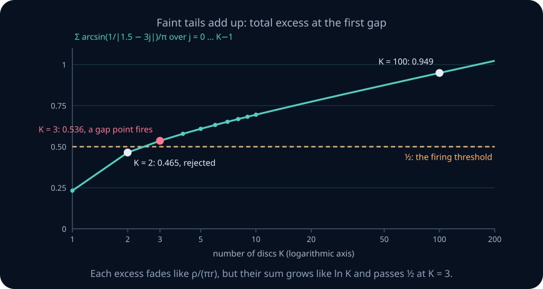

There are two valid repairs. One thresholds each cylinder first, which adds a hidden layer and gives NN01's exact polygons. The other is the ridge construction of this section.

```lab
nn-uat
```

```lab
nn-cylinder-tails
```

> **Practice — Foundation:** Write 2xy and x²−y² as sums of squares of linear forms with coefficients, and give the hidden-unit weight vectors of a skyline network for each on [−1,1]².
>
> **Hint:** 2xy uses the same two directions as the worked example. For x²−y², the coordinate directions already work.

> **Practice — Core:** Using the ReLU interpolation bound, find the smallest K per ridge for which the xy network's guaranteed error is at most 0.005, and the resulting number of ReLU units. Compare with the threshold skyline needed for the same guaranteed error.
>
> **Hint:** The ReLU bound is 2/K² and the skyline bound is 4/K, with K+1 threshold units per ridge.

> **Practice — Stretch:** Show that xy² is a combination of (x+y)³, (x−y)³ and x³, and use it to bound the number of threshold units that guarantees error at most 0.1 for xy² on [−1,1]².
>
> **Hint:** Expand (x+y)³+(x−y)³. Each cubic ridge t³/6 or t³/3 is Lipschitz on its interval with a constant you can compute from its derivative.

<details>
<summary>Section 7 practice — solution sketches</summary>

Foundation: 2xy=½(x+y)²−½(x−y)², with weight vectors (1,1) and (1,−1). x²−y² is (x)²−(y)², with weight vectors (1,0) and (0,1); it can also be written as (x+y)(x−y), but a product is not a sum of ridges.

Core: 2/K²≤0.005 needs K²≥400, so K=20, giving 40 ReLU units. The skyline needs 4/K≤0.005, so K=800 and 2·801=1602 threshold units.

Stretch: (x+y)³+(x−y)³=2x³+6xy², so xy²=[(x+y)³+(x−y)³−2x³]/6. The ridges are h₁(t)=t³/6 on [−2,2], with Lipschitz constant 4·3/6=2; h₂ the same; and h₃(t)=−t³/3 on [−1,1], with constant 1. With skylines of block widths Δ₁, Δ₂, Δ₃ the error is at most Δ₁+Δ₂+Δ₃/2. Take Δ₁=Δ₂=0.04, which is K=100 blocks on an interval of length 4, and Δ₃=0.04, which is K=50 on length 2. The bound is 0.04+0.04+0.02=0.1, with 101+101+51=253 threshold units.

</details>

## 8. Depth for real-valued functions: the sawtooth

**The question.** For Boolean functions, depth saved units only under a restriction on the units. Is there a real-valued function that a deep ReLU network computes with few units, while every shallow one needs exponentially many?

**The picture.** Fold a strip of paper in half, then fold the folded strip in half again. Each fold doubles the number of layers, so ten folds make 1024 layers, yet each fold is one simple action. Unfold the strip and the creases zigzag up and down. The **tent map** t(x)=2min(x,1−x) is one fold of the interval [0,1]: it rises from 0 to 1 and falls back. Composing it with itself doubles the number of teeth each time. The figure shows t, t∘t and t∘t∘t, the narrow deep network that computes them, and why a one-hidden-layer network cannot keep up: it would need one linear piece for every crossing of the level ½.


**A worked example.** On [0,1], t(x)=2ReLU(x)−4ReLU(x−½): for x≤½ this is 2x, and for x≥½ it is 2x−4(x−½)=2−2x. Evaluate t∘t at a few points:
- x=0 gives t=0 and then 0.
- x=⅛ gives t=¼ and then ½.
- x=¼ gives t=½ and then 1.
- x=⅜ gives t=¾ and then ½.
- x=½ gives t=1 and then 0.

So t∘t has a peak at ¼, returns to 0 at ½, and by symmetry peaks again at ¾: two teeth, four linear pieces.

**Lemma 1 (a narrow deep network).** Write \(t^{\circ k}\) for t composed with itself k times. It is computed by a ReLU network with k hidden layers of width 2 and a summing output: 2k hidden units.

*Proof.* Each hidden layer computes ReLU(z) and ReLU(z−½) from the previous value z∈[0,1]. The combination 2ReLU(z)−4ReLU(z−½)=t(z) is a weighted sum, so it folds into the next layer's weights; the last one is the output. Since t maps [0,1] into [0,1], every layer sees inputs in [0,1]. ∎

**Lemma 2 (the teeth).** \(t^{\circ k}\) is piecewise linear with 2ᵏ pieces, and \(t^{\circ k}(i/2^k)\) is 0 for even i and 1 for odd i, for i=0, …, 2ᵏ.

*Proof.* Use induction on k; k=1 is the tent itself. Since \(t^{\circ k}(x)=t^{\circ(k-1)}(t(x))\), and t maps each of [0,½] and [½,1] linearly onto [0,1], each half carries a copy of \(t^{\circ(k-1)}\), compressed by 2 and, on the right half, reflected. Each copy has \(2^{k-1}\) pieces with alternating values on its grid, so together there are 2ᵏ pieces with alternating values on the grid i/2ᵏ. ∎

**Lemma 3 (shallow networks have few pieces).** On ℝ, a one-hidden-layer ReLU network \(c_0+\sum_{i=1}^{m}c_i\,\mathrm{ReLU}(w_ix+b_i)\) is piecewise linear with at most m+1 pieces.

*Proof.* Each unit with wᵢ≠0 bends at the single point −bᵢ/wᵢ, and units with wᵢ=0 are constant. At most m bends make at most m+1 pieces. ∎

**Theorem (a depth separation).** If a one-hidden-layer ReLU network g with m units satisfies \(\sup_{[0,1]}|g-t^{\circ k}|<\tfrac12\), then m≥2ᵏ−1. The deep network of Lemma 1 computes \(t^{\circ k}\) exactly with 2k units.

*Proof.* On the 2ᵏ+1 grid points i/2ᵏ, \(t^{\circ k}\) alternates between 0 and 1. Since \(|g-t^{\circ k}|<\tfrac12\), the values g−½ alternate strictly in sign on those points, so g−½ has a zero between each neighbouring pair: 2ᵏ zeros, separated by points where g−½≠0. Two of these zeros cannot lie in the same linear piece. A linear function that vanishes at two points is identically zero, and then the point of strict sign between them, which also lies in the piece, would give a contradiction. So g has at least 2ᵏ pieces, and by Lemma 3, m+1≥2ᵏ. ∎

For k=10 the deep network uses 20 units, while every one-hidden-layer network needs at least 1023. Here \(t^{\circ k}\) plays the role that parity played for Boolean functions. It alternates as often as possible, and a network has to produce one linear piece per alternation.

The strict inequality matters: the constant output g(x)=½ has uniform error exactly ½ for every k, with no hidden units. Also, m≥2ᵏ−1 is a necessary lower bound, not a construction attaining that width.

**An explicit shallow upper bound.** Put P=2ᵏ. On [0,1], the ReLU interpolant through the alternating grid values is

$$P\,\mathrm{ReLU}(x)+2P\sum_{i=1}^{P-1}(-1)^i\,\mathrm{ReLU}(x-i/P).$$

Its initial slope is P, and at each interior grid point its slope changes by 2P(−1)ⁱ, alternating between P and −P. It therefore equals \(t^{\circ k}\) exactly, using P hidden units and a summing output. Thus the smallest shallow width for error strictly below ½ lies between 2ᵏ−1 and 2ᵏ; the lower-bound proof alone does not decide which endpoint is attainable.

**Theorem (pieces at depth L).** A ReLU network on ℝ with L hidden layers, each of width at most m, and a summing output, is piecewise linear with at most (m+1)ᴸ pieces. Hence approximating \(t^{\circ k}\) with uniform error <½ requires L·log₂(m+1)≥k.

*Proof.* Use induction on the layer. Suppose every unit of layer ℓ−1 is linear on each of at most \((m+1)^{\ell-1}\) common pieces. A unit of layer ℓ applies ReLU to a weighted sum of them, which is linear on each piece, so it adds at most one bend per piece. The m units add at most \(m(m+1)^{\ell-1}\) bends, leaving at most \((m+1)^{\ell-1}+m(m+1)^{\ell-1}=(m+1)^\ell\) pieces. A summing output adds no bends. The crossing argument then needs (m+1)ᴸ≥2ᵏ. ∎

The deep network of Lemma 1 has m=2 and L=k, and log₂3>1, so it is consistent with the bound. A deep network folds; a shallow network can only add bends one at a time.

<details>
<summary>Beyond this chapter: separations in average error</summary>

Telgarsky (2016) proved a stronger version in which the error is averaged over the interval, so a shallow network cannot escape by being badly wrong only on small sets. Montúfar, Pascanu, Cho and Bengio (2014) counted the linear regions of ReLU networks in d dimensions.

</details>

```lab
nn-sawtooth
```

> **Practice — Foundation:** Evaluate \(t^{\circ 3}\) at x=1/16, 3/16 and 5/16, and say how many pieces and teeth it has.
>
> **Hint:** Apply t three times, or use Lemma 2 for grid points i/8 and linearity between them.

> **Practice — Core:** A network may have at most 64 hidden ReLU units in total. Using the pieces-at-depth theorem, find the largest k not ruled out for approximating \(t^{\circ k}\) with uniform error <½ by a one-hidden-layer network, and by 8 hidden layers of width 8. Explain why these necessary bounds alone do not give constructions at those k.
>
> **Hint:** One hidden layer gives m+1=65 pieces. Eight layers of width 8 give at most 9⁸ pieces.

> **Practice — Stretch:** Show that a one-hidden-layer network of threshold units, with a summing output and m units, cannot approximate \(t^{\circ k}\) with uniform error <½ unless m≥2ᵏ. Then explain why the bound differs from the ReLU one by exactly one unit.
>
> **Hint:** A staircase with m units is constant on at most m+1 pieces, and g−½ can change sign only at a jump.

<details>
<summary>Section 8 practice — solution sketches</summary>

Foundation: \(t^{\circ 3}\)(1/16)=t∘t(1/8)=t(1/4)=1/2; \(t^{\circ 3}\)(3/16)=t∘t(3/8)=t(3/4)=1/2; \(t^{\circ 3}\)(5/16)=t∘t(5/8)=t(3/4)=1/2. Each is the midpoint of a piece between grid values 0 and 1. There are 8 pieces and 4 teeth.

Core: one hidden layer has at most 65 pieces, and 2ᵏ≤65 gives k≤6. Eight layers of width 8 have at most 9⁸≈4.3×10⁷ pieces, and 2ᵏ≤9⁸ gives k≤25, since 2²⁵≈3.4×10⁷ and 2²⁶≈6.7×10⁷. These are the largest k not excluded by this counting argument; the upper bound on available pieces does not prove that a network realizes the required pattern.

Stretch: a staircase is constant on each of at most m+1 intervals. g−½ must change sign 2ᵏ times along the grid, and a piecewise-constant function changes sign only at its at most m jumps, so m≥2ᵏ. A ReLU network uses one piece per crossing and can cross inside a piece; a staircase must jump between pieces, so it needs one more unit.

</details>

## 9. Width, information, and activations

**The question.** Depth can save units. Can depth make up for layers that are too narrow? And does the choice of activation matter?

**The picture.** A shadow on a wall loses one dimension of the object that casts it. A cube and a square tile can cast the same square shadow, and nobody looking only at the shadow can tell them apart. A layer narrower than its input is a shadow: it keeps fewer numbers than it was given. The figure compares the target ‖x‖² on [−1,1]², whose level sets are circles, with a network whose first layer has a single unit. That network's level sets are parallel lines, whatever comes after the first layer. The points 0 and v lie on one line, so the network gives them the same value, while the target gives them 0 and 1.

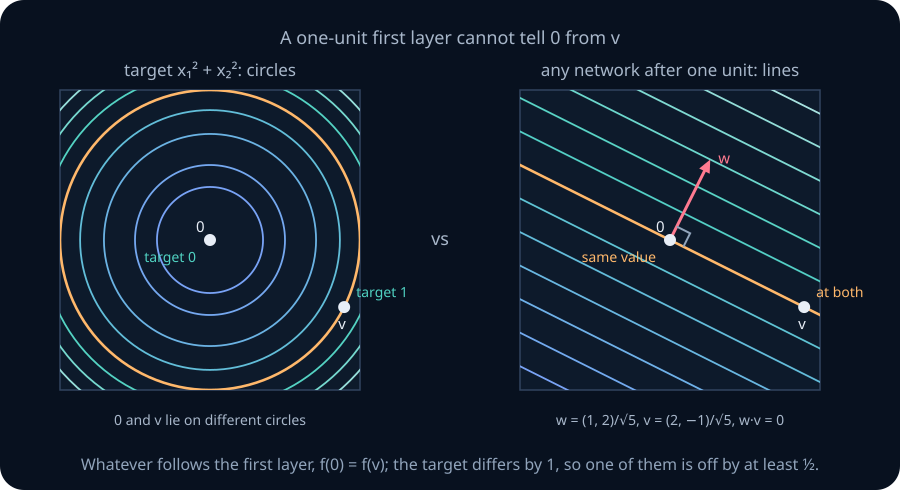

**Theorem (a layer narrower than the input).** Suppose every path from the input to the output passes through a first layer h=σ(W⁽¹⁾x+b) with \(W^{(1)}\in\mathbb{R}^{m\times d}\) and m<d, for any activation σ applied entrywise. Then there is a nonzero v∈ℝᵈ with f(x+τv)=f(x) for every x and every real τ. The network is constant along every line in the direction v.

*Proof.* W⁽¹⁾ has rank at most m<d, so by rank–nullity it has a nonzero null vector v. Then W⁽¹⁾(x+τv)+b=W⁽¹⁾x+b, so h and everything computed from it are unchanged. ∎

**A worked example.** Let d=2, m=1 and target ‖x‖² on [−1,1]². Choose v of length 1 in the null space of the 1×2 matrix W⁽¹⁾; both its coordinates lie in [−1,1], so v is in the window. The network gives 0 and v the same value, while the target gives them 0 and 1. One of the two is wrong by at least ½, for every depth and width after the first layer and for every activation.

**Threshold layers quantize.** A cut of m threshold units has at most 2ᵐ codes, so any function computed after it takes at most 2ᵐ values. To approximate f(x)=x on [0,1] within ε, every x must lie within ε of one of the q≤2ᵐ values, and the q intervals of length 2ε must cover [0,1], so 2εq≥1. Thus 2ᵐ≥1/(2ε). For ε=0.001 that means m≥9, since 2⁹=512≥500 and 2⁸=256<500. A single ReLU unit computes x exactly on [0,1]. On ℝᵈ the first layer is even more limited: by the cell-counting theorem, m threshold units give at most Φ(m,d) codes on their cells, which is 137 for m=16 lines in the plane, against 2¹⁶=65,536 possible codes.

**Graded layers pass information on.** A ReLU layer can be the identity on a bounded window. If every coordinate of x is at least −c on the window, then ReLU(x+c·𝟏)=x+c·𝟏 there, and the next layer subtracts c·𝟏. So a ReLU network of width d can add layers without losing anything about x. Threshold layers cannot: each one rounds its inputs to 0 or 1. Sigmoid and tanh are graded as well: they are nearly affine near 0. For z≠0, sigmoid(kz) approaches θ(z), while tanh(kz) approaches −1 or +1 according to the sign of z. The normalized expression [1+tanh(kz)]/2 approaches θ(z). These are pointwise limits away from zero, not uniform approximation across the jump; at z=0 the sigmoid and normalized tanh remain ½.

**Four common claims, tested.**
1. *"A network whose layers have a bounded width can model any function if it is deep enough."* This is false for threshold units: with width at most m, the first layer allows at most Φ(m,d) codes in ℝᵈ, at any depth. It is false for any activation when the width is less than d, by the theorem above. For ReLU networks somewhat wider than d the answer is yes; see the box below.
2. *"Graded activations compensate for narrow layers through depth better than thresholds do."* This is true in the sense just described: thresholds quantize at every cut, while ReLU layers can pass x along unchanged.
3. *"More graded activations can always make up for limited width and depth."* This is false. A layer narrower than the input collapses a direction for every activation.
4. *"For a given accuracy, graded activations give smaller networks."* This is true for the smooth targets of Section 7: xy needed 162 threshold units but 14 ReLU units for a guaranteed error near 0.05, because interpolation error shrinks like Δ² instead of Δ. It is not a theorem for every target.

<details>
<summary>Beyond this chapter: the minimum width of a universal ReLU network</summary>

Hanin and Sellke (2017) proved that ReLU networks whose hidden layers all have width d+1 approximate every continuous function on a compact subset of ℝᵈ uniformly, if the depth may grow, and that width d does not suffice. Lu, Pu, Wang, Hu and Wang (2017) proved a corresponding result for average error with width d+4.

</details>

> **Practice — Foundation:** A network on ℝ³ has a first layer of 2 units with weight matrix rows (1,0,1) and (0,1,−1), and every path passes through it. Find a direction v along which the network is constant.
>
> **Hint:** Solve W⁽¹⁾v=0. Try v=(a,b,c) with a+c=0 and b−c=0.

> **Practice — Core:** Find the smallest number m of threshold units in a cut that allows f(x)=x² to be approximated within 0.01 on [0,1]. Explain why the answer is the same as for f(x)=x.
>
> **Hint:** x² takes every value in [0,1] on [0,1], so the covering argument applies to its values.

> **Practice — Stretch:** Prove that a ReLU network of width 1, at any depth, computes a monotone function on ℝ. Use this to show that it cannot approximate the tent t within ¼ on [0,1].
>
> **Hint:** ReLU is non-decreasing, and composing non-decreasing or non-increasing maps preserves monotonicity. A monotone function cannot be near 0 at both ends and near 1 in the middle.

<details>
<summary>Section 9 practice — solution sketches</summary>

Foundation: a+c=0 and b−c=0 give v=(−1,1,1), up to scale. Check: (1,0,1)·v=0 and (0,1,−1)·v=0.

Core: the covering argument needs 2ᵐ·2ε≥1 with ε=0.01, so 2ᵐ≥50 and m≥6, since 2⁶=64. It depends only on the set of values to be produced, which is [0,1] in both cases.

Stretch: a width-1 network on ℝ is a composition of maps x↦ReLU(ax+b) and a final affine map. Each map is monotone, and a composition of monotone maps is monotone. A monotone g with |g−t|<¼ at 0, ½ and 1 would need g(0)<¼, g(½)>¾ and g(1)<¼, which is impossible.

</details>

## 10. Arithmetic circuits and sum–product networks · mathematical extension

**The question.** Formal analyses often treat networks as **arithmetic circuits**, which compute polynomials with additions and multiplications. What does factorization buy there, and which comparisons genuinely change depth?

**The picture.** A recipe says "three trays, each with an apple or a pear, a fig or a plum, and a nut or a date". Written out as a list of every possible tray, the same recipe has 2·2·2=8 lines. The factored recipe is a product of sums; the list is a sum of products. The figure shows the same polynomial computed both ways. On the left it is a product of three sums, with 4 units. On the right it is the expanded sum of 8 products. The expanded form cannot be shortened, because each product contributes a different monomial.

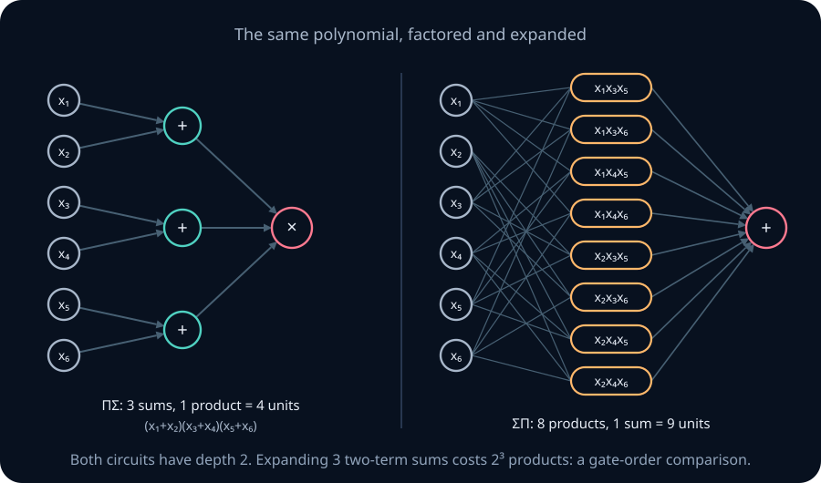

**The definitions.** An **arithmetic circuit** is a feedforward network whose units either add their inputs with real weights (**sum units**) or multiply them (**product units**). The **fan-in** of a unit is the number of inputs it reads. A **sum–product network** here is one whose layers alternate between sum and product units. A **ΣΠ network** has one layer of product units feeding one sum; a **ΠΣ network** has one layer of sum units feeding one product.

**Lemma (degree and depth).** In an arithmetic circuit whose product units have fan-in 2, a node at depth L computes a polynomial of degree at most 2ᴸ. So the product x₁x₂⋯xₙ needs depth at least ⌈log₂ n⌉, and a balanced tree of products achieves it.

*Proof.* Inputs have degree 1. A sum unit's degree is at most the largest degree it reads, and a product of two polynomials has degree at most the sum of their degrees. By induction, a node at depth L has degree at most \(2\cdot2^{L-1}=2^L\). ∎

With unbounded fan-in, one product unit computes x₁⋯xₙ in depth 1. Depth bounds always depend on the allowed fan-in.

**A worked example.** Let f₃=(x₁+x₂)(x₃+x₄)(x₅+x₆). As a ΠΣ network it needs 3 sum units and 1 product unit. Expanding gives the 8 monomials x₁x₃x₅, x₁x₃x₆, …, x₂x₄x₆, one for each choice of one variable from each bracket, each with coefficient 1.

**Theorem (factored versus expanded).** Let \(f_k=\prod_{i=1}^{k}(x_{2i-1}+x_{2i})\). It has a ΠΣ network with k+1 units. Every ΣΠ network for \(f_k\) has at least 2ᵏ product units.

*Proof.* A ΣΠ network computes Σⱼ cⱼmⱼ(x), where each mⱼ is a product of inputs, possibly with repeats, and so a monomial. Distinct monomials are linearly independent as functions on ℝⁿ, because a polynomial that vanishes everywhere has all coefficients zero. Grouping equal monomials, the network's polynomial equals \(f_k\) only if each of \(f_k\)'s 2ᵏ monomials appears among the mⱼ. ∎

Both constructions have depth 2: ΠΣ is a layer of sums followed by a product, while ΣΠ is a layer of products followed by a sum. The exponential comparison above is about factorization and permitted gate ordering, not depth alone. If the output must be a sum unit, append a one-input identity sum to the factored circuit: a depth-3 ΣΠΣ circuit with k+2 units then beats the restricted depth-2 ΣΠ family. State that output and gate restriction when making a depth claim.

<details>
<summary>Beyond this chapter: deeper alternations and compositional targets</summary>

Delalleau and Bengio (2011) constructed functions that deep sum–product networks compute with O(n) units, while every shallow sum–product network needs a number of units exponential in √n. Mhaskar, Liao and Poggio (2017) showed that when a target is a composition arranged as a binary tree of functions of two variables, deep networks that follow the tree avoid an exponential dependence on dimension that shallow approximation pays. Depth–size trade-offs for arithmetic circuits in general remain an active research area.

</details>

> **Practice — Foundation:** How many units do the ΠΣ and the expanded ΣΠ networks for f₅ use?
>
> **Hint:** Five sums and one product, against 2⁵ products and one sum.

> **Practice — Core:** Give a depth-3 arithmetic circuit with fan-in-2 product units for x₁x₂⋯x₈, and explain why depth 2 is impossible with fan-in 2.
>
> **Hint:** Use a balanced tree. At depth 2 every node has degree at most 4.

> **Practice — Stretch:** The polynomial (x₁+x₂+x₃)ᵏ has many monomials. Count them for k=4, and say whether the ΣΠ lower-bound argument applies with that count.
>
> **Hint:** The monomials of degree k in 3 variables number C(k+2,2), and every one has a positive coefficient.

<details>
<summary>Section 10 practice — solution sketches</summary>

Foundation: ΠΣ uses 5+1=6 units; ΣΠ uses 32+1=33 units.

Core: products of pairs at depth 1 give x₁x₂, x₃x₄, x₅x₆, x₇x₈; pairs of those at depth 2; one more product at depth 3. With fan-in 2, a depth-2 node has degree at most 4<8.

Stretch: C(6,2)=15 monomials, each with a positive multinomial coefficient. The argument applies: any ΣΠ network needs at least 15 product units, while a circuit computes (x₁+x₂+x₃)⁴ with one sum and two squarings.

</details>

## 11. Capacity: counting what an architecture can represent · mathematical extension

**The question.** Sections 4 and 5 counted circuits and cells. How many different functions can one fixed architecture with W parameters represent, and what does that number imply?

**The picture.** Put a few coins on a table and colour each one red or blue. Can a ruler always be laid down with all the red coins on one side and all the blue on the other? With three coins, not all on one line, yes, for every colouring. With four coins, no. In the language of this section, three points in general position can be labelled in all 2³=8 ways by a line. With four points this is impossible: either one point lies inside the triangle of the others, or the four form a quadrilateral whose diagonals cross. Either way, some labelling has intersecting convex hulls for its two classes. The figure marks each case's crossing point.


**Lemma (labellings by one unit).** A threshold unit with q inputs produces at most Φ(M,q+1)≤\((M+1)^{q+1}\) different labellings of any M fixed points \(z_1,\dots,z_M\in\mathbb{R}^q\).

*Proof.* Regard the unit's parameters (w,b) as a point of \(\mathbb{R}^{q+1}\). Each zₜ defines a hyperplane {(w,b): w·zₜ+b=0} in that space. Two parameter points in the same cell of this arrangement give the same labelling. Every labelling the unit produces also comes from a point inside some cell. If (w,b) labels some points 1 with w·zₜ+b=0, raise b by less than the smallest |w·zₜ+b| among the points labelled 0. That makes every inequality strict without changing a label. So the number of labellings is at most the number of cells, Φ(M,q+1). Finally, \(\Phi(M,q+1)=\sum_{j\le q+1}\binom{M}{j}\le\sum_{j\le q+1}\binom{q+1}{j}M^j=(M+1)^{q+1}\), because \(\binom{M}{j}\le M^j/j!\le\binom{q+1}{j}M^j\). ∎

**A worked example.** Take q=2 and the four Boolean points of the plane. The lemma allows Φ(4,3)=1+4+6+4=15 labellings. In fact 14 of the 16 Boolean functions of two inputs are threshold functions; only XOR and XNOR are not. The bound is close here. For q=4 Boolean inputs it allows Φ(16,5)=6885 labellings, out of 2¹⁶=65,536 Boolean functions, so at most about a tenth of the functions of four inputs are threshold functions.

**Theorem (labellings by an architecture).** A fixed feedforward threshold architecture with W parameters, counting weights and biases, produces at most \((M+1)^W\) labellings of any M points.

*Proof.* Process the units in topological order. Fix the labellings that the earlier units produce on the M points. A unit with q inputs then sees M fixed points of \(\{0,1\}^q\) or \(\mathbb{R}^q\), so it has at most \((M+1)^{q+1}\) choices, by the lemma. Multiplying over the units gives at most (M+1) raised to Σ(q+1), and that sum is W. ∎

**Corollary (universal Boolean architectures are large).** An architecture that can represent every Boolean function of n inputs has W≥2ⁿ/log₂(2ⁿ+1)>2ⁿ/(n+1) parameters. Every architecture with W parameters represents at most a fraction \(2^{W\log_2(2^n+1)-2^n}\) of the functions.

*Proof.* There are M=2ⁿ input points and \(2^{2^n}\) functions, so representing all of them needs \((2^n+1)^W\ge2^{2^n}\). ∎

For n=10, an architecture representing every function needs at least 103 parameters. The DNF architecture works with 2ⁿ⁻¹ hidden units, building either the function or its complement and using an OR or NOR output. It has 2ⁿ⁻¹(n+2)+1 parameters, which is 6145 at n=10. The lower and upper bounds are both exponential, and their ratio (n+1)(n+2)/2 is only about n²/2.

**Definition (VC dimension).** A set of M points is **shattered** by a family of classifiers if every one of the 2ᴹ labellings is produced. The **VC dimension** of the family is the largest M for which some set of M points is shattered.

**Theorem (one unit).** The VC dimension of a single threshold unit on ℝᵈ is d+1.

*Proof.* For the lower bound, take the points 0, e₁, …, \(e_d\), where eᵢ is the i-th unit vector, and any labels y₀, y₁, …, \(y_d\)∈{0,1}. Let b=½ if y₀=1 and −½ otherwise, and let wᵢ=(2yᵢ−1)−b. Then the score at 0 is b, and at eᵢ it is wᵢ+b=2yᵢ−1. Every point gets its label.

For the upper bound, take any d+2 points \(x_1,\dots,x_{d+2}\). The d+2 vectors \((x_i,1)\in\mathbb{R}^{d+1}\) are linearly dependent, by rank–nullity, so there are \(\lambda_1,\dots,\lambda_{d+2}\), not all zero, with Σλᵢxᵢ=0 and Σλᵢ=0. Let I₊ be the indices with λᵢ>0 and I₋ the rest, and let \(S=\sum_{i\in I_+}\lambda_i>0\). The point \(p=\sum_{i\in I_+}(\lambda_i/S)x_i=\sum_{i\in I_-}(-\lambda_i/S)x_i\) lies in the convex hull of both groups. This is **Radon's theorem**. Label the I₊ points 1 and the rest 0. A unit that fires on the I₊ points fires on their convex hull, since its firing set is a closed half-space. It is silent on the convex hull of the I₋ points, since its silent set is an open half-space. Both must hold at p, a contradiction. ∎

**Corollary (VC dimension of threshold networks).** If an architecture with W parameters shatters M points, then \(2^M\le(M+1)^W\), so M≤W log₂(M+1). For W=10 this allows at most M=59. In general the inequality forces M=O(W log W): if M were much larger than W log₂ W, the left side M would outgrow W log₂(M+1).

<details>
<summary>Beyond this chapter: exact counts and network VC dimensions</summary>

The exact number of threshold functions of four Boolean inputs is 1882, against the bound 6885. Baum and Haussler (1989) proved the O(W log W) bound for threshold networks with explicit constants, and Maass (1994) showed that some threshold architectures reach Ω(W log W). For ReLU networks with W parameters and L layers, Bartlett, Harvey, Liaw and Mehrabian (2019) proved that the VC dimension is O(WL log W) and can be as large as Ω(WL log(W/L)).

</details>

**What capacity measures.** Capacity bounds limit what an architecture can represent or shatter. They are the raw material for generalization bounds, which NN03 and later modules develop. A larger capacity is not better in itself, and representing a function is not the same as learning it.

> **Practice — Foundation:** Give weights and a bias of a threshold unit on ℝ² that labels 0, e₁, e₂ as 1, 0, 1, using the lower-bound construction, and check all three points.
>
> **Hint:** y₀=1 gives b=½. Then wᵢ=(2yᵢ−1)−½.

> **Practice — Core:** For the five points (0,0), (2,0), (0,2), (2,2) and (1,1), give a labelling that no line produces, and find the Radon point of the four corners.
>
> **Hint:** The two diagonals of the square cross at its centre.

> **Practice — Stretch:** Use the architecture theorem to show that a one-hidden-layer threshold network on ℝ² with m hidden units shatters at most about 8m log₂ m points, for large m.
>
> **Hint:** Count W=3m+(m+1)=4m+1, then solve M≤W log₂(M+1) approximately.

<details>
<summary>Section 11 practice — solution sketches</summary>

Foundation: b=½, w₁=(2·0−1)−½=−3/2 and w₂=(2·1−1)−½=½. The scores are ½ at 0 (fires), −1 at e₁ (silent) and 1 at e₂ (fires).

Core: label (0,0) and (2,2) as 1 and (2,0) and (0,2) as 0. The two diagonals cross at (1,1), which lies in both convex hulls, so no line separates them. The Radon point is (1,1) with λ=(1,1,−1,−1) on the corners in that order.

Stretch: W=4m+1. If M≤W log₂(M+1) and M is about W log₂ W, then log₂(M+1)≈log₂ W+log₂ log₂ W, so M≲(4m+1)(log₂ m+O(log log m)), which is about 4m log₂ m. The cruder 8m log₂ m allows for the constants. The bound grows like m log m, not 2ᵐ.

</details>

## 12. Code katas

These five short programs rebuild the chapter's constructions in JavaScript, with tests that run in your browser. They cover a universal gate, a parity tournament, the 19-unit checkerboard, the folded sawtooth, and the two-ridge network for xy. Each one is restricted to a helper, neuron, step or relu, that counts its calls. A test therefore checks the size of your network as well as its answers. Each solution also shows a NumPy version.

```lab
nn02-katas
```

## 13. Six runnable coding labs

These labs use standard-library Python and run in the reader's browser workspace or locally with `python -m labs.checks <task>`. Each has a reference implementation and behavioural checks, including invalid inputs. Robust input validation is a software requirement of the labs. The neural-network idea is what the checks test.

### Lab A — every prime implicant

Open [prime implicants](../../labs/exercises.py). Implement `prime_implicants(truth)`, which takes a truth table in binary order, first input most significant, and returns the sorted list of its prime implicants as strings over `0`, `1` and `-`. Test every one of the 3ⁿ patterns: keep the implicants, then keep those from which no fixed position can be freed. The checks compare your list against the worked example of Section 2, confirm that every implicant of parity is a full row, and test random tables of up to five inputs.

### Lab B — parity three ways

Open [parity network](../../labs/exercises.py). Implement `parity_network(n, construction)` for the constructions `"dnf"`, `"count"`, `"tree"` and `"layered-tree"`. Return a list of units in topological order. Each unit is a pair `(sources, weights, bias)`, where sources index the nodes: 0 to n−1 are the inputs and n+j is unit j. The last unit is the output. The checks evaluate your network on every input for n up to 8 and compare its size with the formulas of Section 3.

### Lab C — four ways to measure a network

Open [network statistics](../../labs/exercises.py). Implement `network_stats(units, n)`, returning a dictionary with the number of units, nonzero connections, biases and parameters, the depth, whether the network is strictly layered, and the dense parameter count, or `None` when the network is not strictly layered. The checks replay the n=6 table of Section 3 and the two-unit XOR of Section 1, and confirm that a stored zero weight is not counted as a connection.

### Lab D — a convex polygon as a network

Open [polygon indicator](../../labs/exercises.py). Implement `polygon_indicator(vertices)`, which takes the vertices of a convex polygon in counter-clockwise order and returns `(hidden, output)`: one edge unit per side, firing on the closed inner side, and an AND output. Reject fewer than three vertices, repeated or collinear vertices, clockwise order, and non-convex polygons. The checks test interior, edge and vertex points, and points just outside every edge, using exact binary fractions.

### Lab E — the irreducible error of a layer

Open [irreducible error](../../labs/exercises.py). Implement `irreducible_error(codes, labels, weights)`. Given each sample's code at a cut, its target label, and its area weight, return the smallest total weight any later layers could misclassify, together with the majority labelling that achieves it. Break ties by labelling 1. The checks reproduce the one-missing-line floor of 4 from Section 6 and confirm that refining codes never raises the floor.

### Lab F — piecewise-linear functions from ReLU units

Open [ReLU interpolant](../../labs/exercises.py). Implement `relu_interpolant(knots, values)`, returning `(c0, units)` with units `(coefficient, knot)` such that c0+Σ coefficient·ReLU(t−knot) passes through every point and is linear between neighbouring knots. The checks rebuild the tent map and t∘t, compare with the interpolation formula of Section 7, and confirm that K knots give at most K−1 units.

## 14. Exercises · by hand

These are the chapter's paper problems. Work each one with pen and paper, then type numerical answers to check them, submit your written argument for marking, or open the reference solution. The panel tracks how many you have attempted.

```lab
nn02-problems
```

**A1 · Foundation · paper — reading a unit backwards.** A threshold unit on four Boolean inputs has weights (1,−1,1,−1) and bias −1. Describe what it computes as "at least r of four literals are true", naming the literals and r, and count how many of the 16 inputs make it fire.

**A2 · Core · paper — a redundant prime implicant.** A four-input function is true exactly on rows {0, 1, 5, 7, 8, 9, 13, 15}. Exactly one of its prime implicants belongs to no smallest cover. Identify that implicant, prove the claim, and say how many AND units a smallest cover saves compared with one unit per true row.

**A3 · Core · paper — exactly two of four.** Prove that every DNF formula for "exactly two of x₁, …, x₄ are on" has at least 6 terms. Then give a threshold network with 3 units that computes it, and check it on one row of each possible count.

**A4 · Core · paper — parity at n=10.** Give the units, connections and depth of the DNF, counting and three-unit tree constructions for 10-bit parity, and the number of pass-through units the layered tree needs with the pairing rule of Section 3.

**A5 · Stretch · paper — waiting values in a tournament.** For 5-bit parity, follow the pairing rule round by round, mark each value that waits, and count the pass-through units of the strictly layered tree. Then prove that every pairing tree for 5 inputs with depth 6 has some value that waits at least two layers.

**A6 · Core · paper — Shannon at twelve inputs.** Check that s=85 satisfies the hypothesis of the counting theorem for n=12, and give the exponent e for which at most a fraction 2ᵉ of 12-input functions have fan-in-2 circuits with at most 85 gates.

**A7 · Foundation · paper — the cake problem.** A flat cake is cut with six straight strokes, every two of which cross inside the cake and no three through one point. Find the number of pieces by adding the strokes one at a time. Then find the most pieces that five plane cuts in general position can make of a solid block.

**A8 · Stretch · paper — the 5+5 checkerboard.** On [0,5]² draw the lines x₁=0.5, …, 4.5 and x₂=0.5, …, 4.5, and let the target fire when the number of lines at or below the point, on both axes together, is odd. Give the unit counts of the AND-per-cell, counting and skip-connection constructions, and prove that the last two are the smallest possible among networks in which only the first layer reads the input.

**A9 · Core · paper — a thousandth of the disc.** Find the smallest N for which the circumscribed regular N-gon has disagreement area at most 0.001 with the unit disc, and the smallest N for the inscribed one. Compare both with the asymptotic formulas.

**A10 · Core · paper — two missing lines.** In the 3+3 checkerboard of Section 6, keep only the first-layer lines x₁=1, x₁=3, x₂=1 and x₂=3. Give the number of code regions and the irreducible error, and the best agreement any later layers can reach.

**A11 · Stretch · paper — lower bounds for folding with width three.** For \(t^{\circ 12}\), derive the lower bound on the number of hidden layers of width at most 3, and on the hidden units of a one-hidden-layer ReLU network, that follows from the pieces theorem for uniform error strictly below ½. Prove the pieces bound. Give known upper bounds from explicit constructions in this chapter. Do the lower bounds prove the exact minima? What changes if error at most ½ is allowed?

**A12 · Stretch · paper — depth rescues squares, but not fully.** (a) Build x³ exactly with two hidden layers of units with activation z². (b) Prove that L hidden layers of such units compute polynomials of degree at most 2ᴸ. (c) Conclude that no fixed depth makes z² networks universal approximators on [−1,1].

## 15. Review quiz

Twelve questions check calculation, construction and interpretation. Every answer follows from this chapter.

```lab
nn02-quiz
```

## 16. Exercises · NumPy

These run locally with NumPy. Use fixed seeds and report the numbers you measured, not only whether a check passed.

**B1 · Core · NumPy — parity at scale.** Write the counting and DNF parity networks as weight matrices and bias vectors. Evaluate both on all Boolean inputs for n=4, …, 14 using two affine stages; split the input batch when needed. Report time per input and nonzero/dense parameter counts. Using float64 and 1 GB=10⁹ bytes, find separately the largest n for which (a) the DNF weights and biases fit in 1 GB and (b) its full all-input hidden activation matrix fits in 1 GB. Estimate peak working memory, including inputs, pre-activations, threshold outputs, and temporary arrays; explain why it differs from either single-array budget. Do not allocate enormous arrays merely to verify the formulas.

**B2 · Core · NumPy — counting cells by sampling.** Draw N=4, 8, 16 and 32 random lines meeting the square [−1,1]² (seed 0). Count the distinct first-layer codes on a 2000×2000 grid in the square and compare with Φ(N,2). Explain why sampling in a window undercounts, and estimate how many cells lie outside the window.

**B3 · Core · NumPy — staircase versus ReLU for xy.** Build the two-ridge networks of Section 7 for K=5, 10, 20, 40 and 80, with threshold and with ReLU units. Measure the largest error on a 401×401 grid, fit the slope of log error against log K, and compare it with the slopes −1 and −2 predicted by the bounds.

**B4 · Stretch · NumPy — no shallow shortcut.** For k=6, fit one-hidden-layer ReLU networks with m=8, 16, 32, 62 and 64 units to \(t^{\circ 6}\) by least squares, using fixed equally spaced breakpoints and solving only for the output weights. Report the largest error and the mean squared error for each m. Confirm that the largest error is at least ½ whenever m≤62, and explain why least squares can still make the mean squared error small.

## 17. Exercises · PyTorch

**C1 · Core · PyTorch — representing is not learning.** Train a ReLU network with 4 hidden layers of width 2 to fit \(t^{\circ 4}\) on 1024 points, from 20 random initializations, and train a one-hidden-layer network of width 64 the same way. Report the final largest error of every run, and compare the deep runs with the exact weights of Lemma 1. Explain what the gap says about representation versus optimization.

**C2 · Stretch · PyTorch — a one-unit first layer.** Train networks whose first layer has width 1, followed by two hidden layers of width 64, to fit ‖x‖² on [−1,1]², and compare with a first layer of width 3. Report the final largest and mean squared errors over 5 seeds. Check that the width-1 networks are constant along a line through the origin, and relate their largest error to the bound of Section 9.

## 18. Derivations to own

Rebuild each of these without notes, including the assumptions, and know a case where the result fails when an assumption is dropped.
1. **One unit, r literals.** Derive the weights and bias of "at least r literals true". It fails as a single unit for "exactly r", which needs two thresholds.
2. **Parity has no DNF shortcut.** Every implicant of parity names all inputs, so a DNF needs 2ⁿ⁻¹ terms. It fails for counting threshold units, which use n+1.
3. **Shannon's count.** Bound the number of fan-in-2 circuits with s gates and compare with \(2^{2^n}\). The argument names no hard function.
4. **Counting cells.** Prove Φ(N,d) by adding one hyperplane at a time. Equality fails without general position.
5. **Boundaries live on first-layer hyperplanes.** Prove cell constancy and the first-layer lower bound. Both fail if later units also read the input.
6. **The crossing obstruction.** Prove the antipodal identity z(p+εu)+z(p−εu)=C. It does not prevent approximation in area.
7. **Irreducible error.** Prove that the majority labelling of codes is optimal and achievable. It assumes a cut with finitely many codes.
8. **Universal approximation.** Bernstein polynomials, then polarization, then skylines, with an explicit error budget. It fails for polynomial activations and outside the box.
9. **The sawtooth separation.** Count crossings of ½ and linear pieces, including the (m+1)ᴸ bound. Being with uniform error <½ everywhere is what forces the crossings.
10. **Labellings of an architecture.** Prove the \((M+1)^W\) bound and the d+1 VC dimension of one unit, with Radon's theorem for the upper half.

## 19. Exercises · cumulative

**M1 · Core · mixed — revisiting two squares.** NN01 represented the union of the squares −3≤x₁≤−1 and 1≤x₁≤3, both with |x₂|≤1, using a 2–6–2–1 network of 9 threshold units. Build an exact one-hidden-layer network for the same region with 7 units, and prove that no exact threshold network in which only the first layer reads the input has fewer.

**M2 · Core · mixed — lower and upper bounds at n=8.** For 8-input Boolean functions, compute the parameter lower bound of Section 11 for an architecture that represents every function, and the parameter count of the DNF architecture with 2ⁿ⁻¹ hidden units. Explain why the DNF architecture can represent functions with more than 2ⁿ⁻¹ true rows.

**M3 · Stretch · mixed — parity is a set of stripes.** Embed the Boolean cube in ℝⁿ and look at the hidden hyperplanes of the counting parity network. Explain, using the cell-constancy lemma and the crossing obstruction, why one hidden layer suffices for parity, whose boundaries are parallel, but not for the two-dimensional checkerboard.

**M4 · Stretch · mixed — a flawed argument, diagnosed.** A student argues: "A one-hidden-layer network approximates the 8+8 checkerboard in disagreement area as closely as we like. So with enough units it represents the checkerboard exactly. Adding cylinders, one per cell, proves this directly." Identify every error, give the correct statement for each claim, and say which theorem of this chapter settles it.

## 20. Exercises · checkpoint

**K1 · Foundation · gate — measure a network.** Three threshold units sit on three Boolean inputs. The first takes all three inputs; the second takes only x₁ and x₂; the output takes the first two units together with x₃. Report the longest input-to-output path length, the counts of units, arrows and biases, whether any arrow skips a layer, and how many copy units would remove every skip.

**K2 · Stretch · gate — derive a cell bound.** Prove by induction that N lines in the plane make at most 1+N+N(N−1)/2 cells, without using the general d-dimensional theorem. Use it to bound the number of codes that a first layer of 10 threshold units can produce on the open cells of ℝ².

**K3 · Core · gate — a ridge construction and its error budget.** Construct a one-hidden-layer approximation to 3xy on [−1,1]² by scaling the two-ridge construction. Give the two directions and the type of output unit. Use the bounds 4/K for xy with midpoint skylines and 2/K² for xy with ReLU interpolation to find the smallest K certified to give error at most 0.02 for 3xy in each construction. Count hidden units, keeping zero-weight units as in Section 7, and explain why sampled error is not the guarantee.

**K4 · Core · gate — debug two size claims.** A student's counting network for 5-bit parity uses the output \(\theta\big(\sum_k(-1)^{k+1}c_k\big)\), with bias 0, and the student reports its depth as 1 "because it has one hidden layer". Find on how many of the 32 inputs the network is wrong, correct the bias, and correct the depth.

**K5 · Core · gate — critique an experiment.** A student reports: "A 9-unit polygon network scores 98.9% on a 150×150 grid for the disc of radius 1.5, so it represents the disc. Universal approximation then shows that one hidden layer represents every shape exactly, so depth is never needed, and gradient descent will find these weights." Identify the separate claims, state what the chapter supports for each, and give a precise disagreement-area statement for the 9-unit network.

**K6 · Stretch · gate — a lower bound is not a construction.** Rebuild the crossing argument for a one-hidden-layer ReLU approximation to \(t^{\circ 5}\) with uniform error strictly below ½. State the resulting lower bound on hidden units. What does it say about widths 30 and 31? Give an exact deep construction and an exact shallow interpolation construction from the chapter, with their hidden-unit counts. Does the lower bound establish the optimum at 31? Finally explain why the constant output ½ defeats every such lower-bound claim if error at most ½ is permitted.


<details>
<summary>Extension practice: seven-input storage counts and a three-dimensional checkerboard</summary>

**Extension — dense versus nonzero at seven inputs.** Build the strictly layered three-unit XOR tree for 7-bit parity under the pairing rule of Section 3 and list its layer widths. Give its nonzero and dense parameter counts, and compare both with the counting network, whose matrices have no zeros.

Round 1 pairs (x₁,x₂), (x₃,x₄), (x₅,x₆), and x₇ waits; rounds go 7→4→2→1, so only x₇ waits, through two copy units. Layer widths, counting the 7 inputs as layer 0: 7; then 6 block units plus a copy, 7; then 3 block outputs plus a copy, 4; then 4; then 2; then 2; then 1. The network has 18 block units and 2 copies, 20 units with 20 biases, and 6·6+2=38 nonzero connections, so 58 nonzero parameters. Its dense count is (7·7+7)+(4·7+4)+(4·4+4)+(2·4+2)+(2·2+2)+(1·2+1)=56+32+20+10+6+3=127. The counting network has (n+1)²=64 parameters, all nonzero, so dense equals nonzero. The tree is smaller in stored nonzero parameters but larger as dense matrices, because most entries of its matrices are zero. Rubric: the waiting value and copy units; all layer widths; both counts for the tree; the counting network's 64; the comparison explained by stored zeros.

**Extension — a three-dimensional checkerboard.** In [0,4]³ place the planes x₁, x₂, x₃ = 0.5, 1.5, 2.5, 3.5, and let the target fire when the total number of planes at or below the point is odd. Give a lower bound on the first layer, an exact network with skip connections using 14 units, and a strictly layered one using 16. Explain how the crossing obstruction carries over to three dimensions.

Lower bound: crossing any of the 12 planes flips the label, so every point of every plane is a boundary point. A plane can be covered by finitely many other planes only on finitely many lines, so each of the 12 planes must be a first-layer hyperplane: at least 12 first-layer units. With skip connections: let pᵢ be the alternating sum of the four units on axis i, S=p₁+p₂+p₃∈{0,1,2,3}, c=θ(S−2), and output θ(S−2c−1); S−2c is 0, 1, 0, 1 for S=0, 1, 2, 3, so the output is parity, using 12+1+1=14 units. Strictly layered: second layer θ(S−1), θ(S−2), θ(S−3), and output θ(h₁−h₂+h₃−1), using 12+3+1=16. The crossing obstruction carries over by slicing: take a point on the line where x₁=0.5 meets x₂=0.5, away from the other planes, and restrict the network to the plane x₃=const through it. On that plane every first-layer unit is a half-plane or a constant, the target is the two-dimensional XOR pattern near the point, and the two-dimensional proof applies, so one hidden layer is impossible. Rubric: the boundary-plane lower bound; both constructions checked on S=0 to 3; the slicing argument for the obstruction.

</details>

## Research connection and reading

The chapter's arguments are self-contained. These sources show where they come from and where they lead.
- Shannon, C. E. (1949). The synthesis of two-terminal switching circuits. *Bell System Technical Journal*, 28, 59–98. Section e, "A lower limit for λ(n) with large n", is the counting argument of Section 4, made for relay networks.
- Sarma, J. M. N. (2012). Size and depth complexity of Boolean circuits, CS6840 lecture notes, IIT Madras. A short proof of Shannon's bound for fan-in-2 gates, and Lupanov's matching construction.
- Håstad, J. (1986). Almost optimal lower bounds for small depth circuits. *STOC*. The depth lower bound for parity in AND/OR circuits.
- Leshno, M., Lin, V. Ya., Pinkus, A., & Schocken, S. (1993). Multilayer feedforward networks with a nonpolynomial activation function can approximate any function. *Neural Networks*, 6, 861–867. The general one-hidden-layer theorem.
- Telgarsky, M. (2016). Benefits of depth in neural networks. *COLT*. The sawtooth separation, in average error.
- Hanin, B., & Sellke, M. (2017). Approximating continuous functions by ReLU nets of minimal width. arXiv:1710.11278.
- Delalleau, O., & Bengio, Y. (2011). Shallow vs. deep sum-product networks. *NeurIPS*.
- Baum, E. B., & Haussler, D. (1989). What size net gives valid generalization? *Neural Computation*, 1, 151–160.

Three questions here are open. Which explicit Boolean functions need large circuits, even of depth two with threshold gates? How much of the practical success of deep networks comes from what depth can represent, and how much from what gradient descent can find? And how does the number of linear pieces that a trained ReLU network actually uses compare with the worst-case count of Section 8?

## Mastery check and remaining coverage

**Core mastery.** You are ready for NN03 when you can count and compare network constructions, reduce a DNF, explain the restricted parity lower bound, use cell constancy and the crossing obstruction, compute a bottleneck's irreducible error, construct the two-ridge approximation with its error budget, and prove the sawtooth lower bound without treating it as an achievable minimum. K1–K6 sample these skills; the required section practice and Python labs provide the DNF, bottleneck, and implementation evidence. Checkpoint success alone does not certify every theorem in the chapter.

**Extension mastery.** To complete the mathematical route, also reconstruct Shannon's count (Section 4 and A6), the full Bernstein/polarization proof and its error budget (Section 7), the gate-restricted arithmetic comparison (Section 10), and the architecture/VC bounds (Section 11 and M2). These are additional goals, not prerequisites for beginning NN03.

This chapter asks what networks can represent. It does not ask how to find the weights. NN03 turns to learning: sampling an unknown function, empirical risk, the perceptron's convergence proof, and why threshold units block gradient methods. Capacity reappears there as the raw material of generalization. Convolutional, recurrent and attention architectures, which build structure into the first layer, begin in NN09.
