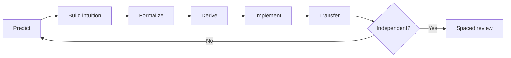

# GroundUp Lab — theory library

This directory is the source of truth for the tutor's long-form theory. It is not a list of summaries. Every unit is designed to move through five independent competencies:

1. **Intuition** — explain the object and why it exists.
2. **Formalism** — state definitions, dimensions and assumptions precisely.
3. **Derivation** — reconstruct central results without pattern matching.
4. **Implementation** — build and test the mechanism from primitives.
5. **Transfer** — solve an unfamiliar variant or diagnose a failure.

## How to study a lesson

Do not read straight through. At each **Stop and predict** block, write an answer before continuing. Derivations marked **Own this** should be reproduced on paper. Implementation labs begin with interfaces, shapes, invariants and tests—not code. Solutions appear after the problem set and should remain closed until a serious attempt.

## Content map

| Stage | Unit | Status | Depth target |
|---|---|---:|---|
| 00 | [Mathematical language](00-foundations/00-mathematical-language.md) | Ready | Diagnostic bridge |
| 00 | [Numerical stability](00-foundations/01-numerical-stability.md) | Ready | Research-engineering core |
| 02 | [Vectors, spaces and bases](02-mathematics/01-vectors-spaces-bases.md) | Ready | Aggarwal-level |
| 02 | [Linear maps, rank and null spaces](02-mathematics/02-linear-maps-rank.md) | Ready | Aggarwal-level |
| 02 | [Projections and least squares](02-mathematics/03-projections-least-squares.md) | Ready | Aggarwal/PRML bridge |
| 02 | [Eigenvalues and invariant subspaces](02-mathematics/04-eigenvalues-invariant-subspaces.md) | Ready | Aggarwal-level |
| 02 | [SVD and PCA](02-mathematics/05-svd-pca.md) | Ready | Aggarwal/PRML level |

Later releases will fill Python/DSA, probability, statistics, optimization, information theory, learning theory, classical ML, deep learning, NLP, PyTorch, LLM systems, RL/post-training and research practice in dependency order.

## Reference policy

The lessons are original. Textbooks are used as depth anchors and cross-checks, not copied sources.

- Charu C. Aggarwal, *Linear Algebra and Optimization for Machine Learning*, 2nd ed.
- David J. C. MacKay, *Information Theory, Inference, and Learning Algorithms*.
- Christopher M. Bishop, *Pattern Recognition and Machine Learning*.
- Shai Shalev-Shwartz and Shai Ben-David, *Understanding Machine Learning*.
- Simon J. D. Prince, *Understanding Deep Learning*.

## Mastery rule

A lesson is mastered only when you can:

- score at least 85% on conceptual and numerical problems;
- reproduce the marked derivations without notes;
- pass every implementation test;
- diagnose one deliberately broken solution; and
- solve one transfer problem after a delay.

